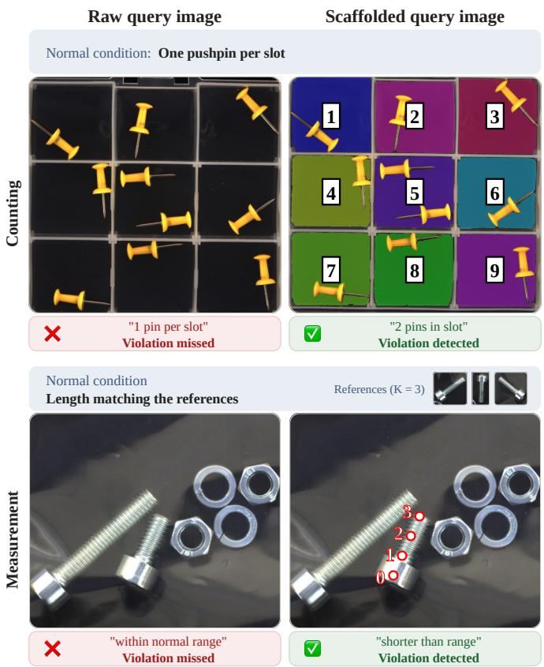
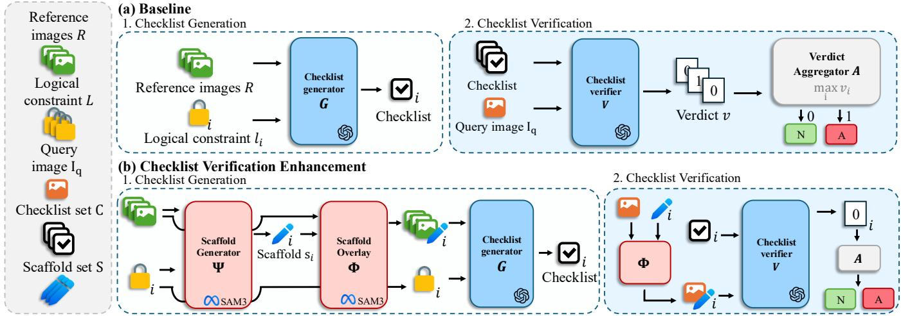
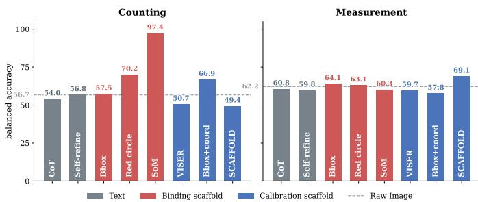
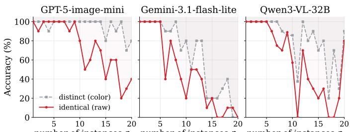
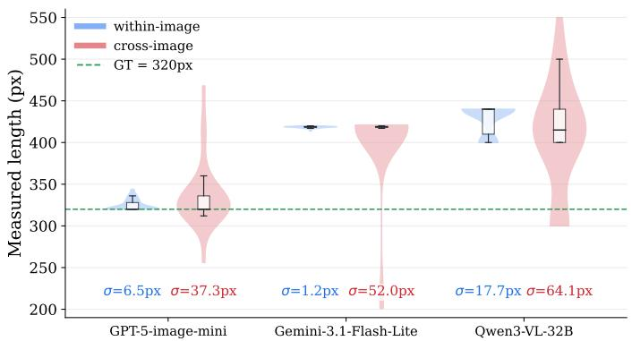
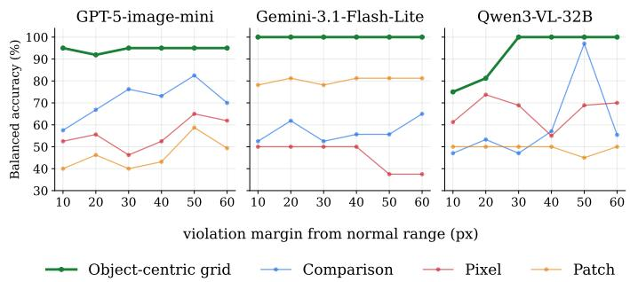

# CASCADE: Constraint-Aware SCAffolded DEcomposition for Logical Anomaly Detection

Jinchan Kim

Dept. of Artificial Intelligence

Ajou University

Suwon, Republic of Korea

jinchank0959@ajou.ac.kr

Jinhee Im   
Dept. of Artificial Intelligence   
Ajou University   
Suwon, Republic of Korea   
jinhee8553@ajou.ac.kr   
Hyunsouk Cho   
Dept. of Artificial Intelligence   
Ajou University   
Suwon, Republic of Korea   
hyunsouk@ajou.ac.kr

Abstract—Logical Anomaly Detection (LAD) requires verifying whether all category-specific constraints, such as object counts, pairing relations, and measurement ranges, are satisfied by a query image given only a few normal references. Recent LAD methods based on Large Vision-Language Models (LVLMs) formulate this as checklist verification, decomposing the decision into independent textual checks. This decomposition, however, is text-only. Every item still reads the same unmodified query image, so the LVLM must extract different forms of visual evidence from one raw image. We identify this text–image mismatch as a constraint-specific perception gap, the source of two failure modes: instance conflation for binding constraints and scale drift for calibration constraints. To diagnose whether these failures stem from insufficient reasoning or insufficient perception, we compare textual reasoning guides and visual perception guides in a training free setting. Our analysis shows that reasoning over the same image provides little benefit, whereas adapting the visual input to each constraint substantially improves verification accuracy. Based on this finding, we propose CASCADE, a training-free framework that extends checklist decomposition using constraint-specific visual scaffolds. We further introduce CASCADE++ which adapts these scaffolds at the object level by deriving their configurations from the constraint structure and reference distribution. Across MVTec-LOCO and VID-AD, CASCADE++ surpasses the fullshot state of the art by 3.9 AUROC points with only three references, and improves over the strongest VID-AD baseline by 11.4, transferring across multiple LVLM backbones without any training. Our code and reproduction materials are publicly available1.

Index Terms—Logical Anomaly Detection, Large Vision-Language Models, Visual Scaffolding, Training-Free Anomaly Detection, Constraint Verification

## I. INTRODUCTION

Driven by recent advances in vision-language models, Logical Anomaly Detection (LAD) [1] has emerged as an important task in manufacturing inspection. Traditional anomaly detection [2], [3] focuses on identifying pixel-level defects such as cracks, scratches, and contamination. LAD, by contrast, requires models to verify logical constraints, such as object counts, pairing relationships, or measurement ranges, from only a few normal references and a query image. Since violating even a single constraint renders the instance anomalous, every constraint must be verified without exception.

  
Fig. 1: Checklist verification on a raw query versus a scaffolded query—per-instance coloring for counting, an object-anchored grid for measurement. Both are the same image verified against the same checklist item, and both violate their constraint, yet only the scaffolded query yields the correct verdict. The Measurement condition is defined by the K = 3 references shown in the band rather than stated explicitly (Section VII-B).

To verify the validity of a query image with only a few normal references, recent approaches have adopted Large Vision-Language Models (LVLMs) by formulating the task as a checklist evaluation. These LVLM-based LAD methods [4], [5] decompose the overall verification into independent perconstraint checks by explicitly converting constraints into a checklist. First, in the generation phase, each logical constraint is converted into a textual checklist item that an LVLM can evaluate. Then, in the verification phase, each checklist item is verified against the query image individually. This checklistbased formulation is useful because it reduces the chance of overlooking a constraint violation and makes it possible to trace which constraint was violated.

This decomposition, however, creates a mismatch between text and image. The checklist tailors the question to each constraint, yet every check still reads the same unmodified raw query image. The LVLM must therefore extract different types of visual evidence from an identical input images, despite the fact that different constraints demand fundamentally different perceptual operations. Count and pairing constraints require the model to individuate and bind visually similar instances, whereas length, ratio, and fill-level constraints require the model to compare continuous measurements against reference-defined normal ranges. This mismatch manifests as two recurring failure modes in LAD: instance conflation, where visually similar objects are not reliably separated, and scale drift, where measurement judgments become inconsistent across references and queries. To determine whether these failures stem from insufficient reasoning or insufficient perception, a direct diagnosis is needed.

To diagnose this under the training-free setting, we compare two input-level interventions that require no model update. The first is a textual reasoning guide [6], [7] that keeps the image unchanged but prompts more deliberate reasoning over each checklist item. The second is a visual perceptual guide [8]–[10] that modifies the image itself by making constraint-relevant visual information explicit. A textual guide that resolves the errors would locate the limitation in reasoning; a visual guide that does so would locate it in perception.

Our analysis confirms that the limitation is perceptual, and that the visual input must be adapted per constraint alongside the checklist. As illustrated in Figure 1, a scaffolded query makes the required instances and measurement bases explicit, enabling the model to successfully detect the anomalies.

The scaffold must be constraint-specific, as different constraints demand different forms of perception. Binding constraints require separating and associating visually similar instances, which mark-based scaffolds [11] make explicit, whereas calibration constraints require comparing measurements against reference-defined normal ranges, for which coordinate-based scaffolds [9] supply a frame.

Based on this principle, we propose CASCADE, a trainingfree framework that selects the scaffold type from the constraint and overlays it on the query image, so that each check reads a view adapted to what it examines. CASCADE alone, however, leaves the scaffold’s configuration at a fixed default, and a default that misaligns with the constraint can mislead the verifier more than no scaffold at all. We therefore extend it to CASCADE++, which derives each scaffold’s configuration from the constraint’s logical structure and the reference distribution. Our contributions are summarized as follows.

• We diagnose the limitation of checklist-based LVLM verification by comparing textual reasoning guides and visual perceptual guides, showing that LAD failures stem from insufficient constraint-relevant visual perception rather than from insufficient reasoning. We propose CASCADE, a training-free framework that routes each constraint to its matched scaffold type, and extend it to CASCADE++, which derives the scaffold’s configuration from the constraint’s logical structure and the reference distribution.

• With three references and no training, CASCADE++ exceeds the full-shot state of the art by 3.9 AUROC on MVTec-LOCO and the strongest VID-AD baseline by 11.4, transferring across four LVLM backbones.

## II. RELATED WORK

## A. Vision-based LAD

Vision-based methods detect anomalies as deviations from learned normal patterns. Full-shot methods such as Patch-Core [2] and EfficientAD [3] achieve strong structural anomaly detection but degrade on logical anomalies. CSAD [12] and SALAD [13] address this gap by modeling component structure, yet they still require large training sets per category. Trainingfree methods such as SAM-LAD [14] and UniVAD [15] alleviate this requirement by leveraging foundation models. Despite these advances, all vision-based methods share a fundamental limitation: they output only a scalar or matching score, and cannot identify which constraint was violated or explain why.

## B. LVLM-based LAD

Recent methods shift from deviation measurement to direct constraint verification by feeding natural-language constraints to LVLMs. LogicAD [5] and LogicQA [4] convert constraints into textual checklist items, LogiCode [16] compiles them into executable programs, and LogSAD [17] routes the task through multiple vision-language foundation models, together enabling traceable constraint-level verification. Across these approaches, however, the decomposition operates on the text side alone. The check is tailored to the constraint, but every check still reads the same unmodified query image. Relying entirely on the LVLM’s internal perception, these methods add no visual signal to compensate for the perceptual failures that verification in this setting exposes.

## C. Visual Scaffold for LVLMs

Visual scaffolds compensate for perceptual limitations of LVLMs by adding training-free visual information onto images and have proven effective across a range of vision tasks [11], [18]. However, existing scaffolds derive their parameters from image space and do not reflect the constraint structure that defines logical anomalies. Disambiguation scaffolds such as SoM [11] make duplicate instances visually distinguishable, yet their ID numbering follows the spatial order of the image and is unrelated to the binding structure of the constraint. Alignment scaffolds provide a cross-image reference frame for continuous measurements: SCAFFOLD [9] overlays a coordinate grid, VISER [10] numbered horizontal lines, which we adapt as a single-axis reference, and Bbox+coords a boxand-coordinate form we adapt from the drawing tools of Visual Sketchpad [18]. In all three, the spacing and offset are fixed and independent of the normal range defined by few-shot references. Visual Sketchpad itself selects tools agentically from querytime perception, which in LAD is self-defeating: the scaffold is needed precisely because that perception is unreliable.

## III. PRELIMINARIES

Logical anomalies are defined as violations of categoryspecific constraints [1]. A reference image is a normal sample that defines what a correct instance of the category looks like. We write $R = \{ I _ { r _ { 1 } } , \ldots , I _ { r _ { K } } \}$ for the set of K reference images, and we set $K { = } 3$ throughout our experiments. A query image $I _ { q }$ is the test-time input whose normality must be decided. Given R and $I _ { q } ,$ , LAD decides whether $I _ { q }$ violates any of the category’s constraints.

Each category is governed by a set of logical constraints $L = \{ l _ { 1 } , \dots , l _ { M } \}$ , where M is the total number of constraints, and each constraint $l _ { i }$ states a normal condition on one property of the category. We group them into two kinds according to the operation their verification demands. A binding constraint concerns discrete structure and is checked by counting or matching, such as requiring exactly one pushpin per compartment. A calibration constraint concerns a continuous measurement checked by comparison against the references, such as a cable length matching the reference instances. This binding–calibration split organizes our analysis in Section V.

## IV. FRAMEWORK

Existing LVLM-based methods verify each constraint independently through a checklist-based framework [4], [5], [16], [17], organized in three stages: checklist generation prepares each constraint into a form an LVLM can evaluate from the constraint text and the references; checklist verification evaluates each prepared item against the query to produce a verdict; and verdict aggregation combines the per-constraint verdicts into an image-level decision, anomalous if even one constraint is violated.

## A. Baseline: LVLM-based Framework

Checklist Generation: A generator G converts each constraint $l _ { i }$ into an independently evaluable item c using the reference set R, yielding the checklist $C = \{ c _ { 1 } , \ldots , c _ { M } \}$ via $c _ { i } = G ( l _ { i } , R )$ for $i = 1 , \ldots , M$ . Existing methods differ only in the output format—a structured JSON record of target object, property, and normal condition in LogicAD [5], a naturallanguage yes-or-no question in LogicQA [4]—and in both, each item is converted independently and is self-contained for verification.

Checklist Verification: A verification operator V evaluates each item against the query image in a single LVLM call and returns a binary verdict $v _ { i } { : }$

$$
v _ { i } = V ( c _ { i } , I _ { q } ) , \qquad i = 1 , \ldots , M .\tag{1}
$$

The text input $c _ { i }$ varies per constraint, reflecting the perconstraint decomposition. The image input $I _ { q }$ , however, is the same raw query image for every constraint. Whether a constraint examines the count of identical objects or the length of a component, the call receives the identical, unmodified image. The question is tailored to the constraint, but the visual evidence is not.

Verdict Aggregation: Because a product is defective if it violates even a single constraint, the query image is classified as anomalous whenever at least one constraint is violated. Given binary constraint-level verdicts $\{ v _ { i } \} _ { i = 1 } ^ { M }$ , where $v _ { i } =$ 1 indicates a violated constraint, we define the image-level abnormal verdict as $A ( I _ { q } ) = \operatorname* { m a x } _ { 1 }$ ≤i≤M $v _ { i } ,$ , where $A ( I _ { q } ) = 1$ denotes an abnormal image and $A ( I _ { q } ) = 0$ denotes a normal image. AUROC evaluation requires a continuous score, for which we use the violated fraction Score $\begin{array} { r } { ( I _ { q } ) = \frac { 1 } { M } \sum _ { i = 1 } ^ { M } v _ { i } } \end{array}$

## B. Checklist Verification Enhanced Framework

The decomposition introduced by the checklist applies to the text alone. Checklist verification enhancement extends it to the image: each verification call reads a scaffolded query in place of the raw query, with no model parameters updated.

This enhancement adds two operators to the baseline pipeline while leaving generation and verification otherwise intact. A scaffold-generation operator Ψ reads a constraint and the references and returns a scaffold configuration, and a scaffoldrendering operator Φ overlays that configuration onto an image. Given $l _ { i }$ and R, Ψ produces the configuration $s _ { i } = \Psi ( l _ { i } , R )$ and Φ renders it onto each reference as $\hat { I } _ { r _ { k } } ^ { i } ~ = ~ \Phi ( I _ { r _ { k } } , s _ { i } )$ forming the scaffolded reference set $\hat { R } ^ { i } = \{ \hat { I } _ { r _ { 1 } } ^ { i } , . . . , \hat { I } _ { r _ { K } } ^ { i } \}$

The checklist item is then generated from the constraint and the scaffolded references as $c _ { i } = G ( l _ { i } , \hat { R } ^ { i } )$ for $i = 1 , \dots , M$ so that the question matches what the scaffold exposes. This mirrors the baseline checklist generation, but replaces the raw reference set R with the scaffolded reference set ${ \hat { R } } ^ { i }$

At verification time, $\Phi$ overlays the same configuration onto the query, producing a scaffolded query $\hat { I } _ { q } ^ { i }$ tailored to constraint $l _ { i } ,$ which the verifier reads in place of the raw query:

$$
\hat { I } _ { q } ^ { i } = \Phi ( I _ { q } , s _ { i } ) , \qquad v _ { i } = V ( c _ { i } , \hat { I } _ { q } ^ { i } ) , \qquad i = 1 , \ldots , M .\tag{2}
$$

Whereas the baseline tailors only the text per constraint, this enhancement tailors both the text and the image, so that the per-constraint decomposition applies to the visual evidence as well. Verdict aggregation is unchanged from the baseline. The scaffold form follows the constraint type: a disambiguation scaffold for a binding constraint and an alignment scaffold for a calibration constraint. Section V establishes which form each type requires, and Sections VI and VII develop how Ψ configures it.

## V. REASONING AND PERCEPTION GUIDES FOR THE VERIFICATION PHASE

In this section, we analyze the two guides available for the verification phase: a textual reasoning guide that reasons more carefully over the checklist item, and a visual guide that modifies the query image the verifier reads. We empirically test the available forms of each guide across binding and calibration constraints, establishing which overlay each constraint type requires. These findings fix the scaffolds that CASCADE implements.

  
Fig. 2: Method comparison between the baseline and CASCADE. Both methods use checklist generator and checklist verifier for verdicts. Unlike the baseline, ours overlays a constraint-specific scaffold on the query image, so each constraint is verified with an adapted visual input.

We adopt GPT-5-image-mini [19] as the single backbone and report per-constraint Balanced Accuracy [20], $\mathrm { B A } = ( \mathrm { T P R } +$ $\mathrm { T N R ) / 2 , }$ since each constraint yields a single binary verdict, for which AUROC is undefined; we therefore report BA at the constraint level and AUROC only at the image level. The probes in Section V-B are synthetic images that vary a single factor in isolation. The comparisons below use a subset of MVTec-LOCO’s 16 logical constraints, chosen to isolate each failure mode most sharply; the full-system evaluation on all of them appears in Section VIII-B.

## A. Effectiveness of Textual Reasoning Guide

We first test whether a textual reasoning guide can aid the checklist verification. Since the checklist item $c _ { i }$ is the text input to the verifier, a natural means of improving verification is to have the model reason more deliberately over $c _ { i }$ before committing to a verdict. Such reasoning may be strengthened along two complementary directions, reasoning more thoroughly toward the verdict and revising it post hoc. We evaluate one guide for each, Chain-of-Thought [6], which prompts the model to reason step by step before answering, and Self-Refinement [7], which allows it to revise its own verdict. Both replace the item $c _ { i }$ with a reasoning-guided item $c _ { i } ^ { \prime }$ while the query image $I _ { q }$ stays fixed, so the verdict becomes $v _ { i } = V ( c _ { i } ^ { \prime } , I _ { q } )$

Strengthening reasoning along either direction, however, yields no measurable gain. As Fig. 3 shows, neither guide improves on the text-only baseline by more than a point on binding and calibration constraints alike. Reasoning more deliberately over the same text therefore does not restore the verdict. If the limitation does not lie in the reasoning, it must lie in what the model perceives from the image, which we examine next.

  
Fig. 3: Comparison of textual reasoning and visual perception guides. Bars show balanced accuracy on a binding constraint for Counting and the average over calibration constraints for Measurement, with the dashed lines indicating the text-only baselines. Each overlay is applied to both constraint types, not only the one it was designed for.

## B. Effectiveness of Visual Guide

We next test whether a visual guide can recover what the textual guide could not. A visual guide overlays a trainingfree cue onto the query image, producing a guided query $\tilde { \hat { I } } _ { q } ^ { i }$ while leaving the checklist item $c _ { i }$ unchanged, so the verdict becomes $v _ { i } = V ( c _ { i } , \hat { I } _ { q } ^ { i } )$ . This renders the property a constraint examines directly observable to the verifier while keeping the backbone and the question fixed. We evaluate the two overlay types reported in prior work, a disambiguation overlay that assigns each instance a separate visual identity and an alignment overlay that imposes a spatial reference frame for continuous measurements.

A single disambiguation overlay raises binding Count from 56.7 to 97.4 (Fig. 3), a margin no textual guide approached. Since only the image changed while the backbone and question remained fixed, the limitation is perceptual rather than one of reasoning.

No single overlay, however, serves both: SoM reaches 97.4 on Counting but 60.3 on Measurement, while SCAFFOLD reverses this (49.4 and 69.1). The two types therefore fail for distinct reasons, which we examine in turn.

  
Fig. 4: Comparison of raw and per-instance colored images on a counting probe. We query the count of n identical circles on a blank canvas, varying only n. Raw-image accuracy (red) collapses past $n \approx 1 0 .$ , while distinctly coloring each circle (gray) keeps it far higher throughout.

1) Instance Conflation on Binding Constraints: We begin with the first perceptual guide type, a disambiguation guide for binding constraints, where the verifier must individuate instances that look alike. We ask whether providing a perceptual guide that makes each instance visually distinct can restore this ability. Without such a guide, the model registers shared attributes such as shape and color yet fails to bind them into distinct instances [10], [21]. If it could individuate them, count accuracy would remain stable as their number grows. A synthetic probe that counts n identical circles shows the opposite: raw-image accuracy collapses past n ≈ 10 while per-circle coloring keeps it stable, consistently across three backbones (Fig. 4) [19], [22], [23]. Since color is the only factor altered, instance conflation is structural rather than an artifact a larger backbone would resolve.

A per-instance color restores this separation, yet separation alone does not determine the outcome. Among overlays that all separate the instances, accuracy still diverges widely, from 70.2 for a red circle to 97.4 for SoM (Fig. 3). Separation is therefore necessary but not sufficient, and what distinguishes these forms is examined in Section VII. What the probe establishes is the overlay type: a per-instance color is what a binding constraint requires, and CASCADE renders it over SAM3 masks (Section VI).

2) Scale Drift on Calibration Constraints: We turn to the second perceptual guide type, an alignment guide for calibration constraints, where the verifier must read the same physical length consistently across the references and the query. The model struggles to do this because it holds no absolute scale and re-estimates the measurement on each image. If it held a consistent scale, the same length would read identically on whichever image carried it. Instead, reading a fixed-length bar across separate renderings spreads 3.6 to 44 times wider than reading it within one repeated image (Fig. 5), so the drift is structural rather than reading noise. The readings are also biased upward relative to the ground truth, but a constant bias is absorbed by a reference-relative grid, since the references and the query are read on the same scale; what such a grid cannot absorb is the cross-image spread. This drift is decisive near the normal-range boundary, where the object-centric grid sustains accuracy as the violation margin shrinks while the non-grid readouts drift (Fig. 6).

Fig. 5: Comparison of within-image and cross-image length readings on a scale probe. We render a bar of fixed true length with a ground truth of 320 px and read its length from the LVLM. A within-image reading repeats the same image, while a cross-image reading spans separate renderings of the same length.  
  
Fig. 6: Comparison of readout strategies on a range-membership probe. Balanced Accuracy across violation margins for three VLM backbones. A test bar is judged against the range of K=3 references, calibrated in code as in CASCADE, so the backbone reads only the test: Comparison sees the references too and answers directly, Pixel reports raw pixels, Patch units of an imagined 12×12 grid, and the object-centric readout an index off a scale drawn on the bar; the last three are rangechecked in code.

Removing the drift requires a grid that is discrete, twodimensional, and object-anchored. A continuous coordinate would reinherit the drift, a single axis could not span a two-directional measurement, and a frame-fixed grid would shift cells as the object moves. The overlays that violate these requirements break down accordingly, as the single-axis VISER collapses on Length and the image-frame Bbox+coords collapses on Ratio, whereas the object-anchored grid holds across every calibration constraint. An object-anchored twodimensional grid is thus the overlay a calibration constraint requires.

The two probes identify the overlay each constraint type needs, a per-instance color for binding constraints and an object-anchored grid for calibration constraints. The overlay alone, however, does not settle the verdict. A color separates the instances but imposes no order on how they relate, and a grid frames the measurement but not at a resolution matched to any particular constraint. How each overlay must then be configured, from the constraint and from the references, is what CASCADE++ resolves (Section VII).

## VI. CASCADE: CONSTRAINT-AWARE SCAFFOLDED DECOMPOSITION

CASCADE implements the two overlays the analysis identified, routing each constraint to the one its type requires. Where the checklist decomposes the question per constraint, CASCADE decomposes the image per constraint, leaving all model parameters unchanged.

## A. Pipeline

CASCADE runs in four stages (Fig. 2(b)). First, a parser reads the constraint $l _ { i }$ and returns its type $\tau \in$ {binding, calibration} together with the target objects $T$ the constraint acts on. Second, Ψ generates a type-matched scaffold configuration $s _ { i } ,$ , a disambiguation scaffold for a binding constraint and an alignment scaffold for a calibration constraint. Third, the checklist item $c _ { i }$ is generated from the scaffolded references. Fourth, Φ overlays $s _ { i }$ on the query, the item is verified in a single LVLM call, and a rule check returns the binary verdict $v _ { i } ,$ aggregated as in the baseline.

Both scaffolds require grounding the target objects $T$ as masks. We adopt SAM3 [24], a pretrained foundation segmentation model used without any task-specific training, following the common practice of rendering scaffolds on segmentation masks rather than raw pixels [11].

## B. Disambiguation Scaffold for Binding Constraints

A binding constraint requires telling identical instances apart. The disambiguation scaffold provides this by assigning a perinstance visual identity. Each target set is segmented into one mask per instance with SAM3, a distinct color is overlaid on each mask to delineate its extent, and a numeric ID is written on top. The color separates the instances, and the ID lets the verifier refer to them when a constraint relates rather than merely counts them. In this stage Ψ assigns the IDs sequentially in image order; deriving them from the constraint is the subject of Section VII-A.

## C. Alignment Scaffold for Calibration Constraints

A calibration constraint requires reading a continuous measurement on a scale that is consistent across images, which the analysis traced to scale drift and showed is removed by an object-anchored two-dimensional grid (Section V-B2). CASCADE recovers a rotated bounding box from the SAM3 mask, aligned to the object’s principal axes, and draws the grid on this box so that the same physical endpoint maps to the same cell across the references and the query. The verdict is read as a comparison of cells: the references occupy a set of cells defining the normal range, and the query is judged normal when its endpoint falls in that range and a violation

TABLE I: Disambiguation channel decomposition for binding constraints on Balanced Accuracy. We vary the two components of the overlay, color and a numeric ID, together with the ID’s numbering scheme, holding the question fixed so that only the overlay changes. Count is the Pushpins (PP) count constraint, and Linking the Splicing-Connector (SC) slotmatching constraint.
<table><tr><td>Channel</td><td>Numbering</td><td>Count (PP)</td><td>Linking (SC)</td></tr><tr><td>None</td><td></td><td>56.7</td><td>61.4</td></tr><tr><td>Color only</td><td></td><td>79.2</td><td>74.3</td></tr><tr><td>ID only</td><td>offset</td><td>75.8</td><td>38.6</td></tr><tr><td>ID only</td><td>constraint-derived</td><td>79.3</td><td>86.2</td></tr><tr><td>SoM (color + ID)</td><td>sequential</td><td>97.4</td><td>66.7</td></tr><tr><td>Visual Sketchpad</td><td>self-scaffolding</td><td>49.8</td><td>69.5</td></tr><tr><td> $\mathbf { C A S C A D E + } \left( \mathbf { c o l o r + I D } \right)$ </td><td>constraint-derived</td><td>99.6</td><td>88.3</td></tr></table>

otherwise. In this stage Ψ returns a single fixed cell width;   
calibrating it to the references is the subject of Section VII-B.

## VII. CASCADE++

CASCADE++ replaces the two fixed defaults that $\Psi$ returns in CASCADE with configurations derived from the constraint and the references. In each case it is the derivation, not the overlay form, that determines the verdict.

## A. Constraint-Derived Numbering

The model does not merely read the IDs off the overlay but follows them as the order in which to relate the instances, so the numbering must follow the constraint’s logical structure rather than the image. Color separates the instances and raises Count to 79.2, but, lacking such an order, recovers only part of Linking (61.4 → 74.3). A numeric ID supplies one, yet where it leads is what decides the verdict: SoM’s sequential ID runs along image position rather than the constraint and leads the model toward the wrong pairing, dropping Linking to 66.7, below color alone, while an offset ID drops to 38.6, below using no overlay at all (Table I).

Ψ therefore derives the numbering from the constraint’s logical structure rather than the query image. Reading the constraint text and the parser’s object names, but not the query image, the LVLM returns only how the constraint partitions the instances of T into sets and under which correspondence between them; the IDs then follow mechanically, all instances the correspondence identifies with one another receiving a single index, and an instance it leaves unmatched keeping its within-set ordinal. On Splicing Connectors the constraint pairs the n slots on one side with the n on the other, so corresponding slots carry the same ID and the verifier compares like-numbered slots across sets, whereas SoM numbers the two sets 1, . . . , n and $n { + } 1 , \ldots ,$ 2n and leaves no such correspondence to follow. SoM and CASCADE++ differ only in what the numbers denote, yet on Linking this raises accuracy from 66.7 to 88.3 (Table I). What determines the verdict is not the overlay’s form but whether the correspondence it encodes is the one the constraint asserts.

## B. Reference-Calibrated Grid

An alignment grid must place its boundaries where the constraint’s normal range actually ends. Its cell width and position therefore have to follow the reference distribution rather than a fixed default. The model judges a query normal when its endpoint falls in the same cell as the references and a violation otherwise, so the cell width sets the resolution of that judgment. A cell narrower than the references scatter splits them across cells and flags a normal query, while a cell wider lets a violation fall in the reference cell and pass. The cell must therefore hold every reference reading and no more.

No fixed width meets this across constraints, because the references scatter by different amounts depending on what the constraint measures. A two-way ANOVA over cell widths and constraints (six widths × six constraints, five reference sets each) confirms this, with the constraint-by-width interaction accounting for the largest share of variance $( \eta ^ { 2 } = 0 . 4 4 9 , p <$ .001). Two size-based rules—Dyn-size at half the target’s extent, Dyn-2× at a quarter—track the object rather than the reference scatter, collapsing to 25.6 on JB-Liquid and to chance on SB-Length (Table II). The position matters equally, as a boundary falling between the references splits the normal range even at the correct width.

Ψ therefore sets the grid from the reference distribution. The analysis in Section V-B2 showed that LVLM measurements of the same physical quantity vary across images by an amount that depends on the constraint. Let $r _ { k }$ denote the measurement of the target property from reference $k ,$ and let $\rho = \mathrm { m a x } _ { k } r _ { k } - \mathrm { m i n } _ { k } r _ { k }$ denote the spread across the K references. CASCADE++ finds the narrowest cell of width w and offset a that holds every $r _ { k }$ with at least a margin m from each boundary, judging a query normal when its reading lands in this cell and a violation otherwise. Two backbonedependent constants set the resolution: the margin m, the smallest separation the LVLM can reliably resolve between a reading and a cell boundary, and the minimum width $w _ { \mathrm { m i n } } ,$ the narrowest cell at which it can still tell adjacent cells apart. Both are calibrated once per backbone on synthetic probes and held fixed across constraints (m=25 px and $w _ { \mathrm { m i n } } { = } 6 0$ px for GPT-5-image-mini, the smallest values reaching 95% probe accuracy).

Concretely, the cell $[ a , a + w ]$ must satisfy

$$
\begin{array} { r l } & { a + m \ \leq \ r _ { k } \ \leq \ a + w - m , \quad \forall k \in \{ 1 , \ldots , K \} , } \\ & { w \ \geq \ w _ { \operatorname* { m i n } } , } \end{array}\tag{3}
$$

so that every reference reading sits at least a margin m from either boundary. Eliminating $^ { a , }$ the tightest feasible width is

$$
w ^ { * } = \mathrm { m a x } ( w _ { \mathrm { m i n } } , \rho + 2 m ) ,\tag{4}
$$

and an offset that places every reference at least m from either boundary is

$$
a ^ { * } \ = \ \operatorname* { m i n } _ { k } r _ { k } \ - \ m .\tag{5}
$$

Together, $w ^ { * }$ and $a ^ { * }$ constitute the configuration $s _ { i }$ that Ψ returns for a calibration constraint. Since m and $w _ { \mathrm { m i n } }$ are fixed per backbone and only the references enter $\rho ,$ no test-time reading touches the calibration. When a constraint compares several groups or spans two axes, the same containment conditions are solved jointly over a shared cell width. The calibration is a one-time cost per backbone: the constants reflect the backbone’s measurement noise, not any dataset or category, and are reused unchanged from MVTec-LOCO to VID-AD (Section VIII-C). Not both constants need to be set precisely. The margin m is a tolerance the pipeline is largely insensitive to: varying it over a fourfold range around the calibrated value moves balanced accuracy by at most 4.7 points. The minimum width $w _ { \mathrm { m i n } }$ is the one that has to hold — removing the floor lets the cell shrink below what the backbone can read, and accuracy drops by more than 35 points.

TABLE II: Calibration rule ablation on Balanced Accuracy (mean ± std over five random reference selections). Grid parameterization per strategy: Fixed $( w { = } 1 0 0 , a ^ { * } )$ Dyn-size $( w { = } \mathrm { t g t } / 2 , a ^ { * } )$ ), Dyn-2× (w=tgt/4, a∗), aadv $( w ^ { \ast }$ , adversarial a), and CASCADE++ $( w ^ { * } , a ^ { * } )$ . Bold marks the best entry in each row.
<table><tr><td>Constraint</td><td>Fixed</td><td>Dyn-size</td><td>Dyn-2×</td><td> $\boldsymbol { a } _ { \mathrm { a d v } }$ </td><td>CASCADE++</td></tr><tr><td>BB-Cereal JB-Fruit</td><td>77.6±9.9 90.0±11.3</td><td>71.4±6.7 95.9±1.9</td><td>78.6±10.1 76.9±6.1</td><td>63.8±8.6 85.7±9.5</td><td>82.9±4.0 94.4±3.9</td></tr><tr><td>JB-Text JB-Liquid</td><td>83.3±6.6 97.8±1.0</td><td>81.4±10.6 25.6±7.9</td><td>82.6±2.3 72.1±0.9</td><td>84.3±10.9 84.0±4.3</td><td>96.9±0.1</td></tr><tr><td>SB-Length</td><td>92.2±0.4</td><td>50.0±2.7</td><td>96.4±0.5</td><td>86.7±2.0</td><td>95.9±0.2 92.4±4.9</td></tr></table>

Both extensions follow one principle: the constraint type fixes the overlay, while the constraint’s logical structure and the reference distribution fix its configuration.

## VIII. EXPERIMENTS

## A. Experimental Setup

We evaluate CASCADE on two benchmarks. MVTec-LOCO [1] provides five product categories, Breakfast Box (BB), Juice Bottle (JB), Pushpins (PP), Screw Bag (SB), and Splicing Connectors (SC), comprising 16 constraints, 10 binding and 6 calibration; a single category may contain both types. Per-constraint analyses name a constraint by its category and measured target (e.g., JB-Liquid), and the measurement labels Count, Ratio, Length, and Fill denote PP-Count, BB-Cereal, SB-Length, and JB-Liquid. VID-AD [27] spans ten manufacturing scenarios under five capture conditions (white, cable, and mesh backgrounds, plus low-light and blurry), and its category specifications yield 20 constraints, 16 binding and 4 calibration. All 36 constraints across the two benchmarks fall into one of the two types; the full list with its type assignment is in our repository.

For MVTec-LOCO we adopt the natural-language constraints from LogicQA [4] so that all vision-language methods share the same constraint-input regime; for VID-AD we derive them from the dataset authors’ category specifications [27]. The baselines were originally reported on GPT-4o; to isolate scaffold design from backbone choice we reproduce the publicly available ones, LogicAD [5] and LogicQA [4], on GPT-5-image-mini with their own inference procedures and reference budgets intact. LogSAD [17] routes the task through specialized foundation models rather than a single swappable chat LVLM, so we run the authors’ released code under our K=3 protocol instead of porting it. The vision baselines are quoted from their original reports, as they are trained on the full normal set and admit no few-shot variant.

TABLE III: Image-level AUROC (%) on the MVTec-LOCO logical subset. GPT-5 denotes GPT-5-image-mini and Gemini-3.1-FL denotes Gemini-3.1-Flash-Lite. Rows without a marker are quoted from the original papers; † marks results we produced under each method’s own inference procedure, and marks a method whose design admits only a single reference, where the other few-shot methods use K=3. Bold marks the best entry in each column within each of the two regimes; dashes mark entries the source paper does not report.
<table><tr><td>Method</td><td>Backbone</td><td>Avg</td><td>BB</td><td>JB</td><td>PP</td><td>SB</td><td>SC</td></tr><tr><td colspan="8">Full-shot</td></tr><tr><td>PatchCore [2]</td><td>CNN</td><td>74.0</td><td>74.8</td><td>93.9</td><td>63.6</td><td>57.8</td><td>79.2</td></tr><tr><td>GCAD [1]</td><td>CNN</td><td>86.0</td><td>87.0</td><td>100.0</td><td>97.5</td><td>56.0</td><td>89.7</td></tr><tr><td>EfficientAD [3]</td><td>CNN</td><td>86.8</td><td>85.5</td><td>98.4</td><td>97.7</td><td>56.7</td><td>95.5</td></tr><tr><td>AST [25]</td><td>CNN</td><td>79.7</td><td>80.0</td><td>91.6</td><td>65.1</td><td>80.1</td><td>81.8</td></tr><tr><td>LogSAD [17]</td><td>GPT-40</td><td>89.3</td><td></td><td></td><td></td><td></td><td></td></tr><tr><td colspan="8">Few-shot</td></tr><tr><td>WinCLIP [26]</td><td>CLIP</td><td>64.3</td><td>57.6</td><td>75.1</td><td>54.9</td><td>69.5</td><td>64.5</td></tr><tr><td>LogicAD* [5]</td><td>GPT-40</td><td>86.0</td><td>93.1</td><td>81.6</td><td>98.1</td><td>83.8</td><td>73.4</td></tr><tr><td></td><td>GPT-5†</td><td>85.5</td><td>94.7</td><td>80.5</td><td>97.6</td><td>79.3</td><td>75.3</td></tr><tr><td>LogicQA [4]</td><td>GPT-40</td><td>87.6</td><td>87.6</td><td>88.2</td><td>98.4</td><td>71.5</td><td>92.4</td></tr><tr><td></td><td>GPT-5†</td><td>86.2</td><td>91.6</td><td>88.7</td><td>97.3</td><td>68.0</td><td>85.3</td></tr><tr><td>LogSAD† [17]</td><td>GPT-40</td><td>84.6</td><td>90.9</td><td>85.4</td><td>81.4</td><td>81.7</td><td>83.7</td></tr><tr><td></td><td>GPT-5†</td><td>86.6</td><td>97.1</td><td>86.3</td><td>84.1</td><td>79.2</td><td>86.6</td></tr><tr><td>CASCADE</td><td>GPT-5</td><td>81.4</td><td>90.0</td><td>73.7</td><td>93.8</td><td>75.5</td><td>73.8</td></tr><tr><td>CASCADE++</td><td>GPT-5</td><td>93.2</td><td>91.4</td><td>94.7</td><td>96.6</td><td>95.8</td><td>87.7</td></tr><tr><td></td><td>Gemini-3.1-FL</td><td>92.7</td><td>89.9</td><td>92.9</td><td>96.3</td><td>95.2</td><td>89.2</td></tr><tr><td></td><td>Qwen3-VL-32B</td><td>90.6</td><td>91.4</td><td>84.5</td><td>100.0</td><td>91.3</td><td>85.6</td></tr><tr><td></td><td>Qwen3-VL-8B</td><td>83.2</td><td>87.7</td><td>75.7</td><td>82.1</td><td>86.0</td><td>84.4</td></tr></table>

Implementation details. All LVLM calls use GPT-5-imagemini (gpt-5-image-mini) at high reasoning effort, applied identically to our framework and the reproduced baselines, with a single sample per call and no self-consistency. The parser runs once per category, not per query: we prompt the same backbone with the constraint text and the references, and it returns the constraint’s type, which decides the scaffold, together with the target objects and the text prompt SAM3 needs to segment them. The type assignment matches our manual labels on all 16 MVTec-LOCO constraints, and this output is released rather than re-derived at inference time. Object masks come from the official SAM3 checkpoint via promptable concept segmentation on those prompts. All few-shot results draw K=3 references uniformly at random with fixed seeds, and constraint-level ablations (Tables I–II) average over five such selections against three for the image-level results (Tables III, V, and VI). Times are wall-clock on a single RTX A5000 at batch size one, excluding model loading. All prompts, code, and seeds are released in our repository.

TABLE IV: Per-image inference cost (s) on MVTec-LOCO, all on GPT-5-image-mini. Seg covers each method’s segmentation stage and LVLM sums the per-call API latencies; Total is the full per-image wall clock, which exceeds $S e g { + } L V L M$ by the remaining compute. LogSAD’s checklist runs once per category, so its per-image LVLM is zero. The feature-based detectors run locally in milliseconds and are not comparable on this axis.
<table><tr><td>Method</td><td>Seg (s)</td><td>LVLM (s)</td><td>Total (s)</td></tr><tr><td>LogicAD [5]</td><td>0.2</td><td>52.6</td><td>52.8</td></tr><tr><td>LogicQA [4]</td><td>0.1</td><td>186.5</td><td>186.6</td></tr><tr><td>LogSAD [17]</td><td>2.7</td><td>0.0</td><td>3.4</td></tr><tr><td>CASCADE</td><td>3.2</td><td>51.4</td><td>55.0</td></tr><tr><td>CASCADE++</td><td>3.2</td><td>68.3</td><td>71.8</td></tr></table>

## B. Main Results — MVTec-LOCO

With three references CASCADE++ reaches 93.2 AUROC without training (Table III); across three random reference sets the standard deviation is 0.8. Under the same backbone and reference budget it improves over the strongest reproduced baseline (LogSAD†, 86.6) by 6.6, and it exceeds the full-shot state of the art (LogSAD, 89.3) by 3.9 while using three references rather than the full normal set.

Base CASCADE reaches only 81.4, below both reproduced baselines. This is the image-level counterpart of what Table I shows at the constraint level: a scaffold whose configuration misaligns with the constraint misleads the verifier more than no scaffold at all. Deriving the configuration from the constraint and the references adds +11.8 and reverses the ordering. The gain concentrates on calibration-heavy categories, where the reference-calibrated grid replaces the fixed default: Juice Bottle +21.0, Screw Bag +20.3, and Splicing Connector +13.9.

LogicAD and LogicQA differ by 0.7 points at the image level yet diverge by over twenty on individual constraints in both directions, so the image-level figure hides which constraints each method fails. Against the same baselines in Balanced Accuracy, the scaffold’s gain concentrates on constraints that no text-only method solves and is absent where they already reach ceiling; the full comparison is in our repository.

CASCADE++ is also the only framework that stays above 87 on every category, whereas every baseline collapses on at least one—PatchCore and EfficientAD near 57 on Screw Bag, LogicAD 73.4 on Splicing Connector, LogicQA 71.5 on Screw Bag—since routing each constraint to its matched scaffold keeps one failure mode from dominating the score.

The gain comes from the scaffold, not the backbone. Reproducing LogicAD and LogicQA on GPT-5-image-mini yields 85.5 and 86.2, barely above their GPT-4o results (86.0 and 87.6): a stronger backbone reasons better but cannot recover evidence the raw image never made visible. The same scaffold transfers across backbones, holding 92.7 on Gemini-3.1-Flash Lite and 90.6 on Qwen3-VL-32B, and even the 8B model (83.2) approaches the full-shot vision state of the art.

Table IV places this gain against its cost. CASCADE++ verifies an image in 71.8 s against LogicQA’s 186.6 s on the same backbone, with segmentation and rendering contributing 3.5 s of a total dominated by API latency—well above the mil lisecond latencies of feature-based detectors, so the framework targets near-line inspection rather than in-line control.

TABLE V: Main results on VID-AD (image-level AUROC, %). W, C, M, L, and B denote white, cable, mesh background, lowlight, and blurry conditions, respectively. Full-shot methods use the complete training set, whereas CASCADE++ uses $K { = } 3$ references with no training. Bold marks the best entry in each column within each of the two regimes.
<table><tr><td>Method</td><td>W</td><td>C</td><td>M</td><td>L</td><td>B</td><td>Mean±Std</td></tr><tr><td>Full-shot</td><td></td><td></td><td></td><td></td><td></td><td></td></tr><tr><td>PatchCore [2]</td><td>40.4</td><td>45.0</td><td>48.0</td><td>46.9</td><td>42.0</td><td> $4 4 . 5 { \pm } 2 . 9 $ </td></tr><tr><td>EfficientAD [3]</td><td>52.6</td><td>60.2</td><td>60.8</td><td>47.9</td><td>48.0</td><td> $5 3 . 9 { \pm } 5 . 7 $ </td></tr><tr><td>PaDiM [28]</td><td>34.8</td><td>35.4</td><td>42.8</td><td>35.4</td><td>40.3</td><td> $3 7 . 8 { \pm } 3 . 2 $ </td></tr><tr><td>VAE [29]</td><td>44.8</td><td>49.4</td><td>45.4</td><td>47.2</td><td>39.3</td><td> $4 5 . 2 { \pm } 3 . 4 $ </td></tr><tr><td>AnoGAN [30]</td><td>48.9</td><td>54.8</td><td>49.2</td><td>47.4</td><td>46.8</td><td> $4 9 . 4 { \pm } 2 . 8 $ </td></tr><tr><td>CSAD [12]</td><td>69.3</td><td>62.4</td><td>64.1</td><td>69.4</td><td>65.7</td><td> $6 6 . 2 { \pm } 2 . 8 $ </td></tr><tr><td>VID-AD baseline [27]</td><td>82.5</td><td>81.1</td><td>84.8</td><td>84.2</td><td>82.6</td><td> ${ \bf 8 3 . 1 \pm 1 . 3 }$ </td></tr><tr><td>Training-free</td><td></td><td></td><td></td><td></td><td></td><td></td></tr><tr><td>UniVAD [15]</td><td>57.4</td><td>59.2</td><td>57.0</td><td>57.3</td><td>55.9</td><td> $5 7 . 4 { \pm } 1 . 1 $ </td></tr><tr><td>CASCADE++</td><td>94.7</td><td>91.4</td><td>97.1</td><td>93.0</td><td>96.2</td><td> ${ \bf 9 4 . 5 { \pm 2 . 1 } }$ </td></tr></table>

## C. Main Results — VID-AD

We verify generalization by applying the identical pipeline, without any parameter adjustment, to VID-AD (Table V). CASCADE++ achieves 94.5±2.1, exceeding the strongest baseline (83.1) by 11.4 points while using only three references against the full training set the other methods require. The gain is consistent across all five capture conditions, including lowlight (93.0) and blurry (96.2), where feature-based methods degrade most: EfficientAD falls to 47.9 and 48.0 respectively. Because the scaffold makes the constraint-relevant evidence explicit before the verifier reads it, the capture condition affects the verdict far less than it affects methods that must recover that evidence from raw features.

Table VI independently enables or disables each scaffold. The disambiguation scaffold raises the binding score from 72.6 to 80.9 (+8.3) while calibration is essentially unchanged (62.7 → 59.9). Conversely, the alignment scaffold raises calibration from 62.7 to 70.0 (+7.3) while binding remains unchanged $( 7 2 . 6 ~  ~ 7 2 . 9 )$ . This double dissociation confirms that the two failure modes are independent and licenses routing each constraint to a single matched scaffold. Combining both raises overall AUROC from 74.5 to 93.2.

## D. Decomposition Ablation

## E. Reference Sensitivity

The calibration grid estimates its cell width $w ^ { * }$ from K references, so K governs how reliably the normal range is recovered. The disambiguation scaffold derives its configuration from the constraint text and is unaffected by K, so this analysis focuses on calibration constraints.

TABLE VI: Decomposition ablation on MVTec-LOCO (imagelevel AUROC, %). All rows use the CASCADE++ configuration rules and differ only in which scaffolds are enabled; “No scaffold” verifies the same checklist on the raw query image. The Binding and Calibration columns score each image by the violated fraction of binding-only and calibration-only subconstraints, and so miss anomalies of the other type; Overall uses all sub-constraints, which is why it exceeds either column alone.
<table><tr><td>Configuration</td><td></td><td>Disambig. Alignment</td><td>Binding</td><td>Calibration</td><td>Overall</td></tr><tr><td>No scaffold</td><td></td><td></td><td>72.6</td><td>62.7</td><td>74.5</td></tr><tr><td>Disambiguation only</td><td>√</td><td></td><td>80.9</td><td>59.9</td><td>81.8</td></tr><tr><td>Alignment only</td><td></td><td>√</td><td>72.9</td><td>70.0</td><td>79.5</td></tr><tr><td>CASCADE++ (both)</td><td>√</td><td>√</td><td>83.8</td><td>74.5</td><td>93.2</td></tr></table>

At $K { = } 1$ a single reference cannot span the normal range, causing $w ^ { * }$ to be underestimated. The resulting grid is overly narrow and misclassifies normal queries as violations. JB-Fruit, for example, reaches only 70.7 balanced accuracy with a standard deviation of 22.5 across reference sets, and BB-Cereal only 71.8±12.6. As K increases to 3, the estimated $w ^ { * }$ converges toward its full-reference value and the standard deviation contracts sharply. Accuracy follows the same trend, with JB-Fruit rising to 94.4±3.9 and BB-Cereal to $8 2 . 9 { \pm } 4 . 0 .$ The margin m in the calibration objective absorbs the residual from estimating the range with finitely many references, which is why the parameter convergence translates into stable accuracy. Increasing K to 5 or 10 yields negligible further gain, so we fix K=3, which balances reference acquisition cost against detection accuracy.

## F. Sensitivity to Segmentation Quality

Both scaffolds are rendered on SAM3 masks, which raises the question of how much of the gain depends on segmentation quality. We inject faults at the mask stage and re-run the full pipeline on Qwen3-VL-32B, whose clean-mask average is 90.6, leaving the references untouched. Boundary error is absorbed: dilating every query mask leaves the average within noise at 10 and 20 px and moves it only at 50 px, to 85.5, with the loss confined to SB-Length, the constraint whose reading has the narrowest tolerance. This is what the discrete grid is for—a reading displaced by a few pixels still falls in the same cell, so the verdict does not change. Instance error is not absorbed in the same way. Splitting one instance in two drops the average to 74.8 and merging the nearest pair to 79.2, and the two fail differently: a split adds an instance the constraint did not license, so only false alarms rise, whereas a merge removes the instance a count or pairing rests on, so misses rise as well.

## IX. CONCLUSION

We show that the limitation of checklist-based LVLM verification for LAD is perceptual rather than textual, manifesting as instance conflation and scale drift. CASCADE extends checklist decomposition to the image through constraintspecific scaffolds, and CASCADE++ derives each scaffold’s configuration from the constraint structure and the reference distribution, reaching 93.2 AUROC on MVTec-LOCO and 94.5 on VID-AD without training. Future work may extend the approach to constraints that combine both perceptual operations.

## ACKNOWLEDGMENT

This work was partly supported by Institute of Information & communications Technology Planning & Evaluation (IITP) under the Artificial Intelligence Convergence Innovation Human Resources Development (IITP-2026-RS-2023-00255968) grant funded by the Korea government (MSIT), IITP grant funded by the Korea government (MSIT) (No. RS-2022-II220680, Abductive inference framework using omni-data for understanding complex causal relations; RS-2026-25617480), the Nano & Material Technology Development Program through the National Research Foundation of Korea (NRF) funded by Ministry of Science and ICT (RS-2024-00444182), and the National Research Foundation of Korea (NRF) grant funded by the Korea government (MSIT) (RS-2026-25518808).

## REFERENCES

[1] P. Bergmann, K. Batzner, M. Fauser, D. Sattlegger, and C. Steger, “Beyond dents and scratches: Logical constraints in unsupervised anomaly detection and localization,” International Journal of Computer Vision, vol. 130, no. 4, pp. 947–969, 2022.

[2] K. Roth, L. Pemula, J. Zepeda, B. Schölkopf, T. Brox, and P. Gehler, “Towards total recall in industrial anomaly detection,” in 2022 IEEE/CVF Conference on Computer Vision and Pattern Recognition (CVPR). IEEE, 2022, pp. 14 298–14 308.

[3] K. Batzner, L. Heckler, and R. König, “Efficientad: Accurate visual anomaly detection at millisecond-level latencies,” in Proceedings of the IEEE/CVF winter conference on applications of computer vision, 2024, pp. 128–138.

[4] Y. Kwon, D. Moon, Y. Oh, and H. Yoon, “Logicqa: Logical anomaly detection with vision language model generated questions,” in Proceed ings of the 63rd Annual Meeting of the Association for Computational Linguistics (Volume 6: Industry Track), 2025, pp. 411–432.

[5] E. Jin, Q. Feng, Y. Mou, G. Lakemeyer, S. Decker, O. Simons, and J. Stegmaier, “Logicad: Explainable anomaly detection via vlm-based text feature extraction,” in Proceedings of the AAAI Conference on Artificial Intelligence, vol. 39, no. 4, 2025, pp. 4129–4137.

[6] J. Wei, X. Wang, D. Schuurmans, M. Bosma, b. ichter, F. Xia, E. Chi, Q. V. Le, and D. Zhou, “Chain-of-thought prompting elicits reasoning in large language models,” in Advances in Neural Information Processing Systems, vol. 35, 2022, pp. 24 824–24 837.

[7] A. Madaan, N. Tandon, P. Gupta, S. Hallinan, L. Gao, S. Wiegreffe, U. Alon, N. Dziri, S. Prabhumoye, Y. Yang et al., “Self-refine: Iterative refinement with self-feedback,” Advances in neural information processing systems, vol. 36, pp. 46 534–46 594, 2023.

[8] A. Shtedritski, C. Rupprecht, and A. Vedaldi, “What does clip know about a red circle? visual prompt engineering for vlms,” in 2023 IEEE/CVF International Conference on Computer Vision (ICCV). IEEE, 2023, pp. 11 953–11 963.

[9] X. Lei, Z. Yang, X. Chen, P. Li, and Y. Liu, “Scaffolding coordinates to promote vision-language coordination in large multi-modal models,” in Proceedings of the 31st International Conference on Computational Linguistics, 2025, pp. 2886–2903.

[10] A. Izadi, M. Banayeeanzade, F. Askari, A. Rahimiakbar, M. Vahedi, H. Hasani, and M. Baghshah, “Visual structures help visual reasoning: Addressing the binding problem in LVLMs,” Advances in Neural Information Processing Systems, vol. 38, pp. 162 930–162 968, 2025.

[11] J. Yang, H. Zhang, F. Li, X. Zou, C. Li, and J. Gao, “Set-of-mark prompting unleashes extraordinary visual grounding in gpt-4v,” arXiv preprint arXiv:2310.11441, 2023.

[12] Y.-H. Hsieh and S.-H. Lai, “Csad: Unsupervised component segmentation for logical anomaly detection,” in 35th British Machine Vision Conference (BMVC). BMVA, 2024.

[13] M. Fucka, V. Zavrtanik, and D. Skoˇ caj, “Salad–semantics-aware logicalˇ anomaly detection,” in Proceedings of the IEEE/CVF International Conference on Computer Vision, 2025, pp. 21 843–21 852.

[14] Y. Peng, X. Lin, N. Ma, J. Du, C. Liu, C. Liu, and Q. Chen, “Samlad: Segment anything model meets zero-shot logic anomaly detection,” Knowledge-Based Systems, vol. 314, p. 113176, 2025.

[15] Z. Gu, B. Zhu, G. Zhu, Y. Chen, M. Tang, and J. Wang, “Univad: A training-free unified model for few-shot visual anomaly detection,” in Proceedings of the Computer Vision and Pattern Recognition Conference, 2025, pp. 15 194–15 203.

[16] Y. Zhang, Y. Cao, X. Xu, and W. Shen, “Logicode: an llm-driven framework for logical anomaly detection,” IEEE Transactions on Automation Science and Engineering, vol. 22, pp. 7712–7723, 2025.

[17] J. Zhang, G. Wang, Y. Jin, and D. Huang, “Towards training-free anomaly detection with vision and language foundation models,” in Proceedings of the IEEE/CVF Conference on Computer Vision and Pattern Recognition, 2025, pp. 15 204–15 213.

[18] Y. Hu, W. Shi, X. Fu, D. Roth, M. Ostendorf, L. Zettlemoyer, N. A. Smith, and R. Krishna, “Visual sketchpad: Sketching as a visual chain of thought for multimodal language models,” in Advances in Neural Information Processing Systems, vol. 37, 2024, pp. 139 348–139 379.

[19] A. Singh, A. Fry, A. Perelman, A. Tart, A. Ganesh, A. El-Kishky, A. McLaughlin, A. Low, A. Ostrow, A. Ananthram et al., “Openai gpt-5 system card,” arXiv preprint arXiv:2601.03267, 2025.

[20] K. H. Brodersen, C. S. Ong, K. E. Stephan, and J. M. Buhmann, “The balanced accuracy and its posterior distribution,” in 2010 20th International Conference on Pattern Recognition. IEEE, 2010, pp. 3121–3124.

[21] S. Tong, Z. Liu, Y. Zhai, Y. Ma, Y. LeCun, and S. Xie, “Eyes wide shut? exploring the visual shortcomings of multimodal llms,” in Proceedings of the IEEE/CVF conference on computer vision and pattern recognition, 2024, pp. 9568–9578.

[22] Google DeepMind, “Gemini 3.1 flash-lite model card,” https://deepmind. google/models/model-cards/gemini-3-1-flash-lite/, Mar. 2026, accessed: 2026-06-07.

[23] S. Bai, Y. Cai, R. Chen, K. Chen, X. Chen, Z. Cheng, L. Deng, W. Ding, C. Gao, C. Ge et al., “Qwen3-vl technical report,” arXiv preprint arXiv:2511.21631, 2025.

[24] N. Carion, L. Gustafson, Y.-T. Hu, S. Debnath, R. Hu, D. Suris, C. Ryali, K. V. Alwala, H. Khedr, A. Huang et al., “Sam 3: Segment anything with concepts,” arXiv preprint arXiv:2511.16719, 2025.

[25] M. Rudolph, T. Wehrbein, B. Rosenhahn, and B. Wandt, “Asymmetric student-teacher networks for industrial anomaly detection,” in Proceed ings of the IEEE/CVF winter conference on applications of computer vision, 2023, pp. 2592–2602.

[26] J. Jeong, Y. Zou, T. Kim, D. Zhang, A. Ravichandran, and O. Dabeer, “Winclip: Zero-/few-shot anomaly classification and segmentation,” in Proceedings of the IEEE/CVF conference on computer vision and pattern recognition, 2023, pp. 19 606–19 616.

[27] H. Nakata, Y. Zou, S. Sakai, S. Maeda, C. Gu, Y. Wei, S. Gao, and C. Zhang, “VID-AD: A dataset for image-level logical anomaly detection under vision-induced distraction,” arXiv preprint arXiv:2603.13964, 2026.

[28] T. Defard, A. Setkov, A. Loesch, and R. Audigier, “Padim: a patch distribution modeling framework for anomaly detection and localization,” in International conference on pattern recognition. Springer, 2021, pp. 475–489.

[29] D. P. Kingma and M. Welling, “Auto-encoding variational Bayes,” in Proceedings of the 2nd International Conference on Learning Representations, 2014.

[30] T. Schlegl, P. Seeböck, S. M. Waldstein, U. Schmidt-Erfurth, and G. Langs, “Unsupervised anomaly detection with generative adversarial networks to guide marker discovery,” in Information Processing in Medical Imaging, 2017, pp. 146–157.