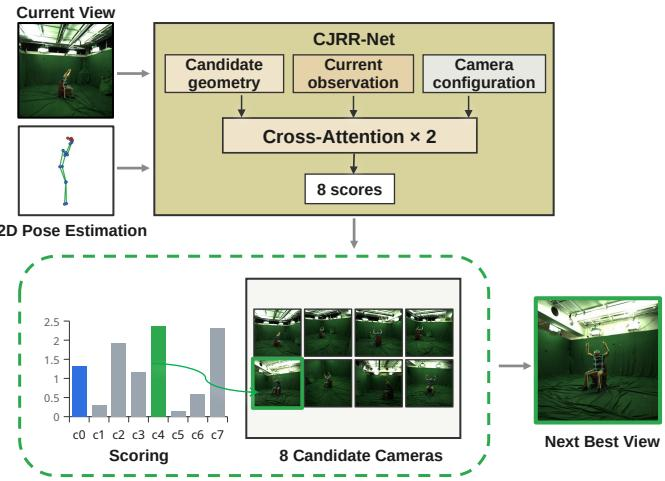
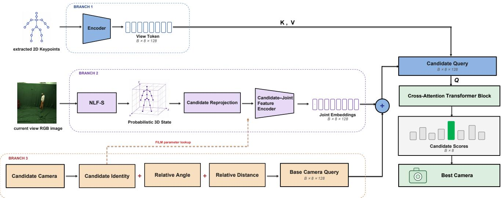
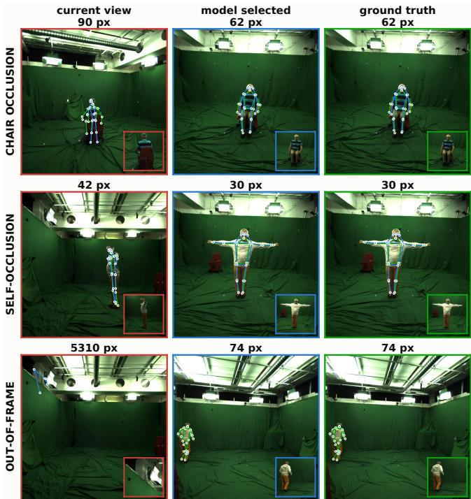
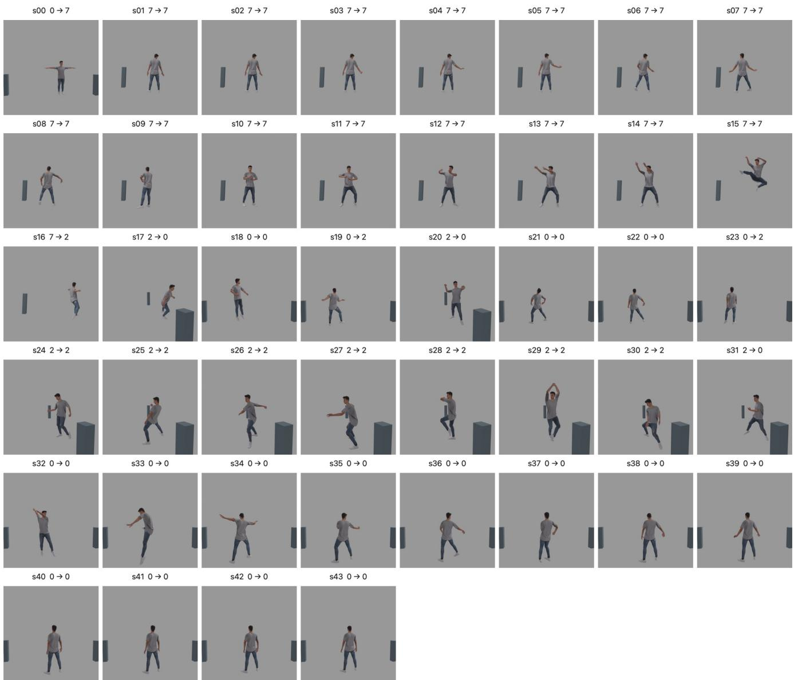

# CJRR-Net: A Candidate-Joint Reprojection Ranking for Future-View Selection in Human Pose Estimation

Huiting Xi1, Marsha Mariya Kappan1, Eduardo Benitez Sandoval2, Francisco Cruz1,3

1School of Computer Science and Engineering, UNSW Sydney, Australia

2School of Art & Design, UNSW Sydney, Australia

3Escuela de Ingenier´ıa, Universidad Central de Chile, Santiago, Chile

huiting.xi@student.unsw.edu.au, {m.marsha mariya kappan, e.sandoval, f.cruz}@unsw.edu.au

## Abstract

Multi-camera systems support performance recording, sports and human-movement analysis, where selecting an informative viewpoint is important for reliable human pose estimation. We propose the Candidate-Joint Reprojection Ranking Network (CJRR-Net) for future-view selection among eight calibrated cameras in MPI-INF-3DHP. The model combines current-view pose observations, camera configuration, and candidate-specific geometric features obtained by reprojecting the estimated 3D pose and its uncertainty into each candidate view. CJRR-Net achieves a selected-view 2D mean per-joint position error (MPJPE) of 105.18 pixels, compared with 114.64 pixels for the shared-input MLP and 117.56 pixels for adapted PoseErrNet. It also achieves the lowest mean error among the listed policies in each evaluated occlusion group. A blender rollout illustrates repeated camera selection. These findings support candidate-specific geometry for single-view selection in the evaluated fixed eight-camera setting.

## 1 Introduction

Markerless human pose estimation provides an unobtrusive way to analyse human motion from RGB images without attaching reflective markers or inertial sensors to the subject [Mehta et al., 2017]. The reliability of these estimates depends in part on the visual evidence available for individual body joints [Sun et al., 2024; Li et al., 2021]. Changes in body orientation and articulation can create self-occlusion and projected joint overlap, while scene objects can hide limbs and image boundaries can truncate the body. A fixed viewpoint may therefore provide insuficient evidence for some joints [Sun et al., 2024], and pose-estimation accuracy can vary with the camera viewpoint [Kiciroglu et al., 2020].

We study future-view selection in a calibrated camera array, where each decision uses one current-view RGB image and selects one camera for the next observation. This setting is motivated by applications with a single-stream processing budget or one selected output, such as robotic observation [Kiciroglu et al., 2020; Chen et al., 2024], automatic camera selection in performance recording [Stoll et al., 2023], and motion tracking and kinematic measurements in sports [Pagnon et al., 2021]. In such settings, processing all camera streams simultaneously may be undesirable because of computation, bandwidth, or real-time constraints, while the system ultimately requires only one view for the next observation or output. Multi-view fusion can combine complementary evidence when multiple images are available; our task instead selects a future view before acquiring its image.

Existing active perception methods for pose-driven camera selection use uncertainty-aware viewpoint planning [Kiciroglu et al., 2020] or predict viewpointdependent pose-estimation error [Chen et al., 2024]. Both approaches must assess candidate views before their images are available. An estimated 3D pose provides a spatial hypothesis for this purpose, but its projected joint locations, spatial extent, and potential selfocclusion vary across candidate cameras. This motivates representing the estimated pose and its uncertainty explicitly relative to each candidate camera.

In this work, we propose the candidate-joint Reprojection Ranking Network (CJRR-Net), a three-branch network, as illustrated in Figure 1, that combines currentview pose observations, candidate-camera configuration, and candidate-specific geometric features to rank future viewpoints. The key design is an explicit geometric representation obtained by reprojecting the estimated 3D pose and its uncertainty into each calibrated candidate camera. It captures projected joint locations, visibility cues, spatial extent, and uncertainty. CJRR-Net combines these features with observation context and camera configuration to select a future viewpoint from the current observation.

  
Figure 1: Overview of CJRR-Net for pose-driven camera selection. The current observation at time t supplies the pose estimate used to construct geometric features for eight calibrated candidate cameras. These features are combined with observation context and camera configuration to select a future view for t + ∆, with $\Delta = 2 5$ frames. The score bars are schematic. Candidate images illustrate the camera set and are unavailable to the selector at decision time.

Our contributions are threefold:

• A candidate-specific geometric representation that transforms an estimated 3D pose and its uncertainty into calibrated joint-level evidence for unobserved camera views.

• A three-branch ranking framework that integrates this representation with current observations and camera configuration to select a future view without acquiring candidate images at decision time.

• Shared-input comparisons, representation and branch controls, and occlusion-stratified evaluation that assess candidate geometry, together with a blender rollout illustrating repeated camera selection.

## 2 Related Work

## 2.1 Human Pose Estimation under Occlusion

Human pose estimation under occlusion requires reasoning about joints with unequal visual support. Token-Pose [Li et al., 2021] represents individual keypoints as tokens to learn visual cues and anatomical relationships. Visibility-aware reasoning [Sun et al., 2024] predicts keypoint visibility to mask unreliable features from occluded joints and infer their locations from visible-joint context. These methods improve estimation from the available observation. For active perception, they motivate considering how a viewpoint change afects individual joints: a view that reveals one limb may obscure another, so aggregate visibility can conceal diferences relevant to camera selection.

Three-dimensional pose provides an intermediate representation for reasoning across viewpoints. Martinez et al. [Martinez et al., 2017] lift 2D keypoints into 3D using a residual network. Neural Localizer Fields [S´ar´andi and Pons-Moll, 2024] localise arbitrary body points in 3D from RGB and predict pointwise uncertainty. MHD-Pose [Kappan et al., 2026] generates multiple plausible 3D pose hypotheses from a 2D pose. These 3D pose representations support geometric reasoning across camera viewpoints and reduce the ambiguity of purely 2D observations.

However, these methods still rely on information avail able from the current observation. Under severe occlusion, some body parts may be invisible and their keypoint estimates unreliable [Cheng et al., 2019], making recovery more dependent on learned priors than direct visual evidence. This motivates active viewpoint selection to acquire a more informative observation.

## 2.2 Next-Best-View Selection for Human Pose Estimation

Active viewpoint selection addresses occlusion by mov ing the camera or agent to acquire a more informative observation, rather than relying only on the pose estimator. Analytic criteria select viewpoints by optimising an explicit utility function. Information-driven criteria seek to reduce estimation uncertainty through entropy minimisation or expected information gain [Sommerlade and Reid, 2008], while related approaches use covariancebased optimality criteria [Wenhardt et al., 2007]. A representative example is ActiveMoCap [Kiciroglu et al., 2020], which approximates pose uncertainty using the Hessian of a reconstruction energy and plans future viewpoints to reduce 3D estimation uncertainty. For a perceptual view-preference objective, Kwon et al. [Kwon et al., 2022] optimise camera position using projected limb length, 2D person extent, and visible 3D bounding-box area. Together, these analytic methods show that candi date viewpoints can be evaluated from pose uncertainty or projected geometry before acquisition.

Learned next-best-view (NBV) methods either predict the next viewpoint directly or estimate task-specific errors across viewpoints. For active 3D reconstruction, NBVNet [Vasquez-Gomez et al., 2021] uses a 3D convolu tional network to predict the next best view from a vox elised scene representation. For human pose estimation, ACTOR and Pose-DRL use deep reinforcement learning to select informative viewpoints for active triangulation or an underlying monocular pose estimator [Pirinen et al., 2019; G¨artner et al., 2020]. More recently, PoseErrNet [Chen et al., 2024] maps normalised current 2D keypoints to a viewpoint-dependent 2D pose-error field, using NeRF-based view synthesis for supervision and a planner for camera motion.

These studies demonstrate that future viewpoints can be selected without first acquiring the corresponding images. However, they do not investigate whether reprojecting an estimated 3D pose and its uncertainty into each candidate camera can provide joint-level geometric evidence for more accurate view selection in a fixed, calibrated multi-camera system. Consequently, they do not evaluate whether structured candidate-specific joint evidence improves future-view ranking. We therefore introduce CJRR-Net to encode and aggregate this candidatespecific joint evidence for future-view ranking.

## 3 Method

Figure 2 presents the overall architecture of CJRR-Net. CJRR-Net combines current-view pose tokens, candidate-camera queries, and candidate-joint reprojection features through two cross-attention blocks. A shared head scores the candidates for future-view selection.

## 3.1 Candidate-Joint Reprojection Field

Using the frozen small variant of Neural Localizer Fields (NLF-S) [S´ar´andi and Pons-Moll, 2024] and a separately trained RootHead, we estimate a probabilistic 3D pose and reproject its joint positions and uncertainties into each candidate camera. Following the encode-thenaggregate principle for set-structured inputs [Zaheer et al., 2017], a shared MLP encodes each candidate–joint feature, and learned attention pooling [Ilse et al., 2018] aggregates the resulting embeddings into one representation per candidate camera.

Probabilistic 3D State. Let $\mathbf { I } _ { t } ^ { r }$ denote the current RGB observation captured by camera r at time t. The frozen NLF-S estimator predicts camera-frame 3D joint coordinates, $\mathbf { P } ^ { \mathrm { N L F } }$ , and joint-wise scalar uncertainties, $\tau ^ { \mathrm { N L F } }$ , as follows:

$$
\bigl ( \mathbf { P } ^ { \mathrm { N L F } } , \pmb { \tau } ^ { \mathrm { N L F } } \bigr ) = f _ { \mathrm { N L F } } ( \mathbf { I } _ { t } ^ { r } ) .\tag{1}
$$

Although NLF-S provides the articulated 3D pose, its global root translation can contain depth error. We therefore use a separately trained RootHead to refine the global root position. Let $\mathbf { r } ^ { \mathrm { N L F } }$ denote the original NLF-S root position, defined as the midpoint of the two hip joints, and $\widehat { \mathbf { r } }$ the corrected root position. For each joint j, $\pmb { \mu } _ { j }$ denotes the corrected 3D joint position, while $\Sigma _ { j }$ is its diagonal covariance and represents the associated positional uncertainty. The resulting probabilistic 3D state is:

$$
\begin{array} { r } { \hat { \mathbf { r } } = \exp ( \delta ) \mathbf { r } ^ { \mathrm { N L F } } + \left[ l _ { x } , l _ { y } , 0 \right] ^ { \top } , \quad } \\ { \pmb { \mu } _ { j } = \mathbf { P } _ { j } ^ { \mathrm { N L F } } - \mathbf { r } ^ { \mathrm { N L F } } + \boldsymbol { \widehat { \mathbf { r } } } , \quad } \\ { \pmb { \Sigma } _ { j } = \mathrm { d i a g } \big ( \pmb { \sigma } _ { \mathrm { r o o t } } ^ { 2 } + ( \tau _ { j } ^ { \mathrm { N L F } } \mathbf { s } _ { \mathrm { a r t } } ) ^ { \odot 2 } \big ) . } \end{array}\tag{2}
$$

Here, δ and $( l _ { x } , l _ { y } )$ denote the predicted log-depth scale correction and lateral corrections, respectively. $\mathbf { P } _ { \textit { i } } ^ { \mathrm { N L F } }$ is the original NLF-S joint prediction, and $\sigma _ { \mathrm { r o o t } } ^ { 2 } \in$ $\mathbb { R } ^ { 3 }$ contains the predicted per-axis root variances. The scalar NLF-S uncertainty $\tau _ { j } ^ { \mathrm { N L F } }$ is mapped to peraxis articulation standard deviations using the trainingcalibrated scale $\mathbf { s } _ { \mathrm { a r t } } \in \mathbb { R } ^ { 3 }$ The joint covariance combines root and articulation variances under a diagonal approximation that neglects their cross-covariances. In this formulation, $( \cdot ) ^ { \odot 2 }$ denotes element-wise squaring, and diag(·) forms a diagonal matrix with the input vector as its diagonal.

Reprojection into Candidate Cameras.

Let $\left( \mathbf { R } _ { v } , \mathbf { T } _ { v } \right)$ denote the extrinsics mapping world coordinates into camera $v ,$ and let r and c index the current and candidate cameras, respectively. Using the known calibration, the corrected joint mean and covariance are transformed from the current camera frame r to the candidate camera frame $c ,$ yielding $\mu _ { c , j }$ and $\Sigma _ { c , j }$ expressed in the candidate camera’s 3D coordinate system:

$$
\begin{array} { r l } & { { \pmb \mu } _ { c , j } = { \bf R } _ { c } { \bf R } _ { r } ^ { \top } ( { \pmb \mu } _ { j } - { \bf T } _ { r } ) + { \bf T } _ { c } , } \\ & { \Sigma _ { c , j } = { \bf R } _ { c } { \bf R } _ { r } ^ { \top } \Sigma _ { j } { \bf R } _ { r } { \bf R } _ { c } ^ { \top } . } \end{array}\tag{3}
$$

The candidate-frame 3D mean $\mu _ { c , j }$ is projected to the 2D image plane by $\pi _ { c } .$ . The covariance is propagated through the projection Jacobian to obtain image-space standard deviations:

$$
\begin{array} { r l } & { \left[ u _ { c , j } \quad v _ { c , j } \right] ^ { \top } = \pi _ { c } ( \pmb { \mu } _ { c , j } ) , } \\ & { \left[ \sigma _ { u , c , j } \quad \sigma _ { v , c , j } \right] ^ { \top } = \sqrt { \mathrm { d i a g } \big ( \mathbf { J } _ { \pi _ { c } } \pmb { \Sigma } _ { c , j } \mathbf { J } _ { \pi _ { c } } ^ { \top } \big ) } . } \end{array}\tag{4}
$$

Reprojecting the estimated pose and uncertainty into each candidate camera gives the following candidatejoint feature vector:

$$
\begin{array} { r l } & { \mathbf { F } _ { c , j } = \big [ u _ { c , j } , v _ { c , j } , Z _ { c , j } , \sigma _ { u , c , j } , \sigma _ { v , c , j } , } \\ & { \qquad p _ { \mathrm { i n } , c , j } , p _ { \mathrm { s e l f - o c c } , c , j } , d _ { \mathrm { b o r d e r } , c , j } , } \\ & { \qquad s _ { \mathrm { p e r s o n } , c } , s _ { \mathrm { b o n e } , c , j } , o _ { \mathrm { o v e r l a p } , c , j } , q _ { j } ^ { \mathrm { c u r } } \big ] . } \end{array}\tag{5}
$$

Here, $p _ { \mathrm { i n } , c , j }$ is the product of the horizontal and vertical marginal Gaussian probabilities over [0, 2048] pixels, using the projected means and standard deviations. The border cue $d _ { \mathrm { b o r d e r } , c , j }$ is min $( u _ { c , j } , 2 0 4 8 - u _ { c , j } , v _ { c , j }$ , 2048 − $v _ { c , j } )$ , positive inside the image and negative outside. The current-view confidence $q _ { j } ^ { \mathrm { c u r } }$ is shared across candidate cameras.

  
Figure 2: Architecture of CJRR-Net. View-context tokens, candidate-joint reprojection features, and camerageometry queries from the three branches are fused through cross-attention to rank the candidate cameras.

For the scale cues, $s _ { \mathrm { p e r s o n } , c }$ measures the overall projected body extent using the bounding-box diagonal of all reprojected joints, including those outside the image. Let $\begin{array} { r } { w _ { c } = \operatorname* { m a x } _ { j } u _ { c , j } - \operatorname* { m i n } _ { j } u _ { c , j } } \end{array}$ and $h _ { c } = \operatorname* { m a x } _ { j } v _ { c , j } -$ minj $v _ { c , j }$ denote the box width and height. The bone scale, $s _ { \mathrm { b o n e } , c , j } ,$ measures local skeletal extent by averaging the projected lengths of edges incident to joint $j \colon$

$$
\begin{array} { l } { s _ { \mathrm { p e r s o n } , c } = \sqrt { w _ { c } ^ { 2 } + h _ { c } ^ { 2 } + \epsilon } , } \\ { s _ { \mathrm { b o n e } , c , j } = \displaystyle \frac { 1 } { | \mathcal { N } ( j ) | } \sum _ { k \in \mathcal { N } ( j ) } \ell _ { c , j k } , } \end{array}
$$

where $\mathcal { N } ( j )$ contains the direct COCO-17 skeleton neighbours of joint j. The length $\ell _ { c , j k }$ is computed as the square root of the squared image-plane distance between joints $j$ and k plus $\epsilon = 1 0 ^ { - 6 }$ pixels squared. Both scales are expressed in pixels; person scale is shared across joints within each candidate, whereas bone scale is jointspecific.

For the self-occlusion cue, $\jmath _ { \mathrm { s e l f - o c c } , c , j }$ , and overlap cue, $O _ { \mathrm { o v e r l a p } , c , j } ,$ let $\boldsymbol { \mathcal { A } } ( \boldsymbol { j } )$ contain all joints except joint j and its direct skeleton neighbours.

We compute

$$
\begin{array} { l } { { p _ { \mathrm { s e l f - o c c } , c , j } = 1 - \displaystyle \prod _ { k \in A ( j ) } [ 1 - Q ( a _ { c , j k } b _ { c , j k } ) ] , } } \\ { { \mathrm { } } } \\ { { \displaystyle \ o _ { \mathrm { o v e r l a p } , c , j } = 1 - \displaystyle \prod _ { k \in A ( j ) } [ 1 - Q ( a _ { c , j k } ) ] , } } \end{array}
$$

where $\rho _ { c , k }$ is obtained by multiplying an assumed 80 mm body radius by the horizontal focal length and dividing by the depth of joint k. The proximity weight $\boldsymbol { a } _ { c , j k }$ is the exponential of the negative squared ratio of $\ell _ { c , j k }$ to $\rho _ { c , k }$ The depth weight $b _ { c , j k }$ applies a sigmoid to the depth of joint j minus that of joint $k ,$ divided by 50 mm. Both scales are fixed heuristic parameters. Q clips its input to $[ 0 , 1 - 1 0 ^ { - 6 } ]$ . Overlap uses the same proximity weights without depth ordering.

Joint-wise Encoding and Aggregation. For each candidate camera $^ { c , }$ we form a separate set containing the feature vectors $\mathbf { F } _ { c , j }$ of all body joints. After obtaining $\mathbf { F } _ { c , j } ,$ we first encode each joint feature separately and then aggregate the resulting joint representations to obtain a compact candidate-view representation. This preserves the feature combinations within each joint before aggregation.

Let $\bar { \mathbf { F } } _ { c , j } = \mathcal { N } ( \mathbf { F } _ { c , j } )$ denote fixed channel-wise normalisation. We first apply $\log ( 1 + \operatorname* { m a x } ( x , 0 ) )$ to projected standard deviations and person/bone scales. All nonprobability channels, including these transformed channels, are then centred by their training-set medians and divided by IQR/1.349, where IQR is the interquartile range; scales below $1 0 ^ { - 6 }$ are replaced by 1. The inframe, self-occlusion, overlap, and confidence channels use $( x - 0 . 5 ) / 0 . 5$ . All normalised values are clipped to [−8, 8] before FiLM.

To condition the normalised joint features on candidate-camera identity, we apply FiLM-style featurewise afine modulation [Perez et al., 2018]. For each candidate camera $c ,$ a learned lookup table provides a scale vector $\gamma _ { c }$ and a shift vector $\beta _ { c } ,$ which modulate the 12 feature channels before the shared joint MLP:

$$
\mathbf { a } _ { c , j } = \left( \mathbf { 1 } + \boldsymbol { \gamma } _ { c } \right) \odot \widetilde { \mathbf { F } } _ { c , j } + \boldsymbol { \beta } _ { c } .\tag{6}
$$

Here $\gamma _ { c } , \beta _ { c } \in \mathbb { R } ^ { 1 2 }$ are lookup-table parameters indexed by candidate identity, shared across joints and initialised to zero. For eight cameras, the scale and shift lookup tables add $2 \times 8 \times 1 2 = 1 9 2$ parameters.

A shared MLP $f _ { \mathrm { j o i n t } }$ with widths $1 2  3 2  3 2$ , layer normalisation, and ReLU maps each modulated feature $\mathbf { a } _ { c , j }$ to a joint token $\mathbf { h } _ { c , j }$ . Learned attention pooling then combines these tokens into one representation $\mathbf { z } _ { c }$ per candidate camera:

$$
\begin{array} { l } { \mathbf { h } _ { c , j } = f _ { \mathrm { j o i n t } } ( \mathbf { a } _ { c , j } ) , } \\ { \displaystyle \alpha _ { c , j } = \frac { \exp ( g ( \mathbf { h } _ { c , j } ) ) } { \sum _ { k = 1 } ^ { J } \exp ( g ( \mathbf { h } _ { c , k } ) ) } , } \\ { \mathbf { z } _ { c } = \displaystyle \sum _ { j = 1 } ^ { J } \alpha _ { c , j } \mathbf { h } _ { c , j } \in \mathbb { R } ^ { 3 2 } , } \end{array}\tag{7}
$$

where $J = 1 7$ is the number of joints and $g$ is a shared linear scalar scorer. This construction retains per-joint feature combinations until after nonlinear encoding, allowing their contributions to be weighted during aggregation. It uses no explicit joint-identity embeddings or message passing between learned joint tokens, while skeleton relationships enter through feature construction. The pooled vector $\mathbf { z } _ { c }$ is the output of the candidatejoint branch and is subsequently projected to enrich the query for camera c.

## 3.2 Three-Branch Fusion and Candidate Ranking

The candidate-joint field described in Section 3.1 is fused with camera information and the current-view observation to score each candidate.

Current-Observation Branch. For each camera slot, the pose observation is represented by 17 twodimensional keypoints and their associated confidence scores, forming a tensor $\mathbf { x } _ { v } \in \mathbb { R } ^ { 1 7 \times 3 }$ . Unobserved camera slots are represented by zero-filled inputs. A shared twolayer MLP encoder maps each flattened 51-dimensional input to a 128-dimensional view-context token. Stacking the tokens over all eight camera slots gives $\mathbf { T } \in \mathbb { R } ^ { 8 \times 1 2 8 }$ which supplies the keys and values for cross-attention.

Candidate-Camera Branch. For current camera r and candidate camera $^ { c , }$ let $\mathrm { a z } _ { v } , \mathrm { e l } _ { v }$ , and $\mathbf { C } _ { v }$ denote the azimuth, elevation, and camera-centre position of camera v, respectively. We define the normalised relative angular feature $\Delta \mathbf { a } _ { r , c }$ and normalised camera-centre distance $d _ { r , c }$ as

$$
\begin{array} { r } { \Delta { \bf { a } } _ { r , c } = \left[ \frac { { \bf { w r a p } } ( \mathrm { a z } _ { c } - \mathrm { a z } _ { r } ) } { { 1 8 0 ^ { \circ } } } , \frac { { \bf { e l } } _ { c } - \mathrm { e l } _ { r } } { { 1 8 0 ^ { \circ } } } \right] ^ { \top } , } \\ { d _ { r , c } = \frac { { \| { \bf { C } } _ { c } - { \bf { C } } _ { r } \| } _ { 2 } } { d _ { 0 } } . \qquad } \end{array}\tag{8}
$$

Here, angular diferences are normalised by $1 8 0 ^ { \circ }$ , and camera-centre coordinates are expressed in millimetres.

The fixed normalisation scale $d _ { 0 } = 8 0 0 0$ mm slightly exceeds the maximum pairwise camera-centre separation of approximately 7.84 m in the evaluated rig, yielding dimensionless distances below 1 for this configuration.

The corresponding camera query is

$$
\mathbf { q } _ { r , c } ^ { \mathrm { c a m } } = \mathbf { e } _ { c } + f _ { \mathrm { g e o } } ( \Delta \mathbf { a } _ { r , c } ) + f _ { \mathrm { b a s e } } ( d _ { r , c } ) \in \mathbb { R } ^ { 1 2 8 } ,\tag{9}
$$

where $\mathbf { e } _ { c }$ is a learned candidate-camera embedding, and $f _ { \mathrm { g e o } }$ and $f _ { \mathrm { b a s e } }$ encode relative orientation and cameraseparation information, respectively.

Fusion and View Scoring. The candidate-joint representation is projected and added to the camera query:

$$
\mathbf { q } _ { r , c } ^ { \mathrm { e n r } } = \mathbf { q } _ { r , c } ^ { \mathrm { c a m } } + f _ { \mathrm { p r o j } } ( \mathbf { z } _ { c } ) \in \mathbb { R } ^ { 1 2 8 } .\tag{10}
$$

The eight enriched queries are then processed by two cross-attention blocks, using T as keys and values. A shared scoring head maps each fused query to a scalar logit $s _ { c } ,$ and the selected next view is:

$$
{ \hat { c } } = \arg \operatorname* { m a x } _ { c \in { \mathcal { C } } } s _ { c } .\tag{11}
$$

## 4 Experiments

We evaluate CJRR-Net through quantitative comparisons and qualitative examples, focusing on the practical benefits of its candidate-joint representation.

## 4.1 Experimental Setup

Dataset and Sample Construction. We use both sequences (Seq1 and Seq2) from MPI-INF-3DHP [Mehta et al., 2017], with S1–S6 for training, S7 for validation, and S8 for testing (4,254, 501, and 500 timestamps, respectively). Using eight synchronised, calibrated cameras $\mathcal { C } = \{ 0 , 1 , 2 , 4 , 5 , 6 , 7 , 8 \}$ , we pair observations at t with candidate views at t + 25. Each test timestamp is evaluated from all eight current cameras, yielding 4,000 single-view decisions per run. All candidates, including the current camera, remain eligible.

ViTPose $[ \mathrm { X u }$ et al., 2022] extracts 17 current-view 2D keypoints and confidence scores; the same RGB image supplies the NLF-S/RootHead state (Section 3.1). Frozen NLF-S was pretrained on data including MPI-INF-3DHP [S´ar´andi and Pons-Moll, 2024], but public documentation does not verify S8’s exclusion. Although S8 is held out from ranker training, possible pretraining overlap limits conclusions about generalisation to subjects unseen by the entire pipeline. The sharedinput MLP remains informative because it uses the same frozen front end.

Future-view supervision is the mean joint-wise Euclidean error between ViTPose detections and mapped 2D annotations in $2 0 4 8 \times 2 0 4 8$ pixel coordinates. The

MPI-INF-3DHP head point is used for all five facial keypoints. The minimum-error candidate defines the bestview label. Future images and annotations are used only for supervision and ofline evaluation.

Training Details. NLF-S and the separately trained RootHead remain fixed during ranker training. We use Adam with learning rate $1 0 ^ { - 3 }$ , weight decay $1 0 ^ { - 4 }$ , batch size 256, and dropout 0.1. Training runs for at most 100 epochs, while the learning rate is halved after five epochs without validation-loss improvement, and training stops after fifteen. The checkpoint with the lowest validation loss is retained. Training and validation loss use random-view dropout: the number of retained views is sampled uniformly from 1–8, and the lowest-index retained camera supplies the reference state. Test inference always uses a single current view. Trained methods are evaluated with seeds 5, 7, 55, 17, 13, 6, 11, 9, 22, 44; results report the mean and sample standard deviation across these ten runs.

Training Objective. The loss coeficients were established through staged development experiments. The gap and regret weights were selected based on validationset performance during model development, while the camera-pair weight was selected through a 15-seed sweep. The contributions of the regret and camera-pair terms were further assessed through an objective ablation. All coeficients were then held fixed across learnedmethod comparisons. The resulting objective combines best-view classification, error-gap ranking, expected regret, and camera-pair ranking:

$$
\mathcal { L } = \mathcal { L } _ { \mathrm { C E } } + 0 . 1 \mathcal { L } _ { \mathrm { g a p } } + 0 . 5 \mathcal { L } _ { \mathrm { r e g } } + 0 . 4 \mathcal { L } _ { \mathrm { p a i r } } .\tag{12}
$$

Cross-entropy L targets the ground-truth best candidate, defined as the candidate with the lowest future pose error. The gap-weighted ranking term $\mathcal { L } _ { \mathrm { g a p } }$ penalises incorrect ordering between candidate views, while the expected-regret term $\mathcal { L } _ { \mathrm { r e g } }$ discourages selections with larger pose errors. Because cameras 5 and 8 account for the largest shares of ground-truth best-view labels under our dataset split and were frequently overselected during development, the pairwise ranking term $\mathcal { L } _ { \mathrm { p a i r } }$ gives additional weight to comparisons in which the groundtruth best or second-best candidate has a lower error than either camera. The same objective is used for the representation controls and the shared-input MLP to ensure a consistent comparison.

Evaluation Metrics. We evaluate camera-selection performance using predicted-view 2D mean per-joint position error (MPJPE), relative MPJPE reduction, Tol@15, and 0-Recall.

Predicted-view 2D MPJPE is the mean Euclidean distance between the predicted and ground-truth 2D joint locations in the selected future view, averaged over all joints and test decisions, where lower values indicate better selection.

Relative MPJPE reduction is the percentage decrease in selected-view MPJPE relative to uniform random selection. Tol@15 is the proportion of selections whose error is within 15 pixels of the minimum future-view error. 0-Recall counts candidate cameras with best-viewconditioned recall below 0.05%.

## 4.2 Quantitative Results

Comparison with Baselines. As shown in Table 1, CJRR-Net is compared with uniform random selection, a geometric utility rule, an ActiveMoCap-inspired planner [Kiciroglu et al., 2020], and an adapted PoseErr-Net [Chen et al., 2024]. These baselines are evaluated using the same future-error targets while retaining their respective inputs and objectives. For a more direct representation comparison, we also include an MLP that uses the same 2D detections, confidence scores, NLF state, and camera information as CJRR-Net, and is trained with the same full objective.

CJRR-Net achieves the lowest mean error, the largest relative MPJPE reduction, and the highest Tol@15 among the policies in the comparison. Its mean error is 10.54% lower than adapted PoseErrNet and 41.98% lower than the ActiveMoCap-inspired planner. Relative to the MLP sharing its perception inputs, CJRR-Net reduces error by 9.46 pixels and raises Tol@15 by 3.02 percentage points. This comparison supports explicitly organising the available pose and camera information into candidate-specific geometric features.

Moreover, CJRR-Net maintains 0-Recall of zero in all ten runs, compared with $6 . 3 0 \pm 0 . 4 8$ near-zero-recall classes for adapted PoseErrNet and $2 . 5 0 \pm 1 . 1 8$ for the shared-input MLP. This indicates that the improvement is accompanied by broader camera-class coverage, rather than being achieved by concentrating predictions on a small subset of dominant candidate views.

Contribution of Candidate-Specific Geometry. We examine both the contribution of the candidate geometry branch and how its information is represented, holding the NLF/RootHead state, detections, calibration, future-error targets, and full objective fixed.

Retaining all 12 geometric channels improves mean error over the scalar summary (Table 2). A uses a scalar confidence/visibility summary; B averages the normalised channels over joints before nonlinear encod ing; C uses candidate-conditioned FiLM, joint-wise en coding, and attention pooling.

B and C nevertheless have nearly identical MPJPEs $( 1 0 5 . 1 9 \pm 2 . 5 2 $ versus $1 0 5 . 1 8 \pm 2 . 6 1 ~ \mathrm { p x } )$ , compared with 117.58±1.46 px for A. These results support richer geometry but do not establish an MPJPE benefit from the additional architecture. C’s mean Tol@15 is 0.51 percentage points higher $( 5 8 . 1 7 \pm 0 . 5 9 \%$ versus $5 7 . 6 6 \pm 0 . 6 3 \%$ This 0.51-percentage-point gain is modest and should be interpreted alongside variability across ten seeds. However, C adds only 225 trainable parameters over B (approximately 0.07%), including 192 for FiLM. The higher observed Tol@15 therefore comes with minimal additional parameter overhead, providing a practical reason to retain candidate-conditioned joint processing in the final model.

Table 1: Overall future-view selection performance on the MPI-INF-3DHP test set. Results for trained methods are reported as mean ± standard deviation over 10 random seeds. ↑ indicates that higher values are better, and ↓ indicates that lower values are better.
<table><tr><td>Policy</td><td>Predicted-view 2D MPJPE (px) ↓</td><td>Relative MPJPE reduction (%) ↑</td><td> $\mathrm { T o l @ 1 5 ~ ( \% ) ~ } \uparrow$ </td><td> $\scriptstyle 0 \mathrm { - R e c a l l \downarrow }$ </td></tr><tr><td>Uniform random</td><td> $2 9 9 . 7 6 \pm 5 . 2 7$ </td><td> $0 . 0 0 \pm 1 . 7 6$ </td><td> $2 6 . 2 5 \pm 0 . 6 7$ </td><td> $\mathbf { 0 . 0 0 \pm 0 . 0 0 }$ </td></tr><tr><td>Geometric utility</td><td> $1 9 8 . 3 0 \pm 0 . 0 0$ </td><td> $3 3 . 8 5 \pm 0 . 0 0$ </td><td> $3 3 . 3 5 \pm 0 . 0 0$ </td><td> $\mathbf { 0 . 0 0 \pm 0 . 0 0 }$ </td></tr><tr><td>ActiveMoCap-inspired planner</td><td> $1 8 1 . 2 9 \pm 1 3 . 5 5$ </td><td> $3 9 . 5 2 \pm 4 . 5 2$ </td><td> $4 0 . 3 7 \pm 4 . 0 2$ </td><td> $\mathbf { 0 . 0 0 \pm 0 . 0 0 }$ </td></tr><tr><td>PoseErrNet (adapted)</td><td> $1 1 7 . 5 6 \pm 5 . 0 2$ </td><td> $6 0 . 7 8 \pm 1 . 6 8$ </td><td> $5 3 . 8 1 \pm 0 . 4 5$ </td><td> $6 . 3 0 \pm 0 . 4 8$ </td></tr><tr><td>MLP with shared perception inputs</td><td> $1 1 4 . 6 4 \pm 3 . 4 2$ </td><td> $6 1 . 7 6 \pm 1 . 1 4$ </td><td> $5 5 . 1 5 \pm 0 . 8 0$ </td><td> $2 . 5 0 \pm 1 . 1 8$ </td></tr><tr><td>CJRR-Net (ours)</td><td> $\mathbf { 1 0 5 . 1 8 \pm 2 . 6 1 }$ </td><td> ${ \bf 6 4 . 9 1 \pm 0 . 8 7 }$ </td><td> ${ \bf 5 8 . 1 7 \pm 0 . 5 9 }$ </td><td> $\mathbf { 0 . 0 0 \pm 0 . 0 0 }$ </td></tr></table>

Table 2: Candidate representation and branch controls. A: scalar summary; B: mean-12D; C: CJRR-Net. Results are mean ± sample standard deviation over ten seeds. Bold marks the best mean in each column. ↓: lower is better; ↑: higher is better.
<table><tr><td>Configuration</td><td>MPJPE (px) ↓</td><td>Tol@15 (%) ↑</td><td>0-Recall ↓</td></tr><tr><td>A: scalar summary</td><td> $1 1 7 . 5 8 \pm 1 . 4 6$ </td><td> $5 4 . 2 5 \pm 0 . 6 3$ </td><td> $2 . 1 0 \pm 1 . 2 0$ </td></tr><tr><td>B: mean-12D</td><td> $1 0 5 . 1 9 \pm 2 . 5 2$ </td><td> $5 7 . 6 6 \pm 0 . 6 3$ </td><td> $0 . 5 0 \pm 0 . 7 1$ </td></tr><tr><td>C: CJRR-Net</td><td> $1 0 5 . 1 8 \pm 2 . 6 1$ </td><td> ${ \bf 5 8 . 1 7 \pm 0 . 5 9 }$ </td><td> $\mathbf { 0 . 0 0 \pm 0 . 0 0 }$ </td></tr><tr><td>C w/o geometry</td><td> $1 1 6 . 0 5 \pm 1 . 5 7$ </td><td> $5 4 . 5 2 \pm 0 . 5 9$ </td><td> $2 . 4 0 \pm 0 . 7 0$ </td></tr><tr><td>C w/o query</td><td> $1 0 8 . 8 8 \pm 2 . 6 6$ </td><td> $5 6 . 2 3 \pm 0 . 7 0$ </td><td> $0 . 8 0 \pm 0 . 6 3$ </td></tr><tr><td>C w/o observation</td><td> $\mathbf { 1 0 4 . 2 6 \pm 3 . 1 2 }$ </td><td> $5 7 . 6 3 \pm 0 . 5 4$ </td><td> $0 . 7 0 \pm 0 . 4 8$ </td></tr></table>

Figure 3: Successful examples of chair occlusion, selfocclusion, and out-of-frame truncation (top to bottom). Columns show the current, model-selected, and groundtruth views. Values indicate 2D MPJPE in pixels.  

Removing the geometry or candidate-query branch raises mean MPJPE to 116.05 and 108.88 px, respectively. Removing observation context instead lowers mean MPJPE to $1 0 4 . 2 6 \pm 3 . 1 2$ px, but reduces mean Tol@15 to $5 7 . 6 3 \pm 0 . 5 4 \%$ and increases 0-Recall to 0.70± 0.48, compared with $0 . 0 0 \pm 0 . 0 0$ for the full model. The observation branch therefore shows a trade-of across mean selection error, Tol@15, and camera-class coverage.

Performance under Occlusion. To evaluate robustness under degraded current-view observations, we group test decisions by the number of joints occluded in the current view: Low (0–2), Medium (3–5), and High $( \geq 6 )$ Table 4 reports the performance of the evaluated methods within each occlusion level.

CJRR-Net achieves the lowest mean error in each occlusion group (Table 4). Its mean-error advantage over adapted PoseErrNet increases from 5.58 pixels under low occlusion to 10.49 and 24.13 pixels under medium and high occlusion, respectively. This trend indicates that CJRR-Net retains a clear selection-quality advantage across occlusion levels, with the largest benefit observed under severe current-view occlusion.

## 4.3 Reduced Candidate Availability

The model computes all eight scores. Scores outside the permitted subset are set to −∞ before selection, without retraining. This changes the selectable future views, whereas training-time view dropout changes the current observations. Table 3 lists one fixed subset per size.

The eight-camera pool yields the lowest mean selectedview error among the tested subsets (Table 3). Selection remains better than random with six, four, or two candidates, without retraining. These results demonstrate selection among subsets of known cameras, with one fixed layout evaluated per subset size.

Table 3: Inference-only candidate-availability analysis. Camera IDs are original MPI-INF-3DHP IDs. Results are mean ± sample standard deviation over ten checkpoints. Random MPJPE is computed within the same permitted subset, and Tol@15 uses the minimum-error reference within that subset; the model is not retrained.
<table><tr><td colspan="3"></td><td rowspan="2">Random Selected MPJPE (px) ↓</td><td rowspan="2">Relative MPJPE reduction (%) ↑</td><td rowspan="2">Tol@15 (%) ↑</td></tr><tr><td>Candidates</td><td>Camera IDs</td><td>MPJPE (px)</td></tr><tr><td>8</td><td> $\{ 0 , 1 , 2 , 4 , 5 , 6 , 7 , 8 \}$ </td><td>299.76</td><td> $1 0 5 . 1 8 \pm 2 . 6 1$ </td><td>64.91</td><td> $5 8 . 1 7 \pm 0 . 5 9$ </td></tr><tr><td>6</td><td> $\{ 0 , 2 , 4 , 6 , 7 , 8 \}$ </td><td>338.14</td><td> $1 3 2 . 8 3 \pm 2 . 5 7$ </td><td>60.72</td><td> $6 0 . 1 7 \pm 0 . 5 2$ </td></tr><tr><td>4</td><td> $\{ 0 , 2 , 7 , 8 \}$ </td><td>345.49</td><td> $1 3 4 . 2 5 \pm 2 . 6 5$ </td><td>61.14</td><td> $6 2 . 3 0 \pm 0 . 3 4$ </td></tr><tr><td>2</td><td>{0, 6}</td><td>258.31</td><td> $1 5 8 . 0 6 \pm 3 . 4 8$ </td><td>38.81</td><td> $8 5 . 6 4 \pm 1 . 4 4$ </td></tr></table>

  
Figure 4: Complete 44-step closed-loop rollout in blender, ordered left-to-right and top-to-bottom. Each panel shows the current input image and labels the step and current-to-selected camera command. The selected camera becomes active 25 frames later (one second of simulated time). The 43 successive inputs follow the preceding camera commands. Visibility is illustrated qualitatively in this single rollout.

Table 4: Selected-view 2D error (pixels) grouped by current-view occlusion. Trained methods report mean ± sample standard deviation over 10 seeds. The groups partition the same 4,000 decisions as the overall comparison. This analysis covers the listed policies, their perception inputs and objectives follow Table 1.
<table><tr><td>Policy</td><td>Low (0-2)</td><td>Medium (3–5)</td><td>High (≥ 6)</td></tr><tr><td>Uniform random</td><td> $2 4 7 . 2 2 \pm 6 . 6 9$ </td><td> $2 7 5 . 5 4 \pm 9 . 9 9$ </td><td> $4 0 1 . 9 3 \pm 1 1 . 2 3$ </td></tr><tr><td>Geometric utility</td><td> $1 6 2 . 4 5 \pm 0 . 0 0$ </td><td> $1 9 3 . 7 4 \pm 0 . 0 0$ </td><td> $2 5 3 . 6 3 \pm 0 . 0 0$ </td></tr><tr><td>ActiveMoCap-inspired planner</td><td> $1 5 2 . 1 3 \pm 1 8 . 4 8$ </td><td> $1 6 3 . 8 5 \pm 1 2 . 9 0$ </td><td> $2 4 2 . 8 3 \pm 8 . 8 0$ </td></tr><tr><td>PoseErrNet (adapted)</td><td> $9 7 . 8 7 \pm 2 . 8 9$ </td><td> $1 0 9 . 7 3 \pm 2 . 9 1$ </td><td> $1 5 4 . 3 7 \pm 1 1 . 6 5$ </td></tr><tr><td>MLP with Shared Perception Inputs</td><td> $9 8 . 5 1 \pm 3 . 3 1 $ </td><td> $1 0 2 . 8 2 \pm 2 . 1 8$ </td><td> $1 5 1 . 2 9 \pm 6 . 7 9$ </td></tr><tr><td>CJRR-Net</td><td> ${ \bf 9 2 . 2 9 \pm 2 . 7 4 }$ </td><td> ${ \bf 9 9 . 2 4 \pm 2 . 1 6 }$ </td><td> $\mathbf { 1 3 0 . 2 4 \pm 5 . 5 1 }$ </td></tr></table>

## 4.4 Qualitative Results

View Selection under Visibility Degradation. Figure 3 shows selected successful cases of external chair occlusion, self-occlusion, and out-of-frame truncation. Relative to the current views, the selected views provide clearer lower-body visibility, arm-torso separation, and body framing, respectively. These examples illustrate useful alternative observations under the visibility degradations motivating active view selection.

Closed-Loop Demonstration in Simulation. A closed-loop demonstration was implemented in blender 5.0.1 using the trained CJRR-Net pipeline, an animated human character from Renderpeople, and two fixed synthetic column-shaped occluders. We used the same eight calibrated cameras as in the MPI evaluation. The character retained its FBX dance animation, while its root followed an additional horizontal trajectory with a maximum displacement of 0.439 m. The occluders were placed outside the character’s motion envelope to produce viewpoint-dependent partial occlusion without intersecting the moving character.

Figure 4 presents the complete decision sequence. Visual inspection shows that the subject remains visible throughout the displayed observations, with most views being either frontal or rear-facing and without complete occlusion by the columns. This example illustrates repeated perception and selection when each chosen camera supplies the next observation. The demonstration evaluates discrete camera switching in simulation.

## 5 Conclusion and Future Work

CJRR-Net selects future views by combining currentview pose observations, candidate-camera configuration, and geometric features obtained by reprojecting the estimated 3D pose and its uncertainty. Using a single current-view image and known camera calibration, it achieves a 64.91% reduction in selected-view 2D MPJPE relative to uniform random selection on our eight-view

MPI-INF-3DHP evaluation, outperforming the listed baselines across the evaluated occlusion levels. Ablations support the contribution of candidate geometry, and a blender rollout illustrates repeated camera selection.

The evaluation is limited to one subject held out from ranker training and one fixed candidate set per camera count. Possible overlap between NLF-S pretraining and the S8 test subject limits conclusions about generalisation to subjects unseen by the entire pipeline. Closedloop performance is demonstrated qualitatively. Future work will evaluate multiple layouts per camera count, retrain models for the corresponding candidate sets, and revisit camera-identity embeddings and candidatespecific FiLM for unseen configurations. We will also measure closed-loop pose error and switching frequency against current-camera retention and fixed-camera baselines on additional subjects and real recordings.

With denser training coverage of camera positions and orientations, the geometric representation and prediction head could be adapted for continuous viewpoint prediction. Moving-camera extensions should integrate temporal pose prediction and scene-occlusion reasoning with motion planning that accounts for travel time and collision constraints. Potential applications include gestureaware robot interaction, pose-aware performance capture, and sports-motion analysis, with downstream benefits evaluated in each setting.

## References

[Chen et al., 2024] Jingxi Chen, Botao He, Chahat Deep Singh, Cornelia Ferm¨uller, and Yiannis Aloimonos. Active human pose estimation via an autonomous UAV agent. In Proceedings of the 2024 IEEE/RSJ International Conference on Intelligent Robots and Systems (IROS), pages 7801–7808, 2024.

[Ilse et al., 2018] Maximilian Ilse, Jakub M. Tomczak, and Max Welling. Attention-based deep multiple instance learning. In Proceedings of the 35th International Conference on Machine Learning, volume 80 of Proceedings of Machine Learning Research, pages 2127–2136, 2018.

[Kiciroglu et al., 2020] Sena Kiciroglu, Helge Rhodin, Sudipta N. Sinha, Mathieu Salzmann, and Pascal Fua. ActiveMoCap: Optimized viewpoint selection for active human motion capture. In Proceedings of the IEEE/CVF Conference on Computer Vision and Pattern Recognition (CVPR), pages 103–112, 2020.

[Li et al., 2021] Yanjie Li, Shoukui Zhang, Zhicheng Wang, Sen Yang, Wankou Yang, Shu-Tao Xia, and Erjin Zhou. TokenPose: Learning keypoint tokens for human pose estimation. In Proceedings of the IEEE/CVF International Conference on Computer Vision (ICCV), pages 11313–11322, 2021.

[Martinez et al., 2017] Julieta Martinez, Rayat Hossain, Javier Romero, and James J. Little. A simple yet efective baseline for 3D human pose estimation. In Proceedings of the IEEE International Conference on Computer Vision (ICCV), pages 2640–2649, 2017.

[Mehta et al., 2017] Dushyant Mehta, Helge Rhodin, Dan Casas, Pascal Fua, Oleksandr Sotnychenko, Weipeng Xu, and Christian Theobalt. Monocular 3D human pose estimation in the wild using improved CNN supervision. In Proceedings of the International Conference on 3D Vision (3DV), pages 506–516, 2017.

[Perez et al., 2018] Ethan Perez, Florian Strub, Harm de Vries, Vincent Dumoulin, and Aaron C. Courville. FiLM: Visual reasoning with a general conditioning layer. In Proceedings of the Thirty-Second AAAI Conference on Artificial Intelligence, pages 3942–3951, 2018.

[S´ar´andi and Pons-Moll, 2024] Istv´an S´ar´andi and Gerard Pons-Moll. Neural Localizer Fields for continuous 3D human pose and shape estimation. In Advances in Neural Information Processing Systems, volume 37, pages 140032–140065, 2024.

[Sommerlade and Reid, 2008] Eric Sommerlade and Ian Reid. Information-theoretic active scene exploration. In Proceedings of the IEEE Conference on Computer Vision and Pattern Recognition (CVPR), pages 1–7, 2008.

[Sun et al., 2024] Pengzhan Sun, Kerui Gu, Yunsong Wang, Linlin Yang, and Angela Yao. Rethinking visibility in human pose estimation: Occluded pose reasoning via transformers. In Proceedings of the IEEE/CVF Winter Conference on Applications of Computer Vision (WACV), pages 5903–5912, 2024.

[Vasquez-Gomez et al., 2021] Juan Irving Vasquez-Gomez, David Ernesto Troncoso Romero, Israel Becerra, Luis Enrique Sucar, and Rafael Murrieta-Cid. Next-best-view regression using a 3D convolutional neural network. Machine Vision and Applications, 32:42, 2021.

[Wenhardt et al., 2007] Stefan Wenhardt, Benjamin Deutsch, Elli Angelopoulou, and Heinrich Niemann. Active visual object reconstruction using D-, E-, and T-optimal next best views. In Proceedings of the IEEE Conference on Computer Vision and Pattern Recognition (CVPR), pages 1–7, 2007.

[Xu et al., 2022] Yufei Xu, Jing Zhang, Qiming Zhang, and Dacheng Tao. ViTPose: Simple vision transformer baselines for human pose estimation. In Advances in Neural Information Processing Systems, volume 35, pages 38571–38584, 2022.

[Zaheer et al., 2017] Manzil Zaheer, Satwik Kottur, Siamak Ravanbakhsh, Barnabas Poczos, Ruslan Salakhutdinov, and Alexander J. Smola. Deep Sets. In Advances in Neural Information Processing Systems, volume 30, pages 3391–3401, 2017.

[Pagnon et al., 2021] David Pagnon, Mathieu Domalain, and Lionel Reveret. Pose2Sim: An end-to-end workflow for 3D markerless sports kinematics—part 1: Robustness. Sensors, 21(19):6530, 2021.

[Stoll et al., 2023] Eckhard Stoll, Stephan Breide, Steve G¨oring, and Alexander Raake. Automatic camera selection, shot size, and video editing in theater multicamera recordings. IEEE Access, 11:96673–96692, 2023.

[Kappan et al., 2026] Marsha Mariya Kappan, Eduardo Benitez Sandoval, Erik Meijering, and Francisco Cruz. MHDPose: Multi-hypothesis 3D human pose estimation using bidirectional Mamba difusion models. Pattern Recognition, 180:114396, 2026.

[Kwon et al., 2022] Beom Kwon, Jungwoo Huh, Kyoungoh Lee, and Sanghoon Lee. Optimal camera point selection toward the most preferable view of 3-D hu man pose. IEEE Transactions on Systems, Man, and Cybernetics: Systems, 52(1):533–553, 2022.

[Pirinen et al., 2019] Aleksis Pirinen, Erik G¨artner, and Cristian Sminchisescu. Domes to drones: Selfsupervised active triangulation for 3D human pose reconstruction. In Advances in Neural Information Processing Systems, volume 32, pages 3907–3917, 2019.

[G¨artner et al., 2020] Erik G¨artner, Aleksis Pirinen, and Cristian Sminchisescu. Deep reinforcement learning for active human pose estimation. In Proceedings of the AAAI Conference on Artificial Intelligence, volume 34, number 7, pages 10835–10844, 2020.

[Cheng et al., 2019] Yu Cheng, Bo Yang, Bo Wang, Wending Yan, and Robby T. Tan. Occlusion-aware networks for 3D human pose estimation in video. In Proceedings of the IEEE/CVF International Conference on Computer Vision (ICCV), pages 723–732, 2019.