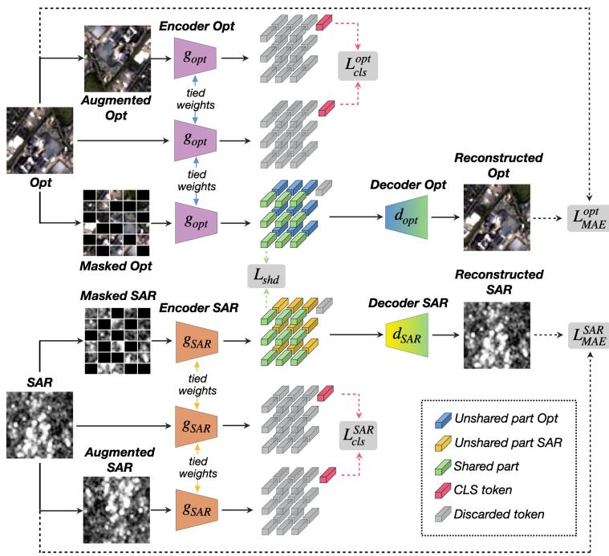
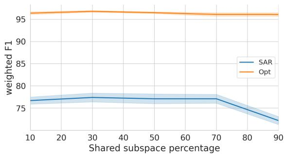
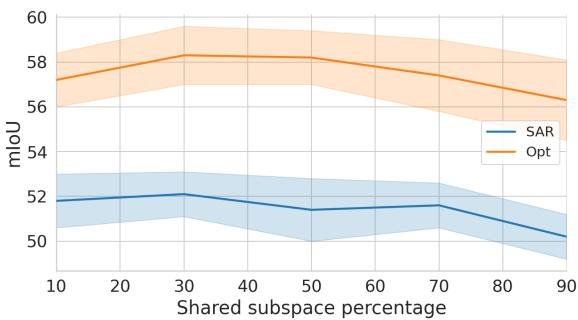
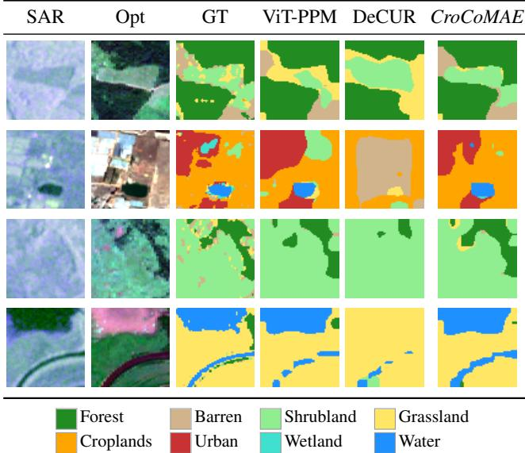

# CroCoMAE: Cross-modal self-supervised collaborative representation learning for SAR-optical remote sensing data

Vito Recchia∗, Giuseppe Guarino‡, Cassio Fraga Dantas´ ‡§, Giuseppina Andresini∗†, and Annalisa Appice∗†, Dino Ienco‡§

∗Department of Computer Science, University of Bari Aldo Moro, Bari, Italy

†Consorzio Interuniversitario Nazionale per l’Informatica (CINI), Bari, Italy

‡INRIA, EVERGREEN, Univ. of Montpellier, Montpellier, France

‡INRAE, UMR TETIS, Univ. of Montpellier, Montpellier, France

{vito.recchia, giuseppina.andresini, annalisa.appice}@uniba.it,

giuseppe.guarino@inria., dino.ienco,cassio.fraga-dantas@inrae.fr

Abstract—Remote sensing increasingly captures the Earth’s surface through complementary sensors such as SAR and optical, yet ground-truth annotations remain scarce, limiting supervised approaches. Self-supervised learning (SSL) addresses the label scarcity, and cross-modal SSL further exploits the complementarity between co-located sensors, but existing crossmodal frameworks align modalities mostly through global imagelevel representations or treat them as largely redundant, leaving their fine-grained complementary structure underexploited. We propose CroCoMAE, a cross-modal SSL framework for SARoptical remote sensing that unifies contrastive learning and masked image modeling within a ViT-based architecture, operating at two complementary levels. At the image level, an intramodality contrastive loss on the class token yields globally discriminative, augmentation-invariant representations. At the patch level, masked image modeling drives fine-grained per-modality representations, while a cross-modal contrastive objective aligns a shared subspace across SAR and optical patch tokens, leaving the complementary subspace unconstrained to retain modalityspecific information. On two SAR-optical benchmarks covering scene classification and semantic segmentation, CroCoMAE improves over uni-modal SSL baselines and outperforms stateof-the-art cross-modal frameworks in most configurations, with gains in both single-modality and multi-modal evaluation across varying label regimes and the largest improvements on semantic segmentation. Code is available at this link.

Index Terms—self-supervised learning, cross-modal learning, masked autoencoders, contrastive learning, SAR-optical fusion, remote sensing

## I. INTRODUCTION

Remote Sensing (RS) is increasingly characterized by the availability of multi-modal sensor data, with multiple satellites and sensors acquiring complementary information over the same region of interest [1]; SAR and optical sensors are a prime example, complementary in availability as well as information, as SAR operates through cloud and darkness where optical fails. Yet, while the volume of raw multi-sensor RS data grows exponentially, ground truth annotations remain scarce and costly to obtain [2], precluding the adoption of standard supervised approaches for RS downstream tasks. Selfsupervised learning (SSL) mitigates this imbalance by exploiting abundant unlabeled RS data [3]. Existing SSL methods for a single modality broadly fall into two families with comple mentary strengths: contrastive/distance-based approaches [4], [5], which contrast augmented views to learn globally discriminative representations but capture little fine-grained spatial structure, and reconstruction/generative approaches [6], [7], which recover masked input to learn local structure but yield less globally discriminative features. Both are well studied uni-modally in computer vision [8] and RS [9], yet applied to a single modality they cannot exploit the complementarity between co-located sensors. Cross-modal SSL targets this, but existing approaches [10]–[12] align the two modalities only through global image-level representations, even when crossmodal contrast is combined with masked reconstruction [12], leaving fine-grained, patch-level cross-modal alignment underexplored (Sec. II). To close this gap, in the context of SAR-optical RS data, we propose CroCoMAE (Cross-modal self-supervised Collaborative Masked AutoEncoder), a ViTbased framework that unifies contrastive learning and masked image modeling at two complementary levels. At the image level, a within-modality contrastive loss on the class token enforces globally discriminative representations. At the patch level, masked image modeling drives per-modality fine-grained reconstruction, while a cross-modal contrastive term aligns a shared subspace across SAR and optical patch tokens, leaving the unshared subspace free to capture complementary, possibly modality-specific information. Unlike prior work that aligns only global representations, this patch-level objective lets CroCoMAE exploit fine-grained SAR-optical interactions. We evaluate CroCoMAE on two SAR-optical benchmarks covering scene classification and semantic segmentation. Compared to uni-modal SSL baselines and cross-modal frameworks, across varying label regimes and under both linear probing and full fine-tuning, CroCoMAE consistently provides an effective general-purpose initialization.

In summary, our contributions are: i) CroCoMAE, a crossmodal SSL framework for SAR-optical RS data unifying contrastive learning and masked image modeling at image and patch levels; ii) A patch-level cross-modal contrastive design that aligns a shared subspace across modalities while leaving the unshared subspace free to capture complementary, possibly modality-specific information, enabling fine-grained SAR-optical collaboration beyond global alignment; iii) An extensive evaluation on scene classification and semantic segmentation benchmarks against uni-modal and cross-modal SSL frameworks retrained under the same controlled protocol, showing gains in most configurations across low-data label regimes, particularly on dense prediction.

## II. RELATED WORKS

Uni-Modal Self-Supervised. Self-supervised learning (SSL) has emerged as a paradigm for learning representations from unlabeled data, eliminating the need for large amounts of costly annotations. Contrastive/distance-based approaches became dominant, with frameworks such as SimCLR [4], MoCo [13] and BYOL [14], and dense variants such as DenseCL [15], maximizing agreement between augmented views of the same image. Redundancy-reduction methods, notably Barlow Twins [5] and VICReg [16], instead decorrelate feature dimensions to avoid collapse without explicit negative pairs. More recently, masked image modeling regained prominence through Masked Autoencoders (MAE) [6], showing that reconstruction alone yields rich, transferable representations. Such techniques have been widely adopted in RS: for optical data, e.g., SatMAE [17] and SpectralGPT [18], adapting contrastive or masked modeling to multispectral and multi-temporal imagery; and, only very recently, for SAR data, e.g. SARMAE [19].

Multi-Modal Self-Supervised. A natural extension of Uni-Modal SSL consists in training a single unified model across modalities or sensors. This has led to large multi-modal foundation models, e.g., ImageBind [20], which anchors six modalities to a shared image embedding space, and Multi-MAE [7], which extends masked autoencoding to multi-modal, multi-task reconstruction. At larger scale, several works introduce RS foundation models pretrained on massive external multi-sensor corpora, including SMARTIES [21], TERRA-MIND [22] and AnySat [23]. These works target generalpurpose pretraining at a scale not directly comparable to the controlled comparison adopted here. Regardless of scale, these approaches learn a common representation across modalities, conflating shared and modality-specific features. This motivates a complementary line of work, discussed next, that instead uses dedicated per-modality encoders with explicit crossmodal alignment, allowing shared and specific information to be represented separately rather than fused.

Cross-Modal Self-Supervised. Purely contrastive crossmodal approaches implicitly assume multiview redundancy: all task-relevant information is shared across modalities, an assumption often violated in practice. CoMM [10] addresses this via a contrastive objective in a fused multimodal space, showing empirically that purely cross-modal methods fail to capture unique and synergistic information. DeCUR [11] par titions each per-modality encoder’s embedding into a common subspace, aligned via Barlow Twins loss, and a unique subspace, explicitly decorrelated across modalities. CROMA [12] combines both paradigms: it performs cross-modal contrastive learning on global, average-pooled unimodal representations of masked inputs, with no explicit decomposition, while a separate cross-modal encoder fuses both modalities to jointly reconstruct their masked patches. DeCUR has been evaluated under in-domain training in its original work, whereas CROMA was pretrained on a large external multi-sensor corpus; since its objectives do not depend on the pretraining corpus, we retrain both methods in-domain under the same controlled protocol as CroCoMAE (Sec. IV). Our work follows a subspace decomposition principle like DeCUR, but differs from all three methods: rather than operating only on global imagelevel embeddings, CroCoMAE acts also at the level of spatially localised ViT patch tokens within a masked autoencoding framework, leveraging cross-modal contrastive alignment directly within a shared subspace, while reconstruction remains per-modality and independent. This yields a shared/unshared decomposition expressed directly at the patch level, which distinguishes CroCoMAE from prior cross-modal SSL frameworks. Table I summarizes the design differences across the discussed approaches.

TABLE I  
COMPARISON OF CROSS-MODAL SSL DESIGNS. ALIGN. COLUMNS INDICATE WHETHER CROSS-MODAL (CM) ALIGNMENT IS PERFORMED AT THE GLOBAL IMAGE OR PATCH LEVEL.
<table><tr><td></td><td>Global CM Align.</td><td>Patch CM Align.</td><td>Partition</td><td>MAE</td><td>Token Level</td></tr><tr><td>CROMA</td><td>√</td><td></td><td></td><td>√</td><td>Patch</td></tr><tr><td>CoMM</td><td>√</td><td></td><td></td><td></td><td>CLS</td></tr><tr><td>DeCUR</td><td>√</td><td></td><td>Shared/Unique</td><td>一</td><td>CLS</td></tr><tr><td>CroCoMAE</td><td>一</td><td>√</td><td>Shared/Unshared</td><td>√</td><td>CLS + Patch</td></tr></table>

## III. METHOD

CroCoMAE is built on the Vision Transformer (ViT) architecture and combines masked autoencoding with contrastive learning at two complementary levels of representation. At the image level, the CLS token is trained with an intra-modal contrastive loss to produce globally discriminative, augmentationinvariant representations. At the patch level, the embedding of each per-modality encoder is split into a shared subspace, aligned across sensors, and an unshared subspace, left free to retain complementary, possibly modality-specific information. Unlike prior cross-modal approaches that decompose global image representations, CroCoMAE applies this decomposition to spatially localised patch tokens, enabling fine-grained crossmodal collaboration, while masked reconstruction grounds each encoder in within-modality structure. As illustrated in Fig. 1, each encoder processes three inputs per image: the original image and an augmented view, whose CLS tokens feed the image-level loss, and a masked version, whose visible patch tokens feed the patch-level losses. The two sets of tokens are thus used by mutually exclusive objectives, which nonetheless act on the same encoder weights, updated jointly in a single training stage.

  
Fig. 1. Overview of CroCoMAE. For each modality m, the encoder $g _ { m }$ processes three inputs: the original image, an augmented view, and a masked version. The resulting tokens are exploited selectively depending on the objective. Patch tokens (green: shared; blue/yellow: unshared) produced from the masked input are used to compute the patch-level losses $\begin{array} { r l } { \dot { ( } \mathcal { L } _ { \mathrm { M A E } } , \mathcal { L } _ { \mathrm { s h d } } ) ; } \end{array}$ the CLS token is discarded in this case. Conversely, the CLS tokens (pink) extracted from the original and augmented images are used to compute the image-level contrastive loss ${ \mathcal { L } } _ { \mathrm { c l s } }$ , while the patch tokens are discarded. Both objectives share the same encoder weights and are optimized jointly.

## A. Notation and Definitions

Let $m \in \{ S A R , O p t \}$ index the two input image modalities. Following standard practice in SAR-optical SSL literature [11], [12], [19], [23], we assume that the two image modalities cover exactly the same spatial extent and are co-registered. Given an input image, we denote the input tensors as $\mathbf { X } ^ { ( m ) } \in \mathbb { R } ^ { C _ { m } \times H ^ { \star } W }$ , where $C _ { m }$ is the number of channels specific to modality $m ,$ , and $H \times W$ is the shared spatial resolution. Each modality is processed by a dedicated ViT encoder $f _ { \theta _ { m } } ,$ , which partitions the input into P nonoverlapping patches, projects each patch into a K-dimensional token, and prepends a learnable CLS token. The encoder output is therefore:

$$
\mathbf { Z } ^ { ( m ) } = f _ { \theta _ { m } } ( \mathbf { X } ^ { ( m ) } ) ~ \in ~ \mathbb { R } ^ { ( P + 1 ) \times K }
$$

where $\mathbf { Z } _ { 0 , : } ^ { ( m ) }$ is the CLS token and $\mathbf { Z } _ { 1 : , : } ^ { ( m ) }$ are the patch tokens. We denote these two components as:

$$
{ \bf h } ^ { ( m ) } = { \bf z } _ { 0 } ^ { ( m ) } \in \mathbb { R } ^ { K } , \qquad { \bf P } ^ { ( m ) } = { \bf z } _ { 1 : } ^ { ( m ) } \in \mathbb { R } ^ { P \times K }
$$

The embedding dimension K is split into two equal halves $K _ { \mathrm { s h d } } ~ = ~ K _ { \mathrm { u } } ~ = ~ \overline { { K } } / 2$ , partitioning each row of $\mathbf { \dot { P } } ^ { ( m ) }$ into a shared component $\mathbf { P } _ { \mathrm { s h d } } ^ { ( m ) } ~ \in ~ \mathbb { R } ^ { P \times K _ { \mathrm { s h d } } }$ and an unshared component $\mathbf { P } _ { \mathrm { u } } ^ { ( m ) } \in \mathbb { R } ^ { P \times K _ { \mathrm { u } } }$ . The shared subspace is trained to encode information shared across modalities, while the unshared one is unconstrained, allowing complementary, possibly specific information to reside therein. This partition introduces no additional parameters: it is enforced implicitly through the training objectives described later, with no learned gating/routing mechanism. For the patch-level contrastive objective, the patch tokens of all B images in the mini-batch are stacked into a single set $\mathbf { E } ^ { ( m ) } \in \mathbb { R } ^ { N \times K } ~ ( N = B \cdot P )$ , whose rows inherit the same shared/unshared split as $\mathbf { P } ^ { ( m ) }$ , giving shared and unshared components $\mathbf { E } _ { \mathrm { s h d } } ^ { ( m ) }$ and $\mathbf { E } _ { \mathrm { u } } ^ { ( m ) }$ . Finally, since all contrastive objectives share the same form, we define a generic Information Noise-Contrastive Estimation loss InfoNCE(U, ℓ) [24] on a matrix of $\ell _ { 2 }$ -normalized embeddings U, with positive pairs given by the label vector ℓ, instantiated per objective below:

$$
\mathrm { I n f o N C E } ( \mathbf { U } , \boldsymbol { \ell } ) = - \frac { 1 } { | \mathbf { U } | } \sum _ { i } \frac { 1 } { | \mathcal { P } _ { i } | } \sum _ { j \in \mathcal { P } _ { i } } \log \frac { \exp ( \mathbf { U } _ { i } \cdot \mathbf { U } _ { j } ) } { \sum _ { k \ne i } \exp ( \mathbf { U } _ { i } \cdot \mathbf { U } _ { k } ) }
$$

where ${ \mathcal { P } } _ { i } = \{ j \neq i : \ell _ { j } = \ell _ { i } \}$ is the set of positives for sample i.

## B. Image-Level Contrastive Learning via CLS Token

The CLS token aggregates a global summary of the input image within the ViT encoder. To learn image-level representations that are invariant to radiometric and geometric augmentations, we use a within-modality contrastive objective following SimCLR [4]. For each modality $m ,$ two views are generated from the input image $\mathbf { X } ^ { ( m ) } ;$ the original image and a randomly augmented counterpart $\tilde { \mathbf { X } } ^ { ( m ) } = \breve { T } ^ { ( m ) } ( \mathbf { X } ^ { ( m ) } )$ where T(m) is a stochastic augmentation pipeline detailed in Section IV. The CLS tokens $\mathbf { h } ^ { ( \breve { m } ) }$ and $\tilde { \mathbf { h } } ^ { ( m ) }$ are extracted from the original and augmented views, respectively:

$$
\mathbf { h } ^ { ( m ) } = f _ { \theta _ { m } } ( \mathbf { X } ^ { ( m ) } ) \circ , \qquad \tilde { \mathbf { h } } ^ { ( m ) } = f _ { \theta _ { m } } ( \tilde { \mathbf { X } } ^ { ( m ) } ) \circ
$$

For the contrastive loss, the CLS tokens of both views are concatenated across the mini-batch and $\ell _ { 2 } \cdot$ -normalized. Pairs of views from the same image are treated as positives, and all other images in the batch as negatives. Since the loss is computed across all B images in the mini-batch, the label vector $\ell _ { \mathrm { i m g } }$ assigns the same index to both views of the same image. The image-level contrastive loss is:

$$
\mathcal { L } _ { \mathrm { c l s } } = \frac { 1 } { 2 } \sum _ { m \in \{ S A R , O p t \} } \mathrm { I n f o N C E } \Bigg ( \ell _ { 2 } \bigg ( \bigg [ \frac { \mathbf { h } ^ { ( m ) } } { \mathbf { \tilde { h } } ^ { ( m ) } } \bigg ] \bigg ) , \ \ell _ { \mathrm { i m g } } \Bigg )
$$

where $\ell _ { 2 } ( \cdot )$ denotes row-wise $\ell _ { 2 }$ normalisation, and $\mathbf { h } ^ { ( m ) } , \tilde { \mathbf { h } } ^ { ( m ) } \in \mathbb { R } ^ { B \times K }$ collect the CLS tokens of the original and augmented views across the mini-batch, respectively.

## C. Patch-Level Representation Learning

Patch tokens encode spatially localised features and constitute the primary substrate for the shared/unshared decomposition. Two complementary objectives act on these tokens.

Reconstruction. Following MAE [6], a randomly generated mask at ratio r is applied, leaving $\mathbf { \bar { \boldsymbol { P } } } ^ { \prime } = \left\lfloor \left( 1 - \boldsymbol { r } \right) \mathbf { \bar { \cdot } } \mathbf { \boldsymbol { P } } \right\rfloor$ visible patch tokens per image. For a given multi-modal sample, the same mask is applied to both the SAR and optical images, so that $\mathcal { M } ^ { ( S A R ) ^ { \bullet ^ { \bullet } } } = \mathcal { M } ^ { ( O p t ) } = \mathcal { M } ^ { ( m ) }$ denotes the (shared) set of masked patch positions. Sharing the mask is required by the cross-modal objective introduced below, whose positive pairs are co-registered visible patches. Since patches at the same position in other images of the batch act as negatives, positional information alone cannot solve this objective, which instead requires the shared subspace to encode patch content. Only visible patch tokens are encoded, and a lightweight permodality decoder reconstructs the pixel values of the masked patches. With per-patch normalisation, the reconstruction loss is:

$$
\mathcal { L } _ { \mathrm { M A E } } = \frac { 1 } { 2 } \sum _ { m \in \{ S A R , O p t \} } \frac { 1 } { \left| \mathcal { M } ^ { ( m ) } \right| } \sum _ { p \in \mathcal { M } ^ { ( m ) } } \left\| \mathbf { X } _ { p } ^ { ( m ) } - \hat { \mathbf { X } } _ { p } ^ { ( m ) } \right\| _ { 2 } ^ { 2 }
$$

Where $\mathbf { X } _ { p } ^ { ( m ) } ( \mathrm { r e s p . } \hat { \mathbf { X } } _ { p } ^ { ( m ) } )$ is the original (resp. reconstructed) masked patch token at position $p \in \mathcal { M } ^ { ( m ) }$ This loss encourages each encoder to develop rich intra-modal spatial representations independently of the cross-modal objectives, discouraging degenerate solutions that neglect fine-grained spatial structure in favour of cross-modal alignment shortcuts. Cross-modal shared subspace alignment. To align the shared subspace across modalities, we use the InfoNCE loss on the ℓ2-normalized shared patch embeddings of both modalities, concatenated into a pool of $2 B P ^ { \prime }$ tokens in a given batch. Coregistered patch pairs (i.e., patches at the same spatial position from the SAR and optical modalities) act as positives; all other patches serve as negatives. The label vector $\mathrm { \bar { \ell } _ { p a t c h } }$ assigns the same index to the k-th patch from both modalities, defining co-registered patch pairs as positives. The cross-modal loss is defined as follows:

$$
\begin{array} { r } { \mathcal { L } _ { \mathrm { s h d } } = \mathrm { I n f o N C E } \left( \ell _ { 2 } \left( \left[ \mathbf { E } _ { \mathrm { s h d } } ^ { ( S A R ) } \right] \right) , \ell _ { \mathrm { p a t c h } } \right) } \end{array}
$$

## D. Overall Objective Function

The final training loss is the unweighted sum of all three terms previously introduced:

$$
\mathcal { L } _ { \mathrm { t o t a l } } = \mathcal { L } _ { \mathrm { M A E } } + \mathcal { L } _ { \mathrm { s h d } } + \mathcal { L } _ { \mathrm { c l s } }
$$

The interplay among the losses is deliberate: $\mathcal { L } _ { \mathrm { M A E } }$ grounds each encoder in within-modality spatial structure; $\mathcal { L } _ { \mathrm { s h d } }$ drives patch-level cross-modal alignment in the shared subspace; and ${ \mathcal L } _ { \mathrm { c l s } }$ ensures that the global per-modality image-level representations remain invariant under augmentations. The unweighted formulation avoids loss-balancing hyperparameters, removing the need for per-task tuning.

## IV. EXPERIMENTAL EVALUATION

To evaluate CroCoMAE, we design an experimental study covering two SAR-optical RS benchmarks, for scene classification and semantic segmentation. We compare against both standard uni-modal SSL methods and recent cross-modal approaches. We conduct an ablation study where the contribution of each component of CroCoMAE is assessed, explore the interplay between CLS and patch tokens, and analyse the behaviour of CroCoMAE varying the size of the shared subspace. Finally, we provide a visual inspection of the segmentation maps produced by CroCoMAE and representative competing approaches and a discussion on computational costs.

Datasets. We evaluate CroCoMAE on two downstream tasks. In both cases, Sentinel-1 SAR and Sentinel-2 multi-spectral optical (Opt) images are used, with SAR images providing two polarization channels and multi-spectral optical images providing 13 spectral bands. EuroSAT-SAR [25] (Multi-Class Classification): A SAR extension of the original EuroSAT dataset [26], constructed by matching each Sentinel-2 patch with a co-registered Sentinel-1 patch based on geospatial coordinates. The resulting dataset comprises 27,000 SAR-Opt image pairs spanning 10 land-cover classes, with 2,700 samples per class. Each image is 64 × 64 pixels. DFC2020 [27] (Semantic Segmentation): Derived from SEN12MS [28] and released as part of the 2020 IEEE GRSS Data Fusion Contest for weakly supervised semantic segmentation, this dataset provides SAR-Opt image pairs with annotations at two resolutions. We consider the publicly available training and validation sets. From the training set we derive 97,824 SAR-Opt image pairs by tiling the original 256 × 256 patches into non-overlapping 64 × 64 sub-patches; since the corresponding annotations are at coarse resolution (500m × 500m), they are discarded. The validation set comprises 15,776 image pairs with highresolution annotations spanning 9 land-cover classes.

Competing Approaches. We compare CroCoMAE against several competitors spanning both uni-modal and cross-modal SSL strategies. On the uni-modal side, we consider three well-established approaches: SimCLR [4], Barlow Twins [5], and Masked AutoEncoder (MAE) [6]. On the cross-modal side, we consider two state-of-the-art approaches designed for and evaluated on SAR-optical RS data: Decoupling Common and Unique Representations (DeCUR) [11] and Contrastive Radar-Optical Masked Autoencoders (CROMA) [12], all retrained in-domain under the same controlled protocol, following the original available implementations and recommendations, adapted to the shared ViT-Small backbone. We further include SimCLR-C and Barlow Twins-C [11], which extend their respective uni-modal counterparts to the crossmodal setting by treating the corresponding image from the other modality (SAR or Opt) as an augmentation of the input. We additionally include $C r o C o M A E _ { N o U }$ as an internal variant of our framework, in which the $\mathcal { L } _ { \mathrm { s h d } }$ loss is applied directly to the full patch embedding, without partitioning it into shared and unshared subspaces. For all SSL methods we use a ViT-Small backbone [29]. We additionally report two supervised baselines using ViT-Small and ResNet-50. For the multi-class classification task (EuroSAT-SAR), all backbones are combined with a single-layer classifier. For semantic segmentation (DFC2020), all ViT-based backbones are paired with a lightweight PSPNet-style pyramid pooling head [30] applied to the final-layer patch tokens, while ResNet-50 is used within a UNet [31] architecture baseline.

Experimental Settings. All SSL approaches share the same data, backbone and fine-tuning setup, and are pre-trained with AdamW [32] (weight decay 0.05) for 260,000 steps (batch size 512), with a maximum learning rate of $1 . 5 \times 1 0 ^ { - 4 }$ , a linear warm-up of 20 epochs, followed by cosine annealing with warm restarts. We evaluate single-modal (SAR, Opt) and multi-modal (MM) settings, the latter obtained by concatenating per-modality embeddings before the classification head. Fine-tuning uses two labeled regimes (1% / 10% of data, with the remaining 99% / 90% held out for testing) under two strategies: Linear Probing (LP, frozen encoder) and Full Fine-Tuning (Full-FT, all weights updated), for 300 epochs with batch size 64. For DFC2020, LP denotes a frozen encoder with a trainable segmentation head.

We follow standard SSL augmentations [14] adapted to multi-channel inputs (resized crop with scale 0.2–1, horizontal/vertical flip, Gaussian blur, brightness/contrast jitter, and a grayscale conversion replacing all channels with their mean, applicable to any number of bands), and a masking ratio $r ~ = ~ 7 5 \%$ for all MAE-based methods [6]. Encoders use 8 × 8-pixel patches; the per-modality decoders of CroCoMAE have 2 layers (128-d, 8 heads), and the CLS projection head, discarded after pre-training, is a two-layer MLP (512– 128). For contrastive objectives, we use a single temperature $\tau = 1$ for all methods, to avoid per-method tuning, except for CROMA, whose temperature is learnable (initialised at 0.07) as in its original design. Following [11], we use the ViT class token for classification heads and patch tokens for segmentation; CROMA, which has no class token in its original design, is evaluated with average-pooled patch tokens for classification. Performance is measured via weighted F1 on EuroSAT-SAR and mIoU on DFC2020, averaged over five runs. Using a protocol identical across methods, for EuroSAT-SAR we adopt a transductive setup where pre-training and fine-tuning share the same images (labels used only during fine-tuning); for DFC2020, we pre-train on the training split and fine-tune/evaluate on the disjoint validation split. This inductive protocol, in which evaluation images are never seen during pre-training, complements the transductive EuroSAT-SAR setting. Experiments run on an HPC facility with NVIDIA H100 SXM5 GPUs (80 GB HBM3).

## A. Results

Table II and Table III report the results on the EuroSAT-SAR and DFC2020 benchmarks, respectively. Standard deviations over the 5 runs are generally below 1.5 points at 1% labels and below 0.5 at 10%; the gains of CroCoMAE over the strongest competitors exceed one standard deviation in most configurations. Overall, CroCoMAE achieves the best performance in the majority of the configurations, demonstrating its effectiveness and generality. Across benchmarks and label regimes, CroCoMAE’s Linear Probing performance closely matches Full Fine-Tuning, showing that the pretrained representations are already effective without costly task-specific adaptation. In contrast, several competing methods, most notably Barlow Twins on EuroSAT-SAR and DeCUR on DFC2020, exhibit substantially larger LP/Full-FT discrepancies, indicating that their representations require more extensive fine-tuning to become useful for downstream tasks. This property is particularly valuable in low-data regimes, where the cost of fine-tuning itself may be a practical constraint.

On EuroSAT-SAR, CroCoMAE consistently surpasses all supervised baselines, with gains ranging from about 4 points (Opt, 10% labels) to about 20 points (MM, 1% labels). Among competing SSL approaches, SimCLR-C and Barlow Twins-C achieve the highest SAR LP scores at 1% labels (82.4% and 82.5%, respectively). However, this performance on the SAR modality comes at the cost of a marked degradation on the optical modality (84.6% and 83.2% vs. 96.5% for Cro-CoMAE), a trend that is even more pronounced for CROMA (73.1% Opt LP, the lowest among cross-modal methods). This suggests that cross-modal strategies aligning the entire global representation tend to favour the lower-performing modality (SAR) at the expense of the higher-performing one (optical), on this benchmark. CroCoMAE avoids this imbalance through its within-modality objectives and consistently achieves the best results in the multi-modal evaluation setting.

DFC2020 provides an informative assessment of the quality of the fine-grained spatial representations produced by the proposed pre-training strategy. CroCoMAE is the only strategy that consistently outperforms the supervised baselines across all considered configurations. Notably, this holds even under LP, where encoder weights are frozen: at 10% labels, CroCo-MAE reaches 58.1% mIoU on the SAR modality and 68.4% mIoU in the multi-modal setting, exceeding the supervised ViT baseline (32.9% and 68.2%, respectively). The obtained result highlight that CroCoMAE’s patch-level representation learning design, which couples intra-modal masked image modeling and patch-level cross-modal alignment, appears well adapted for tasks such as semantic segmentation.

To investigate the contribution of the explicit subspace partitioning, we compare CroCoMAE against its ablated variant $C r o C o M A E _ { N o U }$ , which applies the cross-modal contrastive loss over the full patch embedding. On EuroSAT-SAR, Cro-CoMAE matches or outperforms $C r o C o M A E _ { N o U }$ in most configurations, with the largest gains at 1% labels (e.g. +4.9 for SAR under LP and +4.4 for MM under Full-FT), while at 10% labels the two variants mostly fall within a narrow margin. On DFC2020, where patch tokens are directly exploited for dense prediction, CroCoMAE outperforms $C r o C o M A E _ { N o U }$ across both label regimes and all modalities, with the clearest margins under linear probing (+1.7 to +3.4 mIoU). This provides evidence that explicitly structuring the ViT patchlevel embedding into shared/unshared subspaces benefits finegrained spatial discrimination.

TABLE II  
RESULTS ON EUROSAT-SAR. WE REPORT LP / FULL-FT WEIGHTED F1-SCORE (%) AVERAGED OVER 5 RUNS, FOR SINGLE MODAL (SAR, OPT) AND MULTI-MODAL (MM) SETTINGS, WITH 1% AND 10% LABELED DATA. RED HIGHLIGHTS RESULTS BELOW THE BEST SUPERVISED BASELINE. BOLD INDICATES THE BEST RESULT PER COLUMN.
<table><tr><td colspan="8">EuroSAT-SAR</td></tr><tr><td></td><td></td><td></td><td>1%</td><td></td><td></td><td>10%</td><td></td></tr><tr><td></td><td></td><td>SAR</td><td>Opt</td><td>MM</td><td>SAR</td><td>Opt</td><td>MM</td></tr><tr><td>Sup.</td><td>ViT</td><td>57.8</td><td>75.0</td><td>76.5</td><td>69.7</td><td>91.8</td><td>87.7</td></tr><tr><td></td><td>ResNet-50</td><td>58.2</td><td>78.7</td><td>60.1</td><td>73.1</td><td>93.7</td><td>85.4</td></tr><tr><td>Uni-</td><td>MAE</td><td>67.3 / 67.2</td><td>89.9 / 85.3</td><td>91.0 / 89.5</td><td>78.0 / 74.0</td><td>95.4 / 94.8</td><td>95.9 / 95.1</td></tr><tr><td>Modal</td><td>SimCLR</td><td>48.2 48.6</td><td>65.0 73.1</td><td>67.7 71.8</td><td>55.5 61.6</td><td>80.2 88.3</td><td>82.2 85.9</td></tr><tr><td>Cross-</td><td>BarlowT</td><td>24.4 / 62.5</td><td>93.6 / 90.8</td><td>94.1 / 91.6</td><td>29.4 70.6</td><td>96.0 / 95.8</td><td>96.2 / 96.1</td></tr><tr><td rowspan="4">Modal</td><td>SimCLR-C</td><td>82.4 / 71.4</td><td>84.6 / 88.4</td><td>84.0 / 87.0</td><td>82.8 / 74.6</td><td>87.0 / 93.9</td><td>86.9 / 91.3</td></tr><tr><td>BarlowT-C</td><td>82.5 / 69.5</td><td>83.2 / 86.2</td><td>79.5 / 87.6</td><td>88.6 / 72.1</td><td>89.8 93.1</td><td>89.9 / 92.8</td></tr><tr><td>DeCUR</td><td>75.9 / 71.6</td><td>94.1 / 92.7</td><td>92.7 / 94.2</td><td>79.2 / 75.8</td><td>96.3 / 96.6</td><td>96.3 / 97.0</td></tr><tr><td>CROMA</td><td>72.3 / 68.6</td><td>73.1 / 84.6</td><td>83.3 / 88.7</td><td>81.3 / 76.2</td><td>87.8 92.6</td><td>92.2 / 94.8</td></tr><tr><td rowspan="2"></td><td>CroCoMAENoU</td><td>72.2 / 79.7</td><td>96.5 / 91.8</td><td>95.0 / 90.9</td><td>79.4 / 81.1</td><td>97.8 / 97.0</td><td>97.8 / 97.0</td></tr><tr><td>CroCoMAE</td><td>77.1 / 78.4</td><td>96.5 / 96.0</td><td>96.4 / 95.3</td><td>82.7 / 80.9</td><td>97.8 / 97.6</td><td>97.8 / 97.7</td></tr></table>

TABLE III

RESULTS ON DFC2020. WE REPORT LP / FULL-FT MIOU (%) AVERAGED OVER 5 RUNS, FOR SINGLE MODAL (SAR, OPT) AND MULTI-MODAL (MM) SETTINGS, WITH 1% AND 10% LABELED DATA. RED HIGHLIGHTS RESULTS BELOW THE BEST SUPERVISED BASELINE. BOLD INDICATES THE BEST RESULT PER COLUMN.
<table><tr><td></td><td colspan="4">DFC2020</td><td colspan="4"></td></tr><tr><td></td><td></td><td colspan="4">1%</td><td colspan="3">10%</td></tr><tr><td></td><td></td><td>SAR</td><td>Opt</td><td>MM</td><td>SAR</td><td>Opt</td><td colspan="2">MM</td></tr><tr><td>Sup.</td><td>ViT-PPM</td><td>25.2</td><td>49.3</td><td>59.2</td><td>32.9</td><td>56.1</td><td colspan="2">68.2</td></tr><tr><td></td><td>UNet</td><td>29.2</td><td>48.3</td><td>54.1</td><td>33.4</td><td>54.7</td><td colspan="2">67.1</td></tr><tr><td>Uni-</td><td>MAE</td><td>39.9 / 39.3</td><td>50.7 / 48.8</td><td>51.7 51.1</td><td>47.6 / 49.4</td><td>59.2 / 60.9</td><td>60.9</td><td>65.7</td></tr><tr><td>Modal</td><td>SimCLR</td><td>46.6 / 47.1</td><td>56.1  / 55.3</td><td>60.4 / 60.8</td><td>55.4 / 56.4</td><td>65.8 / 66.4</td><td>67.7</td><td>/ 69.0</td></tr><tr><td></td><td>BarlowT</td><td>40.5 / 39.2</td><td>49.9 / 51.4</td><td>52.0 53.3</td><td>48.8 / 50.3</td><td>60.1  / 66.4</td><td>61.9</td><td>66.5</td></tr><tr><td>Cross- Modal</td><td>SimCLR-C</td><td>45.4 / 45.7</td><td>55.4 / 56.2</td><td>57.6 / 59.3</td><td>52.9 / 53.5</td><td>65.2 / 66.0</td><td>66.2</td><td>/ 68.7</td></tr><tr><td></td><td>BarlowT-C</td><td>40.9 / 40.7</td><td>54.9 / 55.8</td><td>54.0 57.8</td><td>45.5 / 47.6</td><td>63.9 / 65.8</td><td>63.8</td><td>/ 68.2</td></tr><tr><td></td><td>DeCUR</td><td>38.6 / 45.9</td><td>48.4 / 55.0</td><td>47.2 59.1</td><td>46.4 / 56.7</td><td>57.0 / 67.5</td><td>57.6</td><td>/ 69.2</td></tr><tr><td></td><td>CROMA</td><td>45.0 / 44.3</td><td>51.1 / 51.2</td><td>59.1 59.0</td><td>55.1 / 55.1</td><td>63.5 / 63.5</td><td>68.0</td><td>/ 69.4</td></tr><tr><td></td><td> $C r o C o M A E _ { N o U }$ </td><td>48.0 / 48.7</td><td>55.8 / 56.5</td><td>58.4 / 60.5</td><td>56.0 / 58.2</td><td>64.9 / 66.8</td><td>66.6</td><td>/ 69.7</td></tr><tr><td></td><td>CroCoMAE</td><td>51.4 / 51.4</td><td>58.2 / 58.1</td><td>60.1 / 60.9</td><td>58.1 / 58.8</td><td>67.5 / 67.9</td><td>68.4 / 69.8</td><td></td></tr></table>

Ablation Analysis. Combining reconstruction and contrastive objectives generally outperforms either alone (Tables II and III), motivating a closer look at their interplay. Table IV examines the impact of each loss term on EuroSAT-SAR. The last row corresponds to CroCoMAE which achieves the highest average performance on Opt and MM (e.g., 96.5/96.0 and 96.4/95.3 at 1%), showing that all terms provide complementary empirical benefits. Ablating ${ \mathcal L } _ { \mathrm { c l s } }$ yields the strongest SAR performance (82.7/80.8 at 1%, 84.7/82.0 at 10%) but degrades Opt and MM, indicating $\mathcal { L } _ { \mathrm { c l s } }$ is key to discriminative Opt representations, at some cost to SAR-specific discriminability. $\mathcal { L } _ { \mathrm { s h d } } ^ { \mathrm { } } \mathrm { \tilde { s } }$ contribution is mainly visible under LP: the full model improves consistently over the configuration without $\mathcal { L } _ { \mathrm { s h d } }$ (69.5→77.1 for SAR, 96.3→96.5 for Opt at 1%), though this gap narrows under Full-FT, suggesting that, on this benchmark, $\mathcal { L } _ { \mathrm { s h d } }$ improves the quality of pretrained representations, while Full-FT is able to partially compensate for its absence.

TABLE IV  
CroCoMAE’S LOSS TERMS ABLATION ON EUROSAT-SAR. WE REPORT LP / FULL-FT WEIGHTED F1-SCORE (%) AVERAGED OVER 5 RUNS, FOR SAR, OPT AND MULTI-MODAL (MM) SETTINGS, WITH 1% AND 10% LABELED DATA. BOLD INDICATES THE BEST RESULT PER COLUMN.
<table><tr><td colspan="8">EuroSAT-SAR</td></tr><tr><td></td><td></td><td></td><td></td><td>1%</td><td></td><td>10%</td><td></td></tr><tr><td>LMAE</td><td>Lshd</td><td>Lcls</td><td>SAR Opt</td><td>MM</td><td>SAR</td><td>Opt</td><td>MM</td></tr><tr><td></td><td></td><td>√</td><td>48.2 / 48.6 65.0 / 73.1</td><td>67.7 / 71.8</td><td>55.5 / 61.6</td><td>80.2 / 88.3</td><td>82.2 / 85.9</td></tr><tr><td>√</td><td></td><td></td><td>67.3 / 67.2 89.9 / 85.3</td><td>91.0 / 89.5</td><td>78.0 / 74.0</td><td>95.4 / 94.8</td><td>95.9 / 95.1</td></tr><tr><td></td><td>√</td><td>V</td><td>73.7 / 79.6 95.7 / 94.8</td><td>95.6 / 94.6</td><td>80.4 / 81.2</td><td>97.0 / 96.8</td><td>97.1 / 97.0</td></tr><tr><td>√</td><td>√</td><td></td><td>82.7  / 80.8 90.0 / 90.4</td><td>88.9 / 90.4</td><td>84.7  / 82.0</td><td>92.8 / 95.0</td><td>92.9 / 95.0</td></tr><tr><td>√</td><td></td><td>√</td><td>69.5 / 70.5 96.3 / 96.3</td><td>96.1 / 96.3</td><td>76.4 / 78.3</td><td>97.6 / 97.7</td><td>97.7 / 98.0</td></tr><tr><td>√</td><td>√</td><td>√</td><td>77.1 / 78.4 96.5 / 96.0</td><td>96.4 / 95.3</td><td>82.7 / 80.9</td><td>97.8 / 97.6</td><td>97.8 / 97.7</td></tr></table>

Overall, the two contrastive terms play complementary roles: $\mathcal { L } _ { \mathrm { c l s } }$ for global discriminability, $\mathcal { L } _ { \mathrm { s h d } }$ for frozen-representation quality, alongside the spatial grounding from $\mathcal { L } _ { \mathrm { M A E } }$

Analysis of CLS/Patch tokens interplay. Table V reports the LP performance on EuroSAT-SAR of different token rep resentations extracted from the frozen CroCoMAE encoders; we restrict this analysis to LP, as it directly probes the information encoded in the pretrained representations, which Full-FT would partly override. First, the pooled patch tokens are globally discriminative: they outperform the class token on

TABLE V  
CroCoMAE’S ANALYSIS OF THE TOKEN REPRESENTATION ON EuroSAT-SAR. WE REPORT LP WEIGHTED F1-SCORE (%) AVERAGED OVER 5 RUNS, FOR SAR, OPT AND MM SETTINGS WITH 1% AND 10% LABELED DATA. CLS: CLASS TOKEN; Patch: AVERAGE-POOLED PATCH TOKENS; Patch(S) / Patch(U): SHARED / UNSHARED SUBSPACE OF THE POOLED PATCH TOKENS (HALF THE EMBEDDING DIMENSION); CLS+Patch: CONCATENATION OF CLASS AND POOLED PATCH TOKENS. BOLD INDICATES THE BEST RESULT PER COLUMN.
<table><tr><td rowspan=1 colspan=1></td><td rowspan=1 colspan=2>1%</td><td rowspan=1 colspan=1>10%</td></tr><tr><td rowspan=1 colspan=1></td><td rowspan=1 colspan=2>SAR OptMM</td><td rowspan=1 colspan=1>SAR Opt MM</td></tr><tr><td rowspan=3 colspan=1>CLSPatchPatch(S)</td><td rowspan=1 colspan=2>77.1 96.596.4</td><td rowspan=1 colspan=1>82.7 97.8 97.8</td></tr><tr><td rowspan=2 colspan=2>81.8 95.394.3</td><td rowspan=1 colspan=1>84.6 97.0 97.1</td></tr><tr><td rowspan=3 colspan=2>78.8 92.195.180.5 96.396.1</td><td rowspan=1 colspan=1>81.5</td><td rowspan=1 colspan=1>81.9 81.9 83.0</td></tr><tr><td rowspan=2 colspan=1>Patch(U) $C L S { + } P a t c h$ </td><td rowspan=1 colspan=1>84.3 96.697.2</td></tr><tr><td rowspan=1 colspan=1>84.6 97.697.7</td></tr></table>

SAR (81.8 vs. 77.1 at 1%, 84.6 vs. 82.7 at 10%), while the class token remains slightly better in the optical and multimodal settings (e.g., 96.5 vs. 95.3 for Opt at 1%), indicating that the two levels emphasise different information. Their concatenation closely tracks the better of the two in every setting, without requiring a choice between them. Second, the two subspaces play distinct roles. The shared subspace yields almost identical scores for SAR and optical (80.6 vs. 80.3 at 1%, 81.9 for both at 10%), and combining the two modalities brings little gain (81.5 and 83.0 for MM), indicating that it encodes the same, cross-modally aligned information in both sensors. Its accuracy of over 80% further confirms that it captures scene content rather than positional cues. In contrast, the unshared subspace retains most of the optical discriminative power (92.1 vs. 80.3 for the shared subspace at 1%), and combining the unshared parts of both modalities clearly improves over each of them (95.1 for MM vs. 92.1 for Opt and 78.8 for SAR at 1%), showing that they capture complementary, modality-specific information; for SAR, in contrast, neither subspace dominates (80.6 vs. 78.8 at 1%, 81.9 vs. 84.3 at 10% for shared vs. unshared), suggesting that its discriminative information is spread across both. Finally, for single-modal inference the full patch embedding outperforms either subspace alone, confirming that both contribute to the learned representation. A direct measurement on the frozen encoders confirms that this complementary information is modality-specific rather than redundant: co-registered SAR and optical patches are nearly identical in the shared subspace (mean cosine similarity of 0.96 and 0.99 on DFC2020 and EuroSAT-SAR, vs. 0.00 for random pairs; linear CKA (Centered Kernel Alignment) [33] of 0.87 and 0.93), whereas in the unshared subspace they are no more similar than random pairs (cos. sim. of 0.01 and −0.01; CKA of 0.30 and 0.18). UI

Analysis of the Shared/Unshared Subspace Partition. We investigate the sensitivity of CroCoMAE to the proportion of the patch token embedding allocated to the shared subspace, varying it from 10% to 90% in steps of 20%. Fig. 2 reports the weighted F1 score on EuroSAT-SAR and the mIoU on DFC2020 under LP with 1% labeled data, for the SAR and optical modalities. Two consistent trends emerge on both benchmarks. First, performance is largely insensitive to the partition over the 10–70% range: variations stay within about one standard deviation (at most 0.7 points on EuroSAT-SAR and 1.1 mIoU on DFC2020), with a slight optimum around 30% on both datasets. Second, allocating most of the embedding to the shared subspace consistently degrades performance: from 70% to 90% shared, SAR drops by about 5 points on EuroSAT-SAR (77.1→72.2) and by about 1.4 mIoU on DFC2020 (51.6→50.2), and the optical modality loses about 1.1 mIoU on DFC2020 (57.4→56.3), while the optical F1 on EuroSAT-SAR, already close to saturation (∼96%), is only marginally affected. These results indicate that crossmodal alignment does not require a large shared capacity to be beneficial, whereas leaving too little capacity to the unshared subspace prevents each encoder from retaining complementary, modality-specific information; this is consistent with the advantage of CroCoMAE over $C r o C o M A E _ { N o U }$ (Tables II and III), which corresponds to aligning the full embedding. The default 50/50 split lies within the stable regime on both benchmarks, at most 0.7 points from the best configuration, supporting it as a reasonable, dataset-agnostic choice rather than a per-benchmark optimum.

(a) EuroSAT-SAR (weighted F1)  
  
(b) DFC2020 (mIoU)  
Fig. 2. CroCoMAE’s analysis of the proportion of the patch token embedding allocated to the shared subspace, on (a) EuroSAT-SAR and (b) DFC2020. We report results averaged over 5 runs, under LP with 1% labeled data, for SAR and Opt modalities. The solid line represents the average and the shaded band the standard deviation.

Qualitative assessment. Fig. 3 compares CroCoMAE, DeCUR and the supervised ViT-PPM baseline on DFC2020 under the multi-modal LP setting with 10% labeled data. Although all predictions are spatially coarse, as expected with a frozen encoder, CroCoMAE shows sharper class boundaries and better captures intra-scene heterogeneity: it separates compact Barren/Shrubland/Grassland regions (1st row), delineates Urban and Forest classes more accurately (2nd/3rd rows), and is the only method that preserves the continuous geometry of a river (4th row), suggesting that its patch-level objective encourages spatially fine-grained representations.

  
Fig. 3. Qualitative comparison on DFC2020 semantic segmentation under the multi-modal LP setting with 10% labeled data.

Computational Cost. We restrict this comparison to the cross-modal frameworks DeCUR and CROMA, excluding uni-modal-extended baselines. Both share CroCoMAE’s twoencoder, ViT-Small-per-modality architecture, totaling approximately 43M parameters per method; the shared/unshared partition in CroCoMAE introduces no additional parameters. The only overhead specific to CroCoMAE comes from its two lightweight per-modality decoders (1.2M parameters, ∼3% of the backbone), whereas CROMA’s cross-modal fusion encoder and joint decoder add ∼18M parameters; in both cases these modules are discarded after pre-training and add no cost at fine-tuning or inference. On DFC2020, pre-training takes 34 GPU-hours for CroCoMAE and 32 for DeCUR, a similar trend is observed on EuroSAT-SAR. CROMA is cheaper (10 GPU-hours), since its contrastive and reconstruction objectives share a single forward pass on masked inputs; the additional cost of CroCoMAE comes from the full-image forward passes required by $\mathcal { L } _ { \mathrm { c l s } }$ and from the dense patch-level contrast of $\mathcal { L } _ { \mathrm { s h d } }$ , the components that drive its gains on dense prediction.

## V. CONCLUSION

We presented CroCoMAE, a novel cross-modal SSL framework for SAR-optical RS data that unifies contrastive learning and masked image modeling, operating at two complementary levels: image and patch. At the patch level, the per-modality embedding is split into a shared subspace, aligned across sensors, and an unshared subspace, left free to retain complementary, possibly modality-specific information. Across scene classification and semantic segmentation benchmarks, CroCo-MAE achieves the strongest overall performance across lowdata label regimes, training strategies and sensor-availability configurations, with the largest gains on dense prediction tasks. Future work includes extending CroCoMAE to non-RS modality pairs (e.g., RGB-Depth/Thermal) and exploring principled mechanisms for effectively combining image- and patch-level representations.

## ACKNOWLEDGMENT

The authors used Claude (Claude Opus 5.5, Anthropic) [34] to assist with editing parts of the text (Sections I–IV); all AIassisted text was reviewed and verified by the authors, who take full responsibility for the paper.

## REFERENCES

[1] Y. Yuan, Z. Li, and B. Zhao, “A survey of multimodal learning: Methods, applications, and future,” ACM Comput. Surv., vol. 57, no. 7, pp. 1–34, 2025.

[2] R. Roscher et al., “Better, not just more: Data-centric machine learning for Earth observation,” IEEE GRSM, vol. 12, no. 4, pp. 335–355, 2024.

[3] Y. Chen et al., “Self-supervised representation learning for geospatial objects: A survey,” Inf. Fusion, vol. 123, p. 103265, 2025.

[4] T. Chen et al., “A simple framework for contrastive learning of visual representations,” in ICML, 2020, pp. 1597–1607.

[5] J. Zbontar et al., “Barlow twins: Self-supervised learning via redundancy reduction,” in ICML, 2021, pp. 12 310–12 320.

[6] K. He et al., “Masked autoencoders are scalable vision learners,” in CVPR, 2022, pp. 16 000–16 009.

[7] R. Bachmann et al., “MultiMAE: Multi-modal multi-task masked autoencoders,” in ECCV, 2022, pp. 348–367.

[8] J. Gui et al., “A survey on self-supervised learning: Algorithms, applications, and future trends,” IEEE TPAMI, vol. 46, no. 12, pp. 9052–9071, 2024.

[9] C. Tao et al., “Self-supervised remote sensing feature learning: Learning paradigms, challenges, and future works,” IEEE TGRS, vol. 61, pp. 1– 26, 2023.

[10] B. Dufumier et al., “What to align in multimodal contrastive learning?” in ICLR, 2025.

[11] Y. Wang et al., “Decoupling common and unique representations for multimodal self-supervised learning,” in ECCV, 2024, pp. 286–303.

[12] A. Fuller, K. Millard, and J. Green, “CROMA: Remote sensing representations with contrastive radar-optical masked autoencoders,” in NeurIPS, 2023, pp. 5506–5538.

[13] K. He et al., “Momentum contrast for unsupervised visual representation learning,” in CVPR, 2020, pp. 9729–9738.

[14] J.-B. Grill et al., “Bootstrap your own latent: A new approach to selfsupervised learning,” in NeurIPS, 2020, pp. 21 271–21 284.

[15] X. Wang et al., “Dense contrastive learning for self-supervised visual pre-training,” in CVPR, 2021, pp. 3024–3033.

[16] A. Bardes, J. Ponce, and Y. LeCun, “VICReg: Variance-invariancecovariance regularization for self-supervised learning,” in ICLR, 2022.

[17] Y. Cong et al., “SatMAE: Pre-training transformers for temporal and multi-spectral satellite imagery,” in NeurIPS, 2022, pp. 197–211.

[18] D. Hong et al., “SpectralGPT: Spectral remote sensing foundation model,” IEEE TPAMI, vol. 46, no. 8, pp. 5227–5244, 2024.

[19] D. Liu et al., “SARMAE: Masked autoencoder for SAR representation learning,” in CVPR, 2026, pp. 6496–6507.

[20] R. Girdhar et al., “ImageBind: One embedding space to bind them all,” in CVPR, 2023, pp. 15 180–15 190.

[21] G. Sumbul et al., “SMARTIES: Spectrum-aware multi-sensor autoencoder for remote sensing images,” in ICCV, 2025, pp. 5569–5578.

[22] J. Jakubik et al., “TerraMind: Large-scale generative multimodality for Earth observation,” in ICCV, 2025, pp. 7383–7394.

[23] G. Astruc et al., “AnySat: One Earth observation model for many resolutions, scales, and modalities,” in CVPR, 2025, pp. 19 530–19 540.

[24] A. v. d. Oord, Y. Li, and O. Vinyals, “Representation learning with contrastive predictive coding,” arXiv:1807.03748, 2018.

[25] Y. Wang et al., “Feature guided masked autoencoder for self-supervised learning in remote sensing,” IEEE JSTARS, vol. 18, pp. 321–336, 2024.

[26] P. Helber et al., “EuroSAT: A novel dataset and deep learning benchmark for land use and land cover classification,” IEEE JSTARS, vol. 12, no. 7, pp. 2217–2226, 2019.

[27] C. Robinson et al., “Global land-cover mapping with weak supervision: Outcome of the 2020 IEEE GRSS data fusion contest,” IEEE JSTARS, vol. 14, pp. 3185–3199, 2021.

[28] M. Schmitt et al., “SEN12MS: A curated dataset of georeferenced multi-spectral Sentinel-1/2 imagery for deep learning and data fusion,” arXiv:1906.07789, 2019.

[29] H. Touvron et al., “Training data-efficient image transformers & distillation through attention,” in ICML, 2021, pp. 10 347–10 357.

[30] H. Zhao et al., “Pyramid scene parsing network,” in CVPR, 2017, pp. 2881–2890.

[31] O. Ronneberger, P. Fischer, and T. Brox, “U-Net: Convolutional networks for biomedical image segmentation,” in MICCAI, 2015, pp. 234– 241.

[32] I. Loshchilov and F. Hutter, “Decoupled weight decay regularization,” in ICLR, 2019.

[33] S. Kornblith et al., “Similarity of neural network representations revisited,” in ICML, 2019, pp. 3519–3529.

[34] Anthropic, “Claude Opus 5.5,” Large language model, https://claude.ai, 2026, accessed: November 2026.