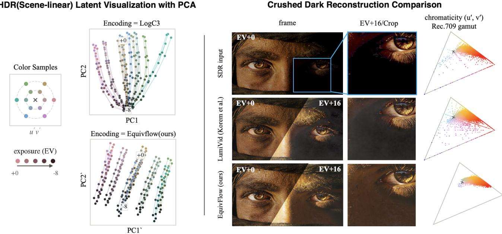
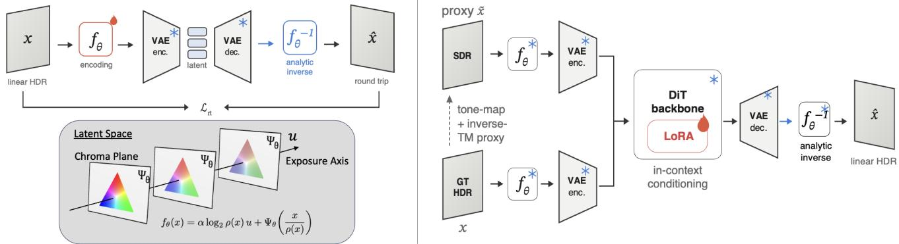
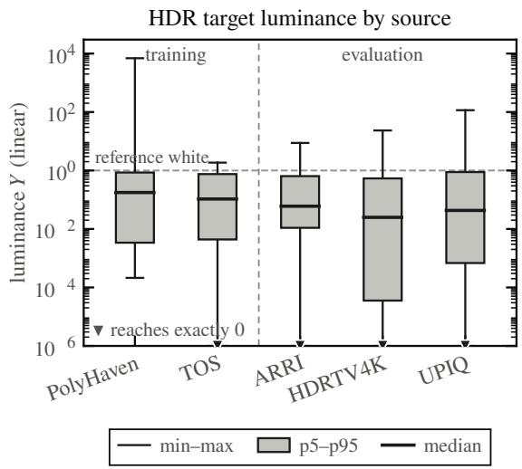
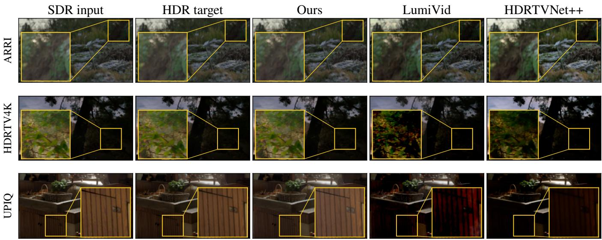

# Dark Matters: VAE-Aware HDR Encoding for SDR-to-HDR Video Reconstruction

Donghoon Cha1, Bomseok Park1, Hansl von Kwon1, Ku DoHyung1, Hanwool Sul2∗

1STUDIO FREEWILLUSION Inc. 2Seoul National University

## Abstract

SDR-to-HDR reconstruction is an ill-posed problem in which clipped highlights, crushed shadows, and quantization arti- facts must be recovered while preserving the original content. Latent difusion models provide powerful generative priors for restoring missing detail, but their efectiveness is constrained by how HDR signals pass through the pretrained VAE. We find that common log-like encodings suppress low-luminance chromatic diferences before generation, producing a dark- side collapse in the frozen-VAE latent. We introduce Equiv- Flow, a compact, invertible exposure-equivariant encoding that maps exposure changes to additive shifts while retaining a scale-independent chromatic component, without modifying the VAE. Encoding-level tests across pretrained image and video VAEs show that its exposure structure and deep-dark chroma transport persist across the tested hosts. Integrated into SDR-to-HDR video difusion, EquivFlow delivers con- sistent chromatic-fidelity gains across the tested settings while retaining competitive reconstruction fidelity.

## Introduction

The growing adoption of high-dynamic-range (HDR) dis-plays and production workflows has increased the demand for converting existing standard-dynamic-range (SDR) content into HDR. This demand extends beyond conventional film and video remastering to a range of applications, includ- ing AI-assisted content creation workflows in which image or video assets are produced in SDR or otherwise limited- dynamic-range form and must be integrated into HDR pro- duction pipelines. SDR-to-HDR reconstruction is therefore becoming increasingly relevant across these application ar- eas.

Dark-region fidelity is also a practical requirement in HDR mastering. Production quality control treats crushed blacks as a defect when underexposure removes intended shadow detail, texture, and depth (Netflix n.d.). At the signal level, perceptual HDR coding allocates precision according to luminance-dependent visibility thresholds so that quanti- zation artifacts remain uniformly small (Miller, Nezamabadi, and Daly 2013). These practices motivate preserving not only shadow luminance but also low-luminance chromatic evidence before it enters the pretrained VAE.

Inverse tone mapping is an inherently ill-posed, one-to- many problem. A single SDR observation may correspond to multiple plausible HDR signals because highlight clip- ping removes intensity variation above the SDR range, while shadow crushing, quantization, and banding suppress subtle luminance and chromatic diferences in dark regions. De- terministic tone expansion alone cannot uniquely recover this missing information. A successful SDR-to-HDR method must instead infer plausible detail in ambiguous regions while preserving the spatial and chromatic evidence that re- mains in the input.

Recent difusion-based SDR-to-HDR methods address this ambiguity using pretrained generative models. Before generation, latent implementations encode HDR signals with a pretrained variational autoencoder (VAE). Recent systems first compress linear HDR with prescribed log- like transforms—LogC3 in LumiVid and Log-Gamma in DifHDR—so that it lies within the pretrained VAE’s oper- ating range (Korem et al. 2026; Yu et al. 2026). The repre-sentation passed through the VAE can therefore afect which luminance and chromatic distinctions remain available to the reconstruction model.

Observation 1: latent chromatic structure collapses at low luminance. Linear HDR signals are poorly matched to the bounded input range of pretrained VAEs; Figure 1 qualitatively illustrates how log-like chromatic trajectories contract in the frozen-VAE latent space at low exposure. Table 1 quantifies this behavior: LogC3 and Log-Gamma match or exceed EquivFlow in frozen-VAE round-trip re- construction, yet retain less linearly recoverable chroma at −8 EV, with LogC3 unrecoverable there. These frozen-VAE representation and round-trip measurements diagnose what reaches the generative model; they are not downstream SDR- to-HDR reconstruction results.
<table><tr><td>encoding</td><td colspan="4">recon  $R _ { u ^ { \prime } v ^ { \prime } } ^ { 2 } ( 0 )$   $R _ { u ^ { \prime } v ^ { \prime } } ^ { 2 } ( - 8 )$  surv.–8 surv.–10</td></tr><tr><td>LogC3</td><td>35.00</td><td>.481 -1.133</td><td>-2.354</td><td>-3.410</td></tr><tr><td>Log-Gamma 36.07</td><td></td><td>.738</td><td>.421 .571</td><td>.391</td></tr><tr><td>EQUIvFLow 34.38</td><td></td><td>.801</td><td>.883 1.102</td><td>1.105</td></tr></table>

Table 1: Frozen-VAE chroma retention for published encod- ings (no fitted head). $R _ { u ^ { \prime } v ^ { \prime } } ^ { 2 }$ measures linear chroma recover- ability; surv.− is retention after k stops of darkening (1.0 = unchanged).

  
Fi ure 1: Motivation. Left: Frozen-VAE latent PCA for 12 chromaticities over 0 to −8 EV. Lo C3 trajectories collapse to one point at −8 EV, while the proposed exposure-equivariant encoding keeps them parallel and separated. The frozen autoencoder and color samples are identical, isolating the encoding as the cause. Right: The same failure in a close-up: the EV+0 frame, the crushed region lifted to EV+16, and its CIE 1976 u′v′ pixel distribution relative to the Rec.709 gamut.

Observation 2: exposure changes scale, not chromaticity. In linear HDR, multiplicative exposure changes overall scale while leaving chromaticity unchanged. This suggests an en- coding in which exposure becomes translation along a fixed code-space direction and a transverse chromatic component remains scale-independent. In our construction, this relation is exact above the luminance toe when both exposure end- points remain above it.

These observations motivate EquivFlow, an invertible exposure-equivariant encoding optimized through the frozen target VAE. It adapts the representation to the VAE’s oper- ating geometry without modifying the pretrained generative backbone.

Our contributions are: (i) We identify and measure the loss of linearly recoverable chromatic structure in dark re- gions after frozen-VAE encoding, and show that the fail- ure is asymmetric across exposure. (ii) We derive Equiv-Flow, an invertible, 13-parameter exposure-equivariant en-coding with an analytic inverse, fitted through frozen-VAE round-trip measurements, and examine its structural behav- ior across multiple pretrained video VAEs. (iii) We inte-grate EquivFlow into SDR-to-HDR video difusion and evaluate it against established baselines, obtaining consis- tent chromatic-fidelity gains across the tested settings while retaining competitive reconstruction fidelity.

## Related Work

Inverse tone mapping and learning-based SDR-to-HDR. Classical iTM expands observed SDR luminance using ana- lytical or spatially adaptive operators (Banterle et al. 2006; Rempel et al. 2007), but cannot model content missing from the input. Learning-based methods instead predict saturated radiance with HDRCNN (Eilertsen et al. 2017), regress HDR through multi-scale features with ExpandNet (Marnerides et al. 2018), or decompose global mapping, local enhancement, and highlight generation with HDRTVNet (Chen et al. 2021). These supervised feed-forward models motivate gen-erative priors for severely underdetermined regions.

Difusion-based SDR-to-HDR reconstruction. Difusion priors ofer a way to synthesize plausible content where the SDR input carries no usable evidence. Existing meth- ods incorporate such priors at diferent stages of reconstruc- tion: Semantic-Aware Difusion iTM completes saturated re- gions before merging estimated exposures (Goswami et al. 2025); LEDif generates and fuses exposure-dependent latents within an LDR latent coordinate system (Wang et al. 2025); and gain-map difusion predicts an SDR base and a gain map (Guan et al. 2025).

Many of these difusion-based approaches build on la- tent difusion models, which perform denoising in the latent space of a pretrained autoencoder rather than directly in pixel space (Rombach et al. 2022). This formulation is particularly attractive for SDR-to-HDR reconstruction, as it enables the reuse of strong pretrained image or video priors while op- erating on compact perceptual representations. Adapting an SDR-pretrained latent difusion model to HDR, however, also requires mapping HDR signals into a form compatible with its pretrained autoencoder. LumiVid addresses distribution alignment by applying a fixed LogC3 (Brendel 2017) transform before a frozen video VAE, thereby mapping scene- linear HDR signals closer to the pretrained latent distribu- tion (Korem et al. 2026). DifHDR follows a related design using a fixed Log-Gamma transform with a frozen video VAE (Yu et al. 2026). These designs highlight HDR encoding as an important component of latent difusion pipelines for SDR-to-HDR reconstruction.

Step 1· VAE-aware encoding optimization fit the exposure-equivariant encoding fthrough the frozen VAE round trip  
Step 2·Adapter finetuning encoding, VAE, and DiT backbone frozen — only the IC-LoRA adapter is trained  
  
Figure 2: Method overview. The display-referred SDR observation is mapped to a scene-linear proxy by a fixed preprocessing convention, so observation and HDR target share one scene-linear coordinate system; the invertible exposure-equivariant encoding $f _ { \theta }$ then carries that space into the pretrained VAE, and is what the generative model actually sees. The encoding is fitted first against the frozen VAE, and the adapter is trained afterwards in the resulting code space. The VAE and the difusion backbone stay frozen throughout.

Luminance and chrominance. Low-light enhancement methods have also emphasized how luminance interacts with color. HVI introduces a trainable color space that separates intensity from chromatic components and compresses low- intensity coordinates to suppress noise (Yan et al. 2025). ICLR further improves luminance–chrominance interaction through dual-stream feature exchange and a covariance cor- rection loss (Xu et al. 2026). These methods show that restoration quality depends not only on network capacity, but also on how luminance and chromatic information are organized before feature extraction. This consideration be- comes particularly important when signals undergo strong dynamic-range compression, since subtle chromatic distinc- tions in dark regions may be attenuated before later restora- tion stages can exploit them.

## Method

## Overview

Our method reconstructs scene-linear HDR video from a display-referred SDR observation through a frozen latent video difusion model. It is defined by three choices. The SDR observation is first mapped to a scene-linear proxy by a fixed preprocessing convention, so that the observation and HDR target can be expressed in one scene-linear coordinate system. That space is then carried into the pretrained VAE by an invertible exposure-equivariant color encoding $f _ { \theta } ,$ which is what the generative model actually sees. Here, “encoding”

denotes an invertible, pointwise reparameterization of scene- linear color rather than a transformation of scene content. The encoding is learned first, against the frozen VAE, so that subsequent adapter training operates in a code space already adapted to the bottleneck it must pass through.

## Exposure Equivariance

The constraint is motivated by what the frozen VAE receives. Log-like encodings can shrink dark chromatic diferences before the VAE sees them (Figure 1), leaving the generative prior conditioned on an already attenuated signal. We therefore seek an encoding in which exposure changes move codes predictably without reducing chromatic separations.

Exposure acts on scene-linear color by a positive scalar, $x \mapsto s x$ . We require the encoding to turn this multiplicative action into a translation along a fixed unit direction u of code space:

$$
f _ { \theta } ( s x ) = f _ { \theta } ( x ) + \alpha \log _ { 2 } ( s ) u , \qquad \| u \| _ { 2 } = 1 ,\tag{1}
$$

with α the code displacement per exposure stop.

Equation (1) gives exposure and chromaticity separate roles in the code. Along u the code travels with exposure; transverse to u it is untouched by any global scaling and therefore carries chromatic information. In particular, code diferences are exposure-invariant, $f _ { \theta } ( s x ) - f _ { \theta } ( s y ) =$ $f _ { \theta } ( x ) - f _ { \theta } ( y )$ , so chromatic amplitude does not contract merely because luminance falls.

The requirement is restrictive enough to be characterized. A map satisfies Eq. (1) for all $s > 0$ if and only if it decom- poses as

$$
f _ { \theta } ( x ) = \alpha \log _ { 2 } \rho ( x ) u + \Psi _ { \theta } \left( \frac { x } { \rho ( x ) } \right) ,\tag{2}
$$

where $\rho$ is positive and 1-homogeneous $( \rho ( s x ) = s \rho ( x ) )$ and $\Psi _ { \theta }$ is defined on the chromaticity slice $\{ x : \rho ( x ) = 1 \}$ with its image taken transverse to the exposure direction u. Taking $\Psi _ { \theta }$ to be the restriction of $f _ { \theta }$ to that slice and applying Eq. (1) with $s = \rho ( x )$ gives one direction; 1-homogeneity of $\rho$ gives the other. The supplement states and proves this formally.

Equation (2) gives a practical template for the encoding. The function $\rho$ chooses the brightness coordinate, $\Psi _ { \theta }$ en-codes the color remaining after brightness normalization, and α sets how far the code moves per exposure stop. Since the VAE accepts only a bounded input range, these choices are fixed as a measured operating point for the target VAE rather than set from color-science principles alone. The con- struction gives an invertible representation in which exposure and color have explicit roles before the representation is fitted to the target VAE.

## Encoding Parameterization

Our encoding, EquivFlow, realizes Eq. (2) in closed form with 13 fitted parameters. We take $\rho = Y$ , the Rec.709 lumi- nance (ITU-R 2015), which is positive and 1-homogeneous, and coordinatize the chromaticity slice by the CIE 1976 coordinates $( u ^ { \prime } , v ^ { \prime } )$ (CIE 2024), which are invariant under x 7→ sx by construction. Both roles of Eq. (2) are then lin-ear, and the encoding is a single afine map of the feature triple $\phi ( x ) = ( \ell _ { \tau } ( Y ) , u ^ { \prime } , v ^ { \prime } )$

$$
f _ { \boldsymbol { \theta } } ( x ) = B \phi ( x ) + b ,\tag{3}
$$

whose intensity coordinate is a toe-limited logarithm,

$$
\ell _ { \tau } ( Y ) = \left\{ \begin{array} { l l } { \log _ { 2 } Y , } & { Y \ge \tau , } \\ { \log _ { 2 } \tau + \displaystyle \frac { Y / \tau - 1 } { \ln 2 } , } & { Y < \tau . } \end{array} \right.\tag{4}
$$

The fitted toe $\tau$ is required because $\log _ { 2 }$ diverges as $Y $ 0 while the code range is bounded; below it the intensity coordinate continues linearly with matched value and slope. This keeps the luminance coordinate finite near black without introducing a discontinuity at the toe.

Above the toe the encoding satisfies Eq. (1) exactly rather than approximately: $u ^ { \prime }$ and $\hat { v ^ { \prime } }$ are unchanged by scaling and $\ell _ { \tau } ( s \dot { Y } ) \dot { = } \ell _ { \tau } ( Y ) \dot { + } \log _ { 2 } s , \mathrm { s o } f _ { \theta } ( s x ) = \bar { f _ { \theta } ( x ) } \dot { + } \log _ { 2 } ( s ) \dot { B } e _ { 1 } .$ The flow direction and the per-stop budget are therefore read of the first column of $B .$

$$
u = \frac { B e _ { 1 } } { \| B e _ { 1 } \| _ { 2 } } , \qquad \alpha = \| B e _ { 1 } \| _ { 2 } ,\tag{5}
$$

so the exposure direction and per-stop displacement are de- termined by the first column of $B$ . Inversion needs no learned decoder: solving the afine system gives $\phi = B ^ { - 1 } ( z - b )$ from which $Y \overset { = } { = } \ell _ { \tau } ^ { - 1 } ( \phi _ { 1 } )$ and $( Y , \bar { u ^ { \prime } } , v ^ { \prime } )$ maps back to lin- ear Rec.709 in closed form, followed by the nonnegativity projection. The 13 parameters are the 9 entries of ${ \bar { B } } ,$ the 3 ofsets b, and the toe τ.

## VAE-Aware Optimization

Analytic invertibility does not imply survival through the pretrained bottleneck. The encoder is frozen and has its own operating geometry, so theclosed-form parameters of Eq. (3) are fitted against that geometry rather than from color-science principles alone. For the encoding $f _ { \theta } ,$ , the relevant measure- ment is the frozen VAE round trip

$$
x  f _ { \theta } ( x )  D ( E ( f _ { \theta } ( x ) ) )  f _ { \theta } ^ { - 1 } ( D ( E ( f _ { \theta } ( x ) ) ) ) .\tag{6}
$$

where $E$ and D are the frozen encoder and decoder and the final inverse is followed by the nonnegativity projection.

Let ${ \hat { x } } _ { \theta }$ denote the output of this round trip. For Equiv- Flow, we score VAE compatibility by the round-trip recon- struction loss

$$
\begin{array} { r } { \mathcal { L } _ { \mathrm { r t } } = \| \log ( 1 + \hat { x } _ { \theta } ) - \log ( 1 + x ) \| _ { 2 } ^ { 2 } } \\ { +  \lambda _ { u v } \| m ( x ) \big ( q ( \hat { x } _ { \theta } ) - q ( x ) \big ) \| _ { 2 } ^ { 2 } . } \end{array}\tag{7}
$$

Here $q ( x ) = ( u ^ { \prime } ( x ) , v ^ { \prime } ( x ) )$ and $m ( x )$ masks pixels above the dark-noise floor. The encoding is also required to keep codes in the VAE input range before hard clipping.

The EquivFlow encoding is an exactly exposure- equivariant closed form with an analytic inverse, fitted by frozen-VAE round-trip measurements before any task-level difusion evaluation.

The fitted parameters belong to the VAE they were fitted against; how far one parameter set transfers to other frozen bottlenecks is measured in the experiments rather than as- sumed.

## SDR-to-HDR Reconstruction

After fitting, the encoding is fixed. For supervised training and evaluation, each scene-linear HDR target x is rendered to a display-referred SDR observation by a fixed recipe: normal- ization, extended Reinhard tone mapping, per-channel clip- ping, the sRGB OETF (IEC 1999), and 8-bit quantization. The SDR observation is then mapped to a scene-linear proxy $\tilde { x }$ using a fixed Reinhard inverse-tone-mapping preprocess- ing convention. This proxy defines the conditioning coordi- nate used by the model, while clipped, crushed, and quantized content remains underdetermined. Because the preprocess- ing contract may afect performance, the experiments addi- tionally evaluate tone-mapper variants rendered with Rein- hard (Reinhard et al. 2002) and ACES-like (Narkowicz 2016) curves.

Both x and x˜ are mapped through the same encoding $f _ { \theta }$ and encoded online by the frozen VAE. The target latent serves as the difusion target, while the proxy latent is sup- plied as in-context conditioning.

At inference, the conditioned difusion model predicts an HDR encoding latent. The frozen VAE decoder maps this latent to encoding space, after which the analytic inverse of $f _ { \theta }$ maps the result to linear HDR:

$$
\hat { x } = f _ { \theta } ^ { - 1 } \left( D ( \hat { h } ) \right) .\tag{8}
$$

Difusion backbone and IC-LoRA adaptation. The re-construction model uses an in-context LoRA conditioning scheme (Huang et al. 2024). In our implementation, the SDR condition latent is formed from the scene-linear proxy af- ter the same color encoding $f _ { \theta } ,$ , rather than from raw SDR. It is prepended as clean reference tokens to the noised HDR target-token sequence; reference tokens receive zero timestep and are excluded from the denoisin loss, which is evaluated only on the target portion. Only the low-rank adapter (Hu et al. 2022) is optimized; the VAE, difusion backbone, and text encoder remain frozen.

<table><tr><td>method</td><td colspan="4">ARRI (40)</td><td colspan="4">HDRTV4K (40)</td><td colspan="4">UPIQ (22)</td></tr><tr><td></td><td colspan="2">PU21-PSNR ↑</td><td colspan="2"> $\Delta C _ { T } C _ { P } \downarrow$ </td><td colspan="2">PU21-PSNR ↑</td><td colspan="2"> $\Delta C _ { T } C _ { P } \downarrow$ </td><td colspan="2">PU21-PSNR ↑</td><td colspan="2"> $\Delta C _ { T } C _ { P } \downarrow$ </td></tr><tr><td>TM method</td><td>rein.</td><td>aces</td><td>rein.</td><td>aces</td><td>rein.</td><td>aces</td><td>rein.</td><td>aces</td><td>rein.</td><td>aces</td><td>rein.</td><td>aces</td></tr><tr><td>EQUIvFLOW</td><td>39.99</td><td>26.11</td><td>5.51</td><td>5.97</td><td>33.12</td><td>26.16</td><td>8.67</td><td>10.23</td><td>41.77</td><td>27.61</td><td>3.02</td><td>4.27</td></tr><tr><td>LogC3</td><td>39.70</td><td>26.33</td><td>5.52</td><td>6.23</td><td>31.43</td><td>27.44</td><td>9.73</td><td>11.95</td><td>39.28</td><td>28.63</td><td>3.93</td><td>5.59</td></tr><tr><td>LumiVid</td><td>36.26</td><td>25.98</td><td>6.87</td><td>8.18</td><td>32.36</td><td>27.25</td><td>10.86</td><td>14.54</td><td>36.01</td><td>26.94</td><td>6.18</td><td>10.30</td></tr><tr><td>HDRTVNet++</td><td>26.32</td><td>20.61</td><td>6.05</td><td>6.23</td><td></td><td></td><td></td><td></td><td>28.07</td><td>22.48</td><td>4.96</td><td>6.19</td></tr><tr><td>LEDiff</td><td>18.37</td><td>18.74</td><td>12.25</td><td>12.29</td><td>18.88</td><td>19.12</td><td>18.87</td><td>19.41</td><td>20.10</td><td>20.64</td><td>10.29</td><td>10.74</td></tr></table>

Table 2: PU21-PSNR and the chromatic $\Delta E _ { \mathrm { I T P } }$ term $\Delta C _ { T } C _ { P }$ on a frozen 102-clip test set — the first 40 ARRI crops (10 parents), the first 40 HDRTV4K clips (19 parents), and all 22 UPIQ parents — frozen before any aggregation was computed, under the training curve (rein.) and one unseen curve (aces); the HDR ground truth, clip list, per-clip normalization and crop are held fixed while the SDR tone curve moves. EquivFlow holds the lowest $\Delta C _ { T } C _ { P }$ in all six chromatic columns and the best PU21-PSNR under the training curve on all three sets; under the unseen curve the aggregate lead passes to LogC3. $\Delta C _ { T } C _ { P }$ is defined on PQ-encoded ICtCp and is not exposure-invariant; the exposure-invariant $\widetilde { \Delta } u ^ { \prime } v ^ { \prime }$ reading is Table 3. Parent-weighted means; clip counts in parentheses; best per column in bold. Upper block: the matched internal pair; lower block: external systems. —: withheld, same-domain with HDRTVNet++’s training corpus and never allowed to win a column.

  
Figure 3: HDR target luminance by source (log axis, pooled over sampled pixels): line and caps span minimum to maximum, the bar the 5th–95th percentile, the dot the median, and the dashed line marks reference white. Target, not the SDR the model receives.

## Experiments

## Datasets and Setup

Training corpus. All internal arms are trained on one corpus of 5,780 crops at 960 × 544 and 49 frames, drawn from 1,015 parent sequences: 215 windows from 94 Tears of Steel (Blender Foundation 2012) shots (2,580 crops) and 800 clips rendered from PolyHaven (Poly Haven n.d.) HDRI panoramas (3,200 crops). Splits are parent-disjoint, shotlevel for Tears of Steel and asset-level for PolyHaven.

These are fixed derivatives of the cited public sources, not a newly introduced dataset or benchmark.

Training inputs. Training SDR inputs use the fixed Reinhard-based rendering protocol described in the Method section, followed by the same camera-style degradations for every internal arm: contrast scaling, band-selective blur, 8- bit quantization, and codec compression. Evaluation addi- tionally includes ACES-like renderings.

Evaluation sets. We evaluate on ARRI’s oficial ALEXA Mini ProRes 4444 XQ sample reel M001R00H (ARRI n.d.), HDRTV4K (Guo et al. 2023), and UPIQ (Mikhailiuk et al. 2021), decoding every prediction to common linear Rec. 709 (ITU-R 2015) before scoring. ARRI contains 176 crops from 44 cinema-camera parents and is the brightest set. HDRTV4K contains 78 clips from 36 parents of mixed video and static content, including material from the source used by HDRTVNet++. UPIQ contains one 49-frame static clip for each of 22 calibrated image parents, so temporal met- rics are undefined there. The main table reports a 102-clip test subset frozen before any aggregation was computed: the first 40 ARRI crops (10 parents), the first 40 HDRTV4K clips (19 parents), and all 22 UPIQ parents. The chromaticdecomposition panel is computed on the full HDRTV4K– UPIQ pool.

Baselines. The internal rows share the training split above, the frozen LTX-2.3 22B backbone and VAE (HaCohen et al. 2024; Lightricks 2026), IC-LoRA adapter (Huang et al. 2024), inference settings, and scorer. We report the protocol from the Method section: canonical Reinhard inputs and one unseen tone mapper, ACES-like. LogC3 is the matched inter- nal baseline: it is retrained on the same corpus and degrada- tion protocol with the same backbone, conditioning method, and scorer. The two internal arms difer in the HDR repre- sentation and in its paired reference contract: EquivFlow conditions on the inverse-tone-mapped scene-linear proxy of the Method section, which is part of the contribution, while LogC3 is trained under raw-SDR conditioning, the oficial

  
Figure 4: Qualitative comparison at frame 24. The inset covers the darkest chroma-carrying ground-truth region; each row carries a display gain applied identically across columns.

contract of LumiVid.

LumiVid is reported separately because it is the closest ar- chitectural predecessor: a pretrained video difusion model adapted for SDR-to-HDR through a fixed LogC3 interface. HDRTVNet++ (Chen et al. 2023) and LEDif (Wang et al. 2025) are external system baselines that difer in architecture, training data, and budget. LEDif uses its oficial preprocess- ing and one method-level radiometric gain fitted on a frozen 24-clip training subset, without access to test images or per- clip ground truth.

## Main Results

Quantitative results. Table 2 evaluates the frozen test subset under the training Reinhard curve and an unseen ACES-like curve, with the target and evaluated clips held fixed. PU21- PSNR (Mantiuk and Azimi 2021) measures aggregate HDR reconstruction, while $\Delta C _ { T } C _ { P }$ , the chromatic component of $\Delta E _ { \mathrm { I T P } }$ (ITU-R 2019), measures perceptual chromatic error at absolute luminance. Under the training curve, EquivFlow leads the matched LogC3 control on both quantities across all three sets. Under the unseen curve, it retains the chromatic lead throughout, while LogC3 takes the aggregate PU21- PSNR lead. The consistent result is therefore improved chro- matic fidelity across tone curves; aggregate reconstruction depends more strongly on the SDR rendering. Parent-level tests support the matched-pair chromatic diference on UPIQ under the training curve and on HDRTV4K and UPIQ under the unseen curve; the smaller ARRI subset does not separate under the training curve. Remaining preregistered metrics and full statistical details are reported in the supplement.

Baseline comparison. LumiVid is the closest architectural predecessor and therefore the most direct external compar- ison. EquivFlow has lower chromatic error in every col- umn and higher aggregate fidelity in all but the HDRTV4K ACES-like case. It also leads LEDif and HDRTVNet++ on both reported quantities wherever a comparison is available;

<table><tr><td></td><td colspan="2">reinhard</td><td colspan="2">aces-like</td></tr><tr><td>metric ↓</td><td>Ours</td><td>LogC3</td><td>Ours</td><td>LogC3</td></tr><tr><td>chroma L1</td><td>.0431</td><td>.0539</td><td>.0525</td><td>.0656</td></tr><tr><td> $\Delta u ^ { \prime } v ^ { \prime }$ </td><td>.0140</td><td>.0173</td><td>.0170</td><td>.0247</td></tr><tr><td> $\Delta C _ { T } C _ { P }$ </td><td>6.37</td><td>7.37</td><td>7.98</td><td>9.47</td></tr></table>

Table 3: Chromatic error of the internal pair on the pooled HDRTV4K–UPIQ panel (58 parents), training curve and one unseen curve. Lower is better; parent-weighted; best per pair in bold. All six paired diferences favor Ours and survive Holm correction (largest corrected $p = 4 . 8 \times 1 0 ^ { - 6 } )$ . ARRI appears in Table 2 only; nested $\Delta u ^ { \prime } v ^ { \prime }$ variants and per-metric intervals: supplement.

HDRTVNet++ is withheld on HDRTV4K because that set is same-domain. These remain system-level comparisons be- cause architecture, training data, radiometric convention, and budget difer.

Chromatic decomposition. To test whether the maintable chromatic trend depends on one metric, Table 3 evaluates the matched pair using raw chroma amplitude, exposure-invariant CIE 1976 chromaticity, and PQ-encoded ICtCp (ITU-R 2018). Every metric favors EquivFlow under both tone curves, with a larger margin under the unseen curve. This consistency supports the chromatic-fidelity read- ing across the tested metrics and curves.

Qualitative results. Figure 4 shows the highest-margin EquivFlow–LumiVid example from each evaluation set, so the rows show selected successes rather than typical cases. In the magnified dark regions, EquivFlow remains closer to the target’s color and local structure, while the comparison outputs show stronger saturation, hue, or shadow-level devi- ations. These examples complement, but do not replace, the dataset-level quantitative comparisons above.

<table><tr><td>VAE</td><td> $R _ { \beta } ^ { 2 }$  ↑ grid 0→−8 ↑  $\Delta u ^ { \prime } v _ { - } ^ { \prime }$  8 ↓ /LTX</td></tr><tr><td>LTX</td><td>0.9990 0.979→0.979 0.01536 1.000</td></tr><tr><td></td><td>SD 2.1 0.9927 0.667→0.812 0.00756 0.492</td></tr><tr><td></td><td>Wan 2.1 0.9977 0.958→0.917 0.00824 0.536</td></tr><tr><td></td><td>Wan 2.2 0.9976 0.979→0.854 0.00793 0.516</td></tr></table>

Table 4: Training-free portability of EquivFlow, measured on this draft’s carrier. Grid accuracy uses a host- and exposure-specific readout; $\Delta u ^ { \prime } v ^ { \prime }$ is frozen-VAE round-trip error and /LTX is that error relative to the LTX host.

## Representation Analysis

Table 1 tests representation behavior before difusion by pass- ing each published encoding through the same frozen VAE without a fitted head. The log-like encodings reconstruct well but lose linearly recoverable chroma as exposure falls, whereas EquivFlow preserves it; reconstruction quality is therefore not a proxy for dark-exposure chroma retention. This divergence is consistent with exposure–chroma cou- pling and matches the downstream widening of the chromatic margin under the unseen tone curve (Tables 2 and 3). We next examine the supporting design choices.

Cross-VAE transfer test. EquivFlow’s exposure structure is tested on frozen LTX, Stable Difusion 2.1 (Rombach et al. 2022; Stability AI 2022), Wan 2.1 T2V-1.3B (Team Wan et al. 2025), and Wan 2.2 TI2V-5B (Wan Team 2025) VAEs; only LTX was used during fitting. On the three for- eign hosts, the exposure-linked latent displacement remains nearly linear and chromaticity readout stays above chance at deep exposure. All three foreign hosts pass the frozen roundtrip non-collapse rule in that regime.

Portability here concerns the exposure structure, not the latent coordinates themselves: an EV-0-frozen readout de- grades along each host’s exposure trajectory, and absolute round-trip quality varies substantially across hosts.

## Conclusion

We introduced EquivFlow, a VAE-aware HDR encoding motivated by the loss of recoverable chromatic structure under darkening in common log-like representations. Its compact, invertible, pointwise construction maps exposure changes to code-space translations while preserving a scale- independent chromatic component, without modifying the pretrained VAE or difusion backbone. Representation anal- yses across pretrained image and video VAEs confirm the persistence of this structure, and integration into SDR-to- HDR video difusion yields consistent chromatic-fidelity gains across the tested datasets and tone curves while re- taining competitive reconstruction fidelity. Together, these results establish VAE-aware encoding as an efective inter- face for adapting pretrained latent generative models to HDR reconstruction. Future work will examine this design across broader VAE families and reconstruction settings.

## References

ARRI. n.d. ARRI Camera Sample Footage and Reference

Images. Oficial sample-footage collection. ALEXA Mini ProRes 4444 XQ sample reel M001R00H.

Banterle, F.; Ledda, P.; Debattista, K.; and Chalmers, A. 2006. Inverse Tone Mapping. In Proceedings ofGRAPHITE.

Blender Foundation. 2012. Tears of Steel. Mango Open Movie Project, https://mango.blender.org/.

Brendel, H. 2017. ALEXA Log C Curve: Usage in VFX. White paper, ARRI. LogC3 definition.

Chen, X.; Li, Z.; Zhang, Z.; Ren, J. S.; Liu, Y.; He, J.;Qiao, Y.; Zhou, J.; and Dong, C. 2023. Towards EficientSDRTV-to-HDRTV by Learning from Image Formation.arXiv preprint arXiv:2309.04084. HDRTVNet++.

Chen, X.; Zhang, Z.; Ren, J. S.; Tian, L.; Qiao, Y.; and Dong, C. 2021. A New Journey from SDRTV to HDRTV. In Proceedings of the IEEE/CVF International Conference on Computer Vision (ICCV).

CIE. 2024. ISO/CIE 11664-5:2024: Colorimetry—Part 5: CIE 1976 $L ^ { \ast } u ^ { \ast } v ^ { \ast }$ Colour Space and u′, v′ Uniform Chro-maticity Scale Diagram. Technical report, International Commission on Illumination.

Eilertsen, G.; Kronander, J.; Denes, G.; Mantiuk, R. K.; and Unger, J. 2017. HDR Image Reconstruction from a Single Exposure Using Deep CNNs. ACM Transactions on Graphics, 36(6).

Goswami, A.; Singh, A. R.; Banterle, F.; Debattista, K.; and Bashford-Rogers, T. 2025. Semantic Aware Difusion In- verse Tone Mapping. Journal ofPhysics: Conference Series, 3128(1): 012009. ArXiv:2405.15468.

Guan, Y.; Xu, R.; Liao, Y.; Yao, M.; Wang, L.; and Xiong, Z. 2025. HDR Image Generation via Gain Map Decomposed Difusion. In Proceedings of the IEEE/CVF International Conference on Computer Vision (ICCV), 17536–17545.

Guo, C.; Fan, L.; Xue, Z.; and Jiang, X. 2023. Learn- ing a Practical SDR-to-HDRTV Up-Conversion Using New Dataset and Degradation Models. In IEEE/CVF Conference on Computer Vision and Pattern Recognition (CVPR), 22231–22241.

HaCohen, Y.; Chiprut, N.; Brazowski, B.; Shalem, D.; Moshe, D.; Richardson, E.; Levin, E.; Shiran, G.; Zabari, N.; Gordon, O.; Panet, P.; Weissbuch, S.; Kulikov, V.; Bitterman, Y.; Melumian, Z.; and Bibi, O. 2024. LTX-Video: Realtime Video Latent Difusion. arXiv preprint arXiv:2501.00103.

Hu, E. J.; Shen, Y.; Wallis, P.; Allen-Zhu, Z.; Li, Y.; Wang, S.; Wang, L.; and Chen, W. 2022. LoRA: Low-Rank Adaptation of Large Language Models. In International Conference on Learning Representations (ICLR).

Huang, L.; Wang, W.; Wu, Z.-F.; Shi, Y.; Dou, H.; Liang, C.;Feng, Y.; Liu, Y.; and Zhou, J. 2024. In-Context LoRA forDifusion Transformers. arXiv preprint arXiv:2410.23775.

IEC. 1999. IEC 61966-2-1:1999: Multimedia Systems and Equipment—Colour Measurement and Management—Part 2-1: Colour Management—Default RGB Colour Space— sRGB. Technical report, International Electrotechnical Com- mission.

ITU-R. 2015. Recommendation ITU-R BT.709-6: Parameter Values for the HDTV Standards for Production and Interna- tional Programme Exchange. Technical report, International Telecommunication Union.

ITU-R. 2018. Recommendation ITU-R BT.2100-2: Image Parameter Values for High Dynamic Range Television for Use in Production and International Programme Exchange. Technical report, International Telecommunication Union. ICtCp definition.

ITU-R. 2019. Recommendation ITU-R BT.2124-0: Objective Metric for the Assessment of the Potential Visibility of Colour Diferences in Television. Technical report, Interna- tional Telecommunication Union. Delta E ITP definition.

Korem, N. K.; Oumoumad, M.; Cain, H.; Ben Yosef, M.; Jelercic, U.; Bibi, O.; Inger, Y.; Patashnik, O.; and Cohen-Or, D. 2026. HDR Video Generation via Latent Alignment with Logarithmic Encoding. arXiv preprint arXiv:2604.11788. LumiVid.

Lightricks. 2026. LTX-2.3 Model and Inference Repository. GitHub repository. LTX-2.3 22B development checkpoint.

Mantiuk, R. K.; and Azimi, M. 2021. PU21: A Novel Per- ceptually Uniform Encoding for Adapting Existing Quality Metrics for HDR. In Picture Coding Symposium (PCS).

Marnerides, D.; Bashford-Rogers, T.; Hatchett, J.; and De- battista, K. 2018. ExpandNet: A Deep Convolutional Neural Network for High Dynamic Range Expansion from Low Dy- namic Range Content. Computer Graphics Forum, 37(2): 37–49.

Mikhailiuk, A.; Pérez-Ortiz, M.; Yue, D.; Suen, W.; and Mantiuk, R. K. 2021. Consolidated Dataset and Metrics for High-Dynamic-Range Image Quality. IEEE Transactions on Multimedia, 24: 2125–2138.

Miller, S.; Nezamabadi, M.; and Daly, S. 2013. Percep- tual Signal Coding for More Eficient Usage of Bit Codes. SMPTE Motion Imaging Journal, 122(4): 52–59.

Narkowicz, K. 2016. ACES Filmic Tone Mapping Curve. Technical blog. Fitted ACES-like approximation, not the normative ACES rendering transform.

Netflix. n.d. Crushed Blacks. Netflix Partner Help Center.

Poly Haven. n.d. Poly Haven: HDRI Library. https: //polyhaven.com/hdris.

Reinhard, E.; Stark, M.; Shirley, P.; and Ferwerda, J. 2002. Photographic Tone Reproduction for Digital Images. ACM Transactions on Graphics, 21(3): 267–276.

Rempel, A. G.; Trentacoste, M.; Seetzen, H.; Young, H. D.; Heidrich, W.; Whitehead, L.; and Ward, G. 2007. Ldr2Hdr: On-the-Fly Reverse Tone Mapping of Legacy Video and Pho- tographs. In ACM SIGGRAPH 2007 Papers.

Rombach, R.; Blattmann, A.; Lorenz, D.; Esser, P.; and Om- mer, B. 2022. High-Resolution Image Synthesis with Latent Difusion Models. In Proceedings of the IEEE/CVF Conference on Computer Vision and Pattern Recognition (CVPR).

Stability AI. 2022. Stable Difusion v2-1 Model Card. Hug- ging Face model card; accessed through the sd2-community mirror.

Team Wan; et al. 2025. Wan: Open and Advanced Large-Scale Video Generative Models. arXiv preprint arXiv:2503.20314.

Wan Team. 2025. Wan2.2: Open and Advanced Large-Scale Video Generative Models. GitHub repository and model release.

Wang, C.; Xia, Z.; Leimkühler, T.; Myszkowski, K.; and Zhang, X. 2025. LEDif: Latent Exposure Difusion for HDR Generation. In Proceedings ofthe IEEE/CVF Conference on Computer Vision and Pattern Recognition (CVPR), 453–464. ArXiv:2412.14456.

Xu, X.; Liu, H.; Liu, W.; Wang, W.; Wu, J.; and Jiang, K. 2026. ICLR: Inter-Chrominance and Luminance Interaction for Natural Color Restoration in Low-Light Image Enhance- ment. In Proceedings of the AAAI Conference on Artificial Intelligence, volume 40, 11415–11423.

Yan, Q.; Feng, Y.; Zhang, C.; Pang, G.; Shi, K.; Wu, P.; Dong, W.; Sun, J.; and Zhang, Y. 2025. HVI: A New Color Space for Low-light Image Enhancement. In Proceedings of the IEEE/CVF Conference on Computer Vision and Pattern Recognition (CVPR), 5678–5687.

Yu, Z.; Ma, L.; He, M.; Isikdogan, L.; Xu, Y.; Smirnov, D.; Salamanca, P.; Mi, D.; Delgado, P.; Yu, N.; Philip, J.; Li, X.; Wang, W.; and Debevec, P. 2026. DifHDR: Re-Exposing LDR Videos with Video Difusion Models. arXiv preprint arXiv:2604.06161.

## Supplementary Material

## Exposure-Equivariant Encodings

This section states the general characterization used in the main paper and then verifies the properties of the realized encoding. Let $f : \mathbb { R } _ { > 0 } ^ { 3 }  \mathbb { R } ^ { d }$ be a code map, let $u \in \mathbb { R } ^ { d }$ be a unit vector, and let $\alpha > 0$ . We say that f is exposureequivariant along u $\operatorname { i f } ,$ for every color $\boldsymbol { x } \in \dot { \mathbb R } _ { > 0 } ^ { 3 }$ and every exposure scale $s > 0$

$$
f ( s x ) = f ( x ) + \alpha \log _ { 2 } ( s ) u .\tag{1}
$$

Proposition 1 (characterization). Let $\rho : \mathbb { R } _ { > 0 } ^ { 3 }  \mathbb { R } _ { > 0 }$ be any positive 1-homogeneous function, $\rho ( s x ) \stackrel { \cdot } { = } s \rho ( x )$ , and define

$$
\mathcal { C } _ { \rho } = \{ c \in \mathbb { R } _ { > 0 } ^ { 3 } : \rho ( c ) = 1 \} .
$$

A map $f$ satisfies $\mathrm { E q . ~ ( 1 ) }$ if and only if there exists a map $\Psi : \mathcal { C } _ { \rho } \overset { \cdot } { \to } \mathbb { R } ^ { d }$ such that

$$
f ( x ) = \alpha \log _ { 2 } \rho ( x ) u + \Psi \left( \frac { x } { \rho ( x ) } \right) .\tag{2}
$$

This characterization alone does not assert injectivity; transversality and injectivity of the chromatic component are additional requirements.

Proof. Assume Eq. (1). For $c \in { \mathcal { C } } _ { \rho } ,$ , define $\Psi ( c ) = f ( c )$ For arbitrary x, set $c = x / \rho ( x )$ . Homogeneity gives $\rho ( c ) = 1$ and $x = \rho ( x ) c$ . Hence

$$
f ( x ) = f ( c ) + \alpha \log _ { 2 } \rho ( x ) u = \Psi ( c ) + \alpha \log _ { 2 } \rho ( x ) u ,
$$

which is Eq. (2). Conversely, homogeneity gives $\rho ( s x ) = $ $s \rho ( x )$ and $s x / \rho ( s x ) = x / \rho ( x )$ . Substitution into Eq. (2) yields

$$
f ( s x ) = \alpha \log _ { 2 } ( s \rho ( x ) ) u + \Psi \left( \frac { x } { \rho ( x ) } \right) = f ( x ) + \alpha \log _ { 2 } ( s ) u .
$$

□

## The Realized Encoding

The deployed EquivFlow encoding is

$$
f ( x ) = B \left[ \begin{array} { c } { { \ell _ { \tau } ( Y ( x ) ) } } \\ { { u ^ { \prime } ( x ) } } \\ { { v ^ { \prime } ( x ) } } \end{array} \right] + b ,\tag{3}
$$

where $Y , u ^ { \prime } , v ^ { \prime }$ are Rec. 709 luminance and CIE 1976 chro- maticity. The toe-limited log luminance is

$$
\ell _ { \tau } ( Y ) = \left\{ \begin{array} { l l } { \log _ { 2 } Y , } & { Y \geq \tau , } \\ { \log _ { 2 } \tau + ( Y / \tau - 1 ) / \ln 2 , } & { 0 \leq Y < \tau . } \end{array} \right.\tag{4}
$$

The frozen numerical values are

$$
B = { \left[ \begin{array} { l l l } { 0 . 0 5 1 2 1 5 6 5 2 6 } & { 1 . 0 5 0 3 0 7 2 5 1 3 } & { 0 . 1 6 8 7 9 8 3 2 4 9 } \\ { 0 . 0 5 5 3 5 8 5 1 5 6 } & { - 0 . 4 9 6 5 9 9 7 4 7 4 } & { 0 . 3 4 9 1 4 9 6 7 4 8 } \\ { 0 . 0 4 9 9 2 6 6 0 5 6 } & { 0 . 0 3 9 9 7 1 9 4 8 6 } & { - 1 . 0 1 4 8 5 7 1 8 5 6 } \end{array} \right] } ,
$$

$$
b = \left[ 0 . 4 5 9 9 7 0 1 2 0 9 \quad 0 . 6 9 5 6 4 2 5 4 3 6 \quad 1 . 2 1 7 1 1 7 9 0 9 7 \right] ^ { \mathrm { T } } , \quad \tau = 0 . 0 0 1 0 5 4 3 4 1 4 8 6 7 .
$$

Analytic inverse and transversality. The scalar function $\ell _ { \tau }$ is strictly increasing on $Y \ \geq 0 .$ , with range $[ t _ { \mathrm { m i n } } , \infty )$ where $t _ { \mathrm { m i n } } = \log _ { 2 } \tau - 1 /$ ln 2. Its inverse is

$$
\ell _ { \tau } ^ { - 1 } ( t ) = \left\{ { 2 ^ { t } , \qquad t \geq \log _ { 2 } \tau , } \right.\tag{5}
$$

Moreover, the selected B is nonsingular: it has rank 3, det $B \ = \ 0 . 1 0 6 9 7$ , and spectral condition number 13.77. Thus, for a code z in the image of Eq. (3), one first computes $q = B ^ { - 1 } ( z - b )$ , recovers $\bar { Y } = \ell _ { \tau } ^ { - 1 } ( q _ { 1 } )$ , and then converts $\left( Y , q _ { 2 } , q _ { 3 } \right) \ : = \ : \left( \dot { Y } , u ^ { \prime } , v ^ { \prime } \right)$ uniquely back to linear Rec. 709 RGB. The standard $Y u ^ { \prime } v ^ { \prime }$ inverse is unique on the admis- sible positive-color domain $( Y > 0 , v ^ { \prime } > 0 )$ , and the Rec. 709 RGB–XYZ matrix is nonsingular. Therefore Eq. (3) is injective on that domain.

This argument does not require the exposure and chromatic code directions to be orthogonal. Define the dual functional

$$
\lambda ^ { \mathsf { T } } = e _ { 1 } ^ { \mathsf { T } } B ^ { - 1 } .
$$

Then $\lambda ^ { \mathsf { T } } B e _ { 1 } = 1$ and $\lambda ^ { \mathsf { T } } B e _ { 2 } = \lambda ^ { \mathsf { T } } B e _ { 3 } = 0$ . Consequently, $\lambda ^ { \mathsf { T } } ( z - b )$ recovers the luminance coordinate, while the chro- matic plane span $( B e _ { 2 } , B e _ { 3 } )$ lies in ker $\lambda ^ { \mathsf { T } }$ . This is the non- orthogonal direct-sum transversality realized by the fitted matrix.

Exactness domain. Above the toe, scaling RGB by s leaves $( u ^ { \prime } , v ^ { \prime } )$ unchanged and increments the first coordinate by $\log _ { 2 } s .$ . Hence Eq. (1) holds whenever both Y and $s Y$ are at least τ, with $\alpha = \| B e _ { 1 } \| _ { 2 }$ and $\displaystyle { u = B e _ { 1 } / \| B e _ { 1 } \| _ { 2 } } .$ The linear toe is deliberately finite at black and is not exactly log-equivariant when either endpoint lies below τ.

The implementation floors RGB components at $1 0 ^ { - 8 }$ be- fore computing $u ^ { \prime } v ^ { \prime } .$ , clamps inverse RGB to the nonnegative orthant, and clamps encoded codes to [0, 1] at the VAE interface before mapping them to $[ - 1 , 1 ]$ . Accordingly, analytic injectivity and equivariance refer to the mathematical encoding on the interior where these guards and code clipping are inactive; they are not claims of global invertibility or exact equivariance for the clipped VAE pipeline.

## Encoding Fitting and Selection

Relation to the main paper. The main paper describes en-coding fitting at the interface level: the closed-form param- eters of its Eq. (3) are fitted by frozen-VAE round-trip measurements, and Figure 2 (Step 1) depicts that fitting as a sin-gle block. Concretely, this block is realized in two sub-stages. Stage 1 optimizes an auxiliary intermediate map through the frozen VAE by gradient descent; its round-trip component corresponds to main-paper Eq. (7) (see the normalization note below), and the main paper’s code-range requirement enters as the range penalty of the stage-1 objective, Eq. (6) below. Stage 2 produces the deployed encoding in closed form: the stage-1 targets are projected into the afine family of main-paper Eq. (3) by least squares (afine distillation), and one displacement scale is then chosen by the prespeci- fied selection gates. The deployed parameters are therefore obtained as follows: B and b from the closed-form projection, the toe τ carried over from the stage-1 map and frozen, and the first-column scale from the frozen selection rule. Gradi- ent optimization occurs only inside stage 1; the stage-1 map is scafolding and is discarded after distillation.

Calibration data. The encoding was fitted once through the frozen LTX video VAE. The fixed calibration pool con- tains 768 crops: four crops from each of 192 temporal win- dows. Each crop has 9 frames at $2 5 6 \times 2 5 6$ . With seed 0, saturation is sampled uniformly from [.55, .80] and, with probability .5, hue is perturbed uniformly within $[ - 4 0 ^ { \circ } , 4 0 ^ { \circ } ]$

Stage 1: VAE-aware fitting targets. Stage 1 optimizes an intermediate map g only to provide targets for afine distillation. Concretely, g is the fixed-form analytic map

$$
g ( x ) = s _ { \mathrm { o u t } } \odot M _ { 2 } \{ a \odot \mathrm { a s i n h } ( b \odot M _ { 1 } x ) + d \} + b _ { \mathrm { o u t } } ,
$$

where $M _ { i } = I + \Delta M _ { i } ;$ its active tensors comprise the two $3 { \times } 3$ matrices; the three-channel $a , b , d , s _ { \mathrm { o u t } } , b _ { \mathrm { o u t } } ;$ an unconstrained three-vector normalized to the unit gauge u; and one log-scale whose exponential is $\alpha - 3 7$ scalar parameters, of which u and α serve only the structural terms below. Its internal parameterization is not part of the deployed encod- ing. The final afine map instead obtains its realized exposure flow directly from $B e _ { 1 }$

The frozen VAE is kept in the computation graph: codes are clamped to [0, 1], mapped to $[ - 1 , 1 ] .$ , encoded and de- coded in 32-bit floating point, and mapped back before an- alytic inversion. VAE parameters receive no gradient. One exposure from $\mathcal { E } _ { \mathrm { f i t } } = \{ 0 , - 4 , - 2 , + 2 , + 4 \}$ EV is sampled uniformly at each step.

For a VAE-round-tripped reconstruction ${ \hat { x } } ,$ the intermedi- ate fitting objective is

$$
{ \mathcal { L } } _ { \mathrm { f i t } } = \underbrace { { \mathcal { L } } _ { \mathrm { l o g } } + { \mathcal { L } } _ { u v } } _ { { \mathcal { L } } _ { \mathrm { r t } } } + \underbrace { { \mathcal { L } } _ { \mathrm { e q } } + 0 . 2 5 { \mathcal { L } } _ { \mathrm { a m p } } } _ { { \mathcal { L } } _ { \mathrm { s t r u c t } } } + 1 0 { \mathcal { L } } _ { \mathrm { r a n g e } } .\tag{6}
$$

The three groups respectively measure VAE round-trip fi- delity, regularize the exposure–chroma structure, and keep codes inside the useful VAE input range. The weights of $\mathcal { L } _ { \mathrm { l o g } } , \mathcal { L } _ { u v } .$ , and $\mathcal { L } _ { \mathrm { e q } }$ are one. Specifically,

$$
\mathcal { L } _ { \mathrm { l o g } } = \mathrm { m e a n } \| \mathrm { l o g } ( 1 + \hat { x } ) - \mathrm { l o g } ( 1 + x ) \| _ { 2 } ^ { 2 } ,
$$

and $\mathcal { L } _ { u v }$ is the mean Euclidean $u ^ { \prime } v ^ { \prime }$ error over pixels with ground-truth $Y \ge 1 0 ^ { - 3 }$ . Thus the compact notation in the main paper denotes a masked per-pixel mean, rather than an unnormalized tensor norm. For $e \in \mathcal { E } _ { \mathrm { f i t } } , \mathcal { L } _ { \mathrm { e q } }$ penalizes

$$
\mathrm { m e a n } _ { m } \lVert g ( 2 ^ { e } x ) - g ( x ) - e \alpha u \rVert _ { 2 } ^ { 2 } ,
$$

where $g$ is the intermediate fitting map, u is its learned unit gauge, and $\alpha > 0$ is its learned displacement scale. The term $\mathcal { L } _ { \mathrm { a m p } }$ penalizes the change with exposure of the code distance between an image and its chromatically perturbed counterpart. The same valid-luminance mask $m = { \bf 1 } [ Y \ge ]$ $1 0 ^ { - 3 } ]$ is used. Finally,

$$
\begin{array} { r l } { \small } & { { \mathcal { L } } _ { \mathrm { r a n g e } } = \mathrm { m e a n } \{ \mathrm { R e L U } ( g ( x ) - 0 . 9 5 ) ^ { 2 } } \\ & { \qquad + \mathrm { R e L U } ( 0 . 0 5 - g ( x ) ) ^ { 2 } \} . } \end{array}
$$

We use AdamW for 15,000 steps with learning rate $2 \times 1 0 ^ { - 3 }$ weight decay $1 0 ^ { - 4 }$ , batch size $^ { 4 , }$ cosine decay to zero, unit gradient clipping, and seed 0.

Stage 2: afine distillation (closed form). The distillation targets are the code vectors g(x) of the converged stage-1 map on 120,000 RGB samples at $\{ 0 , - 2 , - 4 , - 6 , - 8 \}$ EV (600,000 fitting rows); Eq. (3) is fitted to these targets by least squares. The −6 and −8 EV rows evaluate the fixed target map outside its optimization ladder; they do not extend the first-stage optimization. The toe is frozen, the first column of B is swept over $c \in \{ . 5 , . 7 5 , 1 , 1 . 5 , 2 , 2 . 5 , 3 \}$ , and the bias is recentered using 40,000 additional samples.

Since exposure moves the code along $B e _ { 1 }$ with $\alpha =$ $\| B e _ { 1 } \| _ { 2 } ( \mathrm { E q . } ( 1 ) )$ , scaling that column by c rescales the per-stop displacement relative to the fixed chromatic columns, trading round-trip reconstruction against deep-exposure chromatic separation; Table 1 lists the gate thresholds and the two passing candidates of this sweep. The selected c is not a separate deployed parameter: it is absorbed into the frozen matrix of Eq. (3), whose printed first column already contains it.

Selection is performed before downstream task evaluation. Reconstruction uses a fixed 16-clip encoding-fit validation panel. OOD survival is the ratio of held-out chromaticity $\mathrm { \bar { \cal R } ^ { 2 } ~ a t ~ } - 8 ~ \mathrm { E V }$ to that at EV 0 on a fixed 12-clip ARRI– UPIQ OOD survival panel. Grid identification is the fourfold texture-held-out classifier defined below. The projection score is a group-held-out linear probe on absolute top-24- PCA perturbation coordinates; the separation AUC uses the fraction of perturbation energy assigned to independently estimated luminance and chroma subspaces.

No downstream SDR-to-HDR prediction or task metric enters encoding selection; the selection and main-paper re- construction values estimate diferent panels.

Encoding selection predates the downstream subset aggre- gation, but two of the 12 OOD-survival-panel clips also occur in the frozen ARRI subset of the test set. Thus no downstream output or metric is used for selection, but encoding selection and downstream evaluation are not strictly image-disjoint. We treat this gate as design selection and do not claim an untouched-image test for representation selection.

## Chromatic-Loss Ablation

We rerun both fitting stages (stage-1 optimization and stage-2 afine distillation), the scale sweep, the frozen selection rule, and 6,500-step adapter training with the chromatic round- trip term $\mathcal { L } _ { u v }$ removed. All other loss terms and settings are fixed. This fit produces no candidate that passes the selec- tion rule; for diagnostic downstream readout only, its best- reconstruction candidate is exported with the gate explicitly waived.

Removing $\mathcal { L } _ { u v }$ costs 1.73 dB PU21 and increases mean $\Delta u ^ { \prime } v ^ { \prime }$ from .0140 to .0219. The ablation identifies $\mathcal { L } _ { u v }$ as a load-bearing term in the EquivFlow fitting objective.

## SDR-to-HDR System Details

## Data Construction

HDR targets and split. The training corpus contains 5,780 crops from 1,015 parent sequences: 2,580 crops from 215 temporal windows extracted from 94 Tears of Steel shots, and 3,200 crops from 800 PolyHaven clips. The parent- disjoint split contains 5,388 training, 324 validation, and 68 test crops. Each clip is normalized by mapping the 75th percentile of its per-frame 99th-percentile luma to unity.

<table><tr><td>candidate</td><td>recon. ↑</td><td>OOD surv. ↑</td><td> $\mathrm { g r i d } _ { - 8 } \uparrow$ </td><td>exposure  $R ^ { 2 } \uparrow$ </td><td>projection ↑</td><td>separation AUC ↑</td></tr><tr><td>gate</td><td>35.99</td><td>0.8× fit ref.</td><td>.90</td><td>.80</td><td>.89</td><td>.85</td></tr><tr><td> $c = 2 . 5$ </td><td>36.08</td><td>1.092</td><td>.979</td><td>.869</td><td>.985</td><td>1.000</td></tr><tr><td> $c = 3$ </td><td>36.28</td><td>1.102</td><td>.979</td><td>.864</td><td>.999</td><td>1.000</td></tr></table>

Table 1: Encoding-selection gates and the two passing candidates. Candidates difer only in the exposure-column scale c (Stage 2); the predefined highest-reconstruction rule selects $c = 3$ . These are selection-panel scores; the separate main-paper probe panel gives 34.38 dB for the selected encoding.
<table><tr><td> $\mathcal { L } _ { u v }$ </td><td>PU21-PSNR ↑</td><td> $\Delta u ^ { \prime } v ^ { \prime } \downarrow$ </td><td>chroma L1 ↓</td><td> $\Delta C _ { T } C _ { P } \downarrow$ </td><td>selection</td></tr><tr><td>on</td><td>35.95</td><td>.0140</td><td>.0431</td><td>6.37</td><td>pass; EQuivFLow</td></tr><tr><td>off</td><td>34.22</td><td>.0219</td><td>.0582</td><td>10.28</td><td>fail; waived</td></tr></table>

Table 2: Chromatic-loss ablation under the training Reinhard curve on the full HDRTV4K–UPIQ evaluation pool (100 clips, 58 parents). Entries are parent-weighted descriptive means from separately fitted encodings and separately trained adapters. The failed encodin is not admissible; its downstream result is re orted onl to dia nose the removed term.

The two sources difer in provenance. PolyHaven ren- ders are scene-referred and retain highlights above reference white. Tears of Steel is a finished 16-bit display grade that we linearize with the inverse sRGB transfer function; its grade has already compressed highlight information. We therefore refer to the combined data as linear Rec. 709 targets, not uniformly as scene-linear radiance.

SDR generation. Each target has four ofline SDR vari-ants. Variant 0 is a clean lossless FFV1 render. Variants 1–3 use independently sampled degradation parameters. The loader selects the clean variant with probabilit 0.25 and oth-erwise selects uniformly among the three degraded variants, so each stored variant has marginal probability 0.25. The variant generator uses seed 42 + sample index. No online exposure, contrast, blur, or codec augmentation is applied during adapter training.

All training variants use extended Reinhard with white point w = 4 and no additional exposure ofset. For linear luminance L,

$$
\begin{array} { l } { \displaystyle { L _ { t } = \frac { L ( 1 + L / w ^ { 2 } ) } { 1 + L } , } } \\ { \displaystyle { L = \frac { w ^ { 2 } } { 2 } \left[ ( L _ { t } - 1 ) + \sqrt { ( 1 - L _ { t } ) ^ { 2 } + \frac { 4 L _ { t } } { w ^ { 2 } } } \right] . } } \end{array}\tag{7}
$$

The luminance ratio is applied to RGB, followed by per- channel clipping, sRGB OETF, and 8-bit quantization. The analytic inverse in Eq. (7) inverts the unclipped contin-uous luminance curve; clipping and quantization remain information-losing.

For degraded variants, sRGB contrast about 0.5 is sampled uniformly from [0.85, 1.25]. Gaussian blur with $\sigma \sim U [ \hat { 1 } , 3 ]$ is applied selectively to highlights above 0.98 and/or shadows below 0.02, each independently with probability 0.7. H.264 encoding uses yuv420p, integer CRF sampled from 18–32, and the medium preset.

Unseen tone curve. The ACES-like evaluation condition applies

$$
A ( y ) = \mathrm { c l i p } \bigg ( \frac { y ( 2 . 5 1 y + 0 . 0 3 ) } { y ( 2 . 4 3 y + 0 . 5 9 ) + 0 . 1 4 } , 0 , 1 \bigg )\tag{8}
$$

as a luminance-preserving RGB ratio, followed by the same sRGB transfer and 8-bit quantization. This curve is not used to train either internal arm.

## Adapter Training and Inference

The base model is the LTX-2.3 22B checkpoint ltx-2.3-22b-dev.safetensors; its transformer, VAE, and text encoder remain frozen. IC-LoRA reference tokens use clean (t = 0) latents, participate in bidirectional attention, and are excluded from the denoising loss. Rank-32 modules use scale 32 and dropout 0. They are inserted into the q, k, v, and output projections of attn1 and attn2, and into ff.net.0.proj and ff.net.2.

Each arm is trained once for a fixed 6,500-step comparison budget, rather than a validation-selected checkpoint. We use AdamW at learning rate $2 \times 1 0 ^ { - 4 }$ with unit gradient clipping and a linear factor 1 → .1 over a 100,000-step horizon. Training uses four NVIDIA H100 80GB GPUs, per-GPU batch size 1, accumulation 1 (efective batch 4), BF16, gradient checkpointing, and seed 42. Noise follows a shifted logit- normal distribution with standard deviation 1, $\epsilon = 1 0 ^ { - 3 }$ , a .1 uniform mixture, and the model’s sequence-dependent shift.

The positive prompt is “A high dynamic range cinematic scene with bright highlights and deep shadows.”; the negative prompt is “worst quality, inconsistent motion, blurry, jittery, distorted.” Inference uses seed 42, 30 steps, guidance 4, and spatiotemporal guidance 1 at block 28 in stg\_v mode. All settings other than the conditioning contract and encoding are shared: EquivFlow conditions on the analytically inverse- tone-mapped proxy, whereas LogC3 uses the display-referred SDR directly.

## Evaluation Definitions

Common output domain. All outputs are decoded to linear Rec. 709 before evaluation. PU21 uses 100 nits per normalized linear unit, clamps absolute luminance to [0.005, 10, 000] nits, applies the banding–glare PU21 encoding normalized to unit peak, and reports PSNR with peak 1.

For chromatic $\Delta C _ { T } C _ { P }$ , Rec. 709 is converted to Rec. 2020 and then to PQ ICtCp using the 10,000-nit convention. We use the ITP scaling $( \dot { I } , T , \bar { P } ) = ( I , 0 . 5 C _ { T } , C _ { P } )$ and report the mean

$$
7 2 0 \sqrt { ( 0 . 5 \Delta C _ { T } ) ^ { 2 } + ( \Delta C _ { P } ) ^ { 2 } } .
$$

This omits the intensity diference by construction.

Luminance-independent chroma metrics. Let $r ( x ) =$ $x / ( \sum _ { c } x _ { c } + \epsilon )$ , with $\epsilon = 1 0 ^ { - 4 }$ used only to avoid divi- sion by zero. Chroma L1 is mean $| r ( { \hat { x } } ) - r ( x )$ |. Mean $\Delta u ^ { \prime } v ^ { \prime }$ is the Euclidean CIE 1976 chromaticity error over ground- truth pixels with $Y \ge 1 0 ^ { - 3 }$ . LF drift first applies a spatial Gaussian with $\sigma = 8$ to the chromaticity fields and measures the same masked error. Range drift further restricts evalua- tion to pixels whose SDR input is neither clipped nor null: all channels are below $2 5 4 / \dot { 2 } 5 5$ and the maximum channel exceeds $3 / 2 5 5$ . The null region is replaced by the target field before Gaussian filtering to prevent invalid boundaries from leaking into the range mask.

Main-paper frozen-VAE probe. Table 1 in the main pa-per uses no difusion training. Its reconstruction column is the mean per-clip log-RGB PSNR after a frozen-VAE round trip on 16 deterministically sampled held-out vali- dation clips (a panel distinct from the encoding-selection panel of Table 1). For the chromatic columns, 12 deterministic center-cropped clips from the ARRI–UPIQ OOD pool are evaluated at $\{ 0 , \dot { - } 2 , - 4 , - 6 , - 8 , - 1 0 \}$ EV. Only latent tokens whose EV-0 ground-truth luminance is at least $1 0 ^ { - 3 }$ are used. At every exposure and for each encoding separately, a StandardScaler followed by ridge regres-sion with penalty 1 is refitted to predict $u ^ { \prime }$ and $v ^ { \prime } .$ . Five-fold GroupKFold by parent clip supplies held-out predictions; the reported $R _ { u ^ { \prime } v _ { - } ^ { \prime } } ^ { 2 }$ is the mean of the two coordinate scores and surv $\underline { { \boldsymbol { \mathbf { \Pi } } } } _ { k } = \overset { \mathbf { \omega } } { R ^ { 2 } } ( - k ) / R ^ { 2 } ( 0 )$ . Because held-out $R ^ { 2 }$ is un- bounded below and the numerator can exceed its EV-0 value, survival may be negative or exceed one. It measures relative linear recoverability, not chroma-energy amplification.

Cross-VAE probe. The structural-portability test applies the same fixed encoding to each frozen host VAE over the exposure ladder $\{ 0 , - 2 , { - 4 } , - 6 , - 8 \}$ . Its chroma grid com- prises 12 chromaticities (two radii, 0.03 and 0.06, at six equally spaced hue angles about D65) rendered with four lu-minance textures at base luminance 0.45. Grid identification is 12-way accuracy; chance is 1/12. At each host and exposure, a StandardScaler plus logistic regression $( C = 1 )$ is evaluated by four-fold GroupKFold, holding out one lu-minance texture per fold. Thus the table’s grid readout is host- and exposure-specific.

For the exposure readout, a host-specific direction is the first right singular vector ofall nonzero-EV latent diferences. The scalar $\beta ( e )$ is their mean projection on that direction, and $R _ { \beta } ^ { 2 }$ is the no-intercept linear fit of $\beta ( e )$ to EV. The reported $\Delta u ^ { \prime } v _ { - 8 } ^ { \prime }$ is the encoding round-trip chromaticity error at $^ { - 8 }$ EV. The prespecified non-collapse check uses 16 fixed clips (15 with a nonempty EV-0 luminance mask) and requires each foreign host’s round-trip $\Delta u ^ { \prime } v ^ { \prime }$ to be no more than twice the LTX value at both −6 and −8 EV. This is a within-subject collapse check, not a comparative superiority test.

EV-0-frozen readout. The main paper notes that an EV-0-frozen readout degrades along each host’s exposure trajectory. This diagnostic fits the chroma-grid classifier at EV 0 and applies it unchanged at deeper exposures, instead of refitting per exposure as in the grid column of main-paper Table 4. Under the frozen readout, −8 EV grid accuracy falls to .208 (LTX), .083 (SD 2.1, chance level), .167 (Wan 2.1), and .250 (Wan 2.2) from EV-0 values of .979, .667, .958, and .979, while the per-exposure refitted readout remains high (main-paper Table 4). The latent coordinates therefore rotate or rescale along each host’s exposure trajectory even though exposure structure and chroma separability persist; the portability claim concerns the latter, not shared latent coordinates.

LEDif radiometric alignment. LEDif is run with its official preprocessing and checkpoint. A single method-level scalar gain is fitted once on 24 fixed, parent-distinct train- ing clips and then held fixed for every evaluation set. With luminance $y ,$ the gain is

$$
\begin{array} { r l } & { g _ { \mathrm { L E D i f f } } = \exp \bigl ( \operatorname* { m e a n } _ { y _ { \mathrm { g t } } > 1 0 ^ { - 4 } } \delta \bigr ) = 0 . 0 2 9 4 9 4 2 , } \\ & { \qquad \delta = \log ( y _ { \mathrm { g t } } + 1 0 ^ { - 4 } ) - \log ( y _ { \mathrm { p r e d } } + 1 0 ^ { - 4 } ) . } \end{array}
$$

No test image, test ground truth, or per-clip gain enters this fit.

Qualitative selection and display. For each evaluation set, the main-paper figure selects the evaluated crop with the largest EquivFlow–LumiVid $\Delta E _ { \mathrm { I T P } }$ margin; it there- fore shows selected successes, not representative or median cases. ARRI and HDRTV4K are displayed in the full frame containing that crop, whereas UPIQ contains one evaluated crop. The inset is chosen as the darkest chroma-carrying target region that remains inside one reconstructed crop. A row-specific display gain is applied identically to every col- umn and afects no reported metric. For HDRTV4K, only the evaluated quadrant contributes to quantitative results; the other quadrants are display context.

## Statistical Protocol and Full Results

Frozen evaluation subset. The frozen 102-clip test subset of main-paper Table 2 was fixed before any subset aggre- gation was computed. Table 4 records the per-set selection rule.

Aggregation and inference. Metrics are first averaged within each parent and then averaged with equal weight across parents. The chroma-decomposition panel uses the full HDRTV4K–UPIQ pool of 58 parents (36 HDRTV4K and 22 UPIQ). Confidence intervals are nonparametric parent-cluster bootstrap intervals from 10,000 resamples with seed 42. Pairwise tests are two-sided, parent-level paired Wilcoxon signed-rank tests. For the dataset-wise table, Holm correction is applied within each method pair and curve across three datasets and two primary metrics. For the chroma panel, correction is applied within each curve across its three primary metrics. There is one trained model per internal arm; bootstrap intervals characterize parent-level sampling uncertainty rather than variation across training runs.

<table><tr><td rowspan="2">metric</td><td colspan="4">Reinhard</td><td colspan="4">ACES-like</td></tr><tr><td>∆</td><td></td><td>95% CI</td><td>p value</td><td></td><td></td><td>95% CI</td><td>p value</td></tr><tr><td>chroma L1</td><td>-0.01083</td><td>[-0.01565, -0.00598]</td><td></td><td> $1 . 6 1 \times 1 0 ^ { - 6 }$ </td><td>-0.01317</td><td> $\left[ - 0 . 0 1 8 3 4 , \thinspace - 0 . 0 0 7 9 9 \right]$ </td><td></td><td> $2 . 4 7 \times 1 0 ^ { - 7 }$ </td></tr><tr><td> $\Delta u ^ { \prime } v ^ { \prime }$ </td><td>-0.00330</td><td> $\left[ - 0 . 0 0 4 5 1 , \ - 0 . 0 0 2 0 9 \right]$ </td><td></td><td> $1 . 6 1 \times 1 0 ^ { - 6 }$ </td><td>-0.00769</td><td></td><td>[-0.00976, -0.00577]</td><td> $6 . 0 4 \times 1 0 ^ { - 1 0 }$ </td></tr><tr><td> $\Delta C _ { T } C _ { P }$ </td><td>-0.998</td><td></td><td>[-1.388, -0.614]</td><td> $4 . 8 3 \times 1 0 ^ { - 6 }$ </td><td>-1.489</td><td></td><td> $[ - 1 . 9 2 6 , - 1 . 0 6 5 ]$ </td><td> $1 . 6 5 \times 1 0 ^ { - 7 }$ </td></tr><tr><td>LF drift†</td><td>-0.00417</td><td></td><td>[-0.00572, -0.00265]</td><td> $4 . 2 0 \times 1 0 ^ { - 7 }$ </td><td>-0.00768</td><td></td><td>[-0.00968, -0.00583]</td><td> $1 . 4 9 \times 1 0 ^ { - 1 0 }$ </td></tr><tr><td>range drift†</td><td>-0.00407</td><td></td><td>[-0.00557, -0.00266]</td><td> $1 . 3 7 \times 1 0 ^ { - 7 }$ </td><td>-0.00807</td><td></td><td>[-0.01010, -0.00613]</td><td> $6 . 5 5 \times 1 0 ^ { - 1 1 }$ </td></tr></table>

Table 3: Parent-paired chroma diferences (EquivFlow−LogC3) on the pooled HDRTV4K–UPIQ panel (58 parent scenes); negative values favor EquivFlow, and every bootstrap interval excludes zero. The three primary rows report Holm-corrected $p _ { \mathrm { H } }$ within each curve’s three-metric famil . †Nested $\Delta \dot { u } ^ { \prime } v ^ { \prime }$ variants are descriptive and report uncorrected $p .$

<table><tr><td>set</td><td>selection</td><td></td><td>clips parents</td></tr><tr><td>ARRI</td><td>first 40 clips</td><td>40</td><td>10</td></tr><tr><td></td><td>HDRTV4K first 40 clips</td><td>40</td><td>19</td></tr><tr><td>UPIQ</td><td>all parents</td><td>22</td><td>22</td></tr></table>

Table 4: Frozen evaluation subset. “First” refers to each set’s fixed evaluation ordering; the ACES-like condition uses the same clips.

<table><tr><td>curve</td><td>set</td><td>∆PU21</td><td>pH</td><td> $\Delta C _ { T } C _ { P }$ </td><td>pH</td></tr><tr><td rowspan="3">reinhard</td><td>ARRI</td><td>+0.294</td><td>.465</td><td>-0.013</td><td>.492</td></tr><tr><td>HDRTV4K</td><td>+1.684</td><td>.312</td><td>-1.066</td><td>.197</td></tr><tr><td>UPIQ</td><td>+2.485</td><td>.00128</td><td>-0.917</td><td>.00128</td></tr><tr><td rowspan="3">aces-like ARRI</td><td></td><td>-0.216</td><td>.465</td><td>-0.259</td><td>.465</td></tr><tr><td>HDRTV4K</td><td>-1.282.00134</td><td></td><td>-1.718</td><td>.00508</td></tr><tr><td>UPIQ</td><td>-1.024.00134</td><td></td><td></td><td>-1.327.000157</td></tr></table>

Table 5: Internal pair on the frozen test subset. $p _ { \mathrm { H } }$ is the two- sided paired Wilcoxon value after Holm correction within the stated six-test family.

Dataset-wise internal comparison. Table 5 supplies the parent-level tests behind the dataset-wise statements in the main paper. Deltas are EquivFlow−LogC3, so positive PU21-PSNR and negative $\Delta C _ { T } C _ { P }$ favor EquivFlow. The UPIQ chromatic diference is significant under the training curve; HDRTV4K and UPIQ are significant under the un-seen curve. ARRI does not separate under either curve, and HDRTV4K does not separate under the training curve.

Chroma-panel statistics. Table 3 gives the paired difer-ences underlying the main paper’s chroma panel for the fixed 6,500-step EquivFlow checkpoint. Units are parent scenes $( n = 5 8 ) ;$ each entry is EquivFlow−LogC3 with a 10,000- sample bootstrap 95% interval. The three primary metrics use Holm-corrected $p _ { \mathrm { H } }$ . The two nested filtered forms of $\Delta u ^ { \prime } v ^ { \prime }$ are descriptive, use uncorrected $p ,$ and lie outside the correction family.

Interpretive boundary. Under matched Reinhard, Equiv-Flow has higher aggregate-fidelity point estimates on the frozen subset. That aggregate advantage does not persist un- der the ACES-like swap. The result that remains consistent across the two tested curves is narrower: the full EquivFlow system has lower luminance-independent chromaticity error than the same-backbone LogC3 system. Because the arms also difer in reference reconstruction, these results attribute the efect to the complete conditioning system, not to the encoding alone.