# DepthGS: Depth-Guided Gaussian Splatting with Adaptive Regularization for High-Quality Surface Reconstruction

Xiao Ren, Yu Liu, Ning An, Jian Cheng, Xin Qiao, You-Fu Li, Fellow, IEEE, and He Kong

Abstract—Recently, 3D Gaussian Splatting (3DGS) has emerged as an efficient representation for novel view synthesis, offering fast differentiable rendering and high visual fidelity, and has increasingly been extended to surface reconstruction. However, the relationship between depth information and reconstruction error remains insufficiently explored, limiting the principled design of geometric optimization strategies. To fill the above gap, we propose DepthGS, a depth-guided Gaussian splatting framework. We derive theoretical relations between depth discrepancies and reconstruction error under single-view and multi-view settings, and rigorously establish corresponding upper bounds on reconstruction error. The above analysis informs the design of adaptive regularization strategies in both singleview and multi-view optimization. More specifically, for singleview optimization, we propose a depth-difference-guided adaptive normal regularization strategy that modulates the normal constraint strength using a geometric reliability weight computed from local depth differences. For multi-view optimization, we introduce a cross-view depth consistency regularization strategy that promotes consistency between neighboring-view depth maps and the corresponding depth predictions obtained by transforming the current view’s depth predictions into those neighboring views. Extensive experiments on DTU, Mip-NeRF360, and Tanks and Temples demonstrate that DepthGS achieves competitive performance in both surface reconstruction and novel view synthesis.

Index Terms—3D Gaussian splatting, surface reconstruction, novel view synthesis, depth-guided regularization, multi-view geometric consistency.

## I. INTRODUCTION

Multi-view 3D reconstruction plays a crucial role in computer vision, with applications ranging from robotics [1]–[3] and autonomous driving [4]–[6] to augmented and virtual reality [7]–[9]. Neural radiance fields (NeRFs) [10]–[12] represent scenes using continuous radiance fields and achieve highquality novel view synthesis and geometric reconstruction. However, their computationally expensive volume rendering limits real-time applications. In contrast, 3D Gaussian Splatting (3DGS) [13] represents scenes using explicit anisotropic Gaussians and enables efficient optimization and real-time high-fidelity rendering through differentiable α-blending.

Despite its advances in rendering speed and quality, 3DGS still faces challenges in accurate surface reconstruction. The inherent irregularity of Gaussian primitives makes it difficult to precisely fit real-world surfaces, which may lead to geometric artifacts [14].

Geometry-aware approaches [15], [16] improve Gaussian representations through additional geometric constraints, while recent methods incorporating depth and normal cues [17]–[19] demonstrate the effectiveness of such geometric information for surface reconstruction. Nevertheless, the reconstruction errors of the three-dimensional points obtained from unbiased depth and rendered distance through inverse projection have not been explicitly characterized with respect to the corresponding ground-truth surface points. Moreover, the cross-view consistency of these two depth representations remains underexplored. These limitations motivate us to derive reconstruction-error bounds and use the resulting depth discrepancies to guide adaptive geometric regularization.

In this paper, we propose DepthGS, a depth-guided Gaussian splatting framework with adaptive regularization for highquality surface reconstruction. Through mathematical analysis, we investigate the relationship between depth information and reconstruction error and derive the corresponding upper bounds. Based on the single-view analysis, we propose a depth-difference-guided adaptive normal regularization strategy. For multi-view scenes, we propose a cross-view depth consistency regularization strategy to constrain depth discrepancies between neighboring views and improve multi-view geometric consistency. Our main contributions are summarized as follows:

• Through mathematical analysis, we derive the relationships between depth discrepancies and reconstruction error under single-view and multi-view conditions, together with the upper bounds for reconstruction error, providing theoretical guidance for the subsequent optimization strategies.

• Based on the single-view error analysis, we propose a depth-difference-guided adaptive normal regularization strategy that modulates the normal constraint strength according to the local depth difference. Specifically, weaker constraints are applied to regions with larger depth differences, whereas stronger constraints are applied to regions with smaller depth differences.

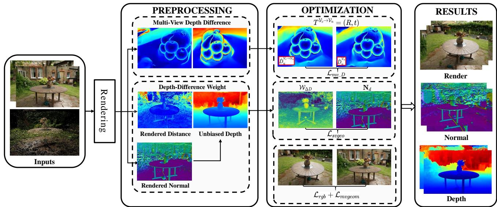  
Fig. 1. Overview of the proposed framework. The Gaussian representation is initialized from a sparse point cloud and used to render the distance and normal maps. Unbiased depth maps are then derived from these rendered quantities. The discrepancy between the unbiased depth and rendered distance is used to compute the depth-difference-based weight ${ \mathcal { W } } _ { \Delta D }$ , which modulates the single-view normal constraint $\mathcal { L } _ { s v g e o }$ . In the multi-view branch, coordinate transformations establish depth correspondences between neighboring views to construct the cross-view depth consistency constraint $\mathcal { L } _ { m v \_ D }$ . The proposed constraints are jointly optimized with the baseline objectives to improve surface reconstruction and multi-view geometric consistency.

• Based on the multi-view error analysis, we propose a cross-view depth consistency regularization strategy that reduces depth discrepancies between neighboring views, thereby improving multi-view geometric consistency.

• Extensive experiments on Mip-NeRF360 [20], DTU [21] and Tanks and Temples [22] demonstrate that DepthGS achieves competitive performance in both novel view synthesis and surface reconstruction.

## II. RELATED WORK

## A. Novel View Synthesis

Novel view synthesis aims to render unseen views while preserving scene structure and visual details. Classical Structure-from-Motion and Multi-View Stereo methods recover scene geometry through multi-view correspondences and epipolar constraints [23]. Soft3D [24] introduces a differentiable density-field representation for view synthesis, while NeRF and its variants represent scenes using continuous radiance fields and achieve high-quality rendering [25], [26]. However, their volumetric formulations generally incur considerable computational costs.

3DGS provides an efficient alternative by representing scenes using explicit anisotropic Gaussians and differentiable rasterization [27], [28]. Subsequent approaches improve representation compactness and rendering efficiency [29]–[31], enhance structural integrity and large-scale rendering [32], [33], and extend Gaussian representations to dynamic scenes [34], [35]. Nevertheless, improvements in rendering quality and efficiency do not necessarily ensure accurate and view-consistent surface geometry.

## B. Gaussian Splatting Surface Reconstruction

With the increasing use of Gaussian splatting in novel view synthesis, its potential for surface reconstruction has also been explored. 2DGS [36] replaces volumetric Gaussian ellipsoids with planar Gaussian disks to achieve more consistent geometric representations, while GOF [37] extracts surfaces from Gaussian opacity fields.

Recent approaches further improve reconstruction through geometry-oriented representations and surface constraints. GF-SGS [38] and GSDF [39] introduce geometry-aware fields and distance representations to regularize Gaussian optimization. GS-Pull [40] and GS-UDF [41] infer signed or unsigned distance functions from Gaussian primitives. QGS [42] models surfaces using second-order geometric primitives, while GSPrior [43] incorporates self-constrained geometric priors for high-fidelity surface reconstruction.

Methods incorporating depth and normal cues provide complementary geometric information. DN-Splatter [17] incorporates depth and normal priors for Gaussian splatting and meshing. VCR-GauS [19] couples depth and normal information through a view-consistent regularizer. PGSR [18] introduces unbiased-depth rendering and multi-view regularization for efficient and high-fidelity surface reconstruction.

These studies demonstrate the effectiveness of depth and normal cues for geometric regularization. However, existing Gaussian splatting methods incorporating depth and normal cues do not explicitly derive reconstruction-error bounds that involve the discrepancy between unbiased depth and rendered distance. Moreover, the multi-view consistency of these two depth representations across neighboring views remains underexplored. DepthGS addresses these limitations by deriving the relationships between depth discrepancies and reconstruction errors under single-view and multi-view conditions. Based on this analysis, we introduce a depth-difference-guided adaptive normal regularization strategy and a cross-view depth consistency regularization strategy.

## III. PRELIMINARIES ON 3D GAUSSIAN SPLATTING

Following 3DGS [13], a scene is represented by a set of anisotropic Gaussian primitives. The i-th Gaussian is defined by its center $\mu _ { i }$ and covariance matrix $\Sigma _ { i }$ :

$$
G ( \mu ; \mu _ { i } , \Sigma _ { i } ) = \exp \left[ - \frac 1 2 ( \mu - \mu _ { i } ) ^ { \top } \Sigma _ { i } ^ { - 1 } ( \mu - \mu _ { i } ) \right] .\tag{1}
$$

To ensure positive semidefiniteness, the covariance is parameterized as $\Sigma _ { i } = R _ { i } S _ { i } S _ { i } ^ { \top } R _ { i } ^ { \top }$ , where $R _ { i }$ and $S _ { i }$ denote the rotation and scaling matrices, respectively. Under a given camera view, the Gaussians are projected onto the image plane and composited in depth order through differentiable α-blending.

At pixel $p ,$ the rendered color and normal are computed as

$$
\widehat C ( p ) = \sum _ { i \in N } T _ { i } \alpha _ { i } c _ { i } , \quad \mathbf N ( p ) = \sum _ { i \in N } T _ { i } \alpha _ { i } R _ { c } ^ { \top } n _ { i } ,\tag{2}
$$

where $\begin{array} { r } { T _ { i } = \prod _ { j = 1 } ^ { i - 1 } ( 1 - \alpha _ { j } ) } \end{array}$ denotes the accumulated transmittance, $\alpha _ { i }$ is the contribution weight of the i-th Gaussian, $c _ { i }$ denotes its view-dependent appearance, and $N$ is the ordered set of Gaussians contributing to pixel $p .$ Moreover, $n _ { i }$ denotes the Gaussian normal, and $R _ { c } ^ { \top } n _ { i }$ denotes the corresponding normal expressed in the camera coordinate system.

Following PGSR [18], the renderer further produces the rendered distance and unbiased depth:

$$
D _ { \mathcal { D } } ( p ) = \sum _ { i \in N } T _ { i } \alpha _ { i } d _ { i } , \quad D _ { u } ( p ) = \frac { D _ { \mathcal { D } } ( p ) } { \mathbf { N } ( p ) \cdot v ( p ) } .\tag{3}
$$

Here, $d _ { i } = ( R _ { c } ^ { \top } n _ { i } ) ^ { \top } R _ { c } ^ { \top } ( \mu _ { i } - T _ { c } )$ denotes the plane-to-camera distance of the i-th Gaussian, and $T _ { c }$ is the camera center. For pixel $\boldsymbol { p } = \left( u , v \right)$ with homogeneous coordinate $\tilde { \mathbf { p } } = [ u , v , 1 ] ^ { \top }$ $v ( p ) = K ^ { - 1 } \tilde { \mathbf { p } } / \| K ^ { - 1 } \tilde { \mathbf { p } } \| _ { 2 }$ is the corresponding unit cameraray direction, where K denotes the camera intrinsic matrix.

## IV. METHODOLOGY

The framework proposed in this paper comprises two major components, which address geometric constraint optimization under single-view and multi-view conditions, respectively. The overall framework of our algorithm is depicted in Fig. 1.

## A. Single-View Geometric Constraint Optimization

1) Single-View Depth Difference-Reconstruction Error $R e \cdot$ lationship: As shown in Eq. 3, Gaussian splatting produces an unbiased depth $D _ { u }$ and a rendered distance $D _ { \mathcal { D } }$ . The corresponding three-dimensional points are obtained from $D _ { u }$ and $D _ { \mathcal { D } }$ through inverse projection along the same camera ray. Their Euclidean distance reflects the discrepancy between the two depth representations. As illustrated in Fig. 2, large depth differences are often observed in regions with irregular Gaussian distributions.

To formalize this observation, we analyze the reconstruction errors of the corresponding three-dimensional points obtained from $D _ { u }$ and $D _ { \mathcal { D } }$ with respect to the ground-truth surface point. We first derive the single-view relationship between the depth difference and reconstruction error and then extend the analysis to the multi-view case.

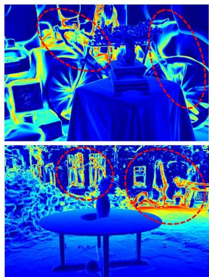

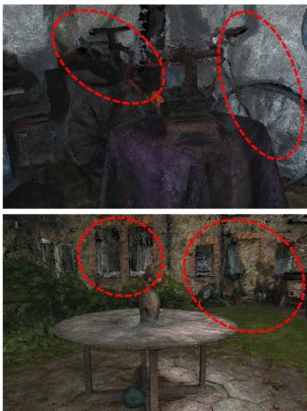  
Fig. 2. Depth differences (left) and corresponding Gaussian distributions (right); large discrepancies often coincide with irregular Gaussian layouts.

Lemma 1. In a single-view scene, the aggregate reconstruction error associated with the unbiased depth satisfies

$$
\begin{array} { l } { \displaystyle E _ { s v } \triangleq \int _ { \Omega } w \big ( p \big ) \big ( \epsilon _ { u } ^ { s v } ( p ) \big ) ^ { 2 } d p } \\ { \displaystyle \qquad \leq \int _ { \Omega } w \big ( p \big ) \big ( \epsilon _ { \mathcal { D } } ^ { s v } ( p ) + \big | \Delta D ( p ) \big | \big ) ^ { 2 } d p , } \end{array}\tag{4}
$$

where $w ( p ) \ \geq \ 0 , \ \Omega$ denotes the valid image domain, and $\epsilon _ { u } ^ { s v } ( p )$ and $\epsilon _ { \mathcal { D } } ^ { s v } ( p )$ denote the reconstruction errors associated with the unbiased depth and rendered distance, respectively.

Proof. The depth difference is given by

$$
\Delta D ( p ) = D _ { u } ( p ) - D _ { \mathcal { D } } ( p ) = \frac { D _ { \mathcal { D } } ( p ) } { { \bf N } ( p ) \cdot v ( p ) } - D _ { \mathcal { D } } ( p ) .\tag{5}
$$

The corresponding three-dimensional points obtained through inverse projection are denoted by $X _ { u }$ and $X _ { \mathcal { D } }$ , respectively:

$$
X _ { u } = \pi ^ { - 1 } ( p , D _ { u } ( p ) ) = \frac { D _ { \mathit { D } } ( p ) } { \mathbf { N } ( p ) \cdot v ( p ) } v ( p ) ,\tag{6}
$$

$$
\begin{array} { r } { X _ { \mathcal { D } } = { \pi } ^ { - 1 } ( p , D _ { \mathcal { D } } ( p ) ) = D _ { \mathcal { D } } ( p ) v ( p ) . } \end{array}\tag{7}
$$

Here, $v ( p )$ is the unit camera-ray direction defined in Eq. 3. Let $X _ { \mathrm { t r u e } }$ denote the corresponding ground-truth surface point. The reconstruction errors associated with the unbiased depth and rendered distance are defined as

$$
\epsilon _ { u } ^ { s v } ( p ) = \left\| X _ { u } - X _ { \mathrm { t r u e } } \right\| _ { 2 } = \left\| \pi ^ { - 1 } ( p , D _ { u } ( p ) ) - X _ { \mathrm { t r u e } } \right\| _ { 2 } ,\tag{8}
$$

$$
\epsilon _ { \mathcal D } ^ { s v } ( p ) = \left\| X _ { \mathcal D } - X _ { \mathrm { t r u e } } \right\| _ { 2 } = \left\| \pi ^ { - 1 } ( p , D _ { \mathcal D } ( p ) ) - X _ { \mathrm { t r u e } } \right\| _ { 2 } .\tag{9}
$$

Application of the triangle inequality to $X _ { u } \mathrm { ~ - ~ } X _ { \mathrm { t r u e } } \ =$ $( X _ { u } - X _ { \mathcal { D } } ) + ( X _ { \mathcal { D } } - X _ { \mathrm { t r u e } } )$ , together with the above error definitions, yields

$$
\epsilon _ { u } ^ { s v } ( p ) \leq \epsilon _ { \mathcal { D } } ^ { s v } ( p ) + \left\| \pi ^ { - 1 } ( p , D _ { u } ( p ) ) - \pi ^ { - 1 } ( p , D _ { \mathcal { D } } ( p ) ) \right\| _ { 2 } .\tag{10}
$$

Using Eqs. 6–7 and $\| v ( p ) \| _ { 2 } = 1$ , the second term on the right-hand side of Eq. 10 can be expressed as

$$
\begin{array} { l } { \displaystyle \left\| \pi ^ { - 1 } ( p , D _ { u } ( p ) ) - \pi ^ { - 1 } ( p , D _ { \mathcal { D } } ( p ) ) \right\| _ { 2 } } \\ { \displaystyle = | D _ { \mathcal { D } } ( p ) | \left| \frac { 1 } { { \bf N } ( p ) \cdot v ( p ) } - 1 \right| = | \Delta D ( p ) | . } \end{array}\tag{11}
$$

Substituting Eq. 11 into Eq. 10 yields

$$
\epsilon _ { u } ^ { s v } ( p ) \leq \epsilon _ { \mathcal { D } } ^ { s v } ( p ) + | \Delta D ( p ) | .\tag{12}
$$

Since both sides of Eq. 12 are nonnegative, squaring the inequality, multiplying both sides by the nonnegative weight $w ( p )$ , and integrating over the valid image domain Ω yield the aggregate reconstruction-error bound in Eq. 4. This completes the proof. □

Remark 1. Expanding the right-hand side of Eq. 4 gives

$$
\begin{array} { c } { { E _ { s v } \le \displaystyle \int _ { \Omega } w ( p ) \Big [ \left( \epsilon _ { \mathcal { D } } ^ { s v } ( p ) \right) ^ { 2 } + 2 \left| \epsilon _ { \mathcal { D } } ^ { s v } ( p ) \right| \left| \Delta D ( p ) \right| } } \\ { { + \left| \Delta D ( p ) \right| ^ { 2 } \Big ] d p . } } \end{array}\tag{13}
$$

Thus,for afixed $\epsilon _ { \mathcal { D } } ^ { s v } ( p )$ , reducing $| \Delta D ( p ) |$ tightens the derived reconstruction-error bound, motivating the adaptive regularization below.

2) Depth-Difference-Weighted Adaptive Normal Regularization: Eqs. 11 and 12 show that $| \Delta D ( p ) |$ equals the Euclidean distance between $X _ { u }$ and $X _ { \mathcal { D } }$ and appears explicitly in the derived reconstruction-error bound. Thus, for a fixed or comparable $\epsilon _ { \mathcal { D } } ^ { s v } ( p )$ , a larger depth difference enlarges the right-hand side of the bound and indicates a larger discrepancy between the unbiased depth $D _ { u } ( p )$ and the rendered distance $D _ { \mathcal { D } } ( p )$

Guided by this relationship, we use $| \Delta D ( p ) |$ to adaptively weight the normal constraint between the reference normal $\mathbf { N } _ { d } ( p )$ computed from $D _ { u } ( p )$ and the rendered normal $\mathbf { N } ( p )$

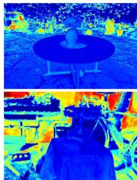  
(a) Render Distance

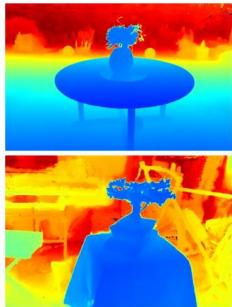  
(b) Unbiased Depth

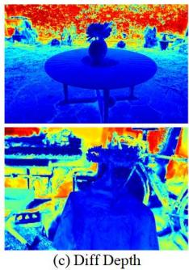  
Fig. 3. Depth-difference weights are derived from the discrepancy between the rendered-distance map and the unbiased-depth map. The greater the depth difference, the smaller the weight.

As illustrated in Fig. 3, rather than directly minimizing $| \Delta D ( p )$ |, we treat it as a local geometric reliability measure and map it to the adaptive weight $\mathcal { W } _ { \Delta D } ( p )$ . The weight is defined as

$$
\mathcal { W } _ { \Delta D } ( p ) = 1 - \frac { | \Delta D ( p ) | - \Delta D _ { \mathrm { m i n } } } { \Delta D _ { \mathrm { m a x } } - \Delta D _ { \mathrm { m i n } } + \sigma } ,\tag{14}
$$

where $\sigma > 0$ prevents division by zero, and $\Delta D _ { \mathrm { m i n } } / \Delta D _ { \mathrm { m a x } }$ are the minimum/maximum of $| \Delta D ( p )$ | over valid pixels. A smaller depth difference produces a larger weight and hence stronger normal regularization, whereas a larger difference weakens the constraint to avoid propagating unreliable local geometry.

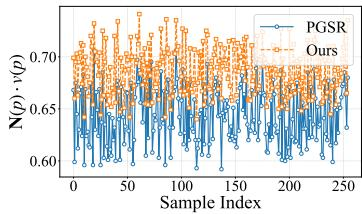

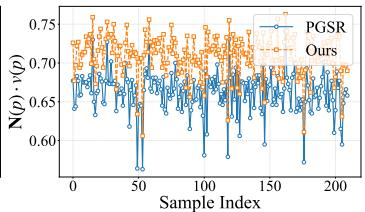

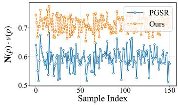

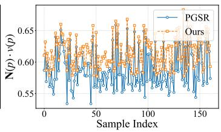  
Fig. 4. Comparison of $\mathbf { N } ( p ) \cdot v ( p )$ obtained by PGSR and the proposed method. The proposed method generally yields normal–ray consistency values closer to 1 in the evaluated scenes.

The single-view normal constraint is defined as

$$
\mathcal { L } _ { s v g e o } = \frac { 1 } { | \Omega _ { D _ { \mathcal { D } } } | } \sum _ { p \in \Omega _ { D _ { \mathcal { D } } } } \mathcal { W } ( p ) \| \mathbf { N } _ { d } ( p ) - \mathbf { N } ( p ) \| _ { 1 } ,\tag{15}
$$

where $\Omega _ { D _ { \mathcal { D } } }$ denotes the valid pixel domain of the rendereddistance map, $\mathbf { N } _ { d }$ represents the reference normals generated from unbiased depth, and $\mathbf { N } ( p )$ denotes the rendered normal. The complete weight is $\mathcal W ( p ) = \mathcal W _ { \Delta D } ( p ) \left( \overline { { \nabla I } } ( p ) \right) ^ { 2 }$ where ${ \mathcal { W } } _ { \Delta D }$ is the proposed depth-difference-based reliability weight, while $\left( \overline { { \nabla I } } ( p ) \right) ^ { 2 }$ is the edge-aware modulation inherited from PGSR [18]. As shown in Fig. 4, the normal–ray consistency values obtained by PGSR [18] and the proposed method are compared across selected scenes.

## B. Multi-View Geometric Constraint Optimization

1) Multi-View Depth Difference-Reconstruction Error Relationship: Corresponding three-dimensional points observed from different views should satisfy rigid-transformation consistency. However, as shown in Fig. 5, neighboring views may exhibit different depth discrepancies at corresponding surface locations. This motivates us to relate cross-view depthdifference residuals to multi-view reconstruction error.

Lemma 2. In multi-view scenes, the aggregate reconstruction error associated with the unbiased-depth-based point clouds satisfies

$$
\begin{array} { r l } & { E _ { m v } \triangleq \displaystyle \sum _ { ( i , j ) \in \mathcal { P } } \int _ { \Omega _ { i j } } w _ { i j } ( p ) \left( \epsilon _ { i j } ^ { m v } ( p ) \right) ^ { 2 } d p } \\ & { \qquad \le 2 \displaystyle \sum _ { ( i , j ) \in \mathcal { P } } \int _ { \Omega _ { i j } } w _ { i j } ( p ) \left[ \left( \epsilon _ { \mathcal { D } , i j } ^ { m v } ( p ) \right) ^ { 2 } + r _ { \Delta , i j } ^ { 2 } ( p ) \right] d p , } \end{array}\tag{16}
$$

where P denotes the selected directed current/nearest-neighbor view pairs, $R _ { i j }$ is the rotation from view i to view $j ,$ $w _ { i j } ( p ) \geq 0 .$ , and $\Omega _ { i j }$ is the valid correspondence domain.

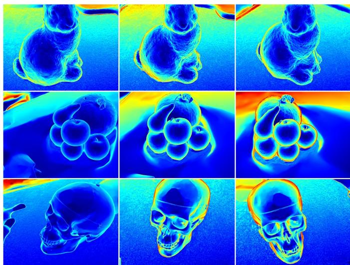  
Fig. 5. Cross-view inconsistency of depth-difference maps at corresponding surface locations in neighboring views.

Moreover, $\epsilon _ { i j } ^ { m v } ( p )$ and $\epsilon _ { \mathcal { D } , i j } ^ { m v } ( p )$ are the unbiased- and rendereddistance-based cross-view discrepancies, respectively, and ${ r } _ { \Delta , i j } ( p ) ~ = ~ \big \| \Delta D ^ { \mathcal { V } _ { j } } ( p ) v ^ { \mathcal { V } _ { j } } ( p ) - \mathsf { \bar { R } } _ { i j } \big ( \Delta D ^ { \mathcal { V } _ { i } } ( \underline { { \dot { p } } } ) v ^ { \mathcal { V } _ { i } } ( p ) \big ) \big \| _ { 2 }$ is the corresponding depth-difference residual.

Proof. Let the rigid transformation from the current view $\mathcal { V } _ { c }$ to its nearest-neighbor view $\nu _ { n }$ be $T _ { \nu _ { c } } ^ { \nu _ { n } } ~ = ~ ( R , t )$ , where $R \in \mathrm { S O ( 3 ) }$ and $t \in \mathbb { R } ^ { 3 }$ . Let $p _ { c } = ( u _ { c } , v _ { c } )$ and $p _ { n } = ( u _ { n } , v _ { n } )$ denote corresponding pixels in the two views, with unit camera-ray directions $v ^ { \nu _ { c } }$ and $v ^ { \nu _ { n } }$ , respectively. For clarity, the view-pair and pixel indices are omitted in the following derivation. Consistent with the single-view definition, the three-dimensional points obtained from the unbiased depth and rendered distance are

$$
\begin{array} { r l } & { X _ { u } ^ { \mathcal { V } _ { c } } = D _ { u } ^ { \mathcal { V } _ { c } } v ^ { \mathcal { V } _ { c } } , \quad X _ { \mathcal { D } } ^ { \mathcal { V } _ { c } } = D _ { \mathcal { D } } ^ { \mathcal { V } _ { c } } v ^ { \mathcal { V } _ { c } } , } \\ & { X _ { u } ^ { \mathcal { V } _ { n } } = D _ { u } ^ { \mathcal { V } _ { n } } v ^ { \mathcal { V } _ { n } } , \quad X _ { \mathcal { D } } ^ { \mathcal { V } _ { n } } = D _ { \mathcal { D } } ^ { \mathcal { V } _ { n } } v ^ { \mathcal { V } _ { n } } . } \end{array}\tag{17}
$$

Here, $D _ { \mathcal { D } } ^ { \mathcal { V } _ { c } }$ and $D _ { \mathcal { D } } ^ { \mathcal { V } _ { n } }$ represent the rendered distance maps under the current view and the nearest-neighbor view, respectively. To relate the exact vector residual $r _ { \Delta }$ to a scalar crossview depth-difference residual, we adopt a shared-target-ray construction, under which the transformed unbiased-depth and rendered-distance representations are projected onto the target ray $v ^ { \nu _ { n } }$ . The corresponding projected depths are

$$
\hat { D } _ { u } ^ { \mathcal { V } _ { n } } = v ^ { { \mathcal { V } _ { n } } ^ { \top } } ( R D _ { u } ^ { \mathcal { V } _ { c } } v ^ { \mathcal { V } _ { c } } + t ) ,
$$

$$
\begin{array} { r } { \hat { D } _ { \mathcal { D } } ^ { \mathcal { V } _ { n } } = v ^ { \mathcal { V } _ { n } \top } ( R D _ { \mathcal { D } } ^ { \mathcal { V } _ { c } } v ^ { \mathcal { V } _ { c } } + t ) . } \end{array}\tag{18}
$$

(19)

To quantify multi-view consistency, the Euclidean distance between corresponding points after coordinate transformation is calculated. Accordingly, the cross-view reconstruction error associated with the unbiased-depth-based points is defined as

$$
\begin{array} { r l } & { \epsilon ^ { m v } = \| X _ { u } ^ { \mathcal { V } _ { n } } - X _ { u } ^ { \mathcal { V } _ { c }  \mathcal { V } _ { n } } \| _ { 2 } } \\ & { \qquad = \| D _ { u } ^ { \mathcal { V } _ { n } } v ^ { \mathcal { V } _ { n } } - ( R D _ { u } ^ { \mathcal { V } _ { c } } v ^ { \mathcal { V } _ { c } } + t ) \| _ { 2 } . } \end{array}\tag{20}
$$

Define the depth differences as $\Delta D ^ { \nu _ { c } } = D _ { u } ^ { \nu _ { c } } - D _ { \mathcal { D } } ^ { \nu _ { c } }$ and $\Delta D ^ { \nu _ { n } } = D _ { u } ^ { \nu _ { n } } - D _ { T } ^ { \nu _ { n } }$ . Accordingly, the unbiased depths can be expressed as $D _ { u } ^ { \mathcal { V } _ { c } } = D _ { \mathcal { D } } ^ { \mathcal { V } _ { c } } + \Delta D ^ { \mathcal { V } _ { c } }$ and $D _ { u } ^ { \mathcal { V } _ { n } } = D _ { \mathcal { D } } ^ { \mathcal { V } _ { n } ^ { \bullet } } + \Delta D ^ { \mathcal { V } _ { n } }$

Substituting these expressions into Eq. 20 yields:

$$
\begin{array} { r l } & { \epsilon ^ { m v } = \Big \| D _ { \mathcal { D } } ^ { \mathcal { V } _ { n } } v ^ { \mathcal { V } _ { n } } - R D _ { \mathcal { D } } ^ { \mathcal { V } _ { c } } v ^ { \mathcal { V } _ { c } } - t } \\ & { \qquad + \left( \Delta D ^ { \mathcal { V } _ { n } } v ^ { \mathcal { V } _ { n } } - R \Delta D ^ { \mathcal { V } _ { c } } v ^ { \mathcal { V } _ { c } } \right) \Big \| _ { 2 } . } \end{array}\tag{21}
$$

Applying the triangle inequality yields:

$$
\epsilon ^ { m v } \leq \epsilon _ { \mathcal { D } } ^ { m v } + \left\| \Delta D ^ { \mathcal { V } _ { n } } v ^ { \mathcal { V } _ { n } } - R \Delta D ^ { \mathcal { V } _ { c } } v ^ { \mathcal { V } _ { c } } \right\| _ { 2 } ,\tag{22}
$$

where $\begin{array} { r l r } { \epsilon _ { \mathcal { D } } ^ { m v } } & { { } \quad } & { \triangleq } & { { } \quad \| X _ { \mathcal { D } } ^ { \mathcal { V } _ { n } } - X _ { \mathcal { D } } ^ { \mathcal { V } _ { c }  \mathcal { V } _ { n } } \| _ { 2 } } \end{array}$ $\left\| D _ { \mathcal { D } } ^ { \nu _ { n } } v ^ { \nu _ { n } } - R \Big ( D _ { \mathcal { D } } ^ { \nu _ { c } } v ^ { \nu _ { c } } \Big ) - t \right\| _ { 2 }$ denotes the Euclidean distance between the rendered-distance-based point in the neighboring view and the corresponding current-view point transformed into the neighboring-view coordinate system. For brevity, we denote the second term on the right-hand side of Eq. 22 by $r _ { \Delta } \triangleq \lVert \Delta D ^ { \mathcal { V } _ { n } } v ^ { \mathcal { V } _ { n } } - R \Delta D ^ { \mathcal { V } _ { c } } v ^ { \mathcal { V } _ { c } } \rVert _ { 2 } ^ { * }$

By squaring Eq. 22, applying $\left( a + b \right) ^ { \ddot { 2 } ^ { - } } \leq 2 a ^ { 2 } + 2 b ^ { 2 }$ multiplying by the nonnegative weight $w _ { i j } ( p )$ , integrating over $\Omega _ { i j }$ , and summing over all valid view pairs, we directly obtain the aggregate bound in Eq. 16. Squaring $r _ { \Delta }$ yields

$$
\begin{array} { c } { { r _ { \Delta } ^ { 2 } = \left( \Delta D ^ { \mathcal { V } _ { n } } \right) ^ { 2 } \left\| v ^ { \mathcal { V } _ { n } } \right\| _ { 2 } ^ { 2 } + \left( \Delta D ^ { \mathcal { V } _ { c } } \right) ^ { 2 } \left\| R v ^ { \mathcal { V } _ { c } } \right\| _ { 2 } ^ { 2 } } } \\ { { - 2 \Delta D ^ { \mathcal { V } _ { n } } \Delta D ^ { \mathcal { V } _ { c } } \left( v ^ { \mathcal { V } _ { n } } \right) ^ { \top } R v ^ { \mathcal { V } _ { c } } . } } \end{array}\tag{23}
$$

Since $v ^ { \nu _ { n } }$ and $v ^ { \nu _ { c } }$ are unit camera-ray directions and R is an orthogonal rotation matrix, we have $\left\| v ^ { \mathcal { V } _ { n } } \right\| _ { 2 } = \left\| R v ^ { \mathcal { V } _ { c } } \right\| _ { 2 } =$ 1. Moreover, let $\left( v ^ { \mathcal { V } _ { n } } \right) ^ { \top } R v ^ { \mathcal { V } _ { c } } = \cos \theta .$ where θ denotes the angle between $v ^ { \nu _ { n } }$ and $R v ^ { \nu _ { c } }$ . Equation 23 then becomes

$$
r _ { \Delta } ^ { 2 } = \left( \Delta D ^ { \mathcal { V } _ { n } } \right) ^ { 2 } + \left( \Delta D ^ { \mathcal { V } _ { c } } \right) ^ { 2 } - 2 \Delta D ^ { \mathcal { V } _ { n } } \Delta D ^ { \mathcal { V } _ { c } } \cos \theta .\tag{24}
$$

Here, $\theta$ is measured in radians. By completing the square, Eq. 24 can be decomposed as

$$
r _ { \Delta } ^ { 2 } = \left( \Delta D ^ { \mathcal { V } _ { n } } - \Delta D ^ { \mathcal { V } _ { c } } \cos \theta \right) ^ { 2 } + \left( \Delta D ^ { \mathcal { V } _ { c } } \right) ^ { 2 } \sin ^ { 2 } \theta .\tag{25}
$$

From Eqs. 18 and 19, the translation terms cancel exactly when taking the difference between the two predicted depths. Using $\Delta D ^ { \smash { \bigcup _ { c } } } = D _ { u } ^ { \gamma _ { c } } - D _ { \oslash } ^ { \gamma _ { c } }$ , we obtain

$$
\begin{array} { r } { \hat { D } _ { u } ^ { \mathcal { V } _ { n } } - \hat { D } _ { \mathcal { D } } ^ { \mathcal { V } _ { n } } = \left( v ^ { \mathcal { V } _ { n } } \right) ^ { \top } R \left( D _ { u } ^ { \mathcal { V } _ { c } } - D _ { \mathcal { D } } ^ { \mathcal { V } _ { c } } \right) v ^ { \mathcal { V } _ { c } } = \Delta D ^ { \mathcal { V } _ { c } } \cos \theta . } \end{array}\tag{26}
$$

Therefore, under the shared-target-ray construction and using Eq. 26, the first term in Eq. 25 is exactly the squared scalar cross-view depth-difference residual. Specifically, we define

$$
\begin{array} { r l } & { \Delta \delta \triangleq \left| \left( D _ { u } ^ { \mathcal { V } _ { n } } - D _ { \mathcal { D } } ^ { \mathcal { V } _ { n } } \right) - \left( \hat { D } _ { u } ^ { \mathcal { V } _ { n } } - \hat { D } _ { \mathcal { D } } ^ { \mathcal { V } _ { n } } \right) \right| } \\ & { \quad \quad = \left| \Delta D ^ { \mathcal { V } _ { n } } - \Delta D ^ { \mathcal { V } _ { c } } \cos \theta \right| . } \end{array}\tag{27}
$$

Accordingly, Eq. 25 can be equivalently rewritten as

$$
\begin{array} { r } { r _ { \Delta } ^ { 2 } = \left( \Delta \delta \right) ^ { 2 } + \left( \Delta D ^ { \mathcal { V } _ { c } } \right) ^ { 2 } \sin ^ { 2 } \theta . } \end{array}
$$

This completes the proof.

Remark 2. Equation 16 bounds the aggregate multi-view reconstruction error in terms of the rendered-distance-based error and the depth-difference-induced vector residual $r _ { \Delta }$ Moreover, Eqs. 25 and 27 give the exact relation

$$
\begin{array} { r } { r _ { \Delta } ^ { 2 } = \left( \Delta \delta \right) ^ { 2 } + \left( \Delta D ^ { \mathcal { V } _ { c } } \right) ^ { 2 } \sin ^ { 2 } \theta , } \end{array}
$$

where ∆δ denotes the scalar cross-view depth-difference residual. When the angle-dependent component $| \Delta D ^ { \bar { \nu } _ { c } }$ sin θ is sufficiently small, the exact relationship in the preceding equation can be approximated by

$$
r _ { \Delta } \approx \Delta \delta .\tag{28}
$$

This approximation provides a scalar interpretation of $r _ { \Delta }$ and is not required for the validity of the aggregate bound in Eq. 16. Thus, reducing cross-view depth-difference inconsistency reduces the corresponding scalar residual component and motivates the practical multi-view regularization introduced below.

2) Multi-View Depth-Difference Geometric Constraints: Motivated by Eqs. 27 and 28, we construct a practical crossview depth consistency regularizer for neighboring views. For $s \in \{ u , \mathcal { D } \} , p _ { s } ^ { \mathcal { V } _ { n } } ( p )$ denotes the image-plane projection in $\nu _ { n }$ of the point $D _ { s } ^ { \nu _ { c } } ( p ) v ^ { \nu _ { c } } ( p )$ transformed from $\mathcal { V } _ { c } .$

To determine valid cross-view reprojections, we define the joint validity mask as

$$
\begin{array} { r l } & { \mathcal { M } ( p ) \triangleq \mathbb { I } \Big [ p _ { u } ^ { \mathcal { V } _ { n } } ( p ) \in [ 0 , W - 1 ) \times [ 0 , H - 1 ) } \\ & { \qquad \wedge \ p _ { \mathcal { D } } ^ { \mathcal { V } _ { n } } ( p ) \in [ 0 , W - 1 ) \times [ 0 , H - 1 ) } \\ & { \qquad \wedge \ \hat { D } _ { u } ^ { \mathcal { V } _ { n } } ( p ) > \tau _ { d } \wedge \hat { D } _ { \mathcal { D } } ^ { \mathcal { V } _ { n } } ( p ) > \tau _ { d } \Big ] . } \end{array}\tag{29}
$$

Here, I[·] denotes the indicator function; $p _ { u } ^ { \mathcal { V } _ { n } } ( p )$ and $p _ { \mathcal { D } } ^ { \mathcal { V } _ { n } } ( p )$ denote the projected coordinates associated with the unbiased depth and rendered distance, respectively; W and H denote the width and height of the neighboring-view depth maps; and $\tau _ { d }$ is the minimum valid-depth threshold. The valid reprojection domain is

$$
\Omega \triangleq \left\{ p \in \Omega _ { D _ { \mathcal { D } } } \vert \mathcal { M } ( p ) = 1 \right\} .\tag{30}
$$

View pairs with $\Omega = \emptyset$ are excluded from the multi-view loss computation.

To obtain differentiable depth values at noninteger projected coordinates, we employ bilinear interpolation:

$$
{ \cal D } _ { \pi } ( p ) \triangleq \sum _ { a = 0 } ^ { 1 } \sum _ { b = 0 } ^ { 1 } \omega _ { a b } D ( \lfloor v ^ { \star } \rfloor + a , \lfloor u ^ { \star } \rfloor + b ) , \quad p \in \Omega ,\tag{31}
$$

where $( u ^ { \star } , v ^ { \star } )$ denotes a projected pixel coordinate, $\Delta u =$ $u ^ { \star } - \lfloor u ^ { \star } \rfloor , \Delta v = v ^ { \star } - \lfloor v ^ { \star } \rfloor$ , and $\omega _ { a b } = \lceil ( 1 - a ) ( 1 - \Delta v ) +$ a∆v $\bar { \lceil ( 1 - b ) ( 1 - \Delta u ) + b \Delta u \rceil }$ . Applying Eq. 31 to $D _ { u } ^ { \nu _ { n } }$ at $p _ { u } ^ { \gamma _ { n } } ( \bar { p } )$ and to $D _ { \mathcal { D } } ^ { \mathcal { V } _ { n } }$ at $p _ { \mathcal { D } } ^ { \mathcal { V } _ { n } } ( p )$ yields $D _ { u , \pi } ^ { \mathcal { V } _ { n } } ( p )$ and $D _ { { D } , \pi } ^ { \mathcal { V } _ { n } } ( p )$ respectively.

The two cross-view depth discrepancies are defined as

$$
\delta _ { u } ( p ) \triangleq \left| \hat { D } _ { u } ^ { \mathcal { V } _ { n } } ( p ) - D _ { u , \pi } ^ { \mathcal { V } _ { n } } ( p ) \right| ,\tag{32}
$$

$$
\delta _ { D } ( p ) \triangleq \left| \hat { D } _ { D } ^ { \gamma _ { n } } ( p ) - D _ { D , \pi } ^ { \gamma _ { n } } ( p ) \right| .\tag{33}
$$

Eqs. 32 and 33 measure the discrepancies between the currentview depth predictions transformed into the neighboring view and the corresponding depths sampled from the neighboringview depth maps.

To connect these practical discrepancies with the scalar residual in Eq. 27, we define its sampled counterpart as

$$
\Delta \delta _ { \pi } ( p ) \triangleq \Big | \Big ( D _ { u , \pi } ^ { \mathcal { V } _ { n } } ( p ) - D _ { \mathcal { D } , \pi } ^ { \mathcal { V } _ { n } } ( p ) \Big ) - \Big ( \hat { D } _ { u } ^ { \mathcal { V } _ { n } } ( p ) - \hat { D } _ { \mathcal { D } } ^ { \mathcal { V } _ { n } } ( p ) \Big ) \Big | .\tag{34}
$$

Applying the triangle inequality to Eq. 34 and using Eqs. 32 and 33 yield

$$
\Delta \delta _ { \pi } ( p ) \leq \delta _ { u } ( p ) + \delta _ { \mathcal { D } } ( p ) .\tag{35}
$$

Moreover, for any $\alpha \in ( 0 , 1 )$

$$
\delta _ { u } ( p ) + \delta _ { \mathcal { D } } ( p ) \leq \frac { \alpha \delta _ { u } ( p ) + ( 1 - \alpha ) \delta _ { \mathcal { D } } ( p ) } { \operatorname* { m i n } \{ \alpha , 1 - \alpha \} } .\tag{36}
$$

Eqs. 35 and 36 establish that a positive weighted combination of the two depth discrepancies controls $\Delta \delta _ { \pi } ( p )$ up to the constant factor 1/ min $\{ \alpha , 1 - \alpha \}$

Accordingly, we define the cross-view depth consistency regularizer as

$$
\mathcal { L } _ { m v \_ D } = \frac { 1 } { | \Omega | } \sum _ { p \in \Omega } \left[ \alpha \delta _ { u } ( p ) + ( 1 - \alpha ) \delta _ { D } ( p ) \right] ,\tag{37}
$$

where α balances the two depth discrepancies and is set to $\alpha = 0 . 8$ . Since $\alpha \in ( 0 , 1 )$ , both terms are assigned positive weights. Thus, minimizing $\mathcal { L } _ { m v \_ D }$ jointly penalizes the two reprojection discrepancies and serves as a practical surrogate for reducing the sampled cross-view depth-difference residual $\Delta \delta _ { \pi } ( p )$

TABLE I  
QUANTITATIVE RECONSTRUCTION ACCURACY ON DTU MEASURED BY CHAMFER DISTANCE (MM)↓. IN THE CD COLUMNS, RED, ORANGE, AND YELLOW INDICATE THE BEST, SECOND-BEST, AND THIRD-BEST RESULTS, RESPECTIVELY. THE SUPERSCRIPT † DENOTES RESULTS REPRODUCED BY US.
<table><tr><td>Method</td><td>24</td><td>37</td><td>40</td><td>55</td><td>63</td><td>65</td><td>69</td><td>83</td><td>97</td><td>105</td><td>106</td><td>110</td><td>114</td><td>118</td><td>122</td><td>Mean</td><td>Time</td></tr><tr><td>NeRF [10]</td><td>1.90</td><td>1.60</td><td>1.85</td><td>0.58</td><td>2.28</td><td>1.27</td><td>1.47</td><td>1.67</td><td>2.05</td><td>1.07</td><td>0.88</td><td>2.53</td><td>1.06</td><td>1.15</td><td>0.96</td><td>1.49</td><td>&gt;12h</td></tr><tr><td>VolSDF [44]</td><td>1.14</td><td>1.26</td><td>0.81</td><td>0.49</td><td>1.25</td><td>0.70</td><td>0.72</td><td>1.29</td><td>1.18</td><td>0.70</td><td>0.66</td><td>1.08</td><td>0.42</td><td>0.61</td><td>0.55</td><td>0.86</td><td>&gt;12h</td></tr><tr><td>NeuS [45]</td><td>1.00</td><td>1.37</td><td>0.93</td><td>0.43</td><td>1.10</td><td>0.65</td><td>0.57</td><td>1.48</td><td>1.09</td><td>0.83</td><td>0.52</td><td>1.20</td><td>0.35</td><td>0.49</td><td>0.54</td><td>0.84</td><td>&gt;12h</td></tr><tr><td>2DGS [36]</td><td>0.48</td><td>0.82</td><td>0.34</td><td>0.43</td><td>1.35</td><td>0.90</td><td>0.81</td><td>1.27</td><td>1.24</td><td>0.65</td><td>0.70</td><td>1.25</td><td>0.41</td><td>0.66</td><td>0.50</td><td>0.79</td><td>8.5min</td></tr><tr><td>GOF [37]</td><td>0.50</td><td>0.83</td><td>0.40</td><td>0.38</td><td>1.35</td><td>0.82</td><td>0.74</td><td>1.26</td><td>1.79</td><td>0.69</td><td>0.71</td><td>1.31</td><td>0.52</td><td>0.64</td><td>0.51</td><td>0.83</td><td>33min</td></tr><tr><td>GFSGS [38]</td><td>0.38</td><td>0.65</td><td>0.29</td><td>0.36</td><td>0.79</td><td>0.65</td><td>0.64</td><td>1.09</td><td>1.21</td><td>0.59</td><td>0.47</td><td>1.19</td><td>0.32</td><td>0.42</td><td>0.37</td><td>0.63</td><td>9.9min</td></tr><tr><td>GS-Pull [40]</td><td>0.60</td><td>0.66</td><td>0.36</td><td>0.38</td><td>0.77</td><td>0.74</td><td>0.63</td><td>1.22</td><td>0.96</td><td>0.67</td><td>0.59</td><td>0.58</td><td>0.42</td><td>0.58</td><td>0.53</td><td>0.64</td><td>22min</td></tr><tr><td>GS-UDF [41]</td><td>0.62</td><td>0.67</td><td>0.43</td><td>0.42</td><td>0.83</td><td>0.86</td><td>0.72</td><td>1.20</td><td>1.03</td><td>0.68</td><td>0.61</td><td>0.63</td><td>0.43</td><td>0.56</td><td>0.52</td><td>0.68</td><td>25min</td></tr><tr><td>PGSR [18]</td><td>0.35</td><td>0.55</td><td>0.40</td><td>0.35</td><td>0.78</td><td>0.58</td><td>0.49</td><td>1.07</td><td>0.64</td><td>0.59</td><td>0.50</td><td>0.54</td><td>0.33</td><td>0.37</td><td>0.34</td><td>0.53</td><td>17min</td></tr><tr><td>GSDF [39]</td><td>0.58</td><td>0.93</td><td>0.46</td><td>0.37</td><td>1.30</td><td>0.77</td><td>0.73</td><td>1.58</td><td>1.28</td><td>0.76</td><td>0.58</td><td>1.22</td><td>0.37</td><td>0.51</td><td>0.51</td><td>0.80</td><td>32min</td></tr><tr><td>QGS [42]</td><td>0.42</td><td>0.64</td><td>0.36</td><td>0.38</td><td>0.86</td><td>0.64</td><td>0.50</td><td>1.13</td><td>0.97</td><td>0.61</td><td>0.48</td><td>0.69</td><td>0.34</td><td>0.41</td><td>0.36</td><td>0.59</td><td>48min</td></tr><tr><td>GSPrior [43]</td><td>0.32</td><td>0.55</td><td>0.30</td><td>0.31</td><td>0.74</td><td>0.54</td><td>0.48</td><td>1.06</td><td>0.69</td><td>0.57</td><td>0.45</td><td>0.58</td><td>0.29</td><td>0.35</td><td>0.33</td><td>0.50</td><td>42min</td></tr><tr><td>GSPrior† [43]</td><td>0.33</td><td>0.54</td><td>0.37</td><td>0.34</td><td>0.79</td><td>0.58</td><td>0.49</td><td>1.07</td><td>0.64</td><td>0.59</td><td>0.47</td><td>0.56</td><td>0.31</td><td>0.38</td><td>0.35</td><td>0.52</td><td>49.9min</td></tr><tr><td>Ours</td><td>0.35</td><td>0.55</td><td>0.37</td><td>0.34</td><td>0.77</td><td>0.56</td><td>0.49</td><td>1.04</td><td>0.64</td><td>0.58</td><td>0.47</td><td>0.50</td><td>0.30</td><td>0.36</td><td>0.33</td><td>0.51</td><td>17.6min</td></tr></table>

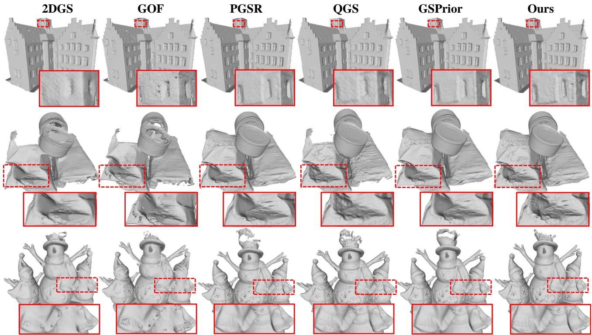

Fig. 6. Qualitative surface reconstruction comparison on the DTU dataset. Reconstructed meshes and zoom-in regions are shown to compare local surface details and geometric completeness across different methods.  
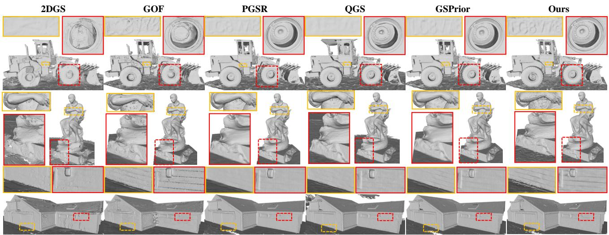  
Fig. 7. Qualitative surface reconstruction comparison on the Tanks and Temples dataset. Reconstructed meshes and zoom-in regions are shown to compare local surface continuity and geometric details across different methods.

## C. Optimization

The proposed regularizers are jointly optimized with the image reconstruction loss $\mathcal { L } _ { r g b }$ , flattened-Gaussian loss $\mathcal { L } _ { s } ,$ and multi-view photometric consistency loss $\mathcal { L } _ { m v g e o m } \mathrm { : }$

$$
\begin{array} { r } { \mathcal { L } = \lambda _ { 1 } \mathcal { L } _ { r g b } + \lambda _ { 2 } \mathcal { L } _ { s } + \lambda _ { 3 } \mathcal { L } _ { m v g e o m } + \lambda _ { 4 } \mathcal { L } _ { s v g e o } + \lambda _ { 5 } \mathcal { L } _ { m v \_ D } . } \end{array}\tag{38}
$$

Here, $\lambda _ { 1 } { - } \lambda _ { 5 }$ denote the corresponding loss weights; $\lambda _ { 1 } { - } \lambda _ { 4 }$ retain the PGSR settings, while $\lambda _ { 5 }$ controls the proposed crossview regularizer.

## V. EXPERIMENTS

## A. Datasets and Implementation Details

We conduct experiments on three public benchmarks: Mip-NeRF360 [20], Tanks and Temples [22], and DTU [21]. Novel view synthesis is evaluated on Mip-NeRF360, while surface reconstruction is evaluated on DTU and Tanks and Temples. Rendering quality is measured using peak signal-to-noise ratio (PSNR), structural similarity (SSIM), and learned perceptual image patch similarity (LPIPS). Surface reconstruction is evaluated using Chamfer distance (CD) on DTU and the benchmark F1-score on Tanks and Temples.

TABLE II  
QUANTITATIVE F1-SCORE COMPARISON ON TANKS AND TEMPLES. BOLD INDICATES THE BEST RESULT WITHIN EACH CLASS.
<table><tr><td>Class|</td><td>Method</td><td>|Barn Caterpillar Courthouse Ignatius Meetingroom Truck |Mean</td><td></td><td></td><td></td><td></td><td></td><td></td></tr><tr><td>Imicet</td><td>NeuS [45] [Neuralangelo [46]</td><td>|0.29 0.70</td><td>0.29 0.36</td><td>0.17 0.28</td><td>0.83 0.89</td><td>0.24 0.32</td><td>0.45 0.48</td><td>|0.378 0.505</td></tr><tr><td></td><td>MonoSDF [47]</td><td>0.49</td><td>0.31</td><td>0.12</td><td>0.78</td><td>0.23</td><td>0.42</td><td>0.392</td></tr><tr><td>EBxdict</td><td>3DGS [13]</td><td>|0.13</td><td>0.08</td><td>0.09</td><td>0.04</td><td>0.01</td><td>0.19</td><td>|0.090</td></tr><tr><td></td><td>2DGS [36]</td><td>0.36</td><td>0.23</td><td>0.13</td><td>0.44</td><td>0.16</td><td>0.26</td><td>0.263</td></tr><tr><td></td><td>GOF [37]</td><td>0.51</td><td>0.41</td><td>0.28</td><td>0.68</td><td>0.28</td><td>0.59</td><td>0.458</td></tr><tr><td></td><td>PGSR [18]</td><td>0.66</td><td>0.41</td><td>0.21</td><td>0.80</td><td>0.29</td><td>0.60</td><td>0.495</td></tr><tr><td></td><td>GS-Pull [40]</td><td>0.60</td><td>0.37</td><td>0.16</td><td>0.71</td><td>0.22</td><td>0.52</td><td>0.430</td></tr><tr><td></td><td>QGS [42]</td><td>0.55</td><td>0.40</td><td>0.28</td><td>0.81</td><td>0.31</td><td>0.64</td><td>0.500</td></tr><tr><td></td><td>GSPrior [43]</td><td>0.66</td><td>0.43</td><td>0.20</td><td>0.80</td><td>0.31</td><td></td><td>0.507</td></tr><tr><td></td><td>Ours</td><td>0.64</td><td>0.43</td><td>0.21</td><td>0.81</td><td>0.30</td><td>0.64 0.63</td><td>0.503</td></tr></table>

All experiments are conducted on a single NVIDIA GeForce RTX 4090 GPU. Unless otherwise specified, the training strategy and hyperparameters follow those of PGSR [18], and each scene is optimized for 30,000 iterations. Following PGSR, the minimum valid-depth threshold is set to $\tau _ { d } = 0 . 1$ and the loss weights $\lambda _ { 1 } , \lambda _ { 2 } , \lambda _ { 3 }$ , and λ4 adopt the baseline settings. For the proposed components, the numerical stabilization constant in Eq. 14 is set to $\sigma ~ = ~ 1 0 ^ { - 6 }$ , and the cross-view depth consistency regularization weight is set to $\lambda _ { 5 } = 0 . 0 0 8$ . After optimization, depth maps rendered from the optimized Gaussian representation are fused into a truncated signed distance function (TSDF) volume, from which a surface mesh is extracted for reconstruction evaluation.

## B. Surface Reconstruction Comparisons

Comparisons on DTU. We evaluate the surface reconstruction performance of the proposed method on the DTU dataset [21] and compare it with representative neural implicit methods and recent Gaussian-splatting-based reconstruction approaches, as listed in Table I. The quantitative results show that our method obtains a mean Chamfer distance of 0.51 mm, ranking second in terms of average reconstruction accuracy among the compared methods. Compared with PGSR, our method reduces the mean Chamfer distance from 0.53 mm to 0.51 mm under a similar experimental setting. Overall, these results indicate that our method achieves competitive reconstruction accuracy under the reported experimental setting.

Fig. 6 presents qualitative comparisons of reconstructed meshes with enlarged local regions. The visual results suggest that our method can maintain relatively continuous surfaces and preserve local geometric details in challenging regions, which is consistent with the quantitative comparison.

Comparisons on Tanks and Temples. We further evaluate our method on the large-scale Tanks and Temples dataset to assess its reconstruction generalization beyond the controlled DTU setting. As shown in Table II, our method achieves a competitive mean F1-score and shows comparable performance to recent Gaussian-splatting-based reconstruction methods. Fig. 7 presents qualitative comparisons of reconstructed meshes and enlarged local regions. The results suggest that our method can produce relatively continuous surfaces and preserve local geometric details in challenging large-scale scenes.

## C. Novel View Synthesis Comparisons

Table III and Fig. 8 present the quantitative and qualitative novel view synthesis results on the Mip-NeRF360 dataset. We evaluate rendering quality using PSNR, SSIM, and LPIPS, and compare our method with representative and recent Gaussiansplatting-based approaches.

As shown in Table III, our method achieves the lowest LPIPS across outdoor scenes, indoor scenes, and the overall average, indicating favorable perceptual rendering quality. It also obtains the second-best overall PSNR and competitive SSIM compared with recent methods. These results suggest

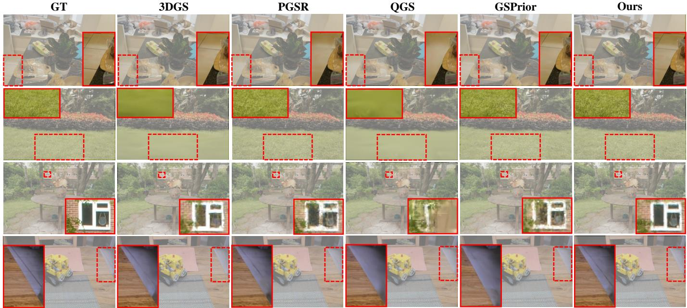  
Fig. 8. Qualitative comparison on the Mip-NeRF360 dataset. Rendered images from different methods are shown with enlarged local regions marked by red boxes. The results suggest that our method preserves fine image details and local structures in the selected scenes.

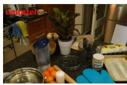

TABLE III  
NOVEL-VIEW-SYNTHESIS RESULTS ON MIP-NERF360. RED, ORANGE, AND YELLOW INDICATE THE BEST, SECOND-BEST, AND THIRD-BEST RESULTS, RESPECTIVELY; † DENOTES REPRODUCED RESULTS.
<table><tr><td rowspan="2">Method</td><td rowspan="2"></td><td colspan="3">Outdoor scenes</td><td colspan="3">Indoor scenes</td><td colspan="3">Overall average</td></tr><tr><td>SSIM↑</td><td>PSNR↑</td><td>LPIPS↓</td><td>SSIM↑</td><td>PSNR↑</td><td>LPIPS↓</td><td>SSIM↑</td><td>PSNR↑</td><td>LPIPS↓</td></tr><tr><td>3DGS [13]</td><td></td><td>0.742</td><td>25.07</td><td>0.232</td><td>0.931</td><td>31.18</td><td>0.164</td><td>0.837</td><td>28.13</td><td>0.198</td></tr><tr><td>2DGS [36]</td><td></td><td>0.706</td><td>24.21</td><td>0.284</td><td>0.912</td><td>30.15</td><td>0.212</td><td>0.809</td><td>27.18</td><td>0.248</td></tr><tr><td>GOF [37]</td><td></td><td>0.746</td><td>24.81</td><td>0.208</td><td>0.917</td><td>30.40</td><td>0.189</td><td>0.832</td><td>27.61</td><td>0.199</td></tr><tr><td>GFSGS [38]</td><td></td><td>0.734</td><td>24.40</td><td>0.224</td><td>0.916</td><td>29.93</td><td>0.194</td><td>0.825</td><td>27.17</td><td>0.209</td></tr><tr><td>GS-UDF [41]</td><td></td><td>0.698</td><td>23.84</td><td>0.292</td><td>0.906</td><td>29.16</td><td>0.219</td><td>0.802</td><td>26.50</td><td>0.255</td></tr><tr><td>PGSR [18]</td><td></td><td>0.752</td><td>24.74</td><td>0.203</td><td>0.929</td><td>30.16</td><td>0.159</td><td>0.841</td><td>27.45</td><td>0.181</td></tr><tr><td>QGS [42]</td><td></td><td>0.706</td><td>23.32</td><td>0.242</td><td>0.919</td><td>30.45</td><td>0.184</td><td>0.813</td><td>26.89</td><td>0.213</td></tr><tr><td>GSPrior [43]</td><td></td><td>0.754</td><td>24.81</td><td>0.200</td><td>0.933</td><td>30.56</td><td>0.155</td><td>0.844</td><td>27.69</td><td>0.178</td></tr><tr><td>GSPrior† [43]</td><td></td><td>0.755</td><td>24.77</td><td>0.201</td><td>0.931</td><td>30.39</td><td>0.159</td><td>0.843</td><td>27.58</td><td>0.180</td></tr><tr><td>Ours</td><td></td><td>0.749</td><td>24.75</td><td>0.199</td><td>0.933</td><td>30.68</td><td>0.151</td><td>0.841</td><td>27.72</td><td>0.175</td></tr></table>

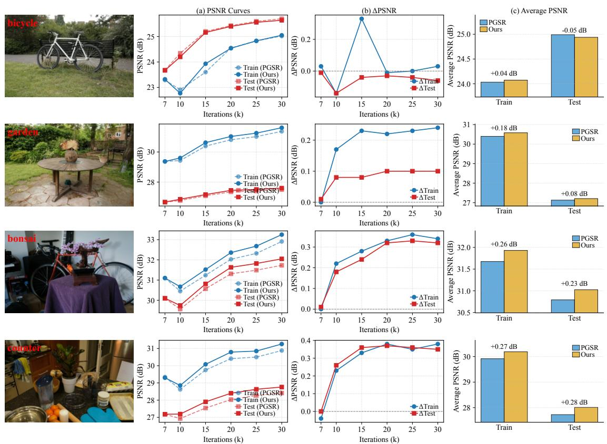  
Fig. 9. Optimization dynamics compared with PGSR. (a) Training- and test-view PSNR curves; (b) per-iteration ∆PSNR; (c) average training- and test-view PSNR.

that the proposed geometric regularization maintains competitive novel view synthesis quality while improving perceptual rendering metrics. Fig. 8 further provides qualitative comparisons with enlarged local regions, where our method preserves fine image details and local structures in the selected scenes.

## D. Optimization Dynamics

We record the training- and test-view PSNR at 7k, 10k, 15k, 20k, 25k, and 30k iterations and compare DepthGS with PGSR in Fig. 9. The first column shows the PSNR evolution, the second reports $\Delta \mathrm { P S N R } ~ = ~ \mathrm { P S N R } _ { \mathrm { O u r s } } - \mathrm { P S N R } _ { \mathrm { P G S R } } ,$ and the third compares the average training- and test-view PSNR. DepthGS generally achieves higher PSNR at most recorded iterations, with faster improvement during 7k–15k iterations in several scenes. The maximum training/test gains reach 0.38/0.37 dB in counter and 0.36/0.33 dB in bonsai.

The average training/test gains are 0.27/0.28 dB in counter, 0.26/0.23 dB in bonsai, and 0.18/0.08 dB in garden. In the more challenging bicycle scene, the training PSNR increases by 0.04 dB, whereas the test PSNR decreases by 0.05 dB.

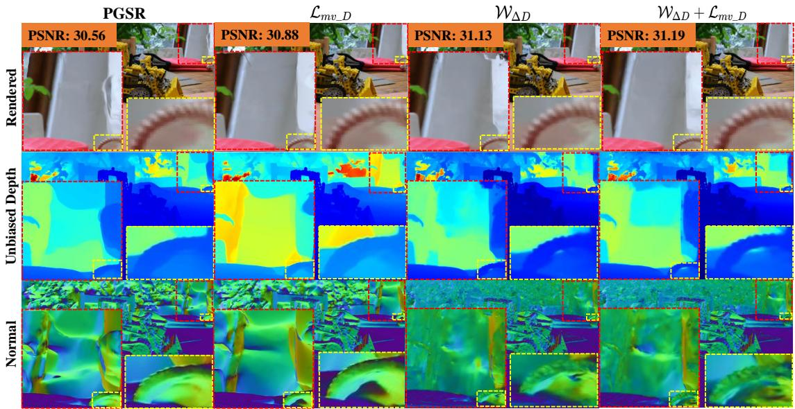  
Fig. 10. Novel-view-synthesis ablation results. The rows show RGB, unbiased depth, and normal maps; the columns show PGSR, the two individual components, and the full model.

TABLE IV  
ABLATION STUDY ON THE MIP-NERF360 DATASET. BEST RESULTS ARE IN BOLD.
<table><tr><td> ${ \mathcal { W } } _ { \Delta D }$ </td><td> $\mathcal { L } _ { m v \_ D }$ </td><td>PSNR↑</td><td>SSIM↑</td><td>LPIPS↓</td></tr><tr><td>X</td><td>X</td><td>27.45</td><td>0.841</td><td>0.181</td></tr><tr><td>√</td><td>X</td><td>27.75</td><td>0.842</td><td>0.175</td></tr><tr><td>X</td><td>√</td><td>27.51</td><td>0.842</td><td>0.180</td></tr><tr><td>√</td><td>√</td><td>27.73</td><td>0.841</td><td>0.175</td></tr></table>

This degradation may result from complex illumination, wide viewpoint variations, and fragmented geometry, which reduce the reliability of normal and depth estimates. Overall, the results indicate favorable but scene-dependent optimization behavior rather than universally improved convergence.

## E. Ablation Studies

Ablation settings and results. We evaluate the depthdifference-guided weight $\mathcal { W } _ { \Delta D }$ and the cross-view depth consistency regularizer $\mathcal { L } _ { m v \_ D }$ . The image-gradient factor $\overline { { \nabla I } } ^ { 2 }$ is kept unchanged whenever the single-view normal constraint is used, so the ablation isolates the contribution of $\mathcal { W } _ { \Delta D }$ . In Tables IV and ${ \mathrm { V } } , \ r ^ { \prime } { \mathrm { X } } ^ { \prime \prime }$ and $" \ j ^ { \flat }$ indicate the exclusion and inclusion of each component, respectively.

Table IV shows that $\mathcal { W } _ { \Delta D }$ primarily improves image-level rendering metrics, while the full model maintains comparable rendering quality. Table V shows that the proposed components reduce CD from 0.53 to 0.51 mm, with average and peak memory usages of 6.77 and 7.50 GB for the full model. The complementary effect of $\mathcal { L } _ { m v \_ D }$ is further evaluated using $E _ { \mathrm { M V C } }$ below.

Qualitative ablation analysis. Fig. 10 compares the rendered RGB images, unbiased depth maps, and normal maps produced by PGSR and the three ablation variants. Introducing either $\mathcal { L } _ { m v \_ D }$ or $\mathcal { W } _ { \Delta D }$ improves local boundary preservation and geometric coherence in the highlighted regions. Their combination achieves the highest PSNR of 31.19 dB for the illustrated view and provides a favorable overall result across the three representations.

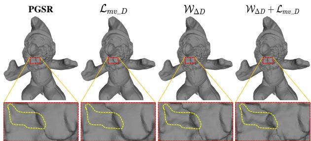  
Fig. 11. 3D reconstruction ablation study. The red dashed box indicates the magnified region. The comparison of local structures within the highlighted region illustrates the effects of different components on local contour preservation and geometric details.

TABLE V  
ABLATION STUDY ON THE DTU DATASET (CD: MM; MEMORY: GB).
<table><tr><td>Method</td><td> ${ \mathcal { W } } _ { \Delta D }$ </td><td> $\mathcal { L } _ { m v \_ D }$ </td><td>CD↓</td><td>Avg. Mem.↓</td><td>Peak Mem.↓</td></tr><tr><td>PGSR</td><td>X</td><td>X</td><td>0.53</td><td>6.41</td><td>7.12</td></tr><tr><td> $+ \mathcal { L } _ { m v \_ D }$ </td><td>X</td><td>√</td><td>0.52</td><td>6.89</td><td>7.98</td></tr><tr><td>+  $\mathbf { \nabla } \cdot \mathcal { W } _ { \Delta D }$ </td><td>√</td><td>X</td><td>0.51</td><td>6.74</td><td>7.43</td></tr><tr><td>Ours</td><td>√</td><td>√</td><td>0.51</td><td>6.77</td><td>7.50</td></tr></table>

Fig. 11 shows that the proposed components generally produce clearer local contours and better-defined geometric structures. These results are consistent with their intended roles: ${ \mathcal { W } } _ { \Delta D }$ adapts the local normal constraint according to geometric reliability, while $\mathcal { L } _ { m v \_ D }$ reduces cross-view depth discrepancies.

Analysis of cross-view depth consistency regularization. Using the sampled cross-view depth-difference residual defined in Eq. 34, we define the multi-view consistency error for each valid view pair as

$$
\begin{array} { r l } { \displaystyle E _ { \mathrm { M V C } } = \frac { 1 } { | \Omega | } \sum _ { p \in \Omega } \Big | \left( D _ { u , \pi } ^ { \mathcal { V } _ { n } } ( p ) - D _ { \mathcal { D } , \pi } ^ { \mathcal { V } _ { n } } ( p ) \right) } & { } \\ { \displaystyle - \left( \hat { D } _ { u } ^ { \mathcal { V } _ { n } } ( p ) - \hat { D } _ { \mathcal { D } } ^ { \mathcal { V } _ { n } } ( p ) \right) \Big | . } \end{array}\tag{39}
$$

A lower $E _ { \mathrm { M V C } }$ indicates better cross-view depth-difference consistency. View pairs with $\Omega = \emptyset$ are excluded from the evaluation.

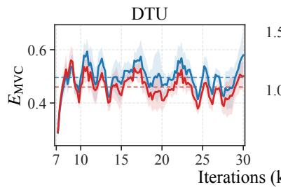

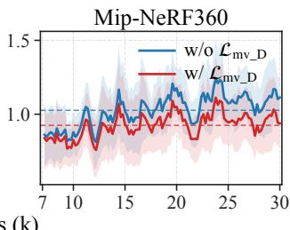  
Fig. 12. Mean $E _ { \mathrm { M V C } }$ on DTU and Mip-NeRF360. Shaded regions denote standard errors across scenes.

As shown in Fig. 12, the averaged $E _ { \mathrm { M V C } }$ curves on DTU and Mip-NeRF360 are generally lower with $\mathcal { L } _ { m v \_ D }$ than without it, indicating that the proposed cross-view depth consistency regularization helps reduce cross-view depth-difference inconsistency. Since $\mathcal { L } _ { m v \_ D }$ mainly targets cross-view geometric consistency, $E _ { \mathrm { M V C } }$ provides a direct diagnostic measure for evaluating its intended effect.

## VI. CONCLUSION

In this paper, we have proposed DepthGS, a depth-guided Gaussian splatting framework with adaptive regularization. More specifically, we have derived theoretical relations between depth information and reconstruction error in both single-view and multi-view settings and established corresponding upper bounds on the reconstruction error. We have further proposed depth-driven optimization frameworks for single-view and multi-view settings that use depth-derived geometric cues to regularize the optimization and improve geometric consistency. Experimental results on multiple public datasets, including DTU, Mip-NeRF360, and Tanks and Temples, demonstrate competitive reconstruction and rendering performance in both quantitative metrics and qualitative comparisons. Future research will focus on addressing challenges in complex outdoor environments, especially under strong illumination variations, noisy geometry, and unstructured scene layouts, to further improve the robustness of the method in real-world applications.

## REFERENCES

[1] M. Li, W. Chen, N. Cheng, J. Xu, D. Li, and H. Wang, “Garad-slam: 3d gaussian splatting for real-time anti dynamic slam,” in 2025 IEEE International Conference on Robotics and Automation (ICRA), 2025, pp. 11 047–11 053.

[2] M. Li, Y. Zhou, H. Zhou, X. Hu, F. Roemer, H. Wang, and A. Osman, “Dy3dgs-slam: Monocular 3d gaussian splatting slam for dynamic environments,” in 2025 IEEE International Conference on Robotics and Automation (ICRA), 2025, pp. 14 572–14 578.

[3] J. Wakulicz, H. Kong, and S. Sukkarieh, “Active information acquisition under arbitrary unknown disturbances,” in 2021 IEEE International Conference on Robotics and Automation (ICRA). IEEE, 2021, pp. 8429–8435.

[4] S. Eiffert, N. D. Wallace, H. Kong, N. Pirmarzdashti, and S. Sukkarieh, “Resource and response aware path planning for long-term autonomy of ground robots in agriculture,” Field Robotics, vol. 2, pp. 1–33, 2022.

[5] J. Wang, Y. He, D. Su, K. Itoyama, K. Nakadai, J. Wu, S. Huang, Y. Li, and H. Kong, “Slam-based joint calibration of multiple asynchronous microphone arrays and sound source localization,” IEEE Transactions on Robotics, 2024.

[6] M. Khan, H. Fazlali, D. Sharma, T. Cao, D. Bai, Y. Ren, and B. Liu, “Autosplat: Constrained gaussian splatting for autonomous driving scene reconstruction,” in 2025 IEEE International Conference on Robotics and Automation (ICRA), 2025, pp. 8315–8321.

[7] Z. Liang, H. Li, K. Jia, K. Guo, and Q. Zhang, “Gus-ir: Gaussian splatting with unified shading for inverse rendering,” IEEE Transactions on Pattern Analysis and Machine Intelligence, vol. 47, no. 10, pp. 8364– 8378, 2025.

[8] P. Wang, L. Zhao, Y. Zhang, S. Zhao, and P. Liu, “Mba-slam: Motion blur aware dense visual slam with radiance fields representation,” IEEE Transactions on Pattern Analysis and Machine Intelligence, vol. 47, no. 12, pp. 11 168–11 186, 2025.

[9] Z.-X. Yin, P.-Y. Jiao, J. Qiu, M.-M. Cheng, and B. Ren, “Ms-nerf: Multispace neural radiance fields,” IEEE Transactions on Pattern Analysis and Machine Intelligence, vol. 47, no. 5, pp. 3766–3783, 2025.

[10] B. Mildenhall, P. P. Srinivasan, M. Tancik, J. T. Barron, R. Ramamoorthi, and R. Ng, “NeRF: Representing scenes as neural radiance fields for view synthesis,” Communications of the ACM, vol. 65, no. 1, pp. 99– 106, 2021.

[11] W. Hu, C. Tian, L. Wen, and H. Ding, “Td-nerf: Transfer learning and diffusion regulation-based nerf for scene perception,” IEEE Transactions on Instrumentation and Measurement, vol. 74, pp. 1–12, 2025.

[12] Y. Han, T. Yu, X. Yu, D. Xu, B. Zheng, Z. Dai, C. Yang, Y. Wang, and Q. Dai, “Super-nerf: View-consistent detail generation for nerf super-resolution,” IEEE Transactions on Visualization and Computer Graphics, vol. 31, no. 9, pp. 6053–6066, 2025.

[13] B. Kerbl, G. Kopanas, T. Leimkuhler, and G. Drettakis, “3D gaussian¨ splatting for real-time radiance field rendering.” ACM Trans. Graph., vol. 42, no. 4, pp. 139–1, 2023.

[14] Y. Cheng, X. Li, X. Ren, J. Wang, H. Jia, D. Xu, W. Zhu, B. Ni, and Y. Yan, “Topo4d++: Realistic physically based 4d head capture with topology-preserving gaussian splatting and expression priors,” IEEE Transactions on Pattern Analysis and Machine Intelligence, pp. 1–17, 2025.

[15] Y. Li, C. Lyu, Y. Di, G. Zhai, G. H. Lee, and F. Tombari, “Geogaussian: Geometry-aware gaussian splatting for scene rendering,” in European Conference on Computer Vision, 2024, pp. 441–457.

[16] K. Cheng, X. Long, K. Yang, Y. Yao, W. Yin, Y. Ma, W. Wang, and X. Chen, “Gaussianpro: 3D gaussian splatting with progressive propagation,” in Forty-first International Conference on Machine Learning, 2024.

[17] M. Turkulainen, X. Ren, I. Melekhov, O. Seiskari, E. Rahtu, and J. Kannala, “DN-Splatter: Depth and normal priors for gaussian splatting and meshing,” arXiv preprint arXiv:2403.17822, 2024.

[18] D. Chen, H. Li, W. Ye, Y. Wang, W. Xie, S. Zhai, N. Wang, H. Liu, H. Bao, and G. Zhang, “PGSR: Planar-based gaussian splatting for efficient and high-fidelity surface reconstruction,” IEEE Transactions on Visualization and Computer Graphics, 2024.

[19] H. Chen, F. Wei, C. Li, T. Huang, Y. Wang, and G. H. Lee, “VCR-GauS: View consistent depth-normal regularizer for gaussian surface reconstruction,” Advances in Neural Information Processing Systems, vol. 37, pp. 139 725–139 750, 2025.

[20] J. T. Barron, B. Mildenhall, D. Verbin, P. P. Srinivasan, and P. Hedman, “Mip-nerf 360: Unbounded anti-aliased neural radiance fields,” in Proceedings of the IEEE/CVF Conference on Computer Vision and Pattern Recognition, 2022, pp. 5470–5479.

[21] R. Jensen, A. Dahl, G. Vogiatzis, E. Tola, and H. Aanæs, “Large scale multi-view stereopsis evaluation,” in Proceedings of the IEEE/CVF Conference on Computer Vision and Pattern Recognition, 2014, pp. 406– 413.

[22] A. Knapitsch, J. Park, Q.-Y. Zhou, and V. Koltun, “Tanks and temples: Benchmarking large-scale scene reconstruction,” ACM Transactions on Graphics (ToG), vol. 36, no. 4, pp. 1–13, 2017.

[23] J. L. Schonberger and J.-M. Frahm, “Structure-from-motion revisited,” in Proceedings of the IEEE/CVF Conference on Computer Vision and Pattern Recognition, 2016, pp. 4104–4113.

[24] E. Penner and L. Zhang, “Soft 3d reconstruction for view synthesis,” ACM Transactions on Graphics (ToG), vol. 36, no. 6, pp. 1–11, 2017.

[25] N. Deng, Z. He, J. Ye, B. Duinkharjav, P. Chakravarthula, X. Yang, and Q. Sun, “Fov-nerf: Foveated neural radiance fields for virtual reality,” IEEE Transactions on Visualization and Computer Graphics, vol. 28, no. 11, pp. 3854–3864, 2022.

[26] X. Huang, Q. Zhang, Y. Feng, H. Li, and Q. Wang, “Ltm-nerf: Embedding 3d local tone mapping in hdr neural radiance field,” IEEE Transactions on Pattern Analysis and Machine Intelligence, vol. 46, no. 12, pp. 10 944–10 959, 2024.

[27] D. Zhu, Z. Wang, and X. Jiang, “An efficient geometric points-guided generalized exponential splatting,” IEEE Transactions on Automation Science and Engineering, vol. 22, pp. 20 546–20 558, 2025.

[28] Z. Liu, J. Su, G. Cai, Y. Chen, B. Zeng, and Z. Wang, “Georgs: Geometric regularization for real-time novel view synthesis from sparse inputs,” IEEE Transactions on Circuits and Systems for Video Technology, vol. 34, no. 12, pp. 13 113–13 126, 2024.

[29] J. C. Lee, D. Rho, X. Sun, J. H. Ko, and E. Park, “Compact 3d gaussian representation for radiance field,” in 2024 IEEE/CVF Conference on Computer Vision and Pattern Recognition, 2024, pp. 21 719–21 728.

[30] P. Wang, Y. Wang, D. Wang, S. Mohan, Z. Fan, L. Wu, R. Cai, Y.-Y. Yeh, Z. Wang, Q. Liu, and R. Ranjan, “Steepest descent density control for compact 3d gaussian splatting,” in 2025 IEEE/CVF Conference on Computer Vision and Pattern Recognition, 2025, pp. 26 663–26 672.

[31] S. S. Mallick, R. Goel, B. Kerbl, M. Steinberger, F. V. Carrasco, and F. De La Torre, “Taming 3dgs: High-quality radiance fields with limited resources,” in SIGGRAPH Asia 2024 Conference Papers, 2024, pp. 1– 11.

[32] T. Shen, S. Liu, J. Feng, Z. Ma, and N. An, “Topology-aware 3d gaussian splatting: Leveraging persistent homology for optimized structural integrity,” in Proceedings of the 39th AAAI Conference on Artificial Intelligence, 2024.

[33] G. Feng, S. Chen, R. Fu, Z. Liao, Y. Wang, T. Liu, B. Hu, L. Xu, Z. Pei, H. Li et al., “Flashgs: Efficient 3d gaussian splatting for large-scale and high-resolution rendering,” in Proceedings of the Computer Vision and Pattern Recognition Conference, 2025, pp. 26 652–26 662.

[34] Z. Guo, W. Zhou, L. Li, M. Wang, and H. Li, “Motion-aware 3d gaussian splatting for efficient dynamic scene reconstruction,” IEEE Transactions on Circuits and Systems for Video Technology, vol. 35, no. 4, pp. 3119– 3133, 2025.

[35] R. Fan, J. Wu, X. Shi, L. Zhao, Q. Ma, and L. Wang, “Fov-gs: Foveated 3d gaussian splatting for dynamic scenes,” IEEE Transactions on Visualization and Computer Graphics, vol. 31, no. 5, pp. 2975–2985, 2025.

[36] B. Huang, Z. Yu, A. Chen, A. Geiger, and S. Gao, “2d gaussian splatting for geometrically accurate radiance fields,” in ACM SIGGRAPH 2024 conference papers, 2024, pp. 1–11.

[37] Z. Yu, T. Sattler, and A. Geiger, “Gaussian opacity fields: Efficient adaptive surface reconstruction in unbounded scenes,” ACM Transactions on Graphics (ToG), vol. 43, no. 6, pp. 1–13, 2024.

[38] K. Jiang, V. Sivaram, C. Peng, and R. Ramamoorthi, “Geometry field splatting with gaussian surfels,” in Proceedings of the IEEE/CVF Conference on Computer Vision and Pattern Recognition, 2025, pp. 5752– 5762.

[39] M. Yu, T. Lu, L. Xu, L. Jiang, Y. Xiangli, and B. Dai, “Gsdf: 3dgs meets sdf for improved neural rendering and reconstruction,” Advances in Neural Information Processing Systems, vol. 37, pp. 129 507–129 530, 2024.

[40] W. Zhang, Y.-S. Liu, and Z. Han, “Neural signed distance function inference through splatting 3d gaussians pulled on zero-level set,” in Advances in Neural Information Processing Systems, 2024.

[41] S. Li, Y.-S. Liu, and Z. Han, “Gaussianudf: Inferring unsigned distance functions through 3d gaussian splatting,” in Proceedings ofthe Computer Vision and Pattern Recognition Conference, 2025, pp. 27 113–27 123.

[42] Z. Zhang, B. Huang, H. Jiang, L. Zhou, X. Xiang, and S. Shen, “Quadratic gaussian splatting: High quality surface reconstruction with second-order geometric primitives,” in Proceedings of the IEEE/CVF International Conference on Computer Vision, 2025, pp. 28 260–28 270.

[43] T. Noda, Y.-S. Liu, and Z. Han, “3d gaussian splatting with selfconstrained priors for high fidelity surface reconstruction,” in Proceedings of the IEEE/CVF Conference on Computer Vision and Pattern Recognition, 2026, pp. 26 041–26 051.

[44] L. Yariv, J. Gu, Y. Kasten, and Y. Lipman, “Volume rendering of neural implicit surfaces,” Advances in Neural Information Processing Systems, vol. 34, pp. 4805–4815, 2021.

[45] P. Wang, L. Liu, Y. Liu, C. Theobalt, T. Komura, and W. Wang, “Neus: Learning neural implicit surfaces by volume rendering for multi-view reconstruction,” arXiv preprint arXiv:2106.10689, 2021.

[46] Z. Li, T. Muller, A. Evans, R. H. Taylor, M. Unberath, M.-Y. Liu, and¨ C.-H. Lin, “Neuralangelo: High-fidelity neural surface reconstruction,” in Proceedings of the IEEE/CVF Conference on Computer Vision and Pattern Recognition, 2023, pp. 8456–8465.

[47] Z. Yu, S. Peng, M. Niemeyer, T. Sattler, and A. Geiger, “Monosdf: Exploring monocular geometric cues for neural implicit surface reconstruction,” Advances in Neural Information Processing Systems, vol. 35, pp. 25 018–25 032, 2022.