# Efects of Laser Beam Width and Measurement Noise on Tree Diameter Estimation in Laser Scanning

Preprint – November 11, 2026

Jesse Muhojoki1∗, Nuutti Ervasti1, Eric Hyyppä1, Aapo Erkkilä2, Eppu Honkanen2, Tuomas Yrttimaa2, Mikko Vastaranta1,2, Juha Hyyppä

1Department of Remote Sensing and Photogrammetry, Finnish Geospatial Research Institute FGI, The National Land Survey of Finland, Vuorimiehentie 5, 02150 Espoo, Finland

2School ofForest Sciences, University ofEastern Finland, 80101 Joensuu, Finland

## Abstract

Laser scanning has been utilized for decades to measure tree structure and geometry. Despite continuous advances in sensor technology, uncertainties arising from scanner characteristics and measurement conditions has remained relevant sources of error. In particular, factors such as laser beam diameter can introduce both systematic and random errors in the reconstructed tree geometry. This study investigates the main sources of these errors in mobile laser scanning (MLS) and quantifies their efects on stem curve (stem diameter) estimation. We discovered through simulations and experiments that the heteroscedasticity (diference in variance in ranging and scan angle) in the measurement noise is a key factor along with the beam width of the lidar, which cause the bias of the diameter estimates to depend not only on distance, but also on the tree diameter. We demonstrated that this bias can be reliably predicted and negated for trees with a diameter at the breast height greater than 10 cm using technical specifications of the sensor without any additional calibration. In experiments, the proposed bias compensation method reduced the root-mean-square error of stem diameter estimates to sub-centimeter level on boreal forest test sites. However, for small trees with diameter below 10 cm, the diameter bias becomes sensitive to the diameter of the tree—an unknown factor—and other factors, such as diferent bark and out-of-roundness of the stem, limiting the precision of lidar for measuring geometry of trees and applicability of the presented method.

Keywords Stem curve, Error analysis, Mobile laser scanning, Point cloud, Bias Compensation

This manuscript version is made available under the CC-BY-NC-ND 4.0 license https://creativecommons.org/licenses/by-nc-nd/4.0/.

## 1 Introduction

Inventories are a key to providing accurate and up-to-date information of forests at country-level. This information can be used for optimizing the forest usage between harvesting, conservation and recreational use.

Airborne laser scanning (ALS) enables eficient, large-area forest inventories, including individual-tree-level inventories(Hyyppa and Inkinen, 1999; Persson et al., 2002; Ma et al., 2023; Hyyppä et al., 2024; White et al., 2025). However, due to high flight altitude required for fast collection of the data and the canopy obstructions, the tree stems get few laser hits, and thus, their geometries are not directly measurable from the point clouds. Therefore, reference data are required for the prediction of tree stem attributes from ALS data. In addition to the accuracy requirement of the reference, it needs to be quick to collect and update as trees are growing and there are also disturbances abruptly changing forest structure. Furthermore, the forest change is accelerated by the climate change (AndersonTeixeira et al., 2013; Thom et al., 2022; Bratu et al., 2025). One promising alternative to manual reference data collection is mobile laser scanning (MLS) (Liang et al., 2014; Pires et al., 2024; Holvoet et al., 2025; Liikonen et al., 2026). MLS utilizes a lidar and an inertial measurement unit (IMU), potentially augmented with a global navigation satellite system (GNSS) receiver, for acquiring a point cloud while moving for eficient high-coverage data collection in contrast to stationary terrestrial laser scanning (TLS). The tree geometry is typically estimated from the laser scanning point clouds through geometric modeling such as circle or cylinder fitting. Acquisition of MLS data from forest sample plots is significantly faster than measurements with calipers and clinometers. Furthermore, MLS data can be used to describe the entire stem curve, i.e., the stem diameter as a function height—as opposed to just the diameter at breast height—and can provide it with better than 10 % accuracy (Hyyppä et al., 2020; Stovall et al., 2023; Muhojoki et al., 2024). Stem curve enables direct estimation of the stem volume, and the geometric information it provides can be used for estimation of the length and volume of the sawlog and pulpwood. Similar accuracy has been achieved for diameter at breast height (DBH) measurements by (Ryding et al., 2015; Bauwens et al., 2016; Cabo et al., 2018; Kuelka et al., 2022; Hofrén et al., 2024; Vandendaele et al., 2022). It should be noted that the accuracy of the stem attribute estimation depends on tree species (Yrttimaa et al., 2022; Holvoet et al., 2025; Tavi et al., 2026) and forest structure (Ryding et al., 2015; Bauwens et al., 2016; Cabo et al., 2018). Due to the capacity to record more structural information on individual trees, MLS can also enhance forest inventories by providing alternatives for assessing carbon storage (Coops et al., 2025) and vigor (Gerbrecht et al., 2025) of each trees as well as biodiversity indicators, such as structural complexity and the amount of dead wood from each measured sample plot (Fol et al., 2023).

In forest inventories, it is essential that measurements of trees and sample plots are unbiased, so that errors do not accumulate when producing estimates over large areas (Kangas et al., 2006). Although MLS systems enable rapid measurement of sample plots and trees, the systematic and random errors inherent in such measurements and their underlying causes remain poorly understood. The tree diameter estimated from laser scanning point clouds through circle or cylinder fitting has been reported to lead to both underestimating (Gollob et al., 2020; Di Stefano et al., 2021; Kuelka et al., 2022; Hofrén et al., 2024) and overestimating the diameter (Ringdahl et al., 2013; Forsman et al., 2018; Muhojoki et al., 2024; Balestra et al., 2024). It is known that the finite beam width of the laser pulses cause part of this bias (Forsman et al., 2018; Muhojoki et al., 2024; Faitli et al., 2024), but only few attempts have been made to study this or correct the efects. Ringdahl et al. (2013) proposed a geometric correction method that moves the edge points of the measured circle sector towards the center of the fitted circle, depending on the viewing angle and beam width. While the method reduced the overestimation of the tree diameter from 40 % to 12 %, the method used a simplistic model of a laser distance measurement, and is therefore limited to laser scanners with a large beam divergence that greatly overestimates the stem diameter.

Forsman et al. (2018) performed a simulation study and concluded that tree diameter bias increased quadratically as a function of measurement distance. However, studies by Kuelka and Surový (2024) and Muhojoki et al. (2024) demonstrated that for modern mobile laser scanners and typical tree detection distances (1 m–20 m) the relation is mostly linear. Muhojoki et al. (2024) and Faitli et al. (2024) calibrated the bias by measuring the bias as a function of measurement distance in one sample plot and fitting a linear model to the data. The (system-specific) models were subsequently used for correcting the measurements from other sample plots, some of which had a drastically diferent tree species composition. Although the method proved efective—eliminating 50 %–99 % of the bias—the large variation demonstrates that the method can be improved. For example, it does not take the scan angle, tree species (reflectance, bark roughness), potentially heteroscedastic stochastic measurement noise or tree diameter into account.

The efect of noise and tree diameter on the accuracy of MLS/TLS-based tree diameter measurements has been studied in the past literature, again with conflicting findings. Gollob et al. (2020); Stovall et al. (2023) and Kuelka and Surový (2024) reported a decreasing bias; a large positive bias for small, under 10 cm diameter trees and a small negative bias for large trees, whereas Pérez-Martín et al. (2021) found the bias to increase as the tree diameter increased. To correct the bias related to DBH, Gollob et al. (2020) developed a model that dependent on tree diameter, mean intensity, and standard deviation and residual error whose coeficients were calibrated with manual DBH measurements. In addition to models that correct for beam width- or diameter-induced bias, Verhoeven et al. (2025) developed an uncertainty-based circle fitting algorithm for point clouds with heteroscedastic and potentially scan angle dependent noise. Although the bias compensation model can benefit even the state-of-the-art laser scanning systems (Muhojoki et al., 2024), it is even more important for low-cost ones (Mokro et al., 2021; Çakir et al., 2021; Gollob et al., 2021; Hu et al., 2021; McGlade et al., 2022; Balestra et al., 2024; Howie and De Stefano, 2024), due to their wider beams and higher noise.

This study investigates the efect of beam divergence and measurement noise on the estimation of tree diameter from mobile laser scanning point clouds. We simulated tree diameter measurements by a time-of-flight laser scanner to demonstrate the measurement distance and tree diameter dependency of the stem curve measurement bias and to find the source of conflicting bias observations in the previous literature. The findings were validated with both an artificial target cylinder and trees from sample plots using terrestrial laser scanning as a reference. Lastly, we developed a novel simulation-based bias compensation method that requires no prior calibration and corrects the diameter estimation bias based both on the measurement distance and the target tree diameter.

## 2 Material and Methods

This study is broken into three parts:

• Simulation study

• Tests on an artificial cylinder under laboratory conditions

• Validation tests on forest sample plots

In this section, simulations experiments are first described in Section 2.1, followed by a description of the used laser scanners, the forest sample plots, and the artificial cylinder in Section 2.2. Finally, the process of acquiring the stem curve and other tree stem attributes from the point clouds is presented in Section 2.4, and the implementation of bias compensation in Section 2.5.

## 2.1 Simulations

The simulations followed the approach presented by Forsman et al. (2018). The beam was assumed to be Gaussian and circular, and the beam waist was ignored. At the scanning location, the beam width was beam width at exit, $W _ { 0 } ,$ at 2σ, as specified by the laser scanning system manufacturer, and the beam was simulated up to 3σ. As $W _ { 0 }$ was not given for the MLS system used in this study, we used a representative value for a modern lidar of $W _ { 0 } = 5 \mathrm { m m }$ . The 2σ definition of the beam width, W, is used throughout this paper. As the targets are much further away from the laser scanner than the Rayleigh length, and the divergence of the beam Θ is of the order of 1 mrad–10 mrad, the beam width at distance of d from the scanner is simply given by $W ( d ) = W _ { 0 } + d \Theta$ , where we have employed the small-angle approximation tan(Θ) ≈ Θ. The beam cross-section was spatially discretized into a 151-by-151 grid. The intersection point and angle between the target cylinder and each sub-beam were calculated, and the reflected pulse was assumed to follow Lambert’s cosine law $I ( \theta ) = I _ { 0 } \mathrm { c o s } ( \theta )$ , where θ is the incident angle. Reflectivity and absorption were ignored. The time of incidence was determined from the intersection point and the return signal was calculated by temporally discretizing the beam between the first incidence to the last beam leaving the surface into 1000 segments and aggregating the returned intensity. The location of the measured point was determined to be in the center of the beam, $d = c \Delta t / 2$ distance away from the origin of the beam, where c is the speed of light and ∆t the time diference from the beam leaving the sensor to when the set proportion of the amplitude of the pulse was returned to the scanner. This proportion threshold is called trigger threshold $\left( t _ { \mathrm { t h r e s h } } \right)$ , and is calculated with respect to the amplitude of the pulse exiting the lidar. The details of $t _ { \mathrm { t h r e s h } }$ are not typically given by the sensor manufacturers, and therefore we used a default value of $t _ { \mathrm { t h r e s h } } = 0 . 1$ , as suggested by (Forsman et al., 2018). We assumed that $t _ { \mathrm { t h r e s h } }$ does not depend on the measurement distance, as the ranging accuracies stated by the manufacturer would not be possible without some sort of range correction due to rangewalk (Yang et al., 2019). Furthermore, adjusting $t _ { \mathrm { t h r e s h } }$ can be used to simulate diferent levels of target reflectivity, since increasing $t _ { \mathrm { t h r e s h } }$ w.r.t. the ideal reflection is roughly equivalent to decreasing the reflectivity of the target. The simulation of the gaussian beam and the efect of the finite beam width on the return pulse are illustrated in Fig. 1.

In addition to the beam divergence, we simulated the uncertainty in the range and angle measurements. Although computationally eficient algebraic circle fit can be performed without inducing bias if the noise is homoscedastic (Al-Sharadqah and Chernov, 2009), i.e., the noise has the same variance in all directions, in general the measurement noise of a lidar is heteroscedastic (Verhoeven et al., 2025), which can cause bias in the circle fit, as demonstrated in Fig. 2. The noise was simulated by adding normally distributed noise with $\sigma _ { r }$ to the range measurement and $\sigma _ { \phi }$ to the azimuthal angle (origin at the lidar, the laser beams rotate about the z-axis).

We utilized the simulations to investigate both isolated and combined efects of finite beam width and ranging precision on the bias of estimating the diameter of the cylinder (tree stem). We compared the findings to lidar measurements on both a smooth artificial cylinder and (forest) sample plots. Furthermore, the simulations form the basis for the bias compensation method described in Section 2.5.

## 2.2 Test sites and laser scanners

The validation experiments were performed in Evo, Finland $( 6 1 . 1 9 ^ { \circ } \mathrm { ~ N } , 2 5 . 1 1 ^ { \circ } \mathrm { ~ \bar { E } ) }$ on a total of 9 32 m × 32 m sample plots representing varying boreal forest structures. The sample plots were categorized into easy and dificult, based on the the stem density and tree species composition. The sample plots categorized as easy were sparse (< 1000 stems/ha), and contained mainly Scots pine (Pinus sylvestris L.) that typically features few lower-hanging branches and a highly circular and straight stem. Therefore, most sources of error other than the laser scanners themselves were expected to be eliminated. In contrast, the dificult sites consisted of mixed forests dominated by Norway spruce (Picea abies (L.) H.Karst), silver and downy birches (Betula pendula Roth, Betula pubescens, Erth.) and Aspen (Populus Tremula $\mathrm { L . } )$ with mixtures of Scots pine and a few other deciduous trees. The density of trees at the dificult sites ranged from approximately 1000 to 2500 stems/ha. In these sites, occlusion of stems, curved or otherwise deformed trees, and the ambiguity of matching point cloud-derived trees with the reference stem map due to close proximity of trees play a major role in the error analysis.

(a)  
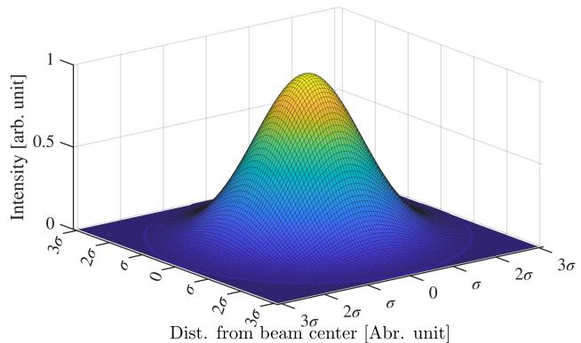

(b)  
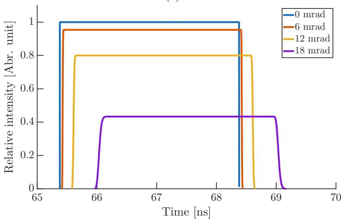  
(c)

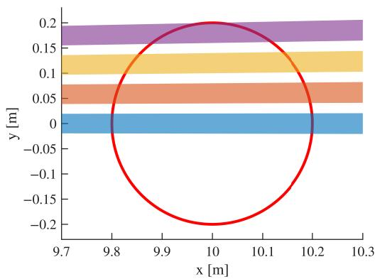  
Figure 1: a) Beam intensity distribution exiting the sensor. b) Return signal for measurements illustrated in c) (top view, target cylinder in red). The edges are smeared by the finite beam hitting a curved surface. The laser pulse was fired from the origin at an angle of 0, 6, 12 and 18 mrad w.r.t. x-axis. The pulse was 3 ns long with divergence of 2 mrad.

(a) Homoscedastic noise  
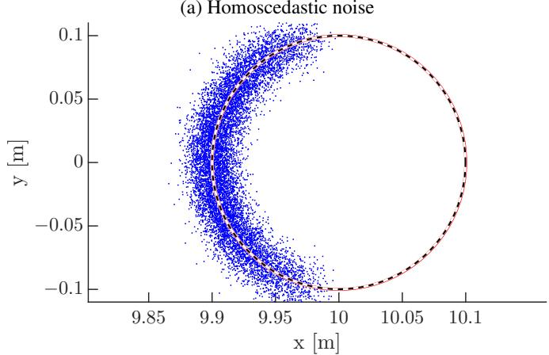

(b) Heteroscedastic noise  
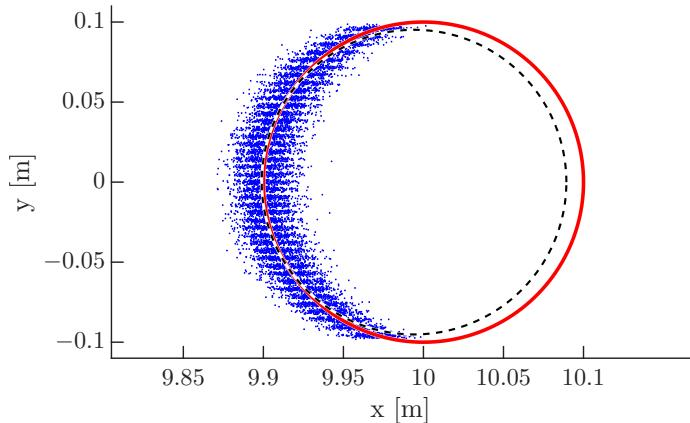  
Figure 2: Illustration of increasing circle fit bias as the heteroscedasticity of the noise increases. a) Homoscedastic noise with $\sigma _ { x } = \sigma _ { y } = 1 \mathrm { { c m } }$ . b) Heteroscedastic noise with range noise with $\sigma _ { r } = 1$ cm and angle noise of $\sigma _ { \theta } = 0 . 1$ mrad. The blue dots are the simulated laser data points, the red circle represents the cylinder and black dashed line the fitted circle. The lidar is located 10 meters left from the center of the tree.

The nine sample plots were measured with a Faro Orbis (FARO Technologies Inc., Lake Mary, Florida, USA) mobile laser scanner on $2 2 ^ { \mathrm { n d } }$ of May 2025. The data were processed into point clouds using Faro Connect software (version 3 2024) with the "forest" setting enabled for simultaneous localization and mapping (SLAM). For reference stem curves, the same plots were measured a Riegl VZ-400i (Riegl GmbH, Horn, Austria) TLS system from 16 scanning positions per plot on $6 ^ { \mathrm { { t h } } } { - 2 0 ^ { \mathrm { { t h } } } }$ of May 2025. The reference measurements were registered and processed into point clouds using RiSCAN PRO software (version 2.20.1). The scanning positions were placed in a regular $4 \times 4$ configuration that was slightly adjusted, if necessary, due to local topography or tree positions. At every other measurement point, an additional scan with the scanner tilted $9 0 ^ { \circ }$ was taken for a hemispherical scan for a more complete vertical field of view. An example TLS setup and MLS measurement trajectory are presented in Fig. 3. Selected key laser scanner specifications are presented in Table 1

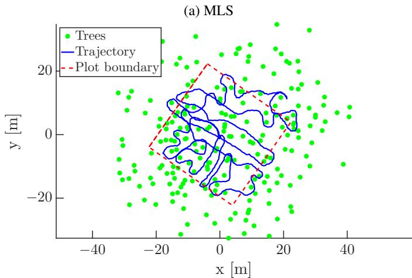

(b) TLS  
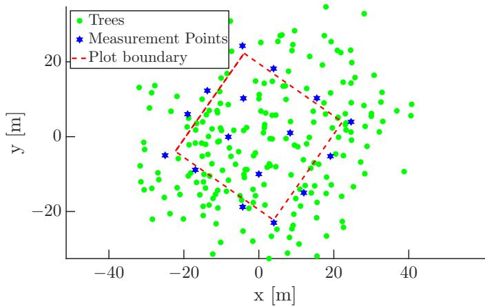  
Figure 3: (a) Example MLS measurement trajectory. (b) Example 16-point TLS measurement setup. The plot boundaries are presented as red dotted line.

Table 1: Lidar specifications
<table><tr><td>Scanner/property</td><td>Faro Orbis</td><td>Riegl VZ-400i</td></tr><tr><td>Divergence [mrad]</td><td> $0 . 7 \times 1 . 7 ^ { \mathrm { a } }$ </td><td>0.35</td></tr><tr><td>1σ Ranging precision [mm]</td><td>5</td><td>3</td></tr><tr><td>Ranging accuracy [mm]</td><td>±10</td><td>3-5b</td></tr><tr><td>PRR[kHz]</td><td>20</td><td>1200</td></tr><tr><td>Angular Resolution [mrad]</td><td>6.3</td><td>0.7</td></tr><tr><td>Wavelength [nm]</td><td>905</td><td>1550</td></tr></table>

a Vertical × Horizontal.  
b 3D accuracy @ 50 m–100 m  
c (Used) Pulse Repetition Rate.

## 2.3 Cylinder measurements

To validate the simulations in a controlled environment, we measured a cylinder with varying reflectance at various ranges. A cylinder approximates the shape of a tree stem, while its geometric properties are precisely known, making it suited for use in both method development and validation. The cylinder had a uniform diameter of 210 mm and height of 155 mm and was covered with thin colored cardboard to simulate diferent tree species, as illustrated in Fig.4. The colors of the paper were brown, white, and black, where brown and white represent the range of reflectivities found in the trees of a boreal forest, and black was selected as a low reflectance comparison. Data were collected at a distance of 1 m–15 m from the cylinder in increments of 1 m. The Faro Orbis scanner was held in the hand of the operator at the same height as the cylinder, and each distance was measured by holding the scanner still for approximately 60 s and then stepping back to the next measurement point. The uniform middle part of the cylinder was manually segmented from the point clouds and the cylinder diameter was calculated with a simplified version of the full stem curve software (see Section 2.4): The point clouds were divided into 3-second segments and each segment was first filtered with RANSAC (random sample consensus (Fischler and Bolles, 1981)) circle fitting, followed by algebraic "hyperaccurate" circle fitting (Al-Sharadqah and Chernov, 2009) to obtain the diameter estimates. The diameters were binned into distance bins based on the trajectory time stamps during which the scanner was stationary. For each measurement distance, the distance to the cylinder was defined as the distance between the average scanner position and the center point of the cylinder, and the median of the fitted circle diameters was used as the measured cylinder diameter.

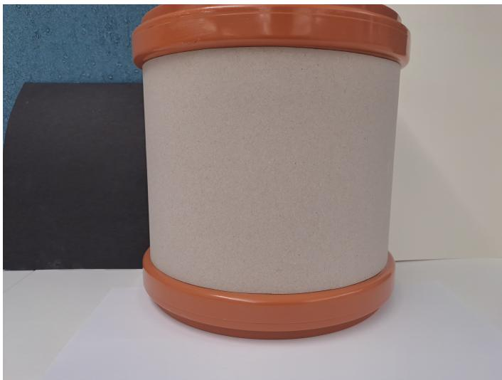  
Figure 4: The artificial target. The brown cardboard is attached to the target and the black and white cardboard are on the left and right of the target, respectively.

## 2.4 Point cloud processing and reference

Both the MLS and reference TLS data collected from sample plots were initially processed into stem curves using the method presented by Hyyppä et al. (2020). The method segments the point cloud into temporal and spatial segments and extracts arcs, i.e., consecutive laser hits to the tree stem forming an arc-shaped cluster of points, using DBSCAN (Ester et al., 1996). The arcs were filtered using RANSAC circle fitting, and preliminary diameter estimates were acquired with an algebraic "hyperaccurate" circle fitting method (Al-Sharadqah and Chernov, 2009), after projecting points to a plane perpendicular to the primary growth direction of the tree. Finally, a smoothing spline and an outlier filter were applied to obtain the diameter estimates at diferent heights (stem curve). For a detailed description of the method, the reader is directed to Hyyppä et al. (2020). The parameters used in this study are described in Muhojoki et al. (2024). Most importantly, we used a temporal segment duration of 3 s, which allows extracting highquality arcs and determining the arc-scanner distance for later distance-based corrections. During each 3-second time interval, the trajectory provided by the SLAM-corrected IMU is stable, allowing the extraction of high-quality arcs. However, the trajectory tends to drift over longer time periods without external reference, such as GNSS. Furthermore, in a typical MLS measurement setting in a forested environment, the scanner only moves a few meters during the 3 s period, and thus the average x- and y-coordinate is a reasonable approximation for the scanner location. The following section details a simulationbased bias compensation method used to further process the MLS arcs. Uncompensated MLS data was used as a comparison and for investigating the distance and tree diameter dependency of the measurement bias. The process, including the optional bias compensation, is illustrated in Fig. 5.

## 2.5 Implementation of the bias compensation

We developed a simulation-based bias compensation method to demonstrate the feasibility of calibration-free bias compensation, relying only on laser scanner specifications. As running a simulation for each arc separately was too slow with the current simulation implementation, we tabulated simulated measurements of trees with a diameter from 75 mm to 1200 mm at intervals of 25 mm, for distances ranging from 1 m to 20 m at 1 m intervals. We applied heteroscedastic, normally distributed noise to the measurement and recorded the mean measured cylinder diameter from 10000 samples and the measurement distance between the scanner and the center of the cylinder. The measured cylinder radius was calculated using the same RANSAC circle fit followed by the "hyperaccurate" fit as described in Section 2.4, and the average measured cylinder radius is thereafter referred to as simulated radius.

The important parameters for the simulation are trigger threshold $t _ { \mathrm { t h r e s h } }$ , beam divergence Θ and standard deviations of range and azimuthal angle noise $\sigma _ { r }$ and $\sigma _ { \phi } .$ . The range precision is typically provided by the manufacturer, but may vary depending on the measurement conditions and target properties. Beam divergence is also often given. However, azimuthal precision, t and further details concerning range calculations from the signal are not. Therefore, it is crucial that the method is stable, and can correct bias in diameter measurements even if the simulation values are slightly wrong. For baseline values, we selected $t _ { \mathrm { t h r e s h } } = 0 . 1$ based on the arguments presented in Forsman et al. (2018). The Faro Orbis has a reported nominal range accuracy of ±10 mm with a precision of $\sigma _ { r } ~ = ~ 5$ mm (1σ) and a nominal azimuthal resolution of 2 mrad–7 mrad. As the noise should be lower than the resolution, we chose $\sigma _ { \phi } ~ = ~ 0 . 5$ mrad. The Faro Orbis has a nominal beam divergence of 0.7 mrad × 1.7 mrad (Kokeza et al., 2026). As the lidar of the Faro Orbis is mounted on a rotating platform that rotates approximately at 1 Hz, the arcs can contain points from up to 3 rotations of the lidar, i.e., the elliptical footprints will be oriented diferently within an arc, the beam was modeled as a cone, with baseline divergence of the Θ = 1.1 mrad, close to the geometric average divergence of 0.7 mrad × 1.7 mrad = 1.09 mrad.

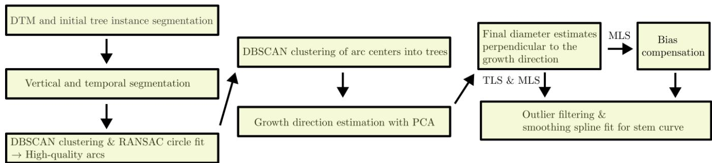  
Figure 5: Process flow for the stem curve and DBH estimation. In the final step, MLS data is processed both with and without the bias compensation.

To correct the bias of an individual arc, we first calculated the distance between the scan location and the arc, where the location of the arc was defined as the center of the initial circle fit, and the scan location as the average scanner trajectory coordinate between the detection of the first and the last point in the arc. As the points are separated by at most 3 s, the trajectory point are typically separated by at most few meters due to slow walking speed in the forest. Subsequently, the two closest simulated mean diameters were selected from two closest simulated measurement distances, and the new diameter estimate was computed as the weighted average based on the difference between the measured and simulated distance and diameter. The weights $w _ { d _ { 1 } }$ and $w _ { d _ { 2 } }$ for nearest distances $d _ { 1 }$ and $d _ { 2 }$ were calculated as:

$$
w _ { d _ { n } } = \frac { | d _ { m } - d | } { | d _ { m } - d _ { n } | } ,\tag{1}
$$

where d is the measurement distance and $n , m \in \{ 1 , 2 \} , n \neq m$ Similarly, for both distances, the two nearest simulated radii $r _ { n , 1 }$ and $r _ { n , 2 }$ to the measured radii r were determined and their weights were calculated as:

$$
w _ { r _ { n , i } } = \frac { | r _ { n , j } - r | } { | r _ { n , j } - r _ { n , i } | } ,\tag{2}
$$

where $i \in \{ 1 , 2 \}$ . Subsequently, the Eqs. (1) and (2) were utilized in calculation of the corrected radius $r _ { \mathrm { c o r r } } \colon$

$$
\boldsymbol { r } _ { \mathrm { c o r r } } = w _ { d _ { 1 } } \left( w _ { r _ { 1 , 1 } } \hat { r } _ { 1 , 1 } + w _ { r _ { 1 , 2 } } \hat { r } _ { 1 , 2 } \right) + w _ { d _ { 2 } } \left( w _ { r _ { 2 , 1 } } \hat { r } _ { 2 , 1 } + w _ { r _ { 2 , 2 } } \hat { r } _ { 2 , 2 } \right) ,\tag{3}
$$

where $\hat { r } _ { n , i }$ represents the cylinder radius corresponding to the simulated radius $r _ { n , i } .$ . After all arcs of a single tree have been bias-corrected using Eq. (3), the smoothing spline and outlier filter are re-applied, as described in Section 2.4 and illustrated in Fig. 5.

## 3 Error Analysis and Evaluation of the the Bias Compensation

The performance of the bias compensation method in the sample plots is compared to the uncompensated results using rootmean-square error (RMSE) and bias, defined as:

$$
\mathrm { R M S E } = \sqrt { \frac { 1 } { N } \Sigma _ { i = 1 } ^ { N } ( D _ { i } - D _ { \mathrm { r e f } , i } ) } ^ { 2 } ,
$$

$$
\mathrm { B i a s } = \frac { 1 } { N } \Sigma _ { i = 1 } ^ { N } ( D _ { i } - D _ { \mathrm { r e f } , i } ) , ,\tag{4}
$$

(5)

(6)

where, $D _ { i }$ is the measured tree diameter from MLS and $D _ { \mathrm { r e f } , i }$ is the corresponding reference value acquired with TLS. Bias was also used in error analysis with the artificial cylinder and simulation data, for which the reference value is known. For DBH, $D _ { i }$ is the diameter at 1.3 m above the ground for tree i. For the stem curve, the sum is calculated over all height intervals and trees. Ideally, with the used stem curve calculation parameters, each tree would have a diameter estimate from 1.5 m to 9.9 m above the ground in 40 cm increments. However, due to occlusions, the diameter values could not always be reliably estimated throughout the whole height range. As discussed in Section 2.4, the stem curve was smoothed with a spline, and therefore the stem curve was always defined between the highest and lowest height interval from which the diameter could be reliably estimated. However, we did not extrapolate the stem curve, and thus any non-overlapping region between the stem curve and its reference was ignored.

The diameter estimation error was studied as a function of stem diameter and measurement distance and also species- and sample plot-wise. In the sample plots, the efects of the tree diameter and measurement distance were isolated by binning each measured arc based on the average measurement distance and the reference tree diameter at the height of the arc. Only the arcs that were approximately parallel to the scanner at the height of 1.5 m–2.5 m were included to eliminate the potential efect of the vertical scan angle and bins with less than 50 arcs were discarded. For the isolated tree diameter experiment, the diameter bin centers were equidistant from 10 cm to 38 cm in 4 cm increments. The results are presented for distance bins of 3, 5, 7, 10 and 12 m (±0.5 m). Similarly, for studying the efect of the measurement distance on sample plots, the measurement distance bins were equidistant and 1-m-wide, with the bin centers ranging from 1.5 m to 24.5 m. The diameter bins were in this experiment were 5-cm-wide with the bin centers ranging from 12.5 cm to 27.5 cm. In addition, we employed a bin for all arcs smaller than 10 cm and larger than 30 cm in diameter.

## 4 Results and Discussion

## 4.0.1 Simulation Experiments—Efect ofBeam Divergence and Ranging Noise

Figure 6 presents the main simulation results. The tree diameter bias as a function of distance to the tree is shown in Figs. 6(a), (c) and (e) with the constant reference diameter of 20 cm, and as a function of tree diameter in Figs. 6(b), (d) and (f) with a constant measurement distance of 10 m. Figures 6(a) and (b) illustrate the impact of beam divergence Θ on diameter bias, while the random measurement noise was set to zero $\begin{array} { r l } { ( \sigma _ { r } } & { { } = } \end{array}$ $\sigma _ { \theta } = 0 )$ . In contrast, Figures 6(c) and (d) show the dependence of diameter bias on range noise $\sigma _ { r } ,$ while the laser beam was assumed infinitely narrow. In Figs. 6(e) and (f), both range noise $\sigma _ { r }$ and beam divergence Θ were varied, while angle noise $\sigma _ { \theta }$ was constant at $\sigma _ { \theta } = \mathrm { \bar { 1 0 ^ { - 4 } } }$ rad.

When the finite beam width efect was combined with stochastic noise, the simulation reproduced all the diferent bias behaviors reported in the literature: Figures 6(e) and 7(e) show both near linear- and near quadratic bias growth with respect to the measurement distance and Figs. 6(f) and 7(f) show both decreasing and increasing bias as a function of tree diameter— depending on the simulation parameters. The simulations also agree on the common finding that the magnitude of bias—both positive and negative—is significantly larger for small trees with DBH smaller than 10 cm–15 cm (Ryding et al., 2015; Gollob et al., 2020; Kuelka et al., 2022). Furthermore, while the simulations produced mostly positive diameter biases, negative biases were also observed, mainly for small trees measured from close range (Fig. 7(f)) and when using $t _ { \mathrm { t h r e s h } } = 0 . 7 5$ in Section 4.0.2 (the black cylinder measurement). Sensitivity analysis of the lidar simulations to t is presented in Appendix A.

## 4.0.2 Cylinder Measurements Under Laboratory Conditions

Figure 8 shows the diameter bias as a function of measurement distance from the 210 mm diameter cylinder, covered in (a) brown, (b) white and (c) black paper. The figure also show selected bias curves simulated with values close to the manufacturer-declared values and $t _ { \mathrm { t h r e s h } } ~ = ~ 0 . 1$ , the standard value used thorough this study. In addition, $t _ { \mathrm { t h r e s h } } = 0 . 7 5$ was used for the black paper to simulate its significantly lower reflectivity compared to the brown and white paper, which have reflectivity values close to tree bark. The simulated lines follow the measurement well in (a) and (b) (brown and white paper, respectively). Bias increases linearly in both measurements, although the measurement noise is quite high despite the ideal measurement environment. Surprisingly, the noise was higher for brown paper than the white paper. The black paper (Fig. 8(c)) behaved noticeably diferent, as the bias stayed at or bellow zero up until approximately 13 m. This behavior was successfully simulated by increasing the trigger threshold to 0.75, which simulates lower proportion of light reflecting back from the target, as discussed in Section 2.1.

## 4.0.3 Experiments on Forest Sample Plots

Figure 9 presents the plot-, DBH class- and species-wise results from the Evo test site for the datasets collected using the Faro Orbis mobile laser scanner. We present both the results acquired with the method introduced in Hyyppä et al. (2020) and its bias-compensated extension developed in this study and presented in Section 2.5. Figures 9(a) and (b) present the RMSE (thick black outline) and bias of stem curve and DBH, respectively for each sample plot. The "E" labels represent easy plots, and the $" \mathrm { D } " $ labels dificult ones. For uncorrected diameters, the RMSE and bias (Eqs. (4) and (5)) of stem curve were 14 mm– 17 mm and 9 mm–16 mm, respectively, excluding the anomalous plot D4. After the bias correction, the RMSE reduced to 5 mm–7 mm and the bias to −2 mm–4 mm. RMSE and bias for uncorrected DBH was 8 mm–12 mm for both metrics and 3 mm–7 mm and −4 mm–0 mm for the corrected DBHs.

The simulation-based bias compensation provided significant improvement in the RMSE of stem curve estimates, even though the RMSE of the uncompensated method was already comparable to the state-of-the-art. The bias compensation allows MLS to provide highly accurate—close to TLS level— diameter measurements from trees/sample plots, with less time spent on the sample plots compared to TLS or manual measurements. The bias compensated RMSE for the stem curves of 5 mm–10 mm is close to the accuracy limit achievable by approximating stems as circles, due to the bark roughness and out-of-roundness of the stems.

The plot D4 was anomalous and had a very low stem curve bias of 3 mm without correction. This resulted in the correction to overshoot the diameter reduction down to approximately −6 mm. A closer look found no explanation for this; the diameter distribution of trees was similar to other dificult plots, and the main tree species of the plot—spruce and aspen—were also found in other plots, where no such efect was detected. The scanning conditions were similar in both the TLS and MLS measurements and they were temporally separated by only 2 days—less than most plots. Furthermore, the smaller bias was found to be systematic and not a result of outliers. Therefore, we excluded the plot D4 from results other than Fig. 9(a) and (b), as the anomalous results would skew the results, especially for spruce and aspen, which produced similar results to other tree species on other plots.

Figures 9(c) and (d) present the combined results from all plots. (c) presents the DBH RMSE and bias for each DBH class and (d) the stem curve RMSE and bias for each main tree species. The species are Pine (Pinus sylvestris), spruce (Picea abies), birch (Betula pendula and Betula pubescens) and aspen (Populus Tremula). Other deciduous species were placed in the "other" category, and the trees with no species information into "missing" category. We found no significant diference between the main tree species and the error values were roughly the same as for plot-wise results presented in Fig. 9(a). The RMSE and bias were somewhat higher for category "other" trees, although this is most likely caused by the fact that the other deciduous trees were in general quite small and often had curved and out-of-round stems.

Figure 10(a) shows the tree diameter bias as a function of tree diameter for the fixed measurement distances and a fixed measurement height without the bias compensation. The x-axis shows the center of the diameter bins. The diameter bias tends to decrease as the tree diameter increases, and varies from 9 mm to 24 mm for 8 cm–12 cm trees and from 7 mm to 18 mm for 36 cm–40 cm trees. The observed diameter dependency is greater for far measurements but overall quite small—at maximum the bias decreased by approximately 10 mm between the trees with diameter of 10 cm and 38 cm.

(a) σr = 0, D = 20 cm  
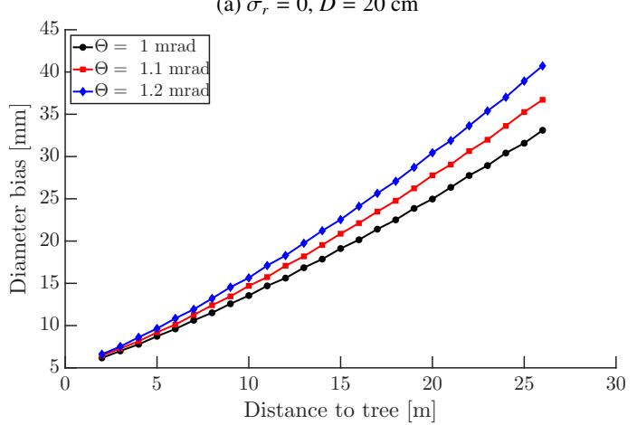

(c) Θ = 0, D = 20 cm  
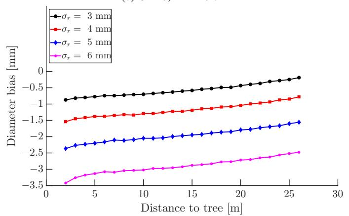

(e) Variable Θ and σ , D = 20 cm  
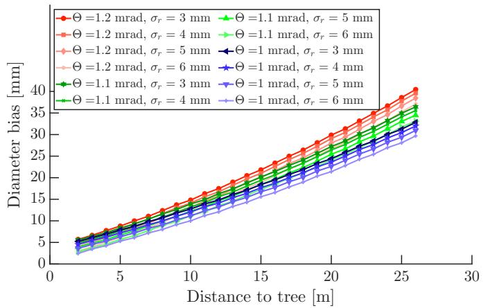

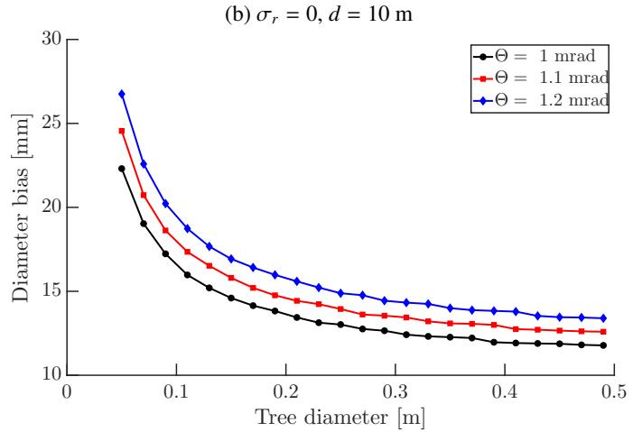

(d) Θ = 0, d = 10 m  
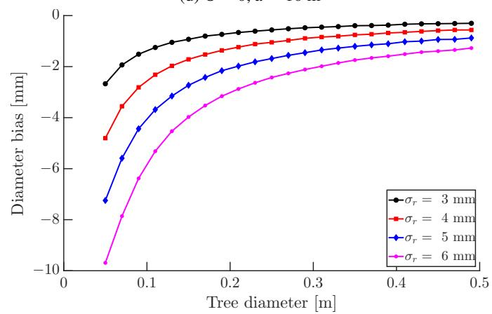

(f) Variable Θ and $\sigma _ { r } , d = 1 0$ m  
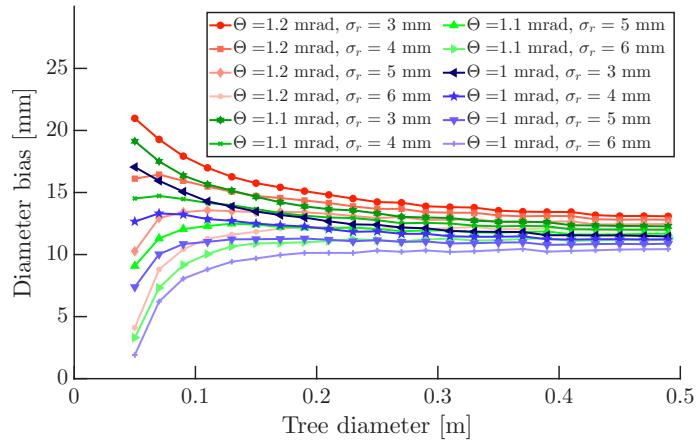  
Figure 6: Simulated bias as a function of measurement distance ((a), (c) and (e)), and tree diameter ((b), (d) and (f)). For distance simulations the tree diameter D was constant 20 cm and the measurement distance d was 10 m for the diameter simulations. In (e) and (f) the divergences are grouped by color with lighter colors indicating higher ranging noise.

(a) σr = 0, D = 20 cm  
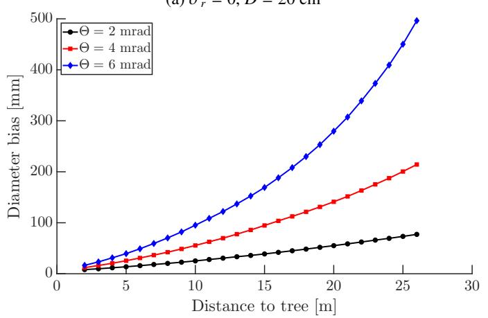

(b) σr = 0, d = 10 m  
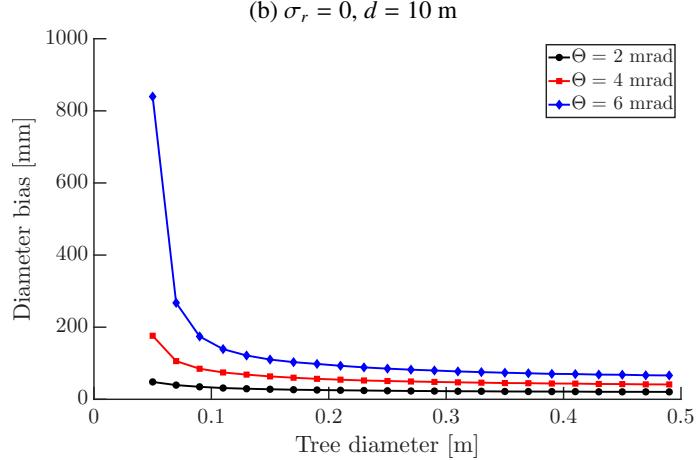

(c) Θ = 0, D = 20 cm  
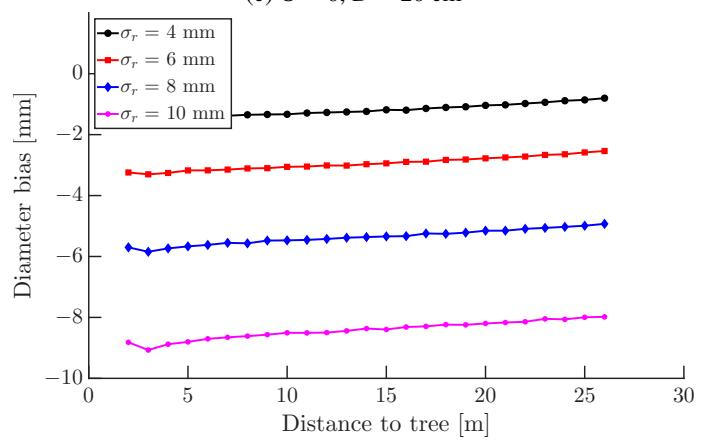

(d) Θ = 0, d = 10 m  
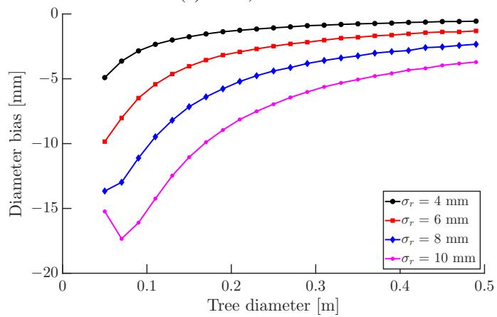

(e) Variable Θ and σ , D = 20 cm  
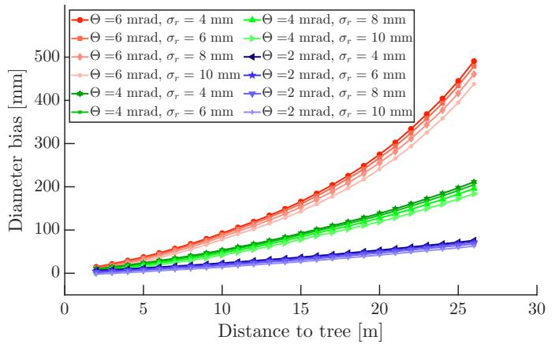

(f) Variable Θ and σr, d = 10 m  
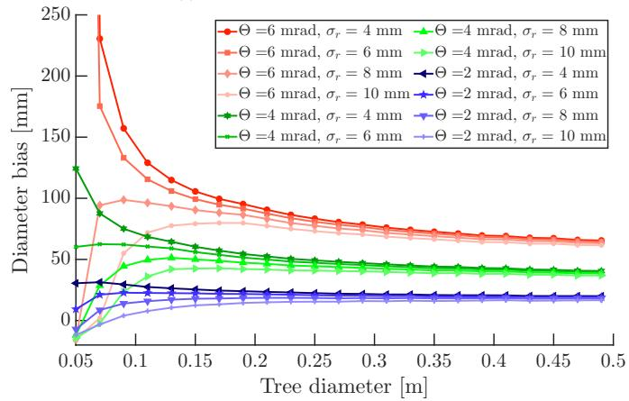  
Figure 7: Simulated bias as a function of measurement distance ((a), (c) and (e)), and tree diameter ((b), (d) and (f)) using a large spread of simulation parameters. For distance simulations the tree diameter D was constant 20 cm and the measurement distance d was 10 m for the diameter simulations. In (e) and (f) the divergences are grouped by color with lighter colors indicating higher ranging noise.

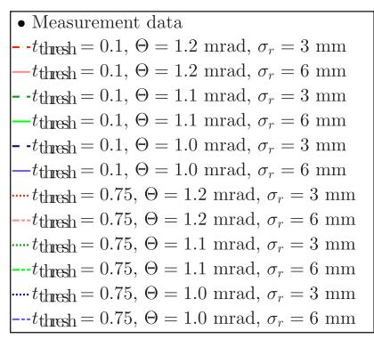

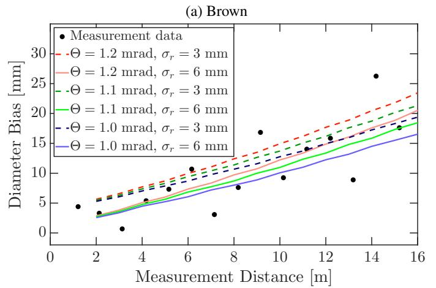

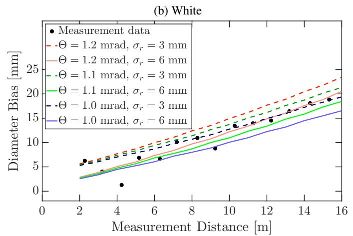

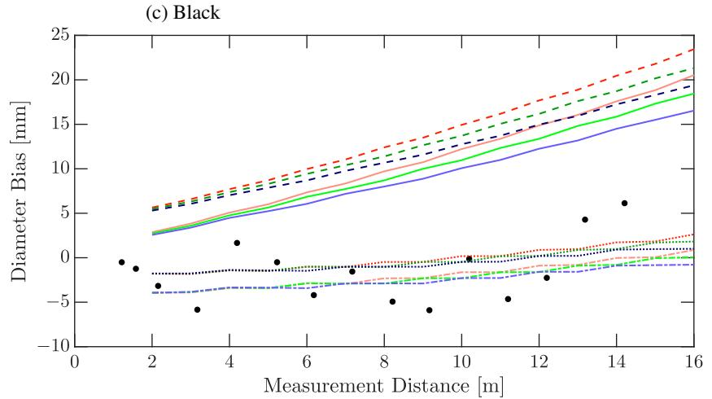  
Figure 8: Measurements of the distance-dependent bias using the artificial cylinder. The cylinder was covered with a (a) brown, (b) white and (c) black thin cardboard. The simulations with extreme simulation parameter values (see Fig. 6) are also presented as colored lines. In addition, simulations with $( t _ { \mathrm { t h r e s h } } = 0 . 7 5$ are presented for the black cardboard.

(a)  
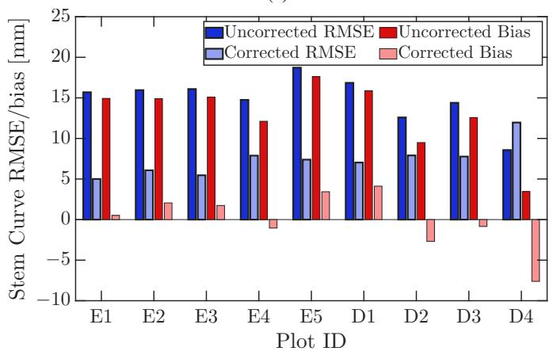

(b)  
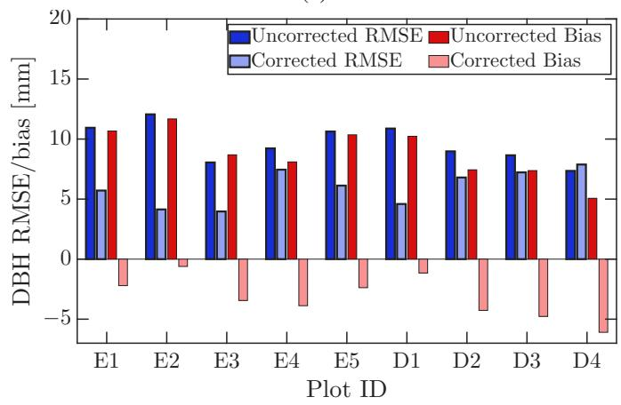

(c)  
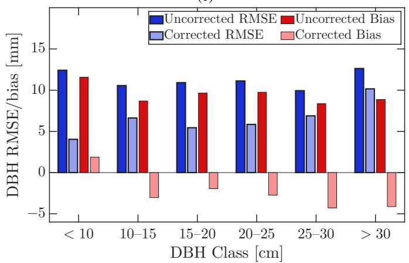

(d)  
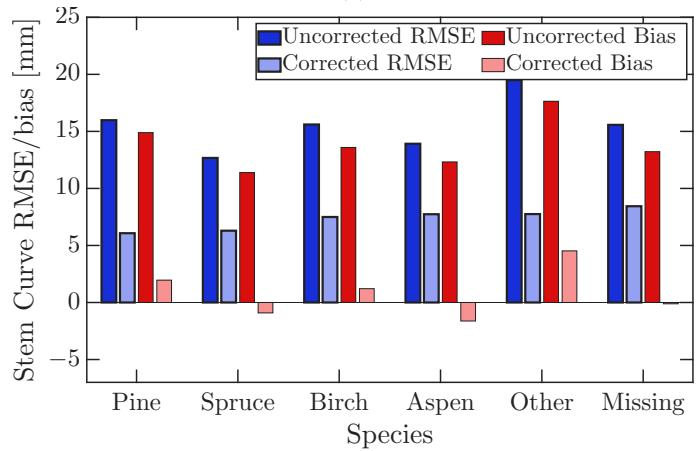  
Figure 9: Results from the forest plots. (a) and (b) present the plot-wise RMSE and bias for stem curve and DBH, respectively. (c) shows the DBH error metrics of diferent DBH classes and (d) shows stem curve error metrics for diferent tree species. Note that the results from the anomalous plot D4 was removed from (c) and (d) to mainly prevent it from skewing the results of spruce and aspen in (d), as discussed in Sec. 4.0.3.

The slightly decreasing bias as a function of the tree diameter, that leveled of to a constant at a diameter of approximately 20 cm, was predicted by the simulations with suitable parameters (see Fig. 6(f)). However, as mentioned previously, the simulated bias for small trees was highly sensitive to the simulation parameters. This sensitivity is a dificult problem to solve, as even with no measurement noise, the bark of the tree essentially causes noise that is dependent on not only the tree species, but the individual tree as well. However, we found no dependency between bias and tree species for the main species (see Fig. 9(d)).

Figure 10(b) presents analogous results, where the diameter bias was calculated as a function of measurement distance for fixed tree diameter ranges based on the reference diameter. The bias remained constant at around 10 mm for trees larger than 10 cm, until measurement distances of 6 m–7 m, after which the bias began to increase roughly linearly. On average, smaller trees exhibit slightly larger bias, but the efect of the tree diameter on the distance dependence of bias is small. Trees smaller than 10 cm in diameter behave similarly, but at slightly higher overall bias. The very small decrease in bias from 1 m to 5 m is slightly more pronounced, suggesting that the efect may be genuine, rather than an artifact of the random measurement noise. However, the simulations did not predict this behavior, as the simulated bias increased throughout the entire range of simulated measurement distances. It is possible that this is due how Faro Orbis handles the range-walk (measurement error due to the change in the return intensity as a function of measurement distance). The (approximately) linear increase of bias at greater measurement distances than 6 m–7 m was predicted by the the simulations, and is in agreement with recent research (Kuelka and Surový, 2024; Muhojoki et al., 2024).

## 4.1 Limitations and Further Discussion

Although the simulations captured the diameter bias trends observed in forest sample plot measurements of this study and the past literature, the model is still incomplete. Lidar specifications, such as beam divergence and ranging noise are not always given, and they may depend on e.g. measurement conditions. However, most importantly, the signal triggering and handling of range walk is typically not openly documented. Furthermore, the elliptical beam was not simulated for simplicity, as the beam orientation with respect to the stem, even within as single arc, is not constant as the scanner rotates. The current implementation required precomputed bias tables, but more computationally eficient simulation would allow for running the simulation for individual arcs or even points, and thus potentially improving the bias compensation.

In addition, the out-of-roundness of tree stems and bark characteristics limit the potential of the simulations, especially for small trees with diameter less than 10 cm. Even if the properties of the scanner are known, the bark depth can be similar or even greater then the noise level of lidar, potentially altering the bias-diameter curve drastically, which is further exacerbated by possible out-of-roundness of the tree stem.

(a)  
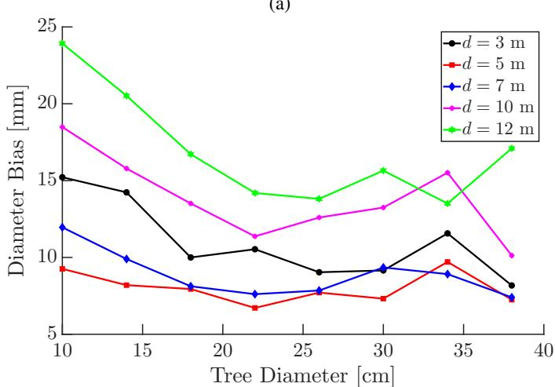

(b)  
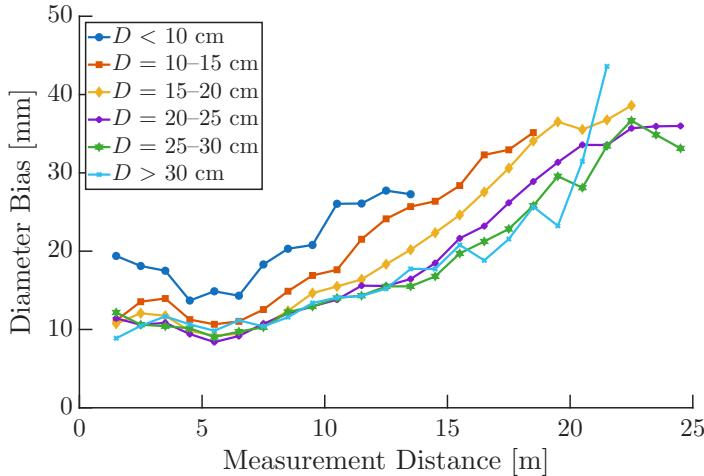  
Figure 10: (a) Diameter bias as a function of tree diameter for a fixed measurement distance and a fixed measurement height of 1.5 m–2.5 m (without the bias compensation). (b) Diameter bias as a function of measurement distance for fixed diameter classes. Measurement points with less than 50 arcs were removed from the results.

One unexplored source of error and possible explanation for conflicting bias reports in the literature was the efect of arcbased diameter estimation. Using the entire point cloud for circle fitting can be more robust, as there are more points to fit the circle to, and the point cloud covers (most of the time) the stem section simultaneously from all sides. This can also reduce the efect of the edge points, i.e. the points created by a partial hit of the laser beam to the edge of the stem. Therefore, the bias and random error can behave diferently. The downside of not using the temporal segmentation, that was used in this study, is that any positioning errors will afect the stem geometry measurements and arc-based bias compensation methods do not work, as the measurement distance to the circle cannot be determined. Using the entire point cloud at once could potentially work with a point-by-point bias compensation method, but its development is left to future work.

## 5 Conclusions

We investigated the efect of beam divergence and measurement noise on the estimation of tree diameter from lidar-generated point clouds. Using simulations, we found that longer measurement distances typically cause overestimation of the diameter, while high heteroscedasticity (higher angular precision than ranging precision) causes underestimation. The combined efect of these factors led to an overall overestimation of stem diameter under simulation conditions representative of state-ofthe-art laser scanners and typical boreal tree reflectivity. However, small variations in the simulation parameters, namely the beam divergence and ranging noise, yielded qualitatively diferent behaviors, explaining the contradictory findings reported in previous studies as these parameters also vary between diferent laser scanning systems.

We found that for trees larger than 10 cm, the simulations are robust with respect to the parameters, and therefore highly accurate bias correction is possible. However, for smaller trees, the bias-diameter curves are sensitive to the parameter values, which highlights the precision limitations of conventional laser scanning systems for measuring the geometry of small trees.

Based on our findings, we developed a calibration-free bias compensation method relying on simulations and demonstrated its potential in measurements on forest sample plots using a Faro Orbis MLS system benchmarked against a TLS reference. The method significantly reduced the RMSE of stem curve estimates to sub-centimeter level by removing most of the bias. Thus, the bias compensation method enables MLS systems to provide highly accurate—close to TLS level—tree diameter measurements than can be further used to support large-area forest inventories. The bias-compensated RMSE of 5 mm–10 mm is close to the accuracy limit achievable by approximating stems as circles, due to the bark roughness and out-of-roundness of the stems. Importantly, the method also holds potential to enable accurate diameter measurements using emerging low-cost sensors that typically sufer from increased diameter bias caused by large beams and high noise level.

## CRediT authorship contribution statement

J. Muhojoki: Conceptualization, Methodology, Formal analysis, Software, Investigation, Data Curation, Writing - Original Draft, Visualization; N. Ervasti: Investigation, Writing - Review & Editing; E. Hyyppä: Software, Writing - Review & Editing; A. Erkkilä: Investigation, Writing - Review & Editing; E. Honkanen: Investigation, Writing - Review & Editing; T. Yrttimaa: Investigation, Supervision, Writing - Review & Editing; M. Vastaranta: Resources, Funding acquisition, Supervision, Writing - Review & Editing; J. Hyyppä: Writing - Review & Editing, Supervision, Project administration, Funding acquisition.

## Funding information

This study was supported by the Research Council of Finland (grant numbers 346382, 359203, 373290, 374285, 357906, 371790, 346383, 373288, 376270)

## Data availability

MLS and TLS data is available from the corresponding author upon request and will be later published in https:// www.scanforest.fi/data/

## Declaration of competing interest

The authors declare that they have no known competing financial interests or personal relationships that could have appeared to influence the work reported in this paper.

## References

Al-Sharadqah, A. and Chernov, N. Error analysis for circle fitting algorithms. Electronic Journal ofStatistics, 3(none), Jan. 2009. ISSN 1935-7524. doi:10.1214/09-EJS419.

AndersonTeixeira, K. J., Miller, A. D., Mohan, J. E., Hudiburg, T. W., Duval, B. D., and DeLucia, E. H. Altered dynamics of forest recovery under a changing climate. Global Change Biology, 19(7):2001–2021, July 2013. ISSN 1354-1013, 1365-2486. doi:10.1111/gcb.12194.

Balestra, M., Cabo, C., Murtiyoso, A., Vitali, A., Alvarez-Taboada, F., Cantero-Amiano, A., Bolaños, R., Laino, D., and Pierdicca, R. Advancing forest inventory: a comparative study of low-cost MLS lidar device with professional laser scanners. The International Archives of the Photogrammetry, Remote Sensing and Spatial Information Sciences, XLVIII-2/W8-2024:9–15, Dec. 2024. ISSN 2194-9034. doi:10.5194/isprsarchives-XLVIII-2-W8-2024-9-2024.

Bauwens, S., Bartholomeus, H., Calders, K., and Lejeune, P. Forest Inventory with Terres trial LiDAR: A Comparison of Static and Hand-Held Mobile Laser Scanning. Forests, 7(6):127, June 2016. ISSN 1999-4907. doi:10.3390/f7060127.

Bratu, I., Dinca, L., Constandache, C., and Murariu, G. Resilience and Decline: The Impact of Climatic Variability on Temperate Oak Forests. Climate, 13(6):119, June 2025. ISSN 2225-1154. doi:10.3390/cli13060119.

Cabo, C., Del Pozo, S., Rodríguez-Gonzálvez, P., Ordóñez, C., and González-Aguilera, D. Comparing Terrestrial Laser Scanning (TLS) and Wearable Laser Scanning (WLS) for Individual Tree Modeling at Plot Level. Remote Sensing, 10(4):540, Apr. 2018. ISSN 2072-4292. doi:10.3390/rs10040540.

Coops, N. C., Irwin, L. A., Seely, H. S., and Hardy, S. J. Advances in Laser Scanning to Assess Carbon in Forests: From Ground-Based to Space-Based Sensors. Current Forestry Reports, 11(1):11, Jan. 2025. ISSN 2198-6436. doi:10.1007/s40725-024- 00242-4.

Di Stefano, F., Chiappini, S., Gorreja, A., Balestra, M., and Pierdicca, R. Mobile 3D scan LiDAR: a literature review. Geomatics, Natural Hazards and Risk, 12(1):2387–2429, Jan. 2021. ISSN 1947-5705, 1947-5713. doi:10.1080/19475705.2021.1964617.

Ester, M., Kriegel, H.-P., Sander, J., and Xu, X. A Density-Based Algorithm for Discovering Clusters in Large Spatial Databases with Noise. pages 226–331, Jan. 1996. ADS Bibcode: 1996kddm.conf..226E.

Faitli, T., Hyyppä, E., Hyyti, H., Hakala, T., Kaartinen, H., Kukko, A., Muhojoki, J., and Hyyppä, J. Integration of a Mobile Laser Scanning System with a Forest Harvester for Accurate Localization and Tree Stem Measurements. Remote Sensing, 16(17):3292, Sept. 2024. ISSN 2072-4292. doi:10.3390/rs16173292.

Fischler, M. A. and Bolles, R. C. Random sample consensus: a paradigm for model fitting with applications to image analysis and automated cartography. Communications of the ACM, 24(6):381–395, June 1981. ISSN 0001-0782, 1557-7317. doi:10.1145/358669.358692.

Fol, C. R., Kükenbrink, D., Rehush, N., Murtiyoso, A., and Griess, V. C. Evaluating state-of-the-art 3D scanning methods for stem-level biodiversity inventories in forests. International Journal ofApplied Earth Observation and Geoinformation, 122:103396, Aug. 2023. ISSN 1569-8432. doi:10.1016/j.jag.2023.103396.

Forsman, M., Börlin, N., Olofsson, K., Reese, H., and Holmgren, J. Bias of cylinder diameter estimation from ground-based laser scanners with diferent beam widths: A simulation study. ISPRS Journal ofPhotogrammetry and Remote Sensing, 135:84–92, Jan. 2018. ISSN 09242716. doi:10.1016/j.isprsjprs.2017.11.013.

Gerbrecht, E. C., Coops, N. C., Carroll, A. L., Bater, C. W., and Buechner, L. Estimation of Forest Structure and Fuel Change Across Mountain Pine Beetle Attacked Forests Using Mobile and RPAS Based LiDAR. Canadian Journal ofRemote Sensing, 51(1): 2505418, Dec. 2025. ISSN 0703-8992. doi:10.1080/07038992.2025.2505418.

Gollob, C., Ritter, T., and Nothdurft, A. Forest Inventory with Long Range and High-Speed Personal Laser Scanning (PLS) and Simultaneous Localization and Mapping (SLAM) Technology. Remote Sensing, 12(9):1509, May 2020. ISSN 2072-4292. doi:10.3390/rs12091509.

Gollob, C., Ritter, T., KraSSnitzer, R., Tockner, A., and Nothdurft, A. Measurement of Forest Inventory Parameters with Apple iPad Pro and Integrated LiDAR Technology. Remote Sensing, 13(16):3129, Jan. 2021. ISSN 2072-4292. doi:10.3390/rs13163129.

Hofrén, R., Lamelas, M. T., and De La Riva, J. Evaluation of Handheld Mobile Laser Scanner Systems for the Definition of Fuel Types in Structurally Complex Mediterranean Forest Stands. Fire, 7(2):59, Feb. 2024. ISSN 2571-6255. doi:10.3390/fire7020059.

Holvoet, J., Latte, N., Perin, J., Bastin, J.-F., De Lame, H., Kükenbrink, D., and Lejeune, P. Mobile laser scanning in support of national and regional forest inventories. Science of Remote Sensing, 12:100316, Dec. 2025. ISSN 26660172. doi:10.1016/j.srs.2025.100316.

Howie, N. A. and De Stefano, A. Measuring Tree Diameter Using LiDAR Equipped iPad: An Evaluation of ForestScanner and Arboreal Forest Applications. Forest Science, 70 (4):304–310, Aug. 2024. ISSN 0015-749X. doi:10.1093/forsci/fxae017.

Hu, T., Sun, X., Su, Y., Guan, H., Sun, Q., Kelly, M., and Guo, Q. Development and Performance Evaluation of a Very Low-Cost UAV-Lidar System for Forestry Applications. Remote Sensing, 13(1):77, Jan. 2021. ISSN 2072-4292. doi:10.3390/rs13010077.

Hyyppa, J. and Inkinen, M. Detecting and estimating attributes for single trees using laser scanner. The Photogrammetric Journal ofFinland, 16(2):27–43, 1999.

Hyyppä, E., Hyyppä, J., Hakala, T., Kukko, A., Wulder, M. A., White, J. C., Pyörälä, J., Yu, X., Wang, Y., Virtanen, J.-P., Pohjavirta, O., Liang, X., Holopainen, M., and Kaartinen, H. Under-canopy UAV laser scanning for accurate forest field measurements. ISPRS Journal ofPhotogrammetry and Remote Sensing, 164:41–60, June 2020. ISSN 09242716. doi:10.1016/j.isprsjprs.2020.03.021.

Hyyppä, M., Turppa, T., Hyyti, H., Yu, X., Handolin, H., Kukko, A., Hyyppä, J., and Virtanen, J.-P. Concepts Towards Nation-Wide Individual Tree Data and Virtual Forests. ISPRS International Journal ofGeo-Information, 13(12):424, Nov. 2024. ISSN 2220- 9964. doi:10.3390/ijgi13120424

Kangas, A., Maltamo, M., Klaus Von, G., Timo, P., and Margarida, T., editors. Forest Inventory: Methodology and Applications, volume 10 of Managing Forest Ecosystems. Springer Netherlands, Dordrecht, 2006. ISBN 978-1-4020-4379-6 978-1-4020-4381- 9. doi:10.1007/1-4020-4381-3.

Kokeza, A., Seitz, A., Jurjevi, L., Medak, D., Indir, K., and Balenovi, I. Comparative Performance of Handheld Personal Laser Scanning Instruments and Operator Experience in Forest Inventory of Even-Aged European Beech Stand. Forests, 17(2):216, Feb 2026, ISSN 1999-4907 doi:10.3390/f17020216

Kuelka, K. and Surový, P. Noise Analysis for Unbiased Tree Diameter Estimation from Personal Laser Scanning Data. Remote Sensing, 16(7):1261, Apr. 2024. ISSN 2072- 4292. doi:10.3390/rs16071261.

Kuelka, K., Maruák, R., and Surový, P. Inventory of close-to-nature forest stands using terrestrial mobile laser scanning. International Journal of Applied Earth Observation and Geoinformation, 115:103104, Dec. 2022. ISSN 15698432. doi:10.1016/j.jag.2022.103104.

Liang, X., Hyyppa, J., Kukko, A., Kaartinen, H., Jaakkola, A., and Yu, X. The Use of a Mobile Laser Scanning System for Mapping Large Forest Plots. IEEE Geoscience and Remote Sensing Letters, 11(9):1504–1508, Sept. 2014. ISSN 1545-598X, 1558-0571. doi:10.1109/LGRS.2013.2297418.

Liikonen, L., Yrttimaa, T., Erkkilä, A., Paakkari, J., Pitkänen, T., Kotivuori, E., and Vastaranta, M. Measuring forest inventory attributes using Faro Orbis Mobile laser scanner in managed boreal forests. Forestry: An International Journal of Forest Research, 99 (3):cpag028, Apr. 2026. ISSN 0015-752X, 1464-3626. doi:10.1093/forestry/cpag028.

Ma, Q., Lin, J., Ju, Y., Li, W., Liang, L., and Guo, Q. Individual structure mapping over six million trees for New York City USA. Scientific Data, 10(1):102, Feb. 2023. ISSN 2052-4463. doi:10.1038/s41597-023-02000-w.

McGlade, J., Wallace, L., Reinke, K., and Jones, S. The Potential of Low-Cost 3D Imaging Technologies for Forestry Applications: Setting a Research Agenda for Low-Cos Remote Sensing Inventory Tasks. Forests, 13(2):204, Feb. 2022. ISSN 1999-4907. doi:10.3390/f13020204.

Mokro, M., Mikita, T., Singh, A., Tomatík, J., Chudá, J., Wyk, P., Kuelka, K., Surový, P., Klimánek, M., Ziba-Kulawik, K., Bobrowski, R., and Liang, X. Novel low-cost mobile mapping systems for forest inventories as terrestrial laser scanning alternatives. International Journal ofApplied Earth Observation and Geoinformation, 104:102512, Dec. 2021. ISSN 15698432. doi:10.1016/j.jag.2021.102512.

Muhojoki, J., Tavi, D., Hyyppä, E., Lehtomäki, M., Faitli, T., Kaartinen, H., Kukko, A., Hakala, T., and Hyyppä, J. Benchmarking Under- and Above-Canopy Laser Scanning Solutions for Deriving Stem Curve and Volume in Easy and Dificult Boreal Forest Conditions. Remote Sensing, 16(10):1721, May 2024. ISSN 2072-4292. doi:10.3390/rs16101721.

Persson, Å., Holmgren, J., and Söderman, U. Detecting and measuring individual trees using an airborne laser scanner. Photogrammetric Engineering & Remote Sensing, 68 (9):925–932, 2002.

Pires, R. D. P., Lindberg, E., Persson, H. J., Olofsson, K., and Holmgren, J. Mobile laser scanning as reference for estimation of stem attributes from airborne laser scanning. Remote Sensing of Environment, 315:114414, Dec. 2024. ISSN 00344257. doi:10.1016/j.rse.2024.114414.

Pérez-Martín, E., López-Cuervo Medina, S., Herrero-Tejedor, T., Pérez-Souza, M. A., Aguirre De Mata, J., and Ezquerra-Canalejo, A. Assessment of Tree Diameter Estimation Methods from Mobile Laser Scanning in a Historic Garden. Forests, 12(8):1013, July 2021. ISSN 1999-4907. doi:10.3390/f12081013.

Ringdahl, O., Hohnloser, P., Hellström, T., Holmgren, J., and Lindroos, O. Enhanced Algorithms for Estimating Tree Trunk Diameter Using 2D Laser Scanner. Remote Sensing, 5(10):4839–4856, Oct. 2013. ISSN 2072-4292. doi:10.3390/rs5104839.

Ryding, J., Williams, E., Smith, M., and Eichhorn, M. Assessing Handheld Mobile Laser Scanners for Forest Surveys. Remote Sensing, 7(1):1095–1111, Jan. 2015. ISSN 2072- 4292. doi:10.3390/rs70101095.

Stovall, A. E. L., MacFarlane, D. W., Crawford, D., Jovanovic, T., Frank, J., and Brack, C. Comparing mobile and terrestrial laser scanning for measuring and modelling tree stem taper. Forestry: An International Journal ofForest Research, 96(5):705–717, Oct. 2023. ISSN 0015-752X, 1464-3626. doi:10.1093/forestry/cpad012.

Tavi, D., Muhojoki, J., Soininen, V., Hyyppä, E., Hakala, T., Luoma, V., Kukko, A., Yu, X., Vastaranta, M., and Hyyppä, J. Combining single-date mobile and multitemporal airborne laser scanning for retrospective estimation of individual tree growth over a 10-year period in boreal forests. Science of Remote Sensing, 13:100345, June 2026. ISSN 26660172. doi:10.1016/j.srs.2025.100345.

Thom, D., Rammer, W., Laux, P., Smiatek, G., Kunstmann, H., Seibold, S., and Seidl, R. Will forest dynamics continue to accelerate throughout the 21st century in the Northern Alps? Global Change Biology, 28(10):3260–3274, May 2022. ISSN 1354-1013, 1365- 2486. doi:10.1111/gcb.16133.

Vandendaele, B., Martin-Ducup, O., Fournier, R. A., Pelletier, G., and Lejeune, P. Mobile Laser Scanning for Estimating Tree Structural Attributes in a Temperate Hardwood Forest. Remote Sensing, 14(18):4522, Sept. 2022. ISSN 2072-4292. doi:10.3390/rs14184522.

Verhoeven, V. B., Raumonen, P., and Åkerblom, M. Fitting Geometric Shapes to Fuzzy Point Cloud Data. Journal of Imaging, 11(1):7, Jan. 2025. ISSN 2313-433X. doi:10.3390/jimaging11010007.

White, J. C., Tompalski, P., Bater, C. W., Wulder, M. A., Fortin, M., Hennigar, C., Robere McGugan, G., Sinclair, I., and White, R. Enhanced forest inventories in Canada: implementation, status, and research needs. Canadian Journal of Forest Research, 55: 1–37, Jan. 2025. ISSN 0045-5067, 1208-6037. doi:10.1139/cjfr-2024-0255.

Yang, J., Liu, X., Gu, G., Qian, W., Ren, K., Zhang, J., Guo, P., Gao, Q., and Chen, Q. A double threshold correction method for walk error in pulsed laser ranging system. Infrared Physics & Technology, 100:28–36, Aug. 2019. ISSN 13504495. doi:10.1016/j.infrared.2019.03.023.

Yrttimaa, T., Luoma, V., Saarinen, N., Kankare, V., Junttila, S., Holopainen, M., Hyyppä, J., and Vastaranta, M. Exploring tree growth allometry using two-date terrestrial laser scanning. Forest Ecology and Management, 518:120303, Aug. 2022. ISSN 03781127. doi:10.1016/j.foreco.2022.120303.

Çakir, G. Y., Post, C. J., Mikhailova, E. A., and Schlautman, M. A. 3D LiDAR Scanning of Urban Forest Structure Using a Consumer Tablet. Urban Science, 5(4):88, Dec. 2021. ISSN 2413-8851. doi:10.3390/urbansci5040088.

## A Sensitivity to trigger threshold

Figure A.1 presents the simulated diameter bias as a function of measurement distance to the target tree and its diameter The default values were 10 m for the measurement distance and 20 cm for the diameter. The selected simulation parameters are close to what was used for Faro Orbis in the bias compensation method with $t _ { \mathrm { t h r e s h } } = 5 \% - 2 0 \% , \Theta = 5 \% - 2 0 \%$ , and $\sigma _ { r } = \{ 4 , 6 \}$ mm. At short measurement distances, the parameter selection afects the simulated bias only little. At measurement distance of 26 m and $\sigma _ { r } = 4 \mathrm { m m }$ , the bias ranged from 31 mm to 47 mm $( \Delta = 1 6 \mathrm { m m } )$ with $\Theta = 1 . 2$ mrad, and from 25 mm to 38 mm $( \Delta = 1 3$ mm) with $\Theta = 1 . 0$ mrad. For $\sigma _ { r } = 6$ mm the results are similar, but the bias level is approximately 3 mm lower throughout the curve. The sensitivity to $t _ { \mathrm { t h r e s h } }$ was similar as a function of tree diameter, where the diference between the extreme values of $t _ { \mathrm { t h r e s h } }$ was approximately 6 mm–7 mm, depending slightly on the beam divergence, except for small diameters with ranging precision of 6 mm, where the diferences were significantly lower.

(a) σr = 4 mm  
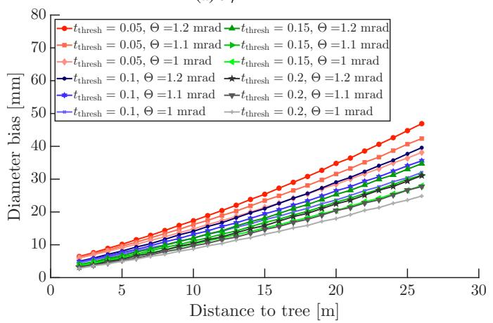

(b) σr = 6 mm  
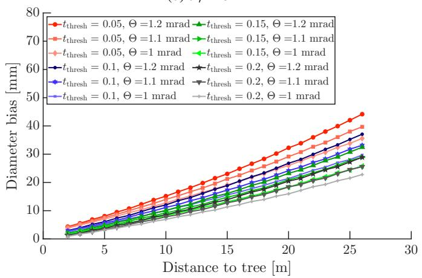

(c) $\sigma _ { r } = 4$ mm  
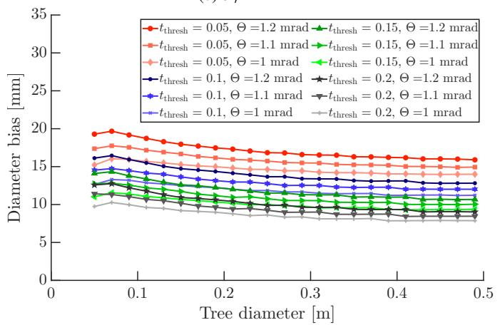

(d) $\sigma _ { r } = 6$ mm  
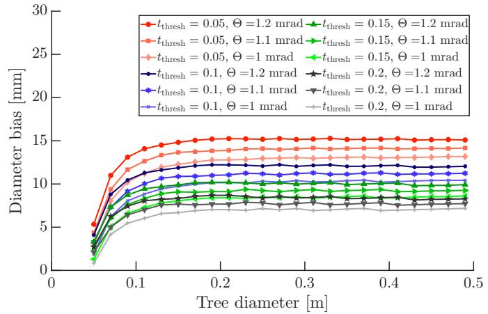  
Figure A.1: Sensitivity analysis of the signal trigger threshold $t _ { \mathrm { t h r e s h } }$ Comparable to Figs. 6 and 7(e) and (f), where $t _ { \mathrm { t h r e s h } } = 0 . 1$ (a) and (b) present the tree diameter estimation bias as a function of measurement distance to the tree and (c) and (d) as a function of tree diameter. In (a) and (c) $\sigma _ { r } = 4 \mathrm { m m }$ , and $\sigma _ { r } = 6 \mathrm { m m }$ in (b) and (c). Colors are grouped based on the trigger threshold.