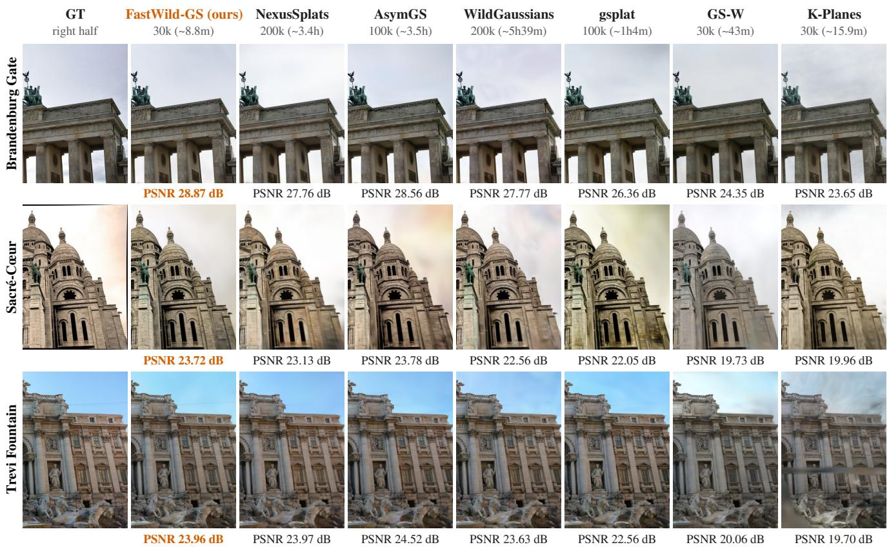
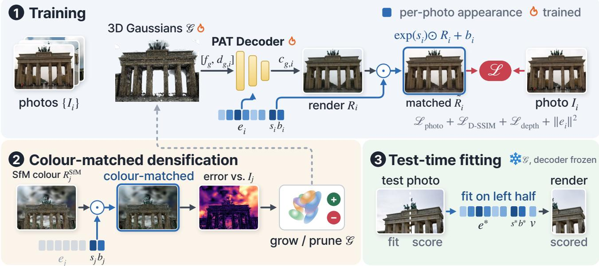
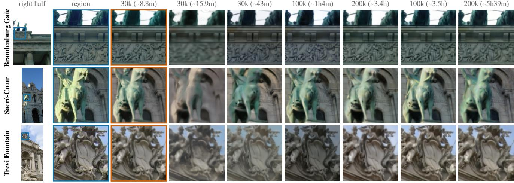
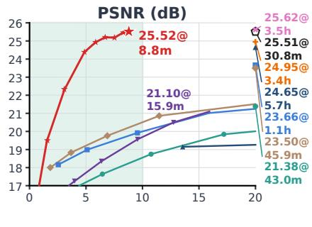
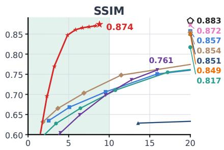
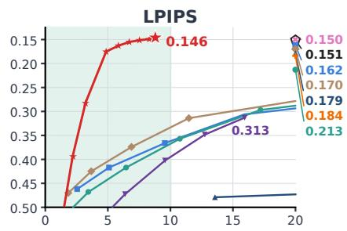
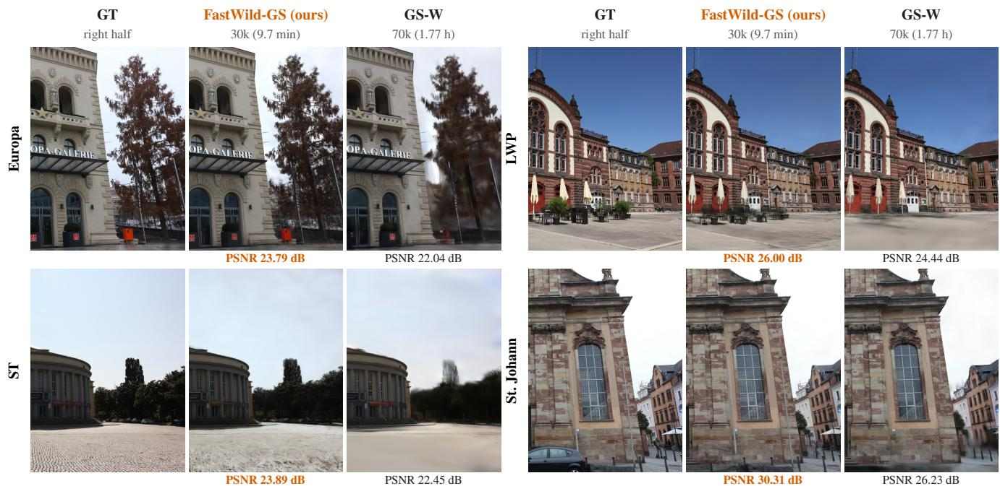
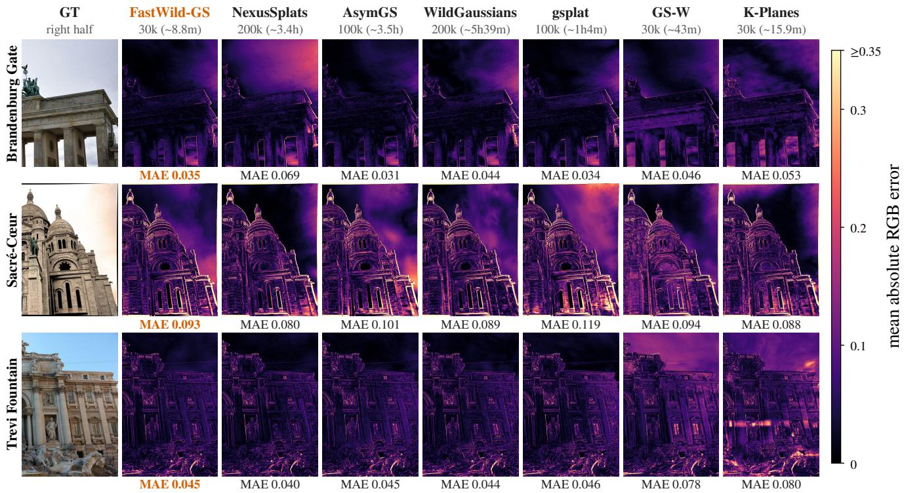

# FastWild-GS: Minutes-Scale In-the-Wild Gaussian Splatting via Compact Per-Image Appearance Adaptation

Donghun Ryu\* Seokhyun Kim\* Minhyeok Lee

Chung-Ang University

{donghun0621, lll6610, mlee}@cau.ac.kr

## Abstract

Internet photos of a scene differ in exposure, illumination and transient objects such as passers-by, so one set of Gaussian colours cannot explain all photos (the in-thewild setting). Recent in-the-wild Gaussian Splatting methods mostly report hours of per-scene optimization. We present FastWild-GS, which describes each photo by a 128- dimensional Photo Appearance Token and a per-channel transform, a scale and an offset applied to the rendered image (six parameters); a small MLP predicts the colour of each Gaussianfrom this token and a per-Gaussianfeature, replacing the spherical-harmonics colour. The same transform is applied to the renders that score Gaussiansfor densification and pruning, so appearance differences between photos are not counted as reconstruction error. On Photo-Tourism, FastWild-GS trains in 8.8 minutes per scene with the lowest LPIPS among the compared methods, 23×faster than AsymGS, the next best in LPIPS. On NeRF-OSR, it has the best average PSNR, SSIM and LPIPS among the compared methods in 9.7 minutes per scene.

## 1. Introduction

In-the-wild novel-view synthesis reconstructs a scene from Internet photo collections [38], taken by different cameras at different times of day and seasons: the same surface differs in brightness and colour across images, and transient objects appear in only some of them.

3D Gaussian Splatting (3DGS) [14] explains all images with one shared scene and averages these differences. In-the-wild methods add image-specific appearance models [18, 30], but recent ones mostly report hours of per-scene optimization (Tab. 1). Accelerated 3DGS training reaches minutes [4, 12, 35], but assumes captures with consistent appearance.

We introduce FastWild-GS, which trains an in-the-wild scene in minutes (Fig. 1). Each photo is described by a

Photo Appearance Token (PAT) and a per-image channel transform, a per-channel scale and offset applied to the rendered image. A small MLP, the PAT Decoder, predicts the colour of each Gaussian from the PAT and a per-Gaussian feature, replacing the spherical-harmonics colour (Sec. 3.2). The densification and pruning adopted from FastGS [35] score Gaussians by the error between renders and photos; on photo collections this error is also high where only exposure or colour differs, so Gaussians can be added on surfaces that are already reconstructed. We therefore apply the per-image transform to the scoring renders (Sec. 3.3). A growth schedule keeps the number of Gaussians low early in training, which keeps early iterations cheap (Sec. 3.1). For a held-out photo, the scene stays fixed and only the appearance parameters of that photo are fitted on the left half of the image; the right half is evaluated (Sec. 3.4). On PhotoTourism [30], FastWild-GS has the lowest LPIPS among the compared methods and trains 23× faster than the next best, AsymGS [21] (Tab. 1).

## Contributions.

1. A compact per-image appearance module for in-the-wild Gaussian Splatting: a Photo Appearance Token per image, a shared PAT Decoder and a channel transform.

2. Colour-matched densification scoring: the same transform is applied to the renders that drive densification and pruning, without additional renders.

3. Evidence that the appearance module is not tied to one training method: it improves PSNR, SSIM and LPIPS on six public 3DGS backbones (Tab. 5).

## 2. Related Work

3D Gaussian Splatting and training acceleration. Neural radiance fields [31] established optimization-based novel-view synthesis from posed photographs, and multiresolution hash encoding [32] cut their training cost. 3DGS [14] represents a scene with optimized anisotropic Gaussian primitives and enables fast rasterized rendering. FastGS [35] accelerates 3DGS with multi-view consistent densification and pruning; we adopt these two steps and its rasterizer. DashGaussian [4] schedules rendering resolution together with the primitive count so that the count stays low early in training, as our growth schedule does. Speedy-Splat [12] prunes aggressively right before opacity resets and at fixed intervals after densification; our four early pruning steps lie just before its first four pruning positions. Turbo-GS [7] grows the count along a budget curve, efficient density control [6] lowers the split threshold in steps, AdpSplit [20] speeds up FastGS further at equal count, and SAD-GS [28] raises the count and shortens training to 3k iterations. A complementary line of work makes the scene representation itself compact by pruning primitives [8, 19, 26]; the compactness studied in this paper instead concerns the image-specific appearance state. All of these methods are evaluated on static scenes, where the densification error of a render reflects geometry; on photo collections it also reflects the appearance of each photo, which is what our colour-matched scoring addresses.

  
Figure 1. Right halves of PhotoTourism test views rendered by FastWild-GS and recent methods, with the number of training iterations and the training time per scene, measured on one RTX 5090. FastWild-GS trains in minutes, while the other methods train for up to several hours. Below each image: the PSNR of the scene as in Tab. 1; for gsplat, GS-W and K-Planes, as reported by NerfBaselines [17].

In-the-wild appearance modeling. NeRF-W [30] introduced the standard PhotoTourism setting, per-image appearance embeddings and the protocol of fitting the testimage embedding on one half of the image and evaluating on the other. Subsequent NeRF-based methods refine the same setting with hallucinated appearance transfer and cross-ray feature aggregation [3, 46]. Gaussian Splatting methods such as Wild-GS [45], GS-W [49] and WildGaussians [18] use image-conditioned, transformation-based or multi-scale mechanisms to model appearance variation. WildGaussians conditions appearance on a per-image code together with a per-Gaussian feature and a small colour MLP; FastWild-GS adopts this conditioning interface. WilLaGS [1] conditions a tri-plane appearance field on a per-image latent code, whereas the appearance of a photo in FastWild-GS is a single vector and a channel transform. Per-image affine colour corrections are used by Splatfacto-W [44] and by hierarchical 3DGS [15]; we apply such a transform both in training and in densification scoring.

Recent robust in-the-wild 3DGS variants. Recent work explores richer appearance-conditioned or robustnessoriented Gaussian models, including SWAG [5], NexusSplats [39], SpotLessSplats [37], AsymGS [21] and Forest-Splats [33]. RobustSplat [11] delays densification in the wild to avoid fitting transients, and RobustSplat++ [10] uses an appearance MLP and the same half-image test protocol on a plain 3DGS backbone. These methods target stronger appearance modeling or distractor handling; we focus on per-scene optimization time. Other variants address efficiency: WL-GS [40] reduces memory use for resourcelimited hardware, Look at the Sky [42] uses pseudo transient masks from a pretrained segmentation network and separate sky and building appearance embeddings for faster convergence, and 3DGS-W [2] looks up transient objects in a 2D dense grid instead of storing them in the Gaussian attributes.

  
Figure 2. Overview of FastWild-GS. (1) Training: the PAT Decoder predicts the colour $c _ { g , i }$ of every Gaussian from its Splat Descriptor $[ f _ { g } , d _ { g , i } ]$ and the Photo Appearance Token (PAT) e of photo $I _ { i } ,$ , and the channel transform $\exp ( s _ { i } ) \odot R _ { i } + b _ { i }$ is applied to the render before the loss; a monocular depth prior regularizes the rendered depth. (2) Colour-matched densification: Gaussians are grown and pruned from the error of renders of 10 training views that use the stored SfM colour and the same per-image transform $\left( s _ { j } , b _ { j } \right)$ ; the PAT is not used there. (3) Test-time fitting: the Gaussians and the decoder are frozen; a test-time $\boldsymbol { \mathrm { P A T } } \boldsymbol { e } ^ { * }$ , the transform $( s ^ { * } , b ^ { * } )$ and a radial gain v are fitted on the left half of each test photo, and the right half is scored. Blue marks the per-photo appearance state and the operations that use it; flames mark trained parts. The Gaussians are drawn as ellipsoids coloured by the trained decoder; all renders are from FastWild-GS.

## 3. Method

Image-level and multi-scale appearance models. DAVIGS [25] transforms rendered images using appearance information gathered from 3D-consistent features, and MW-GS [23] combines micro–macro projection, waveletbased sampling and hierarchical residual fusion for global and local appearance variation, both with higher-capacity appearance modules than the parameterization studied here.

3DGS assumes that one shared scene explains every photo, which does not hold for in-the-wild collections, where illumination, exposure and transient occluders vary from image to image (Sec. 1). FastWild-GS keeps the shared scene and adds a small appearance module of three components: a Photo Appearance Token (PAT) per image, a PAT Decoder shared across the scene that consumes it, and a per-image channel transform (Sec. 3.2). The same transform is applied to the renders that score Gaussians for densification (Sec. 3.3), a monocular depth prior regularizes the geometry (Sec. 3.2), and at test time the PAT and the transform are fitted for each held-out view (Sec. 3.4). Figure 2 summarizes the data flow.

## 3.1. Gaussian Representation and Density Control

The scene is a set of 3D Gaussians initialized from the SfM points of the scene, each with a position, scale, rotation and opacity, as in 3DGS [14]; it is trained for 30k iterations with one training photo per iteration. We adopt the rasterizer and the multi-view consistent densification and pruning of FastGS [35], which reach minutes-scale training on photometrically consistent captures.

Growth schedule. The cost of an iteration grows with the number of Gaussians [4]. We lower the densification thresholds, which adds Gaussians, only in the last part of densification, so that the count stays low during the earlier iterations, and we add four pruning steps, just before the opacity resets at 6k, 9k and 12k iterations and just before densification ends at 15k, where Speedy-Splat [12] also prunes.

## 3.2. Compact Appearance Parameterization

Two quantities are specific to each training image: a PAT $e _ { i } { \mathrm { . } }$ , which conditions the PAT Decoder shared across the scene, and a per-channel transform applied after rasterization. Together with the decoder and a per-Gaussian feature they form the appearance module, with $1 2 8 + 6 = 1 3 4 $ parameters per training image.

Photo Appearance Token. Following NeRF-W [30], each training image $I _ { i }$ carries a learnable Photo Appearance Token (PAT) $e _ { i } ~ \in \mathbb { R } ^ { 1 2 8 }$ , initialized at zero and updated jointly with the Gaussians, that absorbs photographerand time-of-day-specific appearance. The PAT is a single global vector per image, but because the decoder also receives a per-Gaussian feature, it induces Gaussian-specific colour changes.

Splat Descriptor and PAT Decoder. Each Gaussian carries a feature $f _ { g } \in \mathbb { R } ^ { 3 2 }$ , initialized at zero; with the view direction $d _ { g , i }$ it forms the Splat Descriptor $[ f _ { g } , d _ { g , i } ]$ . As in WildGaussians [18], a small MLP, the PAT Decoder, predicts the colour of Gaussian $g$ in image i from its Splat Descriptor and the PAT of the image:

$$
c _ { g , i } = \sigma \big ( \mathrm { M L P } ( [ f _ { g } , e _ { i } , d _ { g , i } ] ) \big ) ,\tag{1}
$$

where $d _ { g , i }$ is the unit direction from the camera of image i to the Gaussian, used without positional encoding, the decoder has two hidden layers of width 128 with ReLU, and σ is the sigmoid. The appearance of an image enters the decoder only through $e _ { i } ,$ so the state of a photo stays at 134 numbers and the colour of a Gaussian costs one MLP evaluation.

Per-channel transform. Photos of the same place also differ globally in exposure and white balance. After rasterization, the render $R _ { i }$ of image i is corrected by

$$
\tilde { R } _ { i } = \exp ( s _ { i } ) \odot R _ { i } + b _ { i } , \qquad s _ { i } , b _ { i } \in \mathbb { R } ^ { 3 } ,\tag{2}
$$

with $s _ { i }$ a channel-wise log-scale and $b _ { i }$ a channel-wise bias, six parameters per image. Modelling these global changes outside the decoder leaves the PAT for the appearance changes that differ across the scene. As the exposure compensation of hierarchical 3DGS [15], the transform starts at the identity and is optimized with Adam on every training render. It has the same form as the transform fitted at test time (Sec. 3.4) and is reused in densification scoring (Sec. 3.3).

Training objective. The Gaussians, the features, the code table, the MLP and the transforms are optimized jointly for 30k iterations with

$$
\begin{array} { r l } & { \mathcal { L } = 0 . 6 \mathcal { L } _ { \mathrm { p h o t o } } ( { \tilde { R } } _ { i } , I _ { i } ) + 0 . 4 \left( 1 - \mathrm { S S I M } ( { \tilde { R } } _ { i } , I _ { i } ) \right) } \\ & { \quad \quad + \mathcal { L } _ { \mathrm { d e p t h } } + 1 0 ^ { - 4 } \| e _ { i } \| _ { 2 } ^ { 2 } , } \end{array}\tag{3}
$$

where $\mathcal { L } _ { \mathrm { p h o t o } }$ is the mean of an L1 term and a root-meansquare term. ${ \mathcal { L } } _ { \mathrm { d e p t h } }$ is a smooth-L1 loss between the logarithms of the rendered depth and of a monocular depth prior from Depth Anything 3 [24], aligned to the scale of the SfM points of the training photo. The prior constrains the geometry with a signal that does not depend on the appearance of the photo; its weight is ramped up early and lowered in the second half of training. The final model averages the parameters of the last 100 iterates, every 20 iterations from 28k to 29,980; the set of Gaussians no longer changes after the last pruning step at 27k.

## 3.3. Colour-Matched Densification Scoring

The adopted densification scores Gaussians with multi-view consistent renders: at each densification and pruning step, 10 training views are rendered and each Gaussian is scored by the error between these renders and the photos. The scoring renders need a colour that does not depend on any photo; each Gaussian keeps the colour of its SfM point as fixed spherical-harmonics coefficients, used only here. These renders therefore do not share the appearance of the photos they are compared with: the error is also high where only the colours differ, and Gaussians on surfaces that are already reconstructed can be selected for densification. We therefore apply the training transform of each view,

$$
\begin{array} { r } { \hat { R } _ { j } = \exp ( s _ { j } ) \odot R _ { j } ^ { \mathrm { S f M } } + b _ { j } , } \end{array}\tag{4}
$$

to its scoring render $R _ { i } ^ { \mathrm { S f M } }$ before the error is computed. No gradient flows through the scoring renders, the transform is not updated by them, and no renders are added. The supplementary material compares this choice with colouring the scoring renders by the PAT Decoder (Tab. 9).

## 3.4. Test-Time Adaptation

Given a held-out view, we follow the half-image protocol of NeRF-W [30]: the image-specific parameters are fitted on the left half and metrics are computed on the right half. The Gaussians, the features and the MLP stay fixed. We fit a test-time PAT $e ^ { * }$ , the transform $( s ^ { * } , b ^ { * } )$ of Eq. (2) and a radial gain $v \in \mathbb { R } ^ { 3 }$ , 137 parameters in total, with 512 Adam steps on the left half; the right half is then rendered with the fitted parameters and scored against the photo. The radial gain, used only at test time, models a brightness fall-off from the image centre, such as lens vignetting, which differs between cameras and which the global transform cannot represent:

$$
\begin{array} { c } { { \tilde { R } ^ { * } = \exp ( s ^ { * } ) \odot \left( G \odot R ^ { * } \right) + b ^ { * } , } } \\ { { G _ { c } ( x ) = \exp \big ( \operatorname { t a n h } ( v _ { c } ) \bar { \rho } ( x ) \big ) , } } \end{array}\tag{5}
$$

where $R ^ { * }$ is the render with $e ^ { * } .$ , c indexes the colour channel, and $\bar { \rho } ( x )$ is the squared distance of pixel x from the image centre, in coordinates normalized to $[ - 1 , 1 ]$ , minus its mean over the image.

## 4. Experimental Setup

Datasets. We evaluate on the three standard Photo-Tourism scenes [30, 38], Brandenburg Gate, Sacré-Cœur and Trevi Fountain, with the official test splits of 10, 21 and 19 held-out views, and on four NeRF-OSR scenes [36], europa, lwp, st and stjohann, which are outdoor captures under varying illumination. All images are used at their original resolution.

Protocol. On PhotoTourism we use the NeRF-W halfimage evaluation protocol [30] with the test-time adaptation of Sec. 3.4: the image-specific parameters are fitted on the left half of each held-out view, and metrics are computed on the right half. On NeRF-OSR we use the same protocol, and the metrics are computed on the right half inside the official masks of the dataset [36]; the masks are used only for this scoring. We report PSNR, SSIM [43] and LPIPS (AlexNet) [50].

Implementation. FastWild-GS is trained for 30k iterations per scene; densification and pruning follow the defaults of FastGS [35] with the changes of Sec. 3. Testtime adaptation uses 512 Adam steps per held-out view with a configuration fixed across scenes and datasets. Camera poses and initial points are the public SfM reconstructions of the scenes, as for the compared methods. We report the training time per scene on a single NVIDIA RTX 5090.

Baselines. For the other methods, Tabs. 1 and 2 give the metrics reported in their papers; for K-Planes [9], GS-W [49] and gsplat [47] on PhotoTourism, those reported by NerfBaselines [17]. WilLaGS has no public code; in Tab. 1 we report the training time of our reimplementation. Metrics are averaged over the held-out views of each scene and then equally over scenes. All values of FastWild-GS, of its ablations and of the backbone experiments are means over five training seeds; we report the standard deviation over seeds in Tabs. 1 and 2 and in the supplementary material.

## 5. Results

Table 1 compares FastWild-GS with recent in-the-wild methods, and Fig. 3 enlarges a region of a further heldout view per scene for all methods; per-pixel error maps are in the supplementary material (Fig. 6). FastWild-GS reaches 25.52 dB PSNR, 0.874 SSIM and 0.1461 LPIPS. Its LPIPS is the lowest among the listed values, and its PSNR is 0.10 dB below the highest, 25.62 dB of AsymGS [21]. The standard deviation of FastWild-GS over seeds is 0.15 dB in PSNR and 0.0017 in LPIPS. The per-scene results differ: on Brandenburg Gate FastWild-GS has the highest PSNR and SSIM and the lowest LPIPS of all listed values, while on Trevi Fountain three of the listed methods have a higher PSNR. It reaches this quality in 8.8 minutes of training per scene on average (6.1–11.8 minutes; Fig. 4), the shortest training time in Tab. 1. K-Planes, the next fastest at 15.9 minutes, is 4.42 dB lower in PSNR, and most of the methods within 1 dB of FastWild-GS take several hours. Our reimplementation of WilLaGS [1] takes 30.8 minutes per scene. With their official code on the same GPU, WildGaussians, NexusSplats and AsymGS take 5.65, 3.39 and 3.50 hours per scene. The PSNR gap to the highest listed value is therefore small compared with the difference in training time: FastWild-GS is 0.10 dB below AsymGS but trains 23× faster on the same GPU.

## 5.1. NeRF-OSR

Table 2 compares FastWild-GS with the methods that report results on the four NeRF-OSR scenes. FastWild-GS reaches 26.00 dB PSNR, 0.856 SSIM and 0.152 LPIPS on average, the best of the listed methods in all three metrics, and trains in 9.7 minutes per scene, with the configuration used on PhotoTourism. Figure 5 shows one test view per scene for FastWild-GS and GS-W [49], the only method of Tab. 2 with public code. As on PhotoTourism, the largest difference to the listed methods is in LPIPS: 0.152 against at best 0.207.

## 6. Ablations

Table 3 removes one component of FastWild-GS at a time. All rows use the same density control, growth schedule and protocol, and removing any component lowers PSNR and raises LPIPS. The test-time fitting is ablated separately in Tab. 4.

Appearance module. The largest drops come from removing the PAT or the PAT Decoder. Without the PAT, PSNR falls from 25.52 dB to 21.22 dB and LPIPS rises from 0.1461 to 0.1882; without the PAT Decoder, they are 21.18 dB and 0.1867. The two variants are almost equal: in both, the colour of a Gaussian no longer depends on the image, apart from the channel transform, so what matters is this dependence rather than either module alone. Replacing the Splat Descriptor by a trained spherical-harmonics colour of each Gaussian keeps the PAT and recovers part of the loss, but PSNR still falls to 23.53 dB and LPIPS rises to 0.1660. This variant changes only the per-Gaussian input of the PAT Decoder (Sec. 3.2), so the remaining drop is due to this replacement.

FastWild-GS (ours)  
WildGaussians
<table><tr><td>Method</td><td colspan="3">Brandenburg Gate</td><td colspan="3">Sacré-Cœur</td><td colspan="3">Trevi Fountain</td><td colspan="3">Mean</td><td></td><td></td></tr><tr><td></td><td>PSNR↑</td><td>SSIM↑</td><td>LPIPS↓</td><td>PSNR↑</td><td>SSIM↑</td><td>LPIPS↓</td><td>PSNR↑</td><td>SSIM↑</td><td>LPIPS↓</td><td>PSNR↑</td><td>SSIM↑</td><td>LPIPS↓</td><td>Train</td><td>GPU</td></tr><tr><td>K-Planes [9]</td><td>23.65</td><td>0.859</td><td>0.253</td><td>19.96</td><td>0.762</td><td>0.299</td><td>19.70</td><td>0.662</td><td>0.388</td><td>21.10</td><td>0.761</td><td>0.313</td><td>15.9min</td><td>RTX 5090</td></tr><tr><td>GS-W [49]</td><td>24.35</td><td>0.903</td><td>0.155</td><td>19.73</td><td>0.824</td><td>0.210</td><td>20.06</td><td>0.724</td><td>0.272</td><td>21.38</td><td>0.817</td><td>0.213</td><td>43.0min</td><td>RTX 5090</td></tr><tr><td>gsplat [47]</td><td>26.36</td><td>0.931</td><td>0.118</td><td>22.05</td><td>0.876</td><td>0.154</td><td>22.56</td><td>0.765</td><td>0.213</td><td>23.66</td><td>0.857</td><td>0.162</td><td>1.06 h</td><td>RTX 5090</td></tr><tr><td>WildGaussians [18]</td><td>27.77</td><td>0.927</td><td>0.133</td><td>22.56</td><td>0.859</td><td>0.177</td><td>23.63</td><td>0.766</td><td>0.228</td><td>24.65</td><td>0.851</td><td>0.179</td><td>5.65 h</td><td>RTX 5090</td></tr><tr><td>NexusSplats [39]</td><td>27.76</td><td>0.922</td><td>0.141</td><td>23.13</td><td>0.859</td><td>0.174</td><td>23.97</td><td>0.766</td><td>0.237</td><td>24.95</td><td>0.849</td><td>0.184</td><td>3.39h</td><td>RTX 5090</td></tr><tr><td>AsymGS [21]</td><td>28.56</td><td>0.938</td><td>0.109</td><td>23.78</td><td>0.887</td><td>0.139</td><td>24.52</td><td>0.790</td><td>0.202</td><td>25.62</td><td>0.872</td><td>0.150</td><td>3.50h</td><td>RTX 5090</td></tr><tr><td>ForestSplats [33]</td><td></td><td></td><td></td><td></td><td></td><td></td><td></td><td></td><td></td><td>25.36</td><td>0.871</td><td>0.151</td><td>7.9h†</td><td>24 GB GPU</td></tr><tr><td>WilLaGS [1]</td><td>28.45</td><td>0.937</td><td>0.134</td><td>23.80</td><td>0.889</td><td>0.150</td><td>24.27</td><td>0.822</td><td>0.168</td><td>25.51</td><td>0.883</td><td>0.151</td><td>30.8 min</td><td>RTX 5090</td></tr><tr><td>FastWild-GS</td><td>28.87</td><td>0.940</td><td>0.1086</td><td>23.72</td><td>0.893</td><td>0.1357</td><td>23.96</td><td>0.790</td><td>0.1941</td><td>25.52</td><td>0.874</td><td>0.1461</td><td>8.8min</td><td>RTX 5090</td></tr><tr><td>std over seeds</td><td>0.39</td><td>0.0001</td><td>0.0029</td><td>0.20</td><td>0.0009</td><td>0.0017</td><td>0.04</td><td>0.0010</td><td>0.0021</td><td>0.15</td><td>0.0003</td><td>0.0017</td><td>0.07 min</td><td></td></tr></table>

Table 1. PhotoTourism per scene. All rows evaluate the right half of each test image. Rows above the line give the metrics reported in each paper, and for K-Planes, GS-W and gsplat those reported by NerfBaselines [17]. Training times marked † are taken from the papers; the others are measured by us per scene on one RTX 5090, that of WilLaGS with our reimplementation. The values of FastWild-GS are means over five seeds; the last row gives their standard deviation.

GT  
GT  
K-Planes  
GS-W  
gsplat  
NexusSplats  
AsymGS  
  
Figure 3. Enlarged regions of further PhotoTourism test views. The first column shows the right half of the test photo with the region in blue; the other columns show that region in the ground truth and in the renders of each method, with FastWild-GS outlined and the other methods ordered by training time. Views and regions are chosen by a fixed rule given in the supplementary material.

Colour-matched scoring. Without the channel transform in the scoring renders, PSNR falls to 24.80 dB and LPIPS rises to 0.1491. Without the channel transform in training as well, they are 24.94 dB and 0.1491. In both settings the scoring renders differ from the photos in exposure and white balance, so the densification and pruning scores also respond to these colour differences (Sec. 3.3); in the first setting this is the only change, so the drop comes from these scores. Colouring the scoring renders with the PAT Decoder instead, with or without the transform, gives no consistent gain (Tab. 9 in the supplementary material): a colour that does not depend on the photo, matched by the global transform, is sufficient for scoring.

Depth loss. Without $\mathcal { L } _ { \mathrm { d e p t h } } ,$ PSNR falls to 24.86 dB and LPIPS rises to 0.1498. The prior is the only term that constrains the geometry independently of the colour of each photo (Sec. 3.2).

Test-time fitting. Table 4 keeps the trained models fixed and changes only what is fitted for each test view. Without the radial gain v, PSNR falls by 0.32 dB; without the channel transform $( s ^ { * } , b ^ { * } )$ , it falls by 0.71 dB, the largest drop. With 128 or 256 steps, PSNR is lower and LPIPS higher than with 512; with 1024 steps, PSNR is 0.01 dB lower and LPIPS is the same.

  
Training time per scene (min)

  
FastWild-GS (ours) gsplat GS-W WildGaussians Scafold-GS K-Planes NexusSplats AsymGS WilLaGS

Figure 4. Quality against training time per scene on PhotoTourism. All curves are those of intermediate checkpoints; methods that train longer than 20 minutes are marked at the right edge with their final value and training time. NexusSplats, AsymGS and WilLaGS are shown only by these marks, with the values and training times of Tab. 1; the training time of WilLaGS is that of our reimplementation on one RTX 5090. The label of FastWild-GS gives the values and the training time of Tab. 1.  
  
Figure 5. Right halves of NeRF-OSR test views rendered by FastWild-GS and GS-W, with the number of training iterations and the training time per scene. Below each image: the PSNR of the scene as in Tab. 10. GS-W is rendered with its official code and takes the appearance from the test photo itself. For each scene, the view is the one with the median LPIPS of FastWild-GS, a rule fixed before rendering.

Other backbones. Table 5 attaches the appearance module of Sec. 3.2, without the other components of FastWild-GS, to six public 3DGS backbones [13, 16, 27, 29, 34, 48]. The module improves all three metrics on every backbone, raising PSNR by 6.4–7.7 dB and lowering LPIPS by 0.050–

0.172. The appearance module is therefore not tied to the density control of FastWild-GS.

## 7. Scope and Limitations

Scope of image-global appearance control. The PAT and the channel transform are global, but the PAT Decoder turns the PAT into Gaussian-specific colours, so rendered appearance is not spatially uniform. The PAT constrains the appearances available to each image to a shared, sceneconditioned space: variation with support across the collection is represented well, while effects confined to a single photograph, such as a shadow crossing a facade, are approximated. FastWild-GS does not explicitly separate transient content from the static scene, and such content is attenuated only through multi-view optimization. The standard PhotoTourism test views are curated to be free of occluders [30], while training images may contain transient objects; uncertainty- and mask-based robustness is complementary to the parameterization studied here.

<table><tr><td>Method</td><td>PSNR↑ SSIM↑ LPIPS↓</td><td>Train</td></tr><tr><td>NeRF-MS [22]</td><td>21.61 0.716 0.317</td><td> $2 . 1 1 \mathrm { h }$ </td></tr><tr><td>SWAG [5]</td><td>23.00 0.801 0.270 23.79</td><td> $4 9 . 8 \mathrm { m i n } ^ { * }$ </td></tr><tr><td>GS-W [49]</td><td>0.792 0.217</td><td>1.77 h</td></tr><tr><td>WE-GS [41] WilLaGS [1]</td><td>23.91 0.818 0.224 0.855 0.207</td><td>3.38 h</td></tr><tr><td>FastWild-GS</td><td>25.79 26.00 0.856 0.152</td><td>27.6 min 9.7 min</td></tr></table>

Table 2. NeRF-OSR, mean over the four scenes. Rows above the line give the metrics reported in each paper; their means are computed by us. ∗Source code not available; numbers from the paper, computed on an unspecified “high-tier GPU”. The other training times are on one RTX 5090; for NeRF-MS, WE-GS and WilLaGS they are those of our reimplementations. The values of FastWild-GS are means over five seeds; the last row gives their standard deviation. Per-scene results are in the supplementary material (Tab. 10).
<table><tr><td>Setting PSNR↑ SSIM↑ LPIPS↓</td></tr><tr><td>FastWild-GS 0.874</td></tr><tr><td>25.52 0.1461 8.8 min</td></tr><tr><td>w/o colour-matched scoring 24.80 0.873 0.1491 8.9 min</td></tr><tr><td>w/o channel transform 24.94 0.874 0.1491 8.8 min 24.86 0.873 0.1498 7.0 min</td></tr><tr><td>w/o  ${ \mathcal { L } } _ { \mathrm { d e p t h } }$ </td></tr><tr><td>w/o PAT 21.22 0.834 0.1882 7.6 min w/o Splat Descriptor 23.53 0.861 0.1660 11.4 min</td></tr><tr><td>w/o PAT Decoder 21.18 0.835 0.1867 8.0 min</td></tr></table>

Table 3. Ablations on PhotoTourism (protocol as in Tab. 1); each row removes one component of FastWild-GS. Train: training time per scene. Values are means over five seeds; their standard deviations are in the supplementary material (Tab. 11). w/o colourmatched scoring: the scoring renders do not use the channel transform. w/o channel transform: no $( s _ { i } , b _ { i } )$ in training or in the scoring renders; test-time fitting still fits $( s ^ { * } , b ^ { * } )$ . w/o PAT: the PAT Decoder takes $[ f _ { g } , d _ { g , i } ]$ only, and test-time fitting adjusts only the channel transform and the radial gain. w/o Splat Descriptor: the PAT Decoder takes a trained spherical-harmonics colour of the Gaussian in direction $d _ { g , i }$ instead of $[ f _ { g } , d _ { g , i } ]$ . w/o PAT Decoder: each Gaussian is coloured by trained spherical-harmonics coefficients, without PAT.
<table><tr><td colspan="5">Test-time fitting #param. PSNR↑ SSIM↑ LPIPS↓</td></tr><tr><td>FastWild-GS: PAT, s, b, v; 512 steps</td><td>137</td><td>25.52</td><td>0.874</td><td>0.1461</td></tr><tr><td>without radial gain v</td><td>134</td><td>25.20</td><td>0.874</td><td>0.1467</td></tr><tr><td>without channel transform  $s , b$ </td><td>131</td><td>24.81</td><td>0.872</td><td>0.1504</td></tr><tr><td>128 steps</td><td>137</td><td>25.13</td><td>0.874</td><td>0.1474</td></tr><tr><td>256 steps</td><td>137</td><td>25.45</td><td>0.874</td><td>0.1464</td></tr><tr><td>1024 steps</td><td>137</td><td>25.51</td><td>0.875</td><td>0.1461</td></tr></table>

Table 4. Test-time fitting on PhotoTourism with the trained models of FastWild-GS fixed (protocol as in Tab. 1).

<table><tr><td></td><td colspan="3">Own colours</td><td colspan="3">With our appearance module</td></tr><tr><td>Backbone</td><td></td><td></td><td>PSNR↑ SSIM↑ LPIPS↓</td><td></td><td>PSNR↑ SSIM↑</td><td>LPIPS↓</td></tr><tr><td>2DGS [13]</td><td>17.65</td><td>0.784</td><td>0.2618</td><td>24.68</td><td>0.866</td><td>0.1604</td></tr><tr><td>Mip-Splatting [48]</td><td>16.94</td><td>0.748</td><td>0.3258</td><td>24.62</td><td>0.867</td><td>0.1540</td></tr><tr><td>3DGS-MCMC [16]</td><td>18.40</td><td>0.810</td><td>0.2168</td><td>24.76</td><td>0.869</td><td>0.1591</td></tr><tr><td>Taming-3DGS [29]</td><td>18.33</td><td>0.801</td><td>0.2235</td><td>24.72</td><td>0.868</td><td>0.1539</td></tr><tr><td>StopThePop [34]</td><td>18.42</td><td>0.794</td><td>0.2382</td><td>24.91</td><td>0.868</td><td>0.1529</td></tr><tr><td>Scaffold-GS [27]</td><td>18.58</td><td>0.811</td><td>0.2053</td><td>25.14</td><td>0.869</td><td>0.1554</td></tr></table>

Table 5. The appearance module of FastWild-GS attached to other backbones on PhotoTourism (mean of the three scenes). Own colours: the backbone with its own colours, scored without testtime fitting; the public Scaffold-GS result in Fig. 4 (23.50 dB) instead uses appearance embeddings and 100k iterations. With our appearance module: PAT, PAT Decoder and channel transform, with the test-time fitting of Sec. 3.4. All backbones are trained for 30k iterations. Values are means over five seeds; their standard deviations are in the supplementary material (Tab. 12).

Training time and scene size. The training time follows the number of Gaussians: on PhotoTourism it ranges from 6.1 minutes with 0.30 M Gaussians to 11.8 minutes with 0.68 M, and NeRF-OSR scenes take 9.7 minutes on average. Larger collections may need a stronger limit on the count than the growth schedule of Sec. 3.1.

## 8. Conclusion

A single token and a six-parameter colour transform per photo are enough to adapt a shared Gaussian scene to unconstrained photo collections with minutes-scale training. A Photo Appearance Token per image with a small PAT Decoder, a per-image channel transform applied both in training and in densification scoring, and a growth schedule train a PhotoTourism scene in 8.8 minutes on average on a single GPU at 25.52 dB PSNR and 0.1461 LPIPS. On NeRF-OSR, FastWild-GS reaches 26.00 dB PSNR in 9.7 minutes per scene. Separating transient content and extending the adaptation beyond image-global control remain open.

## LLM Usage Statement

We used LLM-based coding agents (Claude, Anthropic; Codex, OpenAI) in this work. Code and experiments:

following the authors’ instructions, the agents implemented the training, evaluation and timing scripts, ran the experiments, proposed experimental variants and computed all reported metrics from logged result files; the authors reviewed and approved the code, the experiment plans and the results. Writing and related work: the agents surveyed related work and edited and refined text written by the authors. Tables and figures: the agents wrote the scripts that produce all tables, plots and diagrams from logged result files; photographs and rendered images are dataset images and outputs of the trained models, only cropped and arranged. Ideas: the authors proposed the research ideas; the agents refined and implemented them. The authors take full responsibility for all content.

## References

[1] Yuhao Bai, Qianqiu Tan, Lilong Chen, Huanhuan Lv, and Lijun Chen. WilLaGS: Latent-conditional 3D appearance fields for robust Gaussian splatting in-the-wild. In European Conference on Computer Vision (ECCV), 2026. 2, 5, 6, 8

[2] Qiao Chen, Zhichen Li, Yaowen Chen, Zhensheng Yuan, Xu Wang, Ditao Wu, Huican Chen, Zheng Shi, and Guanghua Yang. 3DGS-W: Efficient dense grid encoding for 3D Gaussian splatting in the wild. In International Conference on Computer Science and Blockchain (CCSB), pages 801–806, 2026. 3

[3] Xingyu Chen, Qi Zhang, Xiaoyu Li, Yue Chen, Ying Feng, Xuan Wang, and Jue Wang. Hallucinated neural radiance fields in the wild. In Proceedings of the IEEE/CVF Conference on Computer Vision and Pattern Recognition, pages 12943–12952, 2022. 2

[4] Youyu Chen, Junjun Jiang, Kui Jiang, Xiao Tang, Zhihao Li, Xianming Liu, and Yinyu Nie. DashGaussian: Optimizing 3D Gaussian splatting in 200 seconds. In Proceedings of the IEEE/CVF Conference on Computer Vision and Pattern Recognition (CVPR), 2025. 1, 2, 4

[5] Hiba Dahmani, Moussab Bennehar, Nathan Piasco, Luis Roldao, and Dzmitry Tsishkou. SWAG: Splatting in the wild images with appearance-conditioned Gaussians. In Computer Vision – ECCV 2024, pages 325–340. Springer, 2024. 2, 8

[6] Xiaobin Deng, Changyu Diao, Min Li, Ruohan Yu, and Duanqing Xu. Efficient density control for 3D Gaussian splatting. arXiv preprint arXiv:2411.10133v1, 2024. 2

[7] Ankit Dhiman, Tao Lu, R Srinath, Emre Arslan, Angela Xing, Yuanbo Xiangli, Venkatesh Babu Radhakrishnan, and Srinath Sridhar. Turbo-GS: Accelerating 3D Gaussian fitting for high-resolution radiance fields. In Proceedings of the IEEE/CVF Conference on Computer Vision and Pattern Recognition (CVPR), 2026. 2

[8] Zhiwen Fan, Kevin Wang, Kairun Wen, Zehao Zhu, Dejia Xu, and Zhangyang Wang. LightGaussian: Unbounded 3D Gaussian compression with 15x reduction and 200+ FPS. In Advances in Neural Information Processing Systems (NeurIPS), 2024. 2

[9] Sara Fridovich-Keil, Giacomo Meanti, Frederik Rahbæk Warburg, Benjamin Recht, and Angjoo Kanazawa. K-Planes: Explicit radiance fields in space, time, and appearance. In Proceedings ofthe IEEE/CVF Conference on Computer Vision and Pattern Recognition (CVPR), pages 12479– 12488, 2023. 5, 6

[10] Chuanyu Fu, Guanying Chen, Yuqi Zhang, Kunbin Yao, Yuan Xiong, Chuan Huang, Shuguang Cui, Yasuyuki Matsushita, and Xiaochun Cao. RobustSplat++: Decoupling densification, dynamics, and illumination for in-the-wild 3DGS. arXiv preprint arXiv:2512.04815, 2025. 3

[11] Chuanyu Fu, Yuqi Zhang, Kunbin Yao, Guanying Chen, Yuan Xiong, Chuan Huang, Shuguang Cui, and Xiaochun Cao. RobustSplat: Decoupling densification and dynamics for transient-free 3DGS. In Proceedings of the IEEE/CVF International Conference on Computer Vision (ICCV), 2025. 3

[12] Alex Hanson, Allen Tu, Geng Lin, Vasu Singla, Matthias Zwicker, and Tom Goldstein. Speedy-Splat: Fast 3D Gaussian splatting with sparse pixels and sparse primitives. In Proceedings of the IEEE/CVF Conference on Computer Vi sion and Pattern Recognition (CVPR), 2025. 1, 2, 4

[13] Binbin Huang, Zehao Yu, Anpei Chen, Andreas Geiger, and Shenghua Gao. 2D Gaussian splatting for geometrically accurate radiance fields. In SIGGRAPH Conference Papers, 2024. 7, 8

[14] Bernhard Kerbl, Georgios Kopanas, Thomas Leimkühler, and George Drettakis. 3D Gaussian splatting for real-time radiance field rendering. ACM Transactions on Graphics, 42 (4), 2023. 1, 3

[15] Bernhard Kerbl, Andreas Meuleman, Georgios Kopanas, Michael Wimmer, Alexandre Lanvin, and George Drettakis. A hierarchical 3D Gaussian representation for real-time rendering of very large datasets. ACM Transactions on Graph ics, 43(4):62:1–62:15, 2024. 2, 4

[16] Shakiba Kheradmand, Daniel Rebain, Gopal Sharma, Weiwei Sun, Yang-Che Tseng, Hossam Isack, Abhishek Kar, Andrea Tagliasacchi, and Kwang Moo Yi. 3D Gaussian splatting as Markov chain Monte Carlo. In Advances in Neu ral Information Processing Systems (NeurIPS), 2024. 7, 8

[17] Jonas Kulhanek and Torsten Sattler. Nerfbaselines: Consistent and reproducible evaluation of novel view synthesis methods. arXiv preprint arXiv:2406.17345, 2024. 2, 5, 6

[18] Jonas Kulhanek, Songyou Peng, Zuzana Kukelova, Marc Pollefeys, and Torsten Sattler. WildGaussians: 3D Gaussian splatting in the wild. In Advances in Neural Information Processing Systems (NeurIPS), 2024. 1, 2, 4, 6

[19] Joo Chan Lee, Daniel Rho, Xiangyu Sun, Jong Hwan Ko, and Eunbyung Park. Compact 3D Gaussian representation for radiance field. In Proceedings of the IEEE/CVF Conference on Computer Vision and Pattern Recognition, pages 21719–21728, 2024. 2

[20] Yongjae Lee, Jingxing Li, Abhay Kumar Yadav, Rama Chel lappa, and Deliang Fan. AdpSplit: Error-driven adaptive splitting for faster geometry discovery in 3D Gaussian splat ting. arXiv preprint arXiv:2605.06876, 2026. 2

[21] Chengqi Li, Zhihao Shi, Yangdi Lu, Wenbo He, and Xiangyu Xu. Robust neural rendering in the wild with asymmetric

dual 3D Gaussian splatting. In Advances in Neural Information Processing Systems (NeurIPS), 2025. 1, 3, 5, 6

[22] Peihao Li, Shaohui Wang, Chen Yang, Bingbing Liu, Weichao Qiu, and Haoqian Wang. NeRF-MS: Neural radiance fields with multi-sequence. In Proceedings of the IEEE/CVF International Conference on Computer Vision (ICCV), pages 18591–18600, 2023. 8, 2

[23] Yihui Li, Chengxin Lv, Hongyu Yang, and Di Huang. Micromacro wavelet-based Gaussian splatting for 3D reconstruction from unconstrained images. In Proceedings of the AAAI Conference on Artificial Intelligence, pages 5057– 5065, 2025. 3

[24] Haotong Lin, Sili Chen, Jun Hao Liew, Donny Y. Chen, Zhenyu Li, Yang Zhao, Sida Peng, Hengkai Guo, Xiaowei Zhou, Guang Shi, Jiashi Feng, and Bingyi Kang. Depth anything 3: Recovering the visual space from any views. In International Conference on Learning Representations (ICLR), 2026. 4

[25] Jiaqi Lin, Zhihao Li, Binxiao Huang, Xiao Tang, Jianzhuang Liu, Shiyong Liu, Xiaofei Wu, Fenglong Song, and Wenming Yang. Decoupling appearance variations with 3D consistent features in Gaussian splatting. In Proceedings of the AAAI Conference on Artificial Intelligence, pages 5236– 5244, 2025. 3

[26] Yifei Liu, Zhihang Zhong, Yifan Zhan, Sheng Xu, and Xiao Sun. MaskGaussian: Adaptive 3D Gaussian representation from probabilistic masks. In Proceedings of the IEEE/CVF Conference on Computer Vision and Pattern Recognition, pages 681–690, 2025. 2

[27] Tao Lu, Mulin Yu, Linning Xu, Yuanbo Xiangli, Limin Wang, Dahua Lin, and Bo Dai. Scaffold-GS: Structured 3D Gaussians for view-adaptive rendering. In Proceedings of the IEEE/CVF Conference on Computer Vision and Pattern Recognition (CVPR), 2024. 7, 8

[28] Linjie Lyu, Ayush Tewari, Jianchun Chen, Thomas Leimkühler, and Christian Theobalt. Faster 3D Gaussian splatting convergence via structure-aware densification. In SIGGRAPH Conference Papers, 2026. 2

[29] Saswat Subhajyoti Mallick, Rahul Goel, Bernhard Kerbl, Markus Steinberger, Francisco Vicente Carrasco, and Fernando De La Torre. Taming 3DGS: High-quality radiance fields with limited resources. In SIGGRAPH Asia Conference Papers, 2024. 7, 8

[30] Ricardo Martin-Brualla, Noha Radwan, Mehdi S. M. Sajjadi, Jonathan T. Barron, Alexey Dosovitskiy, and Daniel Duckworth. NeRF in the wild: Neural radiance fields for unconstrained photo collections. In Proceedings of the IEEE/CVF Conference on Computer Vision and Pattern Recognition (CVPR), 2021. 1, 2, 4, 5, 8

[31] Ben Mildenhall, Pratul P. Srinivasan, Matthew Tancik, Jonathan T. Barron, Ravi Ramamoorthi, and Ren Ng. NeRF: Representing scenes as neural radiance fields for view synthesis. Communications of the ACM, 65(1):99–106, 2021. 1

[32] Thomas Müller, Alex Evans, Christoph Schied, and Alexander Keller. Instant neural graphics primitives with a multiresolution hash encoding. ACM Transactions on Graphics, 41 (4):102:1–102:15, 2022. 1

[33] Wongi Park, Myeongseok Nam, Siwon Kim, Sangwoo Jo, and Soomok Lee. ForestSplats: Deformable transient field for Gaussian splatting in the wild. In Proceedings of the IEEE/CVF Winter Conference on Applications of Computer Vision (WACV), 2026. 3, 6

[34] Lukas Radl, Michael Steiner, Mathias Parger, Alexander Weinrauch, Bernhard Kerbl, and Markus Steinberger. StopThePop: Sorted Gaussian splatting for view-consistent real-time rendering. ACM Transactions on Graphics, 43(4), 2024. 7, 8

[35] Shiwei Ren, Tianci Wen, Yongchun Fang, and Biao Lu. FastGS: Training 3D Gaussian splatting in 100 seconds. In Proceedings of the IEEE/CVF Conference on Computer Vi sion and Pattern Recognition (CVPR), 2026. 1, 3, 5

[36] Viktor Rudnev, Mohamed Elgharib, William Smith, Lingjie Liu, Vladislav Golyanik, and Christian Theobalt. NeRF for outdoor scene relighting. In European Conference on Com puter Vision (ECCV), 2022. 5

[37] Sara Sabour, Lily Goli, George Kopanas, Mark Matthews, Dmitry Lagun, Leonidas Guibas, Alec Jacobson, David J. Fleet, and Andrea Tagliasacchi. SpotLessSplats: Ignoring distractors in 3D Gaussian Splatting. ACM Transactions on Graphics, 44(2), 2025. 3

[38] Noah Snavely, Steven M. Seitz, and Richard Szeliski. Photo tourism: Exploring photo collections in 3D. ACM Transactions on Graphics, 25(3), 2006. 1, 5

[39] Yuzhou Tang, Dejun Xu, Yongjie Hou, Zhenzhong Wang, and Min Jiang. NexusSplats: Efficient 3D Gaussian splatting in the wild. arXiv preprint arXiv:2411.14514, 2024. 3, 6

[40] Hongfei Wang, Sisi Zeng, and Qing Yu. WL-GS: A Gaussian splatting method for unconstrained photo collection under resource-limited conditions. In IEEE International Confer ence on Systems, Man, and Cybernetics (SMC), pages 7548– 7553, 2025. 3

[41] Yuze Wang, Junyi Wang, and Yue Qi. WE-GS: An in-thewild efficient 3D Gaussian representation for unconstrained photo collections. arXiv preprint arXiv:2406.02407, 2024. 8, 2

[42] Yuze Wang, Junyi Wang, Ruicheng Gao, Yansong Qu, Wan tong Duan, Shuo Yang, and Yue Qi. Look at the sky: Sky aware efficient 3D Gaussian splatting in the wild. IEEE Transactions on Visualization and Computer Graphics, 31 (5):3481–3491, 2025. 3

[43] Zhou Wang, Alan C. Bovik, Hamid R. Sheikh, and Eero P. Simoncelli. Image quality assessment: From error visibility to structural similarity. IEEE Transactions on Image Pro cessing, 13(4):600–612, 2004. 5

[44] Congrong Xu, Justin Kerr, and Angjoo Kanazawa. Splatfacto-W: A Nerfstudio implementation of Gaussian Splatting for unconstrained photo collections. arXiv preprint arXiv:2407.12306, 2024. 2

[45] Jiacong Xu, Yiqun Mei, and Vishal M. Patel. Wild-GS: Realtime novel view synthesis from unconstrained photo collections. In Advances in Neural Information Processing Systems (NeurIPS), 2024. 2

[46] Yifan Yang, Shuhai Zhang, Zixiong Huang, Yubing Zhang, and Mingkui Tan. Cross-ray neural radiance fields for novelview synthesis from unconstrained image collections. In

Proceedings of the IEEE/CVF International Conference on Computer Vision, pages 15901–15911, 2023. 2

[47] Vickie Ye, Ruilong Li, Justin Kerr, Matias Turkulainen, Brent Yi, Zhuoyang Pan, Otto Seiskari, Jianbo Ye, Jeffrey Hu, Matthew Tancik, and Angjoo Kanazawa. gsplat: An open-source library for Gaussian splatting. Journal of Machine Learning Research, 26(34):1–17, 2025. 5, 6

[48] Zehao Yu, Anpei Chen, Binbin Huang, Torsten Sattler, and Andreas Geiger. Mip-Splatting: Alias-free 3D Gaussian splatting. In Proceedings of the IEEE/CVF Conference on Computer Vision and Pattern Recognition (CVPR), 2024. 7, 8

[49] Dongbin Zhang, Chuming Wang, Weitao Wang, Peihao Li, Minghan Qin, and Haoqian Wang. Gaussian in the Wild: 3D Gaussian Splatting for unconstrained image collections. In Computer Vision – ECCV 2024. Springer, 2024. 2, 5, 6, 8

[50] Richard Zhang, Phillip Isola, Alexei A. Efros, Eli Shechtman, and Oliver Wang. The unreasonable effectiveness of deep features as a perceptual metric. In Proceedings of the IEEE/CVF Conference on Computer Vision and Pattern Recognition (CVPR), 2018. 5

# FastWild-GS: Minutes-Scale In-the-Wild Gaussian Splatting via Compact Per-Image Appearance Adaptation

Supplementary Material

<table><tr><td>Scene</td><td>Training time (min)</td></tr><tr><td>Brandenburg Gate</td><td>6.1</td></tr><tr><td>Sacré-Cœur</td><td>8.5</td></tr><tr><td>Trevi Fountain</td><td>11.8</td></tr><tr><td>Mean</td><td>8.8</td></tr></table>

Table 6. Training time of FastWild-GS per scene on PhotoTourism on one RTX 5090.
<table><tr><td>Item</td><td>Value</td></tr><tr><td>Densification Densification</td><td>iterations 600 to 14,900, every 100 FastGS defaults (0.0002, 0.0012, 0.1), multiplied</td></tr><tr><td>thresholds Additional pruning Weight of  ${ \mathcal { L } } _ { \mathrm { d e p t h } }$ </td><td>by 1 before 12k iterations and by 0.651 from 12k at 5.9k, 8.9k, 11.9k and 14.9k iterations 0 until 500; linear to 0.05 at 2k; 0.05 until 15k;</td></tr><tr><td>Learning Gaussians</td><td>linear to 0.005 at 30k rates, position  $1 . 6 \times 1 0 ^ { - 4 }  1 . 6 \times 1 0 ^ { - 6 }$  (times the scene extent), opacity 0.025, scaling 0.005, rotation</td></tr><tr><td>Learning rates, ap-</td><td>0.001,  $f _ { g }$  0.0025  $\mathrm { P A T ~ 5 } { \times } \mathrm { \bar { 1 } } 0 ^ { - 4 }$  , PAT Decoder  $1 0 ^ { - 3 }$  (Adam, con-</td></tr><tr><td>pearance Learning</td><td>stant)  $1 0 ^ { - 3 }  1 0 ^ { - 4 }$  , exponential decay, warm-up over</td></tr><tr><td> $( s _ { i } , b _ { i } )$ </td><td>the first 5k iterations</td></tr><tr><td>Test-time fitting</td><td>Adam, 512 steps, constant learning rates, all param-</td></tr><tr><td>Learning rates</td><td>eters start at zero  $e ^ { * } \ 0 . 0 2 ; s ^ { * } , b ^ { * } \ 0 . 0 0 5 ; v \ 0 . 0 1$ </td></tr></table>

Table 7. Hyperparameters of FastWild-GS, identical for all scenes and both datasets.

## 9. Implementation details

Training time. We report the training time per scene on a single NVIDIA RTX 5090 (Tab. 6).

Selection of the enlarged regions. For each scene, the view in Fig. 3 is the one with the median LPIPS of FastWild-GS among the test views not shown in Fig. 1, and the region is the square with the highest image gradient of the ground truth; regions are enlarged by pixel repetition only.

Hyperparameters. Table 7 lists the values that the main text describes in words. The radial gain of Eq. (5) is used with amplitude 1.

Selection of the NeRF-OSR views. For each scene, the view in Fig. 5 is the one with the median per-view LPIPS of

<table><tr><td>Setting</td><td>PAT</td><td> $f _ { g }$ </td><td></td><td>Fitted ∆PSNR</td><td>∆SSIM</td><td>∆LPIPS</td><td>Train</td></tr><tr><td>FastWild-GS</td><td>128 32</td><td></td><td>137</td><td></td><td></td><td></td><td>8.8 min</td></tr><tr><td>PAT size 64</td><td>64 32</td><td></td><td>73</td><td>-0.26</td><td></td><td>-0.0014 +0.0022 8.5 min</td><td></td></tr><tr><td>PAT size 256</td><td>256 32</td><td></td><td>265</td><td>-0.30</td><td>+0.0001</td><td>+0.0007</td><td>9.7 min</td></tr><tr><td>feature  $f _ { g }$  size 16</td><td>128</td><td>16</td><td>137</td><td>-0.06</td><td>-0.0002</td><td>+0.0007 8.4 min</td><td></td></tr><tr><td>feature  $f _ { g }$ </td><td>size 64 128</td><td>64</td><td>137</td><td>-0.29</td><td></td><td>-0.0004 +0.0015 9.5 min</td><td></td></tr></table>

Table 8. Size of the Photo Appearance Token (PAT) and of the per-Gaussian feature $f _ { g }$ on PhotoTourism (mean of the three scenes). $\Delta \mathrm { : }$ difference to FastWild-GS. Fitted: number of values fitted per test image.

FastWild-GS (the lower of the two middle views); the rule was fixed before any image was rendered.

## 10. Size of the appearance token and of the Gaussian feature

Changing the size of the PAT (128) or of the per-Gaussian feature $f _ { g }$ (32) does not improve FastWild-GS: every variant in Tab. 8 has a lower PSNR and a higher LPIPS.

## 11. Per-scene ablation results

Table 9 gives the per-scene values of Tab. 3, and two variants that colour the scoring renders with the PAT Decoder.

## 12. NeRF-OSR per scene

Table 10 lists the per-scene values behind the means in Tab. 2.

## 13. Variation over seeds

All values of FastWild-GS, of its ablations and of the backbone experiments are means over five training seeds. Tables 11 to 13 give the standard deviations over seeds for the tables that do not list them.

## 14. Error maps

Figure 6 shows the per-pixel error of every method on the views of Fig. 1.

<table><tr><td></td><td colspan="3">Brandenburg Gate</td><td colspan="3">Sacré-Cœur</td><td colspan="3">Trevi Fountain</td><td></td></tr><tr><td>Setting</td><td>PSNR↑</td><td>SSIM↑</td><td>LPIPS↓</td><td>PSNR↑</td><td>SSIM↑</td><td>LPIPS↓</td><td>PSNR↑</td><td>SSIM↑</td><td>LPIPS↓</td><td>Train</td></tr><tr><td>FastWild-GS</td><td>28.87</td><td>0.940</td><td>0.1086</td><td>23.72</td><td>0.893</td><td>0.1357</td><td>23.96</td><td>0.790</td><td>0.1941</td><td>8.8 min</td></tr><tr><td>w/o colour-matched scoring</td><td>27.57</td><td>0.940</td><td>0.1116</td><td>23.01</td><td>0.890</td><td>0.1393</td><td>23.84</td><td>0.790</td><td>0.1963</td><td>8.9 min</td></tr><tr><td>w/o channel transform</td><td>27.87</td><td>0.940</td><td>0.1116</td><td>22.93</td><td>0.890</td><td>0.1410</td><td>24.02</td><td>0.791</td><td>0.1945</td><td>8.8 min</td></tr><tr><td>w/o  ${ \mathcal { L } } _ { \mathrm { d e p t h } }$ </td><td>28.12</td><td>0.939</td><td>0.1108</td><td>22.60</td><td>0.890</td><td>0.1421</td><td>23.86</td><td>0.790</td><td>0.1964</td><td>7.0min</td></tr><tr><td>w/o PAT</td><td>25.02</td><td>0.918</td><td>0.1341</td><td>18.36</td><td>0.846</td><td>0.1815</td><td>20.29</td><td>0.738</td><td>0.2491</td><td>7.6 min</td></tr><tr><td>w/o Splat Descriptor</td><td>27.29</td><td>0.938</td><td>0.1162</td><td>21.11</td><td>0.871</td><td>0.1605</td><td>22.21</td><td>0.773</td><td>0.2212</td><td>11.4 min</td></tr><tr><td>w/o PAT Decoder</td><td>25.02</td><td>0.919</td><td>0.1337</td><td>18.31</td><td>0.847</td><td>0.1820</td><td>20.21</td><td>0.738</td><td>0.2443</td><td>8.0min</td></tr><tr><td>Scoring render coloured by the PAT Decoder</td><td>27.70</td><td>0.939</td><td>0.1125</td><td>23.22</td><td>0.891</td><td>0.1392</td><td>23.99</td><td>0.792</td><td>0.1959</td><td>8.6 min</td></tr><tr><td>+ channel transform in the scoring render</td><td>27.83</td><td>0.940</td><td>0.1113</td><td>23.01</td><td>0.891</td><td>0.1393</td><td>23.94</td><td>0.791</td><td>0.1948</td><td>8.4 min</td></tr></table>

Table 9. Per-scene results of the ablations in Tab. 3 on PhotoTourism. The last two rows colour the scoring renders with the PAT Decoder instead of the stored SfM colour, without and with the channel transform.
<table><tr><td>Method</td><td colspan="3">europa</td><td colspan="3">lwp</td><td colspan="3">st</td><td colspan="3">stjohann</td><td colspan="3">Mean</td></tr><tr><td></td><td>PSNR↑</td><td>SSIM↑</td><td>LPIPS↓</td><td>PSNR↑</td><td>SSIM↑</td><td>LPIPS↓</td><td>PSNR↑</td><td>SSIM↑</td><td>LPIPS↓</td><td>PSNR↑</td><td>SSIM↑</td><td>LPIPS↓</td><td>PSNR↑</td><td>SSIM↑</td><td>LPIPS↓</td></tr><tr><td>NeRF-MS [22]</td><td>21.03</td><td>0.721</td><td>0.294</td><td>21.90</td><td>0.719</td><td>0.336</td><td>20.68</td><td>0.630</td><td>0.402</td><td>22.84</td><td>0.793</td><td>0.235</td><td>21.61</td><td>0.716</td><td>0.317</td></tr><tr><td>SWAG [5]</td><td>23.74</td><td>0.845</td><td>0.242</td><td>22.07</td><td>0.783</td><td>0.303</td><td>22.29</td><td>0.713</td><td>0.364</td><td>23.91</td><td>0.864</td><td>0.172</td><td>23.00</td><td>0.801</td><td>0.270</td></tr><tr><td>GS-W [49]</td><td>22.04</td><td>0.758</td><td>0.231</td><td>24.44</td><td>0.827</td><td>0.208</td><td>22.45</td><td>0.690</td><td>0.315</td><td>26.23</td><td>0.893</td><td>0.113</td><td>23.79</td><td>0.792</td><td>0.217</td></tr><tr><td>WE-GS [41]</td><td>24.73</td><td>0.873</td><td>0.157</td><td>24.33</td><td>0.821</td><td>0.197</td><td>22.45</td><td>0.720</td><td>0.341</td><td>24.12</td><td>0.858</td><td>0.202</td><td>23.91</td><td>0.818</td><td>0.224</td></tr><tr><td>WilLaGS [1]</td><td>25.50</td><td>0.830</td><td>0.230</td><td>27.07</td><td>0.879</td><td>0.200</td><td>24.45</td><td>0.788</td><td>0.255</td><td>26.13</td><td>0.925</td><td>0.144</td><td>25.79</td><td>0.855</td><td>0.207</td></tr><tr><td>FastWild-GS</td><td>23.79</td><td>0.842</td><td>0.155</td><td>26.00</td><td>0.845</td><td>0.178</td><td>23.89</td><td>0.792</td><td>0.209</td><td>30.31</td><td>0.946</td><td>0.067</td><td>26.00</td><td>0.856</td><td>0.152</td></tr><tr><td>std over seeds</td><td>0.03</td><td>0.0008</td><td>0.0020</td><td>0.01</td><td>0.0007</td><td>0.0005</td><td>0.06</td><td>0.0007</td><td>0.0008</td><td>0.15</td><td>0.0015</td><td>0.0017</td><td>0.04</td><td>0.0004</td><td>0.0004</td></tr></table>

Table 10. NeRF-OSR per scene. Rows above the line give the metrics reported in each paper; their means are computed by us over the four scenes. The last row gives the standard deviation of FastWild-GS over five seeds.

<table><tr><td>Setting</td><td>PSNR</td><td>SSIM</td><td>LPIPS</td></tr><tr><td>Ablations (Tab. 3)</td><td></td><td></td><td></td></tr><tr><td>FastWild-GS</td><td>0.15</td><td>0.0003</td><td>0.0017</td></tr><tr><td>w/o colour-matched scoring</td><td>0.12</td><td>0.0005</td><td>0.0012</td></tr><tr><td>w/o channel transform</td><td>0.07</td><td>0.0004</td><td>0.0005</td></tr><tr><td>w/o  ${ \mathcal { L } } _ { \mathrm { d e p t h } }$ </td><td>0.00</td><td>0.0006</td><td>0.0010</td></tr><tr><td>w/o PAT</td><td>0.02</td><td>0.0000</td><td>0.0010</td></tr><tr><td>w/o Splat Descriptor</td><td>0.11</td><td>0.0011</td><td>0.0007</td></tr><tr><td>w/o PAT Decoder Test-time ftting (Tab. 4)</td><td>0.01</td><td>0.0002</td><td>0.0012</td></tr><tr><td>without radial gain v</td><td>0.15</td><td>0.0004</td><td>0.0016</td></tr><tr><td>without channel transform s, b 128 steps</td><td>0.08 0.04</td><td>0.0007 0.0002</td><td>0.0006</td></tr><tr><td>256 steps</td><td>0.13</td><td>0.0002</td><td>0.0016</td></tr><tr><td>1024 steps</td><td>0.17</td><td>0.0003</td><td>0.0018</td></tr><tr><td></td><td></td><td></td><td>0.0018</td></tr><tr><td>Sizes (Tab. 8), of the difference to FastWild-GS</td><td></td><td></td><td></td></tr><tr><td>PAT size 64</td><td>0.01</td><td>0.0000</td><td>0.0015</td></tr><tr><td>PAT size 256</td><td>0.18</td><td>0.0004</td><td>0.0023</td></tr><tr><td>feature  $f _ { g }$  size 16</td><td>0.05</td><td>0.0015</td><td>0.0017</td></tr><tr><td>feature  $f _ { g }$  size 64</td><td>0.16</td><td>0.0001</td><td>0.0012</td></tr></table>

Table 11. Standard deviation over five seeds of the PhotoTourism means in Tabs. 3, 4 and 8.

<table><tr><td colspan="4">Own colours</td><td colspan="3">With our module</td></tr><tr><td>Backbone</td><td>PSNR</td><td>SSIM</td><td>LPIPS</td><td>PSNR</td><td>SSIM</td><td>LPIPS</td></tr><tr><td>2DGS</td><td>0.09</td><td>0.0086</td><td>0.0150</td><td>0.02</td><td>0.0009</td><td>0.0016</td></tr><tr><td>Mip-Splatting</td><td>0.16</td><td>0.0091</td><td>0.0134</td><td>0.01</td><td>0.0021</td><td>0.0014</td></tr><tr><td>3DGS-MCMC</td><td>0.09</td><td>0.0015</td><td>0.0013</td><td>0.06</td><td>0.0006</td><td>0.0015</td></tr><tr><td>Taming-3DGS</td><td>0.03</td><td>0.0009</td><td>0.0035</td><td>0.06</td><td>0.0010</td><td>0.0012</td></tr><tr><td>StopThePop</td><td>0.20</td><td>0.0043</td><td>0.0080</td><td>0.04</td><td>0.0003</td><td>0.0008</td></tr><tr><td>Scaffold-GS</td><td>0.10</td><td>0.0017</td><td>0.0036</td><td>0.13</td><td>0.0002</td><td>0.0009</td></tr></table>

Table 12. Standard deviation over five seeds of the values in Tab. 5.

<table><tr><td></td><td colspan="3">Brandenburg Gate</td><td colspan="3">Sacré-Cæur</td><td colspan="3">Trevi Fountain</td></tr><tr><td>Setting</td><td>PSNR</td><td>SSIM</td><td>LPIPS</td><td>PSNR</td><td>SSIM</td><td>LPIPS</td><td>PSNR</td><td>SSIM</td><td>LPIPS</td></tr><tr><td>FastWild-GS</td><td>0.39</td><td>0.0001</td><td>0.0029</td><td>0.20</td><td>0.0009</td><td>0.0017</td><td>0.04</td><td>0.0010</td><td>0.0021</td></tr><tr><td>w/o colour-matched scoring</td><td>0.31</td><td>0.0012</td><td>0.0030</td><td>0.12</td><td>0.0015</td><td>0.0010</td><td>0.04</td><td>0.0008</td><td>0.0011</td></tr><tr><td>w/o channel transform</td><td>0.05</td><td>0.0003</td><td>0.0010</td><td>0.18</td><td>0.0009</td><td>0.0020</td><td>0.05</td><td>0.0007</td><td>0.0004</td></tr><tr><td>w/o Ldepth</td><td>0.17</td><td>0.0003</td><td>0.0006</td><td>0.12</td><td>0.0010</td><td>0.0021</td><td>0.06</td><td>0.0005</td><td>0.0005</td></tr><tr><td>w/o PAT</td><td>0.01</td><td>0.0000</td><td>0.0004</td><td>0.05</td><td>0.0004</td><td>0.0021</td><td>0.01</td><td>0.0004</td><td>0.0006</td></tr><tr><td>w/o Splat Descriptor</td><td>0.36</td><td>0.0006</td><td>0.0013</td><td>0.01</td><td>0.0040</td><td>0.0031</td><td>0.02</td><td>0.0002</td><td>0.0002</td></tr><tr><td>w/o PAT Decoder</td><td>0.00</td><td>0.0000</td><td>0.0003</td><td>0.00</td><td>0.0002</td><td>0.0008</td><td>0.04</td><td>0.0010</td><td>0.0032</td></tr><tr><td>Scoring render coloured by the PAT Decoder</td><td>0.15</td><td>0.0008</td><td>0.0022</td><td>0.15</td><td>0.0012</td><td>0.0021</td><td>0.05</td><td>0.0009</td><td>0.0008</td></tr><tr><td>+ channel transform in the scoring render</td><td>0.25</td><td>0.0003</td><td>0.0018</td><td>0.20</td><td>0.0007</td><td>0.0015</td><td>0.04</td><td>0.0003</td><td>0.0013</td></tr></table>

Table 13. Standard deviation over five seeds of the per-scene values in Tab. 9.

  
Figure 6. Per-pixel error on the right halves of the test views of Fig. 1: mean absolute RGB error against the ground truth, on one colour scale capped at 0.35. Below each map: the mean absolute error of the shown half.