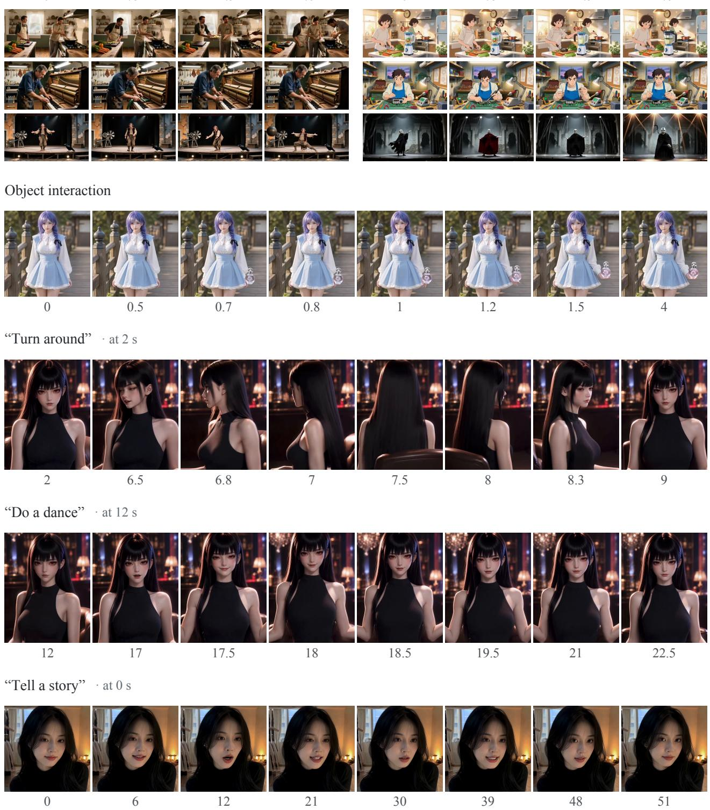
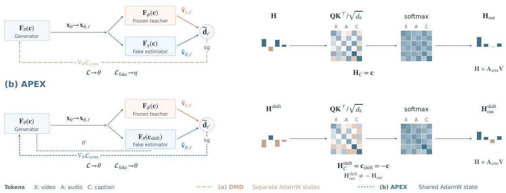
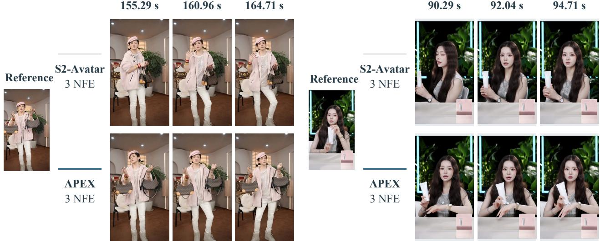
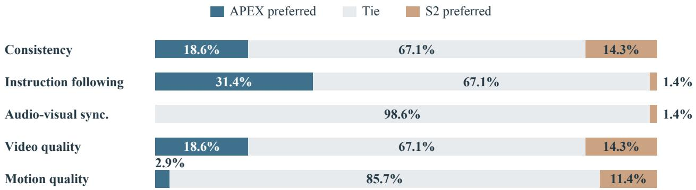
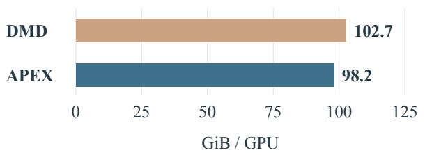
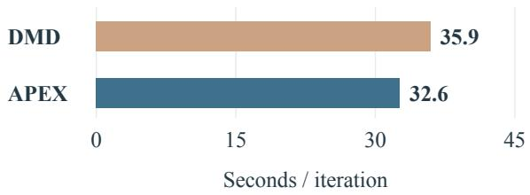
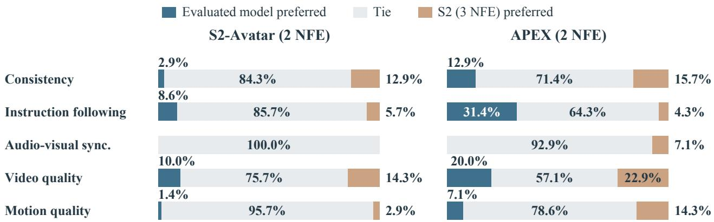
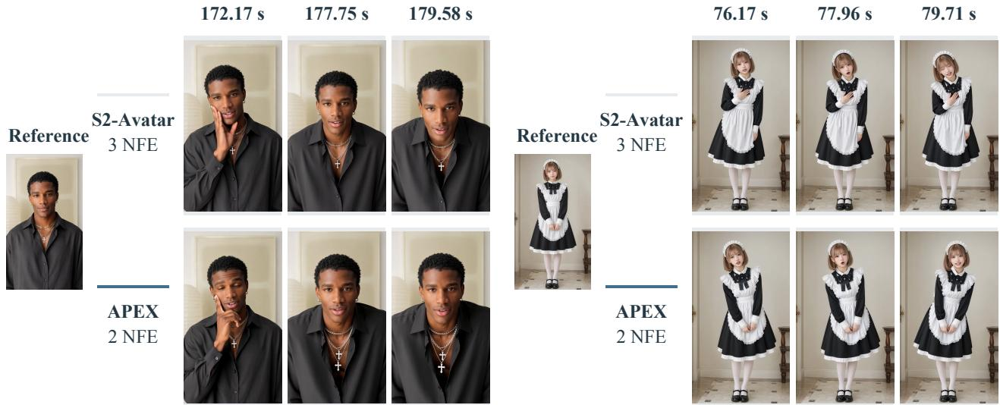
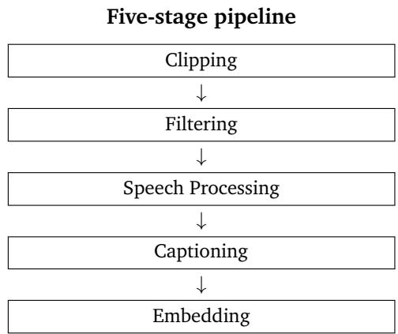

# Few-Step Streaming Video Generation via Condition Shifting

Deyuan Liu1,2,3,∗ Jungang Li1,2,∗ Kaiwen Zheng1,2,∗ Kai Jiang1,2,∗ Jintao Chen1,2

Yaole Wang1,2 Ming Lin1,2 Tao Lin3,‡ Jianfei Chen1,2,‡ Jun Zhu1,2,‡ Jintao Zhang1,2,‡

1Tsinghua University 2Shengshu Technology 3Westlake University

## Abstract

Few-step sampling reduces the cost of streaming video generation. Distribution Matching Distillation (DMD) supervises few-step generators with a separate fake-score network, which adds training memory and computation and must track the evolving generator. We extend APEX to streaming video by using condition shifting to estimate the velocity field of the generated distribution within the generator. The original text condition selects generation, while a shifted condition selects fake estimation using the same parameters. This removes the independent fake network while retaining S2-Avatar’s frozen reference teacher, Self-Replay Forcing, and perceptual regularization. We evaluate APEX on 180-second videos using three backbone evaluations per block and a one-step spatial Refiner, with a 70-case human study and a 320-case StreamAV-Bench comparison. Compared with S2-Avatar, APEX achieves higher video instruction fulfillment on the Progressive track (3.856 versus 3.831) and higher visual aesthetics across both tracks (0.641898 versus 0.632606). Human raters favor APEX most strongly on instruction following, with +30.0% net preference, followed by consistency and video quality at +4.3% each. Motion quality favors S2-Avatar, audiovisual synchronization is predominantly tied, and usability is unchanged. Separate measurements under matched training settings show 4.4% lower peak allocated GPU memory per GPU and 9.2% shorter mean iteration time than DMD.

## 1 Introduction

Diffusion and flow models produce high-quality videos through repeated network evaluations (Brooks et al., 2024; Google DeepMind, 2025; Wan et al., 2025; Seedance et al., 2026). Streaming generation incurs this cost for every new block, making few-step sampling particularly valuable for long sequences. Distillation reduces the number of evaluations (Song et al., 2023; Salimans & Ho, 2022; Zheng et al., 2025b), while the resulting generator must preserve visual quality, maintain characters and scenes, and respond to changing instructions. Figure 1 shows APEX video examples of object interaction and storytelling.

Distribution Matching Distillation (DMD) supervises generated samples through the difference between reference and generated-distribution scores (Yin et al., 2024b;a). A frozen pretrained teacher supplies the reference estimate, while a separate fake-score network learns from current generator outputs. For large video backbones, maintaining this auxiliary network adds training memory and computation. Its estimate must also track the generator as the output distribution changes, requiring coordination of their optimization settings and updates. This motivates learning the fake estimate within the generator.

TwinFlow (Cheng et al., 2026) and the original APEX (Liu et al., 2026c) show how generation and distribution estimation can share a network. We extend APEX’s condition shifting to streaming video: the original text condition selects generation, and its shifted version selects a fake estimator trained on outputs for the same prompt. The two roles share model parameters and, by default, optimizer states, while a separate frozen pretrained teacher provides the same reference guidance as in S2-Avatar.

Streaming video requires the estimator to track outputs generated with a causal history. We integrate condition shifting into S2-Avatar’s Self-Replay Forcing (SRF), which trains on replayed segments of the model’s own generated sequences (Zhang et al., 2026c). The shared fake estimator is fitted to these replay outputs, and its

0  

112.5

179

112.5

75

0

Figure 1 APEX streaming generation and interaction. Top: Progressive (left) and Interactive (right) StreamAV-Bench samples (3 NFE, 2× Refiner). The lower four rows show object interaction, turning, dancing, and storytelling, with each sequence read from left to right. Quoted user prompts are translated from Chinese, with rounded onset times. All timestamps are in seconds. Demo times are measured relative to the start of each recording.

clean-latent predictions are compared with those of the frozen teacher to construct a detached correction for the generator. We retain S2’s replay procedure and perceptual regularization, as described in Section 3 .

We evaluate APEX on 180-second videos through a 70-case human study and all 320 StreamAV-Bench scenarios. Relative to S2-Avatar, APEX receives positive net human preference for instruction following, consistency, and video quality, and achieves higher video instruction-fulfillment scores and visual aesthetics on both benchmark tracks. A separate measurement under matched training settings shows 4.4% lower peak allocated GPU memory and 9.2% shorter mean iteration time than DMD. Instruction-following preference also remains positive at 2 backbone NFE. Section 4 also reports audiovisual synchronization, motion quality, and usability. The paper makes three contributions to few-step streaming video generation:

1. Shared-network estimation through condition shifting. We learn the fake velocity within the generator while retaining a frozen reference teacher and removing the independent fake network.

2. Integration with Self-Replay Forcing. We apply condition-shifted estimation to the outputs of S2’s Self-Replay Forcing, retaining its replay procedure and perceptual regularization.

3. Video quality and training efficiency. We evaluate 180-second generation on 70 paired cases and all 320 StreamAV-Bench scenarios, alongside training-cost and sampling comparisons.

## 2 Preliminaries

We use x for a data latent, z for Gaussian noise, c for projected text, and $F _ { \theta }$ for a velocity predictor. The operator sg denotes stop-gradient, and Section 2.1 defines the video context.

Continuous Generative Models. Conditional diffusion (Ho et al., 2020; Song et al., 2020) and flow matching (Lipman et al., 2022) transport Gaussian noise $\mathbf { z } \sim p _ { z } = \mathcal { N } ( \mathbf { 0 } , \mathbf { I } )$ to data $\mathbf { x } \sim p _ { r } ( \cdot \mid \mathbf { c } )$ . For $t \in [ 0 , 1 ]$ , we use the linear interpolation path of optimal transport (OT) flow matching:

$$
{ \bf x } _ { t } = t { \bf z } + ( 1 - t ) { \bf x } .\tag{1}
$$

Sampling transports noise $\mathbf { x } _ { 1 } = \mathbf { z }$ to data $\mathbf { x } _ { 0 } = \mathbf { x }$ along the probability-flow ODE:

$$
\frac { \mathrm { d } \mathbf { x } _ { t } } { \mathrm { d } t } = \mathbf { v } ( \mathbf { x } _ { t } , t , \mathbf { c } ) .\tag{2}
$$

Flow matching learns this velocity field by regressing to the known target $\mathbf { u } _ { r } ( \mathbf { x } , \mathbf { z } ) : = \mathbf { z } - \mathbf { x } \colon$

$$
\begin{array} { r } { \mathcal { L } _ { \mathrm { F M } } ( \theta ) = \mathbb { E } _ { \mathbf { x } , \mathbf { c } , \mathbf { z } , t } \left[ \| F _ { \theta } ( \mathbf { x } _ { t } , t , \mathbf { c } ) - \mathbf { u } _ { r } ( \mathbf { x } , \mathbf { z } ) \| ^ { 2 } \right] . } \end{array}\tag{3}
$$

The expectation uses paired data $\mathbf { \Psi } ( \mathbf { x } , \mathbf { c } )$ , independent $\mathbf { z } \sim p _ { z }$ , and $t \sim \mathcal { U } ( 0 , 1 )$ . The population minimizer is the conditional mean velocity $\mathbf { v } _ { r } ^ { * } ( \mathbf { x } _ { t } , t , \mathbf { c } ) = \mathbb { E } [ \mathbf { z } - \mathbf { x } \mid \mathbf { x } _ { t } , t , \mathbf { c } ]$ . Sampling integrates from t = 1 to $t = 0$ with numerical ODE solvers (Karras et al., 2022), such as the first-order Euler method.

Few-Step Generation. Consistency and interval-mapping methods support few-step sampling (Song et al., 2023; Wang et al., 2024; Zheng et al., 2025b; Sun & Lin, 2025; Geng et al., 2025). The one-step Euler map is $G _ { \theta } ( \mathbf { z } , \mathbf { c } ) = \mathbf { z } - F _ { \theta } ( \mathbf { z } , 1 , \mathbf { c } )$ , with no destination-time input to the velocity predictor.

Distribution Matching. For a fixed condition, let $p _ { \theta }$ be the distribution of $G _ { \theta } ( \mathbf { z } , \mathbf { c } )$ and $p _ { r }$ the reference distribution. Their noised marginals at time t have scores $\mathbf { s } _ { i , t } ( \mathbf { y } ) : = \nabla _ { \mathbf { y } }$ log pi,t(y) for $i \in \{ r , \theta \}$ . DMD (Yin et al., 2024b) estimates the reverse-KL gradient using their score difference at the same noised generated sample. It uses a pretrained reference score and an auxiliary fake-score network trained on current outputs. Appendix B.2 expresses this score difference through marginal velocities under the OT path.

TwinFlow (Cheng et al., 2026) learns both velocities within one model, using positive time for the real trajectory and negative time for the fake trajectory. APEX selects the fake estimator through the condition input. Our video implementation shares the generator and fake estimator and retains S2’s frozen teacher for the reference prediction. Appendix B.8 relates the GAN gradient to a weighted score difference.

## 2.1 Autoregressive Video Generation and Self-Replay Forcing

We express S2-Avatar’s causal predictor and Self-Replay Forcing procedure (Zhang et al., 2026c) in APEX notation. For block $i ,$ let $\mathbf { x } ^ { i }$ denote the video latent and $\mathbf { c } ^ { i }$ its text representation. The context $\mathbf { h } ^ { i }$ contains the reference image, the preceding video states, and any accompanying audio. The diffusion time $t _ { i } \in ( 0 , 1 ]$ is its noise level, with larger values indicating more noise. The clean prediction is

$$
\widehat { \mathbf { x } } _ { 0 } ^ { i } = \mathbf { x } _ { t _ { i } } ^ { i } - t _ { i } F _ { \theta } ( \mathbf { x } _ { t _ { i } } ^ { i } , t _ { i } , \mathbf { c } ^ { i } \mid \mathbf { h } ^ { i } ) .\tag{4}
$$

A block-wise causal mask lets each block attend to its own tokens, conditions, and preceding video blocks.

Self-Replay Forcing. Following S2 (Zhang et al., 2026c), we generate a detached autoregressive rollout (Huang et al., 2026a) and re-noise a sampled segment with diffusion forcing (DF) (Chen et al., 2024). One differentiable causal pass processes this segment, with each block reading preceding blocks at their replay noise levels. This allows cross-block gradients within the segment while keeping the external history and original rollout detached. We retain S2’s teacher and perceptual regularization (Zhang et al., 2026d) and replace DMD’s fake estimator (Yin et al., 2024b;a) through condition shifting in Section 3 .

## 3 Condition Shifting for Streaming Video Generation

We apply APEX’s condition shifting (Liu et al., 2026c) to the fake estimator in S2’s Self-Replay Forcing framework. The generator and fake estimator share parameters θ, with a frozen teacher $F _ { \phi }$ providing S2’s reference prediction and guidance. Figure 2 compares DMD and APEX during training.

## 3.1 Condition Shifting on Generated Video

The network generates under $\mathbf { c } ^ { i }$ and estimates the fake velocity from these outputs under $\mathbf { c } _ { \mathrm { s h i f t } } ^ { i } = - \mathbf { c } ^ { i }$ . We negate projected text before the transformer blocks, with positive diffusion times in both calls. The N evaluated blocks $\mathbf { x } _ { \theta } ^ { 1 : N }$ include replay outputs and any detached prefix from Section 2.1 . We detach them and re-noise at a scoring time $t ^ { \prime } \in ( 0 , 1 )$ with fresh Gaussian noise $\epsilon ^ { \prime } \sim p _ { z }$

$$
\mathbf { x } _ { \theta } ^ { 1 : N , \mathrm { s g } } : = \mathrm { s g } ( \mathbf { x } _ { \theta } ^ { 1 : N } ) , \qquad \mathbf { x } _ { \theta , t ^ { \prime } } ^ { 1 : N , \mathrm { s g } } : = ( 1 - t ^ { \prime } ) \mathbf { x } _ { \theta } ^ { 1 : N , \mathrm { s g } } + t ^ { \prime } \epsilon ^ { \prime } .\tag{5}
$$

We draw a single scoring time $t ^ { \prime }$ for all generated blocks in a sequence, separately from the replay times $t _ { i }$ used to produce the clean predictions. With reference-image and audio conditions fixed and omitted from the notation, the shifted-condition network predicts the fake velocity from the re-noised video latents:

$$
\widehat { \mathbf { v } } _ { \theta , t ^ { \prime } } ^ { 1 : N } : = F _ { \theta } ( \mathbf { x } _ { \theta , t ^ { \prime } } ^ { 1 : N , \mathrm { s g } } , t ^ { \prime } , \mathbf { c } _ { \mathrm { s h i f t } } ^ { 1 : N } ) .\tag{6}
$$

To learn the velocity field of the generated samples, we use the following flow-matching loss with causal attention over the current and preceding noisy blocks, without an additional clean-video stream:

$$
\begin{array} { r } { \mathcal { L } _ { \mathrm { f a k e } } ( \theta ) = \mathbb { E } \Big [ \mathrm { M S E } \Big ( \widehat { \mathbf { v } } _ { \theta , t ^ { \prime } } ^ { 1 : N } , \ \epsilon ^ { \prime } - \mathbf { x } _ { \theta } ^ { 1 : N , \mathrm { s g } } \Big ) \Big ] . } \end{array}\tag{7}
$$

Here MSE is the mean squared error with S2’s video weighting and averaging. Detaching the generated sequence and regression target restricts this update to the shifted-condition prediction.

## 3.2 A Detached Correction from the Velocity Difference

We form the generator correction from the frozen teacher’s $\widehat { \mathbf { x } } _ { 0 , r } ^ { 1 : N }$ and fake clean-latent predictions at the same noisy video and scoring time, retaining S2’s conditioning, guidance, and DMD target (Zhang et al., 2026c; Yin et al., 2024b;a). Here r marks the teacher prediction and θ the fake estimate.

$$
\widehat { \mathbf { x } } _ { 0 , \theta } ^ { i } = \mathbf { x } _ { \theta , t ^ { \prime } } ^ { i , \mathrm { s g } } - t ^ { \prime } \widehat { \mathbf { v } } _ { \theta , t ^ { \prime } } ^ { i } , \qquad \widehat { \mathbf { v } } _ { r , t ^ { \prime } } ^ { i } : = \frac { \mathbf { x } _ { \theta , t ^ { \prime } } ^ { i , \mathrm { s g } } - \widehat { \mathbf { x } } _ { 0 , r } ^ { i } } { t ^ { \prime } } .\tag{8}
$$

Their clean-latent difference is proportional to the velocity difference at the same scoring time:

$$
\widehat { \mathbf { x } } _ { 0 , r } ^ { i } - \widehat { \mathbf { x } } _ { 0 , \theta } ^ { i } = t ^ { \prime } \widehat { \mathbf { d } } _ { t ^ { \prime } } ^ { i } , \qquad \widehat { \mathbf { d } } _ { t ^ { \prime } } ^ { i } : = \widehat { \mathbf { v } } _ { \theta , t ^ { \prime } } ^ { i } - \widehat { \mathbf { v } } _ { r , t ^ { \prime } } ^ { i } .\tag{9}
$$

We normalize this clean-latent difference as in Appendix B.3 to obtain $\widetilde { \mathbf { d } } _ { t ^ { \prime } } ^ { 1 : N }$ and add it to the current output, giving the generator a detached regression target for the replay predictions:

$$
\begin{array} { r } { \mathcal { L } _ { \mathrm { s c o r e } } ( \theta ) = \mathbb { E } \Big [ \mathrm { M S E } \Big ( \mathbf { x } _ { \theta } ^ { 1 : N } , \mathrm { s g } \Big ( \mathbf { x } _ { \theta } ^ { 1 : N } + \widetilde { \mathbf { d } } _ { t ^ { \prime } } ^ { 1 : N } \Big ) \Big ) \Big ] . } \end{array}\tag{10}
$$

We hold the target fixed, including estimator predictions and normalization. Gradients therefore pass through replay outputs and their connected causal representations within the active segment. Under the OT path, velocity estimates induce score estimates satisfying

$$
\widehat { \mathbf { d } } _ { t ^ { \prime } } ^ { i } = - \frac { t ^ { \prime } } { 1 - t ^ { \prime } } \left( \widehat { \mathbf { s } } _ { \theta , t ^ { \prime } } ^ { i } - \widehat { \mathbf { s } } _ { r , t ^ { \prime } } ^ { i } \right) .\tag{11}
$$

Interpreting these induced estimates as true conditional scores requires calibrated fields under common conditioning. Appendix B.3 derives the gradient of Equation 10 and discusses its score interpretation.

  
Figure 2 DMD and APEX in Self-Replay Forcing. DMD uses independent fake parameters $\eta ;$ APEX shares generator and fake parameters θ and, by default, AdamW states. Teacher parameters ϕ are frozen. Left: $\mathbf { x } _ { \theta }$ is the rollout/replay output, $t ^ { \prime }$ the scoring time, $\mathbf { d } _ { t ^ { \prime } }$ the normalized correction, and sg stop-gradient. The correction contributes $\nabla _ { \theta } \mathcal { L } _ { \mathrm { s c o r e } } ; \mathcal { L }$ is the full generator objective. The fake-velocity subscript θ identifies the generated distribution. Right: H and $\mathbf { H } _ { \mathrm { o u t } }$ denote input and output hidden states; $\mathbf { H } _ { C }$ contains projected text tokens c. Within each row, $\mathbf { Q } , \mathbf { K } , \mathbf { V }$ are queries, keys, and values, and $\mathbf { A } _ { \mathrm { a t t n } } = \mathrm { s o f t m a x } ( \mathbf { Q } \mathbf { K } ^ { \top } / \sqrt { d _ { h } } )$ , with head dimension $d _ { h }$ . Superscript shift marks states under $\mathbf { c } _ { \mathrm { s h i f t } } = - \mathbf { c }$ . The single-head example uses fixed weights and omits the causal mask and other transformer operations; values are schematic.

## 3.3 Shared-Parameter Updates

Following S2, the generator objective combines distribution matching and perceptual regularization:

$$
{ \mathcal { L } } ( \theta ) = { \mathcal { L } } _ { \mathrm { s c o r e } } ( \theta ) + { \mathcal { L } } _ { \mathrm { p e r c } } ( \theta ) .\tag{12}
$$

Generator updates alternate with fake estimation in Equation 7 on shared parameters $\theta ,$ retaining S2’s perceptual regularization (Zhang et al., 2026c;d) and keeping ϕ frozen. By default, these updates share AdamW states, with separate states evaluated in Section 4.3 . At inference, the original projected text selects generation with the chosen few-step schedule, followed by the common one-step spatial Refiner.

## 4 Evaluation

We evaluate 180-second streaming generation on ten StreamAV-Bench metrics and five human-preference dimensions, complemented by absolute ratings, usability, and training-cost and sampling comparisons.

## 4.1 Setting

Training data and model. We reuse S2-Avatar’s complete training data and preparation pipeline (Zhang et al., 2026c), including filtering and annotation, for livestreams, talking heads, film and television, solo dance, and 2D/3D animation, as summarized in Appendix C . APEX uses its causal audiovisual backbone and Self-Replay Forcing, sharing parameters and, by default, AdamW states for generator and fake updates.

Inference. Unless otherwise specified, both models use 3 backbone denoising function evaluations (NFE) per generated block, excluding KV-cache encoding and updates. The common one-step 2× spatial Refiner is counted separately. StreamAV-Bench outputs have resolution 1344 × 768.

StreamAV-Bench. Following the experimental setup of Vidu S2 (Zhang et al., 2026c), we use all 160 Progressive and 160 Interactive scenarios of StreamAV-Bench (Liu et al., 2026f). The metrics cover instruction fulfillment (VIF, AIF), visual quality and aesthetics (VQ, VA), audio quality (AQ, PQ), audiovisual alignment and synchronization (AVAlign, AVSync), and subject and background consistency (SC, BC). All metrics are higher-is-better except AVSync, which measures temporal offset error in seconds. The 12-model comparison uses Progressive cases for VIF, AIF, SC, and BC, and both tracks for the remaining metrics.

Human evaluation. We invited experts with backgrounds in art or aesthetics to provide preference ratings for 70 pairs of image-to-video (I2V) sequences across five dimensions: consistency, instruction following, audiovisual synchronization, video quality, and motion quality. Good/Same/Bad (GSB) denote wins, ties, and losses relative to S2-Avatar at 3 NFE. Net preference is 100(G − B)/70, retaining ties in the denominator. Usability requires Mean Opinion Scores (MOS) above 2 for both instruction following and synchronization.

(a) Retaining both bags  
(b) Applying the product  
  
Figure 3 Paired examples at 3 backbone NFE. (a) APEX retains both bags late in the sequence, while S2-Avatar shows one. (b) APEX brings the tube to the other hand for the applying instruction; S2-Avatar continues holding it at its side. Each pair uses the same reference and timestamps, with a common one-step 2× Refiner.

## 4.2 Results

Qualitative comparison. Figure 3 compares 3-NFE I2V outputs using the same reference images and timestamps. APEX retains both bags late in one sequence and moves the tube toward the other hand for the applying instruction in another, illustrating object persistence and a prompt-directed change in hand pose.

Benchmark results. APEX ranks first on VA, VIF, and AIF and second on VQ among the 12 models with available results in Table 1 . In Table 2 , VIF, AIF, and VA improve on both tracks, with Progressive VIF and AIF increasing by 0.025 and 0.067. VQ rises on Progressive (+0.049) but falls on Interactive (−0.070), yielding −0.011 overall. BC shows the opposite track-level pattern. AQ, AVAlign, and SC decrease on both tracks, pooled PQ is effectively unchanged, and pooled AVSync error rises from 1.319 to 1.341 s. These results show instruction and aesthetic gains alongside visual and audiovisual trade-offs.

Human evaluation. Figure 4 and Table 3 show the strongest preference for instruction following: 22 wins, 47 ties, and 1 loss yield +30.0% net preference, with MOS of 4.17 versus 3.99. Consistency and video quality each receive +4.3%, corresponding to three net wins. Audiovisual synchronization is tied in 69 of 70 pairs, with one loss (−1.4%) and MOS of 4.23 versus 4.26. Motion quality favors S2-Avatar (−8.6%). Both models meet the usability criterion for 62 of 70 evaluated I2V sequences (88.6%).

## 4.3 Training and Sampling Comparisons

Additional preference evaluations use separate rounds of 70 paired 180-second I2V sequences, each against S2-Avatar at 3 NFE with the same Refiner. Table 4 groups results by comparison round.

Training cost. In a separate measurement under matched training settings ( Figure 5 ), peak allocated memory decreases from 102.7 to 98.2 GiB per GPU, saving 4.5 GiB (4.4%) relative to DMD. Mean iteration time decreases from 35.9 to 32.6 s, a reduction of 3.3 s (9.2%), while retaining the frozen teacher.

Two-step generation. Against S2-Avatar at 3 NFE, APEX at 2 NFE receives +27.1% instruction preference (22 wins, 45 ties, 3 losses), while S2-Avatar at 2 NFE receives +2.9% in a separate paired round, as shown in Figure 6 . APEX’s other margins are negative: −2.9% for consistency and video quality, and −7.1% for synchronization and motion quality. Figure 7 compares APEX at 2 NFE with S2-Avatar at 3 NFE, showing broadly similar character appearance with differences in pose and fine detail.

Table 1 Comparison on ten StreamAV-Bench metrics. VIF, AIF, SC, and BC use Progressive; the other metrics use both tracks. APEX and S2-Avatar use our evaluation results; baseline VIF is from StreamAV-Bench (Liu et al., 2026f) and other baseline scores from Vidu S2 (Zhang et al., 2026c). Values are rounded to three decimals. Bold and underlined values mark the best and second-best available results in each column; a dash marks an unreported value. AVSync uses seconds.
<table><tr><td>Model</td><td>VA↑</td><td>VQ↑</td><td>PQ↑</td><td>AQ↑</td><td>AVAlign ↑</td><td>AVSync↓</td><td>VIF↑</td><td>AIF↑</td><td>SC↑</td><td>BC↑</td></tr><tr><td>SoulX-FlashTalk</td><td>0.281</td><td>2.515</td><td>7.091</td><td>3.006</td><td>0.121</td><td>0.648</td><td></td><td>2.499</td><td>0.946</td><td>0.964</td></tr><tr><td>AptAvatar</td><td>0.458</td><td>2.040</td><td>7.075</td><td>2.582</td><td>0.099</td><td>1.284</td><td></td><td>2.448</td><td>0.860</td><td>0.923</td></tr><tr><td>OmniForcing</td><td>0.554</td><td>2.374</td><td>6.351</td><td>2.528</td><td>0.119</td><td>1.423</td><td>2.423</td><td>2.343</td><td>0.962</td><td>0.953</td></tr><tr><td>Hallo-Live</td><td>0.574</td><td>1</td><td>5.396</td><td></td><td>0.102</td><td>1.353</td><td></td><td></td><td>0.991</td><td>0.977</td></tr><tr><td>Self-Forcing</td><td>0.585</td><td>2.753</td><td>6.453</td><td>2.623</td><td>0.256</td><td>0.919</td><td>3.019</td><td>2.810</td><td>0.981</td><td>0.969</td></tr><tr><td>IAMFlow</td><td>0.602</td><td>2.840</td><td>6.415</td><td>2.625</td><td>0.268</td><td>1.016</td><td>3.192</td><td>2.789</td><td>0.986</td><td>0.973</td></tr><tr><td>AvatarForcing</td><td>0.639</td><td></td><td>7.070</td><td></td><td>0.089</td><td>1.041</td><td></td><td></td><td>0.987</td><td>0.976</td></tr><tr><td>PixVerse R1</td><td>0.529</td><td>2.428</td><td>6.348</td><td>2.810</td><td>0.234</td><td>0.855</td><td>2.976</td><td>2.511</td><td>0.907</td><td>0.930</td></tr><tr><td>Odyssey-2</td><td>0.531</td><td>2.820</td><td>6.426</td><td>2.659</td><td>0.260</td><td>0.946</td><td>3.106</td><td>2.778</td><td>0.976</td><td>0.966</td></tr><tr><td>HappyOyster</td><td>0.529</td><td>2.785</td><td>6.817</td><td>3.157</td><td>0.206</td><td>1.044</td><td>3.565</td><td>2.692</td><td>0.904</td><td>0.934</td></tr><tr><td>Vidu S2-Avatar</td><td>0.633</td><td>3.267</td><td>6.386</td><td>2.788</td><td>0.103</td><td>1.319</td><td>3.831</td><td>2.768</td><td>0.979</td><td>0.972</td></tr><tr><td>APEX (ours)</td><td>0.642</td><td>3.256</td><td>6.386</td><td>2.725</td><td>0.101</td><td>1.341</td><td>3.856</td><td>2.835</td><td>0.978</td><td>0.972</td></tr></table>

Table 2 Per-track and pooled StreamAV-Bench results. Progressive and Interactive each contain 160 cases; Overall pools all 320 cases for every metric. Values retain source precision, and ∆ is APEX minus S2-Avatar. AVSync is measured in seconds and is lower-is-better; all other reported metrics are higher-is-better.
<table><tr><td rowspan="2">Metric</td><td colspan="3">Overall (n = 320)</td><td colspan="3">Progressive (n = 160)</td><td colspan="3">Interactive (n = 160)</td></tr><tr><td>APEX</td><td>S2</td><td>∆</td><td>APEX</td><td>S2</td><td>Δ</td><td>APEX</td><td>S2</td><td>Δ</td></tr><tr><td>VQ↑</td><td>3.256</td><td>3.267</td><td>-0.011</td><td>3.180</td><td>3.131</td><td>+0.049</td><td>3.333</td><td>3.403</td><td>-0.070</td></tr><tr><td>AQ↑</td><td>2.725</td><td>2.788</td><td>-0.063</td><td>2.706</td><td>2.809</td><td>-0.103</td><td>2.744</td><td>2.766</td><td>-0.022</td></tr><tr><td>VIF↑</td><td>3.891</td><td>3.834</td><td>+0.057</td><td>3.856</td><td>3.831</td><td>+0.025</td><td>3.925</td><td>3.836</td><td>+0.089</td></tr><tr><td>AIF↑</td><td>2.610</td><td>2.570</td><td>+0.040</td><td>2.835</td><td>2.768</td><td>+0.067</td><td>2.385</td><td>2.372</td><td>+0.013</td></tr><tr><td>VA↑</td><td>0.641898</td><td>0.632606</td><td>+0.009292</td><td>0.645374</td><td>0.636402</td><td>+0.008972</td><td>0.638422</td><td>0.628810</td><td>+0.009612</td></tr><tr><td>PQ↑</td><td>6.385856</td><td>6.385855</td><td>+0.000001</td><td>6.380547</td><td>6.380545</td><td>+0.000002</td><td>6.391166</td><td>6.391166</td><td>+0.000000</td></tr><tr><td>AVAlign ↑</td><td>0.101355</td><td>0.103383</td><td>-0.002028</td><td>0.100186</td><td>0.102011</td><td>-0.001825</td><td>0.102524</td><td>0.104754</td><td>-0.002230</td></tr><tr><td>AVSync ↓</td><td>1.340521</td><td>1.318854</td><td>+0.021667</td><td>1.357500</td><td>1.323646</td><td>+0.033854</td><td>1.323542</td><td>1.314062</td><td>+0.009480</td></tr><tr><td>SC↑</td><td>0.979032</td><td>0.979483</td><td>-0.000451</td><td>0.978310</td><td>0.978624</td><td>-0.000314</td><td>0.979754</td><td>0.980342</td><td>-0.000588</td></tr><tr><td>BC↑</td><td>0.972869</td><td>0.972753</td><td>+0.000116</td><td>0.971695</td><td>0.972411</td><td>-0.000716</td><td>0.974043</td><td>0.973096</td><td>+0.000947</td></tr></table>

  
Figure 4 Paired human preferences at 3 backbone NFE. APEX versus S2-Avatar on 70 I2V sequences of 180 seconds, with a common one-step 2× Refiner. Good, Same, and Bad denote APEX wins, ties, and losses.

Timestep sampling. We vary the sampling of replay times $t _ { i }$ over (0.75, 0.9375, 0.99), leaving the scoring-time schedule for $t ^ { \bar { \prime } }$ unchanged. The default uses equal weights, whereas DF4 and DF10 use (4, 1, 1) and (10, 1, 1), raising the probability of drawing the lowest noise level from 1/3 to 2/3 and $5 / 6 .$ Sampled times are sorted

Table 3 Absolute human ratings and usability. Usable sequences have both MOS ratings above 2.
<table><tr><td>Model</td><td>Instruction MOS</td><td>Synchronization MOS</td><td>Usable sequences</td><td>Usability</td></tr><tr><td>APEX</td><td>4.17</td><td>4.23</td><td>62/70</td><td>88.6%</td></tr><tr><td>S2-Avatar</td><td>3.99</td><td>4.26</td><td>62/70</td><td>88.6%</td></tr></table>

Peak allocated GPU memory  
APEX: 4.4% lower  
Mean training iteration time APEX: 9.2% lower

  
Figure 5 Training cost of DMD and APEX. Peak allocated memory per GPU (GiB) and mean iteration time (seconds) under matched training settings. Percentage reductions are measured relative to DMD.

Figure 6 Human preferences at 2 backbone NFE. Each model is evaluated against S2-Avatar at 3 NFE in a separate 70-case paired comparison. All configurations use the same one-step 2× Refiner.

along the replay segment before the differentiable pass. Default sampling has the highest instruction preference at both budgets in Table 4 , reaching +27.1% at 2 NFE and +21.4% at 3 NFE. Other dimensions vary across both inference budgets, with no consistent advantage from favoring lower-noise replay.

Optimizer configurations. Table 4 reports results for shared optimizer states at 3 NFE and separate generator/fake optimizer states at 2 NFE. Both configurations use AdamW with shared model parameters, achieving instruction-following net preferences of +21.4% and +14.3%, respectively.

(a) Face contact and forward lean

(b) Upper-body side bend

  
Figure 7 APEX at 2 backbone NFE versus S2-Avatar at 3. Selected face-contact, forward-leaning, and side-bending frames have similar overall appearance, with differences in jewelry, hand placement, and body pose. Reference images, frame timestamps, and the one-step 2× spatial Refiner are matched across methods.

Table 4 Sampling and optimizer configurations. Net preference (%) over S2-Avatar at 3 NFE; each block is a separate 70-case round. Sampling variants share optimizer states; optimizer rows use AdamW and also differ in NFE.
<table><tr><td>Configuration</td><td>NFE</td><td>Consistency</td><td>Instruction</td><td>Sync.</td><td>Video</td><td>Motion</td></tr><tr><td>Default</td><td>2</td><td>-2.9</td><td>+27.1</td><td>-7.1</td><td>-2.9</td><td>-7.1</td></tr><tr><td>DF10</td><td>2</td><td>-18.6</td><td>+21.4</td><td>-5.7</td><td>-8.6</td><td>-4.3</td></tr><tr><td>DF4</td><td>2</td><td>-8.6</td><td>+17.1</td><td>-8.6</td><td>-11.4</td><td>-8.6</td></tr><tr><td>Default</td><td>3</td><td>-5.7</td><td>+21.4</td><td>-7.1</td><td>-5.7</td><td>+2.9</td></tr><tr><td>DF10</td><td>3</td><td>-11.4</td><td>+11.4</td><td>-7.1</td><td>-11.4</td><td>+1.4</td></tr><tr><td>DF4</td><td>3</td><td>-14.3</td><td>+10.0</td><td>-10.0</td><td>-7.1</td><td>+1.4</td></tr><tr><td>Shared states</td><td>3</td><td>+5.7</td><td>+21.4</td><td>-14.3</td><td>+2.9</td><td>-7.1</td></tr><tr><td>Separate states</td><td>2</td><td>-8.6</td><td>+14.3</td><td>-15.7</td><td>-10.0</td><td>-7.1</td></tr></table>

## 5 Conclusion

APEX integrates condition-shifted fake estimation into S2’s Self-Replay Forcing, sharing generator and fake parameters while retaining the frozen teacher. It improves instruction fulfillment and visual aesthetics, with positive human preference for instruction following at both 3 and 2 backbone NFE. Matched measurements show lower peak allocated GPU memory and shorter mean iteration time. Motion quality and audiovisual synchronization remain trade-offs, while APEX and S2-Avatar achieve the same usability rate.

## References

Alibaba. Alibaba launches happyoyster, a world model product for real-time immersive creation and interaction. Official product release, 2026. URL https://www.alizila.com/alibaba-launches-happyoyster-a-world-model-product -for-real-time-immersive-creation-and-interaction/.

Tim Brooks, Bill Peebles, Connor Holmes, Will DePue, Yufei Guo, Li Jing, David Schnurr, Joe Taylor, Troy Luhman, Eric Luhman, Clarence Ng, Ricky Wang, and Aditya Ramesh. Video generation models as world simulators. 2024. URL https://openai.com/research/video-generation-models-as-world-simulators.

Boyuan Chen, Diego Martí Monsó, Yilun Du, Max Simchowitz, Russ Tedrake, and Vincent Sitzmann. Diffusion forcing: Next token prediction meets full-sequence diffusion. Advances in Neural Information Processing Systems, 37:24081–24125, 2024.

Chuyan Chen, Haoxing Chen, Kun Chen, Zhenglin Cheng, Long Cui, Ruishan Fang, Zhangxuan Gu, Zhicheng Huang, Zhenzhong Lan, Yuanting Lei, et al. Llada-image: Building strong image generators with fully open training recipes. arXiv preprint arXiv:2609.03796, 2026a.

Guibin Chen, Dixuan Lin, Jiangping Yang, Chunze Lin, Junchen Zhu, Mingyuan Fan, Hao Zhang, Sheng Chen, Zheng Chen, Chengcheng Ma, et al. Skyreels-v2: Infinite-length film generative model. arXiv preprint arXiv:2504.13074, 2025.

Jintao Chen, Chengyu Bai, Junjun Hu, Xinda Xue, and Mu Xu. Grounded forcing: Bridging time-independent semantics and proximal dynamics in autoregressive video synthesis. arXiv preprint arXiv:2604.06939, 2026b.

Zhenglin Cheng, Peng Sun, Jianguo Li, and Tao Lin. Twinflow: Realizing one-step generation on large models with self-adversarial flows. In International Conference on Learning Representations, volume 2026, pp. 151237–151264, 2026.

Jiahao Cui, Hui Li, Yun Zhan, Hanlin Shang, Kaihui Cheng, Yuqi Ma, Shan Mu, Hang Zhou, Jingdong Wang, and Siyu Zhu. Hallo3: Highly dynamic and realistic portrait image animation with video diffusion transformer. In Proceedings of the Computer Vision and Pattern Recognition Conference, pp. 21086–21095, 2025.

Liyuan Cui, Wentao Hu, Wenyuan Zhang, Zesong Yang, Fan Shi, and Xiaoqiang Liu. AvatarForcing: One-step streaming talking avatars via local-future sliding-window denoising, 2026. URL https://arxiv.org/abs/2603.14331.

Bradley Efron. Tweedie’s formula and selection bias. Journal of the American Statistical Association, 106(496):1602–1614, 2011. doi: 10.1198/jasa.2011.tm11181.

Tianrui Feng, Zhi Li, Shuo Yang, Haocheng Xi, Muyang Li, Xiuyu Li, Lvmin Zhang, Keting Yang, Kelly Peng, Song Han, et al. Streamdiffusionv2: A streaming system for dynamic and interactive video generation. arXiv preprint arXiv:2511.07399, 2025. URL https://arxiv.org/abs/2511.07399.

Qijun Gan, Ruizi Yang, Jianke Zhu, Shaofei Xue, and Steven Hoi. Omniavatar: Efficient audio-driven avatar video generation with adaptive body animation. arXiv preprint arXiv:2506.18866, 2025.

Kaifeng Gao, Jiaxin Shi, Hanwang Zhang, Chunping Wang, Jun Xiao, and Long Chen. Ca2-vdm: Efficient autoregressive video diffusion model with causal generation and cache sharing, 2025a. URL https://arxiv.org/abs/2411.16375.

Xin Gao, Li Hu, Siqi Hu, Mingyang Huang, Chaonan Ji, Dechao Meng, Jinwei Qi, Penchong Qiao, Zhen Shen, Yafei Song, et al. Wan-s2v: Audio-driven cinematic video generation. arXiv preprint arXiv:2508.18621, 2025b.

Zhengyang Geng, Mingyang Deng, Xingjian Bai, J Zico Kolter, and Kaiming He. Mean flows for one-step generative modeling. arXiv preprint arXiv:2505.13447, 2025.

Rohit Girdhar, Alaaeldin El-Nouby, Zhuang Liu, Mannat Singh, Kalyan Vasudev Alwala, Armand Joulin, and Ishan Misra. Imagebind: One embedding space to bind them all, 2023. URL https://arxiv.org/abs/2305.05665.

Ian Goodfellow, Jean Pouget-Abadie, Mehdi Mirza, Bing Xu, David Warde-Farley, Sherjil Ozair, Aaron Courville, and Yoshua Bengio. Generative adversarial nets. In Advances in Neural Information Processing Systems, 2014.

Google DeepMind. Veo: A text-to-video generation system. Technical report, Google DeepMind, 2025. URL https: //storage.googleapis.com/deepmind-media/veo/Veo-3-Tech-Report.pdf. Veo 3 Tech Report.

Yansen Han, Shengyi Liao, Peng Sun, Deyuan Liu, Yuanxing Zhang, Pengfei Wan, and Tao Lin. Flowcpo: A unified divergence view of preference alignment for flow models. arXiv preprint arXiv:2609.09905, 2026.

Roberto Henschel, Levon Khachatryan, Hayk Poghosyan, Daniil Hayrapetyan, Vahram Tadevosyan, Zhangyang Wang, Shant Navasardyan, and Humphrey Shi. Streamingt2v: Consistent, dynamic, and extendable long video generation from text. In Proceedings of the Computer Vision and Pattern Recognition Conference, pp. 2568–2577, 2025.

HeyGen. Heygen ai video avatar. https://www.heygen.com/avatars/ai-video-avatar, 2026. Accessed: 2026-07-02.

Jonathan Ho, Ajay Jain, and Pieter Abbeel. Denoising diffusion probabilistic models. Advances in neural information processing systems, 33:6840–6851, 2020.

Yihao Hu, Yitong Lin, Pan Wang, Zhihao Wen, Hang Wang, Yiwen Zhao, Deyuan Liu, Yutong Li, Mingda Wan, Yuchen Mao, et al. Chronoreplay: One answer interface is not enough for streaming spatial intelligence. arXiv preprint arXiv:2610.34283, 2026a.

Yihao Hu, Pan Wang, Yitong Lin, Zhihao Wen, Deyuan Liu, Hang Wang, Mingda Wan, Yiwen Zhao, Yutong Li, Yuchen Mao, et al. Supervising the visible state: Separating representation from view selection in streaming video. arXiv preprint arXiv:2610.34926, 2026b.

Yuezhou Hu and Jintao Zhang. Speculative decoding for autoregressive video generation. arXiv preprint arXiv:2604.17397, 2026.

Xun Huang, Zhengqi Li, Guande He, Mingyuan Zhou, and Eli Shechtman. Self forcing: Bridging the train-test gap in autoregressive video diffusion. Advances in Neural Information Processing Systems, 38:167283–167308, 2026a.

Yu Huang, Jungang Li, Zhiyuan Wang, Yonghua Hei, Song Dai, Jiayu Yang, Deyuan Liu, Xiang Zheng, Xiaoshuang Shi, Hao Cheng, et al. Vtr-bench: A systematic benchmark for evaluating visual text rendering in video generation. arXiv preprint arXiv:2610.01499, 2026b.

Yubo Huang, Hailong Guo, Fangtai Wu, Weiqiang Wang, Shifeng Zhang, Shijie Huang, Qijun Gan, Lin Liu, Sirui Zhao, Enhong Chen, Jiaming Liu, and Steven Hoi. Live avatar: Streaming real-time audio-driven avatar generation with infinite length, 2025. URL https://arxiv.org/abs/2512.04677.

Vladimir Iashin, Weidi Xie, Esa Rahtu, and Andrew Zisserman. Synchformer: Efficient synchronization from sparse cues, 2024. URL https://arxiv.org/abs/2401.16423.

Sam Ade Jacobs, Masahiro Tanaka, Chengming Zhang, Minjia Zhang, Shuaiwen Leon Song, Samyam Rajbhandari, and Yuxiong He. Deepspeed ulysses: System optimizations for enabling training of extreme long sequence transformer models. arXiv preprint arXiv:2309.14509, 2023.

Youhe Jiang, Haoxu Wang, Haotong Bao, Kai Jiang, Jianfei Chen, Jun Zhu, Fangcheng Fu, and Jintao Zhang. Turboserve: Serving streaming video generation efficiently and economically. arXiv preprint arXiv:2606.19271, 2026.

Yang Jin, Zhicheng Sun, Ningyuan Li, Kun Xu, Kun Xu, Hao Jiang, Nan Zhuang, Quzhe Huang, Yang Song, Yadong MU, and Zhouchen Lin. Pyramidal flow matching for efficient video generative modeling. In The Thirteenth International Conference on Learning Representations, 2025. URL https://openreview.net/forum?id=66NzcRQuOq.

Tero Karras, Miika Aittala, Timo Aila, and Samuli Laine. Elucidating the design space of diffusion-based generative models. In Advances in Neural Information Processing Systems, 2022.

Dongjun Kim, Yeongmin Kim, Se Jung Kwon, Wanmo Kang, and Il-Chul Moon. Refining generative process with discriminator guidance in score-based diffusion models. In International Conference on Machine Learning, pp. 16567– 16598. PMLR, 2023.

Jihwan Kim, Junoh Kang, Jinyoung Choi, and Bohyung Han. Fifo-diffusion: Generating infinite videos from text without training. Advances in Neural Information Processing Systems, 37:89834–89868, 2024.

Youngjoong Kim, Deokyeong Lee, and Jaesik Park. Distribution matching distillation without fake score network. arXiv preprint arXiv:2605.19256, 2026a.

Youngrae Kim, Qixin Hu, C-C Jay Kuo, and Peter A Beerel. Memrope: Training-free infinite video generation via evolving memory tokens. arXiv preprint arXiv:2603.12513, 2026b.

LAION-AI. Aesthetic predictor. https://github.com/LAION-AI/aesthetic-predictor, 2022.

Chunyu Li, Jiaye Li, Ruiqiao Mei, Haoyuan Xia, Hao Zhu, Jingdong Wang, and Siyu Zhu. Hallo-Live: Real-time streaming joint audio-video avatar generation with asynchronous dual-stream and human-centric preference distillation, 2026a. URL https://arxiv.org/abs/2604.23632.

Haodong Li, Shaoteng Liu, Zhe Lin, and Manmohan Chandraker. Rolling sink: Bridging limited-horizon training and open-ended testing in autoregressive video diffusion. arXiv preprint arXiv:2602.07775, 2026b.

Yaron Lipman, Ricky TQ Chen, Heli Ben-Hamu, Maximilian Nickel, and Matt Le. Flow matching for generative modeling. arXiv preprint arXiv:2210.02747, 2022.

Deyuan Liu, Peng Sun, Xufeng Li, and Tao Lin. Efficient generative model training via embedded representation warmup. arXiv preprint arXiv:2504.10188, 2025a.

Deyuan Liu, Yansen Han, Kaiwen Zheng, Jun Xie, Jiacheng Liu, Zhenglin Cheng, Peng Sun, Jintao Zhang, Jianguo Li, and Tao Lin. Intrinsic distribution matching. arXiv preprint arXiv:2610.39633, 2026a.

Deyuan Liu, Yihao Hu, Jingxuan Zhang, Xingying Li, Jun Xie, Jiacheng Liu, Jungang Li, Yu Huang, Xuanyi Liu, Yue Ding, et al. Ultratext bench: A comprehensive bilingual benchmark for evaluating visual text rendering in image generation. arXiv preprint arXiv:2610.09823, 2026b.

Deyuan Liu, Peng Sun, Yansen Han, Zhenglin Cheng, Chuyan Chen, and Tao Lin. Self-adversarial one step generation via condition shifting. arXiv preprint arXiv:2604.12322, 2026c.

Jinxiu Liu, Xuanming Liu, Kangfu Mei, Yandong Wen, Ming-Hsuan Yang, and Weiyang Liu. Streaming autoregressive video generation via diagonal distillation. arXiv preprint arXiv:2603.09488, 2026d.

Jinzhuo Liu, Jiangning Zhang, Wencan Jiang, Yabiao Wang, Dingkang Liang, Zhucun Xue, Ran Yi, and Yong Liu. Advancing narrative long video generation via training-free identity-aware memory, 2026e. URL https://arxiv.org/abs/2605.1 8733.

Kaiqi Liu, Haoxuan Zeng, Jingqi Liu, Jiacong Fang, Ziqi Cai, Yunyao Mao, Henglin Liu, Yu Sheng, Shuchen Weng, and Boxin Shi. StreamAV-Bench: A comprehensive benchmark for streaming audio-video generation, 2026f. URL https://arxiv.org/abs/2608.26336.

Kunhao Liu, Wenbo Hu, Jiale Xu, Ying Shan, and Shijian Lu. Rolling forcing: Autoregressive long video diffusion in real time. arXiv preprint arXiv:2509.25161, 2025b.

Cheng Lu and Yang Song. Simplifying, stabilizing and scaling continuous-time consistency models. arXiv preprint arXiv:2410.11081, 2024.

Shakir Mohamed and Balaji Lakshminarayanan. Learning in implicit generative models. arXiv preprint arXiv:1610.03483, 2016.

Odyssey. Introducing odyssey-2: A general-purpose world model. Official technical release, 2025. URL https://odyssey. ml/introducing-odyssey-2.

PixVerse. Pixverse launches r1: A real-time world model that redefines ai video generation. PixVerse technical release, 2026. URL https://pixverse.ai/en/blog/pixverse-launches-r1-real-time-world-model.

Tim Salimans and Jonathan Ho. Progressive distillation for fast sampling of diffusion models. arXiv preprint arXiv:2202.00512, 2022.

Axel Sauer, Frederic Boesel, Tim Dockhorn, Andreas Blattmann, Patrick Esser, and Robin Rombach. Fast high-resolution image synthesis with latent adversarial diffusion distillation. arXiv preprint arXiv:2403.12015, 2024.

Team Seedance, De Chen, Liyang Chen, Xin Chen, Ying Chen, Zhuo Chen, Zhuowei Chen, Feng Cheng, Tianheng Cheng, Yufeng Cheng, et al. Seedance 2.0: Advancing video generation for world complexity. arXiv preprint arXiv:2604.14148, 2026.

Le Shen, Qian Qiao, Tan Yu, Ke Zhou, Tianhang Yu, Yu Zhan, Zhenjie Wang, Ming Tao, Shunshun Yin, and Siyuan Liu. SoulX-FlashTalk: Real-time infinite streaming of audio-driven avatars via self-correcting bidirectional distillation, 2025. URL https://arxiv.org/abs/2512.23379.

Kiwhan Song, Boyuan Chen, Max Simchowitz, Yilun Du, Russ Tedrake, and Vincent Sitzmann. History-guided video diffusion. arXiv preprint arXiv:2502.06764, 2025.

Yang Song, Jascha Sohl-Dickstein, Diederik P Kingma, Abhishek Kumar, Stefano Ermon, and Ben Poole. Score-based generative modeling through stochastic differential equations. arXiv preprint arXiv:2011.13456, 2020.

Yang Song, Prafulla Dhariwal, Mark Chen, and Ilya Sutskever. Consistency models. 2023.

StreamEval Team. Streameval: Evaluating interactive streaming video generation models. arXiv preprint arXiv:2610.28402, 2026.

Rundong Su, Jintao Zhang, Zhihang Yuan, Haojie Duanmu, Jianfei Chen, and Jun Zhu. 6bit-diffusion: Inference-time mixed-precision quantization for video diffusion models. arXiv preprint arXiv:2603.18742, 2026a.

Yaofeng Su, Yuming Li, Zeyue Xue, Jie Huang, Siming Fu, Haoran Li, Ying Li, Zezhong Qian, Haoyang Huang, and Nan Duan Omniforcing: Unleashing real-time joint audio-visual generation, 2026b. URL https://arxiv.org/abs/2603.11647.

Mingzhen Sun, Weining Wang, Gen Li, Jiawei Liu, Jiahui Sun, Wanquan Feng, Shanshan Lao, SiYu Zhou, Qian He, and Jing Liu. Ar-diffusion: Asynchronous video generation with auto-regressive diffusion. In Proceedings of the Computer Vision and Pattern Recognition Conference, pp. 7364–7373, 2025a.

Peng Sun and Tao Lin. Any-step generation via n-th order recursive consistent velocity field estimation, 2025. URL https://github.com/LINs-lab/RCGM. GitHub repository.

Peng Sun, Yi Jiang, and Tao Lin. Unified continuous generative models. arXiv preprint arXiv:2505.07447, 2025b.

Peng Sun, Zhenglin Cheng, Deyuan Liu, Jun Xie, Xinyi Shang, and Tao Lin. Three-body scattering for generative modeling. arXiv preprint arXiv:2607.18198, 2026a.

Peng Sun, Xinyi Shang, Tao Lin, and Zhiqiang Shen. Duality models: An embarrassingly simple one-step generation paradigm. arXiv preprint arXiv:2602.17682, 2026b.

Shanwen Tan, Hao Li, Jingtao Zhang, Xiaosong Jia, Xue Yang, Shaofeng Zhang, and Yanyong Zhang. Swift: Prompt-adaptive memory for efficient interactive long video generation, 2026. URL https://arxiv.org/abs/2605.09442.

Hansi Teng, Hongyu Jia, Lei Sun, Lingzhi Li, Maolin Li, Mingqiu Tang, Shuai Han, Tianning Zhang, WQ Zhang, Weifeng Luo, et al. Magi-1: Autoregressive video generation at scale. arXiv preprint arXiv:2505.13211, 2025.

Andros Tjandra, Yi-Chiao Wu, Baishan Guo, John Hoffman, Brian Ellis, Apoorv Vyas, Bowen Shi, Sanyuan Chen, Matt Le, Nick Zacharov, Carleigh Wood, Ann Lee, and Wei-Ning Hsu. Meta audiobox aesthetics: Unified automatic quality assessment for speech, music, and sound, 2025. URL https://arxiv.org/abs/2502.05139.

Shuyuan Tu, Yueming Pan, Yinming Huang, Xintong Han, Zhen Xing, Qi Dai, Chong Luo, Zuxuan Wu, and Yu-Gang Jiang. Stableavatar: Infinite-length audio-driven avatar video generation. arXiv preprint arXiv:2508.08248, 2025.

Team Wan, Ang Wang, Baole Ai, Bin Wen, Chaojie Mao, Chen-Wei Xie, Di Chen, Feiwu Yu, Haiming Zhao, Jianxiao Yang, et al. Wan: Open and advanced large-scale video generative models. arXiv preprint arXiv:2503.20314, 2025.

Fu-Yun Wang, Zhaoyang Huang, Alexander W Bergman, Dazhong Shen, Peng Gao, Michael Lingelbach, Keqiang Sun, Weikang Bian, Guanglu Song, Yu Liu, et al. Phased consistency models. Advances in neural information processing systems, 37:83951–84009, 2024.

Xinyu Wang, Chongbo Zhao, Fangneng Zhan, and Yue Ma. Liveedit: Towards real-time diffusion-based streaming video editing. arXiv preprint arXiv:2606.26740, 2026. URL https://arxiv.org/abs/2606.26740.

Zidong Wang, Yiyuan Zhang, Xiaoyu Yue, Xiangyu Yue, Yangguang Li, Wanli Ouyang, and Lei Bai. Transition models: Rethinking the generative learning objective. arXiv preprint arXiv:2509.04394, 2025.

Haocheng Xi, Shuo Yang, Yilong Zhao, Chenfeng Xu, Muyang Li, Xiuyu Li, Yujun Lin, Han Cai, Jintao Zhang, Dacheng Li, et al. Sparse videogen: Accelerating video diffusion transformers with spatial-temporal sparsity. arXiv preprint arXiv:2502.01776, 2025.

Haocheng Xi, Shuo Yang, Yilong Zhao, Muyang Li, Han Cai, Xingyang Li, Yujun Lin, Zhuoyang Zhang, Jintao Zhang, Xiuyu Li, et al. Quant videogen: Auto-regressive long video generation via 2-bit kv-cache quantization. arXiv preprint arXiv:2602.02958, 2026.

Chendong Xiang, Jiajun Liu, Jintao Zhang, Xiao Yang, Zhengwei Fang, Shizun Wang, Zijun Wang, Yingtian Zou, Hang Su, and Jun Zhu. Geometry-aware rotary position embedding for consistent video world model. arXiv preprint arXiv:2602.07854, 2026.

Guangxuan Xiao, Yuandong Tian, Beidi Chen, Song Han, and Mike Lewis. Efficient streaming language models with attention sinks. In International Conference on Learning Representations, volume 2024, pp. 21875–21895, 2024.

Yicheng Xiao, Wenxun Dai, Xinran Qin, Lin Song, Maoquan Zhang, Hang Xu, Yukang Chen, Yitong Li, Guohui Zhang, Yuan Zhang, Xuying Zhang, Tommy Zhang, Jianlong Yuan, Peihao Li, Shuai Lu, Siming Fu, Chuyang Zhao, Xin Han,

Jie Huang, Wenbo Li, Guoqing Ma, Wei Huang, Xiaojuan Qi, Haoyang Huang, and Nan Duan. Joyai-video-edit: Real-time open-ended video editing with autoregressive diffusion. arXiv preprint arXiv:2608.03974, 2026. URL https://arxiv.org/abs/2608.03974.

Desai Xie, Zhan Xu, Yicong Hong, Hao Tan, Difan Liu, Feng Liu, Arie Kaufman, and Yang Zhou. Progressive autoregressive video diffusion models. In Proceedings of the Computer Vision and Pattern Recognition Conference, pp. 6322–6332, 2025.

Shuai Yang, Wei Huang, Ruihang Chu, Yicheng Xiao, Yuyang Zhao, Xianbang Wang, Muyang Li, Enze Xie, Yingcong Chen, Yao Lu, et al. Longlive: Real-time interactive long video generation. arXiv preprint arXiv:2509.22622, 2025a.

Shuo Yang, Haocheng Xi, Yilong Zhao, Muyang Li, Jintao Zhang, Han Cai, Yujun Lin, Xiuyu Li, Chenfeng Xu, Jianfei Chen, et al. Sparse videogen2: Accelerate video generation with sparse attention via semantic-aware permutation. arXiv preprint arXiv:2505.18875, 2025b.

Xiaoda Yang, Yuxiang Liu, Kaiwen Zheng, Yuan Liu, Yibo Lai, Shengpeng Ji, Kai Jiang, Jianfei Chen, Shan Yang, Sen Liang, et al. Turbot2va: Fast large-scale text-to-video-audio generation via score-regularized consistency distillation. arXiv preprint arXiv:2608.24674, 2026.

Hidir Yesiltepe, Tuna Meral, Adil Kaan Akan, Kaan Oktay, and Pinar Yanardag. Infinity-rope: Action-controllable infinite video generation emerges from autoregressive self-rollout. In Proceedings of the IEEE/CVF Conference on Computer Vision and Pattern Recognition, pp. 40256–40265, 2026.

Jung Yi, Wooseok Jang, Paul Hyunbin Cho, Jisu Nam, Heeji Yoon, and Seungryong Kim. Deep forcing: Training-free long video generation with deep sink and participative compression. arXiv preprint arXiv:2512.05081, 2025.

Tianwei Yin, Michaël Gharbi, Taesung Park, Richard Zhang, Eli Shechtman, Fredo Durand, and William T Freeman. Improved distribution matching distillation for fast image synthesis. arXiv:2405.14867, 2024a.

Tianwei Yin, Michaël Gharbi, Richard Zhang, Eli Shechtman, Fredo Durand, William T Freeman, and Taesung Park. One-step diffusion with distribution matching distillation. In Proceedings of the IEEE/CVF conference on computer vision and pattern recognition, pp. 6613–6623, 2024b.

Tianwei Yin, Qiang Zhang, Richard Zhang, William T Freeman, Fredo Durand, Eli Shechtman, and Xun Huang. From slow bidirectional to fast autoregressive video diffusion models. In Proceedings of the IEEE/CVF Conference on Computer Vision and Pattern Recognition, pp. 22963–22974, 2025.

Ailing Zeng, Casper Yang, Chauncey Ge, Eddie Zhang, Garvey Xu, Gavin Lin, Gilbert Gu, Jeremy Pi, Leo Li, Mingyi Shi, et al. Lpm 1.0: Video-based character performance model. arXiv preprint arXiv:2604.07823, 2026.

Hengyuan Zhang, Jingna Sun, Meiguang Jin, and Junfeng Ma. AptAvatar: Fast and vivid long-form audio-driven video generation for production-ready avatars, 2026a. URL https://arxiv.org/abs/2607.24013.

Jintao Zhang, Haofeng Huang, Pengle Zhang, Jia Wei, Jun Zhu, and Jianfei Chen. Sageattention2: Efficient attention with thorough outlier smoothing and per-thread int4 quantization. In International Conference on Machine Learning (ICML), 2025a.

Jintao Zhang, Rundong Su, Chunyu Liu, Jia Wei, Ziteng Wang, Haoxu Wang, Pengle Zhang, Huiqiang Jiang, Haofeng Huang, Chendong Xiang, et al. Efficient attention methods: Hardware-efficient, sparse, compact, and linear attention, 2025b. URL https://attention-survey.github.io/files/Attention\_Survey.pdf.

Jintao Zhang, Haoxu Wang, Kai Jiang, Shuo Yang, Kaiwen Zheng, Haocheng Xi, Ziteng Wang, Hongzhou Zhu, Min Zhao, Ion Stoica, Joseph E. Gonzalez, Jun Zhu, and Jianfei Chen. Sla: Beyond sparsity in diffusion transformers via fine-tunable sparse-linear attention. arXiv preprint arXiv:2509.24006, 2025c.

Jintao Zhang, Jia Wei, Pengle Zhang, Xiaoming Xu, Haofeng Huang, Haoxu Wang, Kai Jiang, Jun Zhu, and Jianfei Chen. Sageattention3: Microscaling fp4 attention for inference and an exploration of 8-bit training. arXiv preprint arXiv:2505.11594, 2025d.

Jintao Zhang, Jia Wei, Pengle Zhang, Jun Zhu, and Jianfei Chen. Sageattention: Accurate 8-bit attention for plug-and-play inference acceleration. In International Conference on Learning Representations (ICLR), 2025e.

Jintao Zhang, Chendong Xiang, Haofeng Huang, Jia Wei, Haocheng Xi, Jun Zhu, and Jianfei Chen. Spargeattention: Accurate and training-free sparse attention accelerating any model inference. arXiv preprint arXiv:2502.18137, 2025f.

Jintao Zhang, Xiaoming Xu, Jia Wei, Haofeng Huang, Pengle Zhang, Chendong Xiang, Jun Zhu, and Jianfei Chen. Sageattention2++: A more efficient implementation of sageattention2. arXiv preprint arXiv:2505.21136, 2025g.

Jintao Zhang, Kaiwen Zheng, Kai Jiang, Haoxu Wang, Ion Stoica, Joseph E Gonzalez, Jianfei Chen, and Jun Zhu. Turbodiffusion: Accelerating video diffusion models by 100-200 times. arXiv preprint arXiv:2512.16093, 2025h.

Jintao Zhang, Marco Chen, Haoxu Wang, Kai Jiang, Ion Stoica, Joseph E Gonzalez, Jianfei Chen, and Jun Zhu. Sagebwd: A trainable low-bit attention. arXiv preprint arXiv:2603.02170, 2026b.

Jintao Zhang, Kai Jiang, Jintao Chen, Xu Wang, Deyuan Liu, Jungang Li, Dechuang Chen, Ming Lin, Jingjiang Zhou, Haopeng Jin, et al. Vidu s2: Real-time interactive, editable, and spatial video generation. arXiv preprint arXiv:2609.11638, 2026c.

Jintao Zhang, Kai Jiang, Jintao Chen, Xu Wang, Yang Luo, Yuji Wang, Dechuang Chen, Jungang Li, Chengyang Ye, Marco Chen, Hongzhou Zhu, Min Zhao, Yuxuan Jiang, Zhengkun Huang, Chendong Xiang, Kaiwen Zheng, Haoxu Wang, Xiaohang Wang, Qi Jia, Xin Chen, Yimin Chen, Youhe Jiang, Fangcheng Fu, Zhijie Deng, Fan Bao, Jianfei Chen, and Jun Zhu. Vidu S1: A real-time interactive video generation model, 2026d. URL https://arxiv.org/abs/2607.03118.

Jintao Zhang, Kai Jiang, Chendong Xiang, Weiqi Feng, Yuezhou Hu, Haocheng Xi, Jianfei Chen, and Jun Zhu. Spargeattention2: Trainable sparse attention via hybrid top-k+ top-p masking and distillation fine-tuning. arXiv preprint arXiv:2602.13515, 2026e.

Jintao Zhang, Haoxu Wang, Kai Jiang, Kaiwen Zheng, Youhe Jiang, Ion Stoica, Jianfei Chen, Jun Zhu, and Joseph E Gonzalez. Sla2: Sparse-linear attention with learnable routing and qat. arXiv preprint arXiv:2602.12675, 2026f.

Lvmin Zhang and Maneesh Agrawala. Packing input frame context in next-frame prediction models for video generation. arXiv e-prints, pp. arXiv–2504, 2025.

Pengle Zhang, Jia Wei, Jintao Zhang, Jun Zhu, and Jianfei Chen. Accurate int8 training through dynamic block-level fallback. arXiv preprint arXiv:2503.08040, 2025i.

Min Zhao, Hongzhou Zhu, Yingze Wang, Bokai Yan, Jintao Zhang, Guande He, Ling Yang, Chongxuan Li, and Jun Zhu. Ultravico: Breaking extrapolation limits in video diffusion transformers. In International Conference on Learning Representations, volume 2026, pp. 122283–122309, 2026a.

Min Zhao, Hongzhou Zhu, Kaiwen Zheng, Zihan Zhou, Bokai Yan, Xinyuan Li, Xiao Yang, Chongxuan Li, and Jun Zhu. Causal forcing++: Scalable few-step autoregressive diffusion distillation for real-time interactive video generation. arXiv preprint arXiv:2605.15141, 2026b.

Yuyang Zhao, Yicheng Pan, Qiyuan He, Jincheng Yu, Junsong Chen, Tian Ye, Haozhe Liu, Enze Xie, and Song Han. Sana-streaming: Real-time streaming video editing with hybrid diffusion transformer. arXiv preprint arXiv:2605.30409, 2026c. URL https://arxiv.org/abs/2605.30409.

Kaiwen Zheng, Yongxin Chen, Huayu Chen, Guande He, Ming-Yu Liu, Jun Zhu, and Qinsheng Zhang. Direct discriminative optimization: Your likelihood-based visual generative model is secretly a gan discriminator. arXiv preprint arXiv:2503.01103, 2025a.

Kaiwen Zheng, Yuji Wang, Qianli Ma, Huayu Chen, Jintao Zhang, Yogesh Balaji, Jianfei Chen, Ming-Yu Liu, Jun Zhu, and Qinsheng Zhang. Large scale diffusion distillation via score-regularized continuous-time consistency. arXiv preprint arXiv:2510.08431, 2025b.

Kaiwen Zheng, Guande He, Min Zhao, Jintao Zhang, Huayu Chen, Jianfei Chen, Chen-Hsuan Lin, Ming-Yu Liu, Jun Zhu, and Qianli Ma. Causal-rcm: A unified teacher-forcing and self-forcing open recipe for autoregressive diffusion distillation in streaming video generation and interactive world models. arXiv preprint arXiv:2606.25473, 2026.

Mingyuan Zhou, Yi Gu, and Zhendong Wang. Few-step diffusion via score identity distillation. arXiv preprint arXiv:2505.12674, 2025.

Xuanyi Zhou, Qiuyang Mang, Shuo Yang, Haocheng Xi, Jintao Zhang, Huanzhi Mao, Joseph E Gonzalez, Kurt Keutzer, Ion Stoica, and Alvin Cheung. Svg-ear: Parameter-free linear compensation for sparse video generation via error-aware routing. In European Conference on Computer Vision, pp. 167–185. Springer Nature Switzerland, 2026.

Hongzhou Zhu, Min Zhao, Guande He, Hang Su, Chongxuan Li, and Jun Zhu. Causal forcing: Autoregressive diffusion distillation done right for high-quality real-time interactive video generation. arXiv preprint arXiv:2602.02214, 2026a.

Lunjie Zhu, Xingtong Ge, Fangyu Lin, Yi Zhang, Zhening Liu, Mengfei Li, Yumeng Zhang, Guanglu Song, Yu Liu, and Jun Zhang. Omni-LiveAvatar: Minute-level real-time streaming joint audio-video avatar generation, 2026b. URL https://arxiv.org/abs/2608.13602.

## Contents

Introduction . 1   
2 Preliminaries 33   
2.1 Autoregressive Video Generation and Self-Replay Forcing   
3 Condition Shifting for Streaming Video Generation   
3.1 Condition Shifting on Generated Video   
3.2 A Detached Correction from the Velocity Difference   
3.3 Shared-Parameter Updates .   
4 Evaluation . 5   
4.1 Setting 5   
4.2 Results . 6   
4.3 Training and Sampling Comparisons 6   
5 Conclusion 9   
A Related Work 17   
A.1 Consistency and Trajectory-Based Generation 17   
A.2 Distribution Matching and Adversarial Training 17   
A.3 Causal Streaming Video 17   
A.4 Historical Context and Long Video Generation 18   
A.5 Audio-Driven and Interactive Video 18   
A.6 Efficient Video Inference 18   
A.7 Streaming Video Editing 19   
B Theoretical Analysis and Proofs 19   
B.1 Setup 19   
B.2 Score-Velocity Duality under OT Path 20   
B.3 Frozen-Target Correction 22   
B.4 Endpoint Formulation 22   
B.5 Endpoint-Velocity Equivalence 23   
B.6 Gradient Equivalence of Alternative Loss 24   
B.7 Score-Difference Form of the Endpoint Surrogate Gradient 26   
B.8 GAN Dynamics and Score-Difference Gradients 28   
C Training Data 29   
D Evaluation Details 30   
D.1 StreamAV-Bench 30   
D.2 Paired Human Comparisons 30   
D.3 Backbone and Refiner Budget 30

## A Related Work

## A.1 Consistency and Trajectory-Based Generation

Diffusion (Ho et al., 2020; Song et al., 2020; Karras et al., 2022) and flow matching (Lipman et al., 2022) generate samples by integrating a learned velocity field from noise to data. Embedded Representation Warmup (Liu et al., 2025a) improves training efficiency by aligning early model layers with a pretrained encoder before full generative training. Consistency and trajectory-based methods train the model to predict over a time interval, allowing generation with fewer network evaluations. Consistency Models (CMs) (Song et al., 2023; Lu & Song, 2024) learn to map points on the same trajectory to a common endpoint. Scoreregularized continuous-time consistency (rCM) combines consistency training with score-based distribution matching for large-scale diffusion distillation (Zheng et al., 2025b). MeanFlow (Geng et al., 2025) predicts the average velocity over an interval, while Transition Models (TiM) (Wang et al., 2025) learn the transition between its endpoints. DuMo (Sun et al., 2026b) jointly predicts local velocity and a flow map with two heads on a shared backbone. UCGM (Sun et al., 2025b) interpolates between generative training objectives.

## A.2 Distribution Matching and Adversarial Training

Few-step generation also benefits from direct feedback on the generated distribution.

External correction signals can come from auxiliary score models, as in distribution matching (Yin et al., 2024b;a), or from discriminators used in adversarial refiners (Kim et al., 2023; Sauer et al., 2024; Zheng et al., 2025a). Additional networks increase memory use and update cost. Some early distillation methods also use precomputed teacher-student pairs for regularization, while DMD2 removes that paired-data requirement (Yin et al., 2024a). Direct Discriminative Optimization (DDO) (Zheng et al., 2025a) expresses the GAN discriminator as a likelihood ratio constructed from the target and a fixed reference model.

TwinFlow (Cheng et al., 2026) learns real and fake trajectories within a shared model and uses their velocity discrepancy to construct an internal correction signal. LLaDA-Image Turbo (Chen et al., 2026a) adapts TwinFlow-based distillation to support image generation in two to four sampling steps.

APEX (Liu et al., 2026c) follows this line and separates the branches through condition shifting. The shifted condition selects the fake estimator for samples generated with the original prompt. In Section 3.2 , our video formulation shares generator and fake parameters while retaining S2’s frozen reference teacher.

Intrinsic Distribution Matching (IDM) (Liu et al., 2026a) adds feature mean and standard deviation matching to DMD using the generator’s exponential moving average (EMA) copy.

Few-step score identity distillation (SiD) (Zhou et al., 2025) also studies how conditioning affects distribution matching. Its Zero-CFG strategy removes text conditioning from the fake-score network, while Anti-CFG applies negative classifier-free guidance by combining conditional and unconditional predictions. These strategies modify the fake-score estimate. APEX fits the fake velocity under shifted text.

Fake-Score-network-Free DMD (FSF-DMD) (Kim et al., 2026a) replaces the auxiliary fake-score network with a generator-induced endpoint pseudo-velocity. APEX instead learns the fake velocity through flow matching on generated samples under a shifted condition. TBSM (Sun et al., 2026a) constructs regression targets from attraction to real samples and repulsion from generated samples under an energy-distance objective; its correction is defined by sample interactions rather than a real/fake velocity difference.

## A.3 Causal Streaming Video

Autoregressive video diffusion has been studied through asynchronous generation (Sun et al., 2025a), progressive prediction (Xie et al., 2025), and causal generation with cache sharing (Gao et al., 2025a). MAGI-1 studies autoregressive generation at scale (Teng et al., 2025), while SkyReels-V2 targets extended video generation (Chen et al., 2025). FIFO-Diffusion (Kim et al., 2024) and StreamingT2V (Henschel et al., 2025) also investigate extending video generation beyond a short clip. Later predictions depend on generated history. CausVid distills bidirectional video diffusion into an autoregressive model (Yin et al., 2025); diagonal distillation provides another streaming autoregressive formulation (Liu et al., 2026d). Causal Forcing and Causal Forcing++ study few-step autoregressive distillation for real-time interaction (Zhu et al., 2026a; Zhao et al., 2026b). Causal-rCM unifies Teacher Forcing and Self Forcing in a streaming distillation recipe (Zheng et al., 2026). LPM studies video-based character performance (Zeng et al., 2026), providing a setting for distribution matching in autoregressive models that animate characters.

S2-Avatar (Zhang et al., 2026c) combines bidirectional reference-conditioned training, causal adaptation with Teacher and Diffusion Forcing, and Self-Replay Forcing. Diffusion Forcing (Chen et al., 2024) exposes the model to noisy historical states, while Self Forcing (Huang et al., 2026a) trains with autoregressive histories generated by the current model. S2’s replay procedure retains cross-block gradients inside a sampled trajectory segment without retaining the full rollout graph. APEX uses this video setting to learn the fake estimator within the generator while retaining S2’s causal replay procedure and reference teacher. FlowCPO (Han et al., 2026) studies offline preference alignment using fixed preferred and dispreferred samples. Preference optimization and latent refinement are separate from the APEX correction.

## A.4 Historical Context and Long Video Generation

History-Guided Video Diffusion studies conditioning on past video (Song et al., 2025), while Grounded Forcing separates persistent semantics from recent dynamics (Chen et al., 2026b). LongLive (Yang et al., 2025a) and Rolling Forcing (Liu et al., 2025b) target real-time long video generation; Infinity-RoPE investigates action control under autoregressive self-rollout (Yesiltepe et al., 2026). UltraViCo (Zhao et al., 2026a) addresses length extrapolation by suppressing attention dispersion beyond the training window, providing a complementary approach to extending video duration. These works motivate evaluating instruction response and motion quality alongside visual appearance as a stream grows longer.

Memory design provides a complementary approach. SWIFT uses prompt-adaptive memory (Tan et al., 2026), IAMFlow studies identity-aware memory (Liu et al., 2026e), and FramePack compresses the input-frame context for next-frame prediction (Zhang & Agrawala, 2025). Deep Forcing uses sink states and compression (Yi et al., 2025); Rolling Sink studies the gap between limited training horizons and open-ended testing (Li et al., 2026b). MemRoPE uses evolving memory tokens for extended generation (Kim et al., 2026b). Attention sinks were also studied for streaming language models (Xiao et al., 2024); S2 adopts sink blocks within its video context design (Zhang et al., 2026d;c). APEX retains this context design for its shared model. Quant VideoGen (Xi et al., 2026) reduces autoregressive history-storage costs through two-bit KV-cache quantization, using semantic-aware smoothing and progressive residual quantization. ViewRope (Xiang et al., 2026) instead injects camera-ray geometry into rotary position embeddings and selects relevant historical frames to improve spatial consistency in camera-controlled video world models. These methods address history storage and retrieval, complementing APEX’s focus on the training cost of distribution estimation.

For streaming video understanding, ChronoReplay (Hu et al., 2026a) organizes heterogeneous spatial supervision into chronological episodes, while Supervising the Visible State (Hu et al., 2026b) separates supervision of temporal state from adaptive selection of visual evidence. These studies provide complementary context for the role of temporal supervision and historical evidence in streaming video understanding.

## A.5 Audio-Driven and Interactive Video

Audio-driven character generation includes portrait animation with Hallo3 (Cui et al., 2025), body animation with OmniAvatar (Gan et al., 2025), and cinematic video with Wan-S2V (Gao et al., 2025b). StableAvatar stud ies extended audio-driven generation (Tu et al., 2025). Live Avatar (Huang et al., 2025), SoulX-FlashTalk (Shen et al., 2025), and AptAvatar (Zhang et al., 2026a) address real-time or long-form avatar generation. AvatarForc ing specifically studies one-step streaming talking avatars (Cui et al., 2026). Joint audio and video generation is studied by OmniForcing (Su et al., 2026b), Hallo-Live (Li et al., 2026a), and Omni-LiveAvatar (Zhu et al., 2026b). TurboT2VA (Yang et al., 2026) extends consistency distillation to joint video-audio generation with modality-specific normalization and a progressive curriculum that introduces distribution matching after consistency training. This connects few-step distillation to audiovisual synchronization, although its jointgeneration setting differs from the causal replay setting studied here. Comparisons must distinguish joint audio generation from video generation conditioned on fixed external audio.

S2’s evaluation also includes external systems such as PixVerse R1 (PixVerse, 2026), HappyOyster (Alibaba, 2026), Odyssey-2 (Odyssey, 2025), and HeyGen (HeyGen, 2026). Their inclusion in S2 provides evaluation context; the APEX evidence here consists of the internal I2V comparison and the completed StreamAV-Bench run in Section 4 . Comparisons must match references, audio, duration, and resolution.

## A.6 Efficient Video Inference

Sampling steps are one component of generation cost. TurboDiffusion accelerates video diffusion (Zhang et al., 2025h), and TurboServe addresses efficient streaming service (Jiang et al., 2026). Pyramidal Flow Matching studies efficient video generation across scales (Jin et al., 2025); the present experiments account separately for the low-resolution backbone and one-step high-resolution spatial Refiner.

Efficient attention methods can be organized into hardware-efficient, sparse, compact, and linear approaches (Zhang et al., 2025b). Sparse VideoGen (Xi et al., 2025) exploits spatial and temporal attention-head patterns, while Sparse VideoGen2 (Yang et al., 2025b) uses semantic-aware token permutation to identify and group important attention blocks. SVG-EAR (Zhou et al., 2026) complements sparse computation with parameter-free centroid compensation and error-aware routing for skipped blocks.

S2’s attention implementation draws on several families of efficient operators. SageAttention and SageAttention2 use low-bit attention (Zhang et al., 2025e;a); SageAttention2++ improves its implementation (Zhang et al., 2025g), and SageAttention3 explores FP4 inference and low-bit training (Zhang et al., 2025d). SageBwd further studies trainable low-bit attention (Zhang et al., 2026b). SpargeAttention studies sparse attention without additional training (Zhang et al., 2025f), while SpargeAttention2 uses trainable masking and distillation (Zhang et al., 2026e). SLA and SLA2 combine sparse and linear attention. SLA2 incorporates learnable routing together with quantization-aware training (Zhang et al., 2025c; 2026f).

At the linear-layer level, 6Bit-Diffusion (Su et al., 2026a) dynamically allocates NVFP4 and INT8 precision according to quantization sensitivity and reuses temporally stable block residuals. Speculative Decoding for Autoregressive Video Generation (Hu & Zhang, 2026) uses a smaller model to draft video blocks and a quality router to decide which blocks require regeneration by the larger target model. Both affect inference computation, a separate consideration from the number of networks maintained during distillation.

S2 also draws on block-level low-bit computation (Zhang et al., 2025i) and Ulysses-style parallelism (Jacobs et al., 2023). These operators, precision choices, and parallel schedules can change latency at the same NFE. The training-cost comparison in Figure 5 measures APEX and DMD under matched settings.

## A.7 Streaming Video Editing

StreamDiffusionV2 studies dynamic interactive video generation (Feng et al., 2025). LiveEdit (Wang et al., 2026), JoyAI-Video-Edit (Xiao et al., 2026), and SANA-Streaming (Zhao et al., 2026c) address streaming video editing. These methods use an incoming video’s motion and structure, which differs from I2V conditioning.

Interactive streaming evaluation. StreamEval (StreamEval Team, 2026) evaluates timed interactions across avatar dialogue, avatar performance, world generation, instruction editing, and reference editing, measuring task execution, state consistency, visual fidelity, and audiovisual coordination. Our reported benchmark results use StreamAV-Bench (Liu et al., 2026f) and do not include StreamEval measurements.

Visual text evaluation. VTR-Bench (Huang et al., 2026b) evaluates visual text fidelity separately from scene and motion requirements in video. UltraText Bench (Liu et al., 2026b) evaluates dense bilingual text in individual images, providing complementary background on visual text rendering. Neither is evaluated here.

## B Theoretical Analysis and Proofs

We derive the OT score-velocity identity and the frozen-target gradient in Section 3 . The endpoint formulation in Appendix B.4 compares clean-latent and velocity losses algebraically. The score identities fix conditioning; the replay gradient differentiates connected predictions with the target fixed. These results do not establish long-horizon stability or an exact KL gradient for the joint video trajectory.

## B.1 Setup

We use bold lowercase letters for vectors like x, z, v and bold uppercase letters for matrices and operators like F. The identity matrix is denoted by I, and 0 represents the zero vector.

For $\mathbf { x } , \mathbf { z } \in \mathbb { R } ^ { d }$ , let $p _ { r } ( \mathbf { x } )$ be the data distribution and $p _ { z } ( \mathbf { z } ) = \mathcal { N } ( \mathbf { 0 } , \mathbf { I } )$ the standard Gaussian prior.

For conditional generation, c denotes the projected text representation, and $p _ { r } ( \mathbf { x _ { \theta } } \mid \mathbf { c } )$ is the conditional data distribution. Additional video conditions h are held fixed and suppressed, as is c when unambiguous. Throughout this appendix, we work with the Optimal Transport (OT) interpolation path defined by:

$$
{ \mathbf { x } } _ { t } = t { \mathbf { z } } + ( 1 - t ) { \mathbf { x } } , \quad t \in [ 0 , 1 ] ,\tag{13}
$$

This satisfies the boundary conditions: $\mathbf { x } _ { 0 } = \mathbf { x }$ (pure data) and $\mathbf { x } _ { 1 } = \mathbf { z }$ (pure noise). All score identities and time weights below are used for $t \in ( 0 , 1 )$ . The per-sample FM target is constant along this path:

$$
\mathbf { u } _ { r } ( \mathbf { x } , \mathbf { z } ) : = \mathbf { z } - \mathbf { x } .\tag{14}
$$

The population real-data velocity is the conditional mean of this target:

$$
\mathbf { v } _ { r } ^ { * } ( \mathbf { x } _ { t } , t ) : = \mathbb { E } [ \mathbf { u } _ { r } ( \mathbf { x } , \mathbf { z } ) \mid \mathbf { x } _ { t } , t ] .\tag{15}
$$

The score function is $\mathbf { s } _ { r , t } ( \mathbf { x } _ { t } ) : = \nabla _ { \mathbf { x } _ { t } }$ t log $p _ { r , t } ( \mathbf { x } _ { t } )$ , where $p _ { r , t } ( \mathbf { x } _ { t } )$ is the marginal density of $\mathbf { x } _ { t }$ at time t.

A star marks a population conditional mean, distinct from a network estimate.

We write $\pmb { F } _ { \theta }$ for the velocity estimate $F _ { \theta } ( \mathbf { x } _ { t } , t , \mathbf { c } ) \in \mathbb { R } ^ { d }$ when its inputs are clear.

The operator $\operatorname { s g } ( \cdot )$ denotes stop-gradient. For $\boldsymbol { \theta } \in \mathbb { R } ^ { P }$ and a vector output $\mathbf { q } \in \mathbb { R } ^ { d } , J _ { \theta } \mathbf { q } : = \partial \mathbf { q } / \partial \theta \in \mathbb { R } ^ { d \times P }$ , so the chain rule uses its transpose to map output derivatives to parameter gradients.

For video, branch r is the guided frozen-teacher reference and branch θ is the shared fake estimate. Teacher parameters are ϕ. Hats mark network estimates; unadorned scores are exact.

Throughout this paper, $F _ { \theta } ( \mathbf { y } , t , \mathbf { c } )$ denotes a velocity prediction with no destination-time argument. The one-step map $G _ { \theta } ( \mathbf { z } , \mathbf { c } ) = \mathbf { z } - F _ { \theta } ( \mathbf { z } , 1 , \mathbf { c } )$ and S2’s clean-latent conversion use this same parameterization.

We define the endpoint predictor that maps a velocity estimate to its implied clean sample:

$$
f ^ { \mathbf { x } } ( F , \mathbf { x } _ { t } , t ) : = \mathbf { x } _ { t } - t \cdot F .\tag{16}
$$

This is motivated by the OT path: if ${ \bf x } _ { t } = t { \bf z } + ( 1 - t ) { \bf x }$ and $\begin{array} { r } { \pmb { F } \approx \mathbf Z - \mathbf { x } , } \end{array}$ then $f ^ { \mathbf { x } } ( F , \mathbf { x } _ { t } , t ) \approx \mathbf { x }$

## B.2 Score-Velocity Duality under OT Path

The OT path gives a score-velocity identity for both real and generated endpoint distributions.

Proposition 1 (Score-Velocity Duality) . Let $\mathbf { x } _ { t } = t \mathbf { z } + ( 1 - t ) \mathbf { x } f o r \ t \in ( 0 , 1 )$ , with independent draws $\mathbf { z } \sim \mathcal { N } ( \mathbf { 0 } , \mathbf { I } )$ and $\mathbf { x } \sim p _ { r }$ . Write $p _ { r , t }$ for the density $o f \mathbf { x } _ { t } .$ . The optimal least-squares velocity is

$$
\mathbf { v } _ { r } ^ { * } ( \mathbf { x } _ { t } , t ) : = \mathbb { E } [ \mathbf { u } _ { r } ( \mathbf { x } , \mathbf { z } ) \mid \mathbf { x } _ { t } , t ] .\tag{17}
$$

Then the score function $\mathbf { s } _ { r , t } ( \mathbf { x } _ { t } ) : = \nabla _ { \mathbf { x } _ { t } } \log p _ { r , t } ( \mathbf { x } _ { t } )$ along the OT path satisfies

$$
\mathbf { s } _ { r , t } ( \mathbf { x } _ { t } ) = - \frac { \mathbf { x } _ { t } + ( 1 - t ) \mathbf { v } _ { r } ^ { * } ( \mathbf { x } _ { t } , t ) } { t } .\tag{18}
$$

Proof. Step 1: Rewrite as an additive Gaussian observation model. Define $\mathbf { x } ^ { \prime } : = ( 1 - t ) \mathbf { x }$ . Then the OT path becomes an additive Gaussian observation of the scaled endpoint:

$$
\begin{array} { r } { { \bf x } _ { t } = { \bf x } ^ { \prime } + t { \bf z } , \qquad { \bf z } \sim \mathcal { N } ( { \bf 0 } , { \bf I } ) . } \end{array}
$$

Conditioned on $\mathbf { x } _ { \mathrm { ~ : ~ } } ^ { \prime }$ , the likelihood is $\mathbf { x } _ { t } \mid \mathbf { x } ^ { \prime } \sim \mathcal { N } ( \mathbf { x } ^ { \prime } , t ^ { 2 } \mathbf { I } )$ , since $\mathbf { x } _ { t } - \mathbf { x } ^ { \prime } = t \mathbf { z }$ and $\mathbf { z } \ \sim \ \mathcal { N } ( \mathbf { 0 } , \mathbf { I } )$ implies tz $\sim \mathcal { N } ( \mathbf { 0 } , t ^ { 2 } \mathbf { I } )$ , with the noise covariance determined by the sampled diffusion time.

Step 2: Apply Tweedie’s formula to recover the posterior mean. At fixed $t ,$ Tweedie’s formula (Efron, 2011) recovers the posterior mean of the scaled endpoint $\mathbf { x } ^ { \prime } = ( 1 - t ) \mathbf { x }$ from the marginal score of $\mathbf { x } _ { t } = \mathbf { x } ^ { \prime } + t \mathbf { z } \colon$

$$
\begin{array} { r } { \mathbb { E } [ \mathbf { x } ^ { \prime } \mid \mathbf { x } _ { t } ] = \mathbf { x } _ { t } + t ^ { 2 } \nabla _ { \mathbf { x } _ { t } } \log p _ { r , t } ( \mathbf { x } _ { t } ) = \mathbf { x } _ { t } + t ^ { 2 } \mathbf { s } _ { r , t } ( \mathbf { x } _ { t } ) . } \end{array}\tag{19}
$$

Since $\mathbf { x } ^ { \prime } = ( 1 - t ) \mathbf { x } ,$ we recover the conditional expectation of the original clean endpoint x:

$$
{ \begin{array} { r l } & { \mathbb { E } [ \mathbf { x \mid x } _ { t } ] = { \frac { 1 } { 1 - t } } \mathbb { E } [ \mathbf { x ^ { \prime } \mid x } _ { t } ] } \\ & { \qquad = { \frac { 1 } { 1 - t } } \left[ \mathbf { x } _ { t } + t ^ { 2 } \mathbf { s } _ { r , t } ( \mathbf { x } _ { t } ) \right] } \\ & { \qquad = { \frac { \mathbf { x } _ { t } + t ^ { 2 } \mathbf { s } _ { r , t } ( \mathbf { x } _ { t } ) } { 1 - t } } . } \end{array} }\tag{20}
$$

Step 3: Express the conditional mean of $\mathbf { z } .$ From the OT path ${ \bf x } _ { t } = t { \bf z } + ( 1 - t ) { \bf x }$ , solving for the noise gives:

$$
\mathbf { z } = \frac { \mathbf { x } _ { t } - ( 1 - t ) \mathbf { x } } { t } .
$$

Taking expectations conditioned on $\mathbf { x } _ { t }$ and substituting the mean endpoint gives:

$$
{ \begin{array} { r l } & { \mathbb { E } [ \mathbf { z } \ \mathbf { | } \ \mathbf { x } _ { t } ] = \mathbb { E } { \Biggl [ } { \frac { \mathbf { x } _ { t } - \ ( 1 - t ) \mathbf { x } _ { t } } { t } } { \Biggl | } \mathbf { x } _ { t } { \Biggr ] } } \\ & { \qquad = { \frac { 1 } { t } } { \Bigl [ } \mathbf { x } _ { t } - ( 1 - t ) \mathbb { E } [ \mathbf { x } \ \mathbf { | } \mathbf { x } _ { t } ] { \Bigr | } } \\ & { \qquad = { \frac { 1 } { t } } { \Bigl [ } \mathbf { x } _ { t } - ( 1 - l ) \cdot { \frac { \mathbf { x } _ { t } + l ^ { 2 } \mathbf { s } _ { r , t } ( \mathbf { x } _ { t } ) } { 1 - t } } { \Bigr ] } { \Bigr ] } { \mathrm { \quad ~ s u b s i t u t i n g ~ E q u a t i o n ~ 2 0 } } } \\ & { \qquad = { \frac { 1 } { t } } { \Bigl [ } \mathbf { x } _ { t } - ( \mathbf { x } _ { t } + t ^ { 2 } \mathbf { s } _ { r , t } ( \mathbf { x } _ { t } ) ) { \Bigr ] } { \Bigr ] } { \mathrm { \quad ( s i m p l i f y i n g ~ t h e ~ f r a c t i o n ) } } } \\ & { \qquad = { \frac { 1 } { t } } { \Bigl [ } - t ^ { 2 } \mathbf { s } _ { r , t } ( \mathbf { x } _ { t } ) { \Bigr ] } } \\ & { \qquad = - t \mathbf { s } _ { r , t } ( \mathbf { x } _ { t } ) . } \end{array} }\tag{21}
$$

Step 4: Form the optimal velocity and rearrange. By definition, the (least-squares) optimal velocity field along the OT path is the conditional expectation of the target velocity $\mathbf { z } - \mathbf { x } \mathbf { : }$

$$
\mathbf { v } _ { r } ^ { * } ( \mathbf { x } _ { t } , t ) : = \mathbb { E } [ \mathbf { u } _ { r } ( \mathbf { x } , \mathbf { z } ) \mid \mathbf { x } _ { t } , t ] = \mathbb { E } [ \mathbf { z } \mid \mathbf { x } _ { t } ] - \mathbb { E } [ \mathbf { x } \mid \mathbf { x } _ { t } ] .
$$

Substituting Equation 20 and Equation 21 into the conditional-mean velocity definition gives

$$
{ \begin{array} { r l } & { \mathbf { v } _ { r } ^ { * } ( \mathbf { x } _ { t } , t ) = - t \mathbf { s } _ { r , t } ( \mathbf { x } _ { t } ) - { \frac { \mathbf { x } _ { t } + t ^ { 2 } \mathbf { s } _ { r , t } ( \mathbf { x } _ { t } ) } { 1 - t } } } \\ & { \qquad = { \frac { - t ( 1 - t ) \mathbf { s } _ { r , t } ( \mathbf { x } _ { t } ) - ( \mathbf { x } _ { t } + t ^ { 2 } \mathbf { s } _ { r , t } ( \mathbf { x } _ { t } ) ) } { 1 - t } } { \mathrm { ~ ( c o m m o n ~ d e n o m i n a t o r ) } } } \\ & { \qquad = { \frac { - t \mathbf { s } _ { r , t } ( \mathbf { x } _ { t } ) + t ^ { 2 } \mathbf { s } _ { r , t } ( \mathbf { x } _ { t } ) - \mathbf { x } _ { t } - t ^ { 2 } \mathbf { s } _ { r , t } ( \mathbf { x } _ { t } ) } { 1 - t } } } \\ & { \qquad = { \frac { - t \mathbf { s } _ { r , t } ( \mathbf { x } _ { t } ) - \mathbf { x } _ { t } } { 1 - t } } } \\ & { \qquad = - { \frac { \mathbf { x } _ { t } + t \mathbf { s } _ { r , t } ( \mathbf { x } _ { t } ) } { 1 - t } } } \\ & { \qquad = - { \frac { \mathbf { x } _ { t } + t \mathbf { s } _ { r , t } ( \mathbf { x } _ { t } ) } { 1 - t } } . } \end{array} }\tag{22}
$$

Step 5: Rearrange to obtain the score-velocity duality. Multiplying both sides of Equation 22 by (1 − t) gives an equivalent relation between the velocity and marginal score along the OT path:

$$
( 1 - t ) \mathbf { v } _ { r } ^ { * } ( \mathbf { x } _ { t } , t ) = - \mathbf { x } _ { t } - t \mathbf { s } _ { r , t } ( \mathbf { x } _ { t } ) .
$$

Moving both the sample and velocity terms to the left-hand side of the equality gives:

$$
\begin{array} { r } { \mathbf { x } _ { t } + ( 1 - t ) \mathbf { v } _ { r } ^ { * } ( \mathbf { x } _ { t } , t ) = - t \mathbf { s } _ { r , t } ( \mathbf { x } _ { t } ) , } \end{array}
$$

which, upon dividing both sides by −t, gives the stated score-velocity identity in Equation 18 :

$$
\mathbf { s } _ { r , t } ( \mathbf { x } _ { t } ) = - \frac { \mathbf { x } _ { t } + ( 1 - t ) \mathbf { v } _ { r } ^ { * } ( \mathbf { x } _ { t } , t ) } { t } .
$$

Corollary 1 (Velocity Difference as Score Difference) . For $i \in \{ 1 , 2 \}$ , let $p _ { i , t }$ be the marginal of ${ \bf x } _ { t } = ( 1 - t ) { \bf x } + t { \bf z }$ under endpoint law i and independent Gaussian noise. Define $\mathbf { v } _ { i } ^ { * } ( \mathbf { y } , t ) : = \mathbb { E } _ { i } [ \mathbf { z } - \mathbf { x } \mid \mathbf { x } _ { t } = \mathbf { y } , t ]$ and $\mathbf { s } _ { i , t } ( \mathbf { y } ) : = \nabla _ { \mathbf { y } } \log p _ { i , t } ( \mathbf { y } )$ . At the same noisy state and the same diffusion time,

$$
\mathbf { v } _ { 1 } ^ { * } ( \mathbf { x } _ { t } , t ) - \mathbf { v } _ { 2 } ^ { * } ( \mathbf { x } _ { t } , t ) = - \frac { t } { 1 - t } \left[ \mathbf { s } _ { 1 , t } ( \mathbf { x } _ { t } ) - \mathbf { s } _ { 2 , t } ( \mathbf { x } _ { t } ) \right] .\tag{23}
$$

Proof. Applying Prop. 1 to both fields at the same state and time gives:

$$
\mathbf { s } _ { 1 , t } ( \mathbf { x } _ { t } ) = - \frac { \mathbf { x } _ { t } + ( 1 - t ) \mathbf { v } _ { 1 } ^ { * } ( \mathbf { x } _ { t } , t ) } { t } ,\tag{24}
$$

$$
\mathbf { s } _ { 2 , t } ( \mathbf { x } _ { t } ) = - \frac { \mathbf { x } _ { t } + ( 1 - t ) \mathbf { v } _ { 2 } ^ { * } ( \mathbf { x } _ { t } , t ) } { t } .\tag{25}
$$

Subtracting Equation 25 from Equation 24 cancels the common state term at the same time:

$$
\begin{array} { l } { { \displaystyle { \bf s } _ { 1 , t } \big ( { \bf x } _ { t } \big ) - { \bf s } _ { 2 , t } \big ( { \bf x } _ { t } \big ) = - \frac { 1 } { t } \left[ \big ( { \bf x } _ { t } + ( 1 - t ) { \bf v } _ { 1 } ^ { * } \big ) - \big ( { \bf x } _ { t } + ( 1 - t ) { \bf v } _ { 2 } ^ { * } \big ) \right] } \ ~ } \\ { { \displaystyle ~ = - \frac { 1 - t } { t } \left[ { \bf v } _ { 1 } ^ { * } \big ( { \bf x } _ { t } , t \big ) - { \bf v } _ { 2 } ^ { * } \big ( { \bf x } _ { t } , t \big ) \right] . } \ ~ } \end{array}\tag{26}
$$

Rearranging yields Equation 23 for the difference between the two velocity fields.

## B.3 Frozen-Target Correction

Suppressing block indices, let $\widehat { \mathbf { x } } _ { 0 , }$ be the guided prediction of the frozen teacher and $\widehat { \mathbf { x } } _ { 0 , \theta } = \mathbf { x } _ { \theta , t ^ { \prime } } ^ { \mathrm { s g } } - t ^ { \prime } \widehat { \mathbf { v } } _ { \theta , t ^ { \prime } }$ the fake clean-latent prediction. The DMD correction used in Equation 10 is

$$
w : = \mathrm { m e a n } | \mathbf { x } _ { \theta } - \widehat { \mathbf { x } } _ { 0 , r } | , \qquad \widetilde { \mathbf { d } } _ { t ^ { \prime } } : = \frac { \widehat { \mathbf { x } } _ { 0 , r } - \widehat { \mathbf { x } } _ { 0 , \theta } } { w } = \frac { t ^ { \prime } } { w } \left( \widehat { \mathbf { v } } _ { \theta , t ^ { \prime } } - \widehat { \mathbf { v } } _ { r , t ^ { \prime } } \right) .\tag{27}
$$

The mean uses the inherited video mask and is computed per video across the full scored sequence, including any detached rollout prefix. It is not recomputed separately for each block. Both estimator predictions and the normalization w stay fixed when differentiating the generator loss with respect to θ.

For the derivative, write $\mathbf { x } _ { \theta }$ and $\widetilde { \mathbf { d } } _ { t ^ { \prime } }$ as the masked vectors of d coordinates used by the MSE, and let $J : = \partial \mathbf { x } _ { \theta } / \partial \theta$ . Differentiating only the prediction outside $\mathrm { s g }$ in Equation 10 gives

$$
\nabla _ { \theta } \mathcal { L } _ { \mathrm { s c o r e } } = - 2 \mathbb { E } \bigg [ \frac { 1 } { d } J ^ { \top } \mathrm { s g } \Big ( \widetilde { \mathbf { d } } _ { t ^ { \prime } } \Big ) \bigg ] .\tag{28}
$$

The factor $1 / d$ follows from the mean-squared error. Rows of J for the detached prefix are zero, while replay outputs retain derivatives through the connected causal representations inside the active segment. This is the exact gradient of the stated frozen-target surrogate. For a one-step map $G _ { \boldsymbol { \theta } } = \mathbf { z } - { \boldsymbol { F } } _ { \boldsymbol { \theta } ; }$ , the endpoint target $\mathbf { x } _ { \theta } + \mathbf { d }$ corresponds to the velocity target $\mathbf { \Delta } F _ { \theta } - \mathbf { d }$ . More generally, the clean-latent conversion at replay time $t _ { i } > 0$ maps an endpoint displacement de to a velocity-target displacement $- \widetilde { \mathbf { d } } / t _ { i }$

Score interpretation. For $k \in \{ r , \theta \}$ , applying the OT conversion to a velocity estimate defines

$$
\widehat { \mathbf { s } } _ { k , t ^ { \prime } } ( \mathbf { y } \mid \mathbf { c } ) : = - \frac { \mathbf { y } + ( 1 - t ^ { \prime } ) \widehat { \mathbf { v } } _ { k , t ^ { \prime } } ( \mathbf { y } \mid \mathbf { c } ) } { t ^ { \prime } } .\tag{29}
$$

Subtracting at the same state $\mathbf { y } = \mathbf { x } _ { \theta , t ^ { \prime } } ^ { \mathrm { s g } }$ gives Equation 11 . A true conditional-score interpretation requires calibrated marginal velocity fields under common conditioning. The video update retains S2’s teacher conditioning and guidance and uses the causal shared fake estimator of Section 3.1 . These identities alone do not make the guided, normalized update an exact conditional or full-trajectory KL gradient.

## B.4 Endpoint Formulation

We retain the original APEX endpoint identities (Liu et al., 2026c) below for their algebraic relation to velocity regression. These auxiliary losses are not terms in the video objective of Equation 12 . In this original shared-field construction only, the reference-role estimate $\widehat { \mathbf { v } } _ { r , t }$ is the original-condition call of $F _ { \theta } ;$ the video correction in Section 3 instead uses the frozen teacher. The shifted-condition estimate remains $\widehat { \mathbf { v } } _ { \theta , t }$ Here, the shifted field is learned from the time-dependent endpoint samples below; $p _ { \theta , t } ^ { \mathrm { e n d } }$ denotes their re-noised marginal at the reused time t under the same noise schedule as the reference samples.

This auxiliary endpoint construction forms a detached prediction from a partially noised reference sample:

$$
\begin{array} { r } { \mathbf { x } _ { \theta } ^ { \mathrm { e n d } } ( t ) : = \mathrm { s g } [ \mathbf { x } _ { t } - t { \cal F } _ { \theta } ( \mathbf { x } _ { t } , t , \mathbf { c } ) ] . } \end{array}\tag{30}
$$

Reusing the same t, let $\mathbf { x } _ { \theta , t } ^ { \mathrm { e n d } } = ( 1 - t ) \mathbf { x } _ { \theta } ^ { \mathrm { e n d } } ( t ) + t \epsilon ^ { \prime }$ with independent $\epsilon ^ { \prime } \sim p _ { z }$ . Under $\mathbf { c } _ { \mathrm { s h i f t } } = - \mathbf { c } ,$ the auxiliary loss supervises the fake velocity in the shared network at this re-noised endpoint:

$$
\begin{array} { r } { \textstyle { \mathcal L } _ { \mathrm { f a k e } } ^ { \mathrm { e n d } } : = \mathbb { E } \Big [ \big \| \mathbfcal { F } _ { \boldsymbol { \theta } } ( \mathbf { x } _ { \boldsymbol { \theta } , t } ^ { \mathrm { e n d } } , t , \mathbf { c } _ { \mathrm { s h i f t } } ) - ( \epsilon ^ { \prime } - \mathbf { x } _ { \boldsymbol { \theta } } ^ { \mathrm { e n d } } ( t ) ) \big \| _ { 2 } ^ { 2 } \Big ] . } \end{array}\tag{31}
$$

The superscript end distinguishes this auxiliary loss from the replay-based fake regression in Equation 7 . For endpoint regression, the branch evaluations at the same real-data path point are

$$
\begin{array} { r l } & { \widehat { \mathbf { v } } _ { r , t } : = F _ { \theta } ( \mathbf { x } _ { t } , t , \mathbf { c } ) , } \\ & { \widehat { \mathbf { v } } _ { \theta , t } : = \mathrm { s g } [ F _ { \theta } ( \mathbf { x } _ { t } , t , \mathbf { c } _ { \mathrm { s h i f t } } ) ] . } \end{array}\tag{32}
$$

Using the endpoint predictor in Equation 16 , the mixed target and loss are

$$
\mathbf { T } _ { \mathrm { m i x } } : = ( 1 - \lambda ) \mathbf { x } + \lambda \pmb { f } ^ { \mathbf { x } } ( \widehat { \mathbf { v } } _ { \theta , t } , \mathbf { x } _ { t } , t ) , \qquad \lambda \in [ 0 , 1 ] ,\tag{33}
$$

$$
\mathcal { L } _ { \mathrm { m i x } } : = \mathbb { E } \left[ \frac { 1 } { \omega ( t ) } \left. f ^ { \mathbf { x } } ( F _ { \theta } , \mathbf { x } _ { t } , t ) - \mathbf { T } _ { \mathrm { m i x } } \right. _ { 2 } ^ { 2 } \right] , \qquad \omega ( t ) = \frac { t } { 1 - t } .\tag{34}
$$

The two component losses and their gradient-equivalent combination are

$$
\mathcal { L } _ { \mathrm { s u p } } : = \mathbb { E } \bigg [ \frac { 1 } { \omega ( t ) } \| f ^ { \mathbf { x } } ( F _ { \theta } , \mathbf { x } _ { t } , t ) - \mathbf { x } \| _ { 2 } ^ { 2 } \bigg ] ,\tag{35}
$$

$$
\mathcal { L } _ { \mathrm { c o n s } } : = \mathbb { E } \bigg [ \frac { 1 } { \omega ( t ) } \left. f ^ { \mathbf { x } } ( F _ { \theta } , \mathbf { x } _ { t } , t ) - f ^ { \mathbf { x } } ( \widehat { \mathbf { v } } _ { \theta , t } , \mathbf { x } _ { t } , t ) \right. _ { 2 } ^ { 2 } \bigg ] ,\tag{36}
$$

$$
\mathcal G _ { \mathrm { A P E X } } : = ( 1 - \lambda ) \mathcal L _ { \mathrm { s u p } } + \lambda \mathcal L _ { \mathrm { c o n s } } .\tag{37}
$$

The mixing weight λ and time weight $\omega ( t )$ are used only in the following endpoint identities.

## B.5 Endpoint-Velocity Equivalence

We prove that the endpoint-space MSE and velocity-space MSE are equivalent up to a scalar factor $t ^ { 2 }$ Comparing weighted losses therefore requires accounting for this time-dependent factor.

Proposition 2 (Endpoint-Velocity Equivalence for Supervised FM) . Let $f ^ { \mathbf { x } } ( F , \mathbf { x } _ { t } , t ) : = \mathbf { x } _ { t } - t F$ be the endpoint predictor defined in Equation $^ { 1 6 , }$ , and let ${ \bf u } _ { r } ( { \bf x } , { \bf z } ) = { \bf z } - { \bf x }$ be the target velocity under the OT path. For any velocity estimate $F _ { \theta ; }$ , the squared endpoint error is the squared velocity error scaled by $t ^ { 2 } .$

$$
\left\| f ^ { \mathbf { x } } ( F _ { \theta } , \mathbf { x } _ { t } , t ) - \mathbf { x } \right\| _ { 2 } ^ { 2 } = t ^ { 2 } \left\| F _ { \theta } - \mathbf { u } _ { r } ( \mathbf { x } , \mathbf { z } ) \right\| _ { 2 } ^ { 2 } .\tag{38}
$$

Proof. Step 1: Expand the endpoint predictor. Equation 16 gives the endpoint prediction as

$$
f ^ { \mathbf { x } } ( F _ { \theta } , \mathbf { x } _ { t } , t ) = \mathbf { x } _ { t } - t F _ { \theta } .\tag{39}
$$

Step 2: Compute the squared error. The left-hand side of Equation 38 is

$$
\begin{array} { r } { \left\| f ^ { \mathbf { x } } ( F _ { \theta } , \mathbf { x } _ { t } , t ) - \mathbf { x } \right\| _ { 2 } ^ { 2 } = \left\| ( \mathbf { x } _ { t } - t F _ { \theta } ) - \mathbf { x } \right\| _ { 2 } ^ { 2 } } \\ { = \left\| ( \mathbf { x } _ { t } - \mathbf { x } ) - t F _ { \theta } \right\| _ { 2 } ^ { 2 } . } \end{array}\tag{40}
$$

Step 3: Use the OT path identity. Subtracting the clean endpoint from the OT path in Equation 13 gives

$$
{ \begin{array} { r l } & { \mathbf { x } _ { t } - \mathbf { x } = \left[ t \mathbf { z } + ( 1 - t ) \mathbf { x } \right] - \mathbf { x } \quad ( { \mathrm { s u b s t i t u t i n g ~ t h e ~ O T ~ p a t h } } ) } \\ & { \qquad = t \mathbf { z } + ( 1 - t ) \mathbf { x } - \mathbf { x } } \\ & { \qquad = t \mathbf { z } + ( 1 - t ) \mathbf { x } - 1 \cdot \mathbf { x } \quad ( { \mathrm { w r i t i n g ~ } } \mathbf { x } = 1 \cdot \mathbf { x } ) } \\ & { \qquad = t \mathbf { z } + \mathbf { x } - t \mathbf { x } - \mathbf { x } \quad ( { \mathrm { e x p a n d i n g ~ } } ( 1 - t ) \mathbf { x } ) } \\ & { \qquad = t \mathbf { z } - t \mathbf { x } \quad ( { \mathrm { c a n c e l i n g ~ } } \mathbf { x } ) } \\ & { \qquad = t ( \mathbf { z } - \mathbf { x } ) . \quad ( { \mathrm { f a c t o r i n g ~ o u t ~ } } t ) } \end{array} }\tag{41}
$$

Recall that under the OT path, the target velocity is defined as $\mathbf { u } _ { r } ( \mathbf { x } , \mathbf { z } ) : = \mathbf { z } - \mathbf { x } ;$ , which is the instantaneous rate of change from data x to noise z. Therefore, we obtain the key identity:

$$
\mathbf { x } _ { t } - \mathbf { x } = t \mathbf { u } _ { r } ( \mathbf { x } , \mathbf { z } ) .\tag{42}
$$

The target velocity is constant along this path because the interpolation is linear in time. Step 4: Substitute and simplify. Substituting Equation 42 into Equation 40 :

$$
{ \begin{array} { r l } { \left\| \left( \mathbf { x } _ { t } - \mathbf { x } \right) - t \mathbf { \nabla } F _ { \theta } \right\| _ { 2 } ^ { 2 } = \left\| t \mathbf { u } _ { r } ( \mathbf { x } , \mathbf { z } ) - t \mathbf { \nabla } F _ { \theta } \right\| _ { 2 } ^ { 2 } } & { { \mathrm { u s i n g ~ E q u a t i o n ~ } } 4 2 } \\ { = \left\| t \left( \mathbf { u } _ { r } ( \mathbf { x } , \mathbf { z } ) - F _ { \theta } \right) \right\| _ { 2 } ^ { 2 } } & { ( { \mathrm { f a c t o r i n g ~ o u t ~ } } t ) } \\ { = t ^ { 2 } \left\| \mathbf { u } _ { r } ( \mathbf { x } , \mathbf { z } ) - F _ { \theta } \right\| _ { 2 } ^ { 2 } , } & { ( { \mathrm { u s i n g ~ } } \| c \mathbf { v } \| _ { 2 } ^ { 2 } = c ^ { 2 } \| \mathbf { v } \| _ { 2 } ^ { 2 } ) } \end{array} }\tag{43}
$$

which proves Equation 38 . The final step uses the homogeneity property of the squared $\ell _ { 2 }$ norm.

Proposition 3 (Endpoint-Velocity Equivalence for Fake Alignment) . For the fake-alignment term, let $\widehat { \mathbf { v } } _ { \theta , t } ( \mathbf { x } _ { t } \mid \mathbf { c } ) : = \mathrm { s g } ( F _ { \theta } ( \mathbf { x } _ { t } , t , \mathbf { c } _ { \mathrm { s h i f t } } ) )$ be the fake velocity evaluated with the same online network $F _ { \theta }$ under the shifted condition $\mathbf { c } _ { \mathrm { s h i f t } }$ with stop-gradient applied. Their squared endpoint difference is

$$
\begin{array} { r } { \big \| \mathbf { f } ^ { \mathbf { x } } ( F _ { \theta } , \mathbf { x } _ { t } , t ) - \mathbf { f } ^ { \mathbf { x } } ( \widehat { \mathbf { v } } _ { \theta , t } , \mathbf { x } _ { t } , t ) \big \| _ { 2 } ^ { 2 } = t ^ { 2 } \big \| F _ { \theta } - \widehat { \mathbf { v } } _ { \theta , t } ( \mathbf { x } _ { t } \mid \mathbf { c } ) \big \| _ { 2 } ^ { 2 } . } \end{array}\tag{44}
$$

Proof. Step 1: Expand both endpoint predictors. By the definition of the endpoint predictor,

$$
f ^ { \mathbf { x } } ( F _ { \theta } , \mathbf { x } _ { t } , t ) = \mathbf { x } _ { t } - t F _ { \theta } ,\tag{45}
$$

$$
\begin{array} { r } { \pmb { f } ^ { \mathbf { x } } ( \widehat { \mathbf { v } } _ { \theta , t } , \mathbf { x } _ { t } , t ) = \mathbf { x } _ { t } - t \widehat { \mathbf { v } } _ { \theta , t } ( \mathbf { x } _ { t } \mid \mathbf { c } ) . } \end{array}\tag{46}
$$

Step 2: Compute the difference.

$$
\begin{array} { r l } & { { \pmb f } ^ { { \bf x } } ( { \pmb F } _ { \theta } , { \bf x } _ { t } , t ) - { \pmb f } ^ { { \bf x } } ( \widehat { \bf v } _ { \theta , t } , { \bf x } _ { t } , t ) = \big [ { \bf x } _ { t } - t { \pmb F } _ { \theta } \big ] - \big [ { \bf x } _ { t } - t \widehat { \bf v } _ { \theta , t } \big ] } \\ & { \quad \quad \quad = { \bf x } _ { t } - t { \pmb F } _ { \theta } - { \bf x } _ { t } + t \widehat { \bf v } _ { \theta , t } } \\ & { \quad \quad \quad = t \widehat { \bf v } _ { \theta , t } - t { \pmb F } _ { \theta } } \\ & { \quad \quad \quad = t ( \widehat { \bf v } _ { \theta , t } - { \pmb F } _ { \theta } ) . } \end{array}\tag{47}
$$

Step 3: Square the norm.

$$
\begin{array} { r l } & { \left\| f ^ { \mathbf { x } } ( F _ { \theta } , \mathbf { x } _ { t } , t ) - f ^ { \mathbf { x } } ( \widehat { \mathbf { v } } _ { \theta , t } , \mathbf { x } _ { t } , t ) \right\| _ { 2 } ^ { 2 } = \left\| t \left( \widehat { \mathbf { v } } _ { \theta , t } - F _ { \theta } \right) \right\| _ { 2 } ^ { 2 } } \\ & { \qquad = t ^ { 2 } \left\| \widehat { \mathbf { v } } _ { \theta , t } - F _ { \theta } \right\| _ { 2 } ^ { 2 } } \\ & { \qquad = t ^ { 2 } \left\| F _ { \theta } - \widehat { \mathbf { v } } _ { \theta , t } ( \mathbf { x } _ { t } \mid \mathbf { c } ) \right\| _ { 2 } ^ { 2 } , } \end{array}\tag{48}
$$

which proves Equation 44 for both endpoint predictions at the same state and time.

## B.6 Gradient Equivalence of Alternative Loss

We now show that the gradient of the mixed endpoint loss ${ \mathcal { L } } _ { \mathrm { m i x } }$ is equal to the gradient of the alternative loss $\mathcal { G } _ { \mathrm { A P E X } }$ . This equivalence holds when the mixed target is detached during differentiation.

Theorem 1 (Gradient Equivalence) . Consider ${ \mathcal { L } } _ { m i x }$ from Equation 34 and $\mathcal { G } _ { \mathrm { A P E X } }$ from Equation 37 . Then, for any choice of parameter θ, differentiating the two objectives gives

$$
\nabla _ { \boldsymbol { \theta } } \mathcal { L } _ { m i x } ( \boldsymbol { \theta } ) = \nabla _ { \boldsymbol { \theta } } \mathcal { G } _ { \mathrm { A P E X } } ( \boldsymbol { \theta } ) .\tag{49}
$$

Proof. We omit the expectation and work with one training pair, retaining the time weight $1 / \omega ( t )$ Write $F _ { \theta } \equiv F _ { \theta } ( \mathbf { x } _ { t } , t , \mathbf { c } ) , J _ { t } : = \partial F _ { \theta } / \partial \theta \in \mathbb { R } ^ { d \times P }$ , and $\widehat { \mathbf { v } } _ { \theta , t } \equiv \widehat { \mathbf { v } } _ { \theta , t } ( \mathbf { x } _ { t } \mid \mathbf { c } )$ . The mixed target $\mathbf { T } _ { \mathrm { m i x } }$ includes the sampled clean data x. All target inputs stay fixed when differentiating the original-condition prediction.

Part A: Gradient of the mixed endpoint loss. Step A1: Write the mixed endpoint loss. From Equation 34 , the mixed endpoint loss is written in terms of its detached target as

$$
{ \mathcal L } _ { \mathrm { m i x } } ( \theta ) = \frac { 1 } { \omega ( t ) } \big \| { \mathbf { \boldsymbol { f } } } ^ { \mathbf x } ( { \mathbf { \boldsymbol { F } } } _ { \theta } , \mathbf { \boldsymbol { x } } _ { t } , t ) - \mathbf { \boldsymbol { T } } _ { \mathrm { m i x } } \big \| _ { 2 } ^ { 2 } ,\tag{50}
$$

where the mixed target is defined in Equation 33 as the following weighted sum:

$$
\begin{array} { r } { \mathbf { T } _ { \mathrm { m i x } } = ( 1 - \lambda ) \mathbf { x } + \lambda f ^ { \mathbf { x } } ( \widehat { \mathbf { v } } _ { \theta , t } , \mathbf { x } _ { t } , t ) . } \end{array}\tag{51}
$$

Step A2: Expand the endpoint predictors. Using the definition $f ^ { \mathbf { x } } ( F , \mathbf { x } _ { t } , t ) = \mathbf { x } _ { t } - t F$ from Equation 16 , the original and shifted predictions at the same noisy sample and time take the following forms:

$$
f ^ { \mathbf { x } } ( F _ { \theta } , \mathbf { x } _ { t } , t ) = \mathbf { x } _ { t } - t F _ { \theta } ,\tag{52}
$$

$$
\begin{array} { r } { { \pmb f } ^ { { \bf x } } ( \widehat { \bf v } _ { \theta , t } , { \bf x } _ { t } , t ) = { \bf x } _ { t } - t \widehat { \bf v } _ { \theta , t } . } \end{array}\tag{53}
$$

Step A3: Substitute into the mixed target. Substituting Equation 53 into Equation 51 :

$$
\begin{array} { r } { \mathbf { T } _ { \mathrm { m i x } } = \left( 1 - \lambda \right) \mathbf { x } + \lambda \left( \mathbf { x } _ { t } - t \widehat { \mathbf { v } } _ { \theta , t } \right) } \\ { = \left( 1 - \lambda \right) \mathbf { x } + \lambda \mathbf { x } _ { t } - \lambda t \widehat { \mathbf { v } } _ { \theta , t } . } \end{array}\tag{54}
$$

Step A4: Compute the error term δ. We define the endpoint residual by

$$
\delta : = f ^ { \mathbf { x } } ( F _ { \theta } , \mathbf { x } _ { t } , t ) - \mathbf { T } _ { \operatorname* { m i x } } .\tag{55}
$$

Substituting Equation 52 and Equation 54 into this definition of the endpoint residual gives

$$
\begin{array} { r l } & { \delta = \left( \mathbf { x } _ { t } - t { \pmb { F } } _ { \theta } \right) - \left[ \left( 1 - \lambda \right) \mathbf { x } + \lambda \mathbf { x } _ { t } - \lambda t \widehat { \mathbf { v } } _ { \theta , t } \right] } \\ & { \quad = \mathbf { x } _ { t } - t { \pmb { F } } _ { \theta } - \left( 1 - \lambda \right) \mathbf { x } - \lambda \mathbf { x } _ { t } + \lambda t \widehat { \mathbf { v } } _ { \theta , t } } \\ & { \quad = \mathbf { x } _ { t } ( 1 - \lambda ) - \left( 1 - \lambda \right) \mathbf { x } - t { \pmb { F } } _ { \theta } + \lambda t \widehat { \mathbf { v } } _ { \theta , t } } \\ & { \quad = \left( 1 - \lambda \right) \left( \mathbf { x } _ { t } - \mathbf { x } \right) - t { \pmb { F } } _ { \theta } + \lambda t \widehat { \mathbf { v } } _ { \theta , t } . } \end{array}\tag{56}
$$

Step A5: Apply the OT path identity. Using Equation 42 , proved in Appendix B.5 , we obtain

$$
\mathbf { x } _ { t } - \mathbf { x } = t \mathbf { u } _ { r } , \quad { \mathrm { w h e r e } } \mathbf { u } _ { r } = \mathbf { z } - \mathbf { x } .\tag{57}
$$

Substituting into Equation 56 expresses the endpoint residual through the velocity predictions:

$$
\begin{array} { r } { \delta = \left( 1 - \lambda \right) t \mathbf { u } _ { r } - t { \cal F } _ { \theta } + \lambda t \widehat { \mathbf { v } } _ { \theta , t } } \\ { = t \big [ ( 1 - \lambda ) \mathbf { u } _ { r } + \lambda \widehat { \mathbf { v } } _ { \theta , t } - { \cal F } _ { \theta } \big ] . } \end{array}\tag{58}
$$

Step A6: Compute the gradient using the chain rule. The time weight is independent of θ. For the vector residual $\pmb { \delta } \in \mathbb { R } ^ { d }$ , the chain rule gives the following gradient with respect to θ:

$$
\nabla _ { \boldsymbol { \theta } } \mathcal { L } _ { \mathrm { m i x } } = \frac { 2 } { \omega ( t ) } \left( \frac { \partial \delta } { \partial \boldsymbol { \theta } } \right) ^ { \top } \delta .\tag{59}
$$

The sampled ${ \bf x } , { \bf z } , t$ and the detached shifted prediction are held fixed during differentiation, so

$$
\frac { \partial \delta } { \partial \theta } = - t J _ { t } .\tag{60}
$$

Step A7: Substitute the endpoint residual. Using Equation 58 and Equation 60 ,

$$
\begin{array} { c } { \nabla _ { \theta } \mathcal { L } _ { \mathrm { m i x } } = \displaystyle \frac { 2 t ^ { 2 } } { \omega ( t ) } J _ { t } ^ { \top } \big [ \mathbf { { F } } _ { \theta } - ( 1 - \lambda ) \mathbf { { u } } _ { r } - \lambda \widehat { \mathbf { v } } _ { \theta , t } \big ] } \\ { = 2 t ( 1 - t ) J _ { t } ^ { \top } \big [ \mathbf { { F } } _ { \theta } - ( 1 - \lambda ) \mathbf { { u } } _ { r } - \lambda \widehat { \mathbf { v } } _ { \theta , t } \big ] , } \end{array}\tag{61}
$$

where $t ^ { 2 } / \omega ( t ) = t ( 1 - t )$ , as in Equation 66 , for the sampled time in this expectation. Step A8: Separate the two residuals. By linearity of multiplication by $J _ { t } ^ { \top }$ ,

$$
\nabla _ { \theta } \mathcal { L } _ { \mathrm { m i x } } = 2 t ( 1 - t ) J _ { t } ^ { \top } \left[ ( 1 - \lambda ) ( F _ { \theta } - \mathbf { u } _ { r } ) + \lambda ( F _ { \theta } - \widehat { \mathbf { v } } _ { \theta , t } ) \right] .\tag{62}
$$

Part B: Gradient of the alternative loss. Step B1: Write the alternative loss. From Equation 37 , the alternative loss is the weighted combination of supervision and consistency:

$$
\mathcal { G } _ { \mathrm { A P E X } } ( \theta ) = ( 1 - \lambda ) \mathcal { L } _ { \mathrm { s u p } } ( \theta ) + \lambda \mathcal { L } _ { \mathrm { c o n s } } ( \theta ) ,\tag{63}
$$

where $\mathcal { L } _ { \mathrm { s u p } }$ and ${ \mathcal { L } } _ { \mathrm { c o n s } }$ are defined in Equation 35 and Equation 36 , respectively. Step B2: Apply the endpoint-velocity equivalence. By Prop. 2, we have

$$
\mathcal { L } _ { \mathrm { s u p } } ( \boldsymbol { \theta } ) = \frac { 1 } { \omega ( t ) } \big \| f ^ { \mathbf { x } } ( F _ { \boldsymbol { \theta } } , \mathbf { x } _ { t } , t ) - \mathbf { x } \big \| _ { 2 } ^ { 2 } = \frac { t ^ { 2 } } { \omega ( t ) } \big \| F _ { \boldsymbol { \theta } } - \mathbf { u } _ { r } \big \| _ { 2 } ^ { 2 } .\tag{64}
$$

By Prop. 3, the fake-alignment term can be written as the following velocity error:

$$
\mathcal { L } _ { \mathrm { c o n s } } ( \theta ) = \frac { 1 } { \omega ( t ) } \big \| f ^ { \mathbf { x } } ( F _ { \theta } , \mathbf { x } _ { t } , t ) - f ^ { \mathbf { x } } ( \widehat { \mathbf { v } } _ { \theta , t } , \mathbf { x } _ { t } , t ) \big \| _ { 2 } ^ { 2 } = \frac { t ^ { 2 } } { \omega ( t ) } \big \| F _ { \theta } - \widehat { \mathbf { v } } _ { \theta , t } \big \| _ { 2 } ^ { 2 } .\tag{65}
$$

Step B3: Compute the gradients of $\mathcal { L } _ { \mathbf { s u p } }$ and $\mathcal { L } _ { \mathbf { c o n s } }$ . Both losses carry the time weight $1 / \omega ( t )$ from Equation 35 and Equation 36 , in addition to $t ^ { 2 }$ . Since $\omega ( t ) = t / ( 1 - t )$ depends only on the sampled time and not on $\mathbf { x } _ { t }$ , the two factors combine into a single per-sample weight

$$
{ \frac { 1 } { \omega ( t ) } } \cdot t ^ { 2 } = { \frac { 1 - t } { t } } \cdot t ^ { 2 } = t ( 1 - t ) ,\tag{66}
$$

which remains explicit in both gradients and varies with the sampled time. Applying the chain rule to the supervised and fake-alignment residuals gives

$$
\nabla _ { \theta } \mathcal { L } _ { \mathrm { s u p } } = 2 t ( 1 - t ) J _ { t } ^ { \top } ( F _ { \theta } - \mathbf { u } _ { r } ) ,\tag{67}
$$

$$
\nabla _ { \boldsymbol { \theta } } \mathcal { L } _ { \mathrm { c o n s } } = 2 t ( 1 - t ) J _ { t } ^ { \top } ( F _ { \boldsymbol { \theta } } - \widehat { \mathbf { v } } _ { \boldsymbol { \theta } , t } ) .\tag{68}
$$

The stop-gradient on $\widehat { \mathbf { v } } _ { \theta , i }$ blocks its derivative despite the shared parameters.

Step B4: Combine the gradients. Substituting these expressions into Equation 63 yields

$$
\begin{array} { r l } & { \nabla _ { \theta } \mathcal { G } _ { \mathrm { A P E X } } = ( 1 - \lambda ) \nabla _ { \theta } \mathcal { L } _ { \mathrm { s u p } } + \lambda \nabla _ { \theta } \mathcal { L } _ { \mathrm { c o n s } } } \\ & { \qquad = 2 t ( 1 - t ) J _ { t } ^ { \top } \left[ ( 1 - \lambda ) ( F _ { \theta } - \mathbf { u } _ { r } ) + \lambda ( F _ { \theta } - \widehat { \mathbf { v } } _ { \theta , t } ) \right] . } \end{array}\tag{69}
$$

Part C: Conclusion. Comparing Equation 62 and Equation 69 , we see that the gradients match:

$$
\nabla _ { \boldsymbol { \theta } } \mathcal { L } _ { \mathrm { m i x } } ( \boldsymbol { \theta } ) = \nabla _ { \boldsymbol { \theta } } \mathcal { G } _ { \mathrm { A P E X } } ( \boldsymbol { \theta } ) .\tag{70}
$$

The equality holds for each sampled pair. Taking expectations under the same sampling law proves Thm. 1, assuming differentiation with respect to θ and expectation can be interchanged. □

## B.7 Score-Difference Form of the Endpoint Surrogate Gradient

All expectations below use real-data pairs $\displaystyle ( \mathbf { x } , \mathbf { c } )$ , independent noise $\mathbf { z } \sim p _ { z }$ , and the sampled time $t \in ( 0 , 1 )$ ); ${ \bf x } _ { t } = ( 1 - t ) { \bf x } + t { \bf z }$ . The shifted-condition prediction is detached within the endpoint loss, so only the original-condition prediction contributes a derivative with respect to the network parameters θ.

Proposition 4 (Score-Difference Form) . Let $\widehat { \mathbf { v } } _ { r , t }$ and $\widehat { \mathbf { v } } _ { \theta , t }$ be the original- and shifted-condition predictions from Appendix B.4 , evaluated at $\left( \mathbf { x } _ { t } , \mathbf { c } \right)$ . Define their induced fields by $\widehat { \mathbf { s } } _ { i , t } : = - [ \mathbf { x } _ { t } + ( 1 - t ) \widehat { \mathbf { v } } _ { i , t } ] / t$ for $i \in \{ r , \theta \}$ , and let $\mathbf { s } _ { r , t } = \nabla _ { \mathbf { x } _ { t } } \log p _ { r , t } ( \mathbf { x } _ { t } \mid \mathbf { c } )$ be the exact noised-data score. The target field combines the true data score and the induced fake score with the endpoint mixing weight λ:

$$
\widehat { \mathbf { s } } _ { \mathrm { m i x } , t } : = ( 1 - \lambda ) \mathbf { s } _ { r , t } + \lambda \widehat { \mathbf { s } } _ { \theta , t } .\tag{71}
$$

For $\omega ( t ) = t / ( 1 - t )$ and $J _ { t } : = J _ { \theta } F _ { \theta } ( \mathbf { x } _ { t } , t , \mathbf { c } )$ , the frozen-target gradient is

$$
\begin{array} { r } { \nabla _ { \theta } \mathcal { G } _ { \mathrm { A P E X } } = - 2 \mathbb { E } \left[ t ^ { 2 } J _ { t } ^ { \top } \mathrm { s g } ( \widehat { \mathbf { s } } _ { r , t } - \widehat { \mathbf { s } } _ { \operatorname* { m i x } , t } ) \right] . } \end{array}\tag{72}
$$

The coefficient $- 2 t ^ { 2 }$ depends on time, but is independent of the sample at a fixed t.

Proof. Because $J _ { t }$ depends on the sampled pair only through $\left( \mathbf { x } _ { t } , t , \mathbf { c } \right)$ , conditional expectation replaces the supervised target ${ \mathbf { u } } _ { r } = { \mathbf { z } } - { \mathbf { x } }$ with the true data velocity $\mathbf { v } _ { r } ^ { * } ( \mathbf { x } _ { t } , t , \mathbf { c } )$ . The field entering the gradient of $\mathcal { G } _ { \mathrm { A P E X } } = ( 1 - \lambda ) \mathcal { L } _ { \mathrm { s u p } } + \lambda \mathcal { L } _ { \mathrm { c o n s } }$ is the following weighted combination of velocity residuals:

$$
( 1 - \lambda ) ( \widehat { \mathbf { v } } _ { r , t } - \mathbf { v } _ { r } ^ { * } ) + \lambda ( \widehat { \mathbf { v } } _ { r , t } - \widehat { \mathbf { v } } _ { \theta , t } ) .\tag{73}
$$

The OT conversion and the definitions of the induced fields give the following two identities:

$$
\widehat { \mathbf { v } } _ { r , t } - \mathbf { v } _ { r } ^ { * } = - \frac { t } { 1 - t } ( \widehat { \mathbf { s } } _ { r , t } - \mathbf { s } _ { r , t } ) ,\tag{74}
$$

$$
\widehat { \mathbf { v } } _ { r , t } - \widehat { \mathbf { v } } _ { \theta , t } = - \frac { t } { 1 - t } ( \widehat { \mathbf { s } } _ { r , t } - \widehat { \mathbf { s } } _ { \theta , t } ) .\tag{75}
$$

Combining these identities expresses the velocity residual in score coordinates:

$$
( 1 - \lambda ) ( \widehat { \mathbf { v } } _ { r , t } - \mathbf { v } _ { r } ^ { * } ) + \lambda ( \widehat { \mathbf { v } } _ { r , t } - \widehat { \mathbf { v } } _ { \theta , t } ) = - \frac { t } { 1 - t } ( \widehat { \mathbf { s } } _ { r , t } - \widehat { \mathbf { s } } _ { \operatorname* { m i x } , t } ) .\tag{76}
$$

Substituting this identity into the weighted endpoint gradient with respect to θ yields

$$
\begin{array} { r l } & { \nabla _ { \theta } \mathcal { G } _ { \mathrm { A P E X } } = \mathbb { E } \left[ \frac { 2 t ^ { 2 } } { \omega ( t ) } J _ { t } ^ { \top } \operatorname { s g } ( ( 1 - \lambda ) ( \widehat { \mathbf { v } } _ { r , t } - \mathbf { v } _ { r } ^ { * } ) + \lambda ( \widehat { \mathbf { v } } _ { r , t } - \widehat { \mathbf { v } } _ { \theta , t } ) ) \right] } \\ & { \qquad = - 2 \mathbb { E } \left[ t ^ { 2 } J _ { t } ^ { \top } \operatorname { s g } ( \widehat { \mathbf { s } } _ { r , t } - \widehat { \mathbf { s } } _ { \mathrm { m i x } , t } ) \right] , } \end{array}\tag{77}
$$

where $t ^ { 2 } / \omega ( t ) = t ( 1 - t )$ . All time-dependent factors remain inside the expectation over t.

Remark 1 (Scope of the gradient identity) . This identity rewrites the frozen-target gradient of the endpoint objective. It does not require the network-induced fields $\widehat { \mathbf { s } } _ { r , t }$ and $\widehat { \mathbf { s } } _ { \theta , t }$ to equal true distribution scores, and it does not identify the loss with a divergence between generated and data distributions. The coefficient is constant across samples only at a fixed time; the residual and network Jacobian still vary across samples.

Remark 2 (When the mixed field has a density interpretation) . For each fixed $t , \ p _ { \theta , t } ^ { \mathrm { e n d } }$ is the law $o f \left( 1 - t \right) \mathbf { x } _ { \theta } ^ { \mathrm { e n d } } ( t ) + t \epsilon ^ { \prime }$ from Appendix B.4 , with independent Gaussian $\epsilon { ' } .$ The clean endpoint law itself depends on t; the score conversion applies at each fixed time. If the shifted-condition field is calibrated so that $\widehat { \mathbf { s } } _ { \theta , t } = \nabla \log p _ { \theta , t } ^ { \mathrm { e n d } }$ , then $\widehat { \mathbf { s } } _ { \mathrm { m i x } , t }$ is the score of the following geometric combination:

$$
\begin{array} { r } { p _ { \mathrm { m i x } , t } ( \mathbf { x } _ { t } \mid \mathbf { c } ) \propto p _ { r , t } ( \mathbf { x } _ { t } \mid \mathbf { c } ) ^ { 1 - \lambda } \left[ p _ { \theta , t } ^ { \mathrm { e n d } } ( \mathbf { x } _ { t } \mid \mathbf { c } ) \right] ^ { \lambda } , } \end{array}\tag{78}
$$

provided this expression is normalizable. This is a geometric combination at a fixed time, and need not define a consistent probability path across time. Without calibration, $\widehat { \mathbf { s } } _ { \mathrm { m i x } , t }$ need not be a density score.

Relation to GAN weighting. For comparison, define the noised generated sample $\mathbf { x } _ { \theta , t } : = ( 1 - t ) G _ { \theta } ( \mathbf { z } , \mathbf { c } ) + t \epsilon ^ { \prime }$ and its Jacobian $J _ { t } ^ { G } : = J _ { \theta } \mathbf { x } _ { \theta , t }$ . At fixed noise, the non-saturating GAN gradient takes the form

$$
\begin{array} { r } { \nabla _ { \theta } \mathcal { L } _ { \mathrm { N S - G A N } } = \mathbb { E } \left[ ( J _ { t } ^ { G } ) ^ { \top } w _ { \mathrm { N S } } ( \mathbf { x } _ { \theta , t } ) \left( \mathbf { s } _ { \theta , t } ( \mathbf { x } _ { \theta , t } ) - \mathbf { s } _ { r , t } ( \mathbf { x } _ { \theta , t } ) \right) \right] , } \end{array}\tag{79}
$$

where $w _ { \mathrm { N S } } = 1 - D _ { t } ^ { * }$ for the optimal discriminator held fixed during the generator update. Unlike this discriminator-dependent weight, the explicit coefficient in Equation 72 depends only on time. Each gradient uses its own expectation and Jacobian; this comparison concerns sample weighting.

## B.8 GAN Dynamics and Score-Difference Gradients

Let $p _ { \theta } ( \mathbf { x } )$ and $p _ { r } ( \mathbf { x } )$ denote the generated and data densities for a fixed condition c, omitted below for brevity, and let $\mathbf { s } ( \mathbf { x } ) : = \nabla _ { \mathbf { x } } \log p ( \mathbf { x } )$ denote a distribution’s score. With the optimal discriminator $D ^ { * } ( \mathbf { x } ) =$ $p _ { r } ( \mathbf { x } ) / p _ { r } ( \mathbf { x } ) + p _ { \theta } ( \mathbf { x } )$ held fixed during the generator update (Mohamed & Lakshminarayanan, 2016; Goodfellow et al., 2014), the saturating and non-saturating losses yield a weighted score-difference gradient:

$$
\nabla _ { \boldsymbol { \theta } } \mathcal { L } _ { \mathrm { G A N } } \propto \mathbb { E } _ { { \mathbf { x } } \sim p _ { \boldsymbol { \theta } } } \left[ \left( \frac { \partial \mathbf { x } } { \partial \boldsymbol { \theta } } \right) ^ { \top } w _ { \mathrm { G A N } } ( \mathbf { x } ) \big ( \mathbf { s } _ { \boldsymbol { \theta } } ( \mathbf { x } ) - \mathbf { s } _ { r } ( \mathbf { x } ) \big ) \right] .\tag{80}
$$

For $\mathbf { x } = G _ { \theta } ( \mathbf { z } , \mathbf { c } )$ , the weights are $w _ { \mathrm { G A N } } ( \mathbf { x } ) = D ^ { * } ( \mathbf { x } )$ (saturating) and $w _ { \mathrm { G A N } } ( \mathbf { x } ) = 1 - D ^ { * } ( \mathbf { x } )$ (non-saturating).

## C Training Data

We reuse the complete S2-Avatar training data and preparation pipeline, including filtering and annotation (Zhang et al., 2026c). The data include livestream and talking-head videos, film and television, solo dance, and 2D/3D animation, covering facial expressions, body motion, and animated characters. Figure 8 summarizes the data pipeline inherited from Vidu S1 (Zhang et al., 2026d).

Single-shot clips are filtered for subject visibility, visual quality, content safety, shot stability, and interactivity. Smooth camera motion is corrected using background features after masking foreground subjects; clips with large or complex camera motion are excluded. Full-clip and event-aligned chunk captions describe actions and outcomes chronologically, using object detection and speech recognition to ground the annotations. The clipping, quality checks, background stabilization, and annotation procedures follow S2 without changes; APEX modifies only the model training procedure, as described in Section 3 .

  
Figure 8 S2-Avatar data preparation, summarized from Vidu S2 (Zhang et al., 2026c). Left: the five-stage pipeline reused in our experiments. Right: the processing steps summarized in Appendix C

## S2-Avatar processing

A vision-language model checks candidate cuts for subtle edits.

Filtering selects clear videos and stabilizes suitable backgrounds.

Captions describe full clips and event-based chunks, grounded in objects and recognized speech.

APEX uses the same S2-Avatar data and processing.

## D Evaluation Details

We detail the evaluators, aggregation rules, and comparison budgets for Section 4.2 and Section 4.3 .

## D.1 StreamAV-Bench

We evaluate all 320 StreamAV-Bench cases (Liu et al., 2026f): 160 Progressive and 160 Interactive scenarios, using 180-second outputs. The Interactive track introduces five runtime condition updates at 30-second intervals, at 30, 60, 90, 120, and 150 seconds. We measure APEX and S2-Avatar. Other models’ VIF scores are from StreamAV-Bench (Liu et al., 2026f), with other scores from Vidu S2 (Zhang et al., 2026c).

Visual Aesthetics (VA) uses the LAION Aesthetic Predictor (LAION-AI, 2022). Visual Quality (VQ), Video Instruction Fulfillment (VIF), Audio Quality (AQ), and Audio Instruction Fulfillment (AIF) use the benchmark’s Gemini judge. Subject Consistency (SC) and Background Consistency (BC) measure full-sequence stability. Audio-Visual Alignment (AVAlign) uses ImageBind similarity (Girdhar et al., 2023) to assess cross-modal semantic agreement. Audio-Visual Synchronization (AVSync) uses Synchformer (Iashin et al., 2024) to measure temporal offset error in seconds. Production Quality (PQ) assesses the output audio with AudioBox Aesthetics (Tjandra et al., 2025). All benchmark metrics except AVSync are higher-is-better.

VA, PQ, AVAlign, and AVSync are evaluated over six non-overlapping 30-second windows per video, whereas SC and BC use the full 180-second sequence. Track summaries average case-level scores with equal weight. Overall summaries pool all 320 cases. Since the tracks have equal size, this equals the average of the two unrounded track means. The 12-model comparison in Table 1 uses Progressive cases for VIF, AIF, SC, and BC, and both tracks for the remaining metrics. Table 2 provides track means and pooled results. Differences use unrounded APEX minus S2-Avatar scores, so a positive AVSync difference indicates worse synchronization.

## D.2 Paired Human Comparisons

Each comparison uses 70 paired 180-second I2V cases. The five preference dimensions are consistency, instruction following, audiovisual synchronization, video quality, and motion quality. Good/Same/Bad (GSB) counts wins, ties, and losses for the evaluated model relative to the reference, with $G + S + B = 7 0$ for each dimension. Net preference is $1 0 0 ( G - B ) / 7 0 ,$ retaining tied cases in the denominator. One net win therefore changes the reported preference by approximately 1.43 percentage points. Mean Opinion Scores (MOS) assess instruction following and synchronization, with higher values indicating better quality. A sequence is counted as usable when both scores exceed 2. Synchronization MOS and the benchmark’s AVSync error therefore have opposite directions. In the main study, consistency and video quality each have G/S/B counts of 13/47/10 (three net wins), whereas motion quality has 2/60/8 (six net losses), matching Figure 4 .

The main 3-NFE human study in Figure 4 and the additional sampling and training comparisons use separate evaluation rounds. Table 4 groups the latter by sampling budget and optimizer configuration. Each additional variant is paired with S2-Avatar at 3 NFE, so differences between variants are comparisons against a common reference rather than direct pairwise judgments. For the optimizer comparisons, shared AdamW states are evaluated at 3 NFE and separate states at 2 NFE, with model parameters shared in both settings. All replaytime sampling variants share optimizer states and sort sampled times along the sequence. At noise levels (0.75, 0.9375, 0.99), the default, DF4, and DF10 weights correspond to sampling probabilities $( 1 / 3 , 1 / 3 , 1 / 3 )$ $( 2 / 3 , 1 / 6 , 1 / 6 )$ , and (5/6, 1/12, 1/12), respectively. DF10 favors the lowest noise level most strongly.

## D.3 Backbone and Refiner Budget

NFE counts backbone denoising evaluations per generated video block, excluding KV-cache encoding and updates. All paired comparisons use the same one-step spatial Refiner with 2× upsampling, following S2 (Zhang et al., 2026c). The Refiner adds one separate evaluation per block to either a 2-NFE or a 3-NFE backbone. The 2-NFE setting therefore uses one third fewer backbone evaluations, with the Refiner unchanged. The teacher and fake estimator add no inference calls. The replay times $t _ { i }$ and scoring time $t ^ { \prime }$ in Section 3 are variables used during training and do not determine the inference evaluation budget.