# From Video Frames to Robot Meta-Frames: A Unified Latent Interface for World Action Models

Guoqiang Liang1,2 Yiqi Lin1,2 Yanzhe Chen1 Kevin Yuchen Ma1 Mike Zheng Shou1∗ 1National University of Singapore

2National University of Singapore Guangzhou Research Translation and Innovation Institute, Guangzhou, Guangdong 510700, China

Abstract: Pretrained video diffusion models (VDMs) offer a powerful foundation for World Action Models (WAMs), which jointly predict robot actions and future observations. Building such models requires injecting low-dimensional robot signals (e.g., proprioception, actions, and values) into a latent space shaped by natural videos, and a key design choice is the interface through which these signals enter: existing schemes treat it as a formatting detail, spending a separate latent frame on each signal or bolting on dedicated encoders and decoders. We argue that signal injection is instead a distribution-alignment problem: how well a representation matches the prior of the pretrained VDMs during denoising. Using the relative reconstruction error of a frozen VDM denoiser as a probe, we find that conventional spatial encodings sit far off this prior, whereas frequency-domain packing yields latents that the denoiser corrects far less. Motivated by this diagnostic result, we propose MetaWAM, which folds all robot signals into a single unified meta-frame: each signal is assigned to a disjoint frequency-domain channel band and lifted to the spatial latent by an inverse DCT, yielding a decodable interface aligned with the pretrained VDM prior without any added module or architectural change. A fixed band layout together with slot-aware routing lets the same meta-frame support policy, world-model, and value prediction over a shared set of robot variables. On RoboCasa, MetaWAM reaches 68.9% success while collapsing the per-signal frames into one and cutting inference latency by 39%, and attains 85.0% success on three real-world Franka tasks. Code and models are available at https://github.com/showlab/MetaWAM.

Keywords: World Action Models, Diffusion Models, Latent Representation

## 1 Introduction

Vision-Language-Action models have become a powerful paradigm for generalist robot control, yet they learn reactive observation-to-action mappings without modeling how the world evolves under their actions [1]. World Action Models (WAMs) close this gap by adapting pretrained video diffusion models (VDMs), which carry strong spatiotemporal priors over scene dynamics, to predict actions and future observations jointly. Existing WAMs differ mainly in how they couple world prediction and control. Cascaded WAMs use the video model as a learned simulator and recover actions through a separate inverse-dynamics model or policy [2, 3, 4], while Joint WAMs let one generative backbone emit actions, future observations, and values within a single denoising process [5, 6]. Across these designs, a key interface is often treated as a formatting detail: how low-dimensional robot variables, such as proprioception, actions, task type, and values, should enter a latent space shaped by natural-video statistics. This raises the question: how should structured robot signals be represented so that a pretrained VDM treats them as in-distribution during denoising?

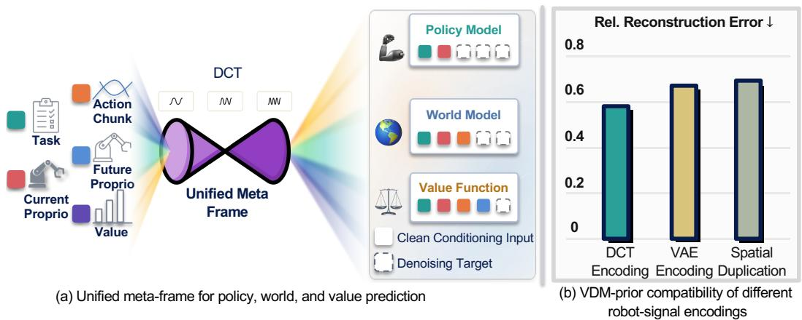

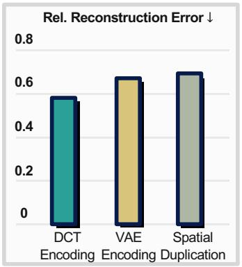  
Figure 1: MetaWAM packs robot signals into one distribution-aware meta-frame. (a) Disjoint DCT bands route signals as inputs or denoising targets for policy, world-model, and value prediction. (b) Frozen-denoiser relative reconstruction error at $\sigma = 1 . 0$ (↓): Spatial Duplication (e.g., Cosmos Policy [5]) and VAE Encoding (e.g., AgiBot-World [7]) require larger corrections, while our DCT Encoding is corrected least.

A straightforward solution injects each robot signal as its own video-like latent frame, either by spatially tiling the raw signal across the frame [5] or by rendering it into an image and re-encoding it through the pretrained VAE [7]; both preserve backbone compatibility but inflate the sequence length and the quadratic attention cost it incurs. Other designs attach dedicated action encoders or decoders [6], improving action modeling at the cost of modifying the pretrained backbone. We view signal injection as a distribution-alignment problem: a useful representation must remain compatible with the VDM prior seen by the pretrained denoiser. As previewed in Fig. 1(b), frequency-domain encoding produces latents that the frozen denoiser corrects far less than spatial encodings.

To examine this design space, we run diagnostic experiments that trace candidate injections through VDM denoising, covering both single-signal injection and multi-signal packing, and measure how strongly a frozen denoiser corrects the injected latent across noise levels. These experiments show that the arrangement of robot signals in latent space measurably affects the denoiser: frequencydomain packing yields latents it corrects far less than spatial tiling or discontinuous canvas layouts. Compactness alone is therefore insufficient; an effective interface must be distribution-aware.

Motivated by these findings, we propose MetaWAM, which folds all heterogeneous robot signals into a single unified meta-frame (Fig. 1(a)). Rather than allocating a latent frame to each signal, MetaWAM assigns every signal, including current and future proprioception, action chunks, task type, and value, to a disjoint frequency-domain channel band within one frame, and lifts the packed coefficients to the spatial latent via an analytical inverse DCT. This produces smooth latent patterns well aligned with the pretrained denoiser, while a single meta-frame becomes a multiplexed carrier for many low-dimensional signals. The design requires no additional action encoder, learned decoder, or modification to the denoising architecture, and recovers each signal analytically at readout.

We instantiate MetaWAM on a Cosmos-Predict2 backbone and evaluate it on RoboCasa, LIBERO, LIBERO-Plus, and three real-world Franka tabletop tasks. MetaWAM exceeds the RoboCasa frameinjection baseline while collapsing multiple robot-signal frames into one. Our contributions are: (1) we recast robot-signal injection as a distribution-aware latent-interface problem for Joint WAMs; (2) we provide diagnostic evidence that frequency-domain packing aligns better with a pretrained VDM prior than spatial signal encodings; and (3) we introduce a unified frequency-domain meta-frame that carries all robot signals in a single decoder-free latent frame without architectural changes.

## 2 Related Work

World Action Models. World Action Models (WAMs) recast robot control as generative modeling over future states and actions [1]. Cascaded WAMs generate or represent future observations first and then recover actions through a separate policy or inverse-dynamics model [2, 3, 8]. Joint WAMs instead couple action and future-state prediction inside one backbone. Cosmos Policy [5] injects actions, proprioception, future states, and values as additional latent frames, preserving the pretrained video architecture; DreamZero [6] uses dedicated action encoders and decoders around a video backbone; and UWM/UVA [9, 10] decouple video and action diffusion schedules to enable mixed robot and video training. Recent efficiency-oriented WAMs reduce inference cost by changing what is denoised or attended to, such as removing future-frame generation at test time [11] or emphasizing action-centered decoding [12]. MetaWAM is orthogonal to these directions: it keeps the pretrained denoising architecture intact but changes how robot signals are represented inside the latent sequence. Rather than treating signal injection as a formatting choice, we study its compati bility with the pretrained VDM prior and introduce a distribution-aware interface.

Latent signal representations. A broad line of work studies how robot or agent signals should be encoded into compact latent forms. Learned schemes include VQ-VAE latent action codes de rived from visual dynamics [13, 14], world-model-grounded latent actions [15], highly compressed discrete action chunks [16], and modality-specific latent positions for proprioception, actions, and future tokens [17]. Transform-based schemes exploit frequency structure: FAST [18] applies 1D DCT to robot action sequences, while wavelet tokenizers [19], FA-VAE [20], and DocPedia [21] use frequency-domain representations for visual or document modeling. MetaWAM differs in target and mechanism: it uses channel-wise 2D DCT bands to pack heterogeneous robot signals directly into the latent space of a pretrained VDM, lifts them back to the spatial domain by analytical iDCT, and recovers them without a learned decoder.

## 3 Motivating Analysis

What kind of robot-signal injection does a pretrained VDM actually accept? We probe candidate injections by a single criterion, VDM-prior compatibility, defined by the relative reconstruction error of a frozen Cosmos-Predict2 denoiser [22] on the injected latent: the denoising residual is normalized by the magnitude of the clean latent. Reference latents are drawn from real RoboCasa observations, and we evaluate this error across noise levels σ. An in-distribution latent needs only small relative corrections; a large residual marks it as off-prior. Fig. 2 and Tab. 1 summarize the schemes and results.

Single-signal injection. We isolate a single signal and compare the three schemes in Fig. 2(a–c): Spatial Duplication (the Cosmos Policy [5] strategy), VAE Encoding (canvas overlay through the VAE [7]), and DCT Encoding (raw DCT coefficients written into a latent frame). Tab. 1(a) reports the denoiser’s relative reconstruction error at every σ. Spatial Duplication, the simplest backbonecompatible choice, incurs the largest corrections: constant row-wise tiling is precisely the pattern a video-trained denoiser pushes away from. VAE Encoding fares no better; although designed to pass cleanly through the VAE, it is still treated as off-prior by the denoiser. DCT Encoding instead spreads the signal into smooth cosine bases and sits closest to the prior, attaining the lowest relative reconstruction error at every $\sigma \leq 5 . 0 $ . What an effective injection must target is compatibility with the denoiser, not merely the encoder a latent passes through.

Multi-signal packing. We use the corresponding action chunks, proprioceptive states, and value labels from the same RoboCasa samples to compare four layouts (Fig. 2(d–g)). Separate Spatial Duplication spatially duplicates each signal into its own latent frame, using three frames in total; its reported error is averaged over these frames. Meta-Quadrants puts all three signals into one frame, assigning each an equally sized spatial region and replicating its values along the channel dimension within that region. Meta-Compact also uses one frame and channel-wise replication, but allocates spatial regions according to signal dimensionality: action chunks occupy a larger region, while proprioception and value occupy smaller ones. These two layouts therefore test whether spatial consolidation alone, with either equal or dimension-dependent allocation, is sufficient. Our Unified Meta-Frame instead assigns signals to disjoint channel bands, writes their values into fixed DCT coefficient slots, and applies a per-channel 2D inverse DCT to form one spatial latent. Signals are separated by channel allocation rather than spatial boundaries.

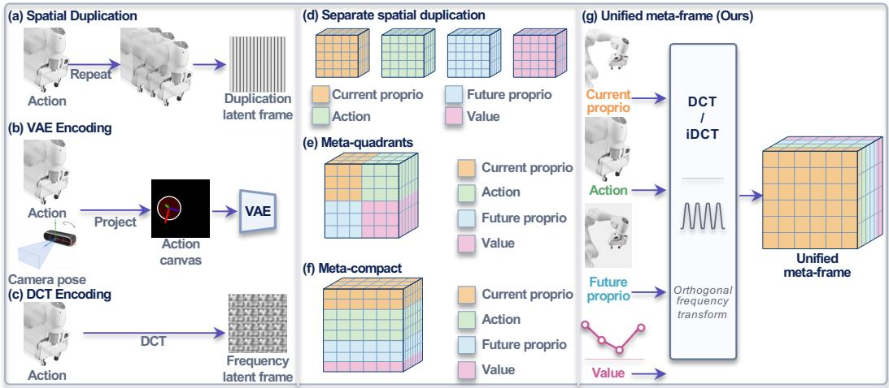

Figure 2: Robot-signal injection schemes used in the diagnostic study. (a–c) Single-signal encodings compare Spatial Duplication, VAE Encoding, and DCT Encoding. (d–g) Multi-signal packings compare Separate Spatial Duplication, Meta-Quadrants, Meta-Compact, and our Unified Meta-Frame, which assigns signals to disjoint channel bands and lifts them to one spatial latent by orthonormal DCT/iDCT.
<table><tr><td>Method</td><td>0.01</td><td>0.05</td><td>0.2</td><td>1.0</td><td>5.0</td></tr><tr><td>Spatial Duplication</td><td>0.0141</td><td>0.0672</td><td>0.2335</td><td>0.6459</td><td>0.8953</td></tr><tr><td>VAE Encoding</td><td>0.0147</td><td>0.0699</td><td>0.2388</td><td>0.6379</td><td>0.8926</td></tr><tr><td>DCT Encoding</td><td>0.0133</td><td>0.0633</td><td>0.2199</td><td>0.5922</td><td>0.8646</td></tr></table>

(a) Single-signal injection.

<table><tr><td>Method</td><td>0.01</td><td>0.05</td><td>0.2</td><td>1.0</td><td>5.0</td></tr><tr><td>Sep. Spatial Dup.</td><td>0.0142</td><td>0.0677</td><td>0.2336</td><td>0.6178</td><td>0.8677</td></tr><tr><td>Meta-Quadrants</td><td>0.0147</td><td>0.0705</td><td>0.2471</td><td>0.6730</td><td>0.9291</td></tr><tr><td>Meta-Compact</td><td>0.0132</td><td>0.0622</td><td>0.2160</td><td>0.6234</td><td>0.9392</td></tr><tr><td>Unified Meta-Frame</td><td>0.0126</td><td>0.0598</td><td>0.2061</td><td>0.5613</td><td>0.8159</td></tr></table>

(b) Multi-signal packing.  
Table 1: VDM-prior compatibility, measured as the relative reconstruction error of a frozen Cosmos-Predict2 [22] at noise level σ (↓ lower is better). Bold marks the best method per σ. †Separate Spatial Duplication is averaged over 3 frames.

Table 1(b) shows that this choice matters beyond frame count. At σ = 1.0, Meta-Quadrants and Meta-Compact incur relative reconstruction errors of 0.6730 and 0.6234, respectively, compared with 0.5613 for our Unified Meta-Frame and 0.6178 for Separate Spatial Duplication. Our layout achieves the lowest error at every tested noise level, combining a single-frame representation with greater frozen-denoiser compatibility.

Takeaway. Two principles follow. First, injection must be distribution-aware, since compactness alone does not guarantee compatibility with the VDM’s natural-video prior. Second, multi-signal WAMs should not spend a full latent frame per low-dimensional signal. MetaWAM further adopts a decoder-free design, recovering signals analytically so that the savings from fewer frames are not offset by added modules. The method below realizes these choices as a unified frequencydomain meta-frame with slot-aware task routing. Further analysis on the Wan-based [23] backbone is provided in the supplementary material.

## 4 Method

We introduce MetaWAM, a World Action Model built around a unified robot-signal latent interface (Fig. 3). Rather than design a new backbone, we rethink how structured robot variables enter an existing pretrained VDM, replacing frame-wise injection with a pair of compact meta-frames: an input meta-frame for robot-state conditioning and an output meta-frame for action, future-state, and value prediction. Each meta-frame exposes its variables not as raw spatial patterns but through structured frequency bands, turning one frame into a multiplexed carrier for many low-dimensional signals while preserving the denoising architecture and removing redundant latent frames.

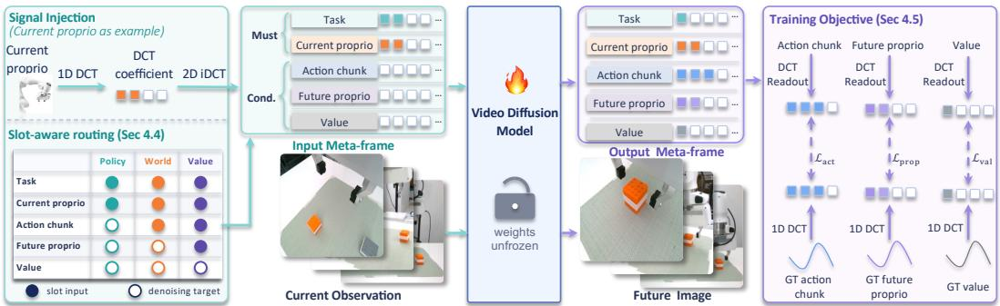  
Figure 3: Overview of MetaWAM. Normalized signals are packed into fixed coefficient slots and lifted by 2D inverse DCT. Slot-aware masks select clean inputs and prediction targets for policy, world-model, and value learning.

## 4.1 Overview: A Unified Robot-Signal Interface

Let a pretrained VDM operate on a latent video sequence $\mathbf { z } \in \mathbb { R } ^ { C \times T \times H \times W }$ , where each temporal slot is a spatial latent frame. Frame-injection WAMs place each robot variable into its own additional frame, forcing every scalar signal to occupy an image-sized frame and inflating T. MetaWAM instead uses the following 8-frame latent sequence:

$$
\begin{array} { r } { \mathbf { z } = ( z _ { \mathrm { i n } } ^ { m } , z _ { t } ^ { w } , z _ { t } ^ { p } , z _ { t } ^ { s } , z _ { \mathrm { o u t } } ^ { m } , z _ { t + H } ^ { w } , z _ { t + H } ^ { p } , z _ { t + H } ^ { s } ) , } \end{array}\tag{1}
$$

where $z _ { \mathrm { i n } } ^ { m }$ and $z _ { \mathrm { o u t } } ^ { m }$ are the input and output meta-frames, and w, p, s index current and future observations from the wrist, primary, and secondary cameras. The input meta-frame carries conditioning information, namely a one-hot task type and the current proprioception $\rho _ { t } .$ , while the output metaframe is the shared prediction interface for action chunks, future proprioception, and value.

This consolidation shortens the sequence. A frame-injection baseline spends a separate frame on each of input proprioception, action, future proprioception, and value; MetaWAM folds input proprioception into the tokenizer’s mandatory blank slot $( z _ { \mathrm { i n } } ^ { m } )$ ) and merges the three output signals into $z _ { \mathrm { o u t } } ^ { m }$ , yielding the 8-frame sequence of Eq. (1): one conditioning meta-frame, six visual frames, one output meta-frame. As self-attention scales quadratically in $T ,$ , this cuts pairwise attention by roughly 47% with the architecture untouched.

## 4.2 Distribution-Aware Spectral Lifting

Broadcasting a robot vector over the spatial grid yields constant patterns; packing values into spatial regions yields discontinuities, which are the failure modes diagnosed in Sec. 3. We therefore encode robot variables in the frequency domain and lift them back to the spatial latent.

Channel-band layout. For each meta-frame we build a sparse coefficient tensor $F \in \mathbb { R } ^ { C \times H \times W }$ whose disjoint channel bands hold the distinct robot signals, one band per signal:

$$
\boldsymbol { F } = \big [ F _ { \mathrm { t a s k } } , F _ { \rho _ { t } } , F _ { a } , F _ { \rho _ { t + H } } , F _ { v } \big ] ,\tag{2}
$$

where the bands form a predefined partition of the latent channels. Let q collect the one-hot task indicator and normalized robot signals. We construct $F = \operatorname { P a c k } ( q )$ by flattening or grouping each signal and directly writing its values into fixed coefficient slots on the $k _ { H } = 0$ row of its channel band; all unused entries are zero. This packing preserves the signal values without a temporal DCT or coefficient truncation. The allocation is fixed across training and inference and introduces no learned parameters.

Spatial lifting. We obtain the spatial meta-frame $z ^ { m } = \mathcal { T } _ { \mathrm { 2 D } } ^ { - 1 } ( F )$ by applying an orthonormal 2D inverse DCT per channel. This distributes the packed coefficients over the $H \times W$ grid through the DCT basis. A spatial 2D DCT on the denoised output meta-frame followed by fixed slot readout gives

$$
\hat { F } = \mathcal { T } _ { \mathrm { 2 D } } ( \hat { z } ^ { m } ) , \qquad ( \hat { a } , \hat { \rho } _ { t + H } , \hat { v } ) = \mathrm { U n p a c k } ( \hat { F } ) ,\tag{3}
$$

where Unpack selects the action, future-proprioception, and value slots and restores their original shapes; task and current-proprioception bands serve as inputs. The selected coefficients directly represent the normalized signals, so no further inverse DCT is applied.

## 4.3 Conditioning-Only Input Meta-Frame

The input meta-frame $z ^ { m }$ in reuses the tokenizer’s mandatory blank slot rather than a dedicated pro prioceptive frame. It follows the same channel-band layout as $z ^ { m }$ out, with task type and current proprioception $\rho _ { t }$ always provided as mandatory conditioning inputs. Other bands are task-dependent: the slot-aware mask in Sec. 4.4 decides whether they serve as clean conditioning signals or denoising targets. Since the tokenizer already reserves a leading blank slot, reusing this otherwise-idle slot makes input-side conditioning effectively free.

## 4.4 Slot-Aware Task Routing

MetaWAM trains policy, world-model, and value prediction in one denoising model. The three tasks share the same robot variables and differ only in causal direction: policy predicts the action from the current state; the world model predicts the future state from state and action; value estimation predicts the return from the full transition. The variables never move between frames; they always occupy the same channel bands of the output meta-frame, and only their role changes per task. We implement this with slot-aware masks. Let $m _ { \pi } , m _ { w } , m _ { v }$ indicate policy, world-model, and value samples; for each sample a band-level mask is defined as $M _ { \mathrm { s l o t } } = \Phi ( m _ { \pi } , m _ { w } , m _ { v } )$ , where Φ deterministically opens a band (clean conditioning) or closes it (denoising target). The mask switches over the partition of Eq. (2), so each signal is switched as an atomic unit. The routing is shown in Fig. 3 (bottom left): a policy sample opens only the task and current-proprioception bands; a world-model sample additionally opens the action band, with the future state still a target; a value sample further opens the future-proprioception band, leaving only value as a target. Such band-level routing is strictly finer than a frame-level mask, which could not open the action band while hiding the co-located value band.

Dual-granularity masking. The routing runs at two granularities. The slot-level mask carries all task semantics on the meta-frame; from it we deterministically derive a single-channel coarse mask for the original video-denoising path, so the six visual frames are conditioned through exactly the interface the pretrained VDM expects. The fine mask carries all task information; the coarse mask carries none and exists only to keep byte-level compatibility with the backbone.

## 4.5 Training Objective

Training follows the standard diffusion denoising objective over the full latent sequence. Given a clean sequence $\mathbf { z } _ { 0 } .$ , we sample noise ϵ and level $\sigma$ and train the denoiser $D _ { \theta }$ under language and video conditioning:

$$
\mathcal { L } _ { \mathrm { d i f f } } = \mathbb { E } _ { \mathbf { z } _ { 0 } , \epsilon , \sigma } \Big [ w ( \sigma ) \big \| D _ { \theta } ( \mathbf { z } _ { 0 } + \sigma \epsilon , \sigma , c , M ) - \mathbf { z } _ { 0 } \big \| _ { 2 } ^ { 2 } \Big ] .\tag{4}
$$

We additionally supervise the robot signals recovered from the predicted output meta-frame using Eq. (3):

$$
\begin{array} { r l } & { \mathcal { L } = \mathcal { L } _ { \mathrm { d i f f } } + \lambda _ { \mathrm { a c t } } \mathcal { L } _ { \mathrm { a c t } } + \lambda _ { \mathrm { p r o p } } \mathcal { L } _ { \mathrm { p r o p } } } \\ & { ~ + \lambda _ { \mathrm { v a l } } \mathcal { L } _ { \mathrm { v a l } } + \lambda _ { \mathrm { o f f } } \mathcal { L } _ { \mathrm { o f f } } . } \end{array}\tag{5}
$$

The three signal terms are Huber losses $( \delta = 1 )$ , averaged over signal elements and eligible samples: policy samples for action, policy/world samples for future proprioception, and all tasks for value. Targets are read from the ground-truth meta-frame and directly represent normalized signals. Coefficients outside the allocated signal slots are penalized by

$$
\mathcal { L } _ { \mathrm { o f f } } = \mathbb { E } \Big [ \mathrm { m e a n } _ { C , H , W } \Big | \big ( 1 - S \big ) \odot \hat { F } \Big | \Big ] ,\tag{6}
$$

where S marks allocated coefficient positions, the expectation covers all tasks, and $\lambda _ { \mathrm { o f f } } = 1 0 ^ { - 4 }$ DCT and slot readout remain differentiable, so all terms backpropagate to the denoiser without a learned decoding head.

## 5 Experiments

We evaluate MetaWAM on RoboCasa [24], LIBERO [25], LIBERO-Plus [26], and three real-world Franka tabletop tasks. RoboCasa covers 24 static kitchen tasks with 50 human demonstrations per task; LIBERO covers four manipulation suites, and LIBERO-Plus tests robustness to seven perturbation categories. We initialize Cosmos-Predict2-2B-Video2World [22]. For RoboCasa, we use AdamW with learning rate $1 0 ^ { - 6 }$ , batch size 64 per GPU, and four gradient-accumulation steps on four NVIDIA H200 GPUs.

## 5.1 Evaluation in Simulation Environments

RoboCasa. We first evaluate MetaWAM on Robo-Casa under the low-demonstration regime. Following the Cosmos Policy evaluation protocol, each task is evaluated over 50 trials across five evaluation scenes with different floor plans and visual styles, with 10 trials per scene; we report the average success rate across all 24 tasks and 3 random seeds, totaling 3600 trials. As shown in Tab. 2, MetaWAM reaches 68.9% average success using only 50 demonstrations per task, outperforming the frame-injection Cosmos Policy baseline under the

<table><tr><td>Method</td><td>Demos / Task</td><td>Avg. SR (%)</td></tr><tr><td>UVA [10]</td><td>50</td><td>50.0</td></tr><tr><td>DP-VLA [27]</td><td>3000</td><td>57.3</td></tr><tr><td>UWM [9]</td><td>1000</td><td>60.8</td></tr><tr><td>π0 [28]</td><td>300</td><td>62.5</td></tr><tr><td>GR00T-N1.5 [29]</td><td>300</td><td>64.1</td></tr><tr><td>Video Policy [30]</td><td>300</td><td>66.0</td></tr><tr><td>FLARE [31]</td><td>300</td><td>66.4</td></tr><tr><td>Cosmos Policy [5]</td><td>50</td><td>67.1</td></tr><tr><td>MetaWAM (ours)</td><td>50</td><td>68.9</td></tr></table>

Table 2: RoboCasa benchmark results.

same data setting and comparing favorably with baselines trained on far more demonstrations. The unified meta-frame interface thus improves policy performance while collapsing the per-signal frames into a single carrier, rather than trading accuracy for compactness.

LIBERO and LIBERO-Plus. MetaWAM achieves 98.1% average success across the Spatial, Object, Goal, and Long suites, reported in the Original column of Table 3. Training and evaluation protocols are provided in the supplementary material. To examine performance beyond the standard benchmark, we evaluate seven perturbation categories: camera viewpoint, robot initial state, language instruction, lighting, background, sensor noise, and object layout. Table 3 compares our results with results from [32]. MetaWAM reaches 83.44% overall success, exceeding the reported Cosmos Policy result of 82.2% by 1.24 percentage points and attaining the highest overall score among the listed WAMs. Its camera and language scores reach 82.93% and 89.56%, improving on Cosmos Policy by 7.13 and 7.86 points, respectively. It also leads the listed methods under lighting (97.81%), sensor noise (94.87%), and layout (86.73%) perturbations. These gains span five of the seven categories, although robustness remains uneven: background (72.68%) and robot initial-state changes (59.90%) are weaker than Cosmos Policy. The comparison highlights both the robustness of the compact interface across several perturbations and the remaining sensitivity to visual context and initial robot configuration.

## 5.2 Real-World Experiments

We evaluate three precision-sensitive tasks with a 7-DoF Franka Panda: Sweep moves a block into a dustpan, Place Cup aligns a cup with a coaster, and Build Block stacks cubes. The OOD setting

<table><tr><td>Model</td><td colspan="8">Original Camera Robot Lang. Light BG Noise Layout Total</td></tr><tr><td colspan="8">VLAs</td></tr><tr><td>π0 [28]</td><td>94.2</td><td>13.8</td><td>6.0</td><td>58.8</td><td>85.081.4</td><td></td><td>79.0</td><td>68.9 53.6</td></tr><tr><td>π₀-FAST [18]</td><td>85.5</td><td>65.1</td><td>21.6</td><td>61.0</td><td>73.2 73.2</td><td>74.4</td><td>68.8</td><td>61.6</td></tr><tr><td>OpenVLA-OFT [33]</td><td>97.6</td><td>55.6</td><td>21.7</td><td>81.0</td><td>92.7 91.0</td><td>78.6</td><td>68.7</td><td>67.9</td></tr><tr><td>UniVLA [34]</td><td>95.2</td><td>1.8</td><td>46.2</td><td>69.6</td><td>69.0 81.0</td><td></td><td>21.2 31.9</td><td>42.9</td></tr><tr><td>RIPT-VLA [35]</td><td>97.5</td><td>55.2</td><td>31.2</td><td>77.6</td><td>88.4 91.6</td><td></td><td>73.5</td><td>74.2 68.4</td></tr><tr><td>X-VLA [36]</td><td>98.1</td><td>23.4</td><td>89.7</td><td>75.7</td><td>88.2 96.0</td><td></td><td>62.7</td><td>71.8 71.4</td></tr><tr><td>HoloBrain0-GD [37]</td><td>96.7</td><td>65.5</td><td>58.2</td><td>78.7</td><td>88.1 90.3</td><td></td><td>66.9</td><td>79.5 74.0</td></tr><tr><td>ABot-M0 [38]</td><td>98.6</td><td>60.4</td><td>67.9</td><td>86.4</td><td>96.2</td><td>91.6</td><td>86.4 82.6</td><td>80.5</td></tr><tr><td colspan="9"></td></tr><tr><td>VLA-JEPA [39]</td><td>97.2</td><td>64.2</td><td>VLA + WM 67.7</td><td>88.1</td><td>91.8 93.4</td><td></td><td>65.8</td><td>83.9 77.9</td></tr><tr><td colspan="9"></td></tr><tr><td>GE-Act [40]</td><td>94.4</td><td>60.7</td><td>WAMs 77.0</td><td>77.4</td><td>95.8 86.0</td><td></td><td>90.9</td><td>80.2 80.3</td></tr><tr><td>Cosmos Policy [5]</td><td>98.5</td><td>75.8</td><td>63.3</td><td>81.7</td><td>96.5</td><td>88.9</td><td>82.2</td><td>82.2</td></tr><tr><td>Fast-WAM [11]</td><td>97.6</td><td>16.4</td><td>44.5</td><td>68.9</td><td>78.2</td><td>53.7</td><td>92.7 37.7</td><td>60.7</td></tr><tr><td>MetaWAM (ours)</td><td>98.1</td><td>82.9</td><td>59.9</td><td>89.5</td><td>97.8 72.6</td><td></td><td>94.8 86.7</td><td>51.5 83.4</td></tr></table>

Table 3: LIBERO-Plus success rates (%). Baselines are reported in Table 4 of [32]; Original denotes standard LIBERO. Lang.: language; BG: background. Bold marks the best result per column.

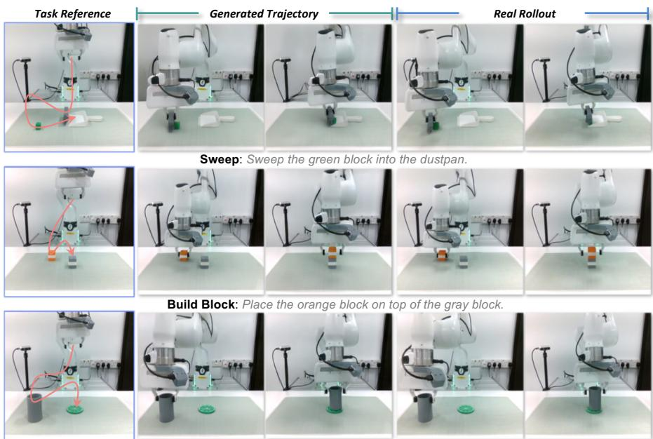  
Place Cup: Place the cup on the green coaster.

Figure 4: Real-world rollouts. For each of the three real-world tasks, we show a task reference, a representative generated trajectory, and a representative real rollout.

adds distractors, unseen object placements, and background changes. MetaWAM reaches 85.0% ID and 68.3% OOD success, improving over Cosmos Policy in both settings (Table 4); Fig. 4 shows representative rollouts.

## 5.3 Ablation Study

All ablations are trained and evaluated on RoboCasa under the same 50-demonstration-per-task setting and evaluation protocol as the main simulation experiments. We report the average success rate (SR) across the 24 RoboCasa tasks.

Robot-signal encoding. Table 5 compares success and inference latency. Separate signal frames require 0.479 s per query; all compact interfaces reduce this to 0.291 s. Our frequency-domain interface achieves the highest success (68.9%), exceeding the spatial quadrant and compact-region packings at the same latency.

<table><tr><td rowspan="2">Method</td><td colspan="4">In-Distribution (ID)</td><td colspan="4">Out-of-Distribution (OOD)</td></tr><tr><td>Sweep</td><td>Place Cup</td><td>Build Block</td><td>SR%</td><td>Sweep</td><td>Place Cup</td><td>Build Block</td><td>SR%</td></tr><tr><td>π₀ [28]</td><td>45.0</td><td>50.0</td><td>55.0</td><td>50.0</td><td>35.0</td><td>35.0</td><td>40.0</td><td>36.7</td></tr><tr><td>π0.5 [41]</td><td>70.0</td><td>70.0</td><td>75.0</td><td>71.7</td><td>45.0</td><td>45.0</td><td>50.0</td><td>46.7</td></tr><tr><td>Cosmos Policy [5]</td><td>75.0</td><td>80.0</td><td>80.0</td><td>78.3</td><td>60.0</td><td>60.0</td><td>70.0</td><td>63.3</td></tr><tr><td>MetaWAM (Ours)</td><td>80.0</td><td>85.0</td><td>90.0</td><td>85.0</td><td>65.0</td><td>65.0</td><td>75.0</td><td>68.3</td></tr></table>

Table 4: Real-world success rates (%) over 20 trials per task under ID and OOD settings.

<table><tr><td rowspan="2"></td><td rowspan="2">Fr. (%)↑</td><td rowspan="2">SR</td><td rowspan="2">Latency</td><td colspan="2">Signal recovery</td><td rowspan="2"></td><td colspan="2">World/value prediction</td></tr><tr><td>Gain↑</td><td>Rel.  $L _ { 2 \downarrow }$ </td><td>PSNR↑ Prop. NEE↓</td><td>Value MAE↓</td></tr><tr><td>Encoding Separate Spatial Dup.</td><td>11</td><td>67.1</td><td>(s)↓ 0.479</td><td>0.6361</td><td>0.3657</td><td>19.27</td><td>0.0250</td><td>0.072</td></tr><tr><td>Meta-Quadrants</td><td>8</td><td>65.9</td><td>0.291</td><td>0.6032</td><td>0.3988</td><td>18.86</td><td>0.0499</td><td>0.081</td></tr><tr><td>Meta-Compact</td><td>8</td><td>68.1</td><td>0.291</td><td>0.6563</td><td>0.3345</td><td>19.41</td><td>0.0193</td><td>0.065</td></tr><tr><td>Unified Meta-Frame</td><td>8</td><td>68.9</td><td>0.291</td><td>0.7146</td><td>0.2928</td><td>19.95</td><td>0.0143</td><td>0.046</td></tr></table>

Table 5: Ablation on robot-signal encoding. Fr.: latent frames per sequence. Signal recovery is measured with the frozen Cosmos-Predict2 denoiser of Tab. 1; world/value prediction is evaluated with the fine-tuned models. Prop. NEE: normalized error of the predicted future proprioception.

Signal recovery after denoising. A small latent correction does not by itself show that the robot signal survives denoising. To test this, we decode the robot signal from the frozen-denoiser outputs of Sec. 3, using only the encoded carrier, and report two signal-space metrics averaged over the five noise levels: target-direction gain, the amplitude retained along the clean-signal direction, and relative readout $L _ { 2 } ,$ , the normalized error of the decoded signal. Both rank the four layouts in the same order as SR, with our unified meta-frame best (Tab. 5). This agreement supports the diagnostic as a comparative measure of frozen-VDM compatibility; we do not use it as a quantitative predictor of SR.

World and value prediction. Policy gains do not come at the expense of the other tasks: among the four layouts, the unified meta-frame also attains the highest future-view PSNR and the lowest future-proprioception NEE and value MAE (Tab. 5).

## 6 Conclusion

MetaWAM treats robot-signal injection as a distribution-alignment problem. Frozen-denoiser diagnostics favor frequency-domain packing over spatial duplication and region-based alternatives. Fixed coefficient slots and analytical DCT readout provide a compact interface for joint policy, world-model, and value learning. Results on RoboCasa, LIBERO, LIBERO-Plus, and real-world Franka tasks demonstrate the interface’s efficiency and applicability.

Limitations. The fixed band layout and loss weights may require adaptation when task importance or signal scales vary substantially. Instruction following remains limited by the Cosmos-Predict2 backbone [22]; stronger language grounding is a useful direction. LIBERO-Plus also exposes sensitivity to background and robot initial-state changes.

Acknowledgment. Guoqiang Liang and Yiqi Lin were supported by the NUS Guangzhou Research Translation and Innovation Institute (GRTII)-Affiliated PhD Scholarship Program.

## References

[1] S. Wang, J. Shi, Z. Fu, X. He, F. Liu, C. Yang, Y. Zhou, Z. Fei, J. Gong, J. Fu, et al. World action models: The next frontier in embodied ai. arXiv preprint arXiv:2605.12090, 2026.

[2] Y. Du, S. Yang, B. Dai, H. Dai, O. Nachum, J. Tenenbaum, D. Schuurmans, and P. Abbeel. Learning universal policies via text-guided video generation. Advances in neural information processing systems, 36:9156–9172, 2023.

[3] J. Bruce, M. D. Dennis, A. Edwards, J. Parker-Holder, Y. Shi, E. Hughes, M. Lai, A. Mavalankar, R. Steigerwald, C. Apps, et al. Genie: Generative interactive environments. In Forty-first International Conference on Machine Learning, 2024.

[4] X. Liu, Z. Bai, H. Ci, K. Y. Ma, and M. Z. Shou. World-vla-loop: Closed-loop learning of video world model and vla policy. arXiv preprint arXiv:2602.06508, 2026.

[5] M. J. Kim, Y. Gao, T.-Y. Lin, Y.-C. Lin, Y. Ge, G. Lam, P. Liang, S. Song, M.-Y. Liu, C. Finn, et al. Cosmos policy: Fine-tuning video models for visuomotor control and planning. arXiv preprint arXiv:2601.16163, 2026.

[6] S. Ye, Y. Ge, K. Zheng, S. Gao, S. Yu, G. Kurian, S. Indupuru, Y. L. Tan, C. Zhu, J. Xiang, et al. World action models are zero-shot policies. arXiv preprint arXiv:2602.15922, 2026.

[7] Q. Bu, J. Cai, L. Chen, X. Cui, Y. Ding, S. Feng, S. Gao, X. He, X. Hu, X. Huang, et al. Agibot world colosseo: A large-scale manipulation platform for scalable and intelligent embodied systems. arXiv preprint arXiv:2503.06669, 2025.

[8] J. Jang, S. Ye, Z. Lin, J. Xiang, J. Bjorck, Y. Fang, F. Hu, S. Huang, K. Kundalia, Y.-C. Lin, et al. Dreamgen: Unlocking generalization in robot learning through video world models. arXiv preprint arXiv:2505.12705, 2025.

[9] C. Zhu, R. Yu, S. Feng, B. Burchfiel, P. Shah, and A. Gupta. Unified world models: Coupling video and action diffusion for pretraining on large robotic datasets. arXiv preprint arXiv:2504.02792, 2025.

[10] S. Li, Y. Gao, D. Sadigh, and S. Song. Unified video action model. arXiv preprint arXiv:2503.00200, 2025.

[11] T. Yuan, Z. Dong, Y. Liu, and H. Zhao. Fast-wam: Do world action models need test-time future imagination? arXiv preprint arXiv:2603.16666, 2026.

[12] A. Ye, B. Wang, C. Ni, G. Huang, G. Zhao, H. Li, H. Li, J. Li, J. Lv, J. Liu, et al. Gigaworldpolicy: An efficient action-centered world–action model. arXiv preprint arXiv:2603.17240, 2026.

[13] S. Ye, J. Jang, B. Jeon, S. Joo, J. Yang, B. Peng, A. Mandlekar, R. Tan, Y.-W. Chao, B. Y. Lin, et al. Latent action pretraining from videos. arXiv preprint arXiv:2410.11758, 2024.

[14] Y. Chen, Y. Ge, Y. Li, Y. Ge, M. Ding, Y. Shan, and X. Liu. Moto: Latent motion token as the bridging language for robot manipulation. In Proceedings of the IEEE/CVF international conference on computer vision, 2025.

[15] B. Tharwat, Y. Nasser, A. Abouzeid, and I. Reid. Latent action pretraining through world modeling. arXiv preprint arXiv:2509.18428, 2025.

[16] C. Yang, D. Liconti, and R. K. Katzschmann. Vq-ace: Efficient policy search for dexterous robotic manipulation via action chunking embedding. arXiv preprint arXiv:2411.03556, 2024.

[17] S. Li, C. Liu, X. Xu, S. Y. Yeo, and X. Yang. Future-aware interaction network for motion forecasting. In Proceedings of the IEEE/CVF International Conference on Computer Vision, pages 7505–7515, 2025.

[18] K. Pertsch, K. Stachowicz, B. Ichter, D. Driess, S. Nair, Q. Vuong, O. Mees, C. Finn, and S. Levine. Fast: Efficient action tokenization for vision-language-action models. arXiv preprint arXiv:2501.09747, 2025.

[19] Z. Zhu and R. Soricut. Wavelet-based image tokenizer for vision transformers. arXiv preprint arXiv:2405.18616, 2024.

[20] T. Medi, H.-Y. Wang, A. Rampini, and M. Keuper. Favae-effective frequency aware latent tokenizer. In NeurIPS 2025 Workshop: Reliable MLfrom Unreliable Data, 2025.

[21] H. Feng, Q. Liu, H. Liu, J. Tang, W. Zhou, H. Li, and C. Huang. Docpedia: Unleashing the power of large multimodal model in the frequency domain for versatile document understanding. Science China Information Sciences, 67(12):220106, 2024.

[22] N. Agarwal, A. Ali, M. Bala, Y. Balaji, E. Barker, T. Cai, P. Chattopadhyay, Y. Chen, Y. Cui, Y. Ding, et al. Cosmos world foundation model platform for physical ai. arXiv preprint arXiv:2501.03575, 2025.

[23] T. Wan, A. Wang, B. Ai, B. Wen, C. Mao, C.-W. Xie, D. Chen, F. Yu, H. Zhao, J. Yang, J. Zeng, J. Wang, J. Zhang, J. Zhou, J. Wang, J. Chen, K. Zhu, K. Zhao, K. Yan, L. Huang, M. Feng, N. Zhang, P. Li, P. Wu, R. Chu, R. Feng, S. Zhang, S. Sun, T. Fang, T. Wang, T. Gui, T. Weng, T. Shen, W. Lin, W. Wang, W. Wang, W. Zhou, W. Wang, W. Shen, W. Yu, X. Shi, X. Huang, X. Xu, Y. Kou, Y. Lv, Y. Li, Y. Liu, Y. Wang, Y. Zhang, Y. Huang, Y. Li, Y. Wu, Y. Liu, Y. Pan, Y. Zheng, Y. Hong, Y. Shi, Y. Feng, Z. Jiang, Z. Han, Z.-F. Wu, and Z. Liu. Wan: Open and advanced large-scale video generative models. arXiv preprint arXiv:2503.20314, 2025.

[24] S. Nasiriany, A. Maddukuri, L. Zhang, A. Parikh, A. Lo, A. Joshi, A. Mandlekar, and Y. Zhu. Robocasa: Large-scale simulation of everyday tasks for generalist robots. arXiv preprint arXiv:2406.02523, 2024.

[25] B. Liu, Y. Zhu, C. Gao, Y. Feng, Q. Liu, Y. Zhu, and P. Stone. Libero: Benchmarking knowledge transfer for lifelong robot learning. Advances in Neural Information Processing Systems, 36:44776–44791, 2023.

[26] S. Fei, S. Wang, J. Shi, Z. Dai, J. Cai, P. Qian, L. Ji, X. He, S. Zhang, Z. Fei, et al. Libero-plus: In-depth robustness analysis of vision-language-action models. arXiv preprint arXiv:2510.13626, 2025.

[27] B. Han, J. Kim, and J. Jang. A dual process vla: Efficient robotic manipulation leveraging vlm. arXiv preprint arXiv:2410.15549, 2024.

[28] K. Black, N. Brown, D. Driess, A. Esmail, M. Equi, C. Finn, N. Fusai, L. Groom, K. Hausman, B. Ichter, et al. pi 0: A vision-language-action flow model for general robot control. arXiv preprint arXiv:2410.24164, 2024.

[29] J. Bjorck, F. Castaneda, N. Cherniadev, X. Da, R. Ding, L. Fan, Y. Fang, D. Fox, F. Hu,˜ S. Huang, et al. Gr00t n1: An open foundation model for generalist humanoid robots. arXiv preprint arXiv:2503.14734, 2025.

[30] J. Liang, P. Tokmakov, R. Liu, S. Sudhakar, P. Shah, R. Ambrus, and C. Vondrick. Video generators are robot policies. arXiv preprint arXiv:2508.00795, 2025.

[31] R. Zheng, J. Wang, S. Reed, J. Bjorck, Y. Fang, F. Hu, J. Jang, K. Kundalia, Z. Lin, L. Magne, et al. Flare: Robot learning with implicit world modeling. arXiv preprint arXiv:2505.15659, 2025.

[32] Z. Zhang, Z. Li, B. Rahmati, R. H. Yang, Y. Ma, A. Rasouli, S. Pakdamansavoji, Y. Wu, L. Zhang, T. Cao, et al. Do world action models generalize better than vlas? a robustness study. arXiv preprint arXiv:2603.22078, 2026.

[33] M. J. Kim, C. Finn, and P. Liang. Fine-tuning vision-language-action models: Optimizing speed and success. arXiv preprint arXiv:2502.19645, 2025.

[34] Q. Bu, Y. Yang, J. Cai, S. Gao, G. Ren, M. Yao, P. Luo, and H. Li. Univla: Learning to act anywhere with task-centric latent actions. arXiv preprint arXiv:2505.06111, 2025.

[35] S. Tan, K. Dou, Y. Zhao, and P. Krahenb ¨ uhl. Interactive post-training for Vision-Language- ¨ Action models. arXiv preprint arXiv:2505.17016, 2025.

[36] J. Zheng, J. Li, Z. Wang, D. Liu, X. Kang, Y. Feng, Y. Zheng, J. Zou, Y. Chen, J. Zeng, Y.-Q. Zhang, J. Pang, J. Liu, T. Wang, and X. Zhan. X-VLA: Soft-prompted transformer as scalable cross-embodiment Vision-Language-Action model. arXiv preprint arXiv:2510.10274, 2025.

[37] X. Lin, T. Lin, Y. Du, H. Xie, Y. Jin, J. Li, S. Wu, Q. Wang, M. Li, M. Zhao, Z. Li, C. Huang, H. Bi, L. Huang, and Z. Su. HoloBrain-0 technical report. arXiv preprint arXiv:2602.12062, 2026.

[38] Y. Yang, S. Zeng, T. Lin, X. Chang, D. Qi, J. Xiao, H. Liu, R. Chen, Y. Chen, D. Huo, F. Xiong, X. Wei, Z. Ma, and M. Xu. ABot-M0: VLA foundation model for robotic manipulation with action manifold learning. arXiv preprint arXiv:2602.11236, 2026.

[39] J. Sun, W. Zhang, Z. Qi, S. Ren, Z. Liu, H. Zhu, G. Sun, X. Jin, and Z. Chen. VLA-JEPA: Enhancing Vision-Language-Action model with latent world model. arXiv preprint arXiv:2602.10098, 2026.

[40] Y. Liao, P. Zhou, S. Huang, D. Yang, S. Chen, Y. Jiang, Y. Hu, J. Cai, S. Liu, J. Luo, L. Chen, S. Yan, M. Yao, and G. Ren. Genie envisioner: A unified world foundation platform for robotic manipulation. arXiv preprint arXiv:2508.05635, 2025.

[41] P. Intelligence, K. Black, N. Brown, J. Darpinian, K. Dhabalia, D. Driess, A. Esmail, M. Equi, C. Finn, N. Fusai, et al. $p i _ { 0 . 5 } \colon$ a vision-language-action model with open-world generalization. arXiv preprint arXiv:2504.16054, 2025.

[42] C. Chi, Z. Xu, S. Feng, E. Cousineau, Y. Du, B. Burchfiel, R. Tedrake, and S. Song. Diffusion policy: Visuomotor policy learning via action diffusion. The International Journal ofRobotics Research, 44(10-11):1684–1704, 2025.

[43] Z. Hou, T. Zhang, Y. Xiong, H. Duan, H. Pu, R. Tong, C. Zhao, X. Zhu, Y. Qiao, J. Dai, et al. Dita: Scaling diffusion transformer for generalist vision-language-action policy. In Proceedings of the IEEE/CVF International Conference on Computer Vision, pages 7686– 7697, 2025.

[44] W. Li, R. Zhang, R. Shao, J. He, and L. Nie. Cogvla: Cognition-aligned vision-languageaction models via instruction-driven routing & sparsification. Advances in neural information processing systems, 38:137646–137675, 2026.

[45] M. J. Kim, K. Pertsch, S. Karamcheti, T. Xiao, A. Balakrishna, S. Nair, R. Rafailov, E. Foster, G. Lam, P. Sanketi, et al. Openvla: An open-source vision-language-action model. arXiv preprint arXiv:2406.09246, 2024.

## A More Details of Motivation Analysis

## A.1 Experiment Details

All motivating-analysis experiments are conducted using samples from the RoboCasa dataset [24] released with Cosmos Policy [5]. For the single-signal analysis, we randomly select 30 action chunks from distinct episodes and compare different ways of injecting this low-dimensional signal into the latent space. For the multi-signal packing analysis, we use the corresponding action chunks, proprioceptive states, and value labels to construct packed meta-frame variants, allowing us to evaluate the distributional compatibility of different multi-signal encoding schemes under the same pretrained video diffusion model.

We compare three spatial packing baselines against our frequency-domain meta-frame. Sep. Spatial Dup. follows the Cosmos Policy implementation, where different robot-related signals are injected into separate latent frames by spatially duplicating each signal across the latent grid. Meta-Quadrants packs multiple signals into a single latent frame by assigning each signal to an equally sized spatial region, and then replicating the signal values along the channel dimension within its assigned region. Meta-Compact also uses a single latent frame but allocates spatial regions according to signal dimensionality: longer signals, such as action chunks, occupy larger regions, while shorter signals, such as proprioception and value, use smaller regions. As in Meta-Quadrants, the assigned signal values are replicated along the channel dimension within each spatial region.

We evaluate five diffusion noise levels, and for each noise level σ, we repeat the denoising evaluation five times with independently sampled noise and report the average across trials.

## A.2 Cross-Backbone Analysis on Wan2.1 and Wan2.2

To further examine whether the observed advantage of frequency-domain encoding is specific to Cosmos-Predict2 [22], we conduct the same motivating analysis on two additional video diffusion backbones from the Wan series [23]: Wan2.1-I2V-14B and Wan2.2-TI2V-5B. As shown in Tab. 6 and Tab. 7, DCT Encoding consistently achieves lower denoiser reconstruction error than spatial duplication and VAE-based encoding in the single-signal injection setting, while our Unified Meta-Frame outperforms all spatial packing baselines in the multi-signal packing setting. These results demonstrate that the benefit of frequency-domain signal injection is not tied to a particula model size, video-diffusion backbone, or training objective. Specifically, the same trend holds across Wan2.1-I2V-14B and Wan2.2-TI2V-5B, which are trained with flow matching, as well as Cosmos-Predict2, which follows an EDM-style residual denoising formulation. This cross-backbone con sistency further supports our claim that DCT-based meta-frames provide a more VDM-compatible interface for injecting low-dimensional robot signals into pretrained video diffusion models.

<table><tr><td>Method</td><td>0.2</td><td>0.4</td><td>0.6</td><td>0.8</td><td>0.9</td></tr><tr><td>Spatial Duplication</td><td>0.8858</td><td>0.9883</td><td>1.0092</td><td>1.0434</td><td>1.0951</td></tr><tr><td>VAE Encoding</td><td>0.7534</td><td>0.8993</td><td>0.9891</td><td>1.0478</td><td>1.0989</td></tr><tr><td>DCT Encoding</td><td></td><td>0.7701 0.8258</td><td>0.9053</td><td>0.9943</td><td>1.0902</td></tr></table>

(a) Single-signal injection.

<table><tr><td>Method</td><td>0.2</td><td>0.4</td><td>0.6</td><td>0.8</td><td>0.9</td></tr><tr><td>Sep. Spatial Dup.</td><td>0.9029</td><td>0.9944</td><td>1.0194</td><td>1.0519</td><td>1.1004</td></tr><tr><td>Meta-Quadrants</td><td>0.9182</td><td>1.0005</td><td>1.0271</td><td>1.0580</td><td>1.1047</td></tr><tr><td>Meta-Compact</td><td>0.8467</td><td>0.9990</td><td>1.0226</td><td>1.0540</td><td>1.1024</td></tr><tr><td>Unified Meta-Frame 0.7144 0.8710 0.9505</td><td></td><td></td><td></td><td>5 1.0226 1.0988</td><td></td></tr></table>

(b) Multi-signal packing.  
Table 6: Wan2.1-I2V-14B VDM-prior compatibility, measured by the relative reconstruction error of the frozen denoiser at noise level σ (↓ lower is better). Bold indicates the best method at each σ among the listed methods. †Sep. Spatial Dup. averages the reconstruction error over separate action, proprioception, and value latent frames.

## B Additional Experimental Details

## B.1 LIBERO Simulation Benchmark

The LIBERO benchmark [25] includes four primary task suites: LIBERO-Spatial, LIBERO-Object, LIBERO-Goal, and LIBERO-Long. Each task suite provides a training dataset of 500 demonstrations in total, covering 10 tasks with 50 demonstrations per task. We follow the standard evaluation protocol used by prior works [5, 45]. For each suite, success rates are averaged over 500 evaluation trials, corresponding to 10 tasks with 50 episodes per task. We evaluate each method with three random seeds, resulting in 6000 evaluation trials in total across the four LIBERO suites. We train MetaWAM on LIBERO for 12K optimization steps using 4 NVIDIA H200 GPUs with a global batch size of 1200, requiring 56 hours of wall-clock training time. The policy predicts an action chunk of 16 timesteps, and we execute all steps before re-querying the policy, following the setting of Cosmos Policy [5].

<table><tr><td>Method</td><td>0.2</td><td>0.4</td><td>0.6</td><td>0.8</td><td>0.9</td></tr><tr><td>Spatial Duplication</td><td>0.9777</td><td>1.0706</td><td>1.1058</td><td>1.1566</td><td>1.2187</td></tr><tr><td>VAE Encoding</td><td>0.7537</td><td>1.0241</td><td>1.0659</td><td>1.1025</td><td>1.1445</td></tr><tr><td>DCT Encoding</td><td>0.7059</td><td>0.8662</td><td>0.9572</td><td>1.0419</td><td>1.0992</td></tr></table>

(a) Single-signal injection.

<table><tr><td>Method</td><td>0.2</td><td>0.4</td><td>0.6</td><td>0.8</td><td>0.9</td></tr><tr><td>Sep. Spatial Dup.†</td><td>0.9942</td><td>1.0768</td><td>1.1204</td><td>1.1748</td><td>1.2603</td></tr><tr><td>Meta-Quadrants</td><td>1.0030</td><td>1.0814</td><td>1.1188</td><td>1.1683</td><td>1.2482</td></tr><tr><td>Meta-Compact</td><td>1.0461</td><td>1.1625</td><td>1.2384</td><td>1.3167</td><td>1.4663</td></tr><tr><td>Unified Meta-Frame</td><td>0.7647</td><td>0.9213</td><td>1.0011</td><td>1.0683</td><td>1.1307</td></tr></table>

(b) Multi-signal packing.

Table 7: Wan2.2-TI2V-5B VDM-prior compatibility, measured by the relative reconstruction error of the frozen denoiser at noise level σ (↓ lower is better). Bold indicates the best method at each σ among the listed methods. †Sep. Spatial Dup. averages the reconstruction error over separate action, proprioception, and value latent frames.
<table><tr><td>Method</td><td>Spatial</td><td>Object</td><td>Goal</td><td>Long</td><td>Average</td></tr><tr><td>Diffusion Policy [42]</td><td>78.3</td><td>92.5</td><td>68.3</td><td>50.5</td><td>72.4</td></tr><tr><td>Dita [43]</td><td>97.4</td><td>94.8</td><td>93.2</td><td>83.6</td><td>92.3</td></tr><tr><td>π₀ [28]</td><td>96.8</td><td>98.8</td><td>95.8</td><td>85.2</td><td>94.2</td></tr><tr><td>UniVLA [34]</td><td>96.5</td><td>96.8</td><td>95.6</td><td>92.0</td><td>95.2</td></tr><tr><td>π0.5 [41]</td><td>98.8</td><td>98.2</td><td>98.0</td><td>92.4</td><td>96.9</td></tr><tr><td>OpenVLA-OFT [33]</td><td>97.6</td><td>98.4</td><td>97.9</td><td>94.5</td><td>97.1</td></tr><tr><td>CogVLA [44]</td><td>98.6</td><td>98.8</td><td>96.6</td><td>95.4</td><td>97.4</td></tr><tr><td>Cosmos Policy [5]</td><td>98.1</td><td>100.0</td><td>98.2</td><td>97.6</td><td>98.5</td></tr><tr><td>MetaWAM (ours)</td><td>99.0</td><td>99.8</td><td>97.4</td><td>96.0</td><td>98.1</td></tr></table>

Table 8: LIBERO simulation benchmark results.

## B.2 Training Details and Real-Robot Setup

RoboCasa Training Details. We train MetaWAM on RoboCasa for 12K optimization steps using 4 NVIDIA H200 GPUs with a global batch size of 1024, requiring 64 hours of wall-clock training time. All parameters of the base Cosmos-Predict2 [22] model are fully fine-tuned. The policy predicts an action chunk of 32 timesteps, and we execute 16 steps before re-querying the policy.

Real-World Franka Training Details. For the real-world Franka experiments, we train MetaWAM for 8K optimization steps using 4 NVIDIA H200 GPUs with a global batch size of 1024, requiring approximately 47 hours of wall-clock training time. We use the same computational resources for all baselines, including $\pi _ { 0 }$ [28], $\pi _ { 0 . 5 }$ [41], and Cosmos Policy [5]. We train the policy with an action chunk size of 16 timesteps and execute the entire predicted chunk before re-querying. For each of the three real-world tasks, Build Block, Place Cup, and Sweep, we collect 80 demonstration episodes.

Real-Robot Setup. Our real-world experiments are conducted on a 7-DoF Franka Emika Panda manipulation platform with a three-view RGB-D perception system. We use synchronized observations from the front-view, back-view, and wrist-view cameras as the visual input to the policy. This design provides both global spatial context and local manipulation detail: the external views help localize objects and monitor the full manipulation scene, while the wrist view improves visibility around the gripper, especially when external cameras suffer from occlusions. Fig. 5 illustrates the physical arrangement of the robot and cameras, and Fig. 6 shows representative observations from the three camera views. During inference, the model runs on an NVIDIA RTX 5090 GPU.

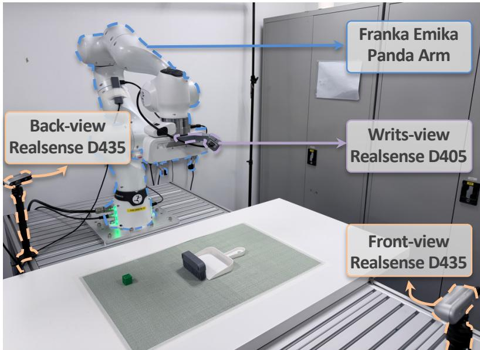  
Figure 5: Real-robot hardware setup. The platform consists of a 7-DoF Franka Emika Panda arm, a wrist-mounted Intel RealSense D405 camera, and two external Intel RealSense D435 cameras placed at the front and back of the workspace. The wrist camera provides observations near the end-effector, whereas the two external cameras provide third-person views.

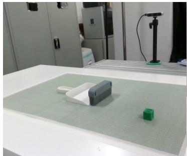  
(a) Back-view Image

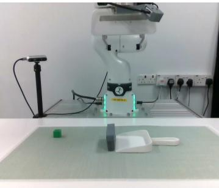  
(b) Front-view Image

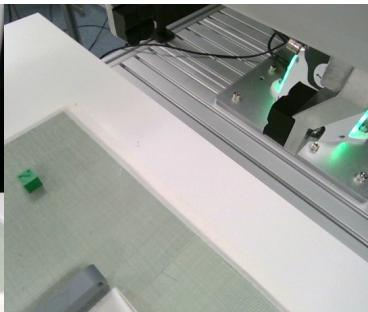  
(c) Wrist-view Image  
Figure 6: Multi-view observations in the real-robot setup. We use three RGB-D camera views for real-world policy execution: a back-view camera, a front-view camera, and a wrist-mounted camera.

## B.3 More Visualization Results

Fig. 7 provides additional qualitative results for real-world out-of-distribution evaluation. Compared with the in-distribution demonstrations, these rollouts introduce moderate scene shifts, including changed object locations, additional distractor objects, and background or layout variations. These examples complement the quantitative real-world evaluation in the main paper by showing that MetaWAM can still produce coherent action trajectories under visual and spatial changes in the workspace.

Fig. 8 further visualizes generated trajectories on the RoboCasa benchmark. We compare trajectories generated by Cosmos Policy and MetaWAM at the same image resolution of $2 2 4 \times 2 2 4$ These qualitative examples provide an intuitive view of the simulated rollouts used in our evaluation and complement the quantitative RoboCasa results reported in the main paper. In particular, they show that the proposed unified meta-frame interface preserves the video-diffusion backbone’s ability to generate temporally coherent future observations, while replacing separate robot-signal latent frames with a compact frequency-domain meta-frame.

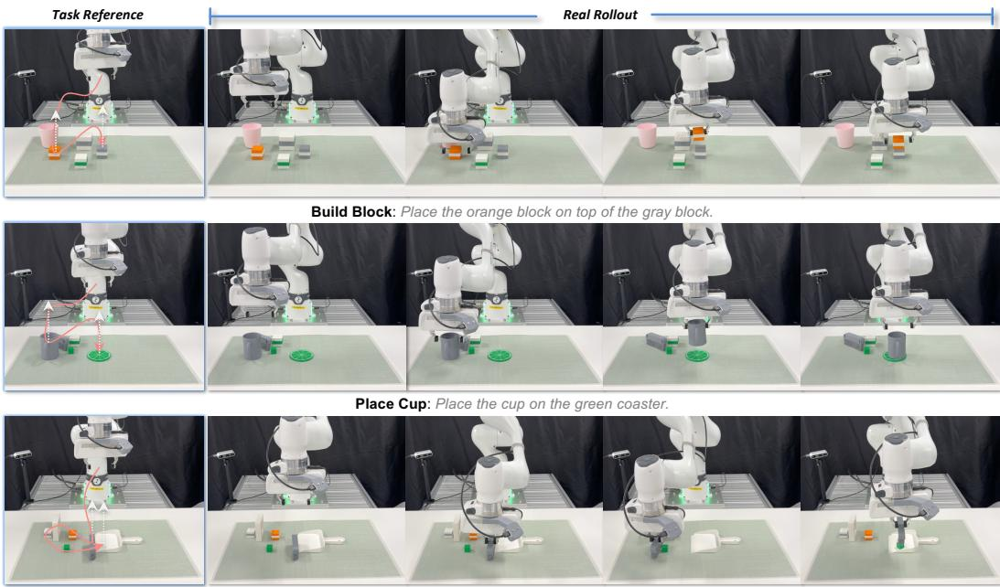  
Sweep: Sweep the green block into the dustpan.

Figure 7: Visualization results in real-world OOD scenarios. We show representative key frames from real-robot rollouts under distribution shifts, including changed object locations, additional distractor objects, and background or layout variations. These examples complement the quantitative OOD evaluation and illustrate the robustness of MetaWAM under scene-level changes.

## C Discussion

## C.1 Attention to Encoded Robot Signals

The reconstruction diagnostic in Sec. 3 measures how strongly an injected representation is corrected by a frozen denoiser. We complement it by examining whether the frozen VDM allocates attention to the encoded robot-signal region. Figure 9 visualizes attention at block 14 alongside the input carrier; the white input region is padding. We define attention lift as the mean attention over the encoded region divided by the mean attention over the entire frame. The visualized case has a lift of 1.40×, indicating above-average attention to the encoded region. This observation is inconsistent with the region simply being ignored as smooth background. Attention alone does not establish successful signal recovery or causal use, but provides complementary evidence to the frozen-denoiser reconstruction analysis.

## C.2 Analytical Readout and Band Supervision

Comparison with a learned interface. We compare the analytical interface with a learnedprojection control based on the state/action interface of DreamZero [6], extended to value using MLP encoders and decoders for all three signals. Figure 10 reports action-chunk mean absolute error (action $L _ { 1 } )$ during training. This quantity is used solely for monitoring and is not an additional training objective. Under the tested setup, MetaWAM reduces this error rapidly, while the learned MLP interface remains at a high error level.

In the unified policy, world-model, and value setting, a robot signal can serve as a clean condition or a prediction target depending on the task. A learned interface therefore needs per-signal encoding and decoding together with mask-aware routing; updating its encoders also changes the latent targets presented to the denoiser. A zero-initialized projection initially conveys no signal. Fixed packing and DCT/iDCT instead provide a static analytical mapping and readout from the start of training.

Wrist camera  
Le8 camera  
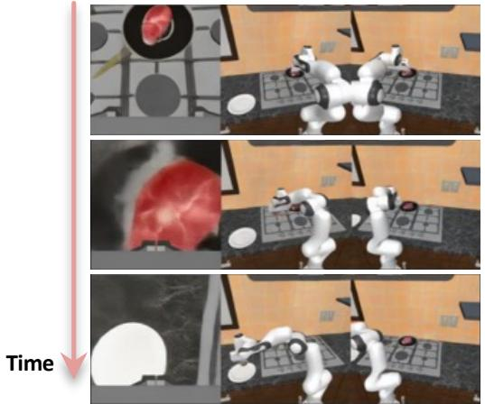  
Right camera

Wrist camera  
Le8 camera  
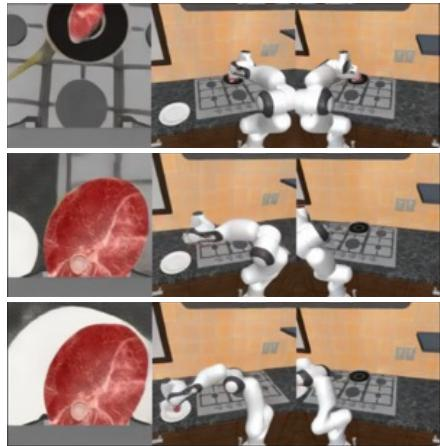  
Right camera

Task: Pick the steak from the pan and place it on the plate  
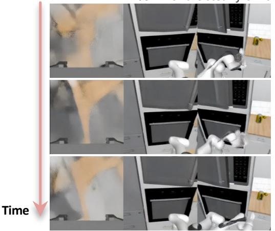

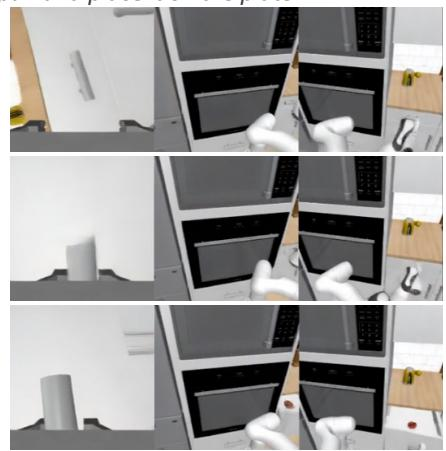  
Task: Open the right drawer

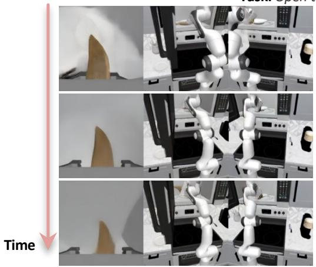  
(a) Cosmos Policy

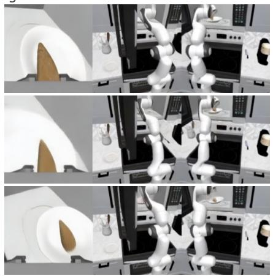  
Task: Pick the sweet potato from the counter and place it on the plate  
(b) MetaWAM (Ours)  
Figure 8: Visualization results on RoboCasa. We compare generated trajectories from Cosmos Policy and MetaWAM at a resolution of $2 2 4 \times 2 2 4$ . The examples show that MetaWAM preserves coherent future-observation generation while using a compact unified meta-frame to encode robotrelated signals.

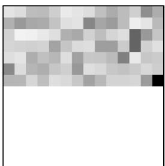  
(a) Input frame

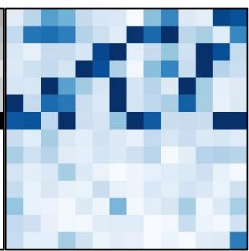  
(b) A0en1on map  
Figure 9: Frozen-VDM attention to encoded robot signals. The input carrier (left) and block-14 attention map (right) show an attention lift of 1.40× over the encoded region relative to the full frame mean. White regions in the input are padding.

The observed optimization behavior supports this design for the tested setup, without implying that learned interfaces cannot work with other architectures or training procedures.

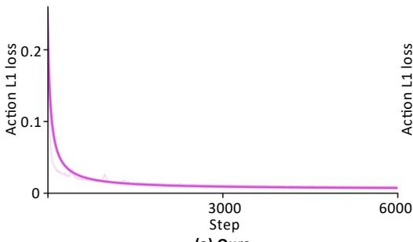  
(a) Ours

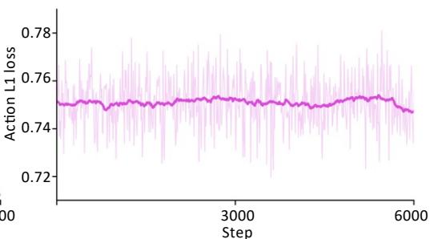  
(b) MLP Encoders + Decoders  
Figure 10: Action recovery with analytical and learned interfaces. Training action-chunk MAE for MetaWAM (left) and the MLP encoder/decoder control (right). Action $L _ { 1 }$ is a monitoring metric, not an additional loss. The two panels use different vertical scales.