# GARD: Gradient-Guided Adversarial Representation Defense against Backdoors in Multimodal Contrastive Learning Models

Yuhong Wang Yujun Cai Lei Feng Songze Li\*

Southeast University

yuhongwang@seu.edu.cn, songzeli@seu.edu.cn

## Abstract

Multimodal contrastive learning models such as CLIP are vulnerable to backdoor attacks with diverse trigger structures, ranging from localized patches to globally distributed perturbations, with recent attacks increasingly optimizing these triggers in the representation space. Existing post-hoc defenses based on clean fine-tuning may leave backdoors ac tive, while trigger-inversion methods depend on accurately estimating the attack target and trigger. We observe that backdoored encoders exhibit structure-dependent representation sensitivity: global perturbations preferentially expose distributed backdoors, whereas local patch perturbations are more effective for localized backdoors. Based on this observation, we propose Gradient-Guided Adversarial Representation Defense (GARD), a target- and trigger-agnostic post-hoc defense. GARD optimizes complementary global and local adversarial probes to maximally displace cleanimage representations, and then realigns the perturbed rep resentations with detached clean anchors while preserving image–text alignment. The resulting model requires no additional computation at inference time. Across six visual backdoor attacks and two CLIP visual backbones, GARD reduces the attack success rate below 1% in all 12 evaluated attack–backbone combinations while maintaining competitive clean accuracy. These results demonstrate the effectiveness of adversarial representation probing for repairing backdoored multimodal contrastive encoders.

## 1 Introduction

Multimodal contrastive learning (MCL) models, such as CLIP, have demonstrated remarkable capabilities in learning transferable visual representations by aligning images and texts in a shared embedding space [14, 23]. These pretrained models have become essential components in many downstream vision–language applications [3, 5, 8, 17, 21, 22], where their reliability and security are increasingly important. However, recent studies have shown that MCL models are vulnerable to backdoor attacks, where an attacker can implant hidden behaviors during training such that images containing specific triggers are associated with attacker-defined concepts while maintaining normal performance on clean samples [1, 15]. Unlike conventional backdoors in classification models that primarily manipulate decision boundaries, backdoors in MCL models compromise the semantic alignment between visual and textual representations, creating new challenges for model purification.

Existing defenses against backdoored MCL models mainly follow two paradigms: clean-data-based purification and trigger-oriented recovery. Clean fine-tuning methods attempt to restore benign image–text alignment using clean data [1], but they provide limited supervision on trigger-induced behaviors and may fail to remove hidden backdoor associations. Trigger inversion methods instead exploit adversarial behaviors to estimate attack targets or recover trigger patterns before purification [26]. However, their effectiveness relies on accurate target estimation and assumptions about the trigger structure. This limitation becomes increasingly significant as recent attacks move beyond handcrafted patterns toward optimized triggers with diverse spatial structures, including localized patches and globally distributed perturbations. Therefore, developing a defense strategy that does not rely on specific knowledge of the attack remains an important challenge.

Recent observations on the connection between adversarial behaviors and backdoor attacks suggest that compromised models may contain abnormal sensitivity patterns that can be exploited without directly observing the original trigger [26]. This motivates us to revisit the objective of backdoor defense. Instead of recovering the unknown trigger itself, an alternative direction is to identify the representation vulnerabilities that enable different triggers to manipulate the learned semantic space. Since backdoor attacks ultimately alter image representations toward attacker-specified semantics, these vulnerabilities may provide a more general defense target than the trigger patterns in the input space.

To investigate this possibility, we first study whether backdoored MCL models exhibit structure-dependent representation vulnerabilities. Our analysis reveals that different trigger structures produce distinct adversarial sensitivity patterns: globally distributed backdoors are more effectively exposed by global perturbations, whereas localized triggers are better revealed through local perturbation probes. More importantly, such vulnerabilities can be identified without access to the original trigger or attack target, suggesting that adversarial perturbations can serve as a trigger-agnostic mechanism for probing backdoor behaviors.

Based on these observations, we propose Gradient-Guided Adversarial Representation Defense (GARD), a trigger- and target-agnostic defense for MCL models. As illustrated in Figure 1, GARD alternates between adversarial probing and representation realignment. It constructs complementary global and local adversarial views to cover distributed and spatially concentrated input variations, respectively, and realigns their representations with a detached clean-image anchor while preserving clean image–text correspondence. This alternating procedure requires neither the true trigger nor its target, and introduces no additional computation at inference time.

We evaluate GARD against six backdoor attacks spanning handcrafted patches, blended and signal-based triggers, optimized local patches, and optimized global perturbations, using CLIP ViT-B/32 and RN50 visual encoders [7, 12, 23]. A single GARD framework effectively handles both localized and distributed triggers, reducing ASR below 1% in all completed evaluations on both backbones while retaining competitive clean accuracy. The ablations explain this broad coverage: local representation alignment is critical for BadCLIP, whereas global representation alignment is critical for BadVision, confirming that the two adversarial views address complementary trigger structures.

Our contributions are summarized as follows:

• We formulate backdoor purification as trigger-agnostic adversarial probing followed by representation realignment, avoiding both target-class estimation and explicit trigger recovery.

• We develop complementary global and local perturbation modules that probe distributed and spatially concentrated representation vulnerabilities under a unified training framework.

• We evaluate GARD across six attacks and two visual backbones. The results demonstrate effective backdoor removal across diverse trigger forms, and the ablations verify the complementary roles of two adversarial views.

## 2 Related Work

Backdoor attacks on vision–language representations. The shared embedding space of MCL models creates a distinct attack surface: a small set of poisoned image–text pairs can associate an image trigger with an attacker-chosen textual concept. Early studies showed that such associations can survive transfer to downstream tasks and zero-shot classifiers [1, 15]. Recent attacks make this association harder to remove by optimizing the trigger itself. BadCLIP jointly guides the visual trigger with target-side visual and textual embeddings, so that triggered samples approach the target semantics in both modalities [18]. BadVision instead compromises a reusable vision encoder using an imperceptible, globally distributed perturbation optimized toward a target representation, and further trains the encoder to distinguish the valid trigger from unrelated adversarial noise [19]. These developments expand the trigger space from fixed patches and blending patterns to optimized local or distributed perturbations. They also motivate defenses that do not assume a particular trigger geometry.

Backdoor defenses for multimodal contrastive learning models. Existing defenses intervene through detection, pretraining, post-hoc fine-tuning, or inference. DECREE detects compromised encoders without repairing them [10]. SAFE-CLIP separates likely clean and risky image–text pairs during pre-training and applies cross-modal learning only to the progressively expanded safe subset [27]; this setting presumes control over the original training process. Post-hoc purification instead uses clean-data fine-tuning and adversarial augmentation [1, 16]. The connection between adversarial perturbations and backdoor behavior is already well recognized in backdoor defense. InverTune exploits this connection by generating a universal adversarial perturbation to elicit target-associated responses from the compromised model; it then estimates the attack target, reconstructs a latent trigger, and applies clustering-guided purification [26]. Its purification signal nevertheless depends on target estimation and trigger inversion. Representation-decomposition analyses further show that local patch and global perturbation attacks affect different CLIP components, and support component-level repair or filtering at inference [13]. In contrast, GARD is a post-hoc defense that requires neither target estimation nor trigger recovery. Rather than treating the adversarial–backdoor connection itself as a contribution, GARD uses target-free adversarial optimization to probe the compromised encoder under complementary global and local perturbation spaces, and directly realigns both adversarial representations to clean semantic anchors.

## 3 Preliminary Study

We first examine whether trigger-agnostic adversarial probing exposes structure-specific backdoor vulnerabilities. We use the same 256 non-target ImageNet images to probe two backdoored ViT-B/32 encoders: BadVision, whose trigger is distributed over the image, and BadCLIP, whose optimized 16×16 trigger is placed at the bottom-right corner. For each clean image, we independently optimize (i) an $\ell _ { \infty }$ -bounded global perturbation and (ii) a 32×32 replacement patch at the image center. Both perturbations maximize the representation deviation from the clean image without using the attack target or the real trigger. Because the two perturbation spaces have different capacities, we measure the increase in targetclass probability relative to a matched random initialization of each perturbation.

Observation 1: Perturbation-specific backdoor sensitivity. Figure 2 shows that different types of backdoors exhibit distinct sensitivities to different forms of adversarial perturbations. For BadVision, the global perturbation increases the target probability by 30.61 percentage points over its initialization, compared with 0.03 points for the local perturbation.

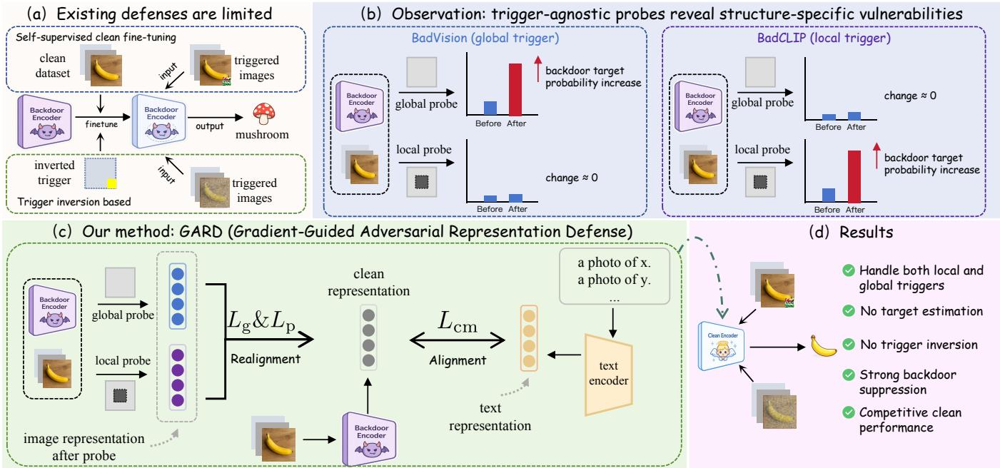  
Figure 1. Overview of GARD. (a) Representative post-hoc defenses rely on clean contrastive fine-tuning, which cannot directly suppress backdoor behaviors under trigger-like perturbations, or use adversarial simulation for target estimation and trigger reconstruction, making the subsequent purification sensitive to trigger mismatch. (b) Trigger-agnostic adversarial probing reveals structure-specific vulnerabilities: global perturbations effectively expose globally distributed backdoors (e.g., BadVision), whereas local patch perturbations are more effective for localized backdoors (e.g., BadCLIP). (c) GARD jointly performs complementary global and local adversarial probing and realigns perturbed representations with clean semantic anchors while preserving clean image–text alignment. (d) A single GARD framework effectively defends against both localized and distributed backdoor triggers without target estimation or trigger reconstruction.

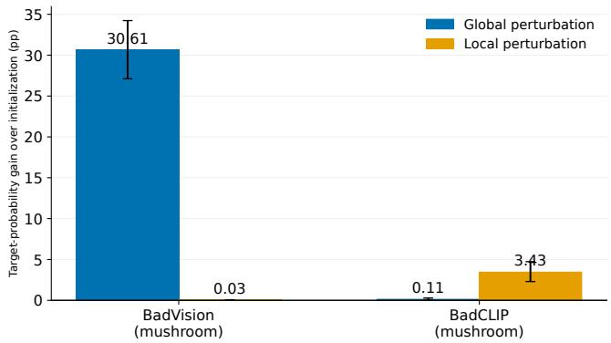  
Figure 2. Trigger-agnostic adversarial sensitivity under different spatial supports. Bars report the increase in target-class probability produced by optimization over a matched random initialization; error bars denote 95% bootstrap confidence intervals over images. The mean target-class probabilities at initialization are 0.016% (global) and 0.027% (local) for BadVision, and 0.0002% (global) and 0.0036% (local) for BadCLIP.

The trend reverses for BadCLIP: the local perturbation produces a 3.43-point increase, compared with 0.11 points for the global perturbation. The class-wise comparison in Figure 3 further shows that the corresponding target response is selective relative to the other 999 classes. These results suggest that backdoors leave a structure-dependent vulnerability footprint in the representation space: distributed and patchbased triggers are preferentially exposed by global and local perturbations, respectively. This observation is also consistent with the failure of a localized target-identification probe on globally distributed triggers. Controlled experiments in the appendix show that this structural mismatch causes Inver-Tune to identify an incorrect target, which in turn severely compromises subsequent backdoor removal.

Observation 2: Exact trigger geometry is unnecessary. The experiment further shows that a surrogate perturbation can expose the model’s target-associated backdoor vulnerability even when its location and size differ from those of the genuine trigger. The genuine BadCLIP trigger is a 16 × 16 patch at the bottom-right corner, whereas our surrogate is a 32×32 patch optimized at the image center. Despite this mismatch in both location and size, Figure 3 shows that the surrogate makes the implanted target the class with the largest mean probability increase among all 1,000 ImageNet classes. Exposing a localized backdoor vulnerability therefore does not require exact knowledge of the trigger pattern, location, or scale.

Our preliminary studies reveal that different trigger structures induce distinct sensitivity patterns in the model’s representation space, which can be identified through triggeragnostic adversarial probing. Motivated by these findings, we propose GARD to use complementary global and local adversarial views that cover different spatial supports, without estimating the attack target or reproducing the implanted trigger.

(a) Global perturbation: top 14 + target Target rank: 147/1000  
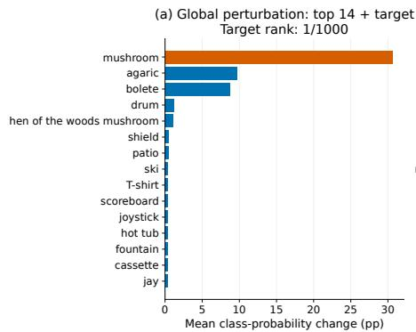

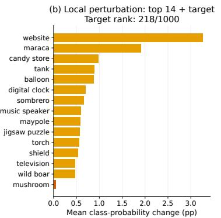

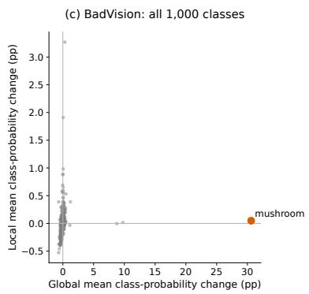

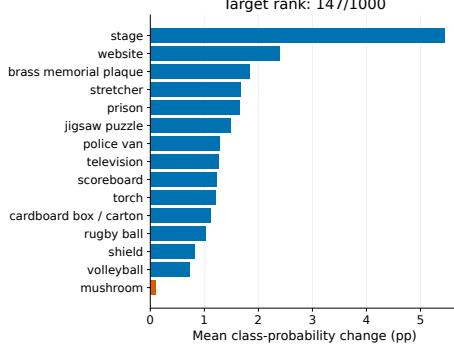

(b) Local perturbation: top 14 + target Target rank: 1/1000  
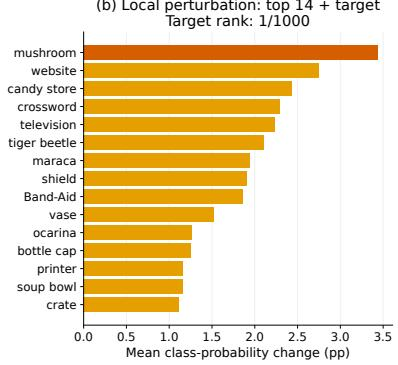

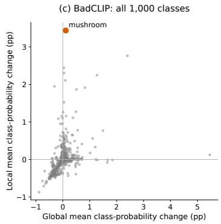  
Figure 3. Class-wise responses to trigger-agnostic global and local perturbations on BadVision (top) and BadCLIP (bottom), with both attacks targeting mushroom. The bar plots show the classes with the largest mean probability increases relative to clean inputs, together with the implanted target; the scatter plots show all 1,000 ImageNet classes. For BadVision, the target ranks first under the global perturbation but 218th under the local perturbation. For BadCLIP, the target ranks first under the local perturbation but 147th under the global perturbation.

## 4 Method

## 4.1 Problem Formulation

We consider an MCL model consisting of an image encoder $f _ { \theta }$ and a text encoder $g _ { \phi }$ , which map images and texts into a shared d-dimensional representation space. Given an image x and text $t ,$ their normalized representations are

$$
z _ { x } = \frac { f _ { \theta } ( x ) } { \| f _ { \theta } ( x ) \| _ { 2 } } , \qquad z _ { t } = \frac { g _ { \phi } ( t ) } { \| g _ { \phi } ( t ) \| _ { 2 } } .\tag{1}
$$

Cross-modal matching is performed using their cosine similarity.

We study a post-hoc defense setting in which the defender has access only to the backdoored model and a small clean image–text dataset $\mathcal { D } _ { c } = \{ ( x _ { i } , t _ { i } ) \} _ { i = 1 } ^ { N }$ . The poisoned training data, trigger, and target class are unavailable. Our goal is to neutralize the implanted backdoor while preserving the model’s utility on clean data.

## 4.2 Overview of GARD

As illustrated in Figure 1, GARD mitigates backdoor attacks in MCL models through a two-stage process: complementary global and local adversarial probing, followed by clean-anchored representation realignment. Since backdoor attacks are designed to preserve clean utility, an untriggered clean image generally remains aligned with its paired text and thus provides a reliable reference for its intended semantics. GARD treats this clean representation as a fixed anchor and realigns the deliberately displaced representations toward it, thereby suppressing the vulnerable directions through which trigger-like perturbations redirect an image toward attackerspecified semantics.

## 4.3 Gradient-Guided Global Perturbation

Backdoor triggers are not always confined to localized patterns but may also manifest as distributed perturbations over the entire image. To expose such global vulnerabilities, we construct a bounded perturbation that maximally displaces the image representation from its clean counterpart.

Given a clean image $x \in [ 0 , 1 ] ^ { H \times W \times 3 }$ , we generate a globally perturbed view

$$
x ^ { g } = \mathrm { c l i p } _ { [ 0 , 1 ] } ( x + \delta ) ,\tag{2}
$$

where $\| \delta \| _ { \infty } \leq \epsilon$ . The perturbation is obtained by maximizing the representation discrepancy between the clean and perturbed images:

$$
\delta ^ { \star } = \underset { | | \delta | | _ { \infty } \leq \epsilon } { \mathrm { a r g m a x } } \left[ 1 - \sin \bigl ( \bar { f } _ { \theta } ( x + \delta ) , \bar { f } _ { \theta } ( x ) \bigr ) \right] ,\tag{3}
$$

where ${ \bar { f } } _ { \theta }$ denotes the $\ell _ { 2 } \cdot$ -normalized image representation and $\mathrm { s i m } ( \cdot , \cdot )$ is cosine similarity. We approximately solve Eq. (3) using projected sign-gradient updates under the $\ell _ { \infty }$ constraint.

Unlike trigger inversion, the optimized perturbation is not intended to recover the unknown trigger pattern. Instead, it searches for perturbation directions that induce the largest representation deviation within a bounded perturbation budget. Because backdoored models exhibit abnormal sensitivity to trigger-related perturbations, these directions preferentially reveal the backdoor-induced vulnerable representations, providing effective supervision for the subsequent representation realignment.

## 4.4 Gradient-Guided Local Patch Perturbation

While the global perturbation effectively explores distributed representation vulnerabilities, many practical backdoor attacks rely on spatially localized triggers. To expose such localized vulnerabilities, we construct a second adversarial view by replacing a square image region with a learnable patch.

Given a clean image x, let $\mathcal { P } ( x , p , \ell )$ denote the operation of pasting a learnable patch p at location ℓ. The patch is optimized to maximize the representation discrepancy between the patched and clean images:

$$
\begin{array} { r l } & { p ^ { \star } = \underset { p \in [ 0 , 1 ] ^ { s \times s \times 3 } } { \mathrm { a r g m a x } } } \\ & { \left[ 1 - \sin \big ( \bar { f } _ { \theta } ( \mathcal { P } ( x , p , \ell ) ) , \bar { f } _ { \theta } ( x ) \big ) \right] , } \end{array}\tag{4}
$$

where s denotes the patch size. We approximately solve Eq. (4) using projected sign-gradient updates while keeping the patch values within the valid image range.

Unlike trigger inversion methods that attempt to reconstruct the attack pattern, the optimized patch is only required to maximally disrupt the image representation. By concentrating perturbations within a local region, the patch effectively probes spatially localized vulnerabilities that may be overlooked by globally constrained perturbations. Together with the global perturbation, it provides a complementary view for exposing abnormal representation sensitivity in backdoored models.

## 4.5 Representation Realignment

Given the generated global and local adversarial views, GARD fine-tunes the backdoored model to achieve two objectives: preserving the original cross-modal alignment and restoring perturbed image representations to their clean semantics.

To preserve the model’s visual–language capability, we employ the standard bidirectional contrastive loss on clean image–text pairs [23]. Given a mini-batch of B samples, the image-to-text loss is defined as

$$
\mathcal { L } _ { \mathrm { i 2 t } } = - \frac { 1 } { B } \sum _ { i = 1 } ^ { B } \log \frac { \exp \left( \tau z _ { x _ { i } } ^ { \top } z _ { t _ { i } } \right) } { \sum _ { j = 1 } ^ { B } \exp \left( \tau z _ { x _ { i } } ^ { \top } z _ { t _ { j } } \right) } .\tag{5}
$$

Similarly, the text-to-image loss is

$$
\mathcal { L } _ { \mathrm { t 2 i } } = - \frac { 1 } { B } \sum _ { i = 1 } ^ { B } \log \frac { \exp \left( \tau z _ { t _ { i } } ^ { \top } z _ { x _ { i } } \right) } { \sum _ { j = 1 } ^ { B } \exp \left( \tau z _ { t _ { i } } ^ { \top } z _ { x _ { j } } \right) } .\tag{6}
$$

The clean cross-modal alignment objective is then

$$
\mathcal { L } _ { \mathrm { c m } } = \frac { 1 } { 2 } \left( \mathcal { L } _ { \mathrm { i 2 t } } + \mathcal { L } _ { \mathrm { t 2 i } } \right) ,\tag{7}
$$

where $\tau$ is the learnable logit scale.

To suppress abnormal representation sensitivity revealed by adversarial perturbations, we further align the representation of each perturbed image with its clean counterpart. For each perturbation type $q \in \{ g , p \}$ , the representation alignment loss is

$$
\mathcal { L } _ { q } = \frac { 1 } { B } \sum _ { i = 1 } ^ { B } \left[ 1 - \sin \left( \bar { f } _ { \theta } ( x _ { i } ^ { q } ) , \mathrm { s g } \left[ \bar { f } _ { \theta } ( x _ { i } ) \right] \right) \right] ,\tag{8}
$$

where $\mathrm { s g } [ \cdot ]$ denotes the stop-gradient operation, which treats the clean representation as a fixed semantic anchor during optimization.

The overall training objective is

$$
\mathcal { L } _ { \mathrm { G A R D } } = \lambda _ { \mathrm { c m } } \mathcal { L } _ { \mathrm { c m } } + \lambda _ { g } \mathcal { L } _ { g } + \lambda _ { p } \mathcal { L } _ { p } ,\tag{9}
$$

where $\lambda _ { \mathrm { { c m } } } , \lambda _ { g }$ , and $\lambda _ { p }$ balance the three objectives. Optimizing Eq. (9) encourages the model to maintain clean image– text alignment while progressively restoring the representations of both globally and locally perturbed views. Consequently, the abnormal representation sensitivity exposed during perturbation generation is gradually suppressed without requiring trigger recovery or target-class estimation.

GARD is trained by alternating between perturbation generation and representation realignment. After training, the purified MCL model is directly used for inference without any additional test-time computation.

## 5 Experiments

## 5.1 Experimental Setup

Backdoor Attacks. We consider BadNets [11], Blended [4], SIG [2], BadEncoder [15], BadCLIP [18], and BadVision [19] on OpenAI CLIP ViT-B/32 and RN50 encoders [23]. Together, these attacks cover handcrafted patches, blended and signal-based triggers and optimized triggers. Complete attack configurations are provided in the appendix.

Baselines. We compare GARD with FT, CleanCLIP [1], PAR [25], and InverTune [26], and also report each backdoored model without defense. Each defense is applied independently to the same backdoored checkpoint for each attack–backbone pair. Following the experimental setup of InverTune, we use 500K CC3M image–text pairs [24] for FT, CleanCLIP, and PAR, 50K ImageNet samples for InverTune, and 20K ImageNet samples for GARD. FT, CleanCLIP, PAR, and GARD are trained for 10 epochs, whereas InverTune follows its original multi-stage schedule. Additional implementation details and defense runtimes are provided in Appendix Sections E and I, respectively.

Evaluation Metrics. We report clean accuracy (CA) and attack success rate (ASR) on ImageNet-1K [6]. CA is the top-1 zero-shot accuracy on clean images, whereas ASR is the percentage of triggered non-target images classified as the attacker-specified target. Images whose ground-truth class is already the attack target are excluded.

## 5.2 Main Results

As shown in Table 1, across all six attacks and both visual backbones, GARD is the only defense that reduces ASR below 1% in every evaluated setting, demonstrating consistent protection against different backdoor attacks. By contrast, every baseline exhibits at least one attack on which it fails to provide reliable protection, highlighting the limited generalization of existing defenses across distinct trigger structures. These results validate the key intuition behind GARD that complementary global and local adversarial probing provides a unified defense against diverse backdoor behaviors.

Across both visual backbones, GARD maintains competitive clean accuracy while effectively removing backdoors, demonstrating a favorable balance between model utility and attack mitigation.

## 5.3 Comparison with Matched Defense Data

To assess whether GARD’s performance stems from differences in defense data, we rerun FT, CleanCLIP, PAR, and InverTune on ViT-B/32 using the same class-balanced 20K ImageNet subset as GARD. We compare these results with GARD’s main-experiment results, keeping the defense-data source, sample count, and class composition consistent across methods.

Table 2 shows that GARD retains its defense advantage when all methods use the same clean dataset. Compared with their results using 500K CC3M pairs, FT, CleanCLIP, and PAR are substantially less effective against several attacks in the 20K ImageNet setting, with ASR remaining above 77% on BadNets, BadCLIP, and BadVision. These results suggest that their effectiveness depends on access to larger clean-data collections, while highlighting GARD’s ability to remove diverse backdoors with a limited clean-data budget.

## 5.4 Evaluation against Adaptive Attacks

To evaluate GARD against attacks tailored to its defense mechanism, we design two adaptive attack strategies based on BadCLIP and BadVision. We assume that the attacker knows GARD’s perturbation generation procedures, training objectives, and hyperparameters, and uses this knowledge to optimize backdoors that resist purification. Both strategies add a defense-resistance loss to the base attack objective.

The first strategy, Adap-1 (simulated purification), explicitly optimizes backdoor persistence after defense. During attack training, the attacker applies two GARD updates to a copy of the current model every five steps and minimizes the target-class loss on triggered images using the purified model, aiming to preserve backdoor effectiveness after defense.

The second strategy, Adap-2 (defense-signal evasion), targets the representation discrepancies that guide GARD’s purification. The attacker reuses GARD’s global and local adversarial probing procedures and minimizes the resulting discrepancies between clean and perturbed representations. This additional loss aims to weaken the signal used by GARD for purification. We apply both strategies to BadCLIP and Bad-Vision on ViT-B/32 and evaluate the resulting models with the full GARD defense. Implementation details are provided in the appendix.

Table 3 shows that both strategies achieve high attack success before defense, with ASR ranging from 97.01% to 99.84%. Despite explicitly targeting GARD’s purification procedure and alignment signals, these attacks are effectively mitigated. GARD reduces ASR below 1% in all four settings while largely preserving clean accuracy. These results demonstrate GARD’s robustness to both adaptive strategies. We believe this robustness stems from GARD’s ability to continually probe and suppress backdoor behavior during purification, rather than relying on a fixed trigger pattern. Although individual probing steps do not aim to recover the exact trigger, repeated probing and representation realignment can cumulatively suppress the backdoor over successive iterations.

## 5.5 Ablation Studies

Table 4 validates the contribution of each training objective in GARD under the BadCLIP and BadVision attacks, which represent optimized local patch triggers and globally optimized perturbations, respectively. The Base variant, which employs only the clean cross-modal alignment objective, provides little protection, retaining ASRs of 99.90% and 73.87% on BadCLIP and BadVision, respectively. This indicates that preserving clean cross-modal alignment alone is insufficient to eliminate backdoor-induced representation deviations.

Removing the global representation alignment objective preserves a low ASR on BadCLIP (0.31%) but substantially weakens the defense against BadVision, increasing the ASR to 36.63%. This result suggests that global representation alignment primarily mitigates vulnerabilities introduced by globally optimized perturbations. In contrast, removing the local representation alignment objective leaves the defense against BadVision largely intact (0.97%) but causes the ASR on BadCLIP to increase to 99.84%, indicating that local representation alignment is essential for suppressing patch-based triggers.

These observations demonstrate that the two representation alignment objectives address complementary vulnerabilities induced by different trigger patterns. Optimizing both objec tives jointly enables Full GARD to reduce the ASR below 1% on both attacks simultaneously. Although the complete objective incurs a modest reduction in clean accuracy compared with the Base variant, it maintains clean performance close to that of the undefended model while providing consistently strong protection across diverse trigger types.

Table 1. Main results across six attacks and two visual backbones. CA (%) measures clean utility, and ASR (%) measures backdoor effectiveness after defense. The best and second-best results are shown in bold and underlined, respectively.
<table><tr><td rowspan="2">Backbone</td><td rowspan="2">Method</td><td colspan="2">BadNets</td><td colspan="2">Blended</td><td colspan="2">SIG</td><td colspan="2">BadEncoder</td><td colspan="2">BadCLIP</td><td colspan="2">BadVision</td></tr><tr><td>CA↑</td><td>ASR↓</td><td>CA↑</td><td>ASR↓</td><td>CA↑</td><td>ASR↓</td><td>CA↑</td><td>ASR↓</td><td>CA↑</td><td>ASR↓</td><td>CA↑</td><td>ASR↓</td></tr><tr><td rowspan="6">ViT-B/32</td><td>No Defense</td><td>60.03</td><td>99.92</td><td>60.18</td><td>99.86</td><td>60.08</td><td>99.55</td><td>62.94</td><td>99.38</td><td>60.58</td><td>99.94</td><td>61.30</td><td>99.56</td></tr><tr><td>FT</td><td>56.42</td><td>44.09</td><td>56.73</td><td>75.71</td><td>56.45</td><td>22.81</td><td>56.40</td><td>0.12</td><td>56.99</td><td>89.61</td><td>56.43</td><td>38.14</td></tr><tr><td>CleanCLIP</td><td>54.91</td><td>31.46</td><td>54.94</td><td>0.12</td><td>55.24</td><td>7.96</td><td>55.32</td><td>0.04</td><td>54.78</td><td>77.48</td><td>54.96</td><td>18.35</td></tr><tr><td>PAR</td><td>54.66</td><td>41.16</td><td>51.59</td><td>0.08</td><td>54.77</td><td>43.16</td><td>51.63</td><td>0.07</td><td>53.70</td><td>19.59</td><td>51.94</td><td>11.81</td></tr><tr><td>InverTune</td><td>57.29</td><td>6.10</td><td>58.33</td><td>1.98</td><td>58.57</td><td>9.91</td><td>58.61</td><td>0.49</td><td>57.98</td><td>4.70</td><td>57.15</td><td>55.70</td></tr><tr><td>GARD</td><td>59.36</td><td>0.10</td><td>59.23</td><td>0.01</td><td>57.61</td><td>0.88</td><td>61.66</td><td>0.05</td><td>61.01</td><td>0.82</td><td>60.39</td><td>0.63</td></tr><tr><td rowspan="6">RN50</td><td>No Defense</td><td>58.94</td><td>99.47</td><td>58.99</td><td>99.20</td><td>59.11</td><td>98.22</td><td>57.23</td><td>98.01</td><td>58.35</td><td>99.38</td><td>51.16</td><td>84.71</td></tr><tr><td>FT</td><td>54.78</td><td>35.55</td><td>54.56</td><td>0.19</td><td>54.73</td><td>5.67</td><td>54.81</td><td>0.13</td><td>56.99</td><td>89.68</td><td>54.72</td><td>11.49</td></tr><tr><td>CleanCLIP</td><td>52.74</td><td>21.95</td><td>52.61</td><td>0.10</td><td>52.36</td><td>1.18</td><td>52.34</td><td>0.08</td><td>52.38</td><td>19.97</td><td>52.81</td><td>28.74</td></tr><tr><td>PAR</td><td>49.03</td><td>0.97</td><td>49.13</td><td>0.16</td><td>48.99</td><td>0.17</td><td>50.28</td><td>0.02</td><td>50.46</td><td>2.50</td><td>49.71</td><td>2.10</td></tr><tr><td>InverTune</td><td>51.27</td><td>5.61</td><td>51.12</td><td>0.08</td><td>50.82</td><td>4.86</td><td>51.01</td><td>1.04</td><td>54.71</td><td>6.06</td><td>51.83</td><td>33.45</td></tr><tr><td>GARD</td><td>53.35</td><td>0.11</td><td>52.79</td><td>0.03</td><td>53.44</td><td>0.45</td><td>55.76</td><td>0.01</td><td>54.88</td><td>0.03</td><td>53.97</td><td>0.05</td></tr></table>

Table 2. ASR (%, ↓) on ViT-B/32 with matched defense data: all defenses use the same class-balanced 20K ImageNet subset.
<table><tr><td>Defense</td><td>BadNets Blended</td><td></td><td>SIG</td><td>BadEncoder BadCLIP</td><td></td><td>BadVision</td></tr><tr><td>No Defense</td><td>99.92</td><td>99.86</td><td>99.55</td><td>99.38</td><td>99.94</td><td>99.56</td></tr><tr><td>FT</td><td>99.73</td><td>90.11</td><td>93.22</td><td>5.01</td><td>99.91</td><td>82.89</td></tr><tr><td>CleanCLIP</td><td>99.79</td><td>33.40</td><td>90.95</td><td>1.01</td><td>99.92</td><td>80.79</td></tr><tr><td>PAR</td><td>97.95</td><td>0.11</td><td>80.07</td><td>25.71</td><td>99.86</td><td>77.71</td></tr><tr><td>InverTune</td><td>7.91</td><td>2.59</td><td>9.63</td><td>7.12</td><td>4.19</td><td>52.16</td></tr><tr><td>GARD</td><td>0.10</td><td>0.01</td><td>0.88</td><td>0.05</td><td>0.82</td><td>0.63</td></tr></table>

Table 3. Adaptive attacks against GARD on ViT-B/32. Before and After refer to evaluation before and after the full GARD defense.
<table><tr><td colspan="2">BadCLIP</td><td colspan="2">BadVision</td></tr><tr><td>Stage</td><td>CA↑ ASR↓</td><td>CA↑</td><td>ASR↓</td></tr><tr><td>Adap-1: Simulated purification Before After</td><td>63.97 99.58 62.45</td><td>62.82 0.01 60.93</td><td>99.84 0.76</td></tr><tr><td colspan="4">Adap-2: Defense-signal evasion 64.65</td></tr><tr><td colspan="2">Before After 62.59</td><td colspan="2">97.01 63.98 0.09 62.28</td></tr></table>

## 5.6 Further Analysis

Representation Realignment Visualization. Figure 4 examines whether the reduction in ASR is accompanied by a correction of trigger-induced representation deviations. Before defense, clean and triggered representations form clearly separated regions for both attacks. After GARD, their distributions overlap more substantially: for BadVision, the mean distance decreases from 0.946 to 0.588 and the mean cosine similarity increases from 0.548 to 0.817; for BadCLIP, the corresponding values change from 1.174 to 0.107 and from 0.309 to 0.993. These results provide representation-level evidence that GARD suppresses the deviations induced by both globally distributed and localized triggers, although the remaining deviation is larger for BadVision. Complete visualizations covering all six attacks, together with clean-model references, are provided in the appendix.

Sensitivity to Perturbation Parameters. We study the sensitivity of GARD to the global perturbation budget ϵ and the local patch size s on ViT-B/32. We vary ϵ under BadVision and s under BadCLIP while keeping all other training settings fixed.

Table 4. Ablation of the training objectives in GARD on ViT-B/32. A bullet indicates that the corresponding objective is enabled. The best and second-best results among the defense variants are shown in bold and underlined, respectively.
<table><tr><td rowspan="2"></td><td colspan="3">Training Objective</td><td colspan="2">BadCLIP</td><td colspan="2">BadVision</td></tr><tr><td>Variant  $\mathcal { L } _ { \mathrm { c m } }$ </td><td> $\mathcal { L } _ { g }$ </td><td> $\mathcal { L } _ { p }$ </td><td>CA↑</td><td>ASR↓</td><td>CA↑</td><td>ASR↓</td></tr><tr><td>No Defense</td><td></td><td></td><td></td><td>60.58</td><td>99.94</td><td>61.30</td><td>99.56</td></tr><tr><td>Base</td><td></td><td></td><td></td><td>62.66</td><td>99.90</td><td>63.39</td><td>73.87</td></tr><tr><td>w/o Global</td><td></td><td></td><td></td><td>62.23</td><td>0.31</td><td>62.79</td><td>36.63</td></tr><tr><td>w/o Local</td><td></td><td></td><td></td><td>61.95</td><td>99.84</td><td>60.67</td><td>0.97</td></tr><tr><td>Full GARD</td><td></td><td></td><td></td><td>61.01</td><td>0.82</td><td>60.39</td><td>0.63</td></tr></table>

Table 5. Sensitivity of GARD to the global perturbation budget ϵ and local patch size s on ViT-B/32. † denotes the default setting used in the main experiments.
<table><tr><td>Parameter</td><td>CA↑</td><td>ASR↓</td></tr><tr><td colspan="3">Global Perturbation on BadVision</td></tr><tr><td> $\epsilon = 2 / 2 5 5$ </td><td>61.77</td><td>0.65</td></tr><tr><td> $\epsilon = 4 / 2 5 5$ </td><td>61.11</td><td>0.42 0.63</td></tr><tr><td> $\epsilon = 8 / 2 5 5 ^ { \dagger }$   $\epsilon = 1 6 / 2 5 5$ </td><td>60.39 60.04</td><td>0.05</td></tr><tr><td colspan="3">Local Patch on BadCLIP</td></tr><tr><td>s = 16</td><td>61.27</td><td>6.64</td></tr><tr><td>s = 24</td><td>60.07</td><td>0.53</td></tr><tr><td> $s = 3 2 ^ { \dagger }$ </td><td>61.01</td><td>0.82</td></tr><tr><td> $s = 4 8$ </td><td>60.15</td><td>0.06</td></tr></table>

As shown in Table 5, GARD maintains low ASR on BadVision across the evaluated perturbation budgets. Increasing the budget to 16/255 further reduces the ASR to 0.05%, accompanied by a decrease in CA, reflecting a trade-off between defense strength and clean utility. For the local perturbation, a small patch of $s ~ = ~ 1 6$ is less effective, whereas all settings with $s \geq 2 4$ reduce the BadCLIP ASR below 1%. This suggests that adequate spatial support is important for exposing localized representation vulnerabilities, while the defense does not require an exact estimate of the trigger size. Overall, GARD remains effective over a moderate range of both parameters, with the default settings providing consistently low

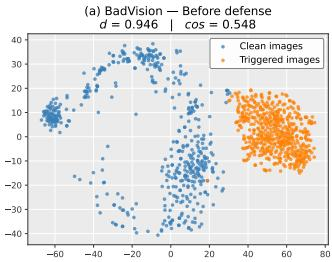

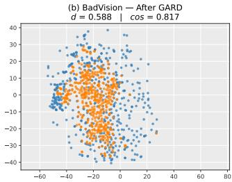

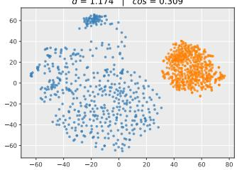

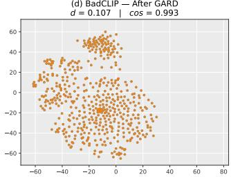  
Figure 4. Paired clean and triggered ViT-B/32 representations before and after GARD. Mean Euclidean distance d and cosine similarity cos are computed in the original normalized feature space.

ASR while preserving clean accuracy.

Table 6. Effect of clean-data size on GARD with ViT-B/32. † denotes the default setting used in the main experiments.
<table><tr><td rowspan="2"></td><td colspan="2">BadCLIP</td><td colspan="2">BadVision</td></tr><tr><td>Clean Data CA↑</td><td>ASR↓</td><td>CA↑</td><td>ASR↓</td></tr><tr><td>1K</td><td>57.09</td><td>14.62</td><td>59.81</td><td>87.59</td></tr><tr><td>5K</td><td>58.59</td><td>3.75</td><td>59.28</td><td>61.10</td></tr><tr><td>10K</td><td>58.13</td><td>2.10</td><td>59.68</td><td>15.91</td></tr><tr><td>20K†</td><td>61.01</td><td>0.82</td><td>60.39</td><td>0.63</td></tr></table>

Effect of Clean Data Size. We further evaluate GARD with ImageNet subsets containing 1K, 5K, 10K, and 20K clean images. All subsets are class-balanced, with 1, 5, 10, and 20 images per class, respectively.

Table 6 shows that backdoor removal improves consistently as more clean data become available. Increasing the subset from 1K to 20K images lowers ASR from 14.62% to 0.82% on BadCLIP and from 87.59% to 0.63% on BadVision, while the 20K setting also yields the highest clean accuracy. These results indicate that sufficient clean-data coverage is important for effective defense across different trigger structures. We also observe that GARD is not sensitive to the choice of clean samples. In Appendix Sections G and H, we further evaluate GARD with contaminated defense data and without clean target-class images.

## 6 Conclusion

We presented GARD, a post-hoc defense that uses adversarial perturbations to probe and repair backdoor-induced representation vulnerabilities in MCL models. Rather than estimating the attack target or reconstructing an unknown trigger, GARD searches for global and local input variations that maximally displace clean-image representations and then realigns the perturbed representations with their clean semantic anchors. Across six attacks and two CLIP visual backbones, GARD reduced ASR below 1% in all evaluated settings while maintaining competitive clean accuracy. The ablation and representation analyses further showed that the global and local objectives address complementary vulnerabilities associated with distributed and spatially concentrated triggers. Overall, GARD demonstrates that identifying and suppressing backdoor-induced representation vulnerabilities offers a practical target-free direction for defending MCL models.

## References

[1] Hritik Bansal, Nishad Singhi, Yu Yang, Fan Yin, Aditya Grover, and Kai-Wei Chang. CleanCLIP: Mitigating data poisoning attacks in multimodal contrastive learning. In Proceedings of the IEEE/CVF International Conference on Computer Vision, pages 112–123, 2023.

[2] Mauro Barni, Kassem Kallas, and Benedetta Tondi. A new backdoor attack in CNNs by training set corruption without label poisoning. In 2019 IEEE International Conference on Image Processing, pages 101–105, 2019. doi: 10.1109/ICIP. 2019.8802997.

[3] Manuele Barraco, Marcella Cornia, Silvia Cascianelli, Lorenzo Baraldi, and Rita Cucchiara. The unreasonable effectiveness of CLIP features for image captioning: An experimental analysis. In Proceedings of the IEEE/CVF Conference on Computer Vision and Pattern Recognition Workshops, pages 4662–4670, 2022.

[4] Xinyun Chen, Chang Liu, Bo Li, Kimberly Lu, and Dawn Song. Targeted backdoor attacks on deep learning systems using data poisoning, 2017. URL https://arxiv.org/ abs/1712.05526.

[5] Jaemin Cho, Seunghyun Yoon, Ajinkya Kale, Franck Dernoncourt, Trung Bui, and Mohit Bansal. Fine-grained image captioning with CLIP reward. In Findings of the Association for Computational Linguistics: NAACL 2022, pages 517– 527. Association for Computational Linguistics, 2022. doi: 10.18653/v1/2022.findings-naacl.39.

[6] Jia Deng, Wei Dong, Richard Socher, Li-Jia Li, Kai Li, and Li Fei-Fei. ImageNet: A large-scale hierarchical image database. In Proceedings of the IEEE Conference on Computer Vision and Pattern Recognition, pages 248–255, 2009. doi: 10.1109/CVPR.2009.5206848.

[7] Alexey Dosovitskiy, Lucas Beyer, Alexander Kolesnikov, Dirk Weissenborn, Xiaohua Zhai, Thomas Unterthiner, Mostafa Dehghani, Matthias Minderer, Georg Heigold, Sylvain Gelly, Jakob Uszkoreit, and Neil Houlsby. An image is worth 16x16 words: Transformers for image recognition at scale. In International Conference on Learning Representations, 2021.

[8] Sedigheh Eslami, Christoph Meinel, and Gerard de Melo. Pub-MedCLIP: How much does CLIP benefit visual question answering in the medical domain? In Findings of the Association for Computational Linguistics: EACL 2023, pages 1181– 1193. Association for Computational Linguistics, 2023. doi: 10.18653/v1/2023.findings-eacl.88.

[9] Mark Everingham, Luc Van Gool, Christopher K. I. Williams, John Winn, and Andrew Zisserman. The pascal visual object classes (VOC) challenge. International Journal of Computer Vision, 88(2):303–338, 2010. doi: 10.1007/s11263-009-0275- 4.

[10] Shiwei Feng, Guanhong Tao, Siyuan Cheng, Guangyu Shen, Xiangzhe Xu, Yingqi Liu, Kaiyuan Zhang, Shiqing Ma, and Xiangyu Zhang. Detecting backdoors in pre-trained encoders. In Proceedings ofthe IEEE/CVF Conference on Computer Vision and Pattern Recognition, pages 16352–16362, 2023.

[11] Tianyu Gu, Brendan Dolan-Gavitt, and Siddharth Garg. Bad-Nets: Identifying vulnerabilities in the machine learning model supply chain. IEEE Access, 7:47230–47244, 2019. doi: 10.1109/ACCESS.2019.2909068.

[12] Kaiming He, Xiangyu Zhang, Shaoqing Ren, and Jian Sun. Deep residual learning for image recognition. In Proceedings of the IEEE Conference on Computer Vision and Pattern Recognition, pages 770–778, 2016.

[13] Shuo He, Zhifang Zhang, Feng Liu, Roy Ka-Wei Lee, Bo An, and Lei Feng. A closer look at backdoor attacks on CLIP. In Proceedings of the 42nd International Conference on Machine Learning, volume 267 of Proceedings of Machine Learning Research, pages 22836–22852, 2025.

[14] Chao Jia, Yinfei Yang, Ye Xia, Yi-Ting Chen, Zarana Parekh, Hieu Pham, Quoc V. Le, Yun-Hsuan Sung, Zhen Li, and Tom Duerig. Scaling up visual and vision-language representation learning with noisy text supervision. In Proceedings of the 38th International Conference on Machine Learning, volume 139 of Proceedings of Machine Learning Research, pages 4904–4916, 2021.

[15] Jinyuan Jia, Yupei Liu, and Neil Zhenqiang Gong. BadEncoder: Backdoor attacks to pre-trained encoders in selfsupervised learning. In 2022 IEEE Symposium on Security and Privacy, pages 2043–2059, 2022. doi: 10.1109/SP46214. 2022.9833644.

[16] Junhao Kuang, Siyuan Liang, Jiawei Liang, Kuanrong Liu, and Xiaochun Cao. Adversarial backdoor defense in CLIP, 2024. URL https://arxiv.org/abs/2409.15968.

[17] Junnan Li, Dongxu Li, Caiming Xiong, and Steven Hoi. BLIP: Bootstrapping language-image pre-training for unified visionlanguage understanding and generation. In Proceedings of the 39th International Conference on Machine Learning, volume 162 of Proceedings ofMachine Learning Research, pages 12888–12900, 2022.

[18] Siyuan Liang, Mingli Zhu, Aishan Liu, Baoyuan Wu, Xiaochun Cao, and Ee-Chien Chang. BadCLIP: Dual-embedding guided backdoor attack on multimodal contrastive learning. In Proceedings ofthe IEEE/CVF Conference on Computer Vision and Pattern Recognition, pages 24645–24654, 2024.

[19] Zhaoyi Liu and Huan Zhang. Stealthy backdoor attack in self-supervised learning vision encoders for large vision language models. In Proceedings of the IEEE/CVF Conference on Computer Vision and Pattern Recognition, pages 25060– 25070, 2025.

[20] Aleksander Madry, Aleksandar Makelov, Ludwig Schmidt, Dimitris Tsipras, and Adrian Vladu. Towards deep learning models resistant to adversarial attacks. In International Conference on Learning Representations, 2018. URL https: //openreview.net/forum?id=rJzIBfZAb.

[21] Ron Mokady, Amir Hertz, and Amit H. Bermano. ClipCap: CLIP prefix for image captioning, 2021. URL https:// arxiv.org/abs/2111.09734.

[22] Qi Qian and Juhua Hu. Online zero-shot classification with CLIP. In Computer Vision – ECCV 2024, volume 15135 of Lecture Notes in Computer Science, pages 462–477, 2024. doi: 10.1007/978-3-031-72980-5 27.

[23] Alec Radford, Jong Wook Kim, Chris Hallacy, Aditya Ramesh, Gabriel Goh, Sandhini Agarwal, Girish Sastry, Amanda Askell, Pamela Mishkin, Jack Clark, Gretchen Krueger, and Ilya Sutskever. Learning transferable visual models from natural language supervision. In Proceedings of the 38th International Conference on Machine Learning, volume 139 of Proceedings ofMachine Learning Research, pages 8748–8763, 2021.

[24] Piyush Sharma, Nan Ding, Sebastian Goodman, and Radu Soricut. Conceptual captions: A cleaned, hypernymed, image alt-text dataset for automatic image captioning. In Proceedings of the 56th Annual Meeting of the Association for Computational Linguistics, pages 2556–2565, 2018. doi: 10.18653/v1/P18-1238.

[25] Naman Deep Singh, Francesco Croce, and Matthias Hein. Perturb and recover: Fine-tuning for effective backdoor removal from CLIP. In Proceedings of the IEEE/CVF Conference on Computer Vision and Pattern Recognition, 2026. CVPR 2026 Findings.

[26] Mengyuan Sun, Yu Li, Yunjie Ge, Yuchen Liu, Bo Du, and Qian Wang. InverTune: A backdoor defense method for multimodal contrastive learning via backdoor-adversarial correlation analysis. In Proceedings of the Network and Distributed System Security Symposium, 2026.

[27] Wenhan Yang, Jingdong Gao, and Baharan Mirzasoleiman. Better safe than sorry: Pre-training CLIP against targeted data poisoning and backdoor attacks. In Proceedings of the 41st International Conference on Machine Learning, volume 235 of Proceedings ofMachine Learning Research, pages 56096– 56108, 2024.

## A Diagnosing InverTune under Mismatched Trigger Structures

InverTune estimates the attack target using a localized adversarial patch before performing trigger inversion and activation tuning. We examine whether this target-identification step is sensitive to the spatial structure of the backdoor trigger. Our analysis includes a controlled BadCLIP variant and BadVision. Unless otherwise specified, all results in this section use a ViT-B/32 image encoder.

## A.1 Controlled BadCLIP Variant

Experimental Design. For this diagnostic experiment, we construct a banana-targeted BadCLIP model and replace its original optimized local patch with a globally distributed adversarial trigger while retaining banana as the attack target. The remaining attack and defense settings are kept unchanged. This comparison isolates the effect of trigger structure on InverTune’s target identification. The modified attack achieves an ASR of 93.77% before defense, confirming that the substituted trigger successfully implants the intended backdoor.

Target-Class Identification. Table A1 reports the class most frequently predicted after applying the adversarial patch used by InverTune. For the original BadCLIP trigger, Inver-Tune correctly identifies banana, which accounts for 76.34% of the predictions. After the local trigger is replaced by the global adversarial trigger, however, InverTune identifies screen with a prediction frequency of 72.95%. The response of the ground-truth target banana becomes negligible. Thus, changing only the trigger structure causes the targetidentification stage to select an incorrect class.

Table A1. Target-class identification by InverTune for the original and modified BadCLIP attacks. Both attacks target banana. The frequency is the fraction of ImageNet validation images predicted as the detected class after applying InverTune’s adversarial patch.
<table><tr><td>BadCLIP trigger</td><td>Detected class Frequency (%)</td><td></td></tr><tr><td>Optimized local patch</td><td>banana</td><td>76.34</td></tr><tr><td>Global adversarial trigger screen</td><td></td><td>72.95</td></tr></table>

Effect on Backdoor Removal. To determine whether the identification error accounts for the subsequent defense failure, we compare standard InverTune with an oracle variant. Standard InverTune uses the automatically detected class screen, whereas the oracle variant is given the ground-truth target banana. All other settings are identical. As shown in Table A2, using the incorrectly detected target leaves an ASR of 72.62%. Providing the correct target reduces the ASR to 3.45%, a difference of 69.17 percentage points, while both variants retain the same clean accuracy of 54.59%. This controlled comparison isolates the target label as the changed factor and shows that the target-identification error is the primary cause of InverTune’s failure on this modified attack.

Table A2. Effect of the target label on InverTune for the modified BadCLIP attack. The undefended model has an ASR of 93.77%. The automatic setting uses the class detected by InverTune, while the oracle setting uses the ground-truth attack target.
<table><tr><td>Setting</td><td>Target used</td><td>CA↑</td><td>ASR↓</td></tr><tr><td>Automatic</td><td>screen</td><td>54.59</td><td>72.62</td></tr><tr><td>Oracle target</td><td>banana</td><td>54.59</td><td>3.45</td></tr></table>

## A.2 Target Identification on BadVision

BadVision provides a second example of a mismatch between InverTune’s local patch prior and a globally distributed trigger. BadVision targets mushroom, but InverTune iden tifies maraca. As reported in Table A3, applying Inver-Tune’s adversarial patch increases the prediction frequency of maraca from 0.126% to 8.680%, whereas the frequency of the ground-truth target increases only from 0.296% to 1.012%. The true target ranks seventh by prediction frequency after applying the patch and ninth by absolute frequency increase. The subsequent defense retains an ASR of 55.70%.

Table A3. Target-class responses produced by InverTune on Bad-Vision. The ground-truth backdoor target is mushroom. ∆ is the absolute change in prediction frequency in percentage points after applying InverTune’s adversarial patch.
<table><tr><td>Class</td><td>Clean (%) Patched (%) ∆</td></tr><tr><td>maraca</td><td>0.126 8.680+8.554</td></tr><tr><td>drake</td><td>0.000 6.488+6.488</td></tr><tr><td>kite</td><td>0.044 2.742 +2.698</td></tr><tr><td>confectionery</td><td>0.158 1.314+1.156</td></tr><tr><td>jigsaw puzzle</td><td>0.158 1.254+1.096</td></tr><tr><td>mushroom (true target)</td><td>0.296 1.012+0.716</td></tr></table>

Discussion. Together, these results show that InverTune’s effectiveness depends on the compatibility between its targetidentification prior and the trigger structure. It successfully identifies and removes the original patch-based Bad-CLIP backdoor, but its localized adversarial patch can activate unrelated classes when the implanted trigger is globally distributed. The oracle experiment further shows that Inver-Tune can substantially mitigate the modified BadCLIP backdoor once the correct target is supplied; the observed failure therefore arises primarily from target identification rather than from an inability to tune the compromised model under any target. These diagnostic results motivate defenses that do not require estimating the attack target or explicitly reconstructing its trigger.

## B Complete Representation Visualizations

We extend the representation analysis in the main paper to all six attacks on ViT-B/32. For each attack, we compare a clean reference model, the backdoored model before defense, and the same backdoored model after GARD. Figure B1 visualizes paired clean and triggered image representations under these three stages.

Across all six attacks, GARD decreases the mean clean– triggered distance and increases their mean cosine similarity relative to the undefended backdoored model. The recovery is particularly pronounced for BadNets, BadEncoder, and Bad-CLIP. For Blended and SIG, GARD substantially reduces the deviation but does not fully recover the corresponding cleanmodel statistics. BadVision shows a similar correction, with the mean distance decreasing from 0.946 to 0.588 and the mean cosine similarity increasing from 0.548 to 0.817. These visualizations provide qualitative support for the representation realignment effect; the reported d and cos values provide the corresponding measurements in the original feature space.

## C Image–Text Retrieval Results

We further evaluate the defended ViT-B/32 models on image– text retrieval. Because ImageNet does not provide naturallanguage descriptions paired with its images, GARD uses 20K clean CC3M image–text pairs for this experiment. All other defense settings are kept unchanged. Table C4 reports clean retrieval accuracy (CA) and attack success rate (ASR) across six attacks.

GARD achieves the lowest ASR on four of the six attacks, reducing ASR to 0.66% on BadNets, 0.01% on Blended, 1.88% on BadCLIP, and 0.02% on BadVision. Overall, GARD effectively mitigates backdoor attacks in the image– text retrieval task. Despite using only 20K clean image–text pairs, 1/25 of the clean data used by the other fine-tuningbased defenses, GARD maintains competitive clean retrieval performance.

## D Comparison with Conventional Adversarial Training

GARD uses adversarial optimization as a probe for backdoorinduced representation sensitivity, but it differs from conventional PGD adversarial training (PGD-AT) [20] in both the inner maximization and the outer objective. To adapt PGD-AT to CLIP, we replace its classification loss with the symmetric image–text contrastive loss ${ \mathcal { L } } _ { \mathrm { C L I P } }$ . The inner loop uses random-start $\ell _ { \infty }$ PGD to maximize this loss over the image inputs. During outer optimization, we minimize the CLIP loss on the resulting adversarial image–text pairs and additionally apply the standard CLIP loss to the clean batch to preserve image–text alignment. For a fair comparison, PGD-AT uses the same 20K clean ImageNet image–prompt pairs and training schedule as GARD. Both methods are trained for 10 epochs with a batch size of 64 and a learning rate of $4 . 5 \times 1 0 ^ { - 6 }$

Table D5 compares conventional AT with GARD across the six attacks evaluated in the main paper. Across both backbones, conventional AT causes a pronounced and consistent reduction in clean accuracy. Although the clean CLIP loss encourages image–text alignment, PGD-AT still sacrifices substantial clean accuracy when optimizing adversarial robustness. GARD instead uses the detached clean-image representation as an explicit semantic anchor and optimizes the perturbed views toward this reference. This clean-anchored repair better preserves the original representation geometry, leading to consistently higher clean accuracy than conventional AT.

The comparison also reveals that adversarial robustness does not uniformly translate into backdoor removal. PGD-AT suppresses several attacks but remains ineffective against others, indicating that robustness learned within a single glob ally bounded perturbation space does not cover all triggerinduced vulnerabilities. In contrast, GARD maintains low ASR across the evaluated attacks by probing both global and local perturbation spaces and repairing the exposed representation deviations. The results therefore distinguish GARD from a direct application of adversarial training: its benefit arises from clean-anchored representation repair and complementary vulnerability probing, rather than adversarial augmentation alone.

## E Detailed Experimental Settings

## E.1 Datasets

For attacks trained on CC3M, the 500K image–text pairs are randomly sampled from the full CC3M dataset [24]. The ImageNet subsets used for defense training are randomly sampled from the ImageNet-1K training split [6]. For the 20K subset used by GARD, we maintain a balanced class distribution by sampling 20 images from each of the 1,000 classes. We use the official ImageNet-1K validation split (ILSVRC2012 img val) exclusively for evaluation.

## E.2 Backdoor Attacks

BadNets. Following the CleanCLIP protocol [1], BadNets is constructed on 500K CC3M image–text pairs [24] by poisoning 1,500 pairs (0.3%). It uses a 16 × 16 yellow patch placed at the bottom-right corner and is trained for 10 epochs with a batch size of 128 and a learning rate of $1 0 ^ { - 6 }$

Blended. Blended is constructed on the same 500K CC3M pairs by poisoning 1,500 pairs (0.3%) and uses a blending ratio of 0.2. It is trained for 10 epochs with a batch size of 128 and a learning rate of $1 0 ^ { - 6 }$

SIG. SIG is constructed on the same 500K CC3M pairs by poisoning 1,500 pairs (0.3%) and uses an amplitude of 60 and a frequency of 6. It is trained for 10 epochs with a batch size of 128 and a learning rate of $1 0 ^ { - 6 }$

BadCLIP. BadCLIP is constructed on the same 500K CC3M pairs. We first collect natural target captions from CC3M by selecting captions that contain mushroom or mushrooms. We then randomly select 1,500 samples (0.3%) from the 500K training set. For each selected sample, we place the optimized 16×16 trigger in the bottom-right corner of the image and replace its original caption with a target caption sampled with replacement from the collected caption pool. The resulting poisoned samples are combined with the remaining 498,500 clean samples to form the final training set. Bad-CLIP is trained for 10 epochs with a batch size of 128 and a learning rate of $1 0 ^ { - 6 }$

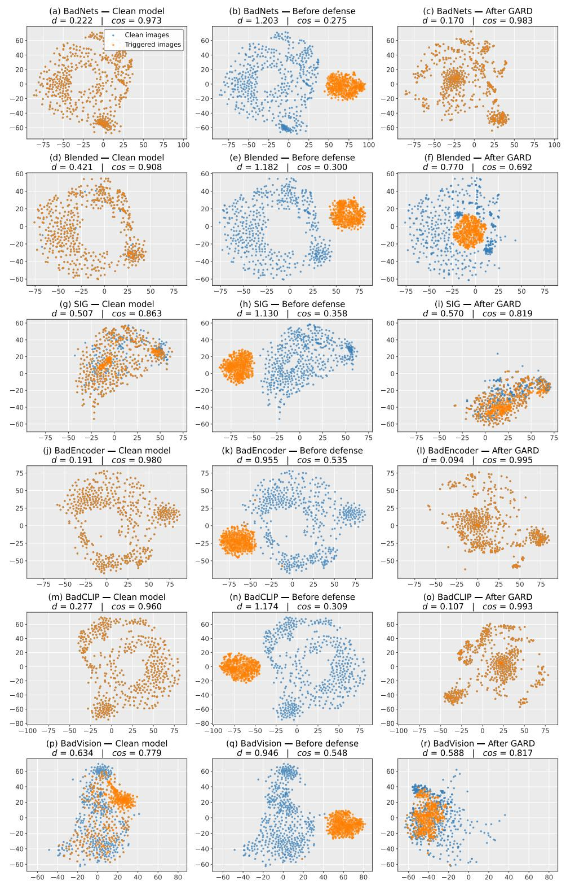  
Figure B1. Complete representation visualization across six attacks on ViT-B/32. Each row corresponds to one attack, and the columns show the clean reference model, the backdoored model before defense, and the model after GARD. Within each attack, all representations are projected using a joint t-SNE embedding. The mean Euclidean distance d and cosine similarity cos between paired clean and triggered representations are computed in the original normalized feature space.

Table C4. Image–text retrieval results on ViT-B/32. CA (%) measures clean retrieval accuracy, and ASR (%) measures backdoor effectiveness after defense. GARD uses 20K clean CC3M image–text pairs because ImageNet does not provide paired natural-language descriptions; all other settings remain unchanged. The best and second-best defense results are shown in bold and underlined, respectively.
<table><tr><td></td><td colspan="2">BadNets</td><td colspan="2">Blended</td><td colspan="2">SIG</td><td colspan="2">BadEncoder</td><td colspan="2">BadCLIP</td><td colspan="2">BadVision</td></tr><tr><td>Method</td><td>CA↑</td><td>ASR↓</td><td>CA↑</td><td>ASR↓</td><td>CA↑</td><td>ASR↓</td><td>CA↑</td><td>ASR↓</td><td>CA↑</td><td>ASR↓</td><td>CA↑</td><td>ASR↓</td></tr><tr><td>No Defense</td><td>80.96</td><td>53.38</td><td>80.84</td><td>96.34</td><td>81.12</td><td>78.46</td><td>82.84</td><td>100.00</td><td>81.02</td><td>100.00</td><td>81.20</td><td>99.94</td></tr><tr><td>FT</td><td>78.00</td><td>1.76</td><td>78.46</td><td>29.62</td><td>78.52</td><td>4.64</td><td>79.16</td><td>0.38</td><td>79.42</td><td>99.58</td><td>78.40</td><td>52.28</td></tr><tr><td>CleanCLIP</td><td>79.04</td><td>1.32</td><td>80.36</td><td>0.52</td><td>79.18</td><td>1.48</td><td>80.16</td><td>0.34</td><td>80.14</td><td>99.32</td><td>79.46</td><td>35.16</td></tr><tr><td>PAR</td><td>78.64</td><td>0.76</td><td>77.32</td><td>0.20</td><td>78.36</td><td>6.94</td><td>76.98</td><td>0.18</td><td>78.36</td><td>99.34</td><td>77.66</td><td>7.20</td></tr><tr><td>InverTune</td><td>80.86</td><td>5.31</td><td>81.00</td><td>3.50</td><td>80.84</td><td>7.56</td><td>79.08</td><td>0.68</td><td>80.40</td><td>2.74</td><td>80.24</td><td>50.44</td></tr><tr><td>GARD</td><td>78.90</td><td>0.66</td><td>77.94</td><td>0.01</td><td>73.45</td><td>2.56</td><td>79.30</td><td>0.62</td><td>78.92</td><td>1.88</td><td>76.42</td><td>0.02</td></tr></table>

Table D5. Comparison between CLIP-adapted PGD adversarial training (AT) and GARD across six attacks and two visual backbones. CA and ASR are reported in percent. Bold values indicate the better result between AT and GARD for each backbone and attack.
<table><tr><td rowspan="2">Backbone</td><td rowspan="2">Method</td><td colspan="2">BadNets</td><td colspan="2">Blended</td><td colspan="2">SIG</td><td colspan="2">BadEncoder</td><td colspan="2">BadCLIP</td><td colspan="2">BadVision</td></tr><tr><td>CA↑</td><td>ASR↓</td><td>CA↑</td><td>ASR↓</td><td>CA↑</td><td>ASR↓</td><td>CA↑</td><td>ASR↓</td><td>CA↑</td><td>ASR↓</td><td>CA↑</td><td>ASR↓</td></tr><tr><td>ViT-B/32</td><td>AT</td><td>49.73</td><td>52.87</td><td>57.23</td><td>0.02</td><td>48.71</td><td>3.24</td><td>50.98</td><td>0.02</td><td>50.68</td><td>14.80</td><td>52.18</td><td>0.03</td></tr><tr><td>ViT-B/32</td><td>GARD</td><td>59.36</td><td>0.10</td><td>59.23</td><td>0.01</td><td>57.61</td><td>0.88</td><td>61.66</td><td>0.05</td><td>61.01</td><td>0.82</td><td>60.39</td><td>0.63</td></tr><tr><td>RN50 RN50</td><td>AT GARD</td><td>46.42 53.35</td><td>54.03 0.11</td><td>47.17 52.79</td><td>0.01 0.03</td><td>48.14 53.44</td><td>0.20 0.45</td><td>49.01 55.76</td><td>0.02 0.01</td><td>50.54 54.88</td><td>76.58 0.03</td><td>45.11 53.97</td><td>0.01 0.05</td></tr></table>

BadEncoder. Following its original setting, BadEncoder is constructed on VOC [9] and uses a 40×40 white patch placed at the bottom-right corner.

BadVision. Following its original setting, BadVision is constructed on VOC and uses an optimized global perturbation.

All backdoored models are initialized from the corresponding OpenAI CLIP checkpoints [23].

## E.3 Backdoor Defenses

Each defense is applied independently to the corresponding backdoored checkpoint.

FT. FT uses 500K clean CC3M image–text pairs and is trained for 10 epochs with a batch size of 64 and a learning rate of $4 . 5 \times 1 0 ^ { - 6 }$

CleanCLIP. CleanCLIP [1] uses 500K clean CC3M image–text pairs and is trained for 10 epochs with a batch size of 64 and a learning rate of $4 . 5 \times 1 0 ^ { - 6 }$

PAR. PAR [25] uses 500K clean CC3M image–text pairs and is trained for 10 epochs with a batch size of 64. Following InverTune [26], we set the starting and peak learning rates to $3 \times 1 0 ^ { - 6 }$ and $5 \times 1 0 ^ { - 6 }$ respectively.

InverTune. InverTune [26] uses 50K clean ImageNet images following its original multi-stage setting.

GARD. GARD uses a subset of 20K clean labeled ImageNet images. Each image is paired with the prompt “a photo of a {class name}” constructed from its ground-truth label. GARD is trained for 10 epochs with a batch size of 64 and a learning rate of $4 . 5 \times 1 0 ^ { - 6 }$ . We set $\lambda _ { \mathrm { c m } } = 1 . 0$ and $\lambda _ { g } = \lambda _ { p } = 0 . 8$ . The global perturbation uses an $\ell _ { \infty }$ bound of 8/255, a step size of 1/255, and six optimization steps. The local perturbation uses a fixed $3 2 \times 3 2$ patch centered in the image, a step size of 0.1, and six optimization steps.

## F Adaptive Attack Protocols

Both implementations start from OpenAI CLIP ViT-B/32. The attacker has access to labeled clean images and triggered inputs.

Adaptive attack objective. At each adaptive update, the attacker combines the base attack objective with a loss designed to resist GARD:

$$
\mathcal { L } _ { \mathrm { a d a p t i v e } } ^ { ( k ) } = \mathcal { L } _ { \mathrm { b a s e } } + \lambda _ { k } \mathcal { L } _ { \mathrm { r e s i s t } } ^ { ( k ) } , \qquad k \in \{ 1 , 2 \} ,\tag{10}
$$

where k denotes the two strategies below and $\lambda _ { k }$ controls the strength of the added loss.

Simulated purification. In this experiment, every five outer steps the attacker copies the current model into a surrogate and applies two GARD updates using its clean, globalconsistency, and local-consistency loss functions. After purification, the attacker computes the targeted cross-entropy gradient on the surrogate and adds a weighted copy of this gradient to the original encoder’s base attack gradient. This is a first-order approximation that treats the Jacobian of the purification trajectory as the identity; it does not backpropagate through the optimizer updates.Then we save the attacker’s

Table G6. Effect of poisoned samples in the defense data on Bad-CLIP with ViT-B/32. n is the number of poisoned images added to the original 20K clean defense set. CA and ASR are measured after GARD defense.
<table><tr><td>n</td><td>ASR↓(%)</td><td>CA↑(%)</td></tr><tr><td>0</td><td>0.82</td><td>61.01</td></tr><tr><td>1</td><td>19.03</td><td>60.73</td></tr><tr><td>2</td><td>68.68</td><td>60.14</td></tr><tr><td>5</td><td>83.08</td><td>60.59</td></tr><tr><td>10</td><td>87.28</td><td>60.47</td></tr><tr><td>20</td><td>98.80</td><td>60.62</td></tr><tr><td>100</td><td>99.95</td><td>60.79</td></tr></table>

model checkpoint, apply the full GARD purification procedure, and evaluate the purified model.

Defense-signal evasion. During attack training, we use GARD’s generators to produce global and local perturbations of clean images. We incorporate the corresponding GARD consistency losses into the base attack objective and update the model to minimize the combined objective. By minimiz ing these consistency losses during attack training, this strategy aims to weaken the signal that guides GARD purification.

## G Sensitivity to Contaminated Defense Data

We examine how GARD performs when its defense set contains poisoned images. Starting from the class-balanced 20K ImageNet subset used in the main experiments (20 images per class), we add n triggered images whose true class differs from the attack target and assign them the target-class label. This concentrates the contamination in the target class: at n = 1, the target class contains 20 clean images and one poisoned image. We evaluate the defended ViT-B/32 model against BadCLIP as n increases.

Table G6 shows that GARD still reduces ASR with one poisoned image in the defense set, but its protection degrades rapidly as contamination increases. ASR rises from 0.82% without contamination to 19.03% with one poisoned image and 68.68% with two, while CA remains near 60–61%. With 20 or more poisoned images, ASR approaches that of the undefended model. As the number of poisoned images grows, their triggers and incorrect target labels may increasingly reinforce the backdoor association during defense training, eventually overwhelming the purification effect. GARD therefore benefits from keeping the defense set clean, but requires only a small collection of clean images rather than the large dataset used by the fine-tuning baselines. This makes assembling a carefully verified defense set more practical.

## H Defense without Clean Target-Class Images

We further test whether GARD needs clean images from the attacker’s target class. Using the same BadCLIP backdoored

Table I8. Defense runtime under our experimental settings. The upper block compares complete defense pipelines; the lower block breaks down InverTune’s runtime. All times are in minutes (lower is better). Bold indicates the shortest total runtime.
<table><tr><td>Defense method Total time (min) ↓</td></tr><tr><td>CleanCLIP 215.44</td></tr><tr><td>PAR 148.41</td></tr><tr><td>InverTune 93.11</td></tr><tr><td>GARD (ours) 42.50</td></tr><tr><td>InverTune: stage-wise breakdown</td></tr><tr><td>UAP generation 74.41</td></tr><tr><td>Target-class identification 6.11</td></tr><tr><td>Trigger inversion 11.28</td></tr><tr><td>Activation tuning (incl. selection) 1.31</td></tr></table>

ViT-B/32 model as in the main experiments, we remove all 20 target-class images from the 20K ImageNet defense set and leave the other defense settings unchanged.

Table H7. BadCLIP defense with and without clean target-class images. Results are measured after GARD purification of the same ViT-B/32 model.
<table><tr><td>Defense data</td><td>ASR↓(%)</td><td>CA↑(%)</td></tr><tr><td>Full 20K set</td><td>0.82</td><td>61.01</td></tr><tr><td>Without target class</td><td>0.03</td><td>60.02</td></tr></table>

Table H7 shows that GARD remains effective without clean images from the attacker’s target class. This result is consistent with the preliminary study: global and local probes can expose backdoor-sensitive directions using images from other classes, without requiring clean examples of the attack target.

## I Defense Runtime

Table I8 reports the wall-clock time of the complete defense pipeline for each method. The timing setup uses a single NVIDIA GeForce RTX 4090 (24 GB). CleanCLIP, PAR, and GARD are trained for 10 epochs; InverTune follows its multi stage procedure, including UAP generation, target-class identification, trigger inversion, and activation tuning with sample selection. These measurements use the method-specific defense data settings described above: 500K clean CC3M pair for CleanCLIP and PAR, 50K clean ImageNet images for InverTune, and 20K for GARD.

GARD completes defense training in 42.50 minutes, compared with 215.44, 148.41, and 93.11 minutes for Clean-CLIP, PAR, and InverTune, respectively. This corresponds to speedups of 5.07×, 3.49×, and 2.19× under these settings. For InverTune, UAP generation accounts for approximately 80% of the total runtime. Despite its adversarial probing steps, GARD has the lowest total runtime among the compared methods.

## J Computing Infrastructure

Experiments were run on a server equipped with eight NVIDIA GeForce RTX 4090 GPUs, each with 24 GB of memory. The server has two Intel Xeon Platinum 8378C CPUs at 2.80 GHz, providing 76 physical cores and 152 logical threads in total, and approximately 1 TB of system memory (1007.5 GiB recognized by the operating system). It runs Ubuntu 22.04.5 LTS with Linux kernel 6.8.0- 111-generic. The software environment consists of Python 3.11.14, PyTorch 2.7.0+cu118, CUDA 11.8 (for both the Py-Torch runtime and the system CUDA Toolkit), and Open-CLIP (open-clip-torch) 3.2.0.