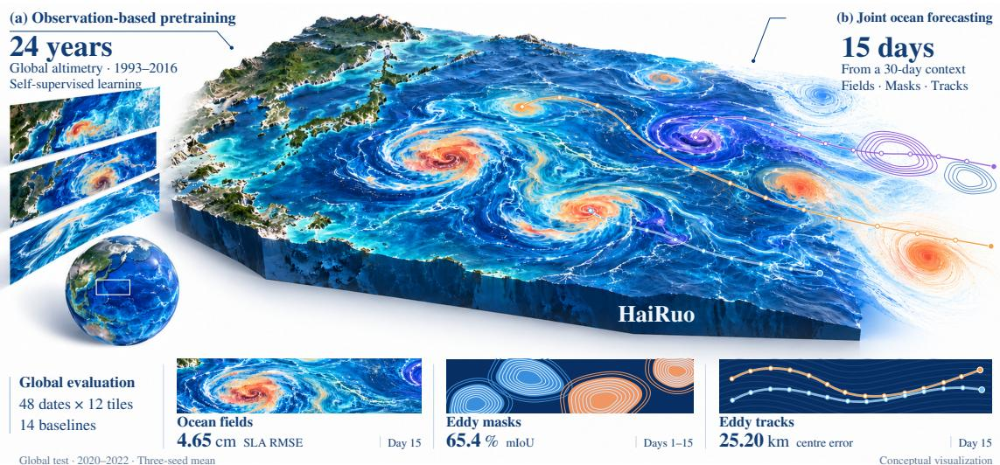
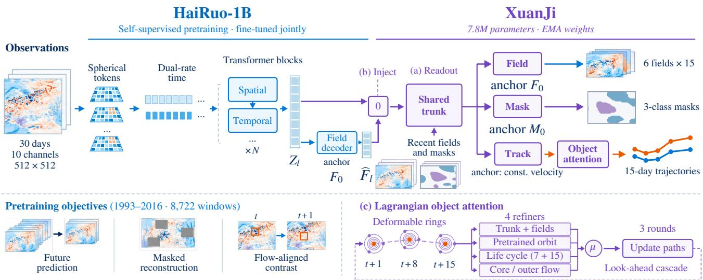
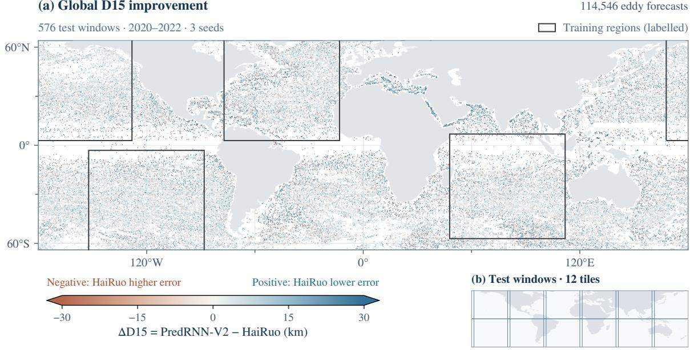
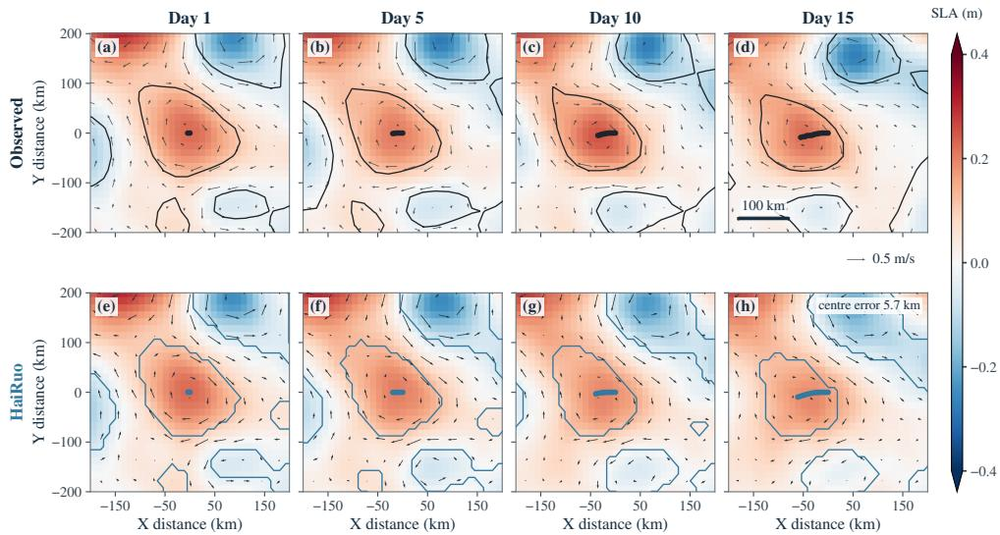
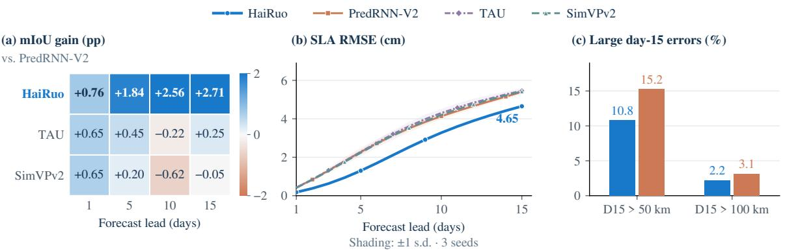

# HaiRuo: Forecasting Ocean Eddies as Fields and Objects with a Satellite-Altimetry Foundation Model

Xukun Qin1,2 Haochen Sun1 Yuyang Tian2,3 Ge Chen1,∗

1Ocean University of China 2Shanghai Artificial Intelligence Laboratory 3University of Science and Technology of China

  
Figure 1. HaiRuo forecasts ocean fields, eddy masks and eddy trajectories for 15 days in one forward pass. (a) HaiRuo-1B is pretrained without labels on 24 years of altimetry and then fine-tuned under XuanJi; (b) XuanJi reads it out as fields, masks and every eddy’s trajectory. Bottom: HaiRuo on the global 2020–2022 evaluation, 48 dates × 12 tiles, three-seed means; the fourteen baselines are in Table 1.

## Abstract

Mesoscale eddies carry most ofthe ocean’s kinetic energy and move heat, salt and nutrients across basins, yet where an eddy will be two weeks ahead is still read offocean models with post-hoc tracking heuristics. We introduce HaiRuo, whichforecasts eddies asfields and as objects at once: from 30 days ofsatellite sea-level maps, oneforward pass returns 15 days of sea level and geostrophic velocity, daily eddy masks and the trajectory of every eddy alive today. HaiRuo pairs two components with a clear division of labour: (1) HaiRuo-1B, an open-weight 1.05-billion-parameterfoundation model pretrained without labels on 24 years ofglobal satellite-altimetry observations, which supplies the 15-day physicalfields and masks (+0.14field skill and +1.1 mIoU points under the same decoder) andfurther lowers 15-day centre error by 1.2 km frozen (1.35 km over training from scratch); and (2) XuanJi, a Lagrangian object decoder that samples the evolvingforecast in each eddy’s co-moving polar frame and refines the 15-day path across three look-ahead

rounds, removing 2.5 km on HaiRuo-1B (2.9 km with joint fine-tuning) and 2.5–3.3 km via its object attention across six published backbones. Under one pre-registered global evaluation over the whole ocean, HaiRuo improves on fourteen methods on every endpoint (25.2 vs. 30.6 km 15-day centre error, −18 %), holding its margin outside the labelled regions and through both phases of the El Nino–Southern˜ Oscillation (ENSO), while reproducing westward drift, 50– 60◦S eastward reversal and poleward cyclone–anticyclone deflection. Over ten days through one fixed tracker, Hai-Ruo’s forecast field cuts the eddy-centre error of WenHai and XiHe by 37–43 % (−2.8 km vs. day 0 while they degrade +4.3–8.7 km), and its object trajectories cut pipeline error by 77–78 % globally.

## 1. Introduction

Where will this eddy be in two weeks? Mesoscale eddies, coherent vortices 50–300 km across that live for weeks to months, carry most of the ocean’s kinetic energy and move heat, salt and nutrients across basins [6, 15]. Satellites have mapped them every day for three decades, and atlases detect and track the eddies the maps resolve [14, 35]. Forecasting them is a different matter. Run a state-of-the-art AI ocean forecaster [8, 47] and track the eddies in its forecast with a fixed tracker, and they land farther from their true positions than if the forecaster’s own initial state had been held fixed (Section 4.5).

  
Figure 2. XuanJi reads the HaiRuo-1B forecast into fields, masks and trajectories. HaiRuo-1B turns 30 days of altimetry into spherical tokens, compresses time at two rates and applies spatio-temporal blocks. Its per-lead features Z and its own forecast Fˆ are injected (b) into XuanJi’s multi-scale spatial stem and proposal heads (a), anchored at persistence and constant velocity; XuanJi object attention (c) samples the forecast and the backbone along every predicted path and refines all 15 leads in three look-ahead rounds, averaged $( \mu , \omega _ { j } { = } \frac { 1 } { 4 } )$ over four refiners.

The reason is structural. These systems forecast fields, learn from reanalysis, and leave eddies to a tracker applied afterwards; nothing in them follows an eddy. Seen from computer vision, eddy forecasting is coupled field-and-object forecasting on continuous spherical fields, where eddies are coherent vortices defined by gradients of the evolving flow itself: given 30 daily maps, predict the next 15, the daily cyclonic and anticyclonic masks, and the path of every eddy alive today. We find that the object belongs in the decoder: a forecaster should learn the ocean’s dynamics at scale from what satellites observe, and then read eddies out as objects that follow and re-sample its own evolving forecast.

We present HaiRuo (Figure 1). Existing AI ocean models [8, 13, 23, 47, 50] are reanalysis state emulators rather than open, label-free observation foundation backbones for downstream decoders. Our backbone, HaiRuo-1B, fills this gap: a 1.05-billion-parameter foundation model pretrained without labels on 24 years of global satellite-altimetry observations with a two-stage spherical 0.5◦ stem, dual-rate 30- day memory, eddy-focused chirality-gated attention, multiaxis masked reconstruction and a geostrophic flow-advected contrast. Every readout tested benefits from HaiRuo-1B, and we pair it with XuanJi, a Lagrangian object decoder that returns 15-day fields, daily masks and every eddy’s trajectory via XuanJi object attention: unlike static-map motion queries [38, 52], occupancy grids [21, 22] or point-vortex advection, XuanJi re-samples the model’s own continuous evolving 15-day forecast and backbone along each eddy’s predicted path in a co-moving polar frame (mean intensity, self-advection dipole and strain quadrupole modes), attends across all 15 leads, and averages four refiners over three look-ahead rounds.

Our contributions are: (i) HaiRuo-1B, an open-weight 1.05B ocean foundation model pretrained without labels on 24 years of global altimetry observations, forecasting 15-day sea level and geostrophic velocity in one pass and lifting every readout tested: under XuanJi, it raises field skill from 0.63 to 0.77, adds 1.1 mIoU points and lowers D15 by 1.2 km frozen on Dev48 (1.35 km over training the same 1B architecture from scratch, and 0.6–1.4 km over six video backbones), while even with plain base heads frozen HaiRuo-1B (25.8 km) beats all 14 baselines and self-supervised PredRNN-V2 (30.4 km frozen, 26.6 km finetuned); (ii) XuanJi, a plug-and-play co-moving polar object decoder that samples azimuthal Fourier modes of the evolving forecast along each eddy’s predicted orbit and refines all 15 leads jointly across three look-ahead rounds and four refiners, removing 2.5 km of D15 on HaiRuo-1B on Dev48 (2.9 km with joint fine-tuning; 0.56 km on Dev48 and 0.87 km globally from multi-expert refinement) and 2.5– 3.3 km via two-round object attention across six published backbones; (iii) a pre-registered global evaluation (Table 1, Figure 3) in which HaiRuo improves on fourteen methods on every endpoint, lowering D15 by 18 % against the strongest and by 17–18 % outside the labelled regions and in both ENSO phases, while reproducing latitudinal westward drift (and 50–60◦S eastward reversal) and poleward cyclone– anticyclone deflection; and (iv) a system comparison through one fixed tracker over days 1–10, in which HaiRuo’s forecast field cuts the eddy-centre error of WenHai and XiHe by 37–43 % field for field on Test48 (improving by 2.8 km over its held-fixed day-0 state while they degrade by 4.3–8.7 km), and direct object trajectories cut pipeline error by 77–78 % over the whole ocean.

## 2. Related work

Spatio-temporal prediction. Recurrent predictors (ConvLSTM [39], PredRNN-V2 [48], PhyDNet [25], SwinLSTM [43]), recurrence-free models (SimVP [18], TAU [41], SimVPv2 [42]), transformers (Earthformer [17], PredFormer [44]) and neural operators (FNO [28]) are the standard tools for video and weather-like forecasting. They treat every pixel or patch alike.

Eddy forecasting. Eddy atlases detect eddies as closed seasurface-height contours (earlier, by Okubo–Weiss [5]) and link them in time [6, 30, 35]; EddyNet [27] learns detection. Trajectory forecasters model each track from its own attributes via recurrent [46], transformer [10], dual-graph [11] and LSTM/Informer [19] networks, or via physics-fused [51] and global [7] models without public code, seeing at most local field descriptors. HaiRuo forecasts fields, masks and tracks jointly, reading its own forecast around every moving eddy.

Ocean forecasters and foundation models. Learned ocean forecasters (XiHe [47], WenHai [8], LangYa [50], GLONET [13], FuXi-Ocean [23]) train on reanalysis from assimilated three-dimensional states and forecast state variables rather than eddy objects [12]. Altimetry interpolators [2] and climate emulators [9] likewise do not forecast eddies as objects, and open foundation backbones pretrained on global ocean observations remain scarce. Earth-system foundation models (Aurora [4], Prithvi WxC [37], ClimaX [32]) pretrain on atmospheric reanalyses and climate simulations with one- to two-step histories and $\geq 1 ^ { \circ }$ tokens. HaiRuo-1B pretrains directly on altimetry observations with a 30-day context and $0 . 5 ^ { \circ }$ eddy-resolving tokens, matched to eddies that drift a few kilometres per day with a 50 km median radius.

Object-centric decoding. Deformable attention [53] and slot attention [29] gather evidence where the object is, and object-centric video predictors roll slots forward in time [49]. In motion forecasting and planning, MTR [38] and QC-Net [52] refine trajectories with static map features gathered around their own proposals, joint detection–forecasting models refine along estimated past motion [3], FIERY [21] and UniAD [22] predict future occupancy grids alongside instance trajectories, and classical vortex-track models advect point vortices in a steering flow. In contrast, XuanJi object attention samples the model’s own continuous multi-channel forecast of an evolving field on deformable co-moving polar rings where the eddy is going, decomposes each ring into azimuthal Fourier modes (m=0, 1, 2), and re-estimates all 15 leads jointly.

## 3. Method

## 3.1. Problem and overview

The input is a window of $T { = } 3 0$ daily altimetry maps $X ~ \in ~ \bar { \mathbb { R } } ^ { 3 0 \times 1 0 \times H \times W }$ on the 0.125◦ grid $\scriptstyle ( H = W = 5 1 2 ,$ , a $6 4 ^ { \circ } \times 6 4 ^ { \circ }$ tile) with ten channels: sea-level anomaly (SLA), absolute dynamic topography (ADT), zonal and meridiona geostrophic velocity anomalies and absolute velocities, SLA mapping error, latitude, longitude and Coriolis parameter, plus an ocean mask and per-day quality map (Appendix A). At readout, the decoder also reads the observed masks and eddy tracks of the last seven days up to $t _ { 0 } .$ For the next L=15 days the model predicts (i) the six dynamic fields $\hat { F } _ { l }$ (ii) a three-class mask $\hat { M } _ { l }$ (background, cyclonic, anticyclonic) and (iii) the centre $\hat { p } _ { e , l }$ of every eddy e that exists on the last observed day $t _ { 0 } .$ . Labels for (ii) and (iii) come from a global satellite-altimetry eddy atlas (Section 4.1); (i) needs none.

HaiRuo has two parts (Figure 2): the backbone HaiRuo-1B (Section 3.2), pretrained without labels on 24 years of global altimetry and fine-tuned jointly with the decoder at a learning rate of $3 \times 1 0 ^ { - 5 }$ , and the object decoder XuanJi (Section 3.4). Every head is zero-initialised: before training the forecast is persistence, the mask is the last observed mask and every trajectory is constant-velocity extrapolation.

## 3.2. HaiRuo-1B: pretrained foundation backbone

A two-stage spherical stem embeds each daily map into fine tokens at $0 . 5 ^ { \circ }$ (patch 4), so a 50 km-radius eddy spans one to two tokens without aliasing; two spherical stride-2 convolutions build a three-level pyramid at $0 . 5 ^ { \circ }$ , 1◦ and $2 ^ { \circ }$ (depths 6/10/20), with a learned quality gate damping poorly observed swaths. To capture month-scale evolution without quadratic cost, the 30-day history is compressed at two rates: the last seven days stay explicit and the preceding 23 are distilled by per-token softmax routing into eight chronological memory slots (15 steps in total), keeping all 30 days on a differentiable path. The three levels stack 36 eddy-focused spatio-temporal blocks: spatial attention combines validitymasked shifted windows with soft eddy-vorticity focus, core– ring deformable sampling and chirality-gated projections, while temporal attention applies physical day-age-aligned QKV routing across the 15 steps. A bank of 240 sparse eddy route-memory tokens and global latents [24] bridges the pyramid to a multi-scale field decoder that queries each lead, fuses the three levels through longitude-periodic residual blocks, and outputs all 15 daily residuals for the six fields in one pass,

  
Figure 3. HaiRuo lowers the 15-day centre error across the whole ocean, including the regions never seen in labelled training. (a) Day-0 position of every evaluated eddy, coloured by the 15-day centre error (D15) of PredRNN-V2 minus that of HaiRuo (three-seed mean; blue favours HaiRuo), with the four labelled training regions outlined. (b) The 12 evaluation tiles.

$$
\hat { F } _ { l } = F _ { 0 } + \delta _ { l } \odot r _ { l } ,\tag{1}
$$

where $F _ { 0 }$ is the last observed field and $\delta _ { l }$ the training RMS of the l-day change; zero-initialised $r _ { l }$ starts every model at persistence (the 200M ablation scale uses $1 ^ { \circ }$ tokens; Appendix B).

## 3.3. Self-supervised pretraining on altimetry

Pretraining visits every daily window of 1993–2016 (8 722 windows) and draws an area-uniform random 512 × 512 tile on the global grid, so HaiRuo-1B learns dynamics across the whole ocean. Three self-supervised objectives are optimised jointly: (i) 15-lead future prediction via an area-weighted Huber loss on the δ -normalised residuals of all six fields; (ii) swath-aware multi-axis masked reconstruction [20] (40 % of spatial tokens, ≤ 15 % of full days, $\leq 2 0 \%$ of channels) via cross-attention to the compressed timeline; and (iii) a geostrophic flow-advected InfoNCE contrast [45] pairing each day-t token at $p _ { t }$ with its day-(t+1) counterpart bilinearly sampled at $\scriptstyle \tilde { p } _ { t + 1 } = \mathrm { E x p } _ { p _ { t } } ( \pmb { u } _ { g } ( p _ { t } ) \Delta t )$ along the observed spherical geostrophic velocity $\pmb { u } _ { g }$ (Appendix B). Pretraining runs from random initialisation for 93 epochs (12 648 updates at batch size 64).

## 3.4. XuanJi: object decoder

Forecast-conditioned spatial stem and initial proposal. A multi-scale residual convolutional stem (the shared trunk of Figure 2a) reads the last seven days of altimetry, seven days of past eddy masks, the ocean mask and HaiRuo-1B’s 15-lead forecast, while HaiRuo-1B’s per-lead features enter the stem through zero-initialised 1 × 1 projections, producing a spatial feature map per lead at stride 4. Three zeroinitialised heads read these features: a residual field head under (1), a mask head refined from the last observed mask, and a proposal trajectory head that integrates on the sphere a velocity correction from a gated recurrent unit (GRU) over each eddy’s seven-day track and a residual velocity sampled at five points around the constant-velocity proposal to form the initial path $\hat { p } _ { 1 : L } ^ { ( 0 ) }$ . Without HaiRuo-1B and object attention, this stem and its three heads serve as the shared Eulerian readout for all field baselines.

XuanJi object attention. For an eddy with radius R and position estimate $p _ { l }$ at lead l, we sample features on five rings $( r / R \in \{ 0 . 5 , 1 , 1 . 5 , 2 , 3 \} )$ of 16 azimuths centred at $p _ { l }$ in the eddy’s Lagrangian (co-moving) frame (Figure 9; Appendix C), and reduce each ring to its azimuthal Fourier modes $m = 0 , 1 , 2 \colon$ the mean, the dipole that encodes the asymmetry driving self-advection, and the quadrupole that encodes strain. The rings read the spatial-stem features, the six forecast fields and, directly, HaiRuo-1B: its per-lead features and its own forecast, together with the step velocity and acceleration of the current path and the geostrophic velocity implied by the dipole modes of sea level (the pretrainedorbit readout: the backbone read along the eddy’s predicted orbit). With the GRU state, the eddy metadata and a lead encoding, the modes form one token per lead; a two-layer transformer attends across the 15 lead tokens, so the correction at lead 10 can depend on what the eddy meets at lead 5, and a zero-initialised layer outputs a velocity correction per lead. Sampling and correction run for $K { = } 3$ rounds $( k { = } 0 , \ldots , K { - } 1 )$ at the updated positions with learned ring deformations (Appendix C). With S the ring sampling, $\phi _ { j }$ the reduction to modes and tokens for refiner j (next paragraph), $u _ { j } ^ { ( k ) } { = } \phi _ { j } ( S ( \hat { p } _ { 1 : L } ^ { ( k ) } ) )$ ) its lead tokens in round $k , g _ { j }$ its zero-initialised output layer and $D ^ { ( k ) }$ the displacement accumulated over the rounds so far $( D ^ { ( 0 ) } { = } 0 )$ , round k updates the whole path at once,

  
Figure 4. HaiRuo follows an anticyclone through its own forecast. A window of the global evaluation issued on 12 August 2022 in the Kuroshio Extension: observed (top) and forecast (bottom, seed 42) sea-level anomaly with geostrophic velocity (arrows), eddy contours (atlas above, forecast mask below) and the centre track (dots) at leads 1, 5, 10 and 15, in a fixed 400 km frame centred on the eddy’s day-0 position. The eddy drifts 56 km in 15 days; the forecast centre ends 5.7 km from the observed one (PredRNN-V2: 8.4 km; Figure 8); over the global evaluation the median eddy forecast of HaiRuo ends 17 km from the observed centre (PredRNN-V2: 22 km)

$$
\begin{array} { r } { D _ { l } ^ { ( k + 1 ) } = D _ { l } ^ { ( k ) } + \sum _ { l ^ { \prime } \leq l } \sum _ { j = 1 } ^ { 4 } \omega _ { j } g _ { j } \big ( \mathrm { A t t n } _ { 1 : L } ^ { j } [ u _ { j } ^ { ( k ) } ] \big ) _ { l ^ { \prime } } , } \end{array}\tag{2}
$$

and $\begin{array} { r } { \hat { p } _ { 1 : L } ^ { ( k + 1 ) } = \hat { p } _ { 1 : L } ^ { ( 0 ) } \oplus \frac { K } { k + 1 } D _ { 1 : L } ^ { ( k + 1 ) } } \end{array}$ , where ⊕ integrates a displacement on the sphere from the initial path, $\mathrm { A t t n } _ { 1 : L } ^ { j }$ is refiner $j ^ { \circ } \mathbf { s }$ transformer over its lead tokens, the sum over $l ^ { \prime }$ turns daily velocities into a displacement and $\omega _ { j } = \frac { 1 } { 4 }$ at inference. The factor $K / ( k { + } 1 )$ is the look-ahead cascade: every round samples where the eddy will be at the end of its path, carries its lead states and ring deformations into the next, and the last round $\left( k + 1 { = } K \right)$ applies the displacement as it is.

Multi-expert look-ahead refinement. The four refiners $g _ { 1 } , \ldots , g _ { 4 }$ of (2) read complementary evidence along the eddy’s trajectory: the spatial-stem and forecast rings (g1), the pretrained HaiRuo-1B orbit $\left( g _ { 2 } \right)$ , the eddy’s 22-day pastand-future life cycle $\left( g _ { 3 } \right)$ , and the geostrophic contrast between inner core and outer rings $\left( g _ { 4 } \right)$ . In training, a randomly drawn primary refiner dominates each eddy’s correction $( \omega _ { \mathrm { p r i m a r y } } = 0 . 7 6$ , others 0.08) to prevent co-adaptation; at inference the four are averaged $( \omega _ { j } = \frac { 1 } { 4 }$ ; Appendix C).

Training. The objective sums a Huber loss on the fields, focal–Dice, boundary and soft-Jaccard losses on the masks, and a smooth-ℓ1 loss on positions and daily displacements. Training visits 1 024 labelled windows eight times with AdamW and cosine decay and evaluates the weights at the fixed final step; XuanJi is evaluated with an exponential moving average (EMA) of its weights over the last three quarters of training. XuanJi (7.85M parameters) and HaiRuo-1B (1.06B total) train jointly in 10–12 h on one GPU (Appendices C, I).

Table 1. Global evaluation on the independent 2020–2022 period: 48 dates on 12 tiles covering all longitudes between $6 4 ^ { \circ } \mathrm { S }$ and $6 4 ^ { \circ } \mathrm { N } ,$ every model scored once. Training regions: the four regions whose labelled windows are used for training; other regions: the rest of the ocean, never seen in labelled training. Three-seed means (seed s.d. of D15: 0.03 km for HaiRuo, 0.11–0.80 km for the field baselines, 0.02 and 0.80 km for LSTM+Informer and Track Transformer); trajectory-only models have no masks or fields. Field: field skill; L15: lead 15. Bold: best in the column. ∆: HaiRuo minus the method in the other regions, with its 95 % interval and the relative change.
<table><tr><td></td><td colspan="3">D15 (km)↓</td><td></td><td>Centre ↓ mIoU ↑ Field ↑</td><td></td><td>SLA RMSE ↓</td><td colspan="3">∆D15, other regions</td></tr><tr><td>Method</td><td>Global</td><td>Training regions</td><td>Other regions</td><td>(km)</td><td>(%)</td><td></td><td>L15 (cm)</td><td colspan="3">km [CI], rel.</td></tr><tr><td>HaiRuo (ours)</td><td>25.20</td><td>22.74</td><td>27.64</td><td>14.03</td><td>65.40</td><td>0.736</td><td>4.65</td><td colspan="3"></td></tr><tr><td>PredRNN-V2 (2023)</td><td>30.58</td><td>27.53</td><td>33.61</td><td>17.01</td><td>63.31</td><td>0.556</td><td>5.39</td><td>-5.97 [−6.16, −5.79], −17.8 %</td><td></td><td></td></tr><tr><td>PhyDNet (2020)</td><td>30.59</td><td>27.54</td><td>33.63</td><td>16.89</td><td>63.50</td><td>0.549</td><td>5.40</td><td>-5.99 [−6.20, -5.79], −17.8 %</td><td></td><td></td></tr><tr><td>TAU (2023)</td><td>30.64</td><td>27.73</td><td>33.52</td><td>16.70</td><td>63.50</td><td>0.578</td><td>5.46</td><td>-5.88 [−6.07, -5.70], −17.6 %</td><td></td><td></td></tr><tr><td>SimVPv2/gSTA (2025)</td><td>30.85</td><td>27.91</td><td>33.77</td><td>16.81</td><td>63.21</td><td>0.588</td><td>5.42</td><td>-6.13 [−6.31, -5.95], -18.2 %</td><td></td><td></td></tr><tr><td>SimVP (2022)</td><td>30.96</td><td>28.11</td><td>33.80</td><td>16.85</td><td>62.15</td><td>0.520</td><td>5.80</td><td>-6.16 [−6.32, -6.01], −18.2 %</td><td></td><td></td></tr><tr><td>U-Net (2015)</td><td>31.00</td><td>28.09</td><td>33.88</td><td>16.94</td><td>59.93</td><td>0.309</td><td>7.56</td><td>-6.24 [−6.43, -6.06], -18.4 %</td><td></td><td></td></tr><tr><td>ConvLSTM (2015)</td><td>31.19</td><td>28.24</td><td>34.13</td><td>17.07</td><td>63.28</td><td>0.553</td><td>5.49</td><td>-6.49 [−6.70, -6.30], -19.0 %</td><td></td><td></td></tr><tr><td>EddyNet (2018)</td><td>32.88</td><td>30.27</td><td>35.47</td><td>17.73</td><td>61.98</td><td>0.438</td><td>6.04</td><td>−7.83 [−8.04, −7.63], −22.1 %</td><td></td><td></td></tr><tr><td>PredFormer (2026)</td><td>33.20</td><td>30.56</td><td>35.82</td><td>17.97</td><td>60.57</td><td>0.411</td><td>6.06</td><td>-8.18 [−8.43, −7.96], −22.8 %</td><td></td><td></td></tr><tr><td>Earthformer (2022)</td><td>33.41</td><td>30.38</td><td>36.43</td><td>18.05</td><td>61.16</td><td>0.459</td><td>5.75</td><td>-8.79 [−8.99, -8.60], -24.1 %</td><td></td><td></td></tr><tr><td>LSTM+Informer (2025, tracks)</td><td>34.05</td><td>31.21</td><td>36.89</td><td>18.29</td><td></td><td></td><td></td><td>-9.25 [−9.69, -8.90], -25.1 %</td><td></td><td></td></tr><tr><td>SwinLSTM-B (2023)</td><td>34.28</td><td>31.53</td><td>37.02</td><td>18.63</td><td>58.96</td><td>0.130</td><td>6.60</td><td>-9.38 [−9.62, −9.15], −25.3 %</td><td></td><td></td></tr><tr><td>FNO-2d (2021)</td><td>34.90</td><td>32.14</td><td>37.65</td><td>19.01</td><td>53.83</td><td>0.251</td><td>6.48</td><td>-10.01 [−10.26, −9.77], −26.6 %</td><td></td><td></td></tr><tr><td>Track Transformer (2024, tracks)</td><td>36.66</td><td>34.05</td><td>39.24</td><td>19.58</td><td></td><td></td><td></td><td>-11.60 [−11.82, -11.38], -29.6 %</td><td></td><td></td></tr></table>

## 4. Experiments

## 4.1. Setup

Data and protocol. Inputs are daily $1 / 8 ^ { \circ }$ delayed-time DUACS altimetry maps [1, 40] and META4.0 eddy atlas labels [16] (Appendix A; operational forecasting would use near-real-time streams), split into 1993–2016 (pretraining and labelled training), 2017–2019 (Dev48) and 2020–2022 (Test48). Labelled windows come from four fixed 512 × 512 regions (North Atlantic, North Pacific, South Pacific, Indian Ocean); the main evaluation covers the whole ocean between $6 4 ^ { \circ } \mathrm { S }$ and $6 4 ^ { \circ } \mathrm { N } .$ . All models follow one pre-registered protocol: the same 1 024 labelled windows and training budget, the same base readout heads for the field methods (Section 3.4), three seeds and the fixed final checkpoint. The test period is scored once per model globally and on Test48 (Appendices A, D), with 95 % paired bootstrap intervals.

Metrics. D15: great-circle error (km) of the predicted centre at lead 15 for every atlas eddy alive at $t _ { 0 }$ and at lead 15 (Appendix $\mathbf { A } ) ;$ centre: the same error over leads 1–15; mIoU: three-class mean intersection over union of the daily masks; field skill: $1 - \mathrm { M S E / M S E _ { p e r s i s t e n c e } }$ of the six fields (persistence $0 ,$ perfect 1; time-constant MDT cancels in $\hat { F } _ { l } - F _ { l }$ and $F _ { 0 } - F _ { l }$ , so ADT and absolute velocities share identical errors and skill with SLA and velocity anomalies).

Baselines. We re-implement fourteen methods as complete systems under the same labelled-training budget, the twelve field methods with the same base readout heads (Appendix G): ConvLSTM [39], PredRNN-V2 [48], PhyDNet [25], SwinLSTM-B [43], SimVP [18], TAU [41], SimVPv2/gSTA [42], Earthformer [17], PredFormer [44], FNO-2d [28], EddyNet [27], a U-Net [36], and two trajectory-only models that see the eddy histories but no field (LSTM+Informer [19], Track Transformer [10]).

## 4.2. Comparison with state-of-the-art methods

Table 1 reports the independent 2020–2022 test over the whole ocean (Figure 3), split into the four training regions and all other regions. HaiRuo leads on every endpoint, inside and outside the training regions (Appendix I). Over the whole ocean it brings D15 to 25.2 km (18 % below PredRNN-V2, every paired interval excluding zero), field skill to 0.74 and 15-day sea-level error to 4.7 cm, against 0.59 and 5.4 cm for the best baseline on each. In Figure 4 the eddy keeps its closed contour through day 15; Figure 3 maps the D15 gain eddy by eddy, and Figure 5a,b follows the mask and sea-level gains by lead. Across the 114 546 global eddies, the share with D15 above 50 km falls from 15.2 % for PredRNN-V2 to 10.8 % (Figure 5c). On Test48, HaiRuo likewise leads all baselines on foreground eddy IoU, 1-pixel contour boundary F1, unconditioned all-track recall and short-lived eddy accuracy (Appendix I).

Outside the labelled training regions, HaiRuo stays 18 % ahead of the strongest baseline (TAU), leads all 14 methods on masks, fields and D15 (every paired interval excluding zero), and shows the smallest absolute regional gap (4.9 km vs. 5.2–6.1 km). Under the shared base heads, the strongest recurrent and recurrence-free predictors all lie within 1 km

  
Figure 5. Skill by lead and reliability on the global evaluation. (a) Three-class mIoU of the lead-l mask relative to PredRNN-V2 (difference of three-seed means, percentage points). (b) Sea-level-anomaly RMSE by lead (three-seed means; shading one standard deviation across seeds). (c) Share of the 114 546 evaluated eddies whose day-15 centre error, averaged over three seeds, exceeds 50 and 100 km.

Table 2. Accuracy through ENSO: global evaluation in the other regions (2020–2022), windows grouped by the ENSO phase of their anchor date (Jan–Mar 2020 El Nino; 17 Dev48 El Ni˜ no dates:˜ 23.34 vs. 27.29 km, −14.5 %; 9 RONI dates: 23.18 vs. 27.56 km, Appendix E). HaiRuo against the strongest of the 14 baselines in each phase (bold: best; all methods: Table 8).

<table><tr><td rowspan="2"></td><td colspan="2">El Niño (4 dates)</td><td colspan="2">La Niña (34 dates)</td></tr><tr><td>HaiRuo</td><td>best baseline</td><td>HaiRuo</td><td>best baseline</td></tr><tr><td>D15 (km)</td><td>28.24</td><td>34.12 (TAU)</td><td>27.28</td><td>33.20 (TAU)</td></tr><tr><td>gap Centre (km)</td><td>15.66</td><td>-5.88 (−17.2 %) 18.61 (TAU)</td><td>15.16</td><td>-5.91 (-17.8 %) 18.03 (TAU)</td></tr><tr><td>mIoU (%)</td><td>63.70</td><td>61.64 (TAU)</td><td>63.86</td><td>61.71 (TAU)</td></tr><tr><td>Field skill</td><td>0.714</td><td>0.556 (gSTA)</td><td>0.723</td><td>0.565 (gSTA)</td></tr><tr><td></td><td></td><td></td><td></td><td></td></tr></table>

of a U-Net, whereas HaiRuo-1B pretraining and XuanJi remove over 5 km (and still lead when baselines receive XuanJi object attention, 22-epoch global pretraining, or all 8 722 windows; Section 4.4, Appendix I).

## 4.3. Forecasting through ENSO

HaiRuo is trained on 1993–2016 and never sees a climate index. Its test period spans both phases of the El Nino–˜ Southern Oscillation (ENSO), the dominant mode of interannual ocean variability [31]: the 2019–20 El Nino and˜ 2020–22 La Nina winters from the Oceanic Ni˜ no Index˜ (ONI) [33].

Table 2 scores the El Nino and La Ni˜ na windows outside˜ the training regions separately. HaiRuo keeps its accuracy through both phases, within 2.2 % of its all-phase error, and leads all fourteen methods on every endpoint in both phases, by 17–18 % in D15. The margin holds on Test48 and on the 2018–19 Dev48 El Nino (17 ONI dates:˜ −14.5 %; 9 Relative ONI [34] dates: −15.9 %). In the tropical Pacific, the margin over PredRNN-V2 stays at 17 % (8.9 km; Figure 6c, Appendix E): ENSO modulates eastern-Pacific eddy kinetic energy by 38 % without affecting HaiRuo’s accuracy or its lead over all 14 methods.

Physical consistency. HaiRuo is given no Rossby-wave or β-drift law, yet its forecasts reproduce altimetry propagation statistics [6] (Appendix F): across global latitude bins the 15-day westward drift matches observations (r=0.98, slope 1.14, reversing to eastward at $5 0 { - } 6 0 ^ { \circ } \mathrm { S } )$ , and unlike constant-velocity extrapolation (which inherits zonal drift but reverses meridional polarity deflection in both hemispheres) cyclones drift poleward relative to anticyclones in both hemispheres, closer to observations than PredRNN-V2. Moreover, geostrophic velocities derived from Hai-Ruo’s predicted SLA on Test48 best match observed currents across all 12 field baselines (r=0.901, 5.47 vs. ≥ 5.91 cm/s, r≤0.884).

## 4.4. Ablation study

Table 3 and Table 15 separate the roles of the foundation backbone and the object decoder on Dev48: HaiRuo-1B supplies the physical fields and masks and lifts every readout tested, while XuanJi refines the trajectories of every backbone it reads (HaiRuo: 22.87 km).

Pretraining (HaiRuo-1B). Under the same XuanJi decoder, frozen HaiRuo-1B lifts field skill from 0.63 to 0.77 (+0.141), adds 1.09 mIoU points and removes 1.19 km of D15 over no backbone (25.07 to 23.85 km): all of the gain of HaiRuo over the decoder alone in fields, most in masks and over half in trajectories comes from the pretrained representation. Trained from scratch, the identical 1B + XuanJi model scores 24.22 km, 66.52 % mIoU and 0.662 field skill, losing 1.35 km D15, 1.12 mIoU and 0.107 field skill to Hai-Ruo (trailing even frozen HaiRuo-1B by 0.93 km). Under the same two-round XuanJi decoder, frozen HaiRuo-1B also leads all six published video-prediction backbones on every endpoint: by 0.57–1.44 km D15, 0.80–1.85 mIoU and 0.074–0.142 field skill, every interval excluding zero (Table 15). Even with plain base heads (no object attention), frozen HaiRuo-1B (25.76 km, 67.10 % mIoU, 0.771 field skill) beats all 14 baselines and 22-epoch self-supervised PredRNN-V2 pretrained on the same global altimetry record (30.36 km / 63.31 % / 0.735 frozen; 26.58 km / 66.84 % / 0.739 fine-tuned; Table 14, Appendix I). Across backbone scales, field skill and mIoU grow from 200M (+0.014–0.059 field skill, +0.06–0.34 mIoU) to 1B (where D15 also drops by 0.45 km at 1◦ and 1.19 km at 0.5◦), with the two-stage 0.5◦ stem and eddy-focused spatio-temporal blocks ablated in Table 4 (Appendix B).

Table 3. Ablation study on Dev48 (D15 in km, mIoU in points). Top: frozen backbones read out by XuanJi (∆ paired on shared seeds vs. no backbone). Middle: representative pretraining ablations (all 14 variants in Table 4; †memory masked at readout). Bottom: XuanJi components and joint fine-tuning. 95 % intervals in Table 14. Bold: best backbone, full system.
<table><tr><td></td><td>D15</td><td>∆D15</td><td>∆mIoU</td><td>∆field</td></tr><tr><td colspan="5">Foundation backbone scaling (same XuanJi readout, vs. no backbone)</td></tr><tr><td>None (decoder alone, 2 seeds)</td><td>25.07</td><td></td><td></td><td></td></tr><tr><td>200M, 1° tokens (22 ep.)</td><td></td><td></td><td></td><td>25.16 +0.04 +0.06 +0.014</td></tr><tr><td>200M, 0.5° tokens (22 ep.)</td><td></td><td>25.01-0.06</td><td></td><td>+0.34 +0.059</td></tr><tr><td>1B, 1° tokens (97 ep.)</td><td></td><td>24.64-0.45</td><td>+0.51</td><td>+0.095</td></tr><tr><td>Frozen HaiRuo-1B (1B, 0.5°, 93 ep.)</td><td>23.85</td><td>-1.19</td><td>+1.09</td><td>+0.141</td></tr><tr><td colspan="5">Pretraining ablations (effect of removing each component)</td></tr><tr><td>w/o pretraining (1B from scratch, vs. HaiRuo)</td><td></td><td>24.22 +1.35</td><td>-1.12</td><td>-0.107</td></tr><tr><td>w/o two-stage stem &amp; 0.5° tokens (200M)</td><td></td><td>25.15 +0.15</td><td>一 -0.25</td><td>-0.044</td></tr><tr><td>w/o chirality-gated projection (200M, Tab. 4)</td><td></td><td>25.32 +0.16</td><td>+0.02</td><td>+0.003</td></tr><tr><td>w/o 23-day memory slots (200M, Tab. 4)†</td><td></td><td>25.12 +0.02</td><td>-0.06</td><td>-0.010</td></tr><tr><td colspan="5">XuanJi object decoder and joint fine-tuning</td></tr><tr><td>XuanJi object attention (2 rounds, vs. 25.76)</td><td>23.85-1.91</td><td></td><td>-0.03</td><td>0.000</td></tr><tr><td>XuanJi object attention (2 rounds, 1°1B, vs. 26.72)</td><td></td><td>24.64-2.08</td><td>+0.01</td><td>+0.001</td></tr><tr><td>w/o second sampling round</td><td></td><td>+0.28</td><td>-0.03</td><td>0.000</td></tr><tr><td>w/o cross-lead attention</td><td></td><td>+0.12</td><td>0.00</td><td>-0.001</td></tr><tr><td>XuanJi 4-expert 3-round look-ahead + EMA (vs. 23.85) 23.29</td><td></td><td>-0.56</td><td>+0.21</td><td>+0.001</td></tr><tr><td>Fine-tuned HaiRuo-1B + XuanJi (HaiRuo, vs. 23.29)</td><td></td><td>22.87-0.42</td><td>+0.36</td><td>-0.004</td></tr><tr><td>Total XuanJi + joint fine-tuning (vs. 25.76)</td><td>22.87-2.89</td><td></td><td>+0.55</td><td>-0.003</td></tr></table>

XuanJi. Attached as a plug-in to six published backbones, two-round XuanJi object attention lowers D15 on every one of them by 2.49–3.34 km while leaving masks and fields unchanged (Figure 10, Table 15). On frozen HaiRuo-1B, two-round object attention removes 1.91 km of D15 (25.76 to 23.85 km; −2.08 km on the 1◦ 1B backbone), with both multi-round sampling (+0.28 km at one round) and crosslead attention (+0.12 km when removed) contributing (Table 3). Full three-round four-expert look-ahead refinement with EMA removes another 0.56 km on Dev48 (23.29 km; −0.77 km on Test48, −0.87 km globally), and joint finetuning (HaiRuo, 22.87 km; −2.89 km total) removes another 0.42 km on Dev48 (−0.34 km on Test48, −0.21 km globally) while adding 0.36–0.78 mIoU points.

## 4.5. Comparison with global ocean forecasters

We evaluate the released global AI ocean forecasters WenHai [8] and XiHe [47] (from GLORYS12 [26], WenHai forced by ERA5) on the 48 test dates at two levels (Appendix H): (i)field-for-field through the samefixed tracker on Test48, HaiRuo’s forecast field scores 29.5 km, cutting WenHai (47.1 km) and XiHe (51.6 km) by 37–43 %, landing within 0.52 km of true altimetry (29.0 km), and improving by 2.8 km over its held-fixed day-0 state (32.3 km) while WenHai and XiHe degrade by 4.3 and 8.7 km beyond theirs (42.9 km); (ii) as objects, HaiRuo’s trajectories score 10.1 km on Test48 (79–80 % lower) and 11.2 km globally (Figure 7b, Table 12), 77–78 % below WenHai (48.0 km) and XiHe (52.0 km), bypassing the 18.8 km tracker offset on true altimetry and 10.6 km day-0 reanalysis offset.

## 5. Conclusion

HaiRuo forecasts mesoscale eddies as fields and objects from satellite altimetry. Pretrained without labels on 24 years of global altimetry, the open-weight 1.05B foundation model HaiRuo-1B supplies the physical fields and masks and lifts every readout tested, while XuanJi refines eddy trajectories on every backbone it reads; together they beat all 14 methods on every endpoint of a pre-registered global protocol, cutting D15 by 18 % overall and 17–18 % outside the labelled regions and in both ENSO phases, while reproducing westward drift (and 50–60◦S eastward reversal) and poleward cyclone–anticyclone deflection. Open-weight checkpoints, code, pre-registration record and the project page will be available at https://github.com/xkqin/HaiRuo.

## References

[1] Maxime Ballarotta, Marie-Isabelle Pujol, and the SL-TAC team. Quality information document for Sea Level TAC DUACS products (SEALEVEL GLO PHY L4 MY 008 047 and related), issue 15.0. Technical Report CMEMS-SL-QUID-008-032-068, Copernicus Marine Service, 2026. Available at https://documentation.marine.cop ernicus.eu/QUID/CMEMS-SL-QUID-008-033- 068.pdf. 6

[2] Maxime Beauchamp, Quentin Febvre, Hugo Georgenthum, and Ronan Fablet. 4DVarNet-SSH: end-to-end learning of variational interpolation schemes for nadir and wide-swath satellite altimetry. Geoscientific Model Development, 16(8): 2119–2147, 2023. 3

[3] Mohammed Amine Bencheikh Lehocine, Julian Schmidt, Frank Moosmann, Dikshant Gupta, and Fabian Flohr. MASAR: motion-appearance synergy refinement for joint detection and trajectory forecasting. In ICRA, 2026. 3

[4] Cristian Bodnar, Wessel P. Bruinsma, Ana Lucic, Megan Stanley, Anna Allen, Johannes Brandstetter, Patrick Garvan, Maik Riechert, Jonathan A. Weyn, Haiyu Dong, Jayesh K. Gupta, Kit Thambiratnam, Alexander T. Archibald, Chun-Chieh Wu, Elizabeth Heider, Max Welling, Richard E. Turner, and Paris Perdikaris. A foundation model for the Earth system. Nature, 641(8065):1180–1187, 2025. 3

[5] Dudley B. Chelton, Michael G. Schlax, Roger M. Samelson, and Roland A. de Szoeke. Global observations of large oceanic eddies. Geophysical Research Letters, 34(15): L15606, 2007. 3

[6] Dudley B. Chelton, Michael G. Schlax, and Roger M. Samelson. Global observations of nonlinear mesoscale eddies. Progress in Oceanography, 91(2):167–216, 2011. 1, 3, 7

[7] Xiaoyan Chen, Ge Chen, Linyao Ge, Chuanchuan Cao, and Baoxiang Huang. Medium-range forecasting of oceanic eddy trajectory. International Journal of Digital Earth, 17(1): 2300325, 2024. 3

[8] Yingzhe Cui, Ruohan Wu, Xiang Zhang, Ziqi Zhu, Bo Liu, Jun Shi, Junshi Chen, Hailong Liu, Shenghui Zhou, Liang Su, Zhao Jing, Hong An, and Lixin Wu. Forecasting the eddying ocean with a deep neural network. Nature Communications, 16(1):2268, 2025. 2, 3, 8

[9] Surya Dheeshjith, Adam Subel, Alistair Adcroft, Julius Busecke, Carlos Fernandez-Granda, Shubham Gupta, and´ Laure Zanna. Samudra: an AI global ocean emulator for climate. Geophysical Research Letters, 52(10):e2024GL114318, 2025. 3

[10] Yanling Du, Jiahao Huang, Jiasheng Chen, Ke Chen, Jian Wang, and Qi He. Enhanced transformer framework for multivariate mesoscale eddy trajectory prediction. Journal of Marine Science and Engineering, 12(10):1759, 2024. 3, 6

[11] Yanling Du, Bin Zhang, Jian Wang, Zhenli Qian, and Wei Song. Modeling multivariable associations and inter-eddy interactions: a dual-graph learning framework for mesoscale eddy trajectory forecasting. Remote Sensing, 17(14):2524, 2025. 3

[12] Anass El Aouni, Quentin Gaudel, J. Emmanuel Johnson, Charly Regnier, Julien Le Sommer, Simon van Gennip, Ro-´

nan Fablet, Marie Drevillon, Yann Drillet, and Pierre-Yves´ Le Traon. OceanBench: a benchmark for data-driven global ocean forecasting systems. In NeurIPS Datasets and Benchmarks Track, 2025. 3

[13] Anass El Aouni, Quentin Gaudel, Charly Regnier, Simon´ van Gennip, Olivier Le Galloudec, Marie Drevillon, Yann´ Drillet, and Jean-Michel Lellouche. GLONET: Mercator’s end-to-end neural global ocean forecasting system. Journal of Geophysical Research: Machine Learning and Computation, 2(3):e2025JH000686, 2025. 2, 3

[14] James H. Faghmous, Ivy Frenger, Yuanshun Yao, Robert Warmka, Aron Lindell, and Vipin Kumar. A daily global mesoscale ocean eddy dataset from satellite altimetry. Scientific Data, 2:150028, 2015. 2

[15] Raffaele Ferrari and Carl Wunsch. Ocean circulation kinetic energy: reservoirs, sources, and sinks. Annual Review of Fluid Mechanics, 41(1):253–282, 2009. 1

[16] Juliette Gamot, Antoine Delepoulle, Francesco Nencioli, Marie-Isabelle Pujol, and Gerald Dibarboure. META4.0:´ a new global mesoscale eddy network atlas derived from altimetry. Earth System Science Data, 18(9):7043–7070, 2026. 6

[17] Zhihan Gao, Xingjian Shi, Hao Wang, Yi Zhu, Yuyang Bernie Wang, Mu Li, and Dit-Yan Yeung. Earthformer: exploring space-time transformers for Earth system forecasting. In NeurIPS, 2022. 3, 6

[18] Zhangyang Gao, Cheng Tan, Lirong Wu, and Stan Z. Li. SimVP: simpler yet better video prediction. In CVPR, 2022. 3, 6

[19] Tingyue Han, Dalei Song, Chong Li, Wei Zhao, and Xinning Wang. Mesoscale eddy trajectory prediction in the Northeastern South China Sea based on an deep learning framework. Intelligent Marine Technology and Systems, 3(1):26, 2025. 3, 6

[20] Kaiming He, Xinlei Chen, Saining Xie, Yanghao Li, Piotr Dollar, and Ross Girshick. Masked autoencoders are scalable´ vision learners. In CVPR, 2022. 4

[21] Anthony Hu, Zak Murez, Nikhil Mohan, Sof´ıa Dudas, Jeffrey Hawke, Vijay Badrinarayanan, Roberto Cipolla, and Alex Kendall. FIERY: future instance prediction in bird’s-eye view from surround monocular cameras. In ICCV, 2021. 2, 3

[22] Yihan Hu, Jiazhi Yang, Li Chen, Keyu Li, Chonghao Sima, Xizhou Zhu, Siqi Chai, Senyao Du, Tianwei Lin, Wenhai Wang, Lewei Lu, Xiaosong Jia, Qiang Liu, Jifeng Dai, Yu Qiao, and Hongyang Li. Planning-oriented autonomous driving. In CVPR, 2023. 2, 3

[23] Qiusheng Huang, Yuan Niu, Xiaohui Zhong, Anboyu Guo, Lei Chen, Dianjun Zhang, Xuefeng Zhang, and Hao Li. FuXi-Ocean: a global ocean forecasting system with sub-daily resolution. In NeurIPS, 2025. 2, 3

[24] Andrew Jaegle, Felix Gimeno, Andy Brock, Oriol Vinyals, Andrew Zisserman, and Joao Carreira. Perceiver: general˜ perception with iterative attention. In ICML, 2021. 4

[25] Vincent Le Guen and Nicolas Thome. Disentangling physical dynamics from unknown factors for unsupervised video prediction. In CVPR, 2020. 3, 6

[26] Jean-Michel Lellouche, Eric Greiner, Romain Bourdalle-´ Badie, Gilles Garric, Angelique Melet, Marie Dr´ evillon, et al.´

The Copernicus global 1/12◦ oceanic and sea ice GLORYS12 reanalysis. Frontiers in Earth Science, 9:698876, 2021. 8

[27] Redouane Lguensat, Miao Sun, Ronan Fablet, Pierre Tandeo, Evan Mason, and Ge Chen. EddyNet: a deep neural network for pixel-wise classification of oceanic eddies. In IGARSS, 2018. 3, 6

[28] Zongyi Li, Nikola Kovachki, Kamyar Azizzadenesheli, Burigede Liu, Kaushik Bhattacharya, Andrew Stuart, and Anima Anandkumar. Fourier neural operator for parametric partial differential equations. In ICLR, 2021. 3, 6

[29] Francesco Locatello, Dirk Weissenborn, Thomas Unterthiner, Aravindh Mahendran, Georg Heigold, Jakob Uszkoreit, Alexey Dosovitskiy, and Thomas Kipf. Object-centric learning with slot attention. In NeurIPS, 2020. 3

[30] Evan Mason, Ananda Pascual, and James C. McWilliams. A new sea surface height–based code for oceanic mesoscale eddy tracking. Journal ofAtmospheric and Oceanic Technology, 31(5):1181–1188, 2014. 3

[31] Michael J. McPhaden, Stephen E. Zebiak, and Michael H. Glantz. ENSO as an integrating concept in Earth science. Science, 314(5806):1740–1745, 2006. 7

[32] Tung Nguyen, Johannes Brandstetter, Ashish Kapoor, Jayesh K. Gupta, and Aditya Grover. ClimaX: a foundation model for weather and climate. In ICML, pages 25904–25938, 2023. 3

[33] NOAA Climate Prediction Center. Cold and warm episodes by season: Oceanic Nino Index (ONI), ERSST version 6.˜ https://www.cpc.ncep.noaa.gov/products /analysis\_monitoring/enso/oni/v6/, 2026. Accessed 23 October 2026. 7

[34] NOAA National Weather Service. Public information statement 26-05: Transition to the Relative Oceanic Nino In-˜ dex (RONI) for official ENSO monitoring and prediction. https://weather.gov/media/notification /pdf\_2026/pns26-05\_Relative\_ONI.pdf, 2026. Issued 13 January 2026; accessed 26 October 2026. 7

[35] Cori Pegliasco, Antoine Delepoulle, Evan Mason, Rosemary Morrow, Yannice Faugere, and G\` erald Dibarboure.´ META3.1exp: a new global mesoscale eddy trajectory atlas derived from altimetry. Earth System Science Data, 14(3): 1087–1107, 2022. 2, 3

[36] Olaf Ronneberger, Philipp Fischer, and Thomas Brox. U-Net: convolutional networks for biomedical image segmentation. In MICCAI, 2015. 6

[37] Johannes Schmude, Sujit Roy, Will Trojak, Johannes Jakubik, Daniel Salles Civitarese, Shraddha Singh, Julian Kuehnert, Kumar Ankur, Aman Gupta, Christopher E. Phillips, Romeo Kienzler, Daniela Szwarcman, Vishal Gaur, Rajat Shinde, Rohit Lal, Arlindo Da Silva, Jorge Luis Guevara Diaz, Anne Jones, Simon Pfreundschuh, Amy Lin, Aditi Sheshadri, Udaysankar Nair, Valentine Anantharaj, Hendrik Hamann, Campbell Watson, Manil Maskey, Tsengdar J. Lee, Juan Bernabe Moreno, and Rahul Ramachandran. Prithvi WxC: foundation model for weather and climate. arXiv preprint arXiv:2409.13598, 2024. 3

[38] Shaoshuai Shi, Li Jiang, Dengxin Dai, and Bernt Schiele. Motion transformer with global intention localization and local movement refinement. In NeurIPS, 2022. 2, 3

[39] Xingjian Shi, Zhourong Chen, Hao Wang, Dit-Yan Yeung, Wai-Kin Wong, and Wang-chun Woo. Convolutional LSTM network: a machine learning approach for precipitation nowcasting. In NeurIPS, 2015. 3, 6

[40] Guillaume Taburet, Antonio Sanchez-Roman, Maxime Ballarotta, Marie-Isabelle Pujol, Jean-Franc¸ois Legeais, Florent Fournier, Yannice Faugere, and G\` erald Dibarboure. DUACS´ DT2018: 25 years of reprocessed sea level altimetry products. Ocean Science, 15(5):1207–1224, 2019. 6

[41] Cheng Tan, Zhangyang Gao, Lirong Wu, Yongjie Xu, Jun Xia, Siyuan Li, and Stan Z. Li. Temporal attention unit: towards efficient spatiotemporal predictive learning. In CVPR, 2023. 3, 6

[42] Cheng Tan, Zhangyang Gao, Siyuan Li, and Stan Z. Li. SimVPv2: towards simple yet powerful spatiotemporal predictive learning. IEEE Transactions on Multimedia, 27:5170– 5184, 2025. 3, 6

[43] Song Tang, Chuang Li, Pu Zhang, and RongNian Tang. SwinLSTM: improving spatiotemporal prediction accuracy using Swin transformer and LSTM. In ICCV, 2023. 3, 6

[44] Yujin Tang, Lu Qi, Xiangtai Li, Chao Ma, and Ming-Hsuan Yang. Video prediction transformers without recurrence or convolution. Transactions on Machine Learning Research, 2026. 3, 6

[45] Aaron van den Oord, Yazhe Li, and Oriol Vinyals. Representation learning with contrastive predictive coding. arXiv preprint arXiv:1807.03748, 2018. 4

[46] Xinning Wang, Xuegong Wang, Miao Yu, Chong Li, Dalei Song, Peng Ren, and Jin Wu. MesoGRU: deep learning framework for mesoscale eddy trajectory prediction. IEEE Geoscience and Remote Sensing Letters, 19:1–5, 2022. 3

[47] Xiang Wang, Renzhi Wang, Ningzi Hu, Pinqiang Wang, Peng Huo, Guihua Wang, Huizan Wang, Senzhang Wang, Junxing Zhu, Jianbo Xu, Jun Yin, Senliang Bao, Ciqiang Luo, Ziqing Zu, Yi Han, Weimin Zhang, Kaijun Ren, Kefeng Deng, and Junqiang Song. XiHe: a data-driven model for global ocean eddy-resolving forecasting. arXiv preprint arXiv:2402.02995, 2024. 2, 3, 8

[48] Yunbo Wang, Haixu Wu, Jianjin Zhang, Zhifeng Gao, Jianmin Wang, Philip S. Yu, and Mingsheng Long. PredRNN: a recurrent neural network for spatiotemporal predictive learning. IEEE Transactions on Pattern Analysis and Machine Intelligence, 45(2):2208–2225, 2023. 3, 6

[49] Ziyi Wu, Nikita Dvornik, Klaus Greff, Thomas Kipf, and Animesh Garg. SlotFormer: unsupervised visual dynamics simulation with object-centric models. In ICLR, 2023. 3

[50] Nan Yang, Chong Wang, Zimeng Zhao, Meihua Zhao, Huiling Zheng, Bin Zhang, Fan Wang, and Xiaofeng Li. LangYa: a large AI model for global ocean forecasting. Science Bulletin, 71(17):4516–4524, 2026. 2, 3

[51] Xinmin Zhang, Baoxiang Huang, Ge Chen, Linyao Ge, Milena Radenkovic, and Guojia Hou. Global oceanic mesoscale eddies trajectories prediction with knowledgefused neural network. IEEE Transactions on Geoscience and Remote Sensing, 62:1–14, 2024. 3

[52] Zikang Zhou, Jianping Wang, Yung-Hui Li, and Yu-Kai Huang. Query-centric trajectory prediction. In CVPR, 2023. 2, 3

[53] Xizhou Zhu, Weijie Su, Lewei Lu, Bin Li, Xiaogang Wang, and Jifeng Dai. Deformable DETR: deformable transformers for end-to-end object detection. In ICLR, 2021. 3