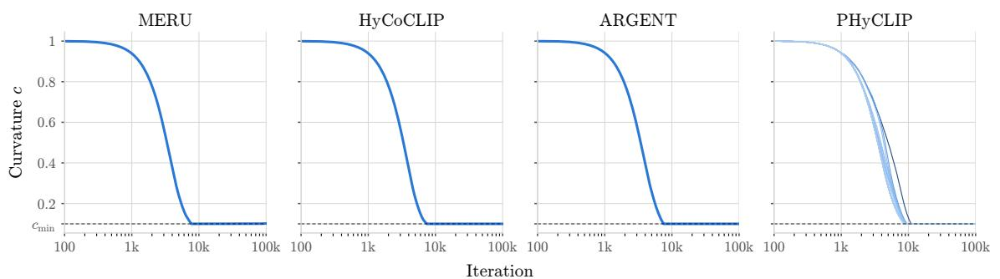
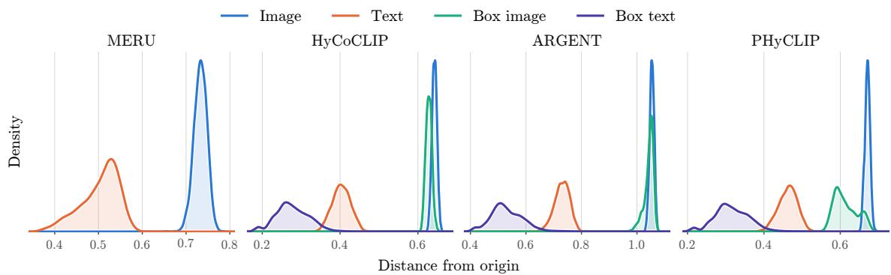
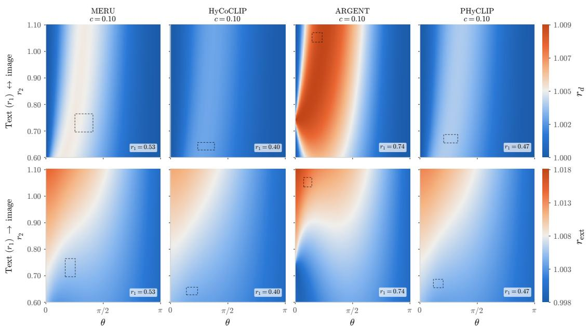
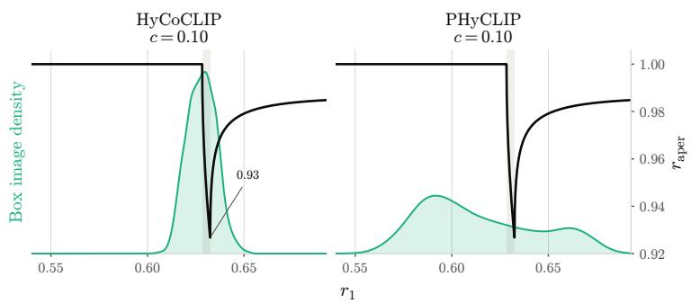
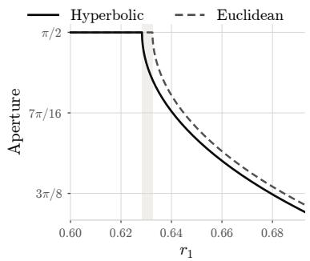
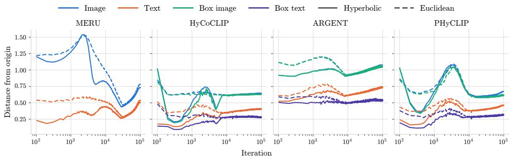
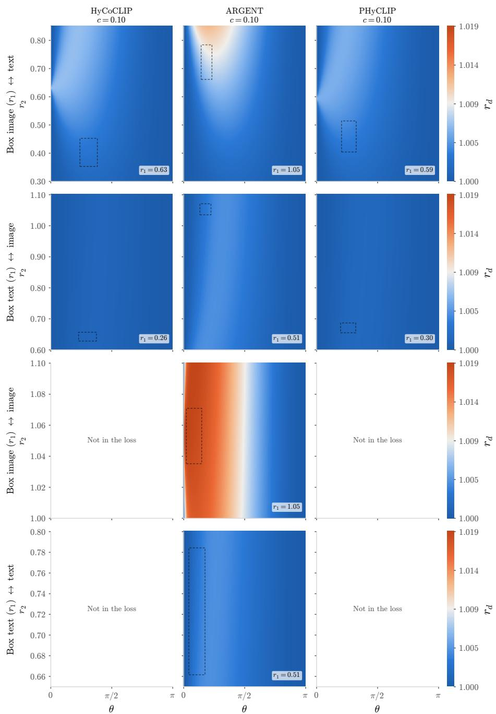
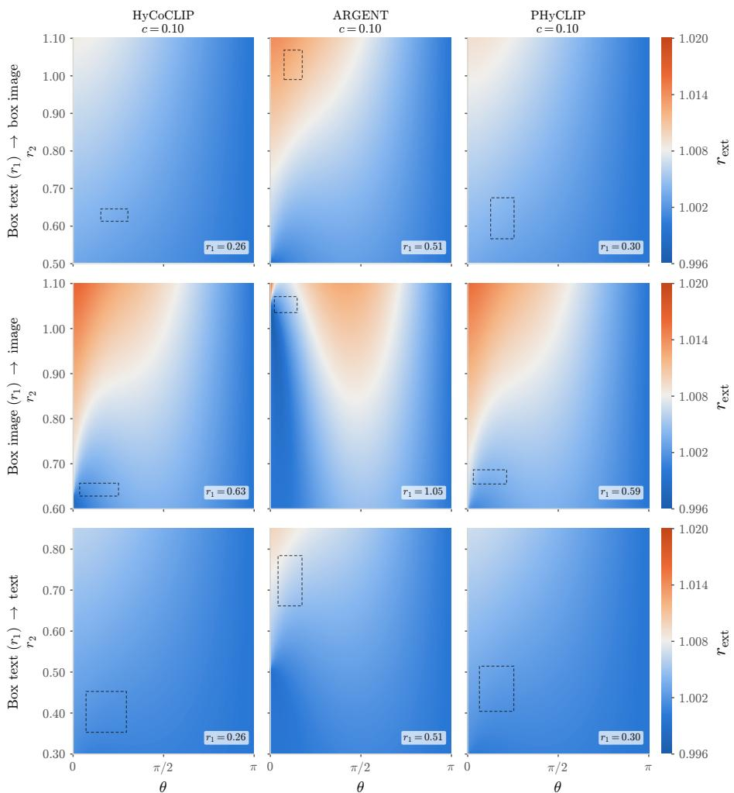
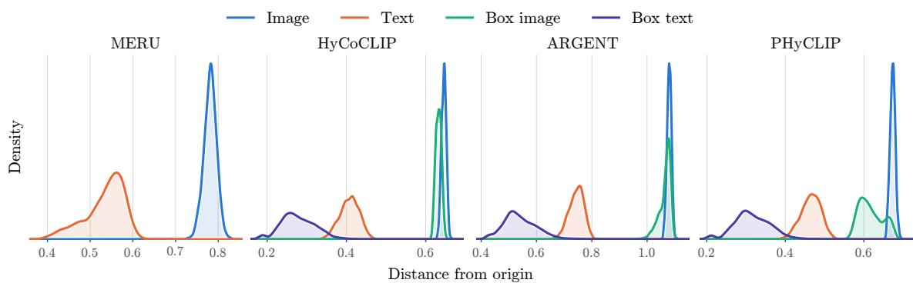
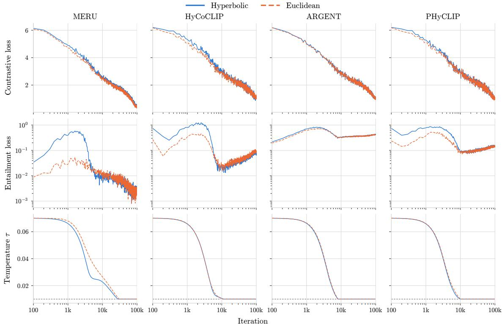

# How Hyperbolic Are Hyperbolic Vision-Language Models?

Freek Byrman1 Partha Das1,2 Stijn Verdenius2 Pascal Mettes1

1University of Amsterdam, 2WAIR

freek.byrman@student.uva.nl

p.das@uva.nl

stijn@wairforretail.com

p.s.m.mettes@uva.nl

Editors: Louisa Cornelis, Francisco Acosta, Fatih Din¸c, Alison Pouplin, David Klindt, Nina Miolane

## Abstract

Hyperbolic vision-language models (VLMs) have emerged as a rapidly growing area of research, reporting strong zero-shot performance alongside an interpretable embedding space in which radius orders representations by generality. But how hyperbolic are hyperbolic VLMs in practice? We investigate this at the exponential map, the single operation through which curvature enters an otherwise Euclidean network. We show that across MERU, HyCoCLIP, ARGENT, and PHyCLIP, the exponential map is well approximated by the identity function, i.e., pairwise distances and angles in the pre-map Euclidean space barely change under projection, and removing the map at inference leaves evaluation scores unchanged. Motivated by this observation, we train Euclidean VLMs on CC3M from scratch under the same hierarchy losses. Over roughly the final 90% of the training steps, the training statistics are nearly indistinguishable from those of their hyperbolic counterparts, and the resulting models match the evaluation scores and recover the same radial distributions. Our findings establish Euclidean space as a suficient substrate for hierarchical vision-language learning as it is currently practiced, and motivate new paradigms in which hyperbolic geometry can deliver on its theoretical promise. Code is available in our GitHub. Keywords: Riemannian manifolds, vision-language models, contrastive learning

## 1. Introduction

Vision and language are inherently hierarchical. Concepts form tree-like structures within and across modalities: animal subsumes dog subsumes corgi, an image crop abstracts a more detailed scene, and a caption abstracts over every image it could describe. Because trees branch exponentially with depth, they fit poorly in Euclidean space (Matouˇsek, 1999), where volume grows only polynomially with radius. Hyperbolic space, whose volume grows exponentially, is mathematically a natural host for such hierarchies (Gromov, 1987).

On the other hand, contrastive vision-language learning owes none of its early success to this idea: CLIP (Radford et al., 2021) and ALIGN (Jia et al., 2021) showed that angular contrastive learning over hundreds of millions of image-text pairs produces embeddings with strong zero-shot performance. Hyperbolic vision-language models (VLMs) retain this contrastive framework on a hyperbolic manifold and add an entailment loss (Ganea et al., 2018), that orders representations by generality along the radius. MERU (Desai et al., 2023) introduced the design, HyCoCLIP (Pal et al., 2025) extended it to compositional and intra-modal hierarchies, and variants have followed (Ramasinghe et al., 2024; Poppi et al., 2025; Huynh et al., 2026; Yoshikawa and Matsubara, 2026). However, these rest on Euclidean backbones and enter the manifold in the final layer through an exponential map.

Strong zero-shot classification and retrieval performance rapidly propelled and expanded this line of work. An interpretable and radially organized embedding space, adds to its benefits, fueling eforts on refined loss functions and better benchmark performances. Yet being hyperbolic is a matter of degree. Curvature sets a characteristic length scale, and how much of the geometry is realized depends on where representations lie relative to it. Since curvature and embeddings are both learned, the efective degree of hyperbolicity is free to vary during training. How much of that geometry hyperbolic VLMs actually use is therefore central to explaining their success, yet this has gone largely uninvestigated.

We investigate this question at the exponential map, the single point at which curvature is introduced in an otherwise Euclidean network. Across MERU (Desai et al., 2023), HyCoCLIP (Pal et al., 2025), ARGENT (Huynh et al., 2026), and PHyCLIP (Yoshikawa and Matsubara, 2026) trained on CC3M, we observe that this map acts as an identity function: removing it at inference leaves evaluation scores unchanged. Motivated by this observation, we train Euclidean VLMs with the same hierarchy losses from scratch. After the first tenth of the training steps the curvature reaches its lower bound with the training statistics becoming indistinguishable from those of the respective hyperbolic counterparts. Consequently, the Euclidean models achieve the same evaluation scores and reproduce the same radial distributions. Our findings suggest that the optimization of hyperbolic VLM leaves much to be desired, since none of the state-of-the-art models make use of the part of the space that makes hyperbolic geometry unique and hierarchical. Our contributions are:

1. Distortion ratios: We introduce distortion ratios as a way to quantify hyperbolicity by comparing elementary geometric operations before and after the exponential map.

2. Diagnosis: We diagnose flagship hyperbolic VLMs as weakly hyperbolic1: distortion ratios stay near 1, and exponential-map readout ablations cost no performance.

3. Euclidean baselines: We introduce Euclidean VLMs with hierarchy losses that exhibit surprisingly similar training dynamics and performance to hyperbolic ones.

## 2. Background

## 2.1. Geometry

Euclidean space. Euclidean space $\mathbb { E } ^ { n }$ is the vector space $\mathbb { R } ^ { n }$ equipped with the inner product $\begin{array} { r } { \langle \pmb { x } , \pmb { y } \rangle _ { \mathbb { E } } : = \sum _ { i = 1 } ^ { n } x _ { i } y _ { i } } \end{array}$ , where $\pmb { x } = [ x _ { 1 } , \dots , x _ { n } ]$ and $\pmb { y } = [ y _ { 1 } , \dots , y _ { n } ]$ . This inner product induces the norm $\| { \pmb x } \| _ { \mathbb { E } } : = \sqrt { \langle { \pmb x } , { \pmb x } \rangle _ { \mathbb { E } } } ,$ and the origin of $\mathbb { E } ^ { n }$ is the vector ${ \bf 0 _ { \mathbb { E } } } : =$ $( 0 , \ldots , 0 )$ . Its curvature is zero everywhere, and geodesics are straight segments.

Hyperbolic space. We use the Lorentz model throughout, which is the common choice in hyperbolic VLM literature (Desai et al., 2023; Pal et al., 2025). A vector decomposes into space and time components as $\pmb { x } = [ \pmb { x } _ { \mathrm { s p a c e } } , \pmb { x } _ { \mathrm { t i m e } } ]$ and carries the Lorentzian inner product

$$
\begin{array} { r } { \langle \pmb { x } , \pmb { y } \rangle _ { \mathbb { L } } : = \langle \pmb { x } _ { \mathrm { s p a c e } } , \pmb { y } _ { \mathrm { s p a c e } } \rangle _ { \mathbb { E } } - x _ { \mathrm { t i m e } } y _ { \mathrm { t i m e } } . } \end{array}\tag{1}
$$

The points of fixed Lorentzian norm $- 1 / c ,$ , for $c > 0$ , form a hyperboloid of two sheets; the model keeps the upper one, selected by $x _ { \mathrm { t i m e } } > 0$ , with origin $\mathbf { 0 } _ { \mathbb { L } } : = [ \mathbf { 0 } _ { \mathbb { E } } , \sqrt { 1 / c } ]$

$$
\mathbb { L } _ { c } ^ { n } : = \big \{ \pmb { x } \in \mathbb { R } ^ { n + 1 } : \langle \pmb { x } , \pmb { x } \rangle _ { \mathbb { L } } = - 1 / c , \ x _ { \mathrm { t i m e } } > 0 \big \} .\tag{2}
$$

That sheet has constant negative curvature −c at every point, and the volume of a ball on it grows exponentially with its radius rather than polynomially, as fast as a tree branches.

Core operations. Almost every training objective in the hyperbolic VLM literature is built from three geometric quantities. The distance between two points is the geodesic length between them; the exterior angle at x toward $\textbf {  { y } }$ is measured from the outward continuation of the ray through ${ \pmb x } ;$ and the half-aperture at x is the angle subtended by a ball around the origin that the cone cannot enter, with radius $R > 0$ in the Euclidean case and radius $K > 0$ in the hyperbolic case. We introduce them here without subscripts,

$$
d ( \pmb { x } , \pmb { y } ) : = \left\{ \begin{array} { l l } { \| \pmb { x } - \pmb { y } \| _ { \mathbb { E } } , } & { \mathrm { i n ~ } \mathbb { E } ^ { n } , } \\ { \frac { 1 } { \sqrt { c } } \operatorname { a r c o s h } \bigl ( - c \langle \pmb { x } , \pmb { y } \rangle _ { \mathbb { L } } \bigr ) , } & { \mathrm { i n ~ } \mathbb { L } _ { c } ^ { n } , } \end{array} \right.\tag{3}
$$

$$
\mathrm { e x t } ( \pmb { x } , \pmb { y } ) : = \left\{ \begin{array} { l l } { \mathrm { a r c c o s } \left( \frac { \| \pmb { y } \| _ { \mathbb { E } } ^ { 2 } - \| \pmb { x } \| _ { \mathbb { E } } ^ { 2 } - \| \pmb { x } - \pmb { y } \| _ { \mathbb { E } } ^ { 2 } } { 2 \| \pmb { x } \| _ { \mathbb { E } } \cdot \| \pmb { x } - \pmb { y } \| _ { \mathbb { E } } } \right) , } & { \mathrm { i n ~ } \mathbb { E } ^ { n } , } \\ { \mathrm { a r c c o s } \left( \frac { \pmb { y } _ { \mathrm { t i m e } } + \pmb { x } _ { \mathrm { t i m e } } c \langle \pmb { x } , \pmb { y } \rangle _ { \mathbb { L } } } { \| \pmb { x } _ { \mathrm { s p a c e } } \| _ { \mathbb { E } } \sqrt { \left( c \langle \pmb { x } , \pmb { y } \rangle _ { \mathbb { L } } \right) ^ { 2 } - 1 } } \right) , } & { \mathrm { i n ~ } \mathbb { L } _ { c } ^ { n } , } \end{array} \right.\tag{4}
$$

$$
\operatorname { a p e r } ( \pmb { x } ) : = \left\{ \begin{array} { l l } { \arcsin \left( \frac { R } { \| \pmb { x } \| _ { \mathbb { E } } } \right) , } & { \mathrm { i n ~ } \mathbb { E } ^ { n } , } \\ { \arcsin \left( \frac { 2 K } { \sqrt { c } \| \pmb { x } _ { \mathrm { s p a c e } } \| _ { \mathbb { E } } } \right) , } & { \mathrm { i n ~ } \mathbb { L } _ { c } ^ { n } . } \end{array} \right.\tag{5}
$$

From encoder outputs to the hyperboloid. Hyperbolic VLMs operate on top of Euclidean backbones. The encoder output $\mathbf { \pmb { v } } \in \mathbb { R } ^ { n }$ lifts into the tangent space at ${ \bf 0 _ { \mathbb { L } } }$ as $[ { \pmb v } , 0 ]$ , and the exponential map carries it a distance $\lVert \pmb { v } \rVert _ { \mathbb { E } }$ to

$$
\mathrm { e x p m } _ { \mathbf { 0 } _ { \mathbb { L } } } ( \pmb { v } ) : = \left[ \frac { \sinh ( \sqrt { c } r ) } { \sqrt { c } r } \pmb { v } , \frac { \cosh ( \sqrt { c } r ) } { \sqrt { c } } \right] .\tag{6}
$$

## 2.2. Loss functions

Two kinds of loss recur across the field: a contrastive term on the distance, and hierarchy terms on the exterior angle and/or the half-aperture. We state them for ordered set embeddings $\mathcal { X } = \{ \pmb { x } _ { i } \} _ { i = 1 } ^ { | B | }$ and $\mathcal { V } = \{ \pmb { y } _ { i } \} _ { i = 1 } ^ { | B | }$ over a batch $B ,$ , with $\mathbf { \nabla } _ { \mathbf { x } _ { i } }$ and ${ \bf { \nabla } } \mathbf { \mathbf { \mathit { y } } } _ { i }$ as positive pair. Contrastive loss. Under similarity $\kappa = - d$ and temperature $\tau ,$ the softmax loss (Sohn, $2 0 1 6 ;$ van den Oord et al., 2018) aligns positive pairs and repels negative ones,

$$
\mathcal { L } _ { \mathrm { s o f t m a x } } ( \mathcal { X } , \mathcal { Y } ) : = - \frac { 1 } { | \mathcal { B } | } \sum _ { i = 1 } ^ { | \mathcal { B } | } \log \frac { \exp \bigl ( \kappa ( \mathbf { x } _ { i } , \pmb { y } _ { i } ) / \tau \bigr ) } { \sum _ { j = 1 } ^ { | \mathcal { B } | } \exp \bigl ( \kappa ( \mathbf { x } _ { i } , \pmb { y } _ { j } ) / \tau \bigr ) } .\tag{7}
$$

Hierarchy losses. The remaining two primitives define an entailment cone (Ganea et al., 2018): y lies inside the cone at x when ex ${ \bf \nabla } ; ( { \pmb x } , { \pmb y } )$ stays below $\eta$ aper(x), for a width hyperparameter $\eta .$ . The hinge is one-sided: pairs inside the cone receive no gradient,

$$
\mathcal { L } _ { \mathrm { e n t } } ( \mathcal { X } , \mathcal { Y } , \eta ) : = \frac { 1 } { | \mathcal { B } | } \sum _ { i = 1 } ^ { | \mathcal { B } | } \operatorname* { m a x } \bigl ( 0 , \ : \mathrm { e x t } ( { \pmb x } _ { i } , { \pmb y } _ { i } ) - \eta \ : \mathrm { a p e r } ( { \pmb x } _ { i } ) \bigr ) .\tag{8}
$$

A recent variant (Huynh et al., 2026) drops the aperture and penalizes the exterior angle itself, smoothed by a Huber transition at $\beta$ and weighted by a function h,

$$
\mathcal { L } _ { \mathrm { a d a } } ( \mathcal { X } , \mathcal { Y } , h ) : = \frac { 1 } { | \mathcal { B } | } \sum _ { i = 1 } ^ { | \mathcal { B } | } \mathrm { H u b e r } _ { \beta } \big ( h ( \pmb { x } _ { i } , \pmb { y } _ { i } ) \ \mathrm { e x t } ( \pmb { x } _ { i } , \pmb { y } _ { i } ) \big ) .\tag{9}
$$

## 3. Methodology

## 3.1. Common setup

Below we describe our train and evaluation pipeline. The design choices follow standard practice in the hyperbolic vision-language literature, the one diference being a pre-training scale set by our compute budget. Appendix A provides all hyperparameters and details.

Training. Every model is trained on CC3M (Sharma et al., 2018), of which we retrieve 3,016,640 samples, with the grounded boxes released for it by Li et al. (2023). We train each in the ViT-S/16 and ViT-B/16 configurations for 100,000 steps at batch size 512, once per configuration, as is conventional given the cost of pre-training.

Models. We consider four models: MERU (Desai et al., 2023), HyCoCLIP (Pal et al., 2025), ARGENT (Huynh et al., 2026), and PHyCLIP (Yoshikawa and Matsubara, 2026). They use two kinds of supervision: image–text pairs, and grounded boxes, i.e., phrases and the image regions they describe. Like CLIP, MERU aligns texts with images via the contrastive loss of Eq. (7), and adds the entailment loss of Eq. (8) so that each image lies in the cone of its text. HyCoCLIP applies both losses to the boxes too, placing each full image and text in the cone of its box. ARGENT and PHyCLIP build on HyCoCLIP: ARGENT uses the adaptive loss of Eq. (9) plus a norm regularizer ${ \mathcal { L } } _ { \mathrm { n o r m } } ,$ and $\mathrm { P H y C L I P }$ splits the embedding space across 64 low-dimensional hyperboloids, each with its own curvature. We train MERU, HyCoCLIP and PHyCLIP from their public implementations, and implement ARGENT, which has none, ourselves. Appendix A gives the exact objectives and weights.

Evaluation. We report zero-shot classification on sixteen benchmarks, retrieval on COCO (Chen et al., 2015) and Flickr30K (Young et al., 2014), and hierarchical classification on the WordNet tree (Miller, 1994) over ImageNet (Deng et al., 2009), scored by the path-based metrics TIE and LCA together with the set-based J, $P _ { \mathrm { H } }$ , and $R _ { \mathrm { H } }$ . Retrieval and classification both rank candidates by the Lorentzian inner product $\langle \cdot , \cdot \rangle _ { \mathbb { L } }$

## 3.2. Distortion ratios

The rapid growth of the hyperbolic VLM literature makes the degree to which these models are actually hyperbolic worth establishing. But how would you even quantify hyperbolicity?

Curvature provides the natural starting point. From a global standpoint, any non-zero curvature is meaningfully diferent from Euclidean space. In practice, however, a model’s embeddings do not occupy the entire space; they are confined to a bounded subset of it. Prior work further suggests that this subset is typically small (Liang et al., 2022). Since hyperbolic VLMs introduce curvature through the exponential map, we quantify its practical efect by the ratio of each of the three geometric primitives of Section 2.1 before and after the map. Those primitives govern every training signal and read-out score.

The three ratios. Consider two encoder outputs $\pmb { v } _ { 1 } , \pmb { v } _ { 2 } \in \mathbb { R } ^ { n }$ with Euclidean norms $r _ { i } : = \| \pmb { v } _ { i } \| _ { \mathbb { E } }$ and enclosed angle θ, and let $\pmb { x } _ { i } : = \mathrm { e x p m } _ { \mathbf { 0 } _ { \mathbb { L } } } ( \pmb { v } _ { i } )$ be their images on $\mathbb { L } _ { c } ^ { n }$ . Taking the ratio of the primitives evaluated at these curved and flat coordinates yields three functions:

$$
r _ { d } ( r _ { 1 } , r _ { 2 } , \theta ; c ) : = \frac { d _ { \mathbb { L } } ( { \pmb x } _ { 1 } , { \pmb x } _ { 2 } ) } { d _ { \mathbb { L } } ( { \pmb v } _ { 1 } , { \pmb v } _ { 2 } ) } , \quad r _ { \mathrm { e x t } } ( r _ { 1 } , r _ { 2 } , \theta ; c ) : = \frac { \mathrm { e x t } _ { \mathbb { L } } ( { \pmb x } _ { 1 } , { \pmb x } _ { 2 } ) } { \mathrm { e x t } _ { \mathbb { L } } ( { \pmb v } _ { 1 } , { \pmb v } _ { 2 } ) } , \quad r _ { \mathrm { a p e r } } ( r _ { 1 } ; c ) : = \frac { \mathrm { a p e r } _ { \mathbb { L } } ( { \pmb x } _ { 1 } ) } { \mathrm { a p e r } _ { \mathbb { L } } ( { \pmb v } _ { 1 } ) } .
$$

Reading the ratio. For the distance and exterior angle at the converged curvature, sweeping both radii over their empirical distributions and θ over $[ 0 , \pi ]$ defines a threedimensional volume. We examine this volume one slice at a time, fixing $r _ { 1 }$ at the mode of one signal’s radial distribution and sweeping the partner radius as a function of the angle. The Euclidean half-aperture introduces a hyperparameter decision on R, which we parameterize as $2 K / \sqrt { 0 . 1 }$ . Closed forms for all three ratios are given in Appendix B.

## 4. Experiments

## 4.1. Realized hyperbolicity

We visualize the curvature training trajectories in Fig. 1 for the ViT-S/16 configurations. All models drive their curvature to the lower bound of the admissible range, $c = 0 . 1$ , within the first tenth of training. PHyCLIP learns 64 individual hyperboloid curvatures, all of which likewise reach the clamp. In Fig. 2, we visualize the corresponding radial distributions. Together, these figures provide the quantities needed to compute distortion ratio heatmaps.

  
Figure 1: Curvature c against training iteration for the ViT-S/16 encoders, one panel per objective, with the floor of the admissible range $c _ { \mathrm { m i n } }$ marked. MERU, HyCoCLIP, and ARGENT learn a single curvature; PHyCLIP learns 64 (one per factor).

  
Figure 2: Radial distribution of the embeddings for the $\mathrm { V i T - S } / 1 6$ models on CC3M. Each panel is a kernel density over distance from the origin, with the horizontal axis scaled per panel. MERU grounds on no boxes and carries only two modalities. For $\mathrm { P H y C L I P }$ we visualize the mean of 64 per-factor geodesic distances.

Figure 3 shows distortion ratios for distances and exterior angles in the text–image relation. Across all models, the ratios are close to 1, indicating that Euclidean distances and exterior angles are approximately preserved by the exponential map. Results for the other supervision relations for these geometric quantities are shown in Figures 6 and 7.

  
Figure 3: Distance distortion $r _ { d } ~ ( \mathrm { t o p } )$ and exterior angle distortion $r _ { \mathrm { e x t } }$ (bottom) for textimage pairs at the converged curvature $c = 0 . 1$ . In each panel $r _ { 1 }$ is held at the mode of the model’s text distribution while the surface sweeps the image radius $r _ { 2 }$ against the enclosed angle $\theta ;$ the dashed box marks the region the pairs occupy.

For the remaining primitive, the aperture, the distortion ratio is exactly 1 for all text and box-text inputs, whose cones are maximally open both before and after the map, a saturation also noted in prior work (Huynh et al., 2026; Kim et al., 2026; Wang et al.,

2026). The ratio at the box-image apexes, shown in Fig. 4(a), is the only one we measure that deviates from 1. This does not indicate fundamentally diferent behavior across the two geometries. As Fig. 4(b) shows, the hyperbolic half-aperture un-clamps slightly before the Euclidean one. Because arcsin is sensitive to inputs near 1, the ratio briefly dips to 0.93 before recovering once the Euclidean aperture un-clamps as well. Thus, the two apertures have the same shape, difering only by a small shift in where they leave the clamp.

  
(a)

  
(b)  
Figure 4: (a) Half-aperture distortion $r _ { \mathrm { a p e r } }$ over the box image distribution. Over the shaded interval the flat half-aperture is still clamped at $\pi / 2$ while the curved one is not. (b) The two half-apertures themselves over the same radii.

## 4.2. Exponential map ablation at read-out

If the exponential map is close to the identity function, its removal at read-out and classifying based on Euclidean distances should be undetectable in downstream evaluation scores. Table 1 shows that this is indeed the case across all the models we consider: classification and retrieval scores barely move when the exponential map is removed, and even the direction of the movement is inconsistent. Since both readings use the same checkpoint, these diferences contain no seed variance. Per-dataset results are given in Tables 3 and 4.

Table 1: Efect of deleting the exponential map at inference. Each checkpoint is read once through expm and once without it, on tangent-space Euclidean distances. Classification is the mean over sixteen datasets, retrieval over both directions, datasets and cutofs. $\operatorname* { m a x } _ { d } | \Delta |$ is the largest single-benchmark change.
<table><tr><td rowspan="2">Model</td><td rowspan="2">Encoder</td><td colspan="4">Classification</td><td colspan="4">Retrieval</td></tr><tr><td>With expm</td><td>Without</td><td>Δ</td><td> $\operatorname* { m a x } _ { d } | \Delta |$ </td><td>With expm</td><td>Without</td><td> $\Delta$ </td><td> $\operatorname* { m a x } _ { d } | \Delta |$ </td></tr><tr><td rowspan="2">MERU</td><td>ViT-S/16</td><td>19.66</td><td>19.67</td><td>+0.01</td><td>0.20</td><td>44.81</td><td>44.83</td><td>+0.02</td><td>0.16</td></tr><tr><td>ViT-B/16</td><td>22.22</td><td>22.23</td><td>+0.01</td><td>0.19</td><td>49.20</td><td>49.24</td><td>+0.03</td><td>0.26</td></tr><tr><td rowspan="2">HyCoCLIP</td><td>ViT-S/16</td><td>23.80</td><td>23.78</td><td>-0.02</td><td>0.11</td><td>50.09</td><td>50.11</td><td>+0.02</td><td>0.10</td></tr><tr><td>ViT-B/16</td><td>25.02</td><td>25.01</td><td>-0.02</td><td>0.06</td><td>52.47</td><td>52.54</td><td>+0.07</td><td>0.30</td></tr><tr><td rowspan="2">ARGENT</td><td>ViT-S/16</td><td>22.99</td><td>22.95</td><td>-0.05</td><td></td><td></td><td></td><td></td><td></td></tr><tr><td>ViT-B/16</td><td>24.35</td><td>24.32</td><td>-0.03</td><td>0.42 0.39</td><td>48.34 52.57</td><td>48.24 52.56</td><td>-0.10 -0.01</td><td>0.70 0.10</td></tr><tr><td rowspan="2">PHyCLIP</td><td>ViT-S/16</td><td></td><td></td><td></td><td></td><td></td><td></td><td></td><td></td></tr><tr><td>ViT-B/16</td><td>23.03 25.06</td><td>23.01 24.97</td><td>-0.03 -0.09</td><td>0.37 0.54</td><td>49.34 52.35</td><td>49.24 52.58</td><td>-0.11 +0.23</td><td>0.70 0.46</td></tr></table>

## 4.3. Exponential map ablation during training

The previous section established that the exponential map can be removed at inference without degrading performance. This does not, however, imply that curvature played no role in shaping the representations during training. To test this, we train a Euclidean control for each hyperbolic model using the same objective from scratch, with every operation in Section 2.1 interpreted in $\mathbb { E } ^ { n }$ and the exponential map replaced by the identity. Loss components, weights, pairings, data, and schedule are held fixed, so each model and its control difer only in the underlying manifold. We set the ball radius to $R = 2 K / \sqrt { 0 . 1 }$ ， matching the Euclidean aperture to the hyperbolic aperture at convergence. For $\mathcal { L } _ { \mathrm { n o r m } }$ , we use the full norm in place of the spatial norm, since there is no time component to exclude.

Figure 5 shows that, after the first 10k steps, the Euclidean and hyperbolic VLMs occupy the same mean radial bands. Likewise, Fig. 9 shows that their contrastive losses, structuring losses, and temperature evolve to nearly identical magnitudes. The discrepancy during the first 10k iterations arises because the curvature requires gradient updates to reach its lower clamp. Once it does, the training dynamics become efectively indistinguishable. This raises a natural question: does this initial deviation have any lasting efect on final performance?

  
Figure 5: Mean distance from the origin against training iteration for the ViT-S/16 encoders, one panel per objective and one curve per modality and box type, hyperbolic (solid) against Euclidean control (dashed). MERU grounds on no boxes.

We find no evidence that it does: the scores mostly agree with each other. Table 2 summarizes the evaluation set: on classification, the Euclidean controls win on 6 of 8 models in terms of the mean; in retrieval, this extends to 7 of 8; and on hierarchical classification, 30 of the Euclidean metrics do better, 9 of the hyperbolic ones do better, and 1 is a tie. We do not read this as the Euclidean models being better: the scores are all clustered close together, and that closeness is itself the point. The exponential map becomes an identity function within the first tenth of training, so for the vast majority of training the two models are optimizing in efectively the same space. Per dataset results are shown in Tables 7 and 8.

Table 2: Each objective in its hyperbolic formulation (Ln) against its Euclidean control (En). Classification is the mean over the sixteen benchmarks, retrieval over directions, datasets and cutofs, and the hierarchical metrics are read on WordNet over ImageNet. The shaded cell marks the better geometry; ties are unshaded.
<table><tr><td></td><td></td><td colspan="2">Classification</td><td colspan="2">Retrieval</td><td colspan="2">TIE (↓)</td><td colspan="2">LCA (4)</td><td colspan="2">J (↑)</td><td colspan="2">PH (↑)</td><td colspan="2">RH (↑)</td></tr><tr><td>Model</td><td>Encoder</td><td>En</td><td>Ln</td><td>En</td><td>Ln</td><td>En</td><td>Ln</td><td>En</td><td>Ln</td><td>En</td><td>Ln</td><td>En</td><td>Ln</td><td>En</td><td>Ln</td></tr><tr><td rowspan="2">MERU</td><td>ViT-S/16</td><td>19.8</td><td>19.7</td><td>45.7</td><td>44.8</td><td>6.440</td><td>6.582</td><td>3.384</td><td>3.442</td><td>0.605</td><td>0.596</td><td>0.719</td><td>0.713</td><td>0.719</td><td>0.711</td></tr><tr><td>ViT-B/16</td><td>22.5</td><td>22.2</td><td>50.0</td><td>49.2</td><td>6.091</td><td>6.220</td><td>3.215</td><td>3.304</td><td>0.626</td><td>0.621</td><td>0.737</td><td>0.730</td><td>0.735</td><td>0.732</td></tr><tr><td rowspan="2">HyCoCLIP</td><td>ViT-S/16</td><td>23.5</td><td>23.8</td><td>47.0</td><td>50.1</td><td>6.028</td><td>5.851</td><td>3.180</td><td>3.095</td><td>0.632</td><td>0.641</td><td>0.740</td><td>0.748</td><td>0.738</td><td>0.747</td></tr><tr><td>ViT-B/16</td><td>25.9</td><td>25.0</td><td>53.3</td><td>52.5</td><td>5.514</td><td>5.719</td><td>2.974</td><td>3.103</td><td>0.664</td><td>0.652</td><td>0.764</td><td>0.753</td><td>0.764</td><td>0.757</td></tr><tr><td rowspan="2">ARGENT</td><td>ViT-S/16 22.7</td><td></td><td>23.0</td><td>49.6</td><td></td><td>48.3 5.963</td><td>5.931 3.130</td><td></td><td></td><td>3.1320.634</td><td>0.637</td><td>0.743</td><td>0.746</td><td>0.740</td><td>0.742</td></tr><tr><td>ViT-B/16</td><td>25.6</td><td>24.4</td><td>53.0</td><td>52.6</td><td>5.579</td><td>5.661</td><td>3.026</td><td>3.079</td><td>0.661</td><td>0.656</td><td>0.761</td><td>0.757</td><td>0.762</td><td>0.761</td></tr><tr><td rowspan="2">PHyCLIP</td><td>ViT-S/16</td><td>23.5</td><td>23.0</td><td>49.8</td><td>49.3</td><td>5.920</td><td>5.998</td><td>3.104</td><td>3.203</td><td>0.636</td><td>0.633</td><td>0.746</td><td></td><td>0.7400.742</td><td>0.742</td></tr><tr><td>ViT-B/16</td><td>25.5</td><td>25.1</td><td>53.5</td><td>52.3</td><td>5.588</td><td>5.745</td><td>3.001</td><td>3.122</td><td>0.660</td><td>0.652</td><td>0.760</td><td>0.752</td><td>0.760</td><td>0.755</td></tr></table>

## 5. Discussion

Relationship to concurrent work. Independently and concurrently, Kim et al. (2026) report that hyperbolic VLMs settle at a near-Euclidean operating point, a conclusion we reach as well using a diferent set of experiments. Both works share the idea that curvature in isolation cannot quantify hyperbolicity. Kim et al. (2026) take a more diagnostic route: they measure curvature gradients in the loss components, audit the operating point using $\sqrt { c } \| \pmb { x } _ { \mathrm { s p a c e } } \|$ E as a measure of hyperbolicity, and remove the curvature lower bound to see how this changes convergence behavior. Ours is more interventional: we ask what the exponential map does to geometric operations, then remove it outright, both at read-out on trained checkpoints and by training a Euclidean control from scratch.

Scale. A natural objection is that CC3M is small compared to the corpora hyperbolic VLMs are trained on. Our arguments, however, rest on relative training dynamics, and we hypothesize that a larger corpus or longer schedule would only extend the near-Euclidean regime rather than escape it. We also repeat the exponential-map removal on the released MERU and HyCoCLIP checkpoints (ARGENT and PHyCLIP have not released weights), trained at much larger scale, and find the map equally inert (Tables 5 and 6).

## 6. Conclusion

We investigate whether the curvature in current hyperbolic VLMs does the geometric work it is credited for, and find that it does not. The exponential map reduces to an identity function early in training, leaving the space efectively Euclidean: deleting it at read-out leaves scores unchanged, and Euclidean controls trained from scratch match the hyperbolic models’ performance and radii closely. Hyperbolic VLMs have been shown empirically to be efective. We believe that with the right optimization, hyperbolic VLMs can reach much greater performance, which can be measured with our diagnostic tools.

## Acknowledgments

Computations were performed using the University of Amsterdam - Science Faculty (UvA/FNWI) High Performance Computing Facility, a centrally managed computational resource available to UvA/FNWI researchers including faculty, staf, students, and collaborators.

## References

Lukas Bossard, Matthieu Guillaumin, and Luc Van Gool. Food-101 – Mining Discriminative Components with Random Forests. In David Fleet, Tomas Pajdla, Bernt Schiele, and Tinne Tuytelaars, editors, Computer Vision – ECCV 2014, pages 446–461, Cham, 2014. Springer International Publishing. ISBN 978-3-319-10599-4.

Xinlei Chen, Hao Fang, Tsung-Yi Lin, Ramakrishna Vedantam, Saurabh Gupta, Piotr Doll´ar, and C. Lawrence Zitnick. Microsoft COCO Captions: Data Collection and Evaluation Server. CoRR, abs/1504.00325, 2015. URL http://arxiv.org/abs/1504.00325.

Gong Cheng, Junwei Han, and Xiaoqiang Lu. Remote Sensing Image Scene Classification: Benchmark and State of the Art. Proceedings of the IEEE, 105(10):1865–1883, 2017. doi: 10.1109/JPROC.2017.2675998.

M. Cimpoi, S. Maji, I. Kokkinos, S. Mohamed, and A. Vedaldi. Describing Textures in the Wild. In Proceedings of the IEEE Conf. on Computer Vision and Pattern Recognition (CVPR), 2014.

Adam Coates, Andrew Ng, and Honglak Lee. An analysis of single-layer networks in unsupervised feature learning. In Proceedings of the fourteenth international conference on artificial intelligence and statistics, pages 215–223. JMLR Workshop and Conference Proceedings, 2011.

Jia Deng, Wei Dong, Richard Socher, Li-Jia Li, Kai Li, and Li Fei-Fei. ImageNet: A Large-Scale Hierarchical Image Database. In IEEE Conference on Computer Vision and Pattern Recognition (CVPR), pages 248–255, 2009. doi: 10.1109/CVPR.2009.5206848.

Karan Desai, Maximilian Nickel, Tanmay Rajpurohit, Justin Johnson, and Shanmukha Ramakrishna Vedantam. Hyperbolic Image-Text Representations. In Andreas Krause, Emma Brunskill, Kyunghyun Cho, Barbara Engelhardt, Sivan Sabato, and Jonathan Scarlett, editors, Proceedings of the 40th International Conference on Machine Learning, volume 202 of Proceedings of Machine Learning Research, pages 7694–7731. PMLR, 23–29 Jul 2023.

Alexey Dosovitskiy, Lucas Beyer, Alexander Kolesnikov, Dirk Weissenborn, Xiaohua Zhai, Thomas Unterthiner, Mostafa Dehghani, Matthias Minderer, Georg Heigold, Sylvain Gelly, Jakob Uszkoreit, and Neil Houlsby. An Image is Worth 16x16 Words: Transformers for Image Recognition at Scale. In International Conference on Learning Representations, 2021. URL https://openreview.net/forum?id=YicbFdNTTy.

Li Fei-Fei, Rob Fergus, and Pietro Perona. Learning Generative Visual Models from Few Training Examples: An Incremental Bayesian Approach Tested on 101 Object Categories. In IEEE Conference on Computer Vision and Pattern Recognition Workshops, CVPR Workshops 2004, Washington, DC, USA, June 27 - July 2, 2004, page 178. IEEE Computer Society, 2004. doi: 10.1109/CVPR.2004.383.

Octavian Ganea, Gary Becigneul, and Thomas Hofmann. Hyperbolic Entailment Cones for Learning Hierarchical Embeddings. In Jennifer Dy and Andreas Krause, editors, Proceedings of the 35th International Conference on Machine Learning, volume 80 of Proceedings of Machine Learning Research, pages 1646–1655. PMLR, 10–15 Jul 2018. URL https://proceedings.mlr.press/v80/ganea18a.html.

M. Gromov. Hyperbolic Groups, pages 75–263. Springer New York, New York, NY, 1987. ISBN 978-1-4613-9586-7. doi: 10.1007/978-1-4613-9586-7 3. URL https://doi.org/ 10.1007/978-1-4613-9586-7\_3.

Patrick Helber, Benjamin Bischke, Andreas Dengel, and Damian Borth. EuroSAT: A Novel Dataset and Deep Learning Benchmark for Land Use and Land Cover Classification. IEEE Journal of Selected Topics in Applied Earth Observations and Remote Sensing, 12 (7):2217–2226, 2019. doi: 10.1109/JSTARS.2019.2918242.

Chuong Huynh, Hossein Souri, Abhinav Kumar, Vitali Petsiuk, Deen Dayal Mohan, and Suren Kumar. ARGENT: Adaptive Hierarchical Image-Text Representations. In Proceedings of the European Conference on Computer Vision (ECCV), pages 557–573, 2026. doi: 10.1007/978-3-032-36846-1 33.

Chao Jia, Yinfei Yang, Ye Xia, Yi-Ting Chen, Zarana Parekh, Hieu Pham, Quoc Le, Yun-Hsuan Sung, Zhen Li, and Tom Duerig. Scaling Up Visual and Vision-Language Representation Learning With Noisy Text Supervision. In Marina Meila and Tong Zhang, editors, Proceedings of the 38th International Conference on Machine Learning, volume 139 of Proceedings of Machine Learning Research, pages 4904–4916. PMLR, 18–24 Jul 2021. URL https://proceedings.mlr.press/v139/jia21b.html.

Andrej Karpathy and Li Fei-Fei. Deep Visual-Semantic Alignments for Generating Image Descriptions. In Proceedings of the IEEE Conference on Computer Vision and Pattern Recognition (CVPR), 2015.

Jaeyoung Kim, Eunseok Kim, and Dongsuk Jang. Is the Geometry Doing the Work? An Operating-Point Audit of Hierarchy in Hyperbolic Vision-Language Models. arXiv preprint arXiv:2607.05268, 2026.

Jonathan Krause, Michael Stark, Jia Deng, and Li Fei-Fei. 3D Object Representations for Fine-Grained Categorization. In 4th International IEEE Workshop on 3D Representation and Recognition (3dRR-13), Sydney, Australia, 2013.

Alex Krizhevsky. Learning multiple layers of features from tiny images. Technical report, University of Toronto, 2009.

Yuheng Li, Haotian Liu, Qingyang Wu, Fangzhou Mu, Jianwei Yang, Jianfeng Gao, Chunyuan Li, and Yong Jae Lee. GLIGEN: Open-Set Grounded Text-to-Image Generation. In IEEE/CVF Conference on Computer Vision and Pattern Recognition (CVPR), pages 22511–22521, 2023.

Weixin Liang, Yuhui Zhang, Yongchan Kwon, Serena Yeung, and James Zou. Mind the Gap: Understanding the Modality Gap in Multi-modal Contrastive Representation Learning. In Alice H. Oh, Alekh Agarwal, Danielle Belgrave, and Kyunghyun Cho, editors, Advances in Neural Information Processing Systems, 2022. URL https://openreview.net/forum? id=S7Evzt9uit3.

Ilya Loshchilov and Frank Hutter. SGDR: Stochastic Gradient Descent with Warm Restarts. In International Conference on Learning Representations, 2017. URL https: //openreview.net/forum?id=Skq89Scxx.

Ilya Loshchilov and Frank Hutter. Decoupled Weight Decay Regularization. In International Conference on Learning Representations, 2019. URL https://openreview.net/forum? id=Bkg6RiCqY7.

Subhransu Maji, Esa Rahtu, Juho Kannala, Matthew Blaschko, and Andrea Vedaldi. Fine-Grained Visual Classification of Aircraft. arXiv preprint arXiv:1306.5151, 2013. URL https://arxiv.org/abs/1306.5151.

Jiˇr´ı Matouˇsek. On embedding trees into uniformly convex Banach spaces. Israel Journal of Mathematics, 114:221–237, 1999. URL https://api.semanticscholar.org/CorpusID: 120301991.

Paulius Micikevicius, Sharan Narang, Jonah Alben, Gregory Diamos, Erich Elsen, David Garcia, Boris Ginsburg, Michael Houston, Oleksii Kuchaiev, Ganesh Venkatesh, and Hao Wu. Mixed Precision Training. In International Conference on Learning Representations, 2018. URL https://openreview.net/forum?id=r1gs9JgRZ.

George A. Miller. WordNet: A lexical database for English. In Human Language Technology: Proceedings of a Workshop held at Plainsboro, New Jersey, March 8-11, 1994, 1994. URL https://aclanthology.org/H94-1111/.

Maria-Elena Nilsback and Andrew Zisserman. Automated Flower Classification over a Large Number of Classes. In Indian Conference on Computer Vision, Graphics and Image Processing, Dec 2008.

Avik Pal, Max van Spengler, Guido Maria D’Amely di Melendugno, Alessandro Flaborea, Fabio Galasso, and Pascal Mettes. Compositional Entailment Learning for Hyperbolic Vision-Language Models. In The Thirteenth International Conference on Learning Representations, 2025. URL https://openreview.net/forum?id=3i13Gev2hV.

Omkar M. Parkhi, Andrea Vedaldi, Andrew Zisserman, and C. V. Jawahar. Cats and Dogs. In IEEE Conference on Computer Vision and Pattern Recognition, 2012.

Tobia Poppi, Tejaswi Kasarla, Pascal Mettes, Lorenzo Baraldi, and Rita Cucchiara. Hyperbolic Safety-Aware Vision-Language Models. In Proceedings of the IEEE/CVF Conference on Computer Vision and Pattern Recognition (CVPR), 2025.

Alec Radford, Jong Wook Kim, Chris Hallacy, Aditya Ramesh, Gabriel Goh, Sandhini Agarwal, Girish Sastry, Amanda Askell, Pamela Mishkin, Jack Clark, Gretchen Krueger, and Ilya Sutskever. Learning Transferable Visual Models From Natural Language Supervision. In Marina Meila and Tong Zhang, editors, Proceedings of the 38th International Conference on Machine Learning, volume 139 of Proceedings of Machine Learning Research, pages 8748–8763. PMLR, 18–24 Jul 2021. URL https://proceedings.mlr. press/v139/radford21a.html.

Sameera Ramasinghe, Violetta Shevchenko, Gil Avraham, and Ajanthan Thalaiyasingam. Accept the Modality Gap: An Exploration in the Hyperbolic Space. In Proceedings of the IEEE/CVF Conference on Computer Vision and Pattern Recognition (CVPR), pages 27263–27272, June 2024.

Rico Sennrich, Barry Haddow, and Alexandra Birch. Neural Machine Translation of Rare Words with Subword Units. In Katrin Erk and Noah A. Smith, editors, Proceedings of the 54th Annual Meeting of the Association for Computational Linguistics (Volume 1: Long Papers), pages 1715–1725, Berlin, Germany, August 2016. Association for Computational Linguistics. doi: 10.18653/v1/P16-1162. URL https://aclanthology.org/P16-1162/.

Piyush Sharma, Nan Ding, Sebastian Goodman, and Radu Soricut. Conceptual Captions: A Cleaned, Hypernymed, Image Alt-text Dataset For Automatic Image Captioning. In Iryna Gurevych and Yusuke Miyao, editors, Proceedings of the 56th Annual Meeting of the Association for Computational Linguistics (Volume 1: Long Papers), pages 2556– 2565, Melbourne, Australia, July 2018. Association for Computational Linguistics. doi: 10.18653/v1/P18-1238. URL https://aclanthology.org/P18-1238/.

Kihyuk Sohn. Improved Deep Metric Learning with Multi-class N-pair Loss Objective. In D. Lee, M. Sugiyama, U. Luxburg, I. Guyon, and R. Garnett, editors, Advances in Neural Information Processing Systems, volume 29. Curran Associates, Inc., 2016. URL https://proceedings.neurips.cc/paper\_files/paper/2016/file/ 6b180037abbebea991d8b1232f8a8ca9-Paper.pdf.

A¨aron van den Oord, Yazhe Li, and Oriol Vinyals. Representation Learning with Contrastive Predictive Coding. CoRR, abs/1807.03748, 2018. URL http://arxiv.org/abs/1807. 03748.

Ashish Vaswani, Noam Shazeer, Niki Parmar, Jakob Uszkoreit, Llion Jones, Aidan N Gomez, L ukasz Kaiser, and Illia Polosukhin. Attention is All you Need. In I. Guyon, U. Von Luxburg, S. Bengio, H. Wallach, R. Fergus, S. Vishwanathan, and R. Garnett, editors, Advances in Neural Information Processing Systems, volume 30. Curran Associates, Inc., 2017. URL https://proceedings.neurips.cc/paper\_files/paper/2017/ file/3f5ee243547dee91fbd053c1c4a845aa-Paper.pdf.

C. Wah, S. Branson, P. Welinder, P. Perona, and S. Belongie. The Caltech-UCSD Birds-200- 2011 Dataset. Technical Report CNS-TR-2011-001, California Institute of Technology, 2011.

Changli Wang, Fang Yin, Suo Gao, and Rui Wu. Enhancing Hyperbolic Vision–Language Representations via Adaptive Apertures and Contrastive Entailment. IEEE Transactions on Circuits and Systems for Video Technology, 36(10):15523–15538, 2026. doi: 10.1109/ TCSVT.2026.3701206.

Jianxiong Xiao, James Hays, Krista A Ehinger, Aude Oliva, and Antonio Torralba. SUN database: Large-scale scene recognition from abbey to zoo. In 2010 IEEE Computer Society Conference on Computer Vision and Pattern Recognition, pages 3485–3492. IEEE, 2010.

Daiki Yoshikawa and Takashi Matsubara. PHyCLIP: ℓ1-Product of Hyperbolic Factors Unifies Hierarchy and Compositionality in Vision-Language Representation Learning. In Proceedings of the International Conference on Learning Representations (ICLR), 2026.

Peter Young, Alice Lai, Micah Hodosh, and Julia Hockenmaier. From image descriptions to visual denotations: New similarity metrics for semantic inference over event descriptions. Transactions of the Association for Computational Linguistics, 2:67–78, 2014. doi: 10. 1162/tacl a 00166. URL https://aclanthology.org/Q14-1006/.

## Appendix A. Experimental details

Objectives. A batch is $\boldsymbol { \mathcal { B } } = \{ ( t _ { i } , i _ { i } , t _ { i } ^ { \mathrm { b o x } } , i _ { i } ^ { \mathrm { b o x } } ) \} _ { i = 1 } ^ { | \mathcal { B } | }$ , in which $\mathbf { \Delta } \mathbf { \mathbf { \mathit { t } } } _ { i }$ and $\mathbf { \rho } _ { i }$ are the text and image embeddings of the i-th pair and $t _ { i } ^ { \mathrm { b o x } } , ~ i _ { i } ^ { \mathrm { b o x } }$ their grounded-box variants, collected into sets $\tau , \tau , \tau ^ { \mathrm { b o x } }$ , and $\mathcal { T } ^ { \mathrm { b o x } }$ . We train MERU without grounded-box supervision. The contrastive terms are

$$
\begin{array} { r l } & { \mathcal { L } _ { \mathrm { s o f t m a x } } ^ { \mathrm { i n t e r } } : = \frac { 1 } { 2 } \big ( \mathcal { L } _ { \mathrm { s o f t m a x } } ( 7 , \mathcal { Z } ) + \mathcal { L } _ { \mathrm { s o f t m a x } } ( \mathcal { Z } , 7 ) \big ) , } \\ & { \mathcal { L } _ { \mathrm { s o f t m a x } } ^ { \mathrm { a l l } } : = \frac { 1 } { 4 } \big ( \mathcal { L } _ { \mathrm { s o f t m a x } } ( 7 , \mathcal { Z } ) + \mathcal { L } _ { \mathrm { s o f t m a x } } ( \mathcal { Z } , 7 ) + \mathcal { L } _ { \mathrm { s o f t m a x } } ( \mathcal { T } ^ { \mathrm { b o x } } , \mathcal { Z } ) + \mathcal { L } _ { \mathrm { s o f t m a x } } ( \mathcal { Z } ^ { \mathrm { b o x } } , 7 ) \big ) , } \end{array}
$$

and every model carries one of the following hierarchy terms alongside them,

$$
\begin{array} { r l } & { \mathcal { L } _ { \mathrm { e n t } } ^ { \mathrm { i n t e r } } : = \mathcal { L } _ { \mathrm { c o n t } } ( \mathcal { T } , \mathcal { T } , \eta _ { \mathrm { i n t e r } } ) , } \\ & { \mathcal { L } _ { \mathrm { e n t } } ^ { \mathrm { a l } } : = \mathcal { L } _ { \mathrm { e n t } } ( \mathcal { T } ^ { \mathrm { b o x } } , \mathcal { T } ^ { \mathrm { b o x } } , \eta _ { \mathrm { i n t e r } } ) + \mathcal { L } _ { \mathrm { e n t } } ( \mathcal { T } , \mathcal { T } , \eta _ { \mathrm { i n t e r } } ) + \mathcal { L } _ { \mathrm { e n t } } ( \mathcal { T } ^ { \mathrm { b o x } } , \mathcal { T } , \eta _ { \mathrm { i n t r a } } ) + \mathcal { L } _ { \mathrm { e n t } } ( \mathcal { T } ^ { \mathrm { b o x } } , \mathcal { T } , \eta _ { \mathrm { i n t e r } } ) , } \\ & { \mathcal { L } _ { \mathrm { a d a } } ^ { \mathrm { a l } } : = \mathcal { L } _ { \mathrm { a d a } } ( \mathcal { T } ^ { \mathrm { b o x } } , \mathcal { T } ^ { \mathrm { b o x } } , \mathit { h } _ { \mathrm { i n t e r } } ) + \mathcal { L } _ { \mathrm { a d a } } ( \mathcal { T } , \mathcal { L } , \mathit { h } _ { \mathrm { i n t e r } } ) + \mathcal { L } _ { \mathrm { a d a } } ( \mathcal { T } ^ { \mathrm { b o x } } , \mathcal { L } , \eta _ { \mathrm { i n t r a } } ) + \mathcal { L } _ { \mathrm { a d a } } ( \mathcal { T } ^ { \mathrm { b o x } } , \mathcal { T } , \mathit { h } _ { \mathrm { i n t r a } } ) . } \end{array}
$$

The adaptive objective adds a term on the spatial norms, holding them in a band,

$$
\mathcal { L } _ { \mathrm { n o r m } } : = \frac { 1 } { 4 | \mathcal { B } | } \sum _ { i = 1 } ^ { | \mathcal { B } | } \sum _ { \substack { x \in \{ t _ { i } , i _ { i } , t _ { i } ^ { \mathrm { b o x } } , i _ { i } ^ { \mathrm { b o x } } \} } } \left( \| \pmb { x } _ { \mathrm { s p a c e } } \| _ { \mathbb { E } } ^ { 2 } - \log \left( \| \pmb { x } _ { \mathrm { s p a c e } } \| _ { \mathbb { E } } \right) \right) .
$$

Each model minimizes a weighted sum of the terms it takes from these blocks,

$$
\begin{array} { r l } & { \mathcal { L } _ { \mathrm { M E R U } } : = \mathcal { L } _ { \mathrm { s o f t m a x } } ^ { \mathrm { i n t e r } } + 0 . 2 \mathcal { L } _ { \mathrm { e n t } } ^ { \mathrm { i n t e r } } , } \\ & { \mathcal { L } _ { \mathrm { H y C o C L I P } } : = \mathcal { L } _ { \mathrm { s o f t m a x } } ^ { \mathrm { a l l } } + 0 . 1 \mathcal { L } _ { \mathrm { e n t } } ^ { \mathrm { a l l } } , } \\ & { \mathcal { L } _ { \mathrm { A R G E N T } } : = \mathcal { L } _ { \mathrm { s o f t m a x } } ^ { \mathrm { a l l } } + 0 . 1 \mathcal { L } _ { \mathrm { a d a } } ^ { \mathrm { a l l } } + 0 . 1 \mathcal { L } _ { \mathrm { n o r m } } . } \end{array}
$$

PHyCLIP splits the embedding space across 64 independent hyperboloids of dimension $^ { 8 , }$ each with its own learnable curvature. Its contrastive term takes the form of $\mathcal { L } _ { \mathrm { s o f } } ^ { \mathrm { a l l } }$ tmax, but scores a pair by the mean of its geodesic distances over the 64 factors (normalized $\ell _ { 1 }$ product metric), and $\mathcal { L } _ { \mathrm { e n t } } ^ { \mathrm { a l l } }$ is imposed inside every factor separately and averaged.

Backbone. Images are encoded using a Vision Transformer (Dosovitskiy et al., 2021) on patches of size 16, text by the 12-layer, 512-dimensional Transformer (Vaswani et al., 2017) of CLIP (Radford et al., 2021), which tokenizes with byte-pair encoding (Sennrich et al., 2016) and truncates at $7 7$ tokens. The shared embedding space is 512-dimensional, except for $\mathrm { P H y C L I P } ,$ which operates on 64 8-dimensional hyperboloids. Encoder outputs are scaled by the projection scalars $\alpha _ { \mathrm { i m a g e } }$ and $\alpha _ { \mathrm { t e x t } }$ before the exponential map. Images are randomly cropped to 50–100% of their area and resized to $2 2 4 \times 2 2 4$

Learnable scalars. Following Desai et al. (2023), the temperature and the curvature are learned in logarithmic space, as $\log ( 1 / \tau )$ and $\log ( c )$ . The curvature is initialized at $c = 1$ and clamped to [0.1, 10], except in ARGENT, which clamps to [0.1, 1]. The projection scalars $\alpha _ { \mathrm { i m a g e } }$ and $\alpha _ { \mathrm { t e x t } }$ are learned as log(α) and initialized at $1 / \sqrt { 5 1 2 }$

Loss constants. The temperature is initialized at $\tau = 0 . 0 7$ and clamped below at $\tau =$ 0.01. The entailment threshold is $\eta _ { \mathrm { i n t e r } } = 1$ for MERU, and $\eta _ { \mathrm { { i n t e r } } } = 0 . 7 , \eta _ { \mathrm { { i n t r a } } } = 1 . 2$ for HyCoCLIP and PHyCLIP. ARGENT replaces it with the adaptive weights $h _ { \mathrm { i n t e r } } = 1$ and $h _ { \mathrm { i n t r a } } = 1 - \exp \bigl ( - d ( \mathbf { { x } } , \pmb { { y } } ) \bigr )$ , under a Huber transition of $\beta = \pi / 4$ . The aperture constant is $K = 0 . 1$ wherever a cone is formed; ARGENT forms none.

Optimization. We use AdamW (Loshchilov and Hutter, 2019) with $( \beta _ { 1 } , \beta _ { 2 } ) = ( 0 . 9 , 0 . 9 8 )$ The learning rate warms up linearly over 4,000 steps to $5 \times 1 0 ^ { - 4 }$ , then decays by cosine to zero (Loshchilov and Hutter, 2017). We train in mixed precision (Micikevicius et al., 2018), computing the exponential map and all losses in FP32. Weight decay is disabled for gains, biases, and the learnable scalars $\tau , c , \alpha _ { \mathrm { i m a g e } } .$ , and $\alpha _ { \mathrm { t e x t } }$ . PHyCLIP is the exception, left as published: its per-factor curvatures and projection scalars are not excluded, and decay along with the encoder weights. Both are parameterized logarithmically, so decaying the parameter toward zero pulls the quantity it encodes toward 1, which for the curvature is a pull away from the floor.

Euclidean controls. Each control keeps every learnable scalar of its hyperbolic twin except the curvature. In particular the projection scalars $\alpha _ { \mathrm { i m a g e } }$ and $\alpha _ { \mathrm { t e x t } }$ are retained and applied identically; encoder outputs are not L2-normalized in either arm, so this scalar is the only rescaling between the encoder and the loss. At read-out the controls score by $- d ,$ the quantity their contrastive term trains on. The hyperbolic arms induce the same ordering: their released implementations score by $\langle \cdot , \cdot \rangle _ { \mathbb { L } } ,$ and Eq. (3) is strictly decreasing in it at a fixed curvature. PHyCLIP is the exception, evaluated by the sum of the inner products over its 64 factors, which is not monotone in the mean of their geodesic distances; we leave it as published.

Retrieval. We evaluate on COCO (Chen et al., 2015) val2017 and on the Flickr30K (Young et al., 2014) test split of Karpathy and Fei-Fei (2015), which hold 5000 and 1000 images respectively, each paired with five captions. We report recall at five and ten in both directions.

Zero-shot classification. We evaluate on sixteen benchmarks in three groups. General object and scene recognition is covered by ImageNet (Deng et al., 2009), on its validation split, CIFAR-10 and CIFAR-100 (Krizhevsky, 2009), SUN397 (Xiao et al., 2010), Caltech-101 (Fei-Fei et al., 2004), and STL-10 (Coates et al., 2011); fine-grained recognition by Food-101 (Bossard et al., 2014), CUB (Wah et al., 2011), Stanford Cars (Krause et al., 2013), FGVC-Aircraft (Maji et al., 2013), Oxford-IIIT Pets (Parkhi et al., 2012), and Oxford Flowers-102 (Nilsback and Zisserman, 2008); and specialized domains by DTD (Cimpoi et al., 2014), EuroSAT (Helber et al., 2019), RESISC45 (Cheng et al., 2017), and Country211 (Radford et al., 2021). The class prompts are the per-dataset templates released with Yoshikawa and Matsubara (2026), which carry over unchanged from Desai et al. (2023) through Pal et al. (2025); we hold them fixed across every model and control.

Hierarchical classification. The ImageNet classes are leaves of the WordNet (Miller, 1994) hierarchy, so an error can be scored by how far the prediction ˆc lies from the truth c in that tree. The tree-induced error (TIE) is the number of edges between $\hat { c }$ and $^ { c , }$ with unit edge weights as is standard for WordNet; the lowest-common-ancestor (LCA) error is the height of the deepest node ancestral to both. Both are lower-is-better. The set-based metrics compare the ancestor sets A(ˆc) and A(c) through their overlap,

$$
J : = \frac { | A ( \hat { c } ) \cap A ( c ) | } { | A ( \hat { c } ) \cup A ( c ) | } ,\tag{10}
$$

$$
P _ { \mathrm { H } } : = \frac { | A ( \hat { c } ) \cap A ( c ) | } { | A ( \hat { c } ) | } ,\tag{11}
$$

$$
R _ { \mathrm { H } } : = \frac { | A ( \hat { c } ) \cap A ( c ) | } { | A ( c ) | } ,\tag{12}
$$

yielding the Jaccard similarity J and the hierarchical precision $P _ { \mathrm { H } }$ and recall $R _ { \mathrm { H } }$ . For all set-based metrics, it holds that higher is better.

## Appendix B. Derivations

## B.1. Distance ratio

Setup. Let $\pmb { v } _ { 1 } , \pmb { v } _ { 2 } \in \mathbb { R } ^ { n }$ be two Euclidean encoder outputs, with norms $r _ { i } : = \| \pmb { v } _ { i } \| _ { \mathbb { E } }$ and enclosed angle $\theta \in [ 0 , \pi ]$ defined through

$$
\langle \pmb { v } _ { 1 } , \pmb { v } _ { 2 } \rangle _ { \mathbb { E } } = r _ { 1 } r _ { 2 } \cos \theta .\tag{13}
$$

Euclidean distance. Expanding the Euclidean distance (Eq. (3)) and substituting Eq. (13) recovers the law of cosines,

$$
d _ { \mathbb { E } } ( \pmb { v } _ { 1 } , \pmb { v } _ { 2 } ) = \sqrt { \langle \pmb { v } _ { 1 } - \pmb { v } _ { 2 } , \pmb { v } _ { 1 } - \pmb { v } _ { 2 } \rangle _ { \mathbb { E } } } = \sqrt { r _ { 1 } ^ { 2 } + r _ { 2 } ^ { 2 } - 2 r _ { 1 } r _ { 2 } \cos \theta } .\tag{14}
$$

Lift to the tangent space at the origin. Augment each encoder output to an ambient vector $\bar { \pmb { v } } _ { i } : = [ \pmb { v } _ { i } , 0 ] \in \mathbb { R } ^ { n + 1 }$ . With the origin ${ \bf 0 } _ { \mathbb { L } } = [ { \bf 0 } _ { \mathbb { E } } , \sqrt { 1 / c } ]$ and the Lorentzian inner product (Eq. (1)),

$$
\langle \bar { \pmb { v } } _ { i } , \mathbf { 0 } _ { \mathbb { L } } \rangle _ { \mathbb { L } } = \langle \pmb { v } _ { i } , \mathbf { 0 } _ { \mathbb { E } } \rangle _ { \mathbb { E } } - 0 \cdot \sqrt { 1 / c } = 0 ,\tag{15}
$$

so $\bar { \pmb { v } } _ { i } \in \mathcal { T } _ { \mathbf { 0 } _ { \mathbb { L } } } \mathbb { L } _ { c } ^ { n }$ . Because its time component vanishes, the Lorentzian norm of the lifted vector reduces to the Euclidean norm of the original,

$$
\lVert \bar { \boldsymbol { v } } _ { i } \rVert _ { \mathbb { L } } = \sqrt { | \langle \boldsymbol { v } _ { i } , \boldsymbol { v } _ { i } \rangle _ { \mathbb { E } } | } = r _ { i } .\tag{16}
$$

Projection onto the hyperboloid. Applying the exponential map at the origin (Eq. (6)) to $\bar { \mathbf { v } } _ { i }$ and using Eq. (16),

$$
\pmb { x } _ { i } : = \mathrm { e x p m } _ { \mathbf { 0 } _ { \mathbb { L } } } ( \bar { \pmb { v } } _ { i } ) = \mathrm { c o s h } \big ( \sqrt { c } r _ { i } \big ) \mathbf { 0 } _ { \mathbb { L } } + \frac { \mathrm { s i n h } \big ( \sqrt { c } r _ { i } \big ) } { \sqrt { c } r _ { i } } \bar { \pmb { v } } _ { i } ,\tag{17}
$$

which separates into spatial and temporal components

$$
\pmb { x } _ { i , \mathrm { s p a c e } } = \frac { \mathrm { s i n h } \big ( \sqrt { c } r _ { i } \big ) } { \sqrt { c } r _ { i } } \pmb { v } _ { i } , \qquad \pmb { x } _ { i , \mathrm { t i m e } } = \frac { \mathrm { c o s h } \big ( \sqrt { c } r _ { i } \big ) } { \sqrt { c } } .\tag{18}
$$

Lorentzian inner product. Combining the components of Eq. (18) through Eq. (1), the spatial term carries the angle via Eq. (13) and the factors $r _ { 1 } r _ { 2 }$ cancel:

$$
\begin{array} { l } { \displaystyle { \langle x _ { 1 } , x _ { 2 } \rangle _ { \mathbb { L } } = \langle x _ { 1 , \mathrm { s p a c e } } , x _ { 2 , \mathrm { s p a c e } } \rangle _ { \mathbb { E } } - x _ { 1 , \mathrm { t i m e } } x _ { 2 , \mathrm { t i m e } } } } \\ { \displaystyle { \quad \quad = \frac { 1 } { c } \Big [ \sinh \bigl ( \sqrt { c } r _ { 1 } \bigr ) \sinh \bigl ( \sqrt { c } r _ { 2 } \bigr ) \cos \theta - \cosh \bigl ( \sqrt { c } r _ { 1 } \bigr ) \cosh \bigl ( \sqrt { c } r _ { 2 } \bigr ) \Big ] . } } \end{array}\tag{19}
$$

Geodesic distance. Substituting into the Lorentzian distance (Eq. (3)), the prefactor −c cancels the $1 / c$ and flips the sign of the bracket:

$$
d _ { \mathbb { L } } ( { \pmb x } _ { 1 } , { \pmb x } _ { 2 } ) = \frac { 1 } { \sqrt { c } } \operatorname { a r c o s h } \Bigl ( \cosh \bigl ( \sqrt { c } r _ { 1 } \bigr ) \cosh \bigl ( \sqrt { c } r _ { 2 } \bigr ) - \sinh \bigl ( \sqrt { c } r _ { 1 } \bigr ) \sinh \bigl ( \sqrt { c } r _ { 2 } \bigr ) \cos \theta \Bigr ) .\tag{20}
$$

Distance ratio. Dividing the geodesic distance in Eq. (20) by the Euclidean distance in Eq. (14) recovers the closed form:

$$
\begin{array} { r l } & { r _ { d } ( r _ { 1 } , r _ { 2 } , \theta ; c ) = \frac { d _ { \mathbb { Z } } \left( x _ { 1 } , x _ { 2 } \right) } { d _ { \mathbb { E } } \left( v _ { 1 } , v _ { 2 } \right) } } \\ & { \qquad = \frac { \mathrm { a r c o s h } \left( \cosh \left( \sqrt { c } r _ { 1 } \right) \cosh \left( \sqrt { c } r _ { 2 } \right) - \sinh \left( \sqrt { c } r _ { 1 } \right) \sinh \left( \sqrt { c } r _ { 2 } \right) \cos \theta \right) } { \sqrt { c } \sqrt { r _ { 1 } ^ { 2 } + r _ { 2 } ^ { 2 } - 2 r _ { 1 } r _ { 2 } \cos \theta } } . } \end{array}\tag{21}
$$

It is convenient to name the argument of the arcosh, which recurs below,

$$
\begin{array} { l } { { A ( r _ { 1 } , r _ { 2 } , \theta ; c ) : = \cosh \bigl ( \sqrt { c } r _ { 1 } \bigr ) \cosh \bigl ( \sqrt { c } r _ { 2 } \bigr ) - \sinh \bigl ( \sqrt { c } r _ { 1 } \bigr ) \sinh \bigl ( \sqrt { c } r _ { 2 } \bigr ) \cos \theta } } \\ { { \ = - c \left. x _ { 1 } , x _ { 2 } \right. _ { \mathbb { L } } . } } \end{array}\tag{22}
$$

## B.2. Exterior angle ratio

Euclidean exterior angle. Substituting $\langle \pmb { v } _ { 1 } , \pmb { v } _ { 2 } \rangle _ { \mathbb { E } } = r _ { 1 } r _ { 2 }$ cos θ and $\| \pmb { v } _ { 1 } \| _ { \mathbb { E } } = \ r _ { 1 }$ into Eq. (4), a factor $r _ { 1 }$ cancels from numerator and denominator and the Euclidean exterior angle depends on the pair only through $( r _ { 1 } , r _ { 2 } , \theta )$

$$
\operatorname { e x t } _ { \mathbb { E } } ( \pmb { v } _ { 1 } , \pmb { v } _ { 2 } ) = \operatorname { a r c c o s } \left( \frac { r _ { 2 } \cos \theta - r _ { 1 } } { \sqrt { r _ { 1 } ^ { 2 } + r _ { 2 } ^ { 2 } - 2 r _ { 1 } r _ { 2 } \cos \theta } } \right) .\tag{23}
$$

Lorentzian exterior angle. The mapped components Eq. (18) give $x _ { i , \mathrm { t i m e } } = { \cosh ( \sqrt { c } r _ { i } ) } / { \sqrt { c } }$ and $\| \pmb { x } _ { 1 , \mathrm { s p a c e } } \| _ { \mathbb { E } } = \sinh ( \sqrt { c } r _ { 1 } ) / \sqrt { c } ,$ while Eq. (22) gives $c \langle { \pmb x } _ { 1 } , { \pmb x } _ { 2 } \rangle _ { \mathbb { L } } = - A$ . Substituting these into Eq. (4), the numerator becomes $\left( \cosh ( \sqrt { c } r _ { 2 } ) - A \cosh ( \sqrt { c } r _ { 1 } ) \right) / \sqrt { c }$ and the denominator sinh $( \sqrt { c } r _ { 1 } ) \sqrt { A ^ { 2 } - 1 } / \sqrt { c }$ , so the factors of √c cancel and

$$
\mathrm { e x t } _ { \mathbb { L } } ( \pmb { x } _ { 1 } , \pmb { x } _ { 2 } ) = \operatorname { a r c c o s } \left( \frac { \cosh \left( \sqrt { c } r _ { 2 } \right) - A \cosh \left( \sqrt { c } r _ { 1 } \right) } { \sinh \left( \sqrt { c } r _ { 1 } \right) \sqrt { A ^ { 2 } - 1 } } \right) .\tag{24}
$$

Exterior angle ratio. Dividing Eq. (24) by Eq. (23),

$$
r _ { \mathrm { e x t } } ( r _ { 1 } , r _ { 2 } , \theta ; c ) = \operatorname { a r c c o s } \left( { \frac { \cosh ( { \sqrt { c } } r _ { 2 } ) - A \cosh ( { \sqrt { c } } r _ { 1 } ) } { \sinh ( { \sqrt { c } } r _ { 1 } ) { \sqrt { A ^ { 2 } - 1 } } } } \right) \left/ \operatorname { a r c c o s } \left( { \frac { r _ { 2 } \cos \theta - r _ { 1 } } { \sqrt { r _ { 1 } ^ { 2 } + r _ { 2 } ^ { 2 } - 2 r _ { 1 } r _ { 2 } \cos \theta } } } \right) \right.\tag{25}
$$

## B.3. Aperture ratio

The half-aperture reads a single point, so its ratio is a function of one radius. From Eq. (18), $\| \pmb { x } _ { \mathrm { s p a c e } } \| _ { \mathbb { E } } = \sinh ( \sqrt { c } r _ { 1 } ) / \sqrt { c } ,$ so the Lorentzian half-aperture of Eq. (5) loses its explicit curvature factor,

$$
\mathrm { a p e r } _ { \mathbb { L } } ( \pmb { x } ) = \mathrm { a r c s i n } \bigg ( \frac { 2 K } { \sqrt { c } \| \pmb { x } _ { \mathrm { s p a c e } } \| _ { \mathbb { E } } } \bigg ) = \mathrm { a r c s i n } \bigg ( \frac { 2 K } { \mathrm { s i n h } \big ( \sqrt { c } r _ { 1 } \big ) } \bigg ) .\tag{26}
$$

With the ball radius fixed by the matching rule $R = 2 K / \sqrt { c }$ of Section 4.3, the Euclidean half-aperture is arcsin $\left( 2 K / ( \sqrt { c } r _ { 1 } ) \right)$ , and taking the ratio curved-over-flat,

$$
r _ { \mathrm { a p e r } } ( r _ { 1 } ; c ) = \frac { \arcsin \bigl ( 2 K / \sinh ( \sqrt { c } r _ { 1 } ) \bigr ) } { \arcsin \bigl ( 2 K / ( \sqrt { c } r _ { 1 } ) \bigr ) } .\tag{27}
$$

## Appendix C. Detailed results

  
Figure 6: Distance distortion $r _ { d }$ for the remaining pairs which are used in the loss components. In each panel $r _ { 1 }$ is held at the mode of the signal named first while the surface sweeps the partner’s radius $r _ { 2 }$ against the enclosed angle θ; the dashed box marks the region the pairs occupy. The last two rows are the box-to-source distances ARGENT weights its intra-modal entailment terms by.

  
Figure 7: Exterior angle distortion $r _ { \mathrm { e x t } }$ for the remaining pairs which are used in the loss components. In each panel $r _ { 1 }$ is held at the mode of the signal named first while the surface sweeps the partne $\mathrm { \Omega ^ { * } s }$ radius $r _ { 2 }$ against the enclosed angle $\theta ;$ the dashed box marks the region the pairs occupy.

Table 3: Zero-shot classification accuracy (%) across the sixteen benchmarks, for each trained hyperbolic checkpoint read with the exponential map (✓) and without it (✗). The shaded cell marks the better reading in each column, per model and encoder; ties are unshaded.
<table><tr><td></td><td></td><td></td><td colspan="6">General</td><td colspan="6">Fine-grained</td><td colspan="4">Specialized</td></tr><tr><td></td><td></td><td></td><td>Iageet</td><td>CR-10</td><td>CI-A0</td><td>S9</td><td>Cat--01</td><td>ST-T10</td><td>0o101</td><td>CU</td><td>Caãrs</td><td>Aircrat</td><td>Pəs</td><td>-102</td><td>DD</td><td>ESAT</td><td>RESISC5</td><td>Ccounr1</td></tr><tr><td>MERU</td><td>ViT-S/16</td><td>√ x</td><td>14.3 14.3</td><td>53.1 53.2</td><td>22.9 22.9</td><td>27.6 27.4</td><td>42.1 42.0</td><td>75.3 75.5</td><td>9.3 9.4</td><td>3.0 3.0</td><td>0.9 1.2 0.9 1.2</td><td></td><td>9.8 7.3 9.8</td><td>7.4</td><td>8.0 8.1</td><td>18.4 18.5</td><td>20.4 20.3</td><td>0.8 0.8</td></tr><tr><td rowspan="3"></td><td rowspan="3">ViT-B/16</td><td>√ x</td><td>16.7</td><td>60.5</td><td>25.9</td><td>30.9 30.9</td><td>47.5 47.6</td><td>84.0</td><td>10.7</td><td>2.7</td><td>1.2</td><td>1.7</td><td>10.9</td><td>9.0</td><td>10.8</td><td>19.1</td><td>23.1 23.1</td><td>0.7</td></tr><tr><td></td><td>16.7</td><td>60.3</td><td>25.9</td><td></td><td></td><td>84.1</td><td>10.7</td><td>2.7</td><td>1.2</td><td>1.7</td><td>10.9</td><td>9.2</td><td>10.9</td><td>19.1</td><td></td><td>0.7</td></tr><tr><td>√</td><td>18.4</td><td>72.6</td><td>31.3</td><td>33.0</td><td>50.0</td><td>85.0</td><td>10.4</td><td>3.6</td><td>1.1</td><td>1.6</td><td>15.1</td><td>7.8</td><td>13.5</td><td>13.1</td><td>23.6</td><td>0.7</td></tr><tr><td rowspan="3">HyCoCLIP</td><td rowspan="2">ViT-S/16</td><td>x</td><td>18.4</td><td>72.5</td><td>31.4</td><td>32.9</td><td>50.0</td><td>85.0</td><td>10.4</td><td>3.5</td><td>1.1</td><td>1.6</td><td>15.1</td><td>7.8</td><td>13.5</td><td>13.0</td><td>23.5</td><td>0.7</td></tr><tr><td>√</td><td>19.9</td><td>75.0</td><td>34.1</td><td>34.8</td><td>50.3</td><td>88.5</td><td>11.7</td><td>3.8</td><td>1.3</td><td>1.2</td><td>16.2</td><td>7.6</td><td>12.0</td><td>19.1</td><td>24.0</td><td>0.7</td></tr><tr><td>ViT-B/16</td><td>x</td><td>19.9</td><td>75.0</td><td>34.0</td><td>34.8</td><td>50.3</td><td>88.6</td><td>11.7</td><td>3.8</td><td>1.3</td><td>1.2</td><td>16.2</td><td>7.6</td><td>12.0</td><td>19.1</td><td>24.0</td><td>0.6</td></tr><tr><td rowspan="3">ARGENT</td><td rowspan="2">ViT-S/16</td><td>√</td><td>18.1</td><td>70.7 70.5</td><td>28.9 28.8</td><td>31.8 31.7</td><td>45.2</td><td>85.2</td><td>9.5</td><td>3.2</td><td>0.9</td><td>1.8</td><td>10.9</td><td>8.6</td><td>10.9</td><td>17.9 18.0</td><td>23.8 23.7</td><td>0.7</td></tr><tr><td>x</td><td>18.1</td><td>77.5</td><td>34.2</td><td>34.6</td><td>44.8 48.4</td><td>85.2</td><td>9.4</td><td>3.2 2.7</td><td>0.9 1.2</td><td>1.7 0.5</td><td>11.0 12.8</td><td>8.7 8.6</td><td>10.7</td><td>17.6</td><td>22.0</td><td>0.7</td></tr><tr><td>ViT-B/16</td><td></td><td>19.6 19.6</td><td>77.5</td><td>34.3</td><td>34.6</td><td>48.0</td><td>88.0 87.9</td><td>10.5 10.5</td><td>2.6</td><td>1.2</td><td>0.5</td><td>12.7</td><td>8.7</td><td>10.6 10.7</td><td>17.5</td><td>22.0</td><td>0.8 0.8</td></tr><tr><td rowspan="3">PHyCLIP</td><td rowspan="2">ViT-S/16</td><td>√</td><td>17.9</td><td>68.0</td><td>27.6</td><td>31.8</td><td>47.4</td><td>84.9</td><td>11.6</td><td>3.7</td><td>0.9</td><td>1.1</td><td>13.4</td><td>8.0</td><td>10.5</td><td>18.8</td><td>22.2</td><td>0.7</td></tr><tr><td>x</td><td>17.9</td><td>67.6</td><td>27.5</td><td>31.7</td><td>47.3</td><td>85.0</td><td>11.3</td><td>3.8</td><td>1.0</td><td>1.3</td><td>13.6</td><td>8.2</td><td>10.5</td><td>18.5</td><td>22.1</td><td>0.7</td></tr><tr><td>ViT-B/16</td><td>√ x</td><td>20.1 20.1</td><td>74.0 74.2</td><td>32.8 32.4</td><td>34.9 34.8</td><td>52.7 52.4</td><td>87.4 87.3</td><td>13.5 13.4</td><td>3.6 3.7</td><td>1.5 1.5</td><td>1.3 1.3</td><td>11.9 11.9</td><td>9.5 9.6</td><td>12.2 12.4</td><td>20.6 20.1</td><td>24.1 23.7</td><td>0.8 0.8</td></tr></table>

Table 4: Zero-shot image–text retrieval on COCO and Flickr30K, and hierarchical classification on WordNet over ImageNet, for each trained hyperbolic checkpoint read with the exponential map (✓) and without it (✗). The shaded cell marks the better reading in each column, per model and encoder; ties are unshaded.
<table><tr><td rowspan="2"></td><td rowspan="2"></td><td rowspan="2"></td><td colspan="4">Text → Image</td><td colspan="4">Image → Text</td><td colspan="5">Hierarchical metrics</td></tr><tr><td colspan="2">COCO</td><td colspan="2">Flickr30K</td><td colspan="2">COCO</td><td colspan="2">Flickr30K</td><td colspan="5">ImageNet</td></tr><tr><td>Model</td><td>Encoder</td><td>expm</td><td>R@5</td><td>R@10</td><td>R@5</td><td>R@10</td><td>R@5 R@10</td><td></td><td>R@5 R@10</td><td>TIE(↓)</td><td>LCA(↓)</td><td>J(↑)</td><td> $P _ { \mathrm { H } } ( \uparrow )$ </td><td>RH(↑)</td></tr><tr><td rowspan="4">MERU</td><td rowspan="2">ViT-S/16</td><td>√</td><td>26.2</td><td>36.8</td><td>42.7</td><td>55.1</td><td>32.5</td><td>43.6</td><td>54.5</td><td>67.0</td><td>6.582</td><td>3.442</td><td>0.596</td><td>0.713</td><td>0.711</td></tr><tr><td>x</td><td>26.2</td><td>36.8</td><td>42.7</td><td>55.1</td><td>32.7</td><td>43.7</td><td>54.5</td><td>66.9</td><td>6.584</td><td>3.442</td><td>0.596</td><td>0.713</td><td>0.711</td></tr><tr><td rowspan="2">ViT-B/16</td><td>√</td><td>29.8</td><td>40.8</td><td>48.1</td><td>60.0</td><td>36.4</td><td>48.8</td><td>58.8</td><td>70.8</td><td>6.220</td><td>3.304</td><td>0.621</td><td>0.730</td><td>0.732</td></tr><tr><td>x</td><td>29.8</td><td>40.8</td><td>48.1</td><td>60.0</td><td>36.7</td><td>48.8</td><td>58.8</td><td>70.8</td><td>6.218</td><td>3.303</td><td>0.621</td><td>0.730</td><td>0.732</td></tr><tr><td rowspan="3">HyCoCLIP</td><td rowspan="2">ViT-S/16</td><td>√</td><td>30.1</td><td>41.1</td><td>49.1</td><td>60.7</td><td>37.1</td><td>48.9</td><td>61.3</td><td>72.4</td><td>5.851</td><td>3.095</td><td>0.641</td><td>0.748</td><td>0.747</td></tr><tr><td>x</td><td>30.1</td><td>41.1</td><td>49.1</td><td>60.7</td><td>37.2</td><td>48.8</td><td>61.3</td><td>72.5</td><td>5.852</td><td>3.095</td><td>0.641</td><td>0.748</td><td>0.747</td></tr><tr><td rowspan="2">ViT-B/16</td><td>√</td><td>32.6</td><td>43.7</td><td>51.9</td><td>63.1</td><td>39.4</td><td>51.6</td><td>63.8</td><td>73.7</td><td>5.719</td><td>3.103</td><td>0.652</td><td>0.753</td><td>0.757</td></tr><tr><td rowspan="2"></td><td>x</td><td>32.6</td><td>43.7</td><td>51.9</td><td>63.1</td><td>39.3</td><td>51.6</td><td>64.1</td><td>74.0</td><td>5.718</td><td>3.103</td><td>0.653</td><td>0.753</td><td>0.757</td></tr><tr><td rowspan="2"></td><td>√</td><td>30.1</td><td>41.2</td><td>46.7</td><td>58.1</td><td>35.8</td><td>47.7</td><td>57.6</td><td>69.5</td><td>5.931</td><td>3.132</td><td>0.637</td><td>0.746</td><td>0.742</td></tr><tr><td rowspan="2">ViT-S/16</td><td>x</td><td>30.1</td><td>41.2</td><td>46.8</td><td>58.1</td><td>35.7</td><td>47.9</td><td>56.9</td><td>69.3</td><td>5.926</td><td>3.127</td><td>0.637</td><td>0.746</td><td>0.742</td></tr><tr><td rowspan="2"></td><td>√</td><td>32.5</td><td>44.0</td><td>52.4</td><td>63.2</td><td>39.5</td><td>51.7</td><td>62.9</td><td>74.3</td><td>5.661</td><td>3.079</td><td>0.656</td><td>0.757</td><td>0.761</td></tr><tr><td rowspan="2">ViT-B/16</td><td>x</td><td>32.5</td><td>44.0</td><td>52.4</td><td>63.2</td><td>39.4</td><td>51.7</td><td>62.9</td><td>74.4</td><td>5.658</td><td>3.077</td><td>0.656</td><td>0.757</td><td>0.761</td></tr><tr><td rowspan="2"></td><td>√</td><td>30.3</td><td>41.1</td><td>48.3</td><td>59.2</td><td>37.5</td><td>49.2</td><td>58.4</td><td>70.6</td><td>5.998</td><td>3.203</td><td>0.633</td><td>0.740</td><td>0.742</td></tr><tr><td rowspan="2">ViT-S/16</td><td>x</td><td>30.5</td><td>41.2</td><td>48.1</td><td>59.4</td><td>37.6</td><td>49.3</td><td>57.7</td><td>70.1</td><td>5.995</td><td>3.198</td><td>0.633</td><td>0.741</td><td>0.742</td></tr><tr><td rowspan="2">ViT-B/16</td><td>√</td><td>32.8</td><td>44.0</td><td>51.8</td><td>62.1</td><td>39.6</td><td>52.1</td><td>62.8</td><td>73.6</td><td>5.745</td><td>3.122</td><td>0.652</td><td>0.752</td><td>0.755</td></tr><tr><td rowspan="2"></td><td>x</td><td>33.0</td><td>44.2</td><td>51.9</td><td>62.4</td><td>40.0</td><td>52.6</td><td>62.8</td><td>73.8</td><td>5.747</td><td>3.125</td><td>0.652</td><td>0.752</td><td>0.756</td></tr></table>

Table 5: Zero-shot classification accuracy (%) across the sixteen benchmarks, for the publicly released ViT-B/16 checkpoints read with the exponential map (✓) and without it (✗). The shaded cell marks the better reading in each column, per model; ties are unshaded.
<table><tr><td></td><td></td><td colspan="6"></td><td colspan="6">Fine-grained</td><td colspan="5">Specialized</td></tr><tr><td>Model</td><td>expm</td><td>Iaəgeet</td><td>CIA-10</td><td>C--0</td><td>S9</td><td>Ca-t--01</td><td>ST-T10</td><td>0o0-01</td><td>CU</td><td>Sas</td><td>Aircrat</td><td>Pts</td><td>-102</td><td></td><td>DID</td><td>ESAT</td><td>RESC45</td><td>Cout1</td></tr><tr><td>MERU</td><td>√ x</td><td>37.5 37.5</td><td>67.7 67.7</td><td>32.7 32.6</td><td>30.9 30.9</td><td>68.1 68.1</td><td>92.5 92.5</td><td>78.7 78.7</td><td>34.8 34.8</td><td>13.8 13.9</td><td>1.7 1.8</td><td>79.2 79.3</td><td>52.1 52.1</td><td>17.4 17.3</td><td>30.2</td><td>30.2 34.5 34.5</td><td></td><td>5.6 5.7</td></tr><tr><td>HyCoCLIP</td><td>√</td><td>45.8</td><td>88.8</td><td>60.1</td><td></td><td>57.2</td><td>80.8</td><td>95.0</td><td>59.2</td><td>16.4</td><td>11.6</td><td>3.7</td><td>56.8</td><td>23.9</td><td>29.4</td><td>35.8</td><td>45.6</td><td>6.5</td></tr><tr><td></td><td>x</td><td>45.8</td><td>88.8</td><td>60.2</td><td>57.2</td><td>80.9</td><td>95.0</td><td>59.2</td><td>16.4</td><td>11.6</td><td>3.7</td><td>56.9</td><td>23.9</td><td></td><td>29.2</td><td>35.8</td><td>45.6</td><td>6.5</td></tr></table>

Table 6: Zero-shot image–text retrieval on COCO and Flickr30K, and hierarchical classification on WordNet over ImageNet, for the publicly released ViT-B/16 checkpoints read with the exponential map (✓) and without it (✗). The shaded cell marks the better reading in each column, per model; ties are unshaded.
<table><tr><td rowspan="2"></td><td rowspan="2"></td><td colspan="3">Text → Image</td><td colspan="4">Image → Text</td><td colspan="5">Hierarchical metrics</td></tr><tr><td colspan="2">COCO</td><td colspan="2">Flickr30K</td><td colspan="2">COCO</td><td colspan="2">Flickr30K</td><td colspan="4">ImageNet</td></tr><tr><td>Model</td><td>expm</td><td>R@5 R@10</td><td></td><td>R@5 R@10</td><td>R@5</td><td>R@10</td><td>R@5</td><td>R@10</td><td>TIE(↓)</td><td>LCA(↓)</td><td>J(↑)</td><td>PH(↑)</td><td>RH(↑)</td></tr><tr><td>MERU</td><td>√</td><td>33.2</td><td>44.0</td><td>41.1</td><td>51.6</td><td>41.8</td><td>52.9</td><td>48.1</td><td>58.9</td><td>4.033</td><td>2.418</td><td>0.756 0.829</td><td>0.832</td></tr><tr><td></td><td>x</td><td>33.2</td><td>44.0</td><td>41.1</td><td>51.6</td><td>41.9</td><td>53.1 48.6</td><td>59.4</td><td>4.028</td><td>2.417</td><td>0.756</td><td>0.829</td><td>0.832</td></tr><tr><td>HyCoCLIP</td><td>√</td><td>58.4</td><td>69.3</td><td>84.9</td><td>90.3</td><td>72.0</td><td>82.0 92.6</td><td>95.4</td><td>3.172</td><td>2.047</td><td>0.814</td><td>0.874</td><td>0.874</td></tr><tr><td></td><td>x</td><td>58.4</td><td>69.3</td><td>84.9</td><td>90.3</td><td>71.9</td><td>82.0 92.6</td><td>95.4</td><td>3.175</td><td>2.048</td><td>0.814</td><td>0.873</td><td>0.874</td></tr></table>

  
Figure 8: Radial distribution of the embeddings for the Euclidean controls, in the same layout as Fig. 2: the ViT-S/16 models on CC3M, one kernel density per modality over distance from the origin.

Table 7: Zero-shot classification accuracy (%) across the sixteen benchmarks, for each objective in its hyperbolic formulation $\left( \mathbb { L } _ { c } ^ { n } \right)$ against its Euclidean control $\left( \mathbb { E } ^ { n } \right)$ . The shaded cell marks the better geometry in each column, per encoder; ties are unshaded.
<table><tr><td></td><td></td><td></td><td colspan="5">General</td><td colspan="5">Fine-grained</td><td colspan="5">Specialized</td></tr><tr><td></td><td>Encoder</td><td>Geometry</td><td>Iageet</td><td>CI10</td><td>C-0</td><td>S9</td><td>S-10</td><td>o-101</td><td>CUB</td><td>Saãas</td><td>Airecrat</td><td>Ptes</td><td></td><td>w-02</td><td>DTD</td><td>RESISC45 ESAT</td><td>Cott21</td></tr><tr><td>Model</td><td>ViT-S/16</td><td>Eⁿ</td><td>15.0</td><td>47.1</td><td>20.0</td><td>28.5 41.5</td><td>78.6</td><td>8.1</td><td>3.2</td><td>1.1</td><td>1.0</td><td>11.6</td><td>8.2</td><td>9.4</td><td>20.3</td><td>23.0</td><td>0.6</td></tr><tr><td>MERU</td><td></td><td>Ln En</td><td>14.3</td><td>53.1</td><td>22.9</td><td>27.6 42.1</td><td>75.3</td><td>9.3</td><td>3.0</td><td>0.9</td><td>1.2</td><td>9.8</td><td>7.3</td><td>8.0</td><td>18.4</td><td>20.4</td><td>0.8</td></tr><tr><td></td><td>ViT-B/16</td><td>Ln</td><td>17.2 16.7</td><td>60.8 60.5</td><td>26.4 31.3 25.9</td><td>46.9</td><td>83.4</td><td>11.1</td><td>3.2</td><td>1.4</td><td>1.3</td><td>13.6</td><td>8.3 9.0</td><td>10.1 10.8</td><td>20.1 19.1</td><td>24.8</td><td>0.8 0.7</td></tr><tr><td></td><td></td><td></td><td></td><td></td><td>30.9</td><td>47.5</td><td>84.0</td><td>10.7</td><td>2.7</td><td>1.2</td><td>1.7</td><td>10.9</td><td></td><td></td><td></td><td>23.1</td><td></td></tr><tr><td></td><td>ViT-S/16</td><td>En</td><td>17.9 18.4</td><td>66.1 72.6</td><td>29.3 30.8 31.3</td><td>47.3</td><td>83.0</td><td>10.9</td><td>3.3</td><td>1.3</td><td>1.5</td><td>12.1 15.1</td><td>8.6</td><td>12.2</td><td>28.8</td><td>22.2</td><td>0.7 0.7</td></tr><tr><td>HyCoCLIP</td><td></td><td>Lc Eⁿ</td><td></td><td></td><td>33.0</td><td>50.0</td><td>85.0</td><td>10.4</td><td>3.6</td><td>1.1</td><td>1.6</td><td></td><td>7.8</td><td>13.5</td><td>13.1</td><td>23.6</td><td></td></tr><tr><td></td><td>ViT-B/16</td><td></td><td>21.2</td><td>76.2</td><td>35.6 34.9 34.8</td><td>52.3</td><td>89.5</td><td>14.5</td><td>4.0</td><td>1.4</td><td>1.2</td><td>13.4</td><td>10.4</td><td>12.7</td><td>21.6</td><td>25.4</td><td>0.6 0.7</td></tr><tr><td></td><td></td><td>Lc</td><td>19.9</td><td>75.0</td><td>34.1</td><td>50.3</td><td>88.5</td><td>11.7</td><td>3.8</td><td>1.3</td><td>1.2</td><td>16.2</td><td>7.6</td><td>12.0</td><td>19.1</td><td>24.0</td><td></td></tr><tr><td>ARGENT</td><td>ViT-S/16</td><td>En Lc</td><td>17.6 18.1</td><td>69.4</td><td>28.1 31.9</td><td>44.2</td><td>86.0</td><td>9.0</td><td>3.2</td><td>1.2</td><td>1.2</td><td>13.8</td><td>8.6</td><td>10.1</td><td>16.1</td><td>21.9</td><td>0.8</td></tr><tr><td></td><td></td><td></td><td></td><td>70.7</td><td>28.9 31.8</td><td>45.2</td><td>85.2</td><td>9.5</td><td>3.2</td><td>0.9</td><td>1.8</td><td>10.9</td><td>8.6</td><td>10.9</td><td>17.9</td><td>23.8</td><td>0.7</td></tr><tr><td></td><td>ViT-B/16</td><td>En</td><td>20.7</td><td>77.8</td><td>33.8 34.1</td><td>51.9</td><td>87.8</td><td>11.0</td><td>4.1</td><td>1.3</td><td>1.1</td><td>14.3</td><td>11.1</td><td>12.9</td><td>22.2</td><td>24.2</td><td>0.7</td></tr><tr><td></td><td></td><td>Lc</td><td>19.6</td><td>77.5</td><td>34.2 34.6</td><td>48.4</td><td>88.0</td><td>10.5</td><td>2.7</td><td>1.2</td><td>0.5</td><td>12.8</td><td>8.6</td><td>10.6</td><td>17.6</td><td>22.0</td><td>0.8</td></tr><tr><td>PHyCLIP</td><td>ViT-S/16</td><td></td><td>18.0</td><td>68.5</td><td>28.4</td><td>31.9 49.3</td><td>83.9</td><td>11.8</td><td>3.7</td><td>0.9</td><td>1.1</td><td>11.4</td><td>8.4</td><td>8.0</td><td>27.9</td><td>22.9</td><td>0.7</td></tr><tr><td></td><td></td><td> $\begin{array} { r } { \prod _ { i = 1 } ^ { k } \mathbb { E } ^ { d } } \\ { \prod _ { i = 1 } ^ { k } \mathbb { L } _ { c _ { i } } ^ { d } } \end{array}$ </td><td>17.9</td><td>68.0</td><td>27.6 31.8</td><td>47.4</td><td>84.9</td><td>11.6</td><td>3.7</td><td>0.9</td><td>1.1</td><td>13.4</td><td>8.0</td><td>10.5</td><td>18.8</td><td>22.2</td><td>0.7</td></tr><tr><td></td><td>ViT-B/16</td><td> $\textstyle \prod _ { i = 1 } ^ { k } \mathbb { E } ^ { d }$ </td><td>20.5</td><td>75.1</td><td>33.5 34.8</td><td>52.8</td><td>89.4</td><td>13.1</td><td>5.1</td><td>1.2</td><td>1.7</td><td>12.7</td><td>8.5</td><td>13.9</td><td>21.2</td><td>23.2</td><td>0.8</td></tr><tr><td></td><td></td><td> $\textstyle \prod _ { i = 1 } ^ { k } \mathbb { L } _ { c _ { i } } ^ { d }$ </td><td>20.1</td><td>74.0</td><td>32.8</td><td>34.9 52.7</td><td>87.4</td><td>13.5</td><td>3.6</td><td>1.5</td><td>1.3</td><td>11.9</td><td>9.5</td><td>12.2</td><td>20.6</td><td>24.1</td><td>0.8</td></tr></table>

Table 8: Zero-shot image–text retrieval on COCO and Flickr30K, and hierarchical classification on WordNet over ImageNet, for each objective against its Euclidean control. The shaded cell marks the better geometry in each column, per encoder; ties are unshaded.
<table><tr><td rowspan="2"></td><td rowspan="2"></td><td rowspan="2"></td><td colspan="3">Text → Image</td><td colspan="4">Image → Text</td><td colspan="5">Hierarchical metrics</td></tr><tr><td colspan="2">COCO</td><td colspan="2">Flickr30K</td><td colspan="2">COCO</td><td colspan="2">Flickr30K</td><td colspan="4">ImageNet</td></tr><tr><td>Model</td><td>Encoder</td><td>Geometry</td><td>R@5 R@10</td><td>R@5</td><td>R@10</td><td>R@5</td><td>R@10</td><td>R@5</td><td>R@10</td><td>TIE(↓)</td><td>LCA(↓)</td><td>J(↑)</td><td>PH(↑)</td><td> $R _ { \mathrm { H } } ( \uparrow )$ </td></tr><tr><td rowspan="4">MERU</td><td rowspan="2">ViT-S/16</td><td>En</td><td>26.7</td><td>36.9</td><td>44.1</td><td>55.6</td><td>33.3</td><td>45.0</td><td>56.6</td><td>67.2</td><td>6.440</td><td>3.384</td><td>0.605 0.719</td><td>0.719</td></tr><tr><td>Lc</td><td>26.2</td><td>36.8</td><td>42.7</td><td>55.1</td><td>32.5</td><td>43.6</td><td>54.5</td><td>67.0</td><td>6.582</td><td>3.442</td><td>0.596 0.713</td><td>0.711</td></tr><tr><td rowspan="2">ViT-B/16</td><td> $\mathbb { E } ^ { n }$ </td><td>29.7</td><td>40.6</td><td>48.6</td><td>59.4</td><td>37.5</td><td>49.2</td><td>61.5</td><td></td><td></td><td></td><td></td><td>0.735</td></tr><tr><td> $\mathbb { L } _ { c } ^ { n }$ </td><td>29.8</td><td>40.8</td><td>48.1</td><td>60.0</td><td>36.4</td><td>48.8 58.8</td><td>73.2 70.8</td><td>6.091 6.220</td><td>3.215 3.304</td><td>0.626 0.621</td><td>0.737 0.730</td><td>0.732</td></tr><tr><td rowspan="3">HyCoCLIP</td><td rowspan="2">ViT-S/16</td><td>Eⁿ</td><td>28.3</td><td>39.1</td><td>45.9</td><td>56.9</td><td></td><td>46.5</td><td>55.6</td><td></td><td>3.180</td><td></td><td></td><td>0.738</td></tr><tr><td>Lc</td><td>30.1</td><td>41.1</td><td>49.1</td><td>60.7</td><td>35.1 37.1</td><td>48.9</td><td>68.5 61.3 72.4</td><td>6.028 5.851</td><td>3.095</td><td>0.632 0.641</td><td>0.740 0.748</td><td>0.747</td></tr><tr><td rowspan="2">ViT-B/16</td><td>Eⁿ</td><td>33.6</td><td>44.8</td><td>52.7</td><td>63.5</td><td>40.2</td><td>52.4</td><td></td><td></td><td></td><td></td><td></td><td></td></tr><tr><td>Lc</td><td></td><td>32.6 43.7</td><td>51.9</td><td>63.1</td><td>39.4</td><td>51.6</td><td>63.7 63.8</td><td>75.2 73.7</td><td>5.514 5.719</td><td>2.974 3.103</td><td>0.664 0.652</td><td>0.764 0.753</td><td>0.764 0.757</td></tr><tr><td rowspan="4">ARGENT</td><td rowspan="2">ViT-S/16</td><td>Eⁿ</td><td>30.4</td><td>41.2</td><td>47.7</td><td>59.3</td><td>36.7</td><td>48.2</td><td>60.7</td><td>72.7</td><td>5.963</td><td>3.130</td><td>0.634 0.743</td><td>0.740</td></tr><tr><td>Lc</td><td>30.1</td><td>41.2</td><td>46.7</td><td>58.1</td><td>35.8</td><td>47.7</td><td>57.6 69.5</td><td></td><td>5.931</td><td>3.132 0.637</td><td>0.746</td><td>0.742</td></tr><tr><td rowspan="2">ViT-B/16</td><td></td><td>33.1</td><td>44.1</td><td>52.3</td><td>63.8</td><td>40.5</td><td>52.9</td><td>63.5</td><td></td><td></td><td></td><td></td><td></td></tr><tr><td>En Lnc</td><td>32.5</td><td>44.0</td><td>52.4</td><td>63.2</td><td>39.5</td><td>51.7 62.9</td><td>74.1 74.3</td><td>5.579 5.661</td><td>3.026 3.079</td><td>0.661 0.656</td><td>0.761 0.757</td><td>0.762 0.761</td></tr><tr><td rowspan="4">PHyCLIP</td><td rowspan="2">ViT-S/16</td><td></td><td>30.6</td><td>41.4</td><td>48.8</td><td>59.7</td><td>37.2</td><td>48.6</td><td>59.2</td><td>72.6</td><td>5.920</td><td>3.104</td><td>0.636 0.746</td><td>0.742</td></tr><tr><td> $\prod _ { i = 1 } ^ { k } \mathbb { E } ^ { d }$ </td><td>30.3</td><td>41.1</td><td>48.3</td><td>59.2</td><td>37.5</td><td>49.2</td><td>58.4</td><td>70.6 5.998</td><td>3.203</td><td>0.633</td><td>0.740</td><td>0.742</td></tr><tr><td rowspan="2">ViT-B/16</td><td></td><td></td><td></td><td></td><td>64.3</td><td></td><td>52.8</td><td>64.4</td><td></td><td></td><td></td><td></td><td></td></tr><tr><td> $\prod _ { i = 1 } ^ { k } \mathbb { E } ^ { d }$ </td><td>33.4 32.8</td><td>44.6 44.0</td><td>52.9 51.8</td><td>62.1</td><td>40.3 39.6</td><td>52.1 62.8</td><td>75.0 73.6</td><td>5.588 5.745</td><td>3.001 3.122</td><td>0.660 0.652</td><td>0.760 0.752</td><td>0.760 0.755</td></tr></table>

  
Figure 9: Training dynamics for the ViT-S/16 encoders, hyperbolic (solid) against Euclidean control (dashed). From top to bottom: the contrastive loss, the entailment loss on a logarithmic scale (the adaptive variant of Eq. (9) for ARGENT), and the learned temperature τ with its lower clamp marked. The iteration axis is logarithmic throughout. The two runs separate over roughly the first 10,000 steps, while the curvature falls to its floor, and track each other closely thereafter.