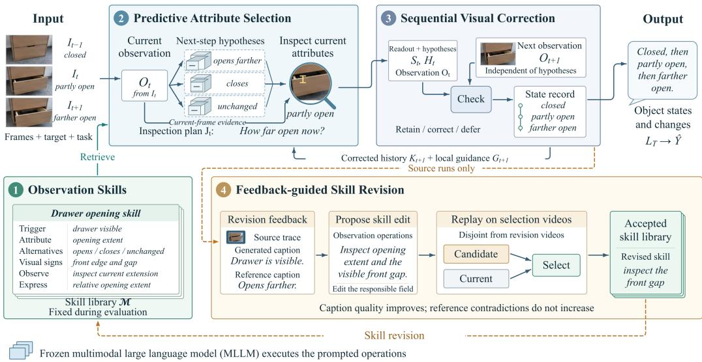
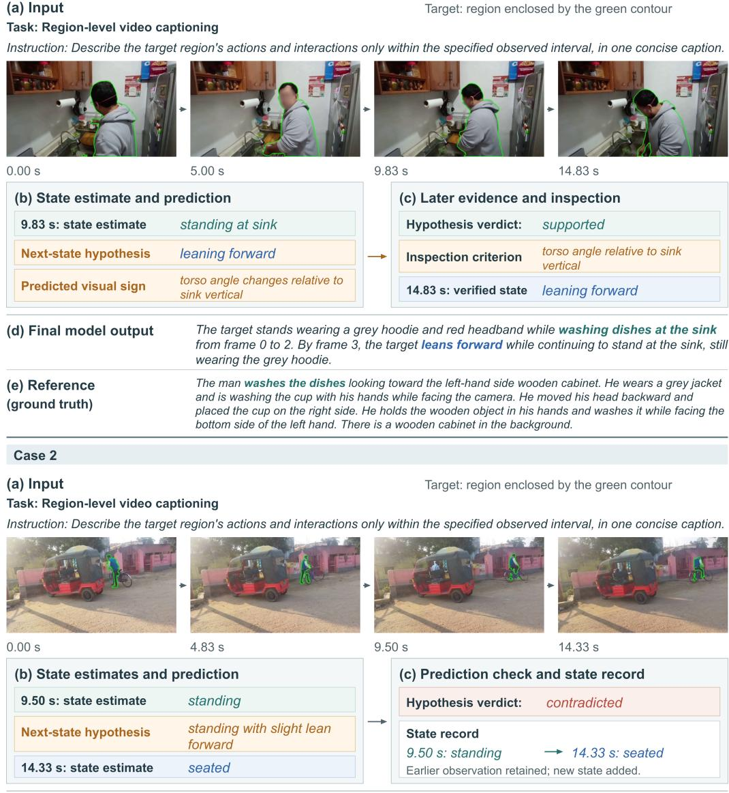

# LOOKING ONE STEP AHEAD: AN ANTICIPATION-GUIDED AGENT FOR OBJECT STATE READOUT IN VIDEOS

Yuanhe Tian♥ Yan Song♠∗

♥Zhongguancun Academy ♠University of Science and Technology of China ♥yhtian94@gmail.com ♠clksong@gmail.com

## ABSTRACT

Understanding the progress of an activity requires tracking how the objects involved change over time. Object state readout provides this information by describing a target object’s states and transitions across video frames. Although multimodal large language models (MLLMs) generate detailed visual descriptions, these descriptions may leave the attributes needed to distinguish successive states insufficiently specified. In this paper, we propose look-ahead state readout (LASER), an anticipation-guided agent for object state readout that uses possible next-step changes to determine which attributes to inspect in the present. Given temporally ordered frames and a target object, LASER converts anticipated changes into targeted visual questions and inspects the current frame to establish attribute values. It then checks state readouts and forecasts against independent observations of subsequent frames, refining a state record used to generate the final description. Reusable textual observation skills guide this process and are refined by tracing discrepancies with reference captions to the responsible instructions. Candidate revisions are selected on separate videos based on improved caption quality without increased contradictions with reference facts. Model parameters remain frozen throughout adaptation and inference, and the revised skills remain fixed during evaluation. Experiment results and further analysis on OSCaR and PLM RCap show consistent improvements of LASER over strong baselines and existing approaches, which demonstrates the effectiveness of our approach.1

## 1 INTRODUCTION

Object state readout describes how a specified object’s condition changes across visual observations, providing a language account of its evolving state (Nguyen et al., 2024; Cho et al., 2025). Whereas image captioning describes the content of a single image, state readout tracks object attributes across time to distinguish successive states and their transitions. This makes state readout an important task for procedural planning and robotic interaction, where understanding how actions change objects supports subsequent decisions (Nguyen et al., 2024). The central challenge is deciding which attributes reveal a meaningful change, rather than merely recognizing the object or naming its activity.

Multimodal large language models (MLLMs) provide a foundation for describing visual observations in natural language. Recent studies improve their video descriptions through detailed spatial and temporal grounding (Xue et al., 2025; Cho et al., 2025; Kazakos et al., 2025; Athar et al., 2025), while temporal benchmarks evaluate their understanding of motion and event order (Liu et al., 2024; Cai et al., 2024). Related agent studies explore anticipation-guided observation (Yang et al., 2026) and feedback-driven refinement of reusable instructions (Zhao et al., 2024; Zhang et al., 2026). These capabilities support object state readout, but accurate grounding and temporal ordering alone do not specify which attributes a state description needs to retain for subsequent comparison. A description may correctly identify an object and its surrounding activity while leaving the property that changes insufficiently specified, weakening the basis for describing its transition across images. Selecting these attributes requires considering which properties distinguish the object’s possible subsequent states.

  
Figure 1: Overview of LASER. (1) Observation skills guide (2) predictive attribute selection to anticipate possible changes and inspect current attributes. (3) Sequential visual correction checks the readout and hypotheses against the next observation, obtained independently of the hypotheses. Corrected history and local guidance support subsequent inspection; the accumulated state record supports the final description. (4) Feedback-guided skill revision uses source-video traces and reference captions to propose edits, then selects edits on separate selection videos when caption quality improves without increasing reference contradictions. Solid arrows indicate information flow; orange dashed arrows indicate source-trace transfer and skill-library updates for adaptation. The MLLM remains frozen, and the skill library is fixed during evaluation.

For example, for a drawer, opening, closing, and remaining unchanged make its current extension relevant, even when that detail receives little emphasis in a general scene description. Anticipated changes thus provide a basis for deciding what to inspect, while visual evidence establishes the current attribute value. The next image provides further evidence for assessing those changes and identifying attributes that require closer inspection. This connection between possible changes and observable properties motivates using anticipation for attribute selection, subsequent evidence to refine state descriptions, and feedback on those descriptions to improve reusable observation instructions.

In this paper, we propose look-ahead state readout (LASER), an anticipation-guided agent that guides an MLLM to inspect an object’s current state by anticipating possible next-step changes. Given a sequence of video frames and a target object, LASER uses observation skills, expressed as reusable textual instructions, to anticipate alternative changes and identify the attributes that distinguish them. Predictive attribute selection turns these attributes into visual questions and examines the current image to establish their values. Sequential visual correction then checks the resulting descriptions and anticipated changes against subsequent images, maintaining an evidence-supported state record for the final description. To improve the observation skills, feedback-guided skill revision traces discrepancies between generated and reference captions to the instructions responsible for observation and description. It proposes focused edits and retains those that improve caption quality on separate source videos without increasing contradictions with the references. This process adapts observation instructions while keeping all model parameters fixed, and the resulting skills remain fixed during evaluation. We evaluate LASER on English benchmarks across various MLLMs, where our approach outperforms strong baselines and existing studies, demonstrating the effectiveness of our approach.

## 2 THE APPROACH

We propose look-ahead state readout (LASER), an anticipation-guided agent that considers possible next-step changes to guide observation of an object’s current state. Figure 1 presents its overall architecture, comprising four components: observation skills, predictive attribute selection, sequential visual correction, andfeedback-guided skill revision. LASER organizes observation and reasoning operations and maintains the state record and local guidance; a frozen MLLM executes the visual inspection and language reasoning within these operations. Specifically, given $T$ temporally ordered video frames $V = ( I _ { 1 } , \ldots , I _ { T } )$ , a target prompt $P$ identifying the object, and a task instruction $\tau$ specifying the description scope, LASER processes the observations in sequence. For each observation $I _ { t } ,$ with $t = 1 , \dots , T$ , LASER retrieves observation skills from the skill library M to guide which attributes of the target object to inspect and how to describe them. Predictive attribute selection uses these skills to propose possible next-step changes, converts their distinguishing attributes into visual questions, and checks the current image to establish the attribute values. When the next observation arrives, sequential visual correction checks earlier descriptions and anticipated changes against the new evidence. It updates a state record $L _ { t }$ of observed attributes, changes, and supporting evidence, and local guidance $G _ { t }$ containing unresolved questions for subsequent inspection. After the final observation, LASER composes the description $\widehat { Y }$ from the final state record $L = L _ { T }$ . During adaptation, feedback-guided skill revision uses discrepancies in these readout sequences and reference captions to propose instruction edits, then selects edits through replay on separate videos.

The observation cycle in Figure 1 follows readout at $I _ { t }$ through correction when $I _ { t + 1 }$ arrives. The feedback path returns corrected history and local guidance to skill selection and current-attribute inspection for that next observation. LASER returns the description $\widehat { Y }$ and its supporting state record $L \colon$

$$
( \widehat { Y } , L ) = \mathrm { L A S E R } ( V , P , \mathcal { T } ; \mathcal { M } )\tag{1}
$$

The following subsections describe observation skills, predictive attribute selection, sequential visual correction, and feedback-guided skill revision, respectively.

## 2.1 OBSERVATION SKILLS

An observation skill is a structured textual instruction that tells the agent what to inspect about an object and how to describe the visual evidence. Each skill contains six fields: a trigger specifying when the instruction applies, an attribute scope identifying what to inspect, alternative changes suggesting possible next states, visual signs distinguishing those alternatives, observation operations specifying how to check the current image, and expression constraints governing the resulting description. We organize these observation instructions into a skill library $\bar { \mathcal { M } }$ . For each observation, the MLLM selects relevant skills to guide inspection (see Section 2.2 for details). Feedback-guided skill revision updates these instructions using caption feedback (Section 2.4).

## 2.2 PREDICTIVE ATTRIBUTE SELECTION

Predictive attribute selection uses possible next-step changes to determine which attributes matter for describing the object’s current state. For each image $I _ { t } ,$ the MLLM first observes the target using the task instruction $\tau$ and the target information available up to that observation, denoted by $P _ { \leq t }$ It produces an observation description $O _ { t }$ containing visible attributes and their values, supporting image regions, and any uncertainty. This initial observation receives no predicted changes, so its description is grounded in the image. For $t > 1$ , LASER checks earlier descriptions against the new observation before selecting skills. The resulting $K _ { t }$ contains the earlier states and observed changes after evidence-supported corrections, while local guidance $G _ { t }$ records questions that still require inspection. Both are empty for the first observation. The MLLM selects skills whose triggers and attribute scopes match $O _ { t } , \tau , K _ { t }$ , and $G _ { t }$ , forming $\mathcal { M } _ { t }$ . When no skill matches, the MLLM follows the task instruction and directly inspects observable attributes of the target object.

Using the selected skills, the MLLM anticipates how the target might change by the next observation. For $t < T$ , it generates a set of hypotheses $H _ { t }$ from the current description and the information accumulated so far:

$$
H _ { t } = \mathrm { A n t i c i p a t e } ( O _ { t } , K _ { t } , G _ { t } , { \mathcal { M } } _ { t } , { \mathcal { T } } )\tag{2}
$$

Each hypothesis identifies an object attribute, a possible next value or change direction, and a visual sign that would distinguish that outcome. For a drawer, alternatives might be opening further, closing, or remaining unchanged; they make its current extension an informative attribute to inspect. These hypotheses concern the next available observation and use only the images observed so far.

The MLLM converts the hypotheses into an inspection plan $J _ { t } { : }$ a set of questions about the target’s current attributes. Each question specifies what visual evidence to examine and how that evidence supports a description. Questions remain neutral about the expected answer; for example, the drawer hypothesis leads to asking how far the drawer is currently extended. The plan also includes taskrelevant attributes already identified in $O _ { t }$ and unresolved questions in $G _ { t }$ . We denote the hypotheses available to planning by $H _ { t } ^ { \mathrm { u s e } }$ : these are $H _ { t }$ for $t < T$ and the preceding hypotheses $H _ { T - 1 }$ for the final observation. The plan is constructed as:

$$
J _ { t } = \mathrm { P l a n } ( O _ { t } , H _ { t } ^ { \mathrm { u s e } } , \mathcal { M } _ { t } , G _ { t } , \mathcal { T } )\tag{3}
$$

The MLLM inspects the current image according to $J _ { t }$ and produces the state readout $S _ { t }$ by $S _ { t } =$ Read $. ( I _ { t } , P _ { \leq t } , \bar { J } _ { t } , O _ { t } )$ . The readout records attribute values and their supporting visual evidence, leaving values unresolved when the image is insufficient. Subsequent observations check this readout and its associated hypotheses through sequential visual correction.

## 2.3 SEQUENTIAL VISUAL CORRECTION

When the agent processes image $I _ { t } \left( t > 1 \right)$ , sequential visual correction checks the preceding state description $S _ { t - 1 }$ and predicted changes $H _ { t - 1 }$ against the new visual evidence. The MLLM uses the observation descriptions $O _ { t - 1 }$ and $O _ { t }$ , which are obtained without predicted values. If these descriptions provide insufficient evidence, the MLLM examines the two images again to answer the unresolved visual questions. This additional inspection produces $W _ { t }$ without receiving the preceding claimed value or predicted outcome; otherwise, $W _ { t }$ is empty. The comparison produces feedback $E _ { t } \mathrm { : }$

$$
E _ { t } = \mathrm { C o m p a r e } ( S _ { t - 1 } , H _ { t - 1 } , O _ { t - 1 } , O _ { t } , W _ { t } , \mathcal { T } )\tag{4}
$$

The feedback identifies supported or contradicted hypotheses, observed state changes, errors in earlier descriptions, and questions that the available evidence does not resolve. If an object previously observed as standing is now seated, the agent records the transition and rejects a prediction of continued standing; it does not change the earlier standing observation. An earlier description is corrected only when visual evidence contradicts that description. When the object’s identity across the two images is uncertain, the agent leaves the transition unresolved.

The state record and local guidance start empty: $L _ { 0 } = \varnothing$ and $G _ { 0 } = \varnothing$ . For $t > 1$ , the correction operation applies evidence-supported repairs to the preceding state record $L _ { t - 1 }$ , producing $K _ { t }$ , while the guidance operation updates the unresolved questions in $G _ { t } \mathrm { : }$

$$
K _ { t } = \operatorname { C o r r e c t } ( L _ { t - 1 } , E _ { t } ) , \quad G _ { t } = \operatorname { G u i d e } ( G _ { t - 1 } , E _ { t } )\tag{5}
$$

Here, $K _ { t }$ contains the corrected history before the current state is added. Predictive attribute selection then uses $K _ { t }$ and $G _ { t }$ to guide inspection of the current image, yielding $S _ { t }$ . The agent adds this readout to the corrected history to obtain the updated state record:

$$
L _ { t } = \mathrm { U p d a t e } ( K _ { t } , S _ { t } )\tag{6}
$$

For the first image, $E _ { 1 } , K _ { 1 }$ , and $G _ { 1 }$ are empty, and $S _ { 1 }$ initializes the state record.

After all $T$ images have been processed, the MLLM generates the final description from $L _ { T }$ . It selects supported states and changes within the object and temporal scope specified by $\tau { : }$

$$
\widehat { Y } = \mathrm { C o m p o s e } ( L _ { T } , \mathcal { T } )\tag{7}
$$

## 2.4 FEEDBACK-GUIDED SKILL REVISION

Feedback-guided skill revision improves observation instructions using existing reference captions while keeping model parameters fixed. We divide the source videos into a revision set $\mathcal { D } _ { \mathrm { r e v } }$ for identifying problems and proposing edits, and a selection set $\mathcal { D } _ { \mathrm { s e l } }$ for evaluating those edits. The sets contain different videos to test whether edits generalize beyond the examples that motivate them. In each round, LASER processes the revision videos with the current library. The MLLM compares generated captions with references and examines the corresponding observations, hypotheses, inspection questions, and state records to identify discrepancy sources. The comparison identifies omissions and explicit contradictions; details unmentioned in the reference remain unjudged.

When a relevant attribute is never inspected, it examines whether the skill’s trigger or alternative changes fail to direct attention to that attribute. When inspection produces an unsupported value, it examines the visual signs and observation operations. When a supported fact appears in the state record but is missing from the final caption, it examines the expression constraints. For a discrepancy linked to an existing skill, the MLLM proposes an edit to one responsible field; if no skill covers the situation, it proposes a new skill. Each proposal produces a candidate library M′ derived independently from the current library M. The MLLM proposes no edit when the available evidence does not identify a responsible instruction.

LASER compares each candidate with the current library on $\mathcal { D } _ { \mathrm { s e l } }$ . For an example x, which contains the images, target information, and task instruction, let $Y _ { x } ^ { * }$ denote its reference caption. The score q measures agreement between the generated and reference captions, giving the mean caption quality:

$$
Q ( \mathcal { M } ) = \frac { 1 } { | \mathcal { D } _ { \mathrm { s e l } } | } \sum _ { x \in \mathcal { D } _ { \mathrm { s e l } } } q \big ( \mathrm { C a p t i o n } ( x ; \mathcal { M } ) , Y _ { x } ^ { * } \big )\tag{8}
$$

Here, Caption returns the description produced by Equation 1; references are used for scoring rather than caption generation. To check contradictions, the MLLM extracts explicit facts from each reference caption once and uses the same facts to assess every candidate. An MLLM judge determines whether a generated caption contains a claim incompatible with a reference fact concerning the same object and temporal scope. Omissions, details absent from the reference, and uncertain comparisons do not count as contradictions. The contradiction score X(M) is the fraction of selection examples containing at least one explicit contradiction.

Selection requires an improvement in caption quality without increasing reference contradictions. For a positive quality margin ϵ, the acceptance rule is:

$$
\mathrm { A c c e p t } ( \mathcal { M } ^ { \prime } ) = \mathbf { 1 } [ Q ( \mathcal { M } ^ { \prime } ) - Q ( \mathcal { M } ) \geq \epsilon , \ X ( \mathcal { M } ^ { \prime } ) \leq X ( \mathcal { M } ) ]\tag{9}
$$

The accepted candidate with the highest caption quality replaces the current library; if none is accepted, the library is retained. The resulting skill library remains fixed during evaluation.

## 3 EXPERIMENT SETTING

## 3.1 DATASETS

We evaluate object-conditioned captioning on OSCaR (Nguyen et al., 2024) and PLM RCap (Cho et al., 2025). We use OSCaR’s released EPIC state-change slot, containing 7K training clips and 500 test clips. Each example pairs three ordered frames with a named object and a reference description of its state change. PLM RCap contains 179K training, 4K development, and 10K test region–interval captions. Given a target masklet and its video interval, the task describes the target’s actions and interactions. For each benchmark, we select 500 examples from its training split and use their reference captions to adapt observation skills. We divide these examples into video-disjoint revision and selection sets, using the former to propose instruction edits and the latter to evaluate them.

## 3.2 BASELINES AND COMPARING MODELS

We compare LASER with the following baselines. Direct Captioning generates a target description from the input frames and task instruction in one pass. Sequential Readout describes object states in temporal order and summarizes their changes without anticipating future states. Generic Reinspection extends sequential readout by checking for omissions or inconsistencies. Attribute Checklist selects current-state attributes for inspection and retains visual correction, without next-step hypotheses. Free Anticipation predicts possible future events without identifying their distinguishing attributes and visual signs. LASER (No Skill Revision) uses unadapted initial observation skills. LASER (GEPA Optimization) uses GEPA (Agrawal et al., 2026) to optimize the same prompt interfaces instead of feedback-guided skill revision. LASER (Full) is our full approach.

We also compare LASER with five existing approaches. InstanceCap (Fan et al., 2025) organizes video instances into structured descriptions of their appearance, actions, motion, and position. Matters (Peng et al., 2025) describes local image patches and hierarchically aggregates their details through semantic filtering. RICO (Wang et al., 2025a) reconstructs images from captions and revises the captions by comparing the reconstructions with the original images. ReAgent-V (Zhou et al., 2025) combines task-relevant frame selection and tool-derived evidence with critical feedback and multi-perspective answer revision. ScaleCap (Xing et al., 2026) expands captions through targeted visual questions and filters unsupported sentences through contrastive scoring. We adapt these approaches to object-conditioned captioning and evaluate them on the benchmarks.

Table 1: Comparison of our approach with various baselines across four backbone MLLMs on the test set of OSCaR and PLM RCap, where “+ LASER (full)” denotes our full model.
<table><tr><td rowspan="2">Approach</td><td colspan="4">OSCaR</td><td>PLM RCap</td></tr><tr><td>BLEU↑</td><td>ROUGE-1↑</td><td>ROUGE-2↑</td><td>ROUGE-L↑</td><td>Score↑</td></tr><tr><td>Qwen3.5-4B</td><td>7.7</td><td>28.4</td><td>8.7</td><td>25.2</td><td>24.7</td></tr><tr><td>+ Sequential Readout</td><td>8.0</td><td>29.2</td><td>8.8</td><td>26.2</td><td>26.1</td></tr><tr><td>+ Generic Reinspection</td><td>8.0</td><td>29.8</td><td>8.7</td><td>25.9</td><td>25.3</td></tr><tr><td>+ Attribute Checklist</td><td>8.6</td><td>29.6</td><td>9.2</td><td>26.7</td><td>26.8</td></tr><tr><td>+ Free Anticipation</td><td>8.1</td><td>29.9</td><td>9.0</td><td>25.2</td><td>25.3</td></tr><tr><td>+ LASER (No Skill Revision)</td><td>8.7</td><td>30.1</td><td>8.9</td><td>26.7</td><td>25.9</td></tr><tr><td>+ LASER (GEPA Optimization)</td><td>9.0</td><td>31.1</td><td>9.1</td><td>29.0</td><td>27.5</td></tr><tr><td>+ LASER (Full)</td><td>9.3</td><td>30.9</td><td>9.3</td><td>28.9</td><td>27.3</td></tr><tr><td>Qwen3.5-9B</td><td>8.6</td><td>29.8</td><td>9.5</td><td>26.9</td><td>25.6</td></tr><tr><td>+ Sequential Readout</td><td>9.1</td><td>30.6</td><td>9.5</td><td>28.5</td><td>26.7</td></tr><tr><td>+ Generic Reinspection</td><td>9.3</td><td>31.1</td><td>9.9</td><td>28.7</td><td>25.8</td></tr><tr><td>+ Attribute Checklist</td><td>9.6</td><td>30.8</td><td>9.9</td><td>27.7</td><td>27.2</td></tr><tr><td>+ Free Anticipation</td><td>9.0</td><td>30.5</td><td>9.6</td><td>28.5</td><td>26.4</td></tr><tr><td>+ LASER (No Skill Revision)</td><td>9.1</td><td>30.5</td><td>9.8</td><td>28.2</td><td>26.8</td></tr><tr><td>+ LASER (GEPA Optimization)</td><td>9.5</td><td>31.6</td><td>10.1</td><td>29.9</td><td>27.5</td></tr><tr><td>+ LASER (Full)</td><td>9.9</td><td>32.0</td><td>10.1</td><td>29.6</td><td>28.1</td></tr><tr><td>Qwen3.5-35B-A3B</td><td>8.8</td><td>30.4</td><td>9.7</td><td>27.7</td><td>26.3</td></tr><tr><td>+ Sequential Readout</td><td>9.0</td><td>30.3</td><td>10.0</td><td>27.9</td><td>27.5</td></tr><tr><td>+ Generic Reinspection</td><td>9.0</td><td>31.0</td><td>9.8</td><td>29.4</td><td>27.0</td></tr><tr><td>+ Attribute Checklist</td><td>9.6</td><td>31.5</td><td>10.1</td><td>29.3</td><td>27.3</td></tr><tr><td>+ Free Anticipation</td><td>9.2</td><td>31.0</td><td>9.7</td><td>28.2</td><td>27.3</td></tr><tr><td>+ LASER (No Skill Revision)</td><td>9.7</td><td>30.9</td><td>10.0</td><td>28.9</td><td>28.1</td></tr><tr><td>+ LASER (GEPA Optimization) + LASER (Full)</td><td>10.3</td><td>32.2</td><td>10.7</td><td>30.7</td><td>29.0</td></tr><tr><td></td><td>10.6</td><td>33.1</td><td>10.8</td><td>30.4</td><td>28.8</td></tr><tr><td>Ministral-3-3B</td><td>6.8</td><td>27.1</td><td>6.1</td><td>24.0</td><td>22.9</td></tr><tr><td>+ Sequential Readout</td><td>7.6</td><td>28.2</td><td>6.0</td><td>24.9</td><td>23.8</td></tr><tr><td>+ Generic Reinspection</td><td>8.1</td><td>28.4</td><td>6.3</td><td>25.4</td><td>23.8</td></tr><tr><td>+ Attribute Checklist</td><td>8.1</td><td>28.6</td><td>7.0</td><td>25.5</td><td>23.6</td></tr><tr><td>+ Free Anticipation</td><td>7.4</td><td>27.7</td><td>7.4</td><td>25.4</td><td>23.4</td></tr><tr><td>+ LASER (No Skill Revision)</td><td>8.0</td><td>28.7</td><td>6.9</td><td>25.9</td><td>23.3</td></tr><tr><td>+ LASER (GEPA Optimization)</td><td>8.1</td><td>29.1</td><td>8.0</td><td>26.4</td><td>24.7</td></tr><tr><td>+ LASER (Full)</td><td>8.8</td><td>29.9</td><td>8.2</td><td>27.0</td><td>25.2</td></tr></table>

## 3.3 IMPLEMENTATION DETAILS

Our backbones MLLMs comprise Qwen3.5-4B, Qwen3.5-9B, and Qwen3.5-35B-A3B (Qwen Team, 2026), plus Ministral-3-3B (Liu et al., 2026). The two dense Qwen models each have 32 language layers, with hidden dimensions of 2,560 and 4,096 for the 4B and 9B variants, respectively. The 35B-A3B variant uses 40 language layers with a hidden dimension of 2,048; its mixture-of-experts layers select 8 of 256 routed experts per token and include a shared expert, with an intermediate dimension of 512 for each expert. Ministral-3-3B has 26 language layers with a hidden dimension of 3,072 and a 24-layer vision encoder.

We divide the adaptation examples into revision and selection sets at a 4:1 ratio, keeping examples from the same video in one set. For PLM RCap, we uniformly sample eight frames from each target interval; OSCaR uses its three provided frames. At each observation, LASER selects up to three relevant skills and generates up to three alternative next-step changes. Skill adaptation runs for at most five rounds, with up to three candidate libraries evaluated per round. We normalize caption quality scores to [0, 1] and require an improvement of at least ϵ = 0.005 without increasing reference contradictions. Adaptation stops when no candidate satisfies these criteria. All model parameters remain frozen, and the adapted skill library remains fixed during evaluation.

Table 2: Comparison of our approach with existing studies on using Qwen3.5-9B as the backbone MLLM. The best and second-best results are marked by boldface and underlines, respectively.
<table><tr><td rowspan="2">Approach</td><td colspan="4">OSCaR</td><td>|PLM RCap</td></tr><tr><td>BLEU↑</td><td>ROUGE-1↑</td><td>ROUGE-2↑</td><td>ROUGE-L↑</td><td>Score↑</td></tr><tr><td>Qwen3.5-9B</td><td>8.6</td><td>29.8</td><td>9.5</td><td>26.9</td><td>25.6</td></tr><tr><td>InstanceCap (Fan et al., 2025)</td><td>9.6</td><td>31.1</td><td>9.9</td><td>27.6</td><td>27.4</td></tr><tr><td>Matters (Peng et al., 2025)</td><td>9.1</td><td>30.2</td><td>9.4</td><td>27.1</td><td>25.4</td></tr><tr><td>RICO (Wang et al., 2025a)</td><td>8.9</td><td>30.1</td><td>9.9</td><td>27.5</td><td>25.5</td></tr><tr><td>ReAgent-V (Zhou et al., 2025)</td><td>9.2</td><td>31.4</td><td>9.8</td><td>28.7</td><td>27.8</td></tr><tr><td>ScaleCap (Xing et al., 2026)</td><td>9.3</td><td>30.1</td><td>9.8</td><td>29.4</td><td>26.6</td></tr><tr><td>LASER</td><td>9.9</td><td>32.0</td><td>10.1</td><td>29.6</td><td>28.1</td></tr></table>

For evaluation, we use different metrics for the two benchmarks. For OSCaR, we report BLEU (Papineni et al., 2002), ROUGE-1, ROUGE-2, and ROUGE-L (Lin, 2004), with ROUGE-L as the primary metric. For PLM RCap, we use the official language-model-judged reference-caption similarity score (Cho et al., 2025). Higher values indicate better caption agreement on both tasks. Evaluation references are accessible only to the scorer.

## 4 RESULTS AND ANALYSIS

## 4.1 OVERALL RESULTS

Table 1 presents the results of our approach and baselines on OSCaR and PLM RCap across four backbone MLLMs. There are several observations. First, LASER consistently outperforms direct captioning, sequential readout, and generic reinspection across all metrics. These gains suggest that accurate state descriptions benefit from selecting informative attributes beyond organizing observations temporally or inspecting them repeatedly. Second, LASER achieves higher scores than both attribute checklists and free anticipation across the evaluated backbones. This supports connecting possible changes to specific visual attributes, so that anticipation guides what to inspect in the current image. Third, feedback-guided skill revision improves every reported metric over LASER with the initial skill library. This indicates that caption feedback helps refine reusable observation instructions without updating model parameters. Fourth, LASER improves over direct captioning for all four backbones, spanning different model sizes, model families, and dense and mixture-of-experts architectures, which demonstrates the robustness of our approach.

Table 2 compares LASER with five existing approaches adapted to object-conditioned captioning using Qwen3.5-9B as the backbone MLLM. LASER outperforms all compared approaches on both benchmarks, which demonstrates the effectiveness of using anticipated changes to identify statedistinguishing attributes and refining their descriptions through subsequent visual evidence and caption feedback.

## 4.2 ABLATION STUDY

We examine whether anticipated changes help identify current-state evidence and whether independent observation limits reliance on predicted values. Using Qwen3.5-9B as the backbone MLLM on both benchmarks, we independently remove current reinspection, remove discriminating visual signs, or expose the initial observer to preceding hypotheses, retaining the full approach’s revised skills in each case. Table 3 compares these variants with full LASER and direct captioning. Removing current reinspection lowers every metric, supporting the use of anticipated changes to guide a second examination of the present image. Removing discriminating signs also lowers every metric and produces the largest ROUGE-L decline among the ablations. This pattern suggests that identifying possible changes is more useful when those changes are connected to explicit visual criteria for inspection. Exposing the initial observer to predicted changes reduces all reported scores and produces the largest decline in RCap similarity among the ablations. The result supports keeping initial visual observations independent of forecasts, so that later comparisons rely on separately obtained evidence.

Table 3: Results of ablation study of predictive observation with Qwen3.5-9B.
<table><tr><td rowspan="2">Approach</td><td colspan="4">OSCaR</td><td>|PLM RCap</td></tr><tr><td>BLEU↑</td><td>ROUGE-1↑</td><td>ROUGE-2↑</td><td>ROUGE-L↑</td><td>Score↑</td></tr><tr><td>LASER (Full)</td><td>9.9</td><td>32.0</td><td>10.1</td><td>29.6</td><td>28.1</td></tr><tr><td>w/o Current Reinspection</td><td>9.1</td><td>31.2</td><td>10.0</td><td>28.9</td><td>27.4</td></tr><tr><td>w/o Discriminating Signs</td><td>9.8</td><td>31.7</td><td>9.8</td><td>28.1</td><td>27.5</td></tr><tr><td>w/o Independent Observation</td><td>9.3</td><td>31.8</td><td>9.7</td><td>29.0</td><td>27.3</td></tr><tr><td>Qwen3.5-9B (Base)</td><td>8.6</td><td>29.8</td><td>9.5</td><td>26.9</td><td>25.6</td></tr></table>

All three ablated variants remain above direct captioning, indicating that each removed operation contributes to the full approach while the remaining observation structure retains value.

## 4.3 CASE STUDY

We use two region-captioning cases from source videos to illustrate how LASER handles supported and contradicted predictions. Figure 2 shows the input frames and target regions in panel (a), state estimates and predictions in panel (b), subsequent visual checks in panel (c), and the generated and reference captions in panels (d) and (e). Green contours identify the target whose state is tracked.

In Case 1, the anticipated forward lean directs inspection toward the target’s torso angle relative to the sink. The later image supports this change, and the final caption describes the lean while preserving the ongoing dishwashing activity. The reference mentions dishwashing without explicitly describing the lean, so the displayed images provide the evidence for this additional posture detail. The case illustrates how an anticipated change becomes a specific visual criterion used in the final description. In Case 2, LASER anticipates continued standing with a slight forward lean, but the later observation shows the target seated on the bicycle. Sequential visual correction rejects the forecast, retains the earlier standing state, and records the newly observed transition. The final caption describes the target sitting on the bicycle, consistent with the reference’s account of getting onto it. The case illustrates that an incorrect forecast still leaves room for evidence-supported state readout: subsequent observations determine the transition without changing a supported earlier state.

## 5 RELATED WORK

Object-centered video understanding studies state localization (Xue et al., 2024; Soucek et al., 2022),ˇ transformation graphs (Sun et al., 2025), and segmentation through appearance changes (Yu et al., 2023). Region-captioning approaches emphasize object representations (Yuan et al., 2025) and local–global context (Lian et al., 2025), while OSCaR (Nguyen et al., 2024) and PerceptionLM (Cho et al., 2025) provide state-change and region-captioning tasks, respectively. Agent approaches organize reasoning and interaction (Yao et al., 2023), execute visual programs (Gupta & Kembhavi, 2023), and gather evidence through iterative inspection (Wang et al., 2024), keyframe selection (Wang et al., 2025b), or evidence-sufficiency assessment (Wang et al., 2026). StreamAgent anticipates where and when task-relevant information will appear to guide evidence acquisition and response timing in streaming video question answering (Yang et al., 2026). Other uses of possible outcomes include counterfactual supervision for video representation learning (Kung et al., 2025) and robot behavior forecasting in TRACE (Puthumanaillam et al., 2025). Feedback-based approaches revise responses (Madaan et al., 2023) or retain experience as reflections (Shinn et al., 2023), workflows (Wang et al., 2025c), manuals (Chen et al., 2024), and evolving contextual playbooks (Zhang et al., 2026). Prompt optimization uses scored candidates (Yang et al., 2024), textual critiques (Pryzant et al., 2023), modular instruction search (Khattab et al., 2024; Opsahl-Ong et al., 2024), and feedback propagation (Yuksekgonul et al., 2025); GEPA uses execution traces to reflect on and evolve prompts (Agrawal et al., 2026). LASER focuses on the role of anticipation in determining what constitutes an informative description of the present: alternative next-step changes identify the object attributes and visual signs to inspect in the current image, whose evidence establishes their values. Subsequent observations check these values and transitions, while caption discrepancies guide revisions to the responsible attribute-selection, visual-inspection, or expression instructions, making the observation criteria themselves the target of adaptation.

<table><tr><td colspan="2">(b) State estimate and prediction</td><td rowspan="5">+</td><td colspan="2">(c) Later evidence and inspection</td></tr><tr><td>9.83 s: state estimate</td><td>standing at sink</td><td>Hypothesis verdict:</td><td>supported</td></tr><tr><td>Next-state hypothesis</td><td>leaning forward</td><td>Inspection criterion</td><td>torso angle relative to sink vertical</td></tr><tr><td>Predicted visual sign</td><td>torso angle changes relative to sink vertical</td><td>14.83 s: verified state</td><td>leaning forward</td></tr></table>

<table><tr><td colspan="2">(b) State estimates and prediction</td></tr><tr><td>9.50 s: state estimate</td><td>standing</td></tr><tr><td>Next-state hypothesis</td><td>standing with slight lean forward</td></tr><tr><td>14.33 s: state estimate</td><td>seated</td></tr></table>

(d) Final model output The target stands near a bicycle wearing a blue shirt. It holds the bicycle handlebars while standing. The target then sits on the bicycle to ride it  
(e) Reference A man holding a bicycle by his side, he is standing near a motor tricycle. Then the (ground truth) man started to turn and walk to his right with the bicycle. After a few steps, he stops and hops on the bicycle  
Figure 2: Two region-captioning cases illustrating selected posture changes. Each case shows the input frames and target region, an anticipated change, later visual evidence, the model caption, and the reference. Case 1 links an anticipated forward lean to a visual inspection criterion. Case 2 rejects a standing forecast and preserves the observed transition to sitting. Green contours identify the target.

## 6 CONCLUSION

In this paper, we propose look-ahead state readout (LASER), an anticipation-guided agent that uses possible next-step changes to determine which object attributes deserve attention in the present.

LASER converts anticipated changes into current-state inspection questions and uses subsequent visual evidence to refine the state record for description. Feedback-guided skill revision improves reusable observation instructions through caption feedback while keeping all model parameters fixed. Experiments on OSCaR and PLM RCap demonstrate consistent improvements over direct captioning and alternative observation strategies across four MLLM backbones, and LASER outperforms the five compared existing approaches. Ablations support the importance of inspecting current attributes, identifying distinguishing visual signs, and checking predictions against independent observations.

## REFERENCES

Lakshya A Agrawal, Shangyin Tan, Dilara Soylu, Noah Ziems, Rishi Khare, Krista Opsahl-Ong, Arnav Singhvi, Herumb Shandilya, Michael J Ryan, Meng Jiang, Christopher Potts, Koushik Sen, Alexandros G. Dimakis, Ion Stoica, Dan Klein, Matei Zaharia, and Omar Khattab. GEPA: Reflective Prompt Evolution Can Outperform Reinforcement Learning. In International Conference on Learning Representations, 2026.

Ali Athar, Xueqing Deng, and Liang-Chieh Chen. ViCaS: A Dataset for Combining Holistic and Pixel-level Video Understanding using Captions with Grounded Segmentation. In Proceedings of the IEEE/CVF Conference on Computer Vision and Pattern Recognition (CVPR), pp. 19023–19035, 2025.

Mu Cai, Reuben Tan, Jianrui Zhang, Bocheng Zou, Kai Zhang, Feng Yao, Fangrui Zhu, Jing Gu, Yiwu Zhong, Yuzhang Shang, Yao Dou, Jaden Park, Jianfeng Gao, Yong Jae Lee, and Jianwei Yang. TemporalBench: Benchmarking Fine-grained Temporal Understanding for Multimodal Video Models. arXiv preprint arXiv:2410.10818, 2024.

Minghao Chen, Yihang Li, Yanting Yang, Shiyu Yu, Binbin Lin, and Xiaofei He. AutoManual: Constructing Instruction Manuals by LLM Agents via Interactive Environmental Learning. In Advances in Neural Information Processing Systems, volume 37, pp. 589–631, 2024.

Jang Hyun Cho, Andrea Madotto, Effrosyni Mavroudi, Triantafyllos Afouras, Tushar Nagarajan, Muhammad Maaz, Yale Song, Tengyu Ma, Shuming Hu, Suyog Jain, Miguel Martin, Huiyu Wang, Hanoona Bangalath, Peize Sun, Po-Yao Huang, Daniel Bolya, Nikhila Ravi, Shashank Jain, Tammy Stark, Seungwhan Moon, Babak Damavandi, Vivian Lee, Andrew Westbury, Salman H Khan, Philipp Krahenb ¨ uhl, Piotr Doll ¨ ar, Lorenzo Torresani, Kristen Grauman, and Christoph ´ Feichtenhofer. PerceptionLM: Open-Access Data and Models for Detailed Visual Understanding. In Advances in Neural Information Processing Systems, volume 38, 2025.

Tiehan Fan, Kepan Nan, Rui Xie, Penghao Zhou, Zhenheng Yang, Chaoyou Fu, Xiang Li, Jian Yang, and Ying Tai. InstanceCap: Improving text-to-video generation via instance-aware structured caption. In Proceedings of the IEEE/CVF Conference on Computer Vision and Pattern Recognition, pp. 28974–28983, 2025.

Tanmay Gupta and Aniruddha Kembhavi. Visual Programming: Compositional Visual Reasoning Without Training. In Proceedings of the IEEE/CVF Conference on Computer Vision and Pattern Recognition (CVPR), pp. 14953–14962, 2023.

Evangelos Kazakos, Cordelia Schmid, and Josef Sivic. Large-scale Pre-training for Grounded Video Caption Generation. In Proceedings of the IEEE/CVF International Conference on Computer Vision (ICCV), pp. 24434–24444, 2025.

Omar Khattab, Arnav Singhvi, Paridhi Maheshwari, Zhiyuan Zhang, Keshav Santhanam, Sri Vardhamanan, Saiful Haq, Ashutosh Sharma, Thomas T. Joshi, Hanna Moazam, Heather Miller, Matei Zaharia, and Christopher Potts. DSPy: Compiling Declarative Language Model Calls into Self-Improving Pipelines. In International Conference on Learning Representations, 2024.

Chi-Hsi Kung, Frangil Ramirez, Juhyung Ha, Yi-Ting Chen, David Crandall, and Yi-Hsuan Tsai. What Changed and What Could Have Changed? State-Change Counterfactuals for Procedure-Aware Video Representation Learning. In Proceedings ofthe IEEE/CVF International Conference on Computer Vision (ICCV), pp. 12294–12306, October 2025.

Long Lian, Yifan Ding, Yunhao Ge, Sifei Liu, Hanzi Mao, Boyi Li, Marco Pavone, Ming-Yu Liu, Trevor Darrell, Adam Yala, and Yin Cui. Describe Anything: Detailed Localized Image and Video Captioning. In Proceedings ofthe IEEE/CVF International Conference on Computer Vision (ICCV), pp. 21766–21777, 2025.

Chin-Yew Lin. ROUGE: A package for automatic evaluation of summaries. In Text Summarization Branches Out, pp. 74–81, Barcelona, Spain, July 2004. Association for Computational Linguistics.

Alexander H. Liu, Kartik Khandelwal, Sandeep Subramanian, Victor Jouault, Abhinav Rastogi, Adrien Sade, Alan Jeffares, Albert Jiang, Alexandre Cahill, Alexandre Gavaudan, Alexandre´ Sablayrolles, Amelie H´ eliou, Amos You, Andy Ehrenberg, Andy Lo, Anton Eliseev, Antonia Calvi,´ Avinash Sooriyarachchi, Baptiste Bout, Baptiste Roziere, Baudouin De Monicault, Cl\` emence Lan-´ franchi, Corentin Barreau, Cyprien Courtot, Daniele Grattarola, Darius Dabert, Diego de las Casas, Elliot Chane-Sane, Faruk Ahmed, Gabrielle Berrada, Gaetan Ecrepont, Gauthier Guinet, Georgii¨ Novikov, Guillaume Kunsch, Guillaume Lample, Guillaume Martin, Gunshi Gupta, Jan Ludziejewski, Jason Rute, Joachim Studnia, Jonas Amar, Josephine Delas, Josselin Somerville Roberts,´ Karmesh Yadav, Khyathi Chandu, Kush Jain, Laurence Aitchison, Laurent Fainsin, Leonard Blier,´ Lingxiao Zhao, Louis Martin, Lucile Saulnier, Luyu Gao, Maarten Buyl, Margaret Jennings, Marie Pellat, Mark Prins, Mathieu Poiree, Mathilde Guillaumin, Matthieu Dinot, Matthieu Futeral,´ Maxime Darrin, Maximilian Augustin, Mia Chiquier, Michel Schimpf, Nathan Grinsztajn, Neha Gupta, Nikhil Raghuraman, Olivier Bousquet, Olivier Duchenne, Patricia Wang, Patrick von Platen, Paul Jacob, Paul Wambergue, Paula Kurylowicz, Pavankumar Reddy Muddireddy, Philomene\` Chagniot, Pierre Stock, Pravesh Agrawal, Quentin Torroba, Romain Sauvestre, Roman Soletskyi, Rupert Menneer, Sagar Vaze, Samuel Barry, Sanchit Gandhi, Siddhant Waghjale, Siddharth Gandhi, Soham Ghosh, Srijan Mishra, Sumukh Aithal, Szymon Antoniak, Teven Le Scao, Theo´ Cachet, Theo Simon Sorg, Thibaut Lavril, Thiziri Nait Saada, Thomas Chabal, Thomas Foubert, Thomas Robert, Thomas Wang, Tim Lawson, Tom Bewley, Tom Bewley, Tom Edwards, Umar Jamil, Umberto Tomasini, Valeriia Nemychnikova, Van Phung, Vincent Maladiere, Virgile Richard,\` Wassim Bouaziz, Wen-Ding Li, William Marshall, Xinghui Li, Xinyu Yang, Yassine El Ouahidi, Yihan Wang, Yunhao Tang, and Zaccharie Ramzi. Ministral 3. arXiv preprint arXiv:2601.08584, 2026.

Yuanxin Liu, Shicheng Li, Yi Liu, Yuxiang Wang, Shuhuai Ren, Lei Li, Sishuo Chen, Xu Sun, and Lu Hou. TempCompass: Do Video LLMs Really Understand Videos? In Findings of the Association for Computational Linguistics: ACL 2024, pp. 8731–8772, 2024.

Aman Madaan, Niket Tandon, Prakhar Gupta, Skyler Hallinan, Luyu Gao, Sarah Wiegreffe, Uri Alon, Nouha Dziri, Shrimai Prabhumoye, Yiming Yang, Shashank Gupta, Bodhisattwa Prasad Majumder, Katherine Hermann, Sean Welleck, Amir Yazdanbakhsh, and Peter Clark. Self-refine: Iterative refinement with self-feedback. In Advances in Neural Information Processing Systems, volume 36, pp. 46534–46594. Curran Associates, Inc., 2023.

Nguyen Nguyen, Jing Bi, Ali Vosoughi, Yapeng Tian, Pooyan Fazli, and Chenliang Xu. OSCaR: Object State Captioning and State Change Representation. In Findings of the Association for Computational Linguistics: NAACL 2024, pp. 3565–3576, 2024.

Krista Opsahl-Ong, Michael J Ryan, Josh Purtell, David Broman, Christopher Potts, Matei Zaharia, and Omar Khattab. Optimizing Instructions and Demonstrations for Multi-Stage Language Model Programs. In Proceedings of the 2024 Conference on Empirical Methods in Natural Language Processing, pp. 9340–9366, 2024.

Kishore Papineni, Salim Roukos, Todd Ward, and Wei-Jing Zhu. Bleu: a method for automatic evaluation of machine translation. In Proceedings of the 40th Annual Meeting of the Association for Computational Linguistics, pp. 311–318, Philadelphia, Pennsylvania, USA, July 2002. Association for Computational Linguistics.

Ruotian Peng, Haiying He, Yake Wei, Yandong Wen, and Di Hu. Patch matters: Training-free fine-grained image caption enhancement via local perception. In Proceedings ofthe IEEE/CVF Conference on Computer Vision and Pattern Recognition, pp. 3963–3973, 2025.

Reid Pryzant, Dan Iter, Jerry Li, Yin Lee, Chenguang Zhu, and Michael Zeng. Automatic prompt optimization with “gradient descent” and beam search. In Proceedings ofthe 2023 Conference on

Empirical Methods in Natural Language Processing, pp. 7957–7968, Singapore, December 2023. Association for Computational Linguistics.

Gokul Puthumanaillam, Paulo Padrao, Jose Fuentes, Pranay Thangeda, William E. Schafer, Jae Hyuk Song, Karan Jagdale, Leonardo Bobadilla, and Melkior Ornik. TRACE: A Self-Improving Framework for Robot Behavior Forecasting with Vision-Language Models. arXiv preprint arXiv:2503.00761, 2025.

Qwen Team. Qwen3.5: Towards Native Multimodal Agents. Qwen Team, February 2026.

Noah Shinn, Federico Cassano, Ashwin Gopinath, Karthik Narasimhan, and Shunyu Yao. Reflexion: language agents with verbal reinforcement learning. In Advances in Neural Information Processing Systems, volume 36, pp. 8634–8652. Curran Associates, Inc., 2023.

Toma´s Souˇ cek, Jean-Baptiste Alayrac, Antoine Miech, Ivan Laptev, and Josef Sivic. Look for theˇ Change: Learning Object States and State-Modifying Actions From Untrimmed Web Videos. In Proceedings ofthe IEEE/CVF Conference on Computer Vision and Pattern Recognition (CVPR), pp. 13956–13966, June 2022.

Yihong Sun, Xinyu Yang, Jennifer Sun, and Bharath Hariharan. Tracking and Understanding Object Transformations. In Advances in Neural Information Processing Systems, volume 38, pp. 81039–81065, 2025.

Xiaohan Wang, Yuhui Zhang, Orr Zohar, and Serena Yeung-Levy. VideoAgent: Long-Form Video Understanding with Large Language Model as Agent. In Computer Vision – ECCV 2024, pp. 58–76, 2024.

Yuchi Wang, Yishuo Cai, Shuhuai Ren, Sihan Yang, Linli Yao, Yuanxin Liu, Yuanxing Zhang, Pengfei Wan, and Xu Sun. RICO: Improving accuracy and completeness in image recaptioning via visual reconstruction. In Proceedings of the 2025 Conference on Empirical Methods in Natural Language Processing, pp. 21785–21804, 2025a.

Ziyang Wang, Shoubin Yu, Elias Stengel-Eskin, Jaehong Yoon, Feng Cheng, Gedas Bertasius, and Mohit Bansal. VideoTree: Adaptive Tree-based Video Representation for LLM Reasoning on Long Videos. In Proceedings of the IEEE/CVF Conference on Computer Vision and Pattern Recognition (CVPR), pp. 3272–3283, June 2025b.

Ziyang Wang, Honglu Zhou, Shijie Wang, Junnan Li, Caiming Xiong, Silvio Savarese, Mohit Bansal, Michael S. Ryoo, and Juan Carlos Niebles. Active Video Perception: Iterative Evidence Seeking for Agentic Long Video Understanding. In Proceedings ofthe IEEE/CVF Conference on Computer Vision and Pattern Recognition (CVPR) Findings, pp. 9088–9099, 2026.

Zora Zhiruo Wang, Jiayuan Mao, Daniel Fried, and Graham Neubig. Agent Workflow Memory. In Proceedings of the 42nd International Conference on Machine Learning, volume 267, pp. 63897–63911, 2025c.

Long Xing, Qidong Huang, Xiaoyi Dong, Pan Zhang, Yuhang Zang, Yuhang Cao, Jinsong Li, Shuangrui Ding, Weiming Zhang, Nenghai Yu, Jiaqi Wang, Feng Wu, and Dahua Lin. ScaleCap: Scalable image captioning via dual-modality debiasing. In International Conference on Learning Representations, 2026.

Zihui Xue, Kumar Ashutosh, and Kristen Grauman. Learning Object State Changes in Videos: An Open-World Perspective. In Proceedings ofthe IEEE/CVF Conference on Computer Vision and Pattern Recognition (CVPR), pp. 18493–18503, June 2024.

Zihui Xue, Joungbin An, Xitong Yang, and Kristen Grauman. Progress-Aware Video Frame Captioning. In Proceedings ofthe IEEE/CVF Conference on Computer Vision and Pattern Recognition, pp. 13639–13650, 2025.

Chengrun Yang, Xuezhi Wang, Yifeng Lu, Hanxiao Liu, Quoc V Le, Denny Zhou, and Xinyun Chen. Large Language Models as Optimizers. In International Conference on Learning Representations, 2024.

Haolin Yang, Feilong Tang, Lingxiao Zhao, Xinlin Zhuang, Yifan Lu, Xiang An, Ming Hu, Xiaofeng Zhang, Abdalla Swikir, Junjun He, Zongyuan Ge, Muhammad Haris Khan, and Imran Razzak. StreamAgent: Towards Anticipatory Agents for Streaming Video Understanding. arXiv preprint arXiv:2508.01875, 2026.

Shunyu Yao, Jeffrey Zhao, Dian Yu, Nan Du, Izhak Shafran, Karthik Narasimhan, and Yuan Cao. ReAct: Synergizing Reasoning and Acting in Language Models. In International Conference on Learning Representations, 2023.

Jiangwei Yu, Xiang Li, Xinran Zhao, Hongming Zhang, and Yu-Xiong Wang. Video State-Changing Object Segmentation. In Proceedings of the IEEE/CVF International Conference on Computer Vision (ICCV), pp. 20439–20448, 2023.

Yuqian Yuan, Hang Zhang, Wentong Li, Zesen Cheng, Boqiang Zhang, Long Li, Xin Li, Deli Zhao, Wenqiao Zhang, Yueting Zhuang, Jianke Zhu, and Lidong Bing. VideoRefer Suite: Advancing Spatial-Temporal Object Understanding with Video LLM. In Proceedings of the IEEE/CVF Conference on Computer Vision and Pattern Recognition (CVPR), pp. 18970–18980, 2025.

Mert Yuksekgonul, Federico Bianchi, Joseph Boen, Sheng Liu, Pan Lu, Zhi Huang, Carlos Guestrin, and James Zou. Optimizing generative AI by backpropagating language model feedback. Nature, 639:609–616, 2025.

Qizheng Zhang, Changran Hu, Shubhangi Upasani, Boyuan Ma, Fenglu Hong, Vamsidhar Kamanuru, Jay Rainton, Chen Wu, Mengmeng Ji, Hanchen Li, Urmish Thakker, James Y Zou, and Kunle Olukotun. Agentic Context Engineering: Evolving Contexts for Self-Improving Language Models. In International Conference on Learning Representations, 2026.

Andrew Zhao, Daniel Huang, Quentin Xu, Matthieu Lin, Yong-Jin Liu, and Gao Huang. ExpeL: LLM Agents Are Experiential Learners. In Proceedings of the AAAI Conference on Artificial Intelligence, volume 38, pp. 19632–19642, 2024.

Yiyang Zhou, Yangfan He, Yaofeng Su, Siwei Han, Joel Jang, Gedas Bertasius, Mohit Bansal, and Huaxiu Yao. ReAgent-V: A reward-driven multi-agent framework for video understanding. In Advances in Neural Information Processing Systems, volume 38, 2025.