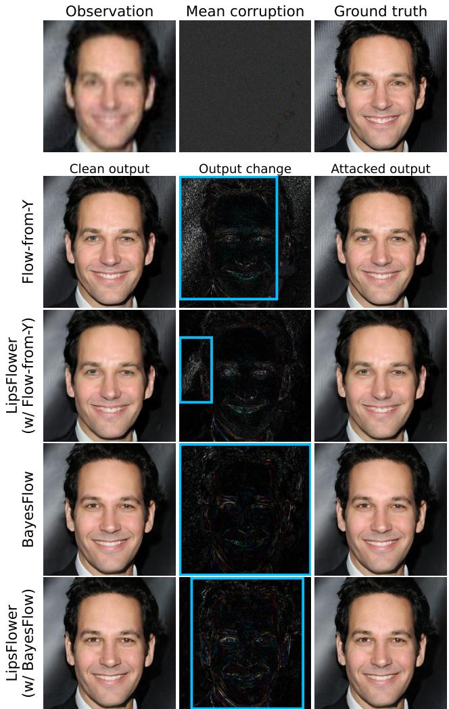
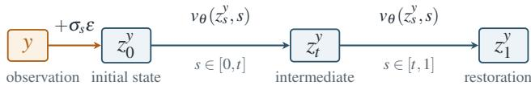
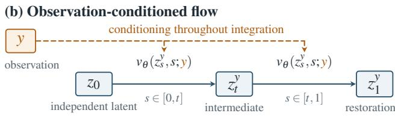
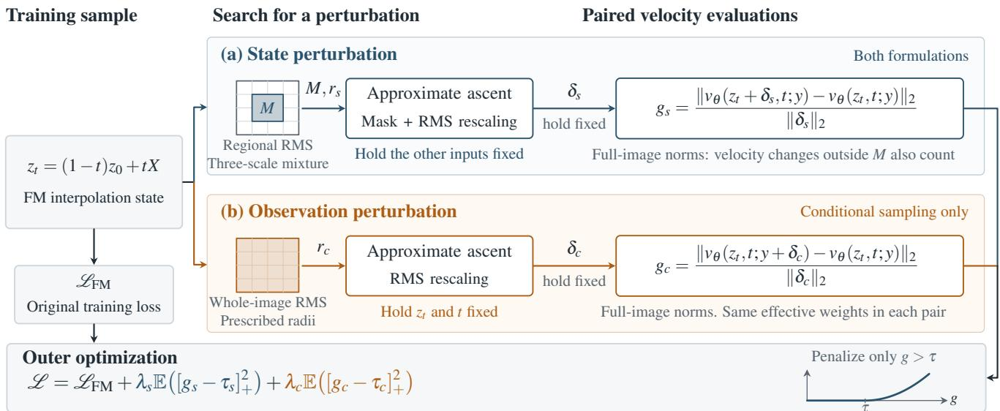
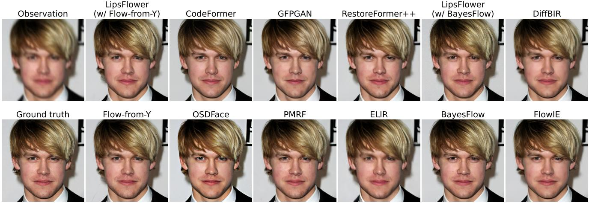
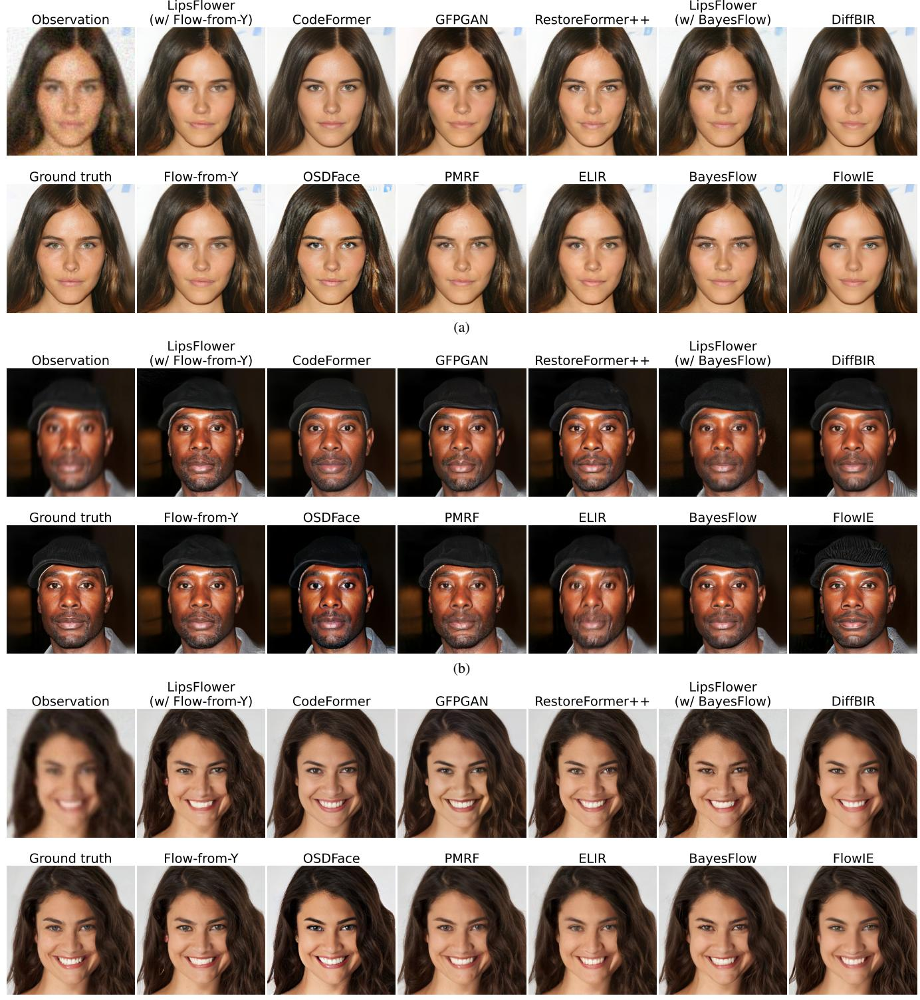
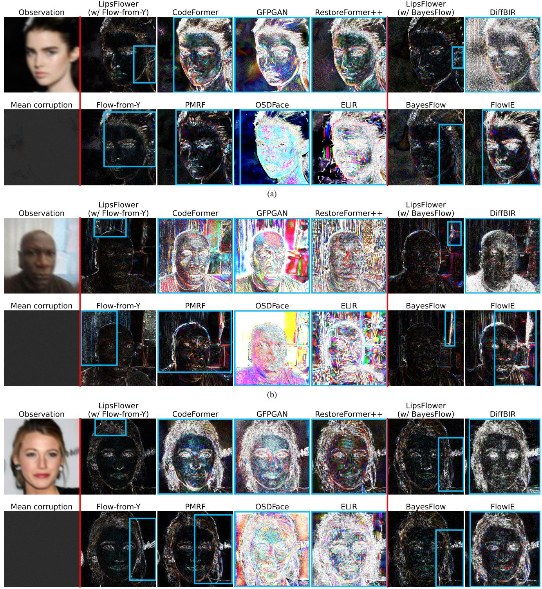

# Lipschitz-Controlled Flow Matching for Robust Image Restoration

Sedjro Salomon Hotegni1,2 Konstantin Sonntag1 Paul-Christian Burkner¨ 2 Sebastian Peitz1

1Paderborn University 2TU Dortmund University

{sedjro.salomon.hotegni, konstantin.sonntag, sebastian.peitz}@uni-paderborn.de

paul.buerkner@gmail.com

## Abstract

Flow-matching models can produce high-quality image restorations, but their learned dynamics may amplify small input perturbations and make reconstructions unstable. We introduce LipsFlower to reduce this amplification. We derive stability boundsfor Flow-from-Y, which initializes the ordinary differential equation from a noise-perturbed observation, as well as for observation-conditioned posterior sampling, which conditions the velocity field on the observation throughout integration. Based on this analysis, we develop LipHDiT, a Lipschitz-aware hourglass diffusion transformer that serves as the vector-field architecture of LipsFlower. LipHDiT incorporates stabilized approximate spectral normalization, bounded modulation, and convex residual mixing We also use adversarialfinite-radius gain regularization at sampled interpolation states to penalize excessive sensitivity to the state and,for conditional sampling, the observation. We test bothformulations on blindface restoration, measuring adversarial robustness and the perceptual quality ofthe reconstructions. LipsFlower reduces perturbation amplification while keeping restoration quality competitive with the evaluated baselines. These results suggest that Lipschitzawareflow matching can improve the stability ofgenerative image restoration.

## 1. Introduction

Image restoration seeks to recover clean images from degraded observations. One particularly challenging case is blind face restoration, which aims to recover a high-quality face image from an observation affected by unknown degradations, such as blur, noise, downsampling, and compression. The problem is ill-posed: several clean faces may explain the same degraded input. The output must therefore look realistic, preserve facial identity and geometry, and stay consistent with the observation. Recent generative methods use face priors to synthesize plausible details [14, 50, 56, 60]. But a convincing output can still be sensitive to small input perturbations. For human faces, even a slight change in the input can cause an image restoration model to produce noticeably different facial features, potentially changing the person’s apparent identity. Metrics such as PSNR [20], LPIPS [58], and FID [17] assess reconstruction or distributional quality, but do not directly measure input sensitivity. A model can score well on these metrics and still produce very different reconstructions from nearly identical observations.

  
Figure 1. Robustness to observation perturbations. LipsFlower reduces output changes for both backbones under model-specific black-box SPSA attacks, with a larger reduction for Flow-from-Y . The mean perturbation and output differences are amplified for visibility. Blue boxes mark the largest above-threshold change regions, with thresholds matched within each backbone pair.

Flow matching [30] learns a time-dependent velocity field whose ordinary differential equation (ODE) transports samples from a source distribution toward clean images. A common form of flow matching is rectified flow [31], in which models are trained on straight-line interpolations between source and target samples. Recent work shows that these models can produce visually convincing restorations [31, 38]. We consider two formulations: Flow-from-Y [38], which starts the ODE from a noise-perturbed degraded observation, and observation-conditioned posterior sampling [61], which starts from a simple base distribution (e.g., multivariate Gaussian) and conditions the velocity field on the observation throughout integration. Neither formulation by itself guarantees that nearby observations produce nearby reconstructions. In Flow-from-Y , an input perturbation changes the initial state and propagates through the dynamics. In conditional sampling, perturbing the observation directly changes the velocity field. Our stability analysis in Sec. 4 relates these effects to the field’s Lipschitz behavior: the velocity field’s sensitivity to the evolving ODE state matters in both formulations, while conditional sampling additionally requires controlling the velocity field’s sensitivity to the observation. Standard flow-matching regression does not directly constrain the field’s Lipschitz constants with respect to the ODE state or the observation. Our goal is to reduce excessive amplification while preserving the capacity needed for realistic restoration. This motivates controlling selected sources of amplification rather than imposing an excessively small global Lipschitz constant. The latter may restrict the nonlinear transformations needed to restore heavily degraded images and recover facial detail.

We introduce LipsFlower, a flow-matching framework that combines architectural controls with adversarial finiteradius gain regularization to reduce input sensitivity. Its velocity network, LipHDiT, builds on the hourglass diffusion transformer (HDiT) [8]. It uses stabilized approximate spectral normalization, controlled normalization and time modulation, and convex residual and skip mixing. Our architectural contribution lies in adapting and integrating these controls within HDiT to improve restoration stability. The conditional variant of LipHDiT uses separate state and observation projection stems with controlled fusion, targeting the additional observation sensitivity identified by our analysis. We also adapt adversarial Lipschitz regularization [46] to velocity fields at sampled flow-matching interpolation states. To do this, we search for local state perturbations at several magnitude scales and use a separate observation perturbation search to target conditional sensitivity. A hinge penalty applies only when the finite-difference velocity gain exceeds a prescribed threshold. Sampling across training times extends regularization beyond the source and endpoint without requiring full ODE rollouts. Together, these mechanisms encourage empirical stability. We evaluate both formulations on blind face restoration, measuring reconstruction changes under adversarial input perturbations, along with reconstruction and perceptual quality. Our experiments show that architectural controls and gain regularization reduce perturbation amplification while keeping reconstruction fidelity and perceptual quality competitive with the evaluated baselines. Our main contributions are:

• We derive stability bounds for Flow-from-Y and observation-conditioned posterior sampling, identifying the state and observation Lipschitz quantities that govern input sensitivity.

• We introduce LipsFlower, which combines a Lipschitzaware hourglass transformer with adversarial finite-radius regularization of state sensitivity and, for conditional sampling, observation sensitivity.

• We evaluate both formulations on blind face restoration, assessing restoration-map sensitivity and reconstruction quality. The results show that LipsFlower improves robustness to observation perturbations, particularly in the Flow-from-Y formulation, while maintaining competitive reconstruction quality.

## 2. Related Work

Blind face image restoration. Early deep-learning methods for blind face restoration (BFR) used facial geometry, semantic parsing maps, or component dictionaries to reduce ambiguity [5, 27, 28]. More recent generative methods use learned priors to synthesize realistic facial details. GPEN [55] and GFP-GAN [50] incorporate generative face priors into restoration networks. VQFR [14], Restore-Former [51], and CodeFormer [60] use vector-quantized codebooks or transformer-based retrieval of high-quality facial features. These methods improve perceptual quality, but strong priors can also generate details that the observation does not clearly support. Diffusion models [18] have since been applied to BFR through conditional generation, degradation removal, and identity-aware guidance. Dif-Face [56] uses a pretrained diffusion prior for posterior estimation, while DR2 [53] separates degradation removal from content enhancement. Region-adaptive conditioning [44], frequency-domain restoration [36], and one-step diffusion models [48] further improve identity preservation, efficiency, or the perception–distortion trade-off. Evaluation still focuses mainly on the quality of restored images. Their consistency under small changes to the degraded observation has received less attention. Standard distortion and perceptual metrics do not directly show whether nearby observations produce nearby reconstructions. Our experiments show that the evaluated baselines can amplify small observation perturbations into larger changes in their reconstructions.

Flow matching for image restoration. Flow-based restoration methods differ in how they use the degraded observation. Plug-and-play methods such as PnP-Flow [35] reuse a pretrained flow model as an image prior within an iterative reconstruction algorithm that promotes consistency with the degraded observation. Other methods transport degraded observations or preliminary estimates toward the clean-image distribution [11, 39]. For example, ELIR [7] uses latent consistency flow matching to transport preliminary latent estimates with added Gaussian noise toward clean-image representations. FlowIE [61] instead learns a conditional rectified flow from Gaussian noise to cleanimage representations, using initial restorations of the degraded inputs as guidance. PMRF [39] is closely related to our setting. It transports an estimate of the posterior mean toward the clean-image distribution, aiming for a better perception–distortion trade-off. Its controlled study compares Flow-from-Y with two conditional rectified-flow baselines whose velocity fields are conditioned on either the degraded observation or its posterior-mean estimate. Unlike PMRF’s two-stage pipeline, our formulations do not require a separate posterior-mean predictor. Other recent methods use rectified flows to connect discriminative and generative restoration or progressively refine images across degradation levels [11]. These methods focus mainly on restoration quality, sampling efficiency, and transport design. We instead study how perturbations to the degraded observation propagate through the learned dynamics. We consider two pathways: the initial condition in Flow-from-Y and the observation supplied to the velocity field in observationconditioned posterior sampling.

Lipschitz control and robustness of learned dynamics. Methods for controlling input sensitivity in neural networks include spectral normalization of linear operators [37], gradient penalties [15], orthogonal or norm-constrained parameterizations [6], and non-expansive activations [1]. Group-Sort networks combine norm-constrained linear maps with gradient-norm-preserving activations to retain expressivity under Lipschitz constraints [1, 45]. Standard dot-product self-attention is not globally Lipschitz on an unbounded domain, which has motivated normalized and otherwise controlled attention mechanisms [9, 24]. For neural ODEs, the regularity of the vector field governs the existence, uniqueness, and sensitivity of trajectories [4]. This connection has been used to study robustness, stability, and generalization in continuous-depth models [22, 34, 54]. Recent work on plugand-play flow restoration also links vector-field Lipschitz regularity to numerical restoration error [21]. Our analysis focuses on how perturbations to the degraded observation affect the restoration map, both for flows initialized from the observation and for flows conditioned on it. LipsFlower uses this analysis to guide two forms of control: architectural control and gain regularization. First, LipHDiT limits amplification within the hourglass diffusion transformer through controlled normalization and conditioning, regularized linear projections, and scaled residual branches. Second, since layer-wise global bounds can be conservative and overly restrictive, we also regularize adversarial finite-radius gain at sampled flow-matching interpolation states. This penalizes excessive local amplification across training times without imposing an overly small global Lipschitz constant on the whole model. TVM [59] is the closest work architecturally. It identifies the lack of Lipschitz continuity in standard diffusion transformers as a source of training instability and introduces semi-Lipschitz modifications based on normalized attention, normalization, modulation, and initialization. Under a Lipschitz assumption, it relates a terminal-velocity objective to distributional error in one- and few-step image generation. This result concerns the distance between generated and target image distributions, not the sensitivity of individual reconstructions to their degraded observations. We bound how observation perturbations affect the final reconstruction when introduced through the initial state or the observation condition. We also regularize finite-radius amplification at sampled interpolation states. The goal is to make small observation changes produce correspondingly small reconstruction changes, with sampling randomness held fixed.

## 3. Background and Problem Formulation

## 3.1. Blind Face Restoration

Let $X \in \mathcal { X } \subseteq \mathbb { R } ^ { d }$ denote a clean face image and $Y \in$ $\mathcal { V } \subseteq \mathbb { R } ^ { d }$ its degraded observation1. During training, paired samples $( X , Y ) \sim p _ { X , Y }$ are available, with Y generated by a stochastic degradation process that may combine blur, downsampling, noise, and compression. At inference time, the degradation parameters are unknown [50, 56]. The objective is to construct a potentially stochastic restoration map ${ \widehat { X } } = \mathcal { R } ( Y )$ . Besides producing perceptually realistic band observation-consistent faces, we require  to be stable: a small perturbation of the degraded observation should not cause a disproportionately large change in the reconstruction when the model randomness is held fixed. This requirement is distinct from conventional restoration quality. Metrics such as PSNR and LPIPS assess the relation between a reconstruction and its reference, whereas stability concerns the variation of the restoration map with respect to its input. We therefore study the response of $\mathcal { R } ( Y )$ to nearby observations $Y ^ { \prime } = Y + \delta$ , where δ may represent incidental corruption or an adversarially selected perturbation2.

## 3.2. Flow Matching

Let $Z _ { 0 }$ be a source sample and let $Z _ { 1 } = X$ be a clean target image. We use the linear probability path [30, 31]

$$
Z _ { t } = ( 1 - t ) Z _ { 0 } + t X , \qquad t \in [ 0 , 1 ] ,\tag{1}
$$

whose sample-wise target velocity is

$$
U _ { t } = { \frac { \mathrm { d } Z _ { t } } { \mathrm { d } t } } = X - Z _ { 0 } .\tag{2}
$$

A neural velocity field $v _ { \theta }$ is trained by regressing this target:

$$
\mathcal { L } _ { \mathrm { F M } } ( \theta ) = \mathbb { E } \left[ \| v _ { \theta } ( Z _ { t } , t ) - ( X - Z _ { 0 } ) \| _ { 2 } ^ { 2 } \right] ,\tag{3}
$$

where $t \sim \mathcal { U } [ 0 , 1 ]$ . At the population optimum, the learned field approximates the conditional mean velocity $v ^ { * } ( z , t ) =$ $\mathbb { E } [ X - Z _ { 0 } \mid Z _ { t } = z ]$ . To generate a sample, we draw $Z _ { 0 }$ and integrate

$$
\frac { \mathrm { d } z _ { t } } { \mathrm { d } t } = v _ { \theta } ( z _ { t } , t ) , \qquad t \in [ 0 , 1 ] .\tag{4}
$$

We denote the flow map from time s to t by $\Phi _ { s \to t } ^ { \theta } .$ , so the terminal sample is $\widehat { X } = \Phi _ { 0  1 } ^ { \theta } ( Z _ { 0 } )$ . In practice, we bapproximate this continuous-time flow with a numerical solver using a finite number of steps.

This general construction can be made observationdependent in two ways: the degraded observation can determine the source state or condition the velocity field. We consider both cases below.

## 3.3. Observation-Dependent Restoration Flows

## 3.3.1. Flow-from-Y

Flow-from-Y starts from a noisy version of the degraded observation [39]. Let $Y$ be the degraded observation in the same image space as the clean image X. The source state is

$$
Z _ { 0 } ^ { Y } = Y + \sigma _ { s } \epsilon , \qquad \epsilon \sim { \mathcal { N } } ( 0 , I ) ,\tag{5}
$$

where $\sigma _ { s }$ controls the source-noise level. The training path and target velocity are

$$
Z _ { t } ^ { Y } = ( 1 - t ) Z _ { 0 } ^ { Y } + t X , \qquad U _ { t } ^ { Y } = X - Z _ { 0 } ^ { Y } .\tag{6}
$$

The velocity field depends on $Y$ through the evolving state, without receiving it as a separate input. Its flowmatching loss is

$$
\mathcal { L } _ { \mathrm { F } Y } ( \theta ) = \mathbb { E } \left[ \left. v _ { \theta } ( Z _ { t } ^ { Y } , t ) - U _ { t } ^ { Y } \right. _ { 2 } ^ { 2 } \right] .\tag{7}
$$

At inference, the restoration map is

$$
\mathcal { R } _ { \mathrm { F } Y } ( y ; \epsilon ) = \Phi _ { 0  1 } ^ { \theta } ( y + \sigma _ { s } \epsilon ) .\tag{8}
$$

Perturbing y changes the ODE’s initial state, and the velocity field propagates this difference over the full integration interval. When comparing y and $y ^ { \prime } = y + \delta$ , we use the same ϵ for both restorations to measure observation sensitivity with the source noise held fixed.

## 3.3.2. Observation-Conditioned Posterior Sampling

The second formulation samples the initial state from a standard Gaussian, independently of the clean image and degraded observation, and supplies the observation to the velocity field: $Z _ { 0 } ^ { C } = \epsilon , \epsilon \sim \mathcal { N } ( 0 , I )$ . Using the path

$$
Z _ { t } ^ { C } = ( 1 - t ) \epsilon + t X , \qquad U _ { t } ^ { C } = X - \epsilon ,\tag{9}
$$

we train an observation-conditioned velocity field $v _ { \theta } ( z , t ; y )$ through

$$
\mathcal { L } _ { \mathrm { C F M } } ( \theta ) = \mathbb { E } \left[ \left. v _ { \theta } ( Z _ { t } ^ { C } , t ; Y ) - U _ { t } ^ { C } \right. _ { 2 } ^ { 2 } \right] .\tag{10}
$$

The corresponding population-optimal field is

$$
v ^ { * } ( z , t ; y ) = \mathbb { E } \left[ X - \epsilon \mid Z _ { t } ^ { C } = z , Y = y \right] .\tag{11}
$$

Under the usual flow-matching assumptions and with an exact velocity field, integrating

$$
\frac { \mathrm { d } z _ { t } } { \mathrm { d } t } = v _ { \theta } ( z _ { t } , t ; y ) , \qquad z _ { 0 } = \epsilon ,\tag{12}
$$

transports the base distribution toward the conditional cleanimage distribution $p _ { X | Y = y } .$ The resulting restoration map is

$$
\mathcal { R } _ { \mathrm { C } } ( y ; \epsilon ) = \Phi _ { 0  1 , y } ^ { \theta } ( \epsilon ) ,\tag{13}
$$

where the subscript y emphasizes that the entire flow depends on the observation. Unlike Flow-from-Y , changing y does not alter the initial state when the same ϵ is used. Instead, it changes the predicted velocity at every integration time. Observation perturbations may therefore be injected continuously throughout the trajectory.

## 3.4. Robustness Objective

We study the input-to-reconstruction sensitivity of a stochastic restoration model under fixed randomness. For a fixed randomness realization $\xi ,$ observation $y ,$ and nonzero perturbation δ, define the finite-radius restoration gain

$$
G _ { \mathcal { R } } ( y , \delta ; \xi ) = \frac { { \| \mathcal { R } ( y + \delta ; \xi ) - \mathcal { R } ( y ; \xi ) \| _ { 2 } } } { { \| \delta \| _ { 2 } } } .\tag{14}
$$

The corresponding worst-case gain within a radius $\rho > 0$ is

$$
G _ { \mathcal { R } } ^ { ( \rho ) } ( y ; \xi ) = \operatorname* { s u p } _ { 0 < \| \delta \| _ { 2 } \leq \rho } G _ { \mathcal { R } } ( y , \delta ; \xi ) .\tag{15}
$$

This quantity measures how strongly the complete restoration procedure can amplify a bounded input change. It is distinct from sample diversity, since the same random seed and numerical-solver configuration are used before and after perturbation. The two formulations induce different sensitivity pathways (see Figure 2). Accordingly, Flow-from-Y

  
Figure 2. Flow-based restoration formulations. (a) Flow-from-Y initializes the ODE with the noise-perturbed observation. (b) Observation-conditioned flow starts from a latent $z _ { 0 }$ independent of y and conditions the velocity field on y throughout integration. Solid arrows between states denote ODE integration, and dashed arrows indicate observation conditioning.

requires control of the velocity field with respect to its evolving state, whereas an observation-conditioned flow requires control with respect to both its evolving state and the observation condition. In the latter case, condition-wise sensitivity determines how perturbations of the observation enter the dynamics, while state-wise sensitivity governs how the resulting trajectory discrepancies propagate during integration. In Sec. 4, we formalize these mechanisms and derive bounds relating the Lipschitz behavior of the velocity field to the sensitivity of the terminal restoration. These results subsequently motivate the architecture and training objective introduced in Sec. 5.

## 4. Stability Analysis

We now characterize how perturbations of the degraded observation propagate through the two formulations introduced in Sec. 3.3. Our analysis considers the exact continuous-time flow and uses the Euclidean norm throughout. We assume that the vector fields are continuous in time and that the corresponding ODE solutions exist on $t \in [ 0 , 1 ] \ [ 3 ]$ . All comparisons use the same source-noise realization ϵ, thereby isolating sensitivity to the observation from ordinary sampling variability.

## 4.1. Stability of Flow-from-Y Restoration

In Flow-from-Y, the observation affects the restoration through the initial state $z _ { 0 } ^ { y } = y + \sigma _ { s } \epsilon$ , while the velocity field itself is not explicitly conditioned on $y .$

Proposition 1 (Stability of Flow-from-Y). Suppose that vθ is ρ-Lipschitz with respect to its state, uniformly over time:

$$
\| v _ { \theta } ( a , t ) - v _ { \theta } ( b , t ) \| _ { 2 } \leq \rho \left\| a - b \right\| _ { 2 }\tag{16}
$$

for all $a , b \in \mathbb { R } ^ { d }$ and $t \in [ 0 , 1 ]$ . Then,for any observations y1, y2 restored using the same ϵ,

$$
\begin{array} { r } { \left\| \mathcal { R } _ { \mathrm { F } Y } ( y _ { 2 } ; \epsilon ) - \mathcal { R } _ { \mathrm { F } Y } ( y _ { 1 } ; \epsilon ) \right\| _ { 2 } \leq e ^ { \rho } \left\| y _ { 2 } - y _ { 1 } \right\| _ { 2 } . } \end{array}\tag{17}
$$

The proof is provided in the supplementary material. The bound in (17) is worst-case sharp under the stated Lipschitz assumption. However, it can be conservative for a particular velocity field, whose actual perturbation amplification may be much smaller than $e ^ { \rho } .$ 3

## 4.2. Stability of Observation-Conditioned Flows

In a conditional posterior sampler, the initial noise is independent of the observation, but the observation affects the vector field throughout the trajectory. Consequently, observation sensitivity is governed by the dependence of the field on both its evolving state and its condition.

Proposition 2 (Stability of an observation-conditioned flow). Suppose that $v _ { \theta }$ is uniformly ρ-Lipschitz in its state and uniformly $\rho _ { c } – L i p s c h i t z$ in its observation condition. That $i s ,$ for every $t \in [ 0 , 1 ]$

$$
\begin{array} { r } { \left\| v _ { \theta } ( a , t ; y ) - v _ { \theta } ( b , t ; y ) \right\| _ { 2 } \leq \rho \left\| a - b \right\| _ { 2 } , } \end{array}\tag{18}
$$

$$
\begin{array} { r } { \| v _ { \theta } ( a , t ; y _ { 2 } ) - v _ { \theta } ( a , t ; y _ { 1 } ) \| _ { 2 } \leq \rho _ { c } \left\| y _ { 2 } - y _ { 1 } \right\| _ { 2 } . } \end{array}\tag{19}
$$

$H \rho > 0 ,$ , then, for any $y _ { 1 } , y _ { 2 }$ and the same initial noise ϵ,

$$
\| \mathcal { R } _ { \mathrm { C } } ( y _ { 2 } ; \epsilon ) - \mathcal { R } _ { \mathrm { C } } ( y _ { 1 } ; \epsilon ) \| _ { 2 } \leq \frac { \rho _ { c } } { \rho } \left( e ^ { \rho } - 1 \right) \| y _ { 2 } - y _ { 1 } \| _ { 2 } .\tag{20}
$$

We give the proof in the supplementary material. The bound in (20) is also worst-case sharp under the stated assumptions, although it may be conservative for a particular velocity field. 4 In this bound, the factor $\rho _ { c }$ controls how strongly an observation perturbation is injected into the velocity field, whereas $\rho$ controls how the induced trajectory discrepancy is subsequently propagated. Controlling only $\rho _ { c }$ is therefore insufficient: even a small condition-induced discrepancy can be strongly amplified by state-sensitive dynamics.

## 4.3. Implications for Model Design

The stability analysis yields three design requirements. First, both restoration formulations require control of the velocity field with respect to the evolving state. Second, an observation-conditioned flow must additionally control its dependence on the conditioning image. Third, control should apply throughout the transport interval, because sensitivity accumulated at intermediate states affects the terminal reconstruction. The next section explains how LipsFlower addresses these three requirements through architectural controls and gain regularization.

## 5. LipsFlower

Guided by our stability analysis, LipsFlower combines a Lipschitz-aware velocity network with finite-radius gain regularization. We instantiate this framework for both Flowfrom-Y and observation-conditioned posterior sampling, targeting state sensitivity in both formulations and observation sensitivity in the conditional formulation.

## 5.1. Lipschitz-Aware Velocity Network

Our velocity network, LipHDiT, keeps the overall structure of HDiT [8] and adds controls to limit amplification. Linear projections use approximate spectral normalization [37] with a safety margin and full-precision power iteration. We include safeguards against degenerate iteration vectors, including for zero-initialized weights. We add a denominator floor to RMSNorm [57] and bound the time-dependent modulation used for adaptive conditioning [8, 41]. Our query-key normalization also uses a denominator floor, building on normalized-attention designs [8, 16]. To control amplification in the residual branches and decoder skip connections, we use convex aggregation [6]. For conditional sampling, separate state and observation projection stems feed a controlled fusion module before the shared backbone. These controls aim to reduce amplification without requiring every component to be nonexpansive. More architectural details are given in Sec. B of the supplementary material.

## 5.2. Finite-Radius Gain Regularization

We also adapt adversarial Lipschitz regularization [46] to restoration velocity fields. It searches for perturbations that cause large velocity changes and penalizes gains above a chosen threshold. We apply it at sampled flow-matching interpolation states [30], so regularization does not require full ODE rollouts. For observation-conditioned fields, our stability analysis motivates controlling sensitivity to both the evolving state and the observation. We measure the two

finite-radius gains separately:

$$
\begin{array} { l } { g _ { s } = \frac { \Vert v _ { \theta } \left( z _ { t } + \delta _ { s } , t ; y \right) - v _ { \theta } \left( z _ { t } , t ; y \right) \Vert _ { 2 } } { \Vert \delta _ { s } \Vert _ { 2 } } , } \\ { g _ { c } = \frac { \Vert v _ { \theta } \left( z _ { t } , t ; y + \delta _ { c } \right) - v _ { \theta } \left( z _ { t } , t ; y \right) \Vert _ { 2 } } { \Vert \delta _ { c } \Vert _ { 2 } } . } \end{array}\tag{21}
$$

For Flow-from-Y, we use only $g _ { s } ,$ with no explicit observation condition. We use localized state perturbations to discourage amplification of spatially concentrated disturbances. However, the gains in Eq. (21) use full-image norms, so velocity changes outside the perturbed region also count. The root-mean-square (RMS) magnitude of the perturbations within the region is drawn from a mixture of small, moderate, and severe scales, with more weight on small perturbations. Starting from random noise, we use projected gradient ascent [33] to approximately maximize the velocity discrepancy. After each update, we restrict the perturbation to its sampled region and rescale it to the chosen RMS magnitude. For conditional sampling, we search separately for observation perturbations at prescribed whole-image RMS radii. This addresses distributed measurement uncertainty. With these adversarial perturbations, we optimize

$$
\begin{array} { r } { \mathcal { L } = \mathcal { L } _ { \mathrm { F M } } + \lambda _ { s } \mathbb { E } \left( [ g _ { s } - \tau _ { s } ] _ { + } ^ { 2 } \right) + \lambda _ { c } \mathbb { E } \left( [ g _ { c } - \tau _ { c } ] _ { + } ^ { 2 } \right) , } \end{array}\tag{22}
$$

where $[ a ] _ { + } = \operatorname* { m a x } ( a , 0 ) , \tau _ { s }$ and $\tau _ { c }$ are gain thresholds, and $\lambda _ { s }$ and $\lambda _ { c }$ weight the sensitivity penalties relative to velocity regression. The expectations are over sampled training states and perturbation searches, with Flow-from-Y using only the state penalty.

These architectural controls and sampled gain penalties target the sensitivities identified by our analysis. As illustrated in Fig. 1, small adversarial perturbations to the observation can lead to noticeable reconstruction changes. Lips-Flower reduces these changes for both Flow-from-Y and observation-conditioned posterior sampling. The supplementary material describes the perturbation distributions, search settings, and regularization schedule (see Sec. B).

## 6. Experiments

We evaluate LipsFlower on blind face restoration, testing whether it reduces the amplification of observation perturbations compared with its flow-matching baselines and how this affects restoration quality. The supplementary material reports an ablation study of architectural controls and gain regularization, individually and jointly, in Sec. B.7.

## 6.1. Experimental Setup

Data and comparisons. Our models are trained on FFHQ [23] at 512 512 resolution. Evaluation uses a shared set of 3,000 degraded–clean image pairs from CelebA-Test [50] at the same resolution. We compare each Lips-

  
Figure 3. Finite-radius gain regularization. Adversarial searches perturb local state regions and, for conditional sampling (marked in orange), the whole observation. Squared hinge penalties on velocity gains above prescribed thresholds are added to the flow-matching loss.

Table 1. Adversarial robustness under SPSA attacks on CelebA-Test. LPIPS drift is reported in units of $1 0 ^ { - 3 } . { \mathrm { C V a R } } _ { 9 5 } G$ is the mean of the worst 5% among all test images. The blocks (I) and (II) present the comparison sets for the Flow-from-Y and observation-conditioned formulations of LipsFlower, respectively. Within each category, bold and underlined values indicate the best and second-best results, respectively.
<table><tr><td colspan="4" rowspan="3">Method</td><td colspan="4">SPSA-l2 (RMS budget)</td><td colspan="5"> $\mathrm { S P S A } – \ell _ { \infty }$ </td></tr><tr><td colspan="11">Mean G ↓ P95 G ↓ CVaR95 G ↓ Max G ↓ LPIPS drift ↓ Mean G ↓ P95 G ↓ CVaR95 G ↓ Max G ↓ LPIPS drift ↓</td></tr><tr><td>CodeFormer</td><td>2.44</td><td>4.04</td><td>4.577</td><td>7.17</td><td>63.375</td><td>2.91</td><td>4.82</td><td></td><td>5.495</td><td>9.35</td><td>53.101</td></tr><tr><td rowspan="8">(I)</td><td>GFPGAN</td><td>3.01</td><td>5.13</td><td>5.664</td><td>7.53</td><td>110.573</td><td>3.60</td><td>6.45</td><td></td><td>7.122</td><td>9.57</td><td>98.214</td></tr><tr><td>RestoreFormer++</td><td>1.77</td><td>3.75</td><td>4.445</td><td>6.79</td><td>44.146</td><td>2.10</td><td>4.56</td><td></td><td>5.406</td><td>8.53</td><td>38.113</td></tr><tr><td>OSDFace</td><td>4.99</td><td>6.49</td><td>6.898</td><td>8.13</td><td>186.731</td><td></td><td>5.83</td><td>7.77</td><td>8.262</td><td>9.87</td><td>155.168</td></tr><tr><td>PMRF</td><td>0.47</td><td>1.11</td><td>1.455</td><td>2.91</td><td></td><td>9.033</td><td>0.47</td><td>1.03</td><td>1.355</td><td>2.96</td><td>5.454</td></tr><tr><td>ELIR</td><td>12.82</td><td>23.03</td><td>25.700</td><td>36.00</td><td>459.179</td><td></td><td>12.99</td><td>22.98</td><td>25.643</td><td>35.37</td><td>451.283</td></tr><tr><td>Flow-from-Y</td><td>0.52</td><td>0.74</td><td>0.849</td><td>1.74</td><td>15.803</td><td></td><td>0.52</td><td>0.74</td><td>0.830</td><td>1.66</td><td>9.188</td></tr><tr><td>LipsFlower (w/ Flow-from-Y)</td><td>0.47</td><td>0.67</td><td>0.747</td><td>1.16</td><td>11.649</td><td></td><td>0.48</td><td>0.66</td><td>0.727</td><td>1.12</td><td>7.360</td></tr><tr><td>DiffBIR</td><td></td><td>2.05</td><td>2.892</td><td>10.28</td><td>14.711</td><td>0.96</td><td>2.22</td><td></td><td>3.296</td><td>10.67</td><td>10.459</td></tr><tr><td rowspan="4">FlowIE (II) BayesFlow</td><td></td><td>0.90</td><td>1.45</td><td>1.856</td><td>3.51</td><td>7.635</td><td>0.65</td><td></td><td>1.39</td><td>1.834</td><td>3.75</td><td>4.935</td></tr><tr><td></td><td>0.64 0.23</td><td>0.35</td><td>0.412</td><td>0.95</td><td>2.901</td><td>0.25</td><td></td><td>0.36</td><td>0.433</td><td>0.73</td><td></td></tr><tr><td>LipsFlower (w/ BayesFlow)</td><td>0.26</td><td>0.36</td><td>0.406</td><td>0.56</td><td>1.648</td><td>0.28</td><td></td><td>0.38</td><td>0.415</td><td>0.56</td><td>2.024</td></tr><tr><td></td><td></td><td></td><td></td><td></td><td></td><td></td><td></td><td></td><td></td><td></td><td>1.088</td></tr></table>

Flower variant with its corresponding baseline: Flow-from-Y [39] and an observation-conditioned sampler implemented using BayesFlow [25]. BayesFlow is a framework for amortized Bayesian inference. Our adaptation uses its conditional flow-matching component to learn a velocity field that transports Gaussian noise toward clean images, with the degraded observation conditioned throughout integration.

The baselines are grouped by their inference pathway. Group (I) includes direct restoration methods (Code-Former [60], GFPGAN [50], and RestoreFormer++ [52]) and methods that refine or transport an image or latent representation derived from the observation (OSDFace [48],

PMRF [39], ELIR [7], and Flow-from-Y ). Group (II) includes methods that start from observation-independent noise and condition their sampling dynamics on the observation (DiffBIR [29], FlowIE [61], and our BayesFlow adaptation). Each LipsFlower variant appears alongside its corresponding flow-matching baseline. Training and methodspecific inference settings are given in the supplementary material (Sec. C).

Restoration metrics. We measure reconstruction fidelity using RGB PSNR [19] and perceptual similarity using VGGbased LPIPS [58]. We report FID [17] and generative precision [26] against a common FFHQ reference distribution. Face-specific fidelity is assessed using the angular distance between ArcFace embeddings, denoted DEG [10] and measured in degrees, and the mean distance between predicted facial landmarks, denoted LMD [49] and measured in image pixels. All methods use the same evaluation images and metric implementations.

Adversarial evaluation. We evaluate observation sensitivity using simultaneous perturbation stochastic approximation (SPSA) [43, 47], which requires only queries to the restoration procedure. For observations (height H and width W) with pixel values scaled to [0, 1], we consider nominal budgets $\| \delta \| _ { 2 } / \sqrt { 3 H W } \le 0 . 0 1$ and $\| \delta \| _ { \infty } \leq 0 . 0 1$ . Searches use 20 iterations with two queries each, probe radius 0.0025, and step size 0.002. For each method , amplification is measured using $G = G _ { \mathcal { R } } ( y , \delta ; \xi )$ , defined in (14). Randomness ξ is fixed across paired evaluations. For both attacks, we report the mean, 95th percentile, maximum, and CVaR95 of the gains across all test images. $\mathrm { C V a R _ { 9 5 } }$ denotes the Conditional Value at Risk at the 95th percentile, computed as the mean of the largest 5% of gains. We also report LPIPS drift between clean and attacked reconstructions.

## 6.2. Robustness to Observation Perturbations

We first examine the primary objective of LipsFlower, which is to make restorations less sensitive to small changes in the degraded observation. Table 1 measures how much an input perturbation changes the reconstructed image. Lower gain indicates less amplification, while lower LPIPS drift means that the perturbed reconstruction remains perceptually closer to the original output.

Flow-from-Y. LipsFlower improves every reported robustness measure relative to the Flow-from-Y baseline under both attack constraints. Under the RMS-constrained attack, mean gain decreases from 0.52 to 0.47. The improvement also extends to the most sensitive images. The average gain among the worst 5% of cases, measured by $\mathrm { C V a R _ { 9 5 } }$ , decreases from 0.849 to 0.747, while the maximum observed gain decreases from 1.74 to 1.16. These correspond to reductions of approximately 12% and 33%, respectively. The $\ell _ { \infty }$ attack produces a similar pattern. The average gain among the worst 5% of cases decreases from 0.830 to 0.727, and the maximum decreases from 1.66 to 1.12. These reductions are accompanied by lower perceptual drift: LPIPS drift decreases by approximately 26% under the RMS-constrained attack and 20% under the $\ell _ { \infty }$ attack. Thus, the improvement concerns both numerical amplification and perceptual changes in the output. The literature comparisons provide further context. PMRF achieves a similar mean gain and lower LPIPS drift, whereas LipsFlower achieves lower 95thpercentile, tail-average, and maximum gains.

Observation-conditioned sampling. For conditional sampling, LipsFlower primarily reduces large observed changes and perceptual drift. Relative to BayesFlow, maximum gain decreases from 0.95 to 0.56 under the RMS-constrained attack and from 0.73 to 0.56 under the $\ell _ { \infty }$ attack. LPIPS drift decreases by approximately 43% and 46%, respectively. However, mean gain and the 95th percentile increase slightly. The conditional formulation therefore improves some aspects of robustness without uniformly reducing sensitivity across the test set.

## 6.3. Restoration Quality

With Flow-from-Y, LipsFlower reduces perturbation amplification while PSNR on unperturbed observations drops by only 0.31 dB relative to the baseline (Table 2 in Sec. B.6). FID rises from 37.05 to 40.77, close to that of Restore-Former++ (40.61). With BayesFlow, the reduction in maximum observed amplification and perceptual drift comes at a larger cost to restoration quality. PSNR drops by 2.32 dB and FID rises from 40.24 to 57.04. We provide the full comparison in the supplementary material (Sec. B.6).

Taken together, the two formulations demonstrate different robustness–quality trade-offs. Flowing directly from the observation offers a better balance between robustness and restoration quality, whereas conditioning on the observation reduces maximum amplification and perceptual drift at a moderately higher cost to perceptual fidelity.

## 7. Limitations

Our results show that Lipschitz-aware flow matching can reduce perturbation amplification, although the effect depends on the restoration formulation. In particular, LipsFlower (w/ Flow-from-Y) gives a better balance between robustness and reconstruction quality, whereas observation-conditioned sampling loses more perceptual quality and shows less consistent robustness gains. At the same time, the architectural controls and finite-radius regularization do not provide a global Lipschitz guarantee. Therefore, the stability results still depend on the assumptions used in the analysis. In addition, our experiments are limited to blind face restoration. Evaluating other inverse problems and stronger perturbations are good directions for future work.

## 8. Conclusion

We introduced LipsFlower to make flow-based image restoration less sensitive to input perturbations. Our method combines Lipschitz-aware architectural controls with finiteradius gain regularization, while our stability analysis explains how observation perturbations enter and propagate through two flow-matching formulations. On blind face restoration, LipsFlower reduces perturbation amplification, with Flow-from-Y giving the better balance between robustness and reconstruction quality. Overall, the results show that controlling sensitivity in both the architecture and training objective can improve the stability of generative image restoration.

## 9. Acknowledgment

All experiments were performed on the compute cluster of the Lamarr Institute for Machine Learning and Artificial Intelligence.

## References

[1] Cem Anil, James Lucas, and Roger Grosse. Sorting out lipschitz function approximation. In International conference on machine learning, pages 291–301. PMLR, 2019. 3

[2] Richard Bellman. The stability of solutions of linear differential equations. 1943. 1

[3] Ricky TQ Chen, Yulia Rubanova, Jesse Bettencourt, and David K Duvenaud. Neural ordinary differential equations. Advances in neural information processing systems, 31, 2018. 5

[4] Ricky T. Q. Chen, Yulia Rubanova, Jesse Bettencourt, and David K Duvenaud. Neural ordinary differential equations. In Advances in Neural Information Processing Systems. Curran Associates, Inc., 2018. 3

[5] Yu Chen, Ying Tai, Xiaoming Liu, Chunhua Shen, and Jian Yang. Fsrnet: End-to-end learning face super-resolution with facial priors. In 2018 IEEE/CVF Conference on Computer Vision and Pattern Recognition, pages 2492–2501. IEEE, 2018. 2

[6] Moustapha Cisse, Piotr Bojanowski, Edouard Grave, Yann Dauphin, and Nicolas Usunier. Parseval networks: Improving robustness to adversarial examples. In International conference on machine learning, pages 854–863. PMLR, 2017. 3, 6, 4

[7] Elad Cohen, Idan Achituve, Idit Diamant, Arnon Netzer, and Hai Victor Habi. Efficient image restoration via latent consistency flow matching. arXiv preprint arXiv:2502.03500, 2025. 3, 7

[8] Katherine Crowson, Stefan Andreas Baumann, Alex Birch, Tanishq Mathew Abraham, Daniel Z Kaplan, and Enrico Shippole. Scalable high-resolution pixel-space image synthesis with hourglass diffusion transformers. arXiv preprint arXiv:2401.11605, 2024. 2, 6, 3

[9] George Dasoulas, Kevin Scaman, and Aladin Virmaux. Lipschitz normalization for self-attention layers with application to graph neural networks. In Proceedings of the 38th International Conference on Machine Learning, pages 2456–2466. PMLR, 2021. 3

[10] Jiankang Deng, Jia Guo, Niannan Xue, and Stefanos Zafeiriou. Arcface: Additive angular margin loss for deep face recognition. In Proceedings ofthe IEEE/CVF conference on computer vision and pattern recognition, pages 4690–4699, 2019. 8

[11] Zihao Fan, Xin Lu, Jie Xiao, Dong Li, Jie Huang, and Xueyang Fu. Ir-flow: Bridging discriminative and generative image restoration via rectified flow. arXiv preprint arXiv:2604.19680, 2026. 3

[12] Gene H Golub and Henk A Van der Vorst. Eigenvalue computation in the 20th century. Journal of Computational and Applied Mathematics, 123(1-2):35–65, 2000. 3

[13] Thomas Hakon Gronwall. Note on the derivatives with respect to a parameter of the solutions of a system of differential equations. Annals of Mathematics, 20(4):292–296, 1919. 1

[14] Yuchao Gu, Xintao Wang, Liangbin Xie, Chao Dong, Gen Li, Ying Shan, and Ming-Ming Cheng. Vqfr: Blind face restoration with vector-quantized dictionary and parallel decoder. In European Conference on Computer Vision, pages 126–143. Springer, 2022. 1, 2

[15] Ishaan Gulrajani, Faruk Ahmed, Martin Arjovsky, Vincent Dumoulin, and Aaron C Courville. Improved training of wasserstein gans. Advances in neural information processing systems, 30, 2017. 3

[16] Alex Henry, Prudhvi Raj Dachapally, Shubham Shantaram Pawar, and Yuxuan Chen. Query-key normalization for transformers. In Findings of the Association for Computational Linguistics: EMNLP 2020, pages 4246–4253, 2020. 6, 3

[17] Martin Heusel, Hubert Ramsauer, Thomas Unterthiner, Bernhard Nessler, and Sepp Hochreiter. Gans trained by a two time-scale update rule converge to a local nash equilibrium. Advances in neural information processing systems, 30, 2017. 2, 8

[18] Jonathan Ho, Ajay Jain, and Pieter Abbeel. Denoising diffusion probabilistic models. Advances in neural information processing systems, 33:6840–6851, 2020. 2

[19] Alain Hore and Djemel Ziou. Image quality metrics: Psnr vs. ssim. In 2010 20th international conference on pattern recognition, pages 2366–2369. IEEE, 2010. 7

[20] Quan Huynh-Thu and Mohammed Ghanbari. Scope of validity of psnr in image/video quality assessment. Electronics letters, 44(13):1, 2008. 2

[21] Fan Jia, Yuhao Huang, Shih-Hsin Wang, Cristina Garcia-Cardona, Andrea L. Bertozzi, and Bao Wang. Plug-andplay image restoration with flow matching: A continuous viewpoint, 2025. 3

[22] Qiyu Kang, Yang Song, Qinxu Ding, and Wee Peng Tay. Stable neural ode with lyapunov-stable equilibrium points for defending against adversarial attacks. In Advances in Neural Information Processing Systems, pages 14925–14937. Curran Associates, Inc., 2021. 3

[23] Tero Karras, Samuli Laine, and Timo Aila. A style-based generator architecture for generative adversarial networks. In 2019 IEEE/CVF conference on computer vision and pattern recognition (CVPR), pages 4396–4405. IEEE, 2019. 6, 7

[24] Hyunjik Kim, George Papamakarios, and Andriy Mnih. The lipschitz constant of self-attention. In International Conference on Machine Learning, pages 5562–5571. PMLR, 2021. 3

[25] Lars Kuhmichel, Jerry M Huang, Valentin Pratz, Jonas¨ Arruda, Hans Olischlager, Daniel Habermann, Simon¨ Kucharsky, Lasse Elsemuller, Aayush Mishra, Niels Bracher,¨

et al. Bayesflow 2: Multi-backend amortized bayesian inference in python. arXiv preprint arXiv:2602.07098, 2026. 7

[26] Tuomas Kynka¨anniemi, Tero Karras, Samuli Laine, Jaakko¨ Lehtinen, and Timo Aila. Improved precision and recall metric for assessing generative models. Advances in neural information processing systems, 32, 2019. 8

[27] Xiaoming Li, Ming Liu, Yuting Ye, Wangmeng Zuo, Liang Lin, and Ruigang Yang. Learning warped guidance for blind face restoration. In European Conference on Computer Vision, pages 278–296. Springer, 2018. 2

[28] Xiaoming Li, Chaofeng Chen, Shangchen Zhou, Xianhui Lin, Wangmeng Zuo, and Lei Zhang. Blind face restoration via deep multi-scale component dictionaries. In European conference on computer vision, pages 399–415. Springer, 2020. 2

[29] Xinqi Lin, Jingwen He, Ziyan Chen, Zhaoyang Lyu, Bo Dai, Fanghua Yu, Yu Qiao, Wanli Ouyang, and Chao Dong. Diffbir: Toward blind image restoration with generative diffusion prior. In European conference on computer vision, pages 430–448. Springer, 2024. 7

[30] Yaron Lipman, Ricky T. Q. Chen, Heli Ben-Hamu, Maximilian Nickel, and Matthew Le. Flow matching for generative modeling. In The Eleventh International Conference on Learning Representations, 2023. 2, 4, 6

[31] Xingchao Liu, Chengyue Gong, and Qiang Liu. Flow straight and fast: Learning to generate and transfer data with rectified flow. arXiv preprint arXiv:2209.03003, 2022. 2, 4

[32] Ilya Loshchilov and Frank Hutter. Decoupled weight decay regularization. arXiv preprint arXiv:1711.05101, 2017. 7

[33] Aleksander Madry, Aleksandar Makelov, Ludwig Schmidt, Dimitris Tsipras, and Adrian Vladu. Towards deep learning models resistant to adversarial attacks. In International Conference on Learning Representations, 2018. 6, 5

[34] Pierre Marion. Generalization bounds for neural ordinary differential equations and deep residual networks. In Advances in Neural Information Processing Systems, pages 48918–48938. Curran Associates, Inc., 2023. 3

[35] Segol ´ ene Martin, Anne Gagneux, Paul Hagemann, and\` Gabriele Steidl. Pnp-flow: Plug-and-play image restoration with flow matching. In International Conference on Learning Representations, pages 45466–45492, 2025. 3

[36] Yunqi Miao, Jiankang Deng, and Jungong Han. Waveface: Authentic face restoration with efficient frequency recovery. In 2024 IEEE/CVF Conference on Computer Vision and Pattern Recognition (CVPR), pages 6583–6592. IEEE, 2024. 2

[37] Takeru Miyato, Toshiki Kataoka, Masanori Koyama, and Yuichi Yoshida. Spectral normalization for generative adversarial networks. In International Conference on Learning Representations, 2018. 3, 6

[38] Guy Ohayon, Tomer Michaeli, and Michael Elad. Posteriormean rectified flow: Towards minimum mse photo-realistic image restoration. arXiv preprint arXiv:2410.00418, 2024. 2

[39] Guy Ohayon, Tomer Michaeli, and Michael Elad. Posteriormean rectified flow: Towards minimum mse photo-realistic image restoration. In International Conference on Learning Representations, pages 63101–63140, 2025. 3, 4, 7

[40] B.G Pachpatte. A note on gronwall-bellman inequality. Journal of Mathematical Analysis and Applications, 44(3):758– 762, 1973. 1

[41] William Peebles and Saining Xie. Scalable diffusion models with transformers. In 2023 IEEE/CVF International Conference on Computer Vision (ICCV), pages 4172–4182. IEEE, 2023. 6, 3

[42] Noam Shazeer. Glu variants improve transformer. arXiv preprint arXiv:2002.05202, 2020. 3

[43] James C Spall. Multivariate stochastic approximation using a simultaneous perturbation gradient approximation. IEEE transactions on automatic control, 37(3):332–341, 1992. 8

[44] Maitreya Suin, Nithin Gopalakrishnan Nair, Chun Pong Lau, Vishal M Patel, and Rama Chellappa. Diffuse and restore: A region-adaptive diffusion model for identity-preserving blind face restoration. In 2024 IEEE/CVF Winter Conference on Applications ofComputer Vision (WACV), pages 6331–6340. IEEE, 2024. 2

[45] Ugo Tanielian and Gerard Biau. Approximating lipschitz continuous functions with groupsort neural networks. In International Conference on Artificial Intelligence and Statistics, pages 442–450. PMLR, 2021. 3

[46] David Terj ´ ek. Adversarial lipschitz regularization. ´ arXiv preprint arXiv:1907.05681, 2019. 2, 6, 5

[47] Jonathan Uesato, Brendan O’donoghue, Pushmeet Kohli, and Aaron Oord. Adversarial risk and the dangers of evaluating against weak attacks. In International conference on machine learning, pages 5025–5034. PMLR, 2018. 8

[48] Jingkai Wang, Jue Gong, Lin Zhang, Zheng Chen, Xing Liu, Hong Gu, Yutong Liu, Yulun Zhang, and Xiaokang Yang. Osdface: One-step diffusion model for face restoration. In 2025 IEEE/CVF Conference on Computer Vision and Pattern Recognition (CVPR), pages 12626–12636. IEEE, 2025. 2, 7

[49] Xinyao Wang, Liefeng Bo, and Li Fuxin. Adaptive wing loss for robust face alignment via heatmap regression. In 2019 IEEE/CVF International Conference on Computer Vision (ICCV), pages 6970–6980. IEEE, 2019. 8

[50] Xintao Wang, Yu Li, Honglun Zhang, and Ying Shan. Towards real-world blind face restoration with generative facial prior. In 2021 IEEE/CVF Conference on Computer Vision and Pattern Recognition (CVPR), pages 9164–9174. IEEE, 2021. 1, 2, 3, 6, 7

[51] Zhouxia Wang, Jiawei Zhang, Runjian Chen, Wenping Wang, and Ping Luo. Restoreformer: High-quality blind face restoration from undegraded key-value pairs. In 2022 IEEE/CVF Conference on Computer Vision and Pattern Recognition (CVPR), pages 17491–17500. IEEE, 2022. 2

[52] Zhouxia Wang, Jiawei Zhang, Tianshui Chen, Wenping Wang, and Ping Luo. Restoreformer++: Towards real-world blind face restoration from undegraded key-value pairs. IEEE Transactions on Pattern Analysis and Machine Intelligence, 45(12): 15462–15476, 2023. 7

[53] Zhixin Wang, Ziying Zhang, Xiaoyun Zhang, Huangjie Zheng, Mingyuan Zhou, Ya Zhang, and Yanfeng Wang. Dr2: Diffusion-based robust degradation remover for blind face restoration. In 2023 IEEE/CVF Conference on Computer Vision and Pattern Recognition (CVPR), pages 1704–1713. IEEE, 2023. 2

[54] Hanshu YAN, Jiawei DU, Vincent TAN, and Jiashi FENG. On robustness of neural ordinary differential equations. In International Conference on Learning Representations, 2020. 3

[55] Tao Yang, Peiran Ren, Xuansong Xie, and Lei Zhang. Gan prior embedded network for blind face restoration in the wild. In 2021 IEEE/CVF Conference on Computer Vision and Pattern Recognition (CVPR), pages 672–681. IEEE, 2021. 2

[56] Zongsheng Yue and Chen Change Loy. Difface: Blind face restoration with diffused error contraction. IEEE Transactions on Pattern Analysis and Machine Intelligence, 46(12):9991– 10004, 2024. 1, 2, 3

[57] Biao Zhang and Rico Sennrich. Root mean square layer normalization. Advances in neural information processing systems, 32, 2019. 6, 3

[58] Richard Zhang, Phillip Isola, Alexei A Efros, Eli Shechtman, and Oliver Wang. The unreasonable effectiveness of deep features as a perceptual metric. In 2018 IEEE/CVF conference on computer vision and pattern recognition, pages 586–595. IEEE, 2018. 2, 8

[59] Linqi Zhou, Mathias Parger, Ayaan Haque, and Jiaming Song. Terminal velocity matching. In International Conference on Learning Representations, pages 87506–87530, 2026. 3

[60] Shangchen Zhou, Kelvin Chan, Chongyi Li, and Chen Change Loy. Towards robust blind face restoration with codebook lookup transformer. Advances in Neural Information Processing Systems, 35:30599–30611, 2022. 1, 2, 7

[61] Yixuan Zhu, Wenliang Zhao, Ao Li, Yansong Tang, Jie Zhou, and Jiwen Lu. Flowie: Efficient image enhancement via rectified flow. In 2024 IEEE/CVF Conference on Computer Vision and Pattern Recognition (CVPR), pages 13–22. IEEE, 2024. 2, 3, 7

# Lipschitz-Controlled Flow Matching for Robust Image Restoration

Supplementary Material

## Contents

A. Proofs of the Stability Results 1   
A.1. Gronwall–Bellman Inequality¨ 1   
A.2. Proof of Proposition 1 1   
A.3. Proof of Proposition 2 2   
B. LipsFlower: Architecture, Regularization Details,   
and Additional Results 3   
B.1. LipHDiT Architecture 3   
B.2. Localized Multi-Scale State Perturbations . 5   
B.3. Observation Perturbations for Conditional   
Sampling 5   
B.4. Time Sampling and Optimization 6   
B.5. Scope of the Stability Controls . 6   
B.6. Detailed Restoration Quality Results . 6   
B.7. Component Ablation Study 7   
C. Training and Inference Settings 7   
C.1. Training Data and Degradation Pipeline 7   
C.2. Optimization 7   
C.3. Inference for the Flow-Matching Comparisons 8   
C.4. Inference for Literature Baselines 8   
C.5. Shared Evaluation Procedure 8

## A. Proofs of the Stability Results

This section provides the complete proofs of the stability results stated in the main paper. For completeness, we first recall the Gronwall–Bellman inequality [¨ 2, 13, 40] used in both derivations and then restate each proposition before presenting its proof. All norms are Euclidean, and all trajectory comparisons use the same source-noise realization unless stated otherwise.

## A.1. Gronwall–Bellman Inequality¨

The following standard integral inequality controls the growth of a nonnegative function and is the principal tool used to translate local Lipschitz control of the velocity field into an end-to-end stability bound.

Lemma 1 (Gronwall–Bellman inequality). Let d(t) and $h ( t )$ be nonnegative, continuous functions on $\mathcal { T } = [ a , b ]$ . Assume that $d _ { 0 }$ is a nonnegative constant and that

$$
d ( t ) \leq d _ { 0 } + \int _ { a } ^ { t } h ( s ) d ( s ) \ \mathrm { d } s , \quad f o r \mathop { a l l } \quad t \in \mathbb { Z } .
$$

Then

$$
d ( t ) \leq d _ { 0 } \exp \left( \int _ { a } ^ { t } h ( s ) \mathrm { d } s \right) , \quad f o r a l l \quad t \in \mathbb { Z } .
$$

## A.2. Proof of Proposition 1

We first consider Flow-from-Y, where the degraded observation determines the initial ODE state. We restate the proposition to make the supplementary material self-contained.

Proposition 1 (Stability of Flow-from-Y ). Suppose that vθ is ρ-Lipschitz with respect to its state, uniformly over time:

$$
\| v _ { \theta } ( a , t ) - v _ { \theta } ( b , t ) \| _ { 2 } \leq \rho \left\| a - b \right\| _ { 2 }\tag{23}
$$

for all $a , b \in \mathbb { R } ^ { d }$ and $t \in [ 0 , 1 ]$ . Then, for any observations $y _ { 1 } , y _ { 2 }$ restored using the same ϵ,

$$
\begin{array} { r } { \left\| \mathcal { R } _ { \mathrm { F } Y } ( y _ { 2 } ; \epsilon ) - \mathcal { R } _ { \mathrm { F } Y } ( y _ { 1 } ; \epsilon ) \right\| _ { 2 } \leq e ^ { \rho } \left\| y _ { 2 } - y _ { 1 } \right\| _ { 2 } . } \end{array}\tag{24}
$$

Proof. Let $z ^ { 1 } : [ 0 , 1 ] \to \mathbb { R } ^ { d }$ and $z ^ { 2 } : [ 0 , 1 ] \to \mathbb { R } ^ { d }$ denote the Flow-from-Y trajectories associated with observations y and $y _ { 2 } .$ , respectively, using the same source-noise realization ϵ. They satisfy

$$
\frac { \mathrm { d } z _ { t } ^ { 1 } } { \mathrm { d } t } = v _ { \theta } ( z _ { t } ^ { 1 } , t ) , \qquad z _ { 0 } ^ { 1 } = y _ { 1 } + \sigma _ { s } \epsilon ,\tag{25}
$$

$$
\frac { \mathrm { d } z _ { t } ^ { 2 } } { \mathrm { d } t } = v _ { \theta } ( z _ { t } ^ { 2 } , t ) , \qquad z _ { 0 } ^ { 2 } = y _ { 2 } + \sigma _ { s } \epsilon ,\tag{26}
$$

and their terminal states are

$$
z _ { 1 } ^ { i } = \mathcal { R } _ { \mathrm { F } Y } ( y _ { i } ; \epsilon ) , \quad \mathrm { f o r } \quad i \in \{ 1 , 2 \} .\tag{27}
$$

Integrating Eqs. (25) and (26) from 0 to t gives

$$
z _ { t } ^ { 1 } = z _ { 0 } ^ { 1 } + \int _ { 0 } ^ { t } v _ { \theta } ( z _ { s } ^ { 1 } , s ) \mathrm { d } s ,\tag{28}
$$

$$
z _ { t } ^ { 2 } = z _ { 0 } ^ { 2 } + \int _ { 0 } ^ { t } v _ { \theta } ( z _ { s } ^ { 2 } , s ) \mathrm { d } s .\tag{29}
$$

Subtracting the first equality from the second yields

$$
z _ { t } ^ { 2 } - z _ { t } ^ { 1 } = z _ { 0 } ^ { 2 } - z _ { 0 } ^ { 1 } + \int _ { 0 } ^ { t } \left[ v _ { \theta } ( z _ { s } ^ { 2 } , s ) - v _ { \theta } ( z _ { s } ^ { 1 } , s ) \right] \mathrm { d } s .\tag{30}
$$

Taking the Euclidean norm and applying the triangle inequality,

$$
\begin{array} { r l } & { \displaystyle \left\| z _ { t } ^ { 2 } - z _ { t } ^ { 1 } \right\| _ { 2 } \leq \left\| z _ { 0 } ^ { 2 } - z _ { 0 } ^ { 1 } \right\| _ { 2 } } \\ & { \displaystyle \qquad + \int _ { 0 } ^ { t } \left\| v _ { \theta } ( z _ { s } ^ { 2 } , s ) - v _ { \theta } ( z _ { s } ^ { 1 } , s ) \right\| _ { 2 } \mathrm { d } s . } \end{array}\tag{31}
$$

By the assumed uniform $\rho \mathrm { - } \mathrm { l }$ Lipschitz continuity of $v _ { \theta }$ with respect to its state,

$$
\left\| v _ { \theta } ( z _ { s } ^ { 2 } , s ) - v _ { \theta } ( z _ { s } ^ { 1 } , s ) \right\| _ { 2 } \leq \rho \left\| z _ { s } ^ { 2 } - z _ { s } ^ { 1 } \right\| _ { 2 } .\tag{32}
$$

Substituting Eq. (32) into Eq. (31) gives

$$
\left\| z _ { t } ^ { 2 } - z _ { t } ^ { 1 } \right\| _ { 2 } \leq \left\| z _ { 0 } ^ { 2 } - z _ { 0 } ^ { 1 } \right\| _ { 2 } + \rho \int _ { 0 } ^ { t } \left\| z _ { s } ^ { 2 } - z _ { s } ^ { 1 } \right\| _ { 2 } \mathrm { d } s .\tag{33}
$$

Define

$$
d ( t ) : = \left\| z _ { t } ^ { 2 } - z _ { t } ^ { 1 } \right\| _ { 2 } .\tag{34}
$$

The function d is nonnegative and continuous, and Eq. (33) becomes

$$
d ( t ) \leq d ( 0 ) + \int _ { 0 } ^ { t } \rho d ( s ) \mathrm { d } s .\tag{35}
$$

Applying the Gronwall–Bellman inequality ( Sec.¨ A.1) with $d _ { 0 } = d ( 0 )$ and $h ( s ) = \rho$ yields

$$
d ( t ) \leq d ( 0 ) \exp \left( \int _ { 0 } ^ { t } \rho \mathrm { d } s \right) = e ^ { \rho t } d ( 0 ) .\tag{36}
$$

Because the two trajectories use the same source-noise realization,

$$
z _ { 0 } ^ { 2 } - z _ { 0 } ^ { 1 } = ( y _ { 2 } + \sigma _ { s } \epsilon ) - ( y _ { 1 } + \sigma _ { s } \epsilon ) = y _ { 2 } - y _ { 1 } .\tag{37}
$$

Therefore,

$$
d ( 0 ) = \| y _ { 2 } - y _ { 1 } \| _ { 2 } .\tag{38}
$$

Evaluating Eq. (36) at $t = 1$ , and using Eq. (27), gives

$$
\begin{array} { r l } & { \left\| \mathcal { R } _ { \mathrm { F } Y } ( y _ { 2 } ; \epsilon ) - \mathcal { R } _ { \mathrm { F } Y } ( y _ { 1 } ; \epsilon ) \right\| _ { 2 } } \\ & { \qquad = \left\| z _ { 1 } ^ { 2 } - z _ { 1 } ^ { 1 } \right\| _ { 2 } \leq e ^ { \rho } \left\| y _ { 2 } - y _ { 1 } \right\| _ { 2 } , } \end{array}\tag{39}
$$

which proves Proposition 1.

The preceding result controls perturbations that enter through the initial state. We next consider the setting in which the initial state is fixed under common-noise coupling, while the observation affects the velocity field throughout the transport trajectory.

## A.3. Proof of Proposition 2

For an observation-conditioned flow, robustness depends on the sensitivity of the velocity field with respect to both its evolving state and its condition. We again restate the proposition before giving the complete derivation.

Proposition 2 (Stability of an observation-conditioned flow). Suppose that $v _ { \theta }$ is uniformly ρ-Lipschitz in its state and uniformly $\rho _ { c } – L$ ipschitz in its observation condition. That $i s ,$ for every $t \in [ 0 , 1 ]$

$$
\begin{array} { r } { \left\| v _ { \theta } ( a , t ; y ) - v _ { \theta } ( b , t ; y ) \right\| _ { 2 } \leq \rho \left\| a - b \right\| _ { 2 } , } \end{array}\tag{40}
$$

$$
\begin{array} { r } { \| v _ { \theta } ( a , t ; y _ { 2 } ) - v _ { \theta } ( a , t ; y _ { 1 } ) \| _ { 2 } \leq \rho _ { c } \left\| y _ { 2 } - y _ { 1 } \right\| _ { 2 } . } \end{array}\tag{41}
$$

$H \rho > 0 ,$ then, for any $y _ { 1 } , y _ { 2 }$ and the same initial noise ϵ,

$$
\| \mathcal { R } _ { \mathrm { C } } ( y _ { 2 } ; \epsilon ) - \mathcal { R } _ { \mathrm { C } } ( y _ { 1 } ; \epsilon ) \| _ { 2 } \leq \frac { \rho _ { c } } { \rho } \left( e ^ { \rho } - 1 \right) \| y _ { 2 } - y _ { 1 } \| _ { 2 } .\tag{42}
$$

Proof. Let $z ^ { 1 } : [ 0 , 1 ] \to \mathbb { R } ^ { d }$ and $z ^ { 2 } : [ 0 , 1 ] \to \mathbb { R } ^ { d }$ denote two conditional flow trajectories associated with observations $y _ { 1 }$ and $y _ { 2 }$ , respectively. Let $\epsilon \sim \mathcal { N } ( 0 , I )$ be the sourcenoise realization for both trajectories:

$$
\frac { \mathrm { d } z _ { t } ^ { 1 } } { \mathrm { d } t } = v _ { \theta } \bigl ( z _ { t } ^ { 1 } , t ; y _ { 1 } \bigr ) , \qquad z _ { 0 } ^ { 1 } = \epsilon ,\tag{43}
$$

$$
\frac { \mathrm { d } z _ { t } ^ { 2 } } { \mathrm { d } t } = v _ { \theta } \big ( z _ { t } ^ { 2 } , t ; y _ { 2 } \big ) ,
$$

$$
z _ { 0 } ^ { 2 } = \epsilon .\tag{44}
$$

Their terminal states satisfy

$$
z _ { 1 } ^ { i } = \mathcal { R } _ { \mathrm { C } } ( y _ { i } ; \epsilon ) , \qquad \mathrm { f o r } \quad i \in \{ 1 , 2 \} .\tag{45}
$$

Integrating Eqs. (43) and (44) from 0 to t gives

$$
z _ { t } ^ { 1 } = \epsilon + \int _ { 0 } ^ { t } v _ { \theta } ( z _ { s } ^ { 1 } , s ; y _ { 1 } ) \mathrm { d } s ,\tag{46}
$$

$$
z _ { t } ^ { 2 } = \epsilon + \int _ { 0 } ^ { t } v _ { \theta } ( z _ { s } ^ { 2 } , s ; y _ { 2 } ) \mathrm { d } s .\tag{47}
$$

Subtracting the first equality from the second yields

$$
z _ { t } ^ { 2 } - z _ { t } ^ { 1 } = \int _ { 0 } ^ { t } v _ { \theta } ( z _ { s } ^ { 2 } , s ; y _ { 2 } ) - v _ { \theta } ( z _ { s } ^ { 1 } , s ; y _ { 1 } ) \mathrm { d } s .\tag{48}
$$

Taking norms and applying the triangle inequality,

$$
\begin{array} { l } { \displaystyle \left\| z _ { t } ^ { 2 } - z _ { t } ^ { 1 } \right\| _ { 2 } \leq } \\ { \displaystyle \int _ { 0 } ^ { t } \left\| v _ { \theta } ( z _ { s } ^ { 2 } , s ; y _ { 2 } ) - v _ { \theta } ( z _ { s } ^ { 1 } , s ; y _ { 1 } ) \right\| _ { 2 } \mathrm { d } s . } \end{array}\tag{49}
$$

To separate the effects of the state and the observation, we add and subtract $v _ { \theta } \big ( z _ { s } ^ { 1 } , s ; y _ { 2 } \big )$ :

$$
\begin{array} { r l } & { \quad \left\| v _ { \theta } ( z _ { s } ^ { 2 } , s ; y _ { 2 } ) - v _ { \theta } ( z _ { s } ^ { 1 } , s ; y _ { 1 } ) \right\| _ { 2 } } \\ & { = \left\| v _ { \theta } ( z _ { s } ^ { 2 } , s ; y _ { 2 } ) - v _ { \theta } ( z _ { s } ^ { 1 } , s ; y _ { 2 } ) + v _ { \theta } ( z _ { s } ^ { 1 } , s ; y _ { 2 } ) - v _ { \theta } ( z _ { s } ^ { 1 } , s ; y _ { 1 } ) \right\| _ { 2 } } \\ & { \leq \left\| v _ { \theta } ( z _ { s } ^ { 2 } , s ; y _ { 2 } ) - v _ { \theta } ( z _ { s } ^ { 1 } , s ; y _ { 2 } ) \right\| _ { 2 } } \\ & { \quad + \left\| v _ { \theta } ( z _ { s } ^ { 1 } , s ; y _ { 2 } ) - v _ { \theta } ( z _ { s } ^ { 1 } , s ; y _ { 1 } ) \right\| _ { 2 } . } \end{array}\tag{50}
$$

The first term changes the state while holding the condition fixed, whereas the second changes the condition while holding the state fixed. By the assumed Lipschitz continuity in these two arguments,

$$
\begin{array} { r l } & { \left\| v _ { \theta } ( z _ { s } ^ { 2 } , s ; y _ { 2 } ) - v _ { \theta } ( z _ { s } ^ { 1 } , s ; y _ { 2 } ) \right\| _ { 2 } \leq \rho \left\| z _ { s } ^ { 2 } - z _ { s } ^ { 1 } \right\| _ { 2 } , } \\ & { \left\| v _ { \theta } ( z _ { s } ^ { 1 } , s ; y _ { 2 } ) - v _ { \theta } ( z _ { s } ^ { 1 } , s ; y _ { 1 } ) \right\| _ { 2 } \leq \rho _ { c } \left\| y _ { 2 } - y _ { 1 } \right\| _ { 2 } . } \end{array}\tag{51}
$$

(52)

Combining Eqs. (49)–(52) gives

$$
\begin{array} { r l r } {  { \big \| z _ { t } ^ { 2 } - z _ { t } ^ { 1 } \big \| _ { 2 } \leq \rho \int _ { 0 } ^ { t } \big \| z _ { s } ^ { 2 } - z _ { s } ^ { 1 } \big \| _ { 2 } \mathrm { d } s } } \\ & { } & \\ & { } & { \qquad + \rho _ { c } \int _ { 0 } ^ { t } \| y _ { 2 } - y _ { 1 } \| _ { 2 } \mathrm { d } s } \\ & { } & { \qquad = \rho \int _ { 0 } ^ { t } ( \big \| z _ { s } ^ { 2 } - z _ { s } ^ { 1 } \big \| _ { 2 } + \frac { \rho _ { c } } { \rho } \Delta y ) \mathrm { d } s , } \end{array}\tag{53}
$$

□

with $\Delta y : = \| y _ { 2 } - y _ { 1 } \| _ { 2 }$ . Next, we define

$$
d ( t ) : = \big \| z _ { t } ^ { 2 } - z _ { t } ^ { 1 } \big \| _ { 2 } + \frac { \rho _ { c } } { \rho } \Delta y ,\tag{54}
$$

with $\begin{array} { r } { d ( 0 ) = \frac { \rho _ { c } } { \rho } \Delta y . } \end{array}$ , since $z _ { 0 } ^ { 2 } = z _ { 0 } ^ { 1 } = \epsilon$ . Then, by Eq. (53), we obtain

$$
d ( t ) \leq d ( 0 ) + \int _ { 0 } ^ { t } \rho d ( s ) \ \mathrm { d } s .\tag{55}
$$

Then, we can apply the Gronwall-Bellman inequality, to¨ derive

$$
d ( t ) \leq d ( 0 ) e ^ { \rho t } .\tag{56}
$$

Using the definition of $d ( t )$ and $\Delta y$ , we obtain

$$
\left\| z _ { t } ^ { 2 } - z _ { t } ^ { 1 } \right\| _ { 2 } \leq \frac { \rho _ { c } } { \rho } \left( e ^ { \rho t } - 1 \right) \left\| y _ { 2 } - y _ { 1 } \right\| _ { 2 } .
$$

Finally, setting t = 1 and using Eq. (45) gives

$$
\begin{array} { r l } & { \displaystyle \left\| \mathcal { R } _ { \mathrm { C } } ( y _ { 2 } ; \epsilon ) - \mathcal { R } _ { \mathrm { C } } ( y _ { 1 } ; \epsilon ) \right\| _ { 2 } } \\ & { \displaystyle \quad = \left\| z _ { 1 } ^ { 2 } - z _ { 1 } ^ { 1 } \right\| _ { 2 } \le \frac { \rho _ { c } } { \rho } \left( e ^ { \rho } - 1 \right) \left\| y _ { 2 } - y _ { 1 } \right\| _ { 2 } , } \end{array}\tag{57}
$$

which proves the proposition.

## B. LipsFlower: Architecture, Regularization Details, and Additional Results

This section details the architectural controls and finiteradius regularization used by LipsFlower. Both Flow-from-Y and observation-conditioned posterior sampling use the same core architectural modifications and localized state regularizer. The conditional model additionally uses separate input stems and an observation-sensitivity penalty.

## B.1. LipHDiT Architecture

Backbone. LipHDiT follows the hierarchical organization of HDiT [8]. We use 4 4 input patches, feature widths (256, 512, 1024), and level depths (2, 2, 8). The first two levels use neighborhood attention with 7 7 windows, whereas the coarsest level uses global attention. The attention head dimension is 64, and the feed-forward hidden dimension is three times the corresponding feature width. The timeconditioning mapping network has width 768 and depth 2. Dropout is disabled.

Stabilized spectral normalization. Following spectral normalization [37], we control linear projections using an estimate of the largest singular value of their weight matrix. For a raw weight matrix W, the effective weight is

$$
\widehat { W } = \frac { W } { \operatorname* { m a x } ( 1 , \kappa \widehat { \sigma } ( W ) ) } , \qquad \kappa = 1 . 1 0 ,\tag{58}
$$

where $\widehat { \sigma } ( W )$ is obtained using power iteration [12, 37]. Unblike normalization that always rescales to unit estimated norm, this rule leaves sufficiently small weights unchanged.

We use two power iterations per spectral-buffer refresh. The matrix–vector products and spectral estimates are computed in single-precision floating-point arithmetic (FP32). To handle zero-initialized projections, a vanishing iteration product does not replace a valid iteration vector with a zero vector: the previous valid direction is retained, with a nonzero fallback when needed. Consequently, zero initialization does not permanently disable subsequent spectral estimation. Spectral-buffer updates are frozen during the paired evaluations used to compute finite-difference gains, so both evaluations use the same effective weights. The factor κ provides a practical safety margin, not a certified upper bound: a finite number of power iterations can underestimate the true spectral norm.

Normalization and modulation. For a token feature vector $h \in \mathbb { R } ^ { d }$ , we use a denominator-floored variant of RM-SNorm [57]:

$$
\mathcal { N } _ { c } ( h ) = \frac { h } { \operatorname* { m a x } \Bigl ( c , \sqrt { d ^ { - 1 } \| h \| _ { 2 } ^ { 2 } + \varepsilon _ { \mathrm { n } } } \Bigr ) } ,\tag{59}
$$

with $c = 0 . 1 0$ and $\varepsilon _ { \mathrm { n } } = 1 0 ^ { - 1 2 }$ . The floor limits the amplification introduced when normalizing low-magnitude features.

Given the time embedding $e _ { t } .$ , adaptive normalization uses scale-only modulation:

$$
\mathrm { A d a N o r m } ( h , e _ { t } ) = \mathcal { N } _ { c } ( h ) \odot \left[ 1 + \beta \operatorname { t a n h } ( A e _ { t } ) \right] ,\tag{60}
$$

where $\beta = 0 . 2 5$ , and A is a spectrally controlled projection. Thus, each modulation factor lies between 0.75 and 1.25, and no additive modulation shift is used. This adapts the conditioning mechanisms used in diffusion transformers [8, 41] while explicitly bounding their multiplicative factors. Queries and keys are normalized separately using Eq. (59), also with floor 0.10. This modifies normalized-attention designs [8, 16] to control their behavior near zero.

Feed-forward transformation. The feed-forward expansion projects features into two equal-sized groups, a and b, and applies the coordinatewise minimum,

$$
\phi ( a , b ) _ { i } = \operatorname* { m i n } ( a _ { i } , b _ { i } ) .\tag{61}
$$

This replaces the multiplicative GEGLU transformation a GELU(b) [42] with a coordinatewise minimum, followed by a spectrally controlled output projection. The pairwise minimum is nonexpansive under the Euclidean norm on the concatenated input $( a , b )$

<table><tr><td></td><td>Method</td><td>PSNR ↑</td><td>LPIPS ↓</td><td>FID √</td><td>Precision ↑</td><td>DEG↓</td><td>LMD↓</td></tr><tr><td rowspan="11">(I)</td><td>CodeFormer</td><td>25.146</td><td>0.343</td><td>52.521</td><td>0.3512</td><td>37.282</td><td>2.470</td></tr><tr><td>GFPGAN</td><td>24.986</td><td>0.364</td><td>46.160</td><td>0.3212</td><td>36.036</td><td>2.444</td></tr><tr><td>RestoreFormer++</td><td>25.313</td><td>0.344</td><td>40.611</td><td>0.4089</td><td>29.634</td><td>2.043</td></tr><tr><td>OSDFace</td><td>23.381</td><td>0.364</td><td>43.567</td><td>0.4631</td><td>33.907</td><td>2.158</td></tr><tr><td>PMRF</td><td>25.821</td><td>0.367</td><td>35.842</td><td>0.3855</td><td>31.027</td><td>2.037</td></tr><tr><td>ELIR</td><td>25.817</td><td>0.374</td><td>39.944</td><td>0.2441</td><td>34.258</td><td>2.308</td></tr><tr><td>Flow-from-Y</td><td>25.784</td><td>0.350</td><td>37.050</td><td>0.3797</td><td>30.602</td><td>1.995</td></tr><tr><td>LipsFlower (w/ Flow-from-Y)</td><td>25.475</td><td>0.388</td><td>40.769</td><td>0.2711</td><td>34.143</td><td>2.351</td></tr><tr><td rowspan="5">(II)</td><td>DiffBIR</td><td>25.418</td><td>0.387</td><td>57.663</td><td>0.4131</td><td>33.074</td><td>2.017</td></tr><tr><td>FlowIE</td><td>24.855</td><td>0.344</td><td>50.871</td><td>0.3954</td><td>33.390</td><td>2.208</td></tr><tr><td>BayesFlow</td><td>25.731</td><td>0.330</td><td>40.243</td><td>0.3440</td><td>32.035</td><td>2.107</td></tr><tr><td>LipsFlower (w/ BayesFlow)</td><td>23.409</td><td></td><td>0.508 57.037</td><td>0.1448</td><td>36.088</td><td>2.457</td></tr><tr><td></td><td></td><td></td><td></td><td></td><td></td><td></td></tr></table>

Table 2. Clean reconstruction and perceptual quality on CelebA-Test at $5 1 2 \times 5 1 2$ resolution. The blocks (I) and (II) present the comparison sets for the Flow-from-Y and observation-conditioned formulations of LipsFlower, respectively. Within each category, bold and underlined values indicate the best and second-best results, respectively.

  
Figure 4. Qualitative comparison on CelebA-Test. Both LipsFlower variants closely reproduce the facial structure and hairstyle of the ground truth, with differences mainly in fine texture. Despite the trade-off in perceptual quality for improved robustness, their reconstructions remain visually comparable to those of the other methods.

Convex residual and skip mixing. Motivated by convex aggregation for Lipschitz control [6], each attention or feedforward residual update takes the form

$$
h ^ { + } = ( 1 - \alpha ) h + \alpha F _ { \theta } ( h ) , \qquad \alpha = \alpha _ { \mathrm { m a x } } \mathrm { s i g m o i d } ( a ) ,\tag{62}
$$

where a is a learned scalar and $F _ { \theta }$ denotes the transformation branch alone, excluding the identity skip. Time conditioning is omitted from the notation. We set $\alpha _ { \mathrm { m a x } } = 0 . 1 0$ and initialize $\alpha = 0 . 0 5$ . The mapping-network residual branches use the same convex-mixing mechanism.

Decoder token-splitting connections combine the projected, upsampled features $U ( h )$ with the corresponding

encoder features s:

$$
h _ { \mathrm { d e c } } = ( 1 - \gamma ) s + \gamma U ( h ) .\tag{63}
$$

Here, γ is sigmoid-parameterized with maximum 1 and initialized to 0.5.

For an input-independent coefficient α and a branch with Lipschitz constant $L _ { F } ,$ , the residual map satisfies

$$
\mathrm { L i p } \big ( ( 1 - \alpha ) I + \alpha F _ { \theta } \big ) \leq ( 1 - \alpha ) + \alpha L _ { F } .\tag{64}
$$

This explains the role of convex mixing without implying that the resulting block is nonexpansive when $L _ { F } > 1$

Table 3. Mixture used to sample the RMS magnitude inside the perturbed region.
<table><tr><td>Scale</td><td>Probability</td><td>Radius distribution</td></tr><tr><td>Small</td><td>0.70</td><td> $\mathrm { L o g U n i f o r m ( 0 . 0 0 1 , 0 . 0 1 ) }$ </td></tr><tr><td>Moderate</td><td>0.20</td><td>LogUniform(0.01, 0.10)</td></tr><tr><td>Severe</td><td>0.10</td><td> $r = 0 . 2 5$ </td></tr></table>

Conditional input stems. The conditional model embeds the state and observation using separate patch projections:

$$
h _ { s } = E _ { s } ( z _ { t } ) , \quad h _ { c } = E _ { c } ( y ) , \quad h _ { \mathrm { i n } } = P ( [ h _ { s } ; \eta h _ { c } ] ) ,\tag{65}
$$

where $[ \cdot ; \cdot ]$ denotes channel concatenation. The projections $E _ { s } , E _ { c } ,$ and $P$ use the same stabilized spectral normalization. The observation coefficient η is sigmoid-parameterized with maximum 1 and initialized to 0.75. Unlike decoder skip mixing, this module uses scaled concatenation followed by projection, not a convex sum.

## B.2. Localized Multi-Scale State Perturbations

We adapt adversarial Lipschitz regularization [46] to sampled velocity-field inputs. Perturbations are applied only during the regularizer evaluations, and the inputs and targets of the main flow-matching loss remain unchanged.

Spatial support. For each selected state, we sample a binary rectangular mask $M \in \{ 0 , 1 \} ^ { H \times W }$ , shared across channels. The target area fraction is sampled uniformly from [0.02, 0.15], and the width-to-height aspect ratio is sampled log-uniformly from [0.5, 2.0]. The rectangle dimensions are rounded to valid pixel dimensions, and its location is sampled uniformly among valid placements. Thus, the realized area can differ slightly from the sampled target because of rounding.

Perturbation magnitude. Let $C$ be the number of channels and $\begin{array} { r } { n _ { M } = C \sum _ { i , j } M _ { i j } } \end{array}$ the number of active scalar coordinates. Define the masked RMS magnitude by

$$
\| u \| _ { \mathrm { R M S } , M } = \left( \frac { 1 } { n _ { M } } \sum _ { c , i , j } M _ { i j } u _ { c i j } ^ { 2 } \right) ^ { 1 / 2 } .\tag{66}
$$

The perturbation radius r is sampled independently for each selected state according to Table 3. All radii are expressed in the coordinates supplied to the velocity network, rather than in integer pixel-intensity units. For an interval $[ r _ { \operatorname* { m i n } } , r _ { \operatorname* { m a x } } ]$ log-uniform sampling means

$$
r = \exp \left( \log r _ { \operatorname* { m i n } } + u \log \frac { r _ { \operatorname* { m a x } } } { r _ { \operatorname* { m i n } } } \right) , \qquad u \sim \mathcal { U } ( 0 , 1 ) .\tag{67}
$$

Adversarial search. Define masked normalization as

$$
\mathcal { Q } _ { M } ( u ) = \frac { M \odot u } { \Vert M \odot u \Vert _ { \mathrm { R M S } , M } } ,\tag{68}
$$

with numerical safeguards for zero denominators. Starting from Gaussian noise ξ, we initialize $\delta ^ { ( 0 ) } = r \mathcal { Q } _ { M } ( \xi )$ . For the conditional formulation, the search objective is

$$
J _ { s } ( \delta ) = \frac { 1 } { C H W } \| v _ { \theta } ( z _ { t } + \delta , t ; y ) - v _ { \theta } ( z _ { t } , t ; y ) \| _ { 2 } ^ { 2 } .\tag{69}
$$

The observation is omitted for Flow-from-Y.

Using projected gradient ascent [33], we update

$$
\begin{array} { c } { \displaystyle \boldsymbol { q } ^ { ( k ) } = \nabla _ { \delta } J _ { s } ( \delta ^ { ( k ) } ) , } \\ { \displaystyle \delta ^ { ( k + 1 ) } = r \mathcal { Q } _ { M } \bigg ( \delta ^ { ( k ) } + \frac { 2 . 5 r } { K } \mathcal { Q } _ { M } ( \boldsymbol { q } ^ { ( k ) } ) \bigg ) . } \end{array}\tag{70}
$$

Our configuration uses $K = 1$ ascent step. Each update preserves the sampled support and restores the prescribed masked RMS magnitude, up to numerical safeguards. This is a fixed-radius search, rather than projection onto an RMS ball. No image-range clipping is applied to the perturbed state.

Gain measurement. After the search, the state gain is

$$
g _ { s } = \frac { \| v _ { \theta } ( z _ { t } + \delta ^ { ( K ) } , t ; y ) - v _ { \theta } ( z _ { t } , t ; y ) \| _ { 2 } } { \| \delta ^ { ( K ) } \| _ { 2 } } .\tag{71}
$$

The implementation evaluates this ratio using full-image RMS norms, which is equivalent to the Euclidean-norm ratio for equal input and output dimensions, apart from numerical safeguards. The numerator includes every output coordinate and therefore captures velocity changes outside the perturbed region.

## B.3. Observation Perturbations for Conditional Sampling

For observation-conditioned posterior sampling, we additionally search for observation perturbations while holding $z _ { t }$ and t fixed. These perturbations have whole-image support and prescribed full-image RMS radius $r _ { c } \in \{ 0 . 0 0 5 , 0 . 0 1 \}$

The search follows Eq. (70) with an all-ones mask, radius $r _ { c } ,$ and objective

$$
J _ { c } ( \delta _ { c } ) = \frac { 1 } { C H W } \| v _ { \theta } ( z _ { t } , t ; y + \delta _ { c } ) - v _ { \theta } ( z _ { t } , t ; y ) \| _ { 2 } ^ { 2 } .\tag{72}
$$

We again use one ascent step, without image-range clipping. The final observation gain is

$$
g _ { c } = \frac { \| v _ { \theta } ( z _ { t } , t ; y + \delta _ { c } ) - v _ { \theta } ( z _ { t } , t ; y ) \| _ { 2 } } { \| \delta _ { c } \| _ { 2 } } .\tag{73}
$$

The two observation radii are cycled during training. They do not use the localized three-scale mixture employed by the state regularizer.

## B.4. Time Sampling and Optimization

Sampling training states. We reuse the interpolation states and times generated for the flow-matching objective [30]. Training uses stratified-uniform time sampling. At each regularization event, two examples per GPU are selected by cycling through positions in the local minibatch. This covers different portions of the sampled training path over successive events, without computing numerical ODE trajectories.

For the conditional observation search, the radius changes after a complete cycle through the local minibatch positions. With the default local batch size of 16 and two selected examples, each radius is used for eight regularization events before switching.

Penalty and gradient computation. For the selected examples, we compute

$$
\mathcal { P } _ { s } = \frac { 1 } { m } \sum _ { i = 1 } ^ { m } [ g _ { s , i } - \tau _ { s } ] _ { + } ^ { 2 } , \qquad \mathcal { P } _ { c } = \frac { 1 } { m } \sum _ { i = 1 } ^ { m } [ g _ { c , i } - \tau _ { c } ] _ { + } ^ { 2 } ,\tag{74}
$$

where $m = 2 , \tau _ { s } = \tau _ { c } = 1 2$ , and $[ a ] _ { + } = \operatorname* { m a x } ( a , 0 )$ . The observation term is used only for the conditional model.

During the inner search, the reference velocity is detached. During the outer optimization, the final perturbations are detached, while gradients propagate through both reference and perturbed velocity evaluations. We therefore do not differentiate through the adversarial search itself.

Weight warm-up and cadence. The nominal weight for each active penalty is $\lambda _ { 0 } = 1 0 ^ { - 4 }$ . For zero-based epoch index e, we use

$$
\lambda ( e ) = \lambda _ { 0 } \operatorname* { m i n } \biggl ( 1 , \frac { e + 1 } { 2 0 } \biggr ) .\tag{75}
$$

Thus, the weight increases over the first 20 epochs, and regularization is not disabled during this period.

To reduce computation, penalties are evaluated once every I physical minibatches. At an active event, their weights are multiplied by I to compensate for this reduced frequency:

$$
\mathcal { L } _ { \mathrm { a c t i v e } } = \mathcal { L } _ { \mathrm { F M } } + I \lambda ( e ) \mathcal { P } _ { s } + I \lambda ( e ) \mathcal { P } _ { c } ,\tag{76}
$$

with the final term omitted for Flow-from-Y. Inactive minibatches use only the flow-matching loss.

## B.5. Scope of the Stability Controls

Architectural controls act throughout the network, while the gain penalty probes selected finite-radius neighborhoods of training-path states. Neither the approximate adversarial search nor the power-iteration estimates provide a global certificate. Our propositions therefore remain conditional on their stated Lipschitz assumptions. The implementation aims to encourage the sensitivity behavior described by the analysis. We assess its effect using velocity gains and endto-end restoration robustness.

Table 4. Default batching and regularization settings.
<table><tr><td>Setting</td><td>Flow-from-Y</td><td>Conditional</td></tr><tr><td>Number of GPUs</td><td>4</td><td>4</td></tr><tr><td>Batch size per GPU</td><td>8</td><td>16</td></tr><tr><td>Gradient accumulation</td><td>8</td><td>4</td></tr><tr><td>Effective batch size</td><td>256</td><td>256</td></tr><tr><td>Regularization interval I</td><td>8</td><td>8</td></tr><tr><td>Selected examples per GPU</td><td>2</td><td>2</td></tr><tr><td>Ascent steps per search</td><td>1</td><td>1</td></tr><tr><td>Nominal state weight</td><td> $1 0 ^ { - 4 }$ </td><td> $1 0 ^ { - 4 }$ </td></tr><tr><td>Nominal observation weight</td><td></td><td>10⁻4</td></tr><tr><td>Gain threshold</td><td>12</td><td>12</td></tr><tr><td>Warm-up epochs</td><td>20</td><td>20</td></tr></table>

## B.6. Detailed Restoration Quality Results

Greater consistency under input perturbations is useful only when the model also retains sufficient restoration quality. Table 2 therefore evaluates the same models on unperturbed observations, measuring reconstruction fidelity, perceptual quality, and preservation of facial information.

Flow-from-Y . The robustness improvements come with a relatively small decrease in PSNR, from 25.784 to 25.475 dB. Perceptual metrics also decline: LPIPS increases from 0.350 to 0.388, and FID increases from 37.050 to 40.769. Nevertheless, the resulting FID remains close to RestoreFormer++ (40.611) and below GFPGAN (46.160) and CodeFormer (52.521). The trade-off is therefore quantifiable and does not place our method outside the range of perceptual quality achieved by the compared restoration methods. For LipsFlower (w/ Flow-from-Y), the central result is lower perturbation amplification with a moderate reduction in perceptual fidelity.

Observation-conditioned sampling. The conditional model sacrifices more reconstruction quality. PSNR decreases from 25.731 to 23.409 dB, LPIPS increases from 0.330 to 0.508, and FID increases from 40.243 to 57.037. LipsFlower (w/ BayesFlow) thus trades clean reconstruction quality for lower maximum amplification and perceptual drift.

Figure 4 provides a visual perspective on this quality trade-off. In the illustrated example, both LipsFlower variants recover clearly defined facial features from the degraded observation. The reconstructions retain a coherent facial appearance and overall visual clarity. This example complements the quantitative results by showing that LipsFlower’s lower perceptual scores coexist with visually clear reconstructions.

## B.7. Component Ablation Study

Tables 5 and 6 examine the contributions of architectural controls and gain regularization in Flow-from-Y. We compare four configurations: standard HDiT (A), HDiT with gain regularization (B), LipHDiT without gain regularization (C), and full LipsFlower (E). All configurations use 1,000 training epochs and 100 Euler sampling steps.

Architectural controls. Replacing HDiT with LipHDiT without adding the regularizer $( \mathsf { A } \to \mathsf { C } )$ improves every reported robustness measure under both attack constraints. For example, under the RMS-constrained attack, mean gain decreases from 0.525 to 0.486, and the average gain among the worst 5% of images decreases from 0.849 to 0.775. Maximum gain decreases from 1.740 to 1.309. These results show that the architectural controls provide a substantial part of the observed robustness improvement.

Gain regularization. The effect of the regularizer depends on the backbone. Adding it to standard HDiT $( \mathsf { A } \to \mathsf { B } )$ reduces maximum gain and perceptual drift, but increases mean gain, the 95th percentile, and $\mathrm { C V a R _ { 9 5 } }$ under both attacks. Thus, regularization alone does not consistently reduce end-to-end sensitivity.

Adding the same regularizer to LipHDiT (C E), however, improves every reported robustness measure. Maximum gain decreases from 1.309 to 1.158 under the RMSconstrained attack and from 1.277 to 1.118 under the $\ell _ { \infty }$ attack, reductions of approximately 11.5% and 12.5%. Full LipsFlower consequently achieves the lowest observed sensitivity across all reported measures among the four configurations.

Restoration-quality trade-off. The quality results clarify the cost of these improvements. Architecture-only LipHDiT and full LipsFlower have nearly identical PSNR (25.474 and 25.475 dB). Adding regularization nevertheless increases LPIPS from 0.379 to 0.388 and FID from 39.906 to 40.769, while slightly improving generative precision. The additional robustness therefore comes with some loss of perceptual quality despite essentially unchanged PSNR.

Quality changes are also metric-dependent. Regularizeronly HDiT achieves the best FID (35.306) and precision (0.4005), whereas the unregularized baseline achieves the best PSNR, LPIPS, identity similarity, and landmark accuracy. Taken together, the results suggest that architectural controls and gain regularization work best in combination for measured robustness, with more varied effects on perceptual quality.

## C. Training and Inference Settings

This section describes the training configuration of Lips-Flower and the inference procedures used for the main comparisons.

## C.1. Training Data and Degradation Pipeline

We train our restoration models on FFHQ images [23] at $5 1 2 \times 5 1 2$ resolution. Images are converted to three-channel RGB tensors with values in [0, 1]. Degraded observations are generated by combining blur, resizing, Gaussian noise, and JPEG compression. The pipeline samples isotropic or anisotropic Gaussian blur with equal probability, using a $4 1 \times 4 1$ kernel and blur standard deviations in [0.1, 15]. The resizing factor is sampled from [0.8, 32], the Gaussian noise standard deviation from [0, 20/255], and JPEG quality from [30, 100]. The degraded image is subsequently resized back to $5 1 2 \times 5 1 2$ using bilinear interpolation. Training also uses random horizontal flipping and grayscale conversion with probability 0.01, while retaining three channels. The resulting observation is quantized to 1/255 increments. Consequently, the clean image and degraded observation are supplied in the same spatial and channel dimensions. Downsampling and resizing back to the target resolution are part of observation generation, and the restoration model does not receive the sampled degradation parameters.

## C.2. Optimization

Both LipsFlower formulations use AdamW [32] with a constant learning rate of $5 \times 1 0 ^ { - 4 } , ( \beta _ { 1 } , \beta _ { 2 } ) \ : = \ : ( 0 . 9 , 0 . 9 5 )$ and optimizer $\epsilon = 1 0 ^ { - 8 }$ . We clip the gradient norm to 1 and maintain an exponential moving average (EMA) of the model parameters with decay 0.9999. Weight decay is $1 0 ^ { - 2 }$ for ordinary parameters and disabled for the raw weights of spectrally controlled projections. All optimizer groups use the same learning rate. Table 8 summarizes the reference batching configuration. Gradient accumulation gives an effective batch size of 256 for both formulations.

Table 8. Reference training configuration for the two LipsFlower formulations. Batch size denotes the number of examples per GPU.
<table><tr><td>Setting</td><td>Flow-from-Y</td><td>Conditional</td></tr><tr><td>Image resolution</td><td> $5 1 2 ^ { 2 }$ </td><td> $5 1 2 ^ { 2 }$ </td></tr><tr><td>Number of GPUs</td><td>4</td><td>4</td></tr><tr><td>Batch size per GPU</td><td>8</td><td>16</td></tr><tr><td>Accumulation steps</td><td>8</td><td>4</td></tr><tr><td>Effective batch size</td><td>256</td><td>256</td></tr><tr><td>Learning rate</td><td> $5 \times 1 0 ^ { - 4 }$ </td><td> $5 \times 1 0 ^ { - 4 }$ </td></tr><tr><td>EMA decay</td><td>0.9999</td><td>0.9999</td></tr><tr><td>Gradient clipping norm</td><td>1</td><td>1</td></tr></table>

For Flow-from-Y, the source state is $z _ { 0 } = y + 0 . 1 \epsilon$ , where $\epsilon \sim \mathcal { N } ( 0 , I )$ . Training uses linear interpolation between this source and the clean target, with the displacement $x - z _ { 0 }$ as the velocity-regression target. By contrast, conditional sampling uses independently sampled standard Gaussian noise as the source, with the observation supplied as a separate condition.

Table 5. Component ablation for Flow-from-Y under SPSA attacks on CelebA-Test. A and B use standard HDiT, without and with sensitivity regularization, respectively; C uses LipHDiT without regularization; E combines both components (full LipsFlower). Lower is better: bold and underlined values indicate the best and second-best point estimates, respectively.
<table><tr><td rowspan="2">Setting</td><td rowspan="2"></td><td rowspan="2">Backbone Gain reg.</td><td colspan="5">SPSA-l2 (RMS budget)</td><td colspan="5"> $\mathrm { S P S A } – \ell _ { \infty }$ </td></tr><tr><td>Mean G</td><td>P95 G</td><td> $\operatorname { C V a R } _ { 9 5 } G$ </td><td>Max G</td><td>LPIPS drift</td><td>Mean G</td><td>P95 G</td><td> $\operatorname { C V a R } _ { 9 5 } G$ </td><td>Max G LPIPS drift</td><td></td></tr><tr><td>A: Baseline</td><td>HDiT</td><td></td><td>0.525</td><td>0.743</td><td>0.849</td><td>1.740</td><td>15.803</td><td>0.523</td><td>0.737</td><td>0.830</td><td>1.660</td><td>9.188</td></tr><tr><td>B: Regularizer only</td><td>HDiT</td><td>Yes</td><td>0.559</td><td>0.791</td><td>0.904</td><td>1.584</td><td>14.040</td><td>0.558</td><td>0.770</td><td>0.878</td><td>1.631</td><td>8.660</td></tr><tr><td>C: Architecture only</td><td>LipHDiT</td><td></td><td>0.486</td><td>0.688</td><td>0.775</td><td>1.309</td><td>12.530</td><td>0.489</td><td>0.674</td><td>0.750</td><td>1.277</td><td>7.772</td></tr><tr><td>E: LipsFlower</td><td>LipHDiT</td><td> $\mathrm { Y e s }$ </td><td>0.475</td><td>0.667</td><td>0.747</td><td>1.158</td><td>11.649</td><td>0.480</td><td>0.658</td><td>0.727</td><td>1.118</td><td>7.360</td></tr></table>

Table 6. Clean reconstruction and perceptual quality for the Flow-from-Y component ablation on CelebA-Test. A and B use standard HDiT, without and with sensitivity regularization, respectively; C uses LipHDiT without regularization; E combines both components (ful LipsFlower). Bold and underlined values indicate the best and second-best point estimates, respectively
<table><tr><td>Setting</td><td>Backbone</td><td>Gain reg.</td><td>PSNR↑</td><td>LPIPS ↓</td><td>FID↓</td><td>Precision ↑</td><td>DEG↓</td><td>LMD↓</td></tr><tr><td>A: Baseline</td><td>HDiT</td><td>一</td><td>25.784</td><td>0.350</td><td>37.050</td><td>0.3797</td><td>30.602</td><td>1.995</td></tr><tr><td>B: Regularizer only</td><td>HDiT</td><td>Yes</td><td>25.298</td><td>0.384</td><td>435.306</td><td>0.4005</td><td>31.145</td><td>2.045</td></tr><tr><td>C: Architecture only LipHDiT</td><td></td><td></td><td>25.474</td><td>0.379</td><td>39.906</td><td>0.2625</td><td>34.148</td><td>2.345</td></tr><tr><td>E: LipsFlower</td><td>LipHDiT</td><td>Yes</td><td>25.475</td><td>0.388</td><td>40.769</td><td>0.2711</td><td>34.143</td><td>2.351</td></tr></table>

## C.3. Inference for the Flow-Matching Comparisons

The main evaluation uses 100 forward-Euler steps and EMA parameters for both Flow-from-Y models and both conditional models. Training-only gain penalties are disabled at inference. Both inference pipelines disable automatic mixed precision. Final reconstructions are clipped to [0, 1] and saved as eight-bit RGB images.

Flow-from-Y. Saved degraded observations are passed directly to the model without additional degradation. Each image receives a Gaussian source-noise draw generated from the evaluation seed and its position in the input sequence. The input order and seed (42) are held fixed across unperturbed and perturbed evaluations, ensuring that each pair uses the same source noise. After loading EMA parameters, spectral buffers are refreshed using at least 10 power iterations.

Conditional sampling. We restore the saved observationstandardization statistics before loading the final EMA velocity parameters. Each observation produces one conditional posterior sample. The evaluation uses seed 42 and a fixed Gaussian source draw across observations and perturbation conditions. For the conditional LipsFlower model, spectral buffers are refreshed using five power iterations after loading EMA parameters.

## C.4. Inference for Literature Baselines

We use released pretrained weights for the literature baselines and retain their method-specific inference procedures. Table 7 lists the settings configured by the evaluation adapters. Thus, the comparison uses a common test cohort and attack protocol, but does not impose an identical number of network evaluations on every method.

## C.5. Shared Evaluation Procedure

All methods are evaluated on the same 3,000 paired CelebA-Test observations and ground truths. The evaluation seed is 42. For each method, inference settings and randomseed handling are retained across clean and attacked inputs to separate observation sensitivity from sampling variability. Repeated inference on unperturbed inputs provides a repeatability check. The quality and robustness tables use reconstructions from the same evaluation cohort. Metrics are computed from saved eight-bit images; gain denominators use the realized input differences after clipping and quantization. FID and generative precision use the same FFHQ reference set for every method.

Table 7. Inference configurations for the literature baselines. Iterative methods retain their respective sampling procedures.
<table><tr><td>Method</td><td>Inference configuration</td></tr><tr><td>CodeFormer (a)</td><td>Fidelity weight 0.5; aligned inputs; upscale factor 1; background upsampling disabled.</td></tr><tr><td>GFPGAN (b)</td><td>Released v1.3 checkpoint with the clean architecture; restoration weight 0.5; aligned inputs; upscale factor 1.</td></tr><tr><td>RestoreFormer++ (c) OSDFace (d)</td><td>Released RestoreFormer++ checkpoint; aligned inputs; upscale factor 1.</td></tr><tr><td></td><td>Stable Diffusion 2.1-base backbone; one U-Net evaluation at timestep 399; merged LoRA with rank 16 and scale parameter 16; FP32 inference.</td></tr><tr><td>DiffBIR (e)</td><td>Version 2 face-restoration pipeline; spaced sampler with 50 steps; classifier-free guidance scale 4; caption- ing disabled; FP32 inference.</td></tr><tr><td>PMRF (f) FlowIE (g)</td><td>Official implementation and pretrained checkpoint; 100 flow integration steps.</td></tr><tr><td></td><td>Released blind-face-restoration checkpoint; official mean-value sampler with midpoint index 3, requiring four velocity evaluations; preprocessing enabled and wavelet color correction.</td></tr><tr><td>ELIR (h)</td><td>Released blind-face-restoration checkpoint; five flow steps; source-noise scale 0.1; latent dimensions 16 × 64 × 64.</td></tr></table>

a https://github.com/sczhou/CodeFormer

  
(c)  
Figure 5. Additional qualitative comparisons on CelebA-Test. Panels (a)–(c) show three degraded faces and their clean references alongside reconstructions from both LipsFlower variants and the other methods. The examples illustrate how closely LipsFlower recovers facial structure and finer details such as hair and skin texture.

  
(c)  
Figure 6. Output changes under adversarial perturbations on CelebA-Test. For three degraded faces, panels (a)–(c) show the amplified absolute difference between each method’s reconstructions before and after a model-specific black-box SPSA attack on the observation. Consistent with the quantitative results, LipsFlower reduces output changes for both backbones, with a larger reduction for Flow-from-Y.