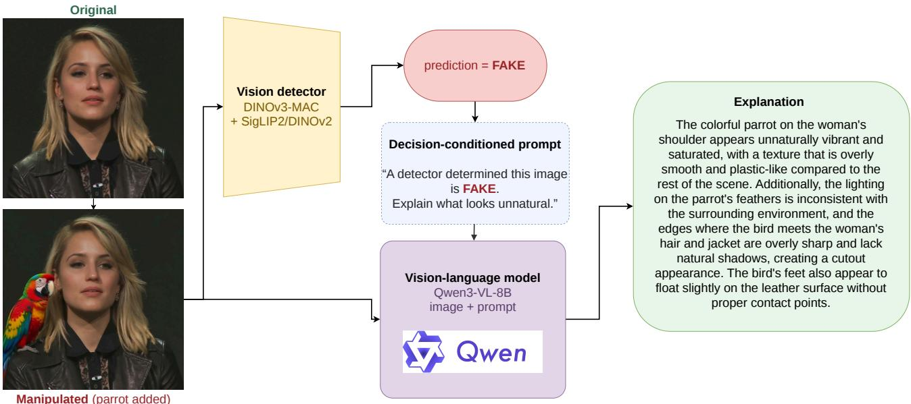

# Metric-Aligned Group Relative Policy Optimization for Explainable Deepfake Detection

Luka Dragar   
ld8435@student.uni-lj.si   
University of Ljubljana   
Ljubljana, Slovenia   
Vitomir Štruc   
vitomir.struc@fe.uni-lj.si   
University of Ljubljana   
Ljubljana, Slovenia   
Peter Peer   
peter.peer@fri.uni-lj.si   
University of Ljubljana   
Ljubljana, Slovenia   
Borut Batagelj   
borut.batagelj@fri.uni-lj.si   
University of Ljubljana   
Ljubljana, Slovenia

  
Manipulated (parrot added)

Figure 1: Visualization of our architecture.

## Abstract

Deepfake detectors are commonly evaluated on real/fake classification alone, but real-world applications require explanations of the vi sual evidence behind each prediction. Joint vision-language models struggle with authenticity assessment, producing “real” narratives for manipulated images. To address this, we propose a decoupled predict-then-explain pipeline as our submission to the ACM Multimedia 2026 Explainable Deepfake Detection Challenge [15], with methods trained and evaluated on the XPlainVerse benchmark [14]. A vision-foundation-model ensemble first classifies the image, then a Qwen3-VL-8B model generates a decision-conditioned explanation of the visual evidence. For fake images, a second Qwen3-VL-8B

This work is licensed under a Creative Commons Attribution 4.0 International License. MRAC ’26, Rio de Janeiro, Brazil   
© 2026 Copyright held by the owner/author(s).   
ACM ISBN 979-8-4007-2928-7/2026/11   
https://doi.org/10.1145/3840474.3840547

compresses that text into a short non-expert summary without using the image. We further apply metric-aligned Group Relative Policy Optimization (GRPO) to optimize both explainers against the challenge criteria. Under matched conditions, GRPO raises complex BERTScore-F1 from 0.686 to 0.712 and also improves grounding (entity and evidence F1); our submission ranked first on complex BERTScore-F1 and seventh overall.

## CCS Concepts

• Computing methodologies → Computer vision; Natural language generation; • Applied computing → Investigation techniques.

## Keywords

explainable deepfake detection, AI-generated image detection, visionlanguage models, reinforcement learning, group relative policy optimization

## ACM Reference Format:

Luka Dragar, Peter Peer, Vitomir Štruc, and Borut Batagelj. 2026. Metric-Aligned Group Relative Policy Optimization for Explainable Deepfake Detection. In 4th International Workshop on Multimodal, Generative and Responsible Afective Computing (MRAC ’26), November 10–14, 2026, Rio de Janeiro, Brazil. ACM, New York, NY, USA, 5 pages. https://doi.org/10.1145/3840474.3840547

## 1 Introduction

The realism of synthetic imagery has advanced to the point where it is nearly indistinguishable from authentic content. This is particularly evident for deepfake imagery, whose low-cost creation is routinely misused for harmful ends, including misinformation and deliberate attacks on individuals’ reputations. Moving beyond straightforward identity replacement, modern generative pipelines enable nuanced person-centric edits that modify actions, object interactions, and overall scene semantics while preserving the subject’s identity [6]. As generation methods advance, detectors still struggle to generalize beyond the generators and manipulation methods seen during training [3, 8], making reliable identification of manipulated content increasingly demanding.

Despite this growing sophistication of synthetic content, deepfake detection systems are typically evaluated on classification accuracy alone: a detector need only output a binary real/fake label, without articulating which regions, objects, or attributes support that decision. This leaves a critical gap for real-world deployment, where both experts and non-expert users need to understand how an image was manipulated and which specific changes alter the style, semantics, or narrative of the scene, especially for localized edits to actions, interactions, or context, not merely whether it was flagged as synthetic.

The Deepfake Explainability Challenge [15] introduces a new paradigm in which detectors must identify manipulations and generate grounded natural-language explanations.

In this paper, we present our solution to this challenge: a decoupled predict-then-explain pipeline that separates foundation-model detection from decision-conditioned explanation generation. This design provides the explainer with a predetermined authenticity decision, rather than relying on the autoregressive output to generate a class-specific narrative before deciding. Because token-level supervised fine-tuning (SFT) is only indirectly aligned with the sequence-level metrics used for evaluation, we follow the recent reinforcement-learning post-training trend [2, 16] and further optimize explanations with GRPO [17] against the challenge’s semanticsimilarity metrics. Our contributions can be summarized as follows:

• We introduce a decoupled predict-then-explain pipeline for explainable deepfake detection.

• The method tackles decision bias and related errors in combined decision and explanation generation.

• We apply metric-aligned GRPO post-training for both com plex and simple explanations, improving over SFT alone.

## 2 Related work

The detection of AI-generated images has shifted from specialized forensic systems to vision foundation models (VFMs) [12, 20]. Frozen DINOv3 and SigLIP2 features with lightweight heads perform strongly on generated-image and in-the-wild benchmarks [22,

23], while LoRA adaptation, forensic heads, and complementary VFM ensembles further improve robustness [1, 7, 21]. These methods achieve strong real-versus-fake classification, but they do not generally explain the visual evidence behind their decisions.

Recent forensic vision-language models add textual explanations. M2F2-Det couples a forgery encoder with an LLM so detection features inform both the fake probability and its explanation [5]. VIGIL structures forensic reasoning as a plan-then-examine process over facial evidence [11]. IFDL-VLM [4] decouples detection and localization from explanation and conditions the VLM on mask-enhanced visual features; we condition it on binary detector decisions instead. This predict-then-explain ordering is also more data-eficient than explain-then-predict training [10].

GRPO [17] extends the RL post-training line of RLHF [16] and DeepSeek-R1 [2] by comparing group-sampled completions without a value model. VIGIL uses part-aware GRPO for facial forensics [11]; we apply metric-aligned GRPO to the challenge’s BERTScore-F1 and SLE rewards.

MultiFakeVerse introduces large-scale person-centric edits that change actions, interactions, and scene context while preserving identity [6]. Building on this, XPlainVerse requires complex and simple natural-language explanations for image-level detection [14, 15].

## 3 Methods

## 3.1 Overview

Detection and explanation are handled separately in our pipeline (Figure 1). Given an input image, a vision-foundation model (VFM) detector first predicts whether the image is real or fake. The image and this predetermined decision are then passed to a visionlanguage model (VLM), which produces a detailed complex explanation of the visible evidence. For fake images, a second Qwen3-VL-8B summarizes the complex text into a brief non-expert explanation without using the image. The subsequent subsections explain the detector, the complex explainer, and the simple explainer.

## 3.2 Detection

We employ a Bombek1-style dual-encoder classifier [1]. In the first branch, features from Global SigLIP2-SO400M and DINOv2-Large are concatenated and passed to an MLP binary classifier. The second branch follows the DINO-MAC architecture used in the NTIRE 2026 winning solution [7]: for each ofthe final four DINOv3-Large blocks, mean-pooled patch features are concatenated with the classification token and four register tokens, then passed to a layer-specific binary head. All four heads are supervised during training; during inference, only the final-layer logit is used. In both branches, the pretrained backbone weights remain frozen; only LoRA adapters in the attention layers and the binary classification heads are trained. Logits from each branch are combined using a weight selected on held-out data, converted into a pseudo-probability, and compared to a threshold to produce the final real/fake decision. The detector provides only this decision label; all text generation occurs further down the pipeline.

Table 1: XPlainVerse dataset splits. Test class counts reflect the hidden evaluation reference; labels are not included in the public test release.
<table><tr><td>Split</td><td>Real</td><td>Fake</td><td>Total</td></tr><tr><td>Training</td><td>130,000</td><td>320,000</td><td>450,000</td></tr><tr><td>Validation</td><td>50,000</td><td>60,000</td><td>110,000</td></tr><tr><td>Test</td><td>90,000</td><td>110,000</td><td>200,000</td></tr><tr><td>Total</td><td>270,000</td><td>490,000</td><td>760,000</td></tr></table>

## 3.3 Complex Explanation Generation

The complex explanation is generated by Qwen3-VL-8B-Instruct. During inference, the image is paired with one of two decisionconditioned prompts. The hypothetical-fake prompt requests visible inconsistencies or synthesis artifacts, whereas the hypotheticalreal prompt requests concrete cues that support authenticity. Both request an evidence-focused paragraph followed by a Verdict: real/fake line, used to reward label consistency during training and stripped before submission. The VLM is adapted via supervised fine-tuning (SFT) with low-rank adapters on one primary and two hypothetical prompt forms (Section 4.3), then refined with metricaligned GRPO (Section 4.5). As a joint baseline, we also train the same Qwen3-VL-8B with the primary prompt alone so the VLM both decides and explains; its failure modes motivate the decoupled pipeline (Section 5).

## 3.4 Simple Explanation Generation

For fake images, a second Qwen3-VL-8B-Instruct model turns the complex explanation into a short summary in everyday language. This simple explainer is trained on text-only paired complex and simple references with the same SFT-then-GRPO recipe, using the competition’s simple-explanation metric as the reward (Section 4.5). For real images, the complex explanation is submitted to both output fields, as required by the benchmark.

## 4 Experiments

## 4.1 Datasets

XPlainVerse, presented for the ACM Multimedia 2026 Deepfake Explainability Challenge [14, 15], builds upon MultiFakeVerse [6] by incorporating natural-language explanations.

Each image in the training and validation splits is paired with a binary real-or-fake label and a detailed complex explanation grounded in visible evidence. Fake images additionally include a concise ex planation written for non-technical users. Table 1 summarizes the dataset splits.

The complex and simple explanation models are trained on the oficial XPlainVerse train set (450,000 images) and its reference explanations only. For detection, we held out 1,000 images from validation, then combined oficial train with the rest of validation and further augmented this set with three external imageauthenticity datasets: OpenFake (1.73M images) [13], the DFBench training split (436,506) [19], and the SID-Set training and validation splits (240,000) [9]. SID-Set contains equal numbers of real, fully synthetic, and locally tampered images; we mapped the latter two categories to fake. These sources formed the 2.97M-image mixture (1.80M fake / 1.16M real) for the SigLIP2–DINOv2 detector. DINOv3-MAC additionally used 277,643 images from the NTIRE 2026 Robust AI-Generated Image Detection training set [7], resulting in a 3.24M-image mixture (1.98M fake / 1.26M real).

## 4.2 Evaluation Protocols

Detection. Labels are binary: 0 indicates a real image, while 1 indicates a generated or manipulated image. Macro F1 is calculated across both classes using all 200,000 test images.

Reference similarity. Each prediction requires a detailed complex explanation and a concise simple explanation, both consistent with the submitted label. Complex explanations are scored with BERTScore-F1. Simple explanations combine BERTScore-F1 (70%) with an SLE simplicity score (30%), after clipping SLE to [−1, 4] and mapping it to [0, 1]; we refer to this weighted sum as the simple overall score. During the competition, the reported reference explanation score was the average of complex BERTScore-F1 and simple overall.

LLM-based grounding. The grounding score was omitted during the competition because of its computational cost. In the postcompetition evaluation, a fixed Qwen3.5-4B judge extracts diagnostic entities and evidence claims from generated and reference complex explanations. The same judge then measures semantic coverage in both directions by deciding, for each entity and claim, whether it is present in the other explanation based on meaning rather than exact wording. The two directional scores are then combined by their harmonic mean to produce entity F1 and evidence F1, which are averaged to obtain the grounding score. The postcompetition explanation score is then 0.4 · reference explanation + 0.6·grounding, and the overall score is the mean of this explanation score and detection macro F1.

## 4.3 Supervised Training Corpus and Prompt Design

We build the explanation corpus from oficial train and validation annotations; only the train set is used for training. Each complex sample pairs an image with a user prompt; the target is the reference text plus Verdict: real/fake. For the simple tier, each fake complex reference is paired with its simple summary under a textonly compression prompt. Complex training uses three templates mixed at about 50%/25%/25%: the primary template asks the model to decide authenticity and justify it from visible evidence, while hypothetical-fake and hypothetical-real provide the ground-truth decision and ask only for supporting explanation. At inference we use only the hypothetical template matching the detector prediction, so the explainer does not classify the image. All templates request multi-region evidence to match reference style and grounding criteria; the fake-conditioned form asks for structured technical analysis, and the real-conditioned form uses less technical language for the typically shorter real references. We keep fake references with at least three sentences and 80 words and train at a 4:1 fake-to-real ratio.

Table 2: Selected final CodaBench scores [15]. Complex is Complex BERTScore- $\mathbf { - F 1 } ;$ Expl. is Explanation Score. Challenge website: https://explainable-deepfake-detection.github. io/.
<table><tr><td>#</td><td>Team</td><td>Overall</td><td>Det. F1</td><td>Complex</td><td>Expl.</td></tr><tr><td>1</td><td>XZ</td><td>0.842</td><td>0.942</td><td>0.706</td><td>0.741</td></tr><tr><td>7</td><td>Ours</td><td>0.791</td><td>0.860</td><td>0.712</td><td>0.722</td></tr><tr><td>32</td><td>Qwen3-VL-8B</td><td>0.643</td><td>0.634</td><td>0.665</td><td>0.651</td></tr></table>

## 4.4 Detector Training

Both detector branches are optimized with focal loss (�=2, �=0.25) using LoRA adapters (�=32, �=64) on frozen encoders. The SigLIP2– DINOv2 model is warm-started from an XPlainVerse-trained checkpoint and fine-tuned for five epochs at 392×392 on the 2.97M-image mixture, with compression and resize augmentations. DINOv3- MAC is trained from scratch for two epochs at 512×512 on the 3.24M-image mixture. We select the best checkpoint for each branch based on macro F1 on a stratified 1,000-image holdout set, and use the same holdout to tune the fusion weights and decision threshold, arriving at 0.6/0.4 and 0.360, respectively.

## 4.5 Explanation Model Training

The complex explainer and simple compressor are first trained with supervised fine-tuning (SFT) using LoRA adapters $( r = 1 6 , \alpha = 3 2 )$ on frozen vision encoders. The complex explainer is Qwen3-VL-8B-Instruct, trained for one epoch at a learning rate of 1.5×10−4. The simple compressor uses the same backbone but processes only text, training for one epoch on fake-image pairs.

SFT alone was insuficient: training loss kept falling while validation ROUGE-L plateaued near 0.35, reflecting the mismatch between token-level cross-entropy and the challenge’s sequence-level metrics. We therefore continue with GRPO [17]: for each prompt we sample � completions, score them with a scalar reward �, normalize advantages within the group, and update the policy with a KL penalty $\beta$ toward the SFT reference. Simple (�s) and complex $\left( r _ { \mathrm { c } } \right)$ rewards match the oficial metrics and are cheap enough for online training:

$$
r _ { \mathrm { s } } = 0 . 7 \mathrm { B E R T S c o r e - F 1 } + 0 . 3 \mathrm { S L E _ { n o r m } , }\tag{1}
$$

$$
r _ { \mathrm { c } } = \mathrm { B E R T S c o r e - F 1 } + 0 . 3 r _ { \mathrm { f m t } } .\tag{2}
$$

where BERTScore-F1 uses the leaderboard DeBERTa setup, �fmt checks the Verdict: line, and $\mathrm { S L E } _ { \mathrm { n o r m } }$ follows the oficial [0, 1] mapping. Both runs use one epoch, $G { = } 8 ,$ , learning rate $1 \times 1 0 ^ { - 6 }$ , and LoRA $\scriptstyle ( r = 1 6 , \alpha = 3 2 )$ ; complex uses $\beta { = } 0 . 0 0 1$ (max length 400) and simple $\beta { = } 0 . 0 4$ (max length 128).

## 5 Results

Decoupling detection and explanation. Our primary-prompt VLM baseline showed a strong real bias: on 2,000 validation images held out from explanation-model training, 65% of explanations used a generic real-style opening and the fake false-negative rate was 44.8%. This behavior is consistent with the semantic-plausibility bias observed in forensic VLMs, which tend to prioritize coherent scene semantics and surface realism over subtle authenticity cues [4, 18]. The same model is also a weaker detector than the vision ensemble (0.772 vs. 0.972 macro F1 on a separate 1,000-image holdout). We therefore let the ensemble decide and ask the VLM only to explain. Giving the explainer the correct label on those 2,000 images raised complex BERTScore-F1 from 0.698 to 0.733.

Table 3: Matched SFT vs. GRPO complex-explanation ablation on 10,000 scored test images.
<table><tr><td>Adapter</td><td>BERTScore-F1</td><td>Entity F1</td><td>Evidence F1</td><td>Grounding</td></tr><tr><td>SFT-1655</td><td>0.686</td><td>0.362</td><td>0.259</td><td>0.310</td></tr><tr><td>GRPO-26400</td><td>0.712</td><td>0.387</td><td>0.296</td><td>0.341</td></tr></table>

Table 4: Post-competition grounding-aware scores on all 200,000 test images.
<table><tr><td>Metric</td><td>Score</td></tr><tr><td>Detection macro F1</td><td>0.859709</td></tr><tr><td>Complex BERTScore-F1</td><td>0.712210</td></tr><tr><td>Simple overall</td><td>0.727451</td></tr><tr><td>Reference explanation score</td><td>0.719831</td></tr><tr><td>Entity F1</td><td>0.389700</td></tr><tr><td>Evidence F1</td><td>0.300414</td></tr><tr><td>Grounding score</td><td>0.345057</td></tr><tr><td>Explanation score</td><td>0.494967</td></tr><tr><td>Overall score</td><td>0.677338</td></tr></table>

Efect of GRPO. To evaluate GRPO’s impact, we ran an additional controlled experiment that directly compared SFT and GRPO complex explanations on the same 10,000 explanation-scored test images. Both models received identical images, detector decisions, decision-conditioned prompts, and decoding settings; only the explainer adapter difered. As shown in Table 3, GRPO raises complex BERTScore-F1 by 0.026 and also improves entity F1, evidence F1, and grounding, even though entity and evidence coverage were never online rewards. Together, these results indicate that GRPO improves not only complex BERTScore-F1, but also coverage of the diagnostic entities and evidence claims identified in the references.

For simple explanations, swapping only the fake-image compressor on the hidden test set raised simple overall from 0.677 to 0.730, with detection and complex explanations held fixed.

Final leaderboard. Table 2 compares our submission with the overall winner and the organizers’ Qwen3-VL-8B baseline. We ranked seventh overall. Complex BERTScore-F1 was our strongest component: 0.712 ranked first, ahead of the winner’s 0.706. Detection F1 ranked 17th, so detection—not explanation—was the main limitation.

Grounding-aware evaluation. Finally, we evaluated our final submission with the post-competition protocol on all 200,000 test images. It achieved entity F1 and evidence F1 of 0.390 and 0.300, respectively, a grounding score of 0.345, an explanation score of 0.495, and an overall score of 0.677 (Table 4).

## 6 Discussion

The final leaderboard highlights complex BERTScore-F1 as our strongest component, ranking first among all submissions. GRPO improved both complex BERTScore-F1 and the grounding score. Al though it used a quick, cost-efective BERTScore-F1 reward instead of entity F1 and evidence F1, its outputs covered more of the diag nostic entities and evidence claims seen in the references. Two main limitations remain. First, the reference simple explanations already favor short motifs such as “sticker” and “doll,” and metric-aligned GRPO overuses these patterns in even shorter, more repetitive responses. As a result, the oficial simple score rises, mainly via SLE, while linguistic diversity falls. Second, the predict-then-explain approach propagates detector errors: while conditioning maintains decision consistency, an incorrect decision leads the explainer to produce evidence supporting the wrong class.

## 7 Conclusion

These results highlight the value of separating detection from explanation: specialized vision models determine authenticity, while language models communicate the supporting evidence for that fixed decision. Metric-aligned reinforcement learning with GRPO can then improve those explanations using inexpensive rewards. Because each image has only one reference explanation, grounding can under-credit plausible alternative evidence; closing this gap will require grounding-aware judges that are fast enough for online training, so that GRPO can reward evidence supported by the image rather than BERTScore-F1 alone. Developing such judges, richer reward signals, and comparisons with other sequence-level methods remains an important direction for future research.

## Acknowledgments

Supported in parts by the ARIS Research Programmes P2–0250 (B) and P2-0214 (B) as well as the ARIS project J2-50065 (A) DeepFake DAD.

## References

[1] Bombek1. 2025. AI Image Detector (SigLIP2 + DINOv2 Ensemble). Hugging Face model card. https://huggingface.co/Bombek1/ai-image-detector-siglip-dinov2

[2] DeepSeek-AI, Daya Guo, Dejian Yang, Haowei Zhang, Junxiao Song, Peiyi Wang, Qihao Zhu, Runxin Xu, Ruoyu Zhang, Shirong Ma, et al. 2025. DeepSeek R1: Incentivizing Reasoning Capability in LLMs via Reinforcement Learning. arXiv:2501.12948 [cs.CL] https://arxiv.org/abs/2501.12948

[3] Fabrizio Guillaro, Giada Zingarini, Ben Usman, Avneesh Sud, Davide Cozzolino, and Luisa Verdoliva. 2025. A Bias-Free Training Paradigm for More Genera AI-Generated Image Detection. In Proceedings ofthe IEEE/CVF Conference on ComputerVision and Pattern Recognition (CVPR). IEEE, Nashville, TN, USA, 18685– 18694. doi:10.1109/CVPR52734.2025.01741

[4] Shaofeng Guo, Jiequan Cui, and Richang Hong. 2026. Rethinking VLMs for Image Forgery Detection and Localization. CVPR 2026 Findings. arXiv:2603.12930 [cs.CV] https://arxiv.org/abs/2603.12930

[5] Xiao Guo, Xiufeng Song, Yue Zhang, Xiaohong Liu, and Xiaoming Liu. 2025. Rethinking Vision-Language Model in Face Forensics: Multi-Modal Interpretable Forged Face Detector. In Proceedings of the IEEE/CVF Conference on Computer Vision and Pattern Recognition (CVPR). IEEE, Nashville, TN, USA, 105–116. arXiv:2503.20188 doi:10.1109/CVPR52734.2025.00019

[6] Parul Gupta, Shreya Ghosh, Tom Gedeon, Thanh-Toan Do, and Abhinav Dhall. 2025. Multiverse Through Deepfakes: The MultiFakeVerse Dataset of Person Centric Visual and Conceptual Manipulations. In Proceedings ofthe 33rd ACM International Conference on Multimedia (MM ’25). ACM, Dublin, Ireland, 13258– 13265. arXiv:2506.00868 doi:10.1145/3746027.3758283

[7] Aleksandr Gushchin, Khaled Abud, Ekaterina Shumitskaya, Artem Fil ippov, Georgii Bychkov, Sergey Lavrushkin, Mikhail Erofeev, Anastasia Antsiferova, Changsheng Chen, Shunquan Tan, Radu Timofte, Dmitriy

Vatolin, et al. 2026. NTIRE 2026 Challenge on Robust AI-Generated Image Detection in the Wild. In Proceedings of the IEEE/CVF Conference on Computer Vision and Pattern Recognition (CVPR) Workshops. IEEE, Denver, CO, USA, 1895–1913. arXiv:2604.11487 https://openaccess.thecvf.com/content/ CVPR2026W/NTIRE/html/Gushchin\_NTIRE\_2026\_Challenge\_on\_Robust\_AI-Generated\_Image\_Detection\_in\_the\_CVPRW\_2026\_paper.html

[8] Yue-Hua Han, Tai-Ming Huang, Kai-Lung Hua, and Jun-Cheng Chen. 2025. Towards More General Video-based Deepfake Detection through Facial Component Guided Adaptation for Foundation Model. In Proceedings ofthe IEEE/CVF Conference on Computer Vision and Pattern Recognition (CVPR). IEEE, Nashville, TN, USA, 22995–23005. doi:10.1109/CVPR52734.2025.02141

[9] Zhenglin Huang, Jinwei Hu, Xiangtai Li, Yiwei He, Xingyu Zhao, Bei Peng, Baoyuan Wu, Xiaowei Huang, and Guangliang Cheng. 2025. SIDA: Social Media Image Deepfake Detection, Localization and Explanation with Large Multimodal Model. In Proceedings of the IEEE/CVF Conference on Computer Vision and Pattern Recognition (CVPR). IEEE, Nashville, TN, USA, 28831–28841. arXiv:2412.04292 doi:10.1109/CVPR52734.2025.02685

[10] Myeongjun Jang and Thomas Lukasiewicz. 2021. Are Training Resources Insuficient? Predict First Then Explain! arXiv:2110.02056 [cs.CL] https://arxiv.org/ abs/2110.02056

[11] Xinghan Li,Junhao Xu, andJingjing Chen. 2026. VIGIL: Part-Grounded Structured Reasoning for Generalizable Deepfake Detection. arXiv:2603.21526 [cs.CV] https: //arxiv.org/abs/2603.21526

[12] Li Lin, Neeraj Gupta, Yue Zhang, Hainan Ren, Chun-Hao Liu, Feng Ding, Xin Wang, Xin Li, Luisa Verdoliva, and Shu Hu. 2024. Detecting Multimedia Generated by Large AI Models: A Survey. arXiv:2402.00045 [cs.MM] https://arxiv.org/abs/ 2402.00045

[13] Victor Livernoche, Akshatha Arodi, Andreea Musulan, Zachary Yang, Adam Salvail, Gaétan Marceau Caron, Jean-François Godbout, and Reihaneh Rabbany. 2025. OpenFake: An Open Dataset and Platform Toward Real-World Deepfake Detection. arXiv:2509.09495 [cs.CV] https://arxiv.org/abs/2509.09495

[14] Abhijeet Narang, Kartik Kuckreja, Shreya Ghosh, Muhammad Haris Khan, Jianfei Cai, and Abhinav Dhall. 2026. XPlainVerse: A Million-Scale Benchmark for Explainable Deepfake Detection. arXiv:2607.03562 [cs.CV] https://arxiv.org/abs/ 2607.03562

[15] Abhijeet Narang, Kartik Kuckreja, Shreya Ghosh, Muhammad Haris Khan, Usman Tariq, Jianfei Cai, and Abhinav Dhall. 2026. Explainable Deepfake Detection Challenge. arXiv:2607.21007 [cs.CV] https://arxiv.org/abs/2607.21007

[16] Long Ouyang, Jef Wu, Xu Jiang, Diogo Almeida, Carroll L. Wainwright, Pamela Mishkin, Chong Zhang, Sandhini Agarwal, Katarina Slama, Alex Ray, et al. 2022. Training Language Models to Follow Instructions with Human Feedback. In Advances in Neural Information Processing Systems (New Orleans, LA, USA), Vol. 35. Curran Associates, Inc., Red Hook, NY, USA, 27730–27744. arXiv:2203.02155 https://proceedings.neurips.cc/paper\_files/paper/2022/hash/ b1efde53be364a73914f58805a001731-Abstract-Conference.html

[17] Zhihong Shao, Peiyi Wang, Qihao Zhu, Runxin Xu, Junxiao Song, Xiao Bi, Haowei Zhang, Mingchuan Zhang, Y. K. Li, Y. Wu, and Daya Guo. 2024. DeepSeek-Math: Pushing the Limits of Mathematical Reasoning in Open Language Models. arXiv:2402.03300 [cs.CL] https://arxiv.org/abs/2402.03300

[18] Shahroz Tariq, David Nguyen, M. A. P. Chamikara, Tingmin Wu, Alsharif Abuadbba, and Kristen Moore. 2025. LLMs Are Not Yet Ready for Deepfake Image Detection. arXiv:2506.10474 [cs.CV] https://arxiv.org/abs/2506.10474

[19] Jiarui Wang, Huiyu Duan, Juntong Wang, Ziheng Jia, Woo Yi Yang, Xiaorong Zhu, Yu Zhao, Jiaying Qian, Yuke Xing, Guangtao Zhai, and Xiongkuo Min. 2025. DFBench: Benchmarking Deepfake Image Detection Capability of Large Multimodal Models. arXiv:2506.03007 [cs.CV] https://arxiv.org/abs/2506.03007

[20] Qijie Xu, Can Wang, Jiawei Chen, Siwei Lyu, and Defang Chen. 2025. Fully AI-Generated Image Detection: Definition, Recent Advances and Challenges. arXiv:2502.19716 [cs.CV] https://arxiv.org/abs/2502.19716

[21] Jieming Yu, Qiuxiao Feng, Zhuohan Wang, and Xiaochen Ma. 2026. DINOv3 Beats Specialized Detectors: A Simple Foundation Model Baseline for Image Forensics. arXiv:2604.16083 [cs.CV] https://arxiv.org/abs/2604.16083

[22] Yue Zhou, Xinan He, Kaiqing Lin, Bing Fan, Feng Ding, and Bin Li. 2026. Simplicity Prevails: The Emergence of Generalizable AIGI Detection in Visual Foundation Models. arXiv:2602.01738 [cs.CV] https://arxiv.org/abs/2602.01738

[23] Yue Zhou, Xinan He, Kaiqing Lin, Bing Fan, Feng Ding, Jinhua Zeng, and Bin Li. 2025. Brought a Gun to a Knife Fight: Modern VFM Baselines Outgun Specialized Detectors on In-the-Wild AI Image Detection. arXiv:2509.12995 [cs.CV] https: //arxiv.org/abs/2509.12995