# ATune: Unsupervised Photo Retouching Through Image-Editor Controls

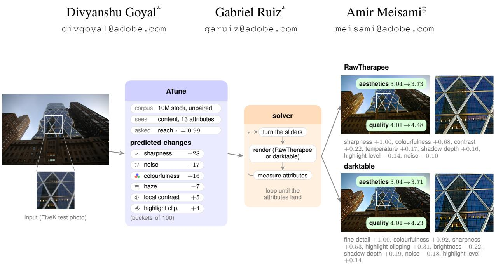  
Figure 1. Retouching learned from unpaired photographs. On a FiveK test photograph, ATune predicts how far each attribute should move to reach a desired quality set by τ; a simple search sets RawTherapee’s or darktable’s sliders until the measured attributes land there. Insets: the boxed region at 100%; scores: Q-Align quality and aesthetics

## Abstract

Photo retouching models are trained on pairs of original and retouched photographs, usually edited by experts. Expert edits are costly, so the two main public sets, FiveK and PPR10K, hold only 16,161 originals. Good photographs on their own are far easier to find: commercial stock collections and free ones such as Pixabay and Unsplash hold millions. We learn retouchingfrom them alone: we damage each photograph the way a camera or a careless edit would, which gives a worse and a better version ofthe same photograph. From these pairs, our model, ATune, learns how 13 measured attributes, such as brightness, contrast and sharpness, should change to raise a photograph’s quality. The edit is declarative: ATune sets target values for the attributes, and a simple search adjusts the sliders of an outof-the-box photo editor until the photograph reaches them. Every edit is a list of slider values a person can read and adjust. The same model can drive any editor that makes those changes; we test RawTherapee and darktable. We train on 10M photographs from a commercial stock collection and

test on FiveK, PPR10K and SPAQ. Nine quality judges score every edit, and in a user study 157 human raters made 9,253 choices between our edit and another method’s edit of the same photograph. When Claude Opus 5 and GPT-6 Astra edit the same photographs in the same editor, raters prefer our edits to GPT-6 Astra’s (54.3%) and rate them even with Claude’s (50.5%). We also compare with supervised retouchers on their home ground: NeurOP on FiveK and AdaInt on PPR10K, each trained on that set’s own exper edits. Raters chose our edits in 46.3% of those comparisons. ATune, a 54M-parameter model trained without a single expert edit, now matches frontier models at setting an editor’s sliders.

## 1. Introduction

Photo retouching models learn from pairs of original and expert-retouched photographs. Expert edits are costly, so MIT-Adobe FiveK [7] from 2011 and PPR10K [35] from 2021 hold only 16,161 originals between them. A model trained on so few photographs fits that one collection, and it does worse on photographs from other sources (Sec. 4.2).

Good photographs on their own are far easier to find. Stock collections, commercial ones and free ones such as Pixabay and Unsplash, hold millions of photographs that already look right, and none of them comes with a retouched pair.

A good photograph can be turned into a training pair by degrading it: underexpose it, flatten its contrast or blur it, and the original is the target. Millions of such pairs teach a model which changes raise a photograph’s quality. Distortand-Recover [46] trains this way too, but its model outputs a sequence of pixel operations, so its edits are tied to those operations. ATune outputs a goal: how 13 measured attributes of the photograph, such as brightness, contrast, sharpness and haze, should change. The first is an imperative edit and the second a declarative one. Any editor whose tools move these attributes can reach the goal, so the same model works across editors without retraining.

The method has three steps (Fig. 1). Measure: each of the 13 attributes is measured directly from the photograph, and the measures were selected by a reliability test (Sec. 3.1). Predict: ATune learns how the degraded copy’s attributes must change to get back to the original, given how much the quality should rise. At test time that quality rise is a dial: we ask for the changes that bring a new photograph up to the collection’s τ -th quality percentile (Sec. 3.3). Act: a simple search adjusts the calibrated controls of an outof-the-box open-source editor, RawTherapee [49] or darktable [12], rendering and re-measuring until the attributes land (Sec. 3.4). Every edit is a short list of named slider values a photographer can read and adjust.

We train ATune on 10M photographs from a commercial stock collection and test on FiveK, PPR10K and SPAQ. We compare with two kinds of method. The first is frontier models: Claude Opus 5 [2] and GPT-6 Astra [44] get the same photograph and editor as ATune and set its sliders in one call, with reasoning on (Claude at maximum effort, GPT-6 Astra at high). The second is seven learned retouchers. Two of them, AdaInt and NeurOP, trained on FiveK’s and PPR10K’s training splits, so they are tested on collections they learned from; CSRNet’s weights trained on 450 of the 499 FiveK test photographs themselves. Nine published quality judges score every edit, and in a user study 157 human raters made 9,253 choices between our edit and another method’s edit of the same photograph (Secs. 4.1 and 4.4).

Against GPT-6 Astra, at least eight of the nine judges prefer our edits on every test set, and raters chose ours in 54.3% of votes. Against Claude, three to six judges prefer ours and at most two prefer Claude’s, while raters’ votes are a tie at 50.5% (95% CI 46.8–54.2). The same holds on darktable, where at least five judges prefer our edits to either model’s on every test set (Secs. 4.3 and 4.4). Against the seven learned retouchers, at least seven judges prefer ours on every test set (Tab. 3). On their home ground, NeurOP on FiveK and AdaInt on PPR10K, eight judges prefer ours, while raters chose ours in 46.3% of comparisons (95% CI 41.5–51.2; Sec. 4.4). Finally, we train models on 1M to 10M photographs and find that more training photographs help: no judge ever prefers the model trained on the smaller set (Sec. 4.5).

Our contributions:

1. A declarative, editor-independent edit. ATune describes an edit as a change in 13 measured attributes, with no pixels and no sliders. A simple search then reaches that change with any editor’s sliders, so the same model drives RawTherapee and darktable, and every edit is a readable list of slider values (Secs. 3 and 4.3).

2. Retouching learned without expert edits. Degrading good photographs and learning to reverse the degradation turns 10M unedited photographs into training data. The model improves as the training set grows, with no judge preferring a model trained on fewer photographs (Sec. 4.5).

3. Parity with frontier models from a 54M-parameter model. With Claude Opus 5 and GPT-6 Astra setting the same editor’s sliders, raters prefer ATune’s edits to GPT-6 Astra’s and rate them even with Claude’s, and the judges favour ATune’s over both (Secs. 4.3 and 4.4).

We compare only with methods that adjust the photograph’s tone and colour and keep its content. Generative editors that synthesise new pixels [59] are out of scope.

## 2. Related work

Supervised retouching. Most learned retouchers are trained on the FiveK dataset [7] and learn to reproduce its expert retouches as pixels, curves or filters: HDRNet [20], DPE [10], CSRNet [23], DeepLPF [42], image-adaptive 3D LUTs [64], AdaInt [61] and neural colour operators (NeurOP) [57]. FiveK has five experts’ edits, but these methods are usually trained on one of them, expert C, and so reproduce that expert’s style. Their output is the edited image itself, so a user cannot see or adjust the edit as slider values. The exception is Neural Photo-Finishing [54], which predicts a raw editor’s slider settings, but it needs a target style to imitate and a neural network that mimics the editor in order to train.

Unpaired and self-supervised enhancement. Several methods avoid expert pairs by learning from a signal other than a retouched target. Exposure [27], Distort-and-Recover [46] and Kosugi and Yamasaki [32] use reinforcement learning to pick a sequence of editing operations, such as brightening or adding contrast, from a fixed set that each method defines and implements itself. Distort-and-Recover degrades good photographs to make its training signal, as we do, and is the closest prior method; synthetic degradation is also how restoration methods make their training pairs [5, 56]. Kosugi and Yamasaki and UEGAN [43] instead learn from a discriminator, which still needs FiveK’s expert retouches as the set of desirable images. Others learn from a quality score: Talebi and Milanfar [53] train an enhancement network to raise the score of a learned aesthetic judge, Deng et al. [13] learn their operators adversarially from good and poor aesthetic labels, and Gao et al. [19] let the user set a target quality score for a portrait enhancer. EnlightenGAN [30], Zero-DCE [21] and SCI [39] learn without pairs but target low light only. All of these methods output an imperative edit, a policy or network over one fixed set of operations, so moving to another editor means training again. ATune outputs a declarative edit, a change in measured attributes learned from millions of photographs with no paired edit, and a simple search reaches that change with the tools of any out-of-the-box editor.

Language-model retouching agents. Multimodal language models can now operate photo editors. Monet-GPT [16] fine-tunes a multimodal model on procedurally edited expert photographs to propose editing operations with their parameters. JarvisArt [37] is fine-tuned, with supervision and then reinforcement learning, to drive Lightroom’s tools from a user’s instruction; its MMArt release provides the PPR10K retoucher renders we evaluate against. Similar agents orchestrate restoration tools [9, 67]. All of these need a large model, curated instruction data and expert edits to fine-tune on. We instead compare with frontier models used as they are: Claude Opus 5 [2] and GPT-6 Astra [44] set the sliders of the same editor as ATune.

## 3. Method

## 3.1. The attribute space

When a photographer judges a photograph, they talk about qualities such as its brightness, contrast, sharpness, colour balance, noise etc. ATune works with 13 such attributes. It uses them for three things: to describe a photograph, to decide how the photograph should change, and to check that the editor delivered the change. Because everything depends on these numbers, each attribute needs a measure that is reliable, that an editor can move, and that does not duplicate another. A bad measure would corrupt the training targets, the edits and the check on the edits at once.

We therefore chose each measure in a selection study on public photographs, KADID-10k [36] and SPAQ [18]. A candidate measure had to track a known dose of its own distortion, ignore other distortions, and add something the other measures did not. All of the chosen measures except the two clipping descriptors are stable: resizing, JPEG reencoding or a small crop leaves the ordering of photographs by that measure almost unchanged. The protocol, the coverage and the rejected candidates are in the supplementary

Table 1. The 13 attributes and the measure behind each one. All are computed on the analysis frame (Sec. 3.1).
<table><tr><td>Group</td><td>Attribute</td><td>Measure</td></tr><tr><td>Tone</td><td>brightness</td><td>median log intensity</td></tr><tr><td></td><td>contrast</td><td>interquartile range of CIELAB L*</td></tr><tr><td></td><td>shadow depth</td><td>L* at the 5th percentile</td></tr><tr><td></td><td>highlight level</td><td>L* at the 95th percentile</td></tr><tr><td></td><td>local contrast</td><td>midtone-weighted unsharp-mask energy, large radius</td></tr><tr><td></td><td>haze</td><td>mean dark channel [24]</td></tr><tr><td></td><td>shadow clipping</td><td>signed clipped area or headroom, at black</td></tr><tr><td></td><td>highlight clipping</td><td>signed clipped area or headroom, at white</td></tr><tr><td>Colour</td><td>colourfulness</td><td>Hasler and Süsstrunk [22]</td></tr><tr><td></td><td>colour temperature tint</td><td>McCamy CCT [41] of the mean colour mean a*</td></tr><tr><td>Detail</td><td></td><td></td></tr><tr><td></td><td>sharpness noise</td><td>spread of the max. local variation map [3] Immerkær residual [29], flattest 8×8 blocks, two scales</td></tr></table>

material.

Table 1 lists the 13 attributes in three groups, tone, colour and detail, with the measure behind each. The clipping and noise measures are less obvious than the rest. Clipping is measured separately for the shadows and the highlights as a signed value: positive when pixels are clipped to pure black or white (growing with the clipped area), negative when there is still room before clipping, so it passes smoothly through zero. Noise is estimated from the pixel variation in the smoothest patches of the image, such as a wall or a sky. We chose this estimator because it is stable under JPEG re-encoding and resizing (the ordering of SPAQ photographs before and after agrees with Spearman 0.97 and 0.91), where the classical PCA estimator [38] is not (0.58, 0.78). Its limitation is that fine texture and sharpening also add variation in smooth patches, so it cannot separate them from noise [11]; it reads as the amount of fine-grained variation, whatever its source.

One frame, one ruler. Every attribute is measured on the same analysis frame: the decoded image resampled once to a 1024-px short side with Lanczos resampling [15], in the corpus, inside the search and at evaluation. Each attribute is divided into 100 equal-width buckets between its 0.5th and 99.5th percentiles over the training corpus (equal steps of log(1+x) for sharpness, temperature and noise). These 100 bucket boundaries are computed once from the training corpus and then used unchanged for every photograph, including the test sets. Buckets are the unit for everything that follows: the model predicts changes in buckets, and the search measures how far an edit still is from its target in buckets.

## 3.2. Supervision from a quality-ranked corpus

Corpus. We draw photographs from a licensed commercial stock collection: photographs only, no items flagged as AI-generated, short side at least 1024 px. We sample from every band of their precomputed Q-Align quality score, from weak to polished, so that the model learns to edit photographs at every quality level. Our training corpus has 10M photographs, 68% of them at $\mathrm { Q - A l i g n } \geq 4$

Transitions. The corpus holds only finished photographs, so we generate the degraded versions. Each photograph gets five copies, and each copy receives two or three of twelve camera-like defects: exposure, black point, highlight blow-out or roll-off, contrast, temperature, tint, colourfulness, haze veil, local-contrast flattening, blur or oversharpening, three kinds of noise, and JPEG compression. Defect strengths are drawn from a range that grows with the original’s quality, so a weak photograph is not damaged beyond recognition. The original is the target for each of its copies, so no expert edit is needed, and because the originals range from mediocre to excellent, the training transitions start at every quality level rather than all ending at the top.

Quality is measured on the same frame as the attributes, with LIQE [66]. For every copy we record its 13 attributes $\mathbf { o } _ { 0 }$ and its LIQE score, expressed as a percentile $p _ { \mathrm { s t a r t } }$ of the LIQE scores of the training photographs. The dial uses the same scale: $\tau { = } 0 . 9 9$ means “as good, by LIQE, as the corpus’s 99th-percentile photograph”. So Q-Align shaped the sample and LIQE defines the dial.

## 3.3. ATune

ATune answers one question: given what this photograph shows and where its attributes sit, how should they move for its quality to rise by a given amount? Its inputs are the content of the photograph, as a frozen DINOv3 ViT-L/16 embedding e [52]; its 13 current attributes ${ \bf o } _ { 0 } ;$ its current quality percentile $p _ { \mathrm { s t a r t } } ;$ and the requested quality rise, the $l i f t \delta .$ . Its output is the change $\pmb { \Delta }$ each attribute needs, in buckets. During training the input is a degraded copy, the target is its original, and the lift is the gap between them, $\delta = \mathrm { m a x } ( p _ { \mathrm { o r i g } } - p _ { \mathrm { s t a r t } } , 0 )$ , with $p _ { \mathrm { o r i g } }$ the original’s percentile.

Many different edits can raise a photograph’s quality, so the model predicts a distribution over changes rather than one change:

$$
p _ { \theta } ( \Delta | { \bf e } , { \bf o } _ { 0 } , p _ { \mathrm { s t a r t } } , \delta ) = \sum _ { k = 1 } ^ { 5 } \pi _ { k } \mathcal { N } ( \Delta / 1 0 ; \mu _ { k } , \Sigma _ { k } ) ,\tag{1}
$$

The density is a mixture of five Gaussians [4], each with a full covariance over the 13 changes. Training maximises the likelihood of the true change under this density. The full covariance matters because attributes move together: raising exposure deepens highlight clipping, and removing haze raises contrast.

Two design choices prevent degenerate solutions. First, the model predicts the change rather than the target. A model asked for the target with $\mathbf { o } _ { 0 }$ in view learns to return $\mathbf { o } _ { 0 } .$ , because on most training rows the original is already close to it (supplementary material). Second, one training row in five is an original with $\delta { = } 0$ and $\Delta { = } 0$ , which teaches the model to leave a photograph alone when no lift is requested.

The network is small: a residual MLP over the DINOv3 embedding, three blocks of width 2048 and 54M parameters in all, with the other inputs, $\mathbf { o } _ { 0 } , p _ { \mathrm { s t a r t } }$ and $\delta ,$ fed into each block through FiLM conditioning [47]. We train it with batches of 32,768 rows and keep the checkpoint with the lowest negative log-likelihood on a validation set of copies. The architecture diagram and the training details are in the supplementary material.

Inference and the dial. For a new photograph we measure $\mathbf { o } _ { 0 }$ and $p _ { \mathrm { s t a r t } }$ and ask for the lift to a target percentile $\tau \colon \delta = \operatorname* { m a x } ( \tau - p _ { \mathrm { s t a r t } } , 0 )$ . The dial $\tau$ is the only setting a user chooses. A photograph already above τ gets $\delta { = } 0$ and is left unchanged. Each attribute’s target is $\mathbf { o } _ { 0 }$ plus the median of its predicted change, and an attribute whose predicted change is within three buckets is not changed at all.

## 3.4. Acting through an out-of-the-box editor

ATune specifies target values for the attributes; reaching them is left to the editor. A photographer would do this by adjusting a slider, inspecting the result and adjusting again. We automate the same loop as a numerical search over the editor’s own sliders. The search has no learned parameters and consults no quality judge: at each step it renders the photograph, measures the 13 attributes and compares them with the targets.

Controls. For each attribute we pick the editor tools a photographer would use to change it. These tools use very different units, such as exposure in stops and a sharpening radius in pixels. So the search does not set them directly. Each attribute gets a control, a number in [−1, 1], and a fixed mapping turns it into tool values. The search then works on one common scale. In RawTherapee 5.8:

• for brightness, contrast and colourfulness, we use the brightness, contrast and saturation sliders;

• for temperature and tint, the colour curves;

• for shadow depth and highlight level, the shadows and highlights tools;

• for shadow and highlight clipping, the black and white points;

• for haze and local contrast, the dehaze and local-contrast tools;

• for sharpness, sharpening, and for noise, noise reduction. We write the control values into RawTherapee’s settings file and render from the command line. Exact settings, and darktable’s controls, are in the supplementary material.

Search. The search sets all controls at once, with one goal per attribute. Attributes the model wants to change aim for the values it predicted; the rest aim to stay where they are, so the edit leaves them alone. After each render we measure the attributes and compute how far each is from its goal, in buckets. A bounded Levenberg–Marquardt solver [34, 40], with a Jacobian estimated by finite differences and updated by Broyden’s method [6], minimises these distances, with a penalty on any attribute that ends up further from its goal than it started (exact objective in the supplementary material). The search runs on the 1024 px frame with at most 50 renders, then renders at native resolution with pixel radii scaled up, re-measures, and corrects at most twice. One rule handles a side effect: sharpening raises measured noise, and the denoiser lowers measured sharpness, so when the model asks for more sharpness the hold on noise is released; otherwise the penalty would block the sharpening.

The same model and the same search also drive a second editor, darktable [12], through its own modules, with a 14th control for requests for more noise (supplementary material).

Calibrating the controls. The same slider behaves differently in different editors: RawTherapee’s sharpening and darktable’s differ in radius, in strength and in how much one step changes the image. For the search to work, each control must move its attribute by a predictable amount. So, once per editor, we calibrate each control’s fixed settings: the tool it drives, that tool’s constants (such as a radius), and how a control value maps to a tool value. The calibration is a keep-if-better loop following autoresearch [31]: an LLM coding agent proposes one change to the settings at a time, and a change is kept only if the search then reaches more of its goals, where a goal counts as reached when the attribute ends within two buckets of its target. On heldout photographs the calibrated search reaches 82.8% of the model’s goals on RawTherapee and 77.3% on darktable (details in the supplementary material).

## 4. Experiments

## 4.1. Protocol

Test sets. We evaluate on three public sets of different kinds. FiveK [7] is the standard retouching benchmark: we use its test split of 499 photographs, with expert C as the reference edit. PPR10K [35] is a portrait set: we use 382 portraits from its official validation groups, with the expert’s retouched version released by MMArt [37] as the reference. SPAQ [18] is a set of smartphone photographs with no reference edit: we use a fixed list of 1000 of its 11,125 photographs. ATune trains on none of them.

Baselines. We compare with seven published retouching models and with two frontier vision–language models that set the sliders of the same editor (Sec. 4.3). CSRNet, AdaInt and NeurOP are supervised on FiveK’s expert edits; AdaInt and NeurOP also come in PPR10K-trained versions, which we use on PPR10K. UEGAN learns from FiveK’s expert edits without pairing them. EnlightenGAN, Zero-DCE and SCI are unpaired low-light enhancers. CSRNet’s authors split FiveK at random, and its released weights trained on 450 of the 499 test photographs.

Judges. A retouch has no single right answer, so we score each render with nine no-reference quality scores from eight published models: the language-model scorers Q-Align [60] (quality and aesthetics scores) and DeQA-Score [63]; the CLIP-based LIQE [66], CLIP-IQA [55], QualiCLIP [1] and LAION aesthetic predictor [50]; and the convolutional PaQ-2-PiQ [62] and TOPIQ [8]. Three of the nine are tied to our training: ATune is conditioned on LIQE percentiles, and the corpus was sampled by Q-Align, which gives two of the scores. The other six are held out. Q-Align and DeQA-Score also trained on SPAQ photographs. Judges are imperfect proxies for human judgement: on FiveK renderings, LIQE and CLIP-IQA agree with human pairwise preferences 73% and 68% of the time, against 90% between two raters [48]. We therefore report each judge separately.

Statistics. For each judge we report the mean change in score against the unedited original, with a 95% bootstrap confidence interval [17] (10<sup>4</sup> resamples; PPR10K groups several shots of the same person into a session, so there we resample sessions rather than photographs). To compare two methods we pair their edits per photograph, test each judge with Holm’s correction [26] across the nine, and report how many judges prefer ours, show no significant difference, or prefer the other (ours / n.s. / theirs). A count of k means that, with 95% confidence, at least k judges prefer that side [14].

## 4.2. Main result

ATune improves the photographs under the judges: the mean score change against the unedited original is significantly positive in 26 of the 27 judge–set cells (9 judges × 3 test sets) and negative in none (Tab. 2). In the paired comparison of Tab. 3, at least seven of the nine judges prefer our edit to each retouching model’s on every test set, and at most two prefer theirs. This holds against AdaInt and NeurOP on FiveK, which they were trained on (7 / 1 / 1 and 8 / 0 / 1). The one dissenting judge is DeQA-Score, which prefers AdaInt and NeurOP to ours on FiveK and PPR10K.

The supervised models do not carry over to other photographs. On SPAQ, AdaInt and NeurOP leave Q-Align quality unchanged (−0.011 and −0.009, against +0.125 for ours), whereas on FiveK they raise it (+0.134 and +0.137). Even on PPR10K, with their PPR10K-trained versions, AdaInt improves the photograph under seven judges and NeurOP under five, against nine for ours. The unpaired lowlight enhancers lower Q-Align quality on every set: they brighten photographs that are already well exposed.

Table 2. Every judge against the unedited original: mean per-photograph score change; columns marked <sup>×</sup> are scaled by 100 because those judges score on a 0–1 scale. Bold/underlined: best/second; grey: 95% CI includes 0; red: significantly negative. <sup>†</sup>PPR10K-trained version. <sup>‡</sup>Saw 450 of the 499 FiveK test photographs in training.
<table><tr><td></td><td colspan="3">Used in training</td><td colspan="6">Held out</td></tr><tr><td>Method</td><td>Q-Align</td><td>Q-AlignA</td><td>LIQE</td><td>PaQ-2-PiQ</td><td>TOPIQX</td><td>LAION</td><td>CLIP-IQA×</td><td>QualiCLIP×</td><td>DeQA</td></tr><tr><td colspan="10">FiveK (n=499)</td></tr><tr><td>ATune (10M, τ=0.99)</td><td>+0.207</td><td>+0.225</td><td>+0.71</td><td>+2.03</td><td>+1.99</td><td>+0.210</td><td>+10.48</td><td>+4.36</td><td>+0.102</td></tr><tr><td>Claude Opus 5, same editor</td><td>+0.200</td><td>+0.139</td><td>+0.49</td><td>+2.27</td><td>+2.25</td><td>+0.211</td><td>+1.03</td><td>+2.59</td><td>+0.102</td></tr><tr><td>GPT-6 Astra, same editor</td><td>+0.145</td><td>+0.085</td><td>+0.35</td><td>+1.55</td><td>+1.54</td><td>+0.147</td><td>-1.49</td><td>+2.08</td><td>+0.083</td></tr><tr><td>CSRNet [23]‡</td><td>-0.138</td><td>-0.010</td><td>-0.35</td><td>+2.70</td><td>+2.14</td><td>+0.086</td><td>-0.25</td><td>-5.19</td><td>-0.167</td></tr><tr><td>AdaInt [61]†</td><td>+0.134</td><td>+0.113</td><td>+0.25</td><td>+2.03</td><td>+1.82</td><td>+0.117</td><td>+2.56</td><td>+0.92</td><td>+0.127</td></tr><tr><td>NeurOP [57]†</td><td>+0.137</td><td>+0.105</td><td>+0.24</td><td>+1.81</td><td>+1.66</td><td>+0.113</td><td>+2.35</td><td>+1.05</td><td>+0.122</td></tr><tr><td>UEGAN [43]</td><td>+0.130</td><td>+0.106</td><td>+0.25</td><td>+1.66</td><td>+1.48</td><td>+0.109</td><td>+3.16</td><td>+0.97</td><td>+0.114</td></tr><tr><td>EnlightenGAN [30]</td><td>-0.337</td><td>-0.122</td><td>-0.43</td><td>+2.03</td><td>+1.96</td><td>+0.090</td><td>-4.69</td><td>-2.74</td><td>-0.284</td></tr><tr><td>Zero-DCE [21]</td><td>-0.311</td><td>-0.219</td><td>-0.08</td><td>+2.13</td><td>+1.89</td><td>-0.022</td><td>-1.50</td><td>-0.99</td><td>-0.157</td></tr><tr><td>SCI [39]</td><td>-1.207</td><td>-0.484</td><td>-0.85</td><td>-2.34</td><td>-1.73</td><td>-0.279</td><td>-10.58</td><td>-10.67</td><td>-1.209</td></tr><tr><td colspan="10">PPR10K (n=382)</td></tr><tr><td>ATune (10M, τ=0.99)</td><td>+0.155</td><td>+0.148</td><td>+0.35</td><td>+1.22</td><td>+1.59</td><td>+0.124</td><td>+10.00</td><td>+2.68</td><td>+0.072</td></tr><tr><td>Claude Opus 5, same editor</td><td>+0.130</td><td>+0.148</td><td>+0.35</td><td>+1.42</td><td>+1.46</td><td>+0.061</td><td>+7.74</td><td>+0.79</td><td>+0.045</td></tr><tr><td>GPT-6 Astra, same editor</td><td>+0.110</td><td>+0.080</td><td>+0.27</td><td>+0.94</td><td>+1.08</td><td>+0.031</td><td>+3.44</td><td>+0.35</td><td>+0.085</td></tr><tr><td>CSRNet [23]‡</td><td>-0.508</td><td>-0.303</td><td>-0.65</td><td>+2.02</td><td>+0.50</td><td>0.206</td><td>-1.65</td><td>-9.22</td><td>-0.540</td></tr><tr><td>AdaInt [61]†</td><td>+0.111</td><td>+0.020</td><td>+0.16</td><td>+0.88</td><td>+1.06</td><td>+0.008</td><td>+0.97</td><td>+0.28</td><td>+0.150</td></tr><tr><td>NeurOP [57]†</td><td>+0.074</td><td>+0.016</td><td>+0.16</td><td>+0.57</td><td>+0.85</td><td>0.000</td><td>-0.33</td><td>-0.06</td><td>+0.118</td></tr><tr><td>UEGAÑ [43]</td><td>+0.032</td><td>+0.030</td><td>+0.03</td><td>+1.09</td><td>+0.78</td><td>-0.028</td><td>+3.43</td><td>-0.53</td><td>+0.016</td></tr><tr><td>EnlightenGAN [30]</td><td>-0.279</td><td>-0.122</td><td>-0.32</td><td>+1.50</td><td>+1.23</td><td>-0.020</td><td>-3.67</td><td>-1.43</td><td>-0.341</td></tr><tr><td>Zero-DCE [21]</td><td>-0.257</td><td>-0.246</td><td>+0.01</td><td>+1.44</td><td>+1.34</td><td>-0.102</td><td>+0.27</td><td>-1.02</td><td>-0.183</td></tr><tr><td>SCI [39]</td><td>-1.672</td><td>-0.686</td><td>-0.96</td><td>-2.68</td><td>-3.30</td><td>-0.360</td><td>-9.74</td><td>-19.43</td><td>-1.785</td></tr><tr><td colspan="10">SPAQ (n=1000)</td></tr><tr><td>ATune (10M, τ=0.99)</td><td>+0.125</td><td>+0.153</td><td>+0.39</td><td>+3.80</td><td>+1.88</td><td>+0.158</td><td>+5.46</td><td>+0.12</td><td>+0.132</td></tr><tr><td>Claude Opus 5, same editor</td><td>+0.064</td><td>+0.093</td><td>+0.22</td><td>+3.76</td><td>+2.05</td><td>+0.165</td><td>+2.18</td><td>-1.65</td><td>+0.068</td></tr><tr><td>GPT-6 Astra, same editor</td><td>+0.070</td><td>+0.053</td><td>+0.18</td><td>+2.18</td><td>+1.32</td><td>+0.106</td><td>+0.39</td><td>-1.19</td><td>+0.079</td></tr><tr><td>CSRNet [23]‡</td><td>-0.259</td><td>+0.043</td><td>-0.08</td><td>+3.87</td><td>+1.33</td><td>+0.116</td><td>+2.30</td><td>-6.13</td><td>-0.199</td></tr><tr><td>AdaInt [61]†</td><td>-0.011</td><td>+0.099</td><td>+0.16</td><td>+2.48</td><td>+1.24</td><td>+0.161</td><td>+3.79</td><td>+0.07</td><td>+0.021</td></tr><tr><td>NeurOP [57]†</td><td>-0.009</td><td>+0.101</td><td>+0.20</td><td>+2.58</td><td>+1.23</td><td>+0.164</td><td>+4.07</td><td>-0.06</td><td>+0.018</td></tr><tr><td>UEGAN [43]</td><td>-0.020</td><td>+0.070</td><td>+0.16</td><td>+1.96</td><td>+0.92</td><td>+0.146</td><td>+3.59</td><td>+1.34</td><td>+0.002</td></tr><tr><td>EnlightenGAN [30]</td><td>-0.417</td><td>-0.066</td><td>-0.28</td><td>+2.88</td><td>+1.25</td><td>+0.055</td><td>-0.03</td><td>-3.37</td><td>-0.363</td></tr><tr><td>Zero-DCE [21]</td><td>-0.337</td><td>-0.136</td><td>-0.10</td><td>+3.18</td><td>+2.14</td><td>-0.009</td><td>+1.38</td><td>-1.25</td><td>-0.220</td></tr><tr><td>SCI [39]</td><td>-1.133</td><td>-0.273</td><td>-0.53</td><td>-1.13</td><td>-1.78</td><td>-0.179</td><td>-2.32</td><td>-14.44</td><td>-1.029</td></tr></table>

## 4.3. Against frontier vision–language models

A frontier vision–language model can set an editor’s sliders too, so we ask Claude Opus 5 and GPT-6 Astra to make the same decision ATune makes. Each receives the same 1024 px frame and one RawTherapee slider for each of the 13 attributes, with the minimum and maximum the editor allows, plus the current white balance. The prompt adds no system message, hints or example values (full prompt in the supplementary material). The model answers once, with no feedback, and its slider values are written into the editor and rendered at native resolution, as ours are.

Against GPT-6 Astra, at least eight of the nine judges prefer our edits on every test set (9 / 0 / 0, 8 / 1 / 0 and 9 / 0 / 0; Tab. 3), although GPT-6 Astra’s own edits improve the photograph in 24 of the 27 judge–set cells. Against Claude Opus 5 the margin is narrower: 4 / 3 / 2 on FiveK, 3 / 5 / 1 on PPR10K and 6 / 3 / 0 on SPAQ, and among the six heldout judges 2 / 2 / 2, 3 / 2 / 1 and 3 / 3 / 0(examples in Fig. 2).

A second editor. Because ATune never sees the editor, we also ran it through darktable 3.8 [12], calibrated as for RawTherapee (Sec. 3.4), with the model, the dial and the search unchanged. Its darktable edits improve the photograph in 26 of the 27 cells and lower it in none. The judges prefer the RawTherapee edits (1 / 6 / 2, 0 / 4 / 5 and 2 / 4 / 3; Tab. 5c), which remain our main result. Given darktable’s own sliders, Claude Opus 5 and GPT-6 Astra fall behind

Table 3. Paired comparison of ATune with each method. Number of judges that significantly prefer our edit / show no significant difference / prefer the other method’s, out of all nine judges and out of the six held out from our training (Holm-corrected). Green: more judges prefer ours. Red: more judges prefer the other method. <sup>†</sup>PPR10K-trained version. <sup>‡</sup>Saw 450 of the 499 FiveK test photographs in training.
<table><tr><td></td><td colspan="2">FiveK</td><td colspan="2">PPR10K</td><td colspan="2">SPAQ</td></tr><tr><td>ATune vs</td><td>all 9</td><td>held out</td><td>all 9</td><td>held out</td><td>all 9</td><td>held out</td></tr><tr><td>Claude Opus 5, same editor</td><td>4/3/2</td><td>2/2/2</td><td>3/5/1</td><td>3/2/1</td><td>6/3/0</td><td>3/3/0</td></tr><tr><td>GPT-6 Astra, same editor</td><td>9/0/0</td><td>6/0/0</td><td>8/1/0</td><td>5/1/0</td><td>9/0/0</td><td>6/0/0</td></tr><tr><td>CSRNet [23]‡</td><td>77072</td><td>4/0/2</td><td>8/0/1</td><td>5/0/1</td><td>8/1/0</td><td>5/1/0</td></tr><tr><td>AdaInt [61]†</td><td>7/1/1</td><td>4/1/1</td><td>8/0/1</td><td>5/0/1</td><td>7/2/0</td><td>4/2/0</td></tr><tr><td>NeurOP [57]†</td><td>8/0/1</td><td>5/0/1</td><td>8/0/1</td><td>5/0/1</td><td>7/2/0</td><td>4/2/0</td></tr><tr><td>UEGAN [43]</td><td>8/1/0</td><td>5/1/0</td><td>8/1/0</td><td>5/1/0</td><td>7/1/1</td><td>4/1/1</td></tr><tr><td>EnlightenGAN [30]</td><td>7/2/0</td><td>4/2/0</td><td>8/0/1</td><td>5/0/1</td><td>9/0/0</td><td>6/0/0</td></tr><tr><td>Zero-DCE [21]</td><td>7/2/0</td><td>4/2/0</td><td>7/2/0</td><td>4/2/0</td><td>8/0/1</td><td>5/0/1</td></tr><tr><td>SCI [39]</td><td>9/0/0</td><td>6/0/0</td><td>9/0/0</td><td>6/0/0</td><td>9/0/0</td><td>6/0/0</td></tr></table>

Table 4. Human preference for ATune’s edits. Percentage of pairwise votes in favour of our edit against each method (95% confidence interval in parentheses). Pooled results weight the three test sets equally. Green: significantly above 50% (Holmcorrected). <sup>†</sup>NeurOP on FiveK, AdaInt on PPR10K.
<table><tr><td>ATune vs</td><td>FiveK</td><td>PPR10K</td><td>SPAQ</td><td>Pooled</td></tr><tr><td>Claude Opus 5</td><td>44.2 (38.4–49.8)</td><td>56.1 (49.3–62.8)</td><td>51.2 (45.3–57.1)</td><td>50.5 (46.8–54.2)</td></tr><tr><td>GPT-6 Astra</td><td>54.0 (48.1–59.7)</td><td>54.1 (47.0–61.3)</td><td> $5 5 . 0 \ ( 4 8 . 9 - 6 0 . 7 )$ </td><td>54.3 (50.3–58.3)</td></tr><tr><td>NeurOP/AdaInt†</td><td>47.2 (41.5–53.0)</td><td>45.3 (38.3–52.6)</td><td></td><td>46.3 (41.5–51.2)</td></tr></table>

ATune there too: at least five judges prefer our edits on every test set, and at most two prefer theirs (supplementary material).

## 4.4. Human raters

We ran a pairwise preference study on a crowdsourcing platform. Each rater saw our edit and another method’s edit of the same photograph side by side, in random order, and answered “Which image is better?” with Image 1, Image 2 or About the same. The photographs are random samples of the three test sets. 157 raters gave 9,253 answers on 1,837 pairs, at least five per pair; 9.8% of answers were ties and are excluded. Table 4 reports the share of the remaining votes for our edit, with confidence intervals from a bootstrap over raters and photographs [45].

Three results stand out (Tab. 4). First, raters prefer our edits to GPT-6 Astra’s: 54.3% of votes, significant after Holm’s correction (p=0.031). Second, our edits and Claude Opus 5’s are rated as equal: 50.5% of votes, with a 95% CI of 46.8–54.2. Per set, Claude led on FiveK and ours led on PPR10K, by a difference of 11.9 points (95% CI 3.3–20.6). Third, against NeurOP and AdaInt on their own test sets, raters gave our edits 46.3% of votes, even though eight of the nine judges prefer ours there.

How often does a judge pick the same edit as the raters? Q-Align’s quality score matches the raters’ majority on

Table 5. Paired comparisons: judges preferring the first / neither / the second (Holm over nine judges); green/red: more judges favour the first/second. (a) Training-set size. (b) The dial at 4M. (c) ATune on darktable against itself on RawTherapee and against the frontier models on darktable.
<table><tr><td>First vs second</td><td>FiveK</td><td>PPR10K</td><td>SPAQ</td></tr><tr><td>(a) Corpus size</td><td></td><td></td><td></td></tr><tr><td>ATune (10M) vs 8M</td><td>0/9/0</td><td>2/7/0</td><td>0/9/0</td></tr><tr><td>8M vs 6M</td><td>7/2/0</td><td>3/6/0</td><td>0/9/0</td></tr><tr><td>6M vs 4M</td><td>1/8/0</td><td>2/7/0</td><td>3/6/0</td></tr><tr><td>6M vs 2M</td><td>7/2/0</td><td>5/4/0</td><td>3/6/0</td></tr><tr><td>6M vs 1M</td><td>3/6/0</td><td>8/1/0</td><td>4/5/0</td></tr><tr><td>(b) Dial τ, 4M</td><td></td><td></td><td></td></tr><tr><td>0.99 vs 0.97</td><td>9/0/0</td><td>7/2/0</td><td>3/6/0</td></tr><tr><td>0.97 vs 0.90</td><td>9/0/0</td><td>8/1/0</td><td>6/3/0</td></tr><tr><td>(c) Editor, 10M</td><td></td><td></td><td></td></tr><tr><td>darktable vs RawTherapee</td><td>1/6/2</td><td>0/4/5</td><td>2/4/3</td></tr><tr><td>ATune vs Claude, both darktable</td><td>5/2/2</td><td>7/2/0</td><td>8/1/0</td></tr><tr><td>ATune vs GPT-6, both darktable</td><td>8/1/0</td><td>7/2/0</td><td>9/0/0</td></tr></table>

64.0% of pairs, the most of any judge; PaQ-2-PiQ matches on 53.1%, the least. For comparison, a single rater matches the majority of the other raters on the same pair 67.3% of the time, so raters themselves disagree on the rest.

## 4.5. What drives the result

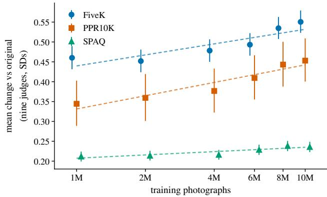  
Figure 3. More training photographs, better edits. Mean change against the unedited original, averaged over the nine judges.

Corpus size. More photographs help. We trained ATune on 1M, 2M, 4M, 6M, 8M and 10M photographs (Fig. 3). Each larger corpus wins or ties, and no judge on any test set prefers a smaller one (Tab. 5a). The gains flatten at the top. We trained one model per size, so we report the trend and fit no scaling law.

The dial. The dial τ is the target quality percentile: τ=0.99 asks for a photograph as good, by LIQE, as the corpus’s 99th-percentile photograph (Sec. 3.3). A higher target gives better edits: at 4M, τ=0.99 beats 0.97 and 0.97 beats

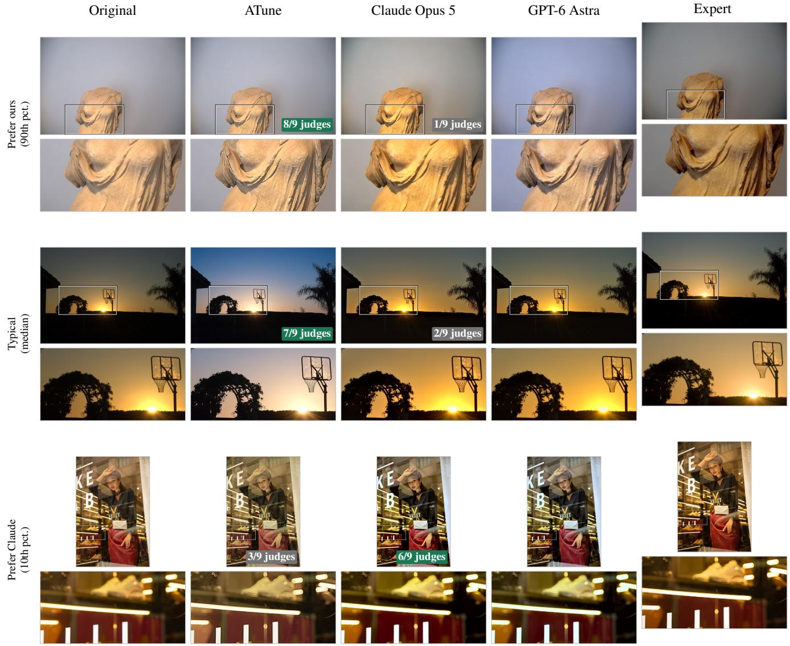  
Figure 2. Three example edits. We score every FiveK and PPR10K photograph by how much the nine judges prefer our edit to Claude’s, and show one photograph the judges clearly give to ours (top), a typical one (middle) and one they clearly give to Claude (bottom). The badge on each edit counts the judges that score it above the other. Below each image: the boxed region enlarged.

0.90 under every test set, and no judge prefers the lower target (Tab. 5b).

## 5. Limitations

Global edits. All 13 attributes are image-wide; faces, skies and other regions cannot be treated separately. Speed. The search renders repeatedly: a median of 42 s per photograph, against 3.3 s for a Claude call. One shot. Each frontier model decided once, without seeing its result, and so did ATune; either could iterate on its own output and do better.

## 6. Conclusion

A large corpus of good photographs is enough to teach a model photo retouching, stated declaratively as targets for 13 measured attributes that a search reaches with an editor’s own sliders. One model drives two editors, every edit is a slider setting a user can read and undo, and a 54M-parameter model trained without a single expert edit matches Claude Opus 5 and beats GPT-6 Astra with human raters. Edit quality appears to be capped not by the number of expert edits but by the quality of the corpus. Future work: a higher-quality corpus, to see how far better photographs alone go, and a network that maps attributes straight to slider values, cutting search time to milliseconds.

## References

[1] Lorenzo Agnolucci, Leonardo Galteri, and Marco Bertini. Quality-aware image-text alignment for opinion-unaware image quality assessment. arXiv preprint arXiv:2403.11176, 2024. 5

[2] Anthropic. Claude Opus 5. Model accessed through the Messages API (claude-opus-5), 2026. 2, 3

[3] Khosro Bahrami and Alex C. Kot. A fast approach for noreference image sharpness assessment based on maximum local variation. IEEE Signal Processing Letters, 21(6):751– 755, 2014. 3

[4] Christopher M. Bishop. Mixture density networks. Technical Report NCRG/94/004, Aston University, 1994. 4

[5] Tim Brooks, Ben Mildenhall, Tianfan Xue, Jiawen Chen, Dillon Sharlet, and Jonathan T. Barron. Unprocessing images for learned raw denoising. In CVPR, 2019. 3

[6] Charles G. Broyden. A class of methods for solving nonlinear simultaneous equations. Mathematics of Computation, 19(92):577–593, 1965. 5, 15

[7] Vladimir Bychkovsky, Sylvain Paris, Eric Chan, and Frédo Durand. Learning photographic global tonal adjustment with a database of input/output image pairs. In CVPR, 2011. 1, 2, 5

[8] Chaofeng Chen, Jiadi Mo, Jingwen Hou, Haoning Wu, Liang Liao, Wenxiu Sun, Qiong Yan, and Weisi Lin. TOPIQ: A top-down approach from semantics to distortions for image quality assessment. IEEE Transactions on Image Processing, 33:2404–2418, 2024. 5

[9] Haoyu Chen, Wenbo Li, Jinjin Gu, Jingjing Ren, Sixiang Chen, Tian Ye, Renjing Pei, Kaiwen Zhou, Fenglong Song, and Lei Zhu. RestoreAgent: Autonomous image restoration agent via multimodal large language models. In NeurIPS, 2024. 3

[10] Yu-Sheng Chen, Yu-Ching Wang, Man-Hsin Kao, and Yung-Yu Chuang. Deep photo enhancer: Unpaired learning for image enhancement from photographs with GANs. In CVPR, 2018. 2

[11] Miguel Colom and Antoni Buades. Analysis and extension of the Ponomarenko et al. method, estimating a noise curve from a single image. Image Processing On Line, 3:173–197, 2013. 3

[12] darktable developers. darktable 3.8.1. https://www. darktable.org, 2022. 2, 5, 6, 16

[13] Yubin Deng, Chen Change Loy, and Xiaoou Tang. Aestheticdriven image enhancement by adversarial learning. In ACM International Conference on Multimedia, pages 870–878, 2018. 3

[14] Rotem Dror, Gili Baumer, Marina Bogomolov, and Roi Reichart. Replicability analysis for natural language processing: Testing significance with multiple datasets. Transactions of the Association for Computational Linguistics, 5: 471–486, 2017. 5

[15] Claude E. Duchon. Lanczos filtering in one and two dimensions. Journal of Applied Meteorology, 18(8):1016–1022, 1979. 3

[16] Niladri Shekhar Dutt, Duygu Ceylan, and Niloy J. Mitra. MonetGPT: Solving puzzles enhances MLLMs’ image retouching skills. ACM Transactions on Graphics (Proc. SIG-GRAPH), 44(4), 2025. 3

[17] Bradley Efron and Robert J. Tibshirani. An Introduction to the Bootstrap. Chapman and Hall/CRC, 1994. 5

[18] Yuming Fang, Hanwei Zhu, Yan Zeng, Kede Ma, and Zhou Wang. Perceptual quality assessment of smartphone photog raphy. In CVPR, 2020. 3, 5, 12

[19] Shiqi Gao, Huiyu Duan, Xinyue Li, Kang Fu, Yicong Peng, Qihang Xu, Yuanyuan Chang, Jia Wang, Xiongkuo Min, and Guangtao Zhai. Quality-guided skin tone enhancement for portrait photography. IEEE Transactions on Multimedia, 27: 171–185, 2025. 3

[20] Michaël Gharbi, Jiawen Chen, Jonathan T. Barron, Samuel W. Hasinoff, and Frédo Durand. Deep bilateral learning for real-time image enhancement. ACM Transactions on Graphics, 36(4), 2017. 2

[21] Chunle Guo, Chongyi Li, Jichang Guo, Chen Change Loy, Junhui Hou, Sam Kwong, and Runmin Cong. Zero-reference deep curve estimation for low-light image enhancement. In CVPR, 2020. 3, 6, 7, 17, 18, 19, 22

[22] David Hasler and Sabine Süsstrunk. Measuring colourful ness in natural images. In Human Vision and Electronic Imaging VIII, Proc. SPIE 5007, pages 87–95, 2003. 3

[23] Jingwen He, Yihao Liu, Yu Qiao, and Chao Dong. Conditional sequential modulation for efficient global image re touching. In ECCV, 2020. 2, 6, 7, 17, 19, 22

[24] Kaiming He, Jian Sun, and Xiaoou Tang. Single image haze removal using dark channel prior. In CVPR, 2009. 3, 13

[25] Paul W. Holland and Roy E. Welsch. Robust regression using iteratively reweighted least-squares. Communications in Statistics – Theory and Methods, 6(9):813–827, 1977. 15

[26] Sture Holm. A simple sequentially rejective multiple test procedure. Scandinavian Journal of Statistics, 6(2):65–70, 1979. 5

[27] Yuanming Hu, Hao He, Chenxi Xu, Baoyuan Wang, and Stephen Lin. Exposure: A white-box photo post-processing framework. ACM Transactions on Graphics, 37(2), 2018. 2

[28] Peter J. Huber. Robust estimation of a location parameter. The Annals ofMathematical Statistics, 35(1):73–101, 1964. 15

[29] John Immerkær. Fast noise variance estimation. Computer Vision and Image Understanding, 64(2):300–302, 1996. 3

[30] Yifan Jiang, Xinyu Gong, Ding Liu, Yu Cheng, Chen Fang, Xiaohui Shen, Jianchao Yang, Pan Zhou, and Zhangyang Wang. EnlightenGAN: Deep light enhancement without paired supervision. IEEE Transactions on Image Processing, 30:2340–2349, 2021. 3, 6, 7, 17, 18, 19, 22

[31] Andrej Karpathy. autoresearch: AI agents running research automatically. https://github.com/karpathy/ autoresearch, 2026. GitHub repository, March 2026. 5, 15

[32] Satoshi Kosugi and Toshihiko Yamasaki. Unpaired image enhancement featuring reinforcement-learning-controlled image editing software. In AAAI Conference on Artificial Intelligence, pages 11296–11303, 2020. 2

[33] Daniël Lakens. Equivalence tests: A practical primer for t tests, correlations, and meta-analyses. Social Psychological and Personality Science, 8(4):355–362, 2017. 19

[34] Kenneth Levenberg. A method for the solution of certain non-linear problems in least squares. Quarterly of Applied Mathematics, 2(2):164–168, 1944. 5, 15

[35] Jie Liang, Hui Zeng, Miaomiao Cui, Xuansong Xie, and Lei Zhang. PPR10K: A large-scale portrait photo retouching dataset with human-region mask and group-level consistency. In CVPR, 2021. 1, 5

[36] Hanhe Lin, Vlad Hosu, and Dietmar Saupe. KADID-10k: A large-scale artificially distorted IQA database. In QoMEX, 2019. 3, 12

[37] Yunlong Lin, Zixu Lin, Kunjie Lin, Jinbin Bai, Panwang Pan, Chenxin Li, Haoyu Chen, Zhongdao Wang, Xinghao Ding, Wenbo Li, and Shuicheng Yan. JarvisArt: Liberating human artistic creativity via an intelligent photo retouching agent. In Advances in Neural Information Processing Systems (NeurIPS), 2025. 3, 5, 18

[38] Xinhao Liu, Masayuki Tanaka, and Masatoshi Okutomi. Single-image noise level estimation for blind denoising. IEEE Transactions on Image Processing, 22(12):5226–5237, 2013. 3

[39] Long Ma, Tengyu Ma, Risheng Liu, Xin Fan, and Zhongxuan Luo. Toward fast, flexible, and robust low-light image enhancement. In CVPR, 2022. 3, 6, 7, 17, 18, 19, 22

[40] Donald W. Marquardt. An algorithm for least-squares estimation of nonlinear parameters. Journal of the Society for Industrial and Applied Mathematics, 11(2):431–441, 1963. 5, 15

[41] Calvin S. McCamy. Correlated color temperature as an explicit function of chromaticity coordinates. Color Research & Application, 17(2):142–144, 1992. 3

[42] Sean Moran, Pierre Marza, Steven McDonagh, Sarah Parisot, and Gregory Slabaugh. DeepLPF: Deep local parametric filters for image enhancement. In CVPR, 2020. 2

[43] Zhangkai Ni, Wenhan Yang, Shiqi Wang, Lin Ma, and Sam Kwong. Towards unsupervised deep image enhancement with generative adversarial network. IEEE Transactions on Image Processing, 29:9140–9151, 2020. 3, 6, 7, 17, 18, 19, 22

[44] OpenAI. GPT-6 Astra. Model accessed through the Responses API (gpt-6-astra), 2026. 2, 3

[45] Art B. Owen. The pigeonhole bootstrap. The Annals of Applied Statistics, 1(2):386–411, 2007. 7, 19

[46] Jongchan Park, Joon-Young Lee, Donggeun Yoo, and In So Kweon. Distort-and-recover: Color enhancement using deep reinforcement learning. In CVPR, 2018. 2

[47] Ethan Perez, Florian Strub, Harm de Vries, Vincent Dumoulin, and Aaron Courville. FiLM: Visual reasoning with a general conditioning layer. In AAAI, 2018. 4

[48] Vsevolod Plohotnuk, Artyom Panshin, Nikola Banic, Si-´ mone Bianco, Michael Freeman, and Egor Ershov. DEAR: Dataset for evaluating the aesthetics of rendering. arXiv preprint arXiv:2512.05209, 2025. 5, 19

[49] RawTherapee developers. RawTherapee 5.8. https:// rawtherapee.com, 2020. 2

[50] Christoph Schuhmann, Romain Beaumont, Richard Vencu, Cade Gordon, Ross Wightman, Mehdi Cherti, Theo Coombes, Aarush Katta, Clayton Mullis, Mitchell Wortsman, et al. LAION-5B: An open large-scale dataset for training next generation image-text models. In NeurIPS Datasets and Benchmarks, 2022. 5

[51] Gaurav Sharma, Wencheng Wu, and Edul N. Dalal. The CIEDE2000 color-difference formula: Implementation notes, supplementary test data, and mathematical observations. Color Research & Application, 30(1):21–30, 2005. 18

[52] Oriane Siméoni, Huy V. Vo, Maximilian Seitzer, et al. DI-NOv3. arXiv preprint arXiv:2508.10104, 2025. 4

[53] Hossein Talebi and Peyman Milanfar. Learned perceptual image enhancement. In IEEE International Conference on Computational Photography (ICCP), 2018. 3

[54] Ethan Tseng, Yuxuan Zhang, Lars Jebe, Xuaner Zhang, Zhihao Xia, Yifei Fan, Felix Heide, and Jiawen Chen. Neural photo-finishing. ACM Transactions on Graphics, 41(6): 238:1–238:15, 2022. 2

[55] Jianyi Wang, Kelvin C. K. Chan, and Chen Change Loy. Exploring CLIP for assessing the look and feel of images. In AAAI, 2023. 5

[56] Xintao Wang, Liangbin Xie, Chao Dong, and Ying Shan. Real-ESRGAN: Training real-world blind super-resolution with pure synthetic data. In ICCV Workshops, 2021. 3, 13

[57] Yili Wang, Xin Li, Kun Xu, Dongliang He, Qi Zhang, Fu Li, and Errui Ding. Neural color operators for sequential image retouching. In ECCV, 2022. 2, 6, 7, 17, 19, 22

[58] Zhou Wang, Alan C. Bovik, Hamid R. Sheikh, and Eero P. Simoncelli. Image quality assessment: From error visibility to structural similarity. IEEE Transactions on Image Processing, 13(4):600–612, 2004. 18

[59] Chenfei Wu, Jiahao Li, Jingren Zhou, Junyang Lin, Kaiyuan Gao, et al. Qwen-Image technical report. arXiv preprint arXiv:2508.02324, 2025. 2

[60] Haoning Wu, Zicheng Zhang, Weixia Zhang, Chaofeng Chen, Liang Liao, Chunyi Li, Yixuan Gao, Annan Wang, Erli Zhang, Wenxiu Sun, Qiong Yan, Xiongkuo Min, Guangtao Zhai, and Weisi Lin. Q-Align: Teaching LMMs for visual scoring via discrete text-defined levels. In ICML, 2024. 5

[61] Canqian Yang, Meiguang Jin, Xu Jia, Yi Xu, and Ying Chen. AdaInt: Learning adaptive intervals for 3D lookup tables on real-time image enhancement. In CVPR, 2022. 2, 6, 7, 17, 19, 22

[62] Zhenqiang Ying, Haoran Niu, Praful Gupta, Dhruv Mahajan, Deepti Ghadiyaram, and Alan Bovik. From patches to pictures (PaQ-2-PiQ): Mapping the perceptual space of picture quality. In CVPR, 2020. 5

[63] Zhiyuan You, Xin Cai, Jinjin Gu, Tianfan Xue, and Chao Dong. Teaching large language models to regress accurate image quality scores using score distribution. In CVPR, 2025. 5

[64] Hui Zeng, Jianrui Cai, Lida Li, Zisheng Cao, and Lei Zhang. Learning image-adaptive 3D lookup tables for high perfor mance photo enhancement in real-time. IEEE TPAMI, 44 (4):2058–2073, 2022. 2, 18

[65] Richard Zhang, Phillip Isola, Alexei A. Efros, Eli Shechtman, and Oliver Wang. The unreasonable effectiveness of deep features as a perceptual metric. In CVPR, 2018. 18

[66] Weixia Zhang, Guangtao Zhai, Ying Wei, Xiaokang Yang, and Kede Ma. Blind image quality assessment via visionlanguage correspondence: A multitask learning perspective. In CVPR, 2023. 4, 5

[67] Kaiwen Zhu, Jinjin Gu, Zhiyuan You, Yu Qiao, and Chao Dong. An intelligent agentic system for complex image restoration problems. In ICLR, 2025. 3

[68] Qingsong Zhu, Jiaming Mai, and Ling Shao. A fast single image haze removal algorithm using color attenuation prior. IEEE Transactions on Image Processing, 24(11):3522–3533, 2015. 13

## Contents

Method   
A Attribute measures . . 12   
Training defects . 13   
C Training ATune . . 14   
D Solver . . 14   
E A second editor: darktable . . 16   
Comparisons   
F The frontier models . . 16   
G Baselines . . 17   
H Test sets . . 18   
Against the expert: all methods. . 18   
Human study   
Human study . . . . 19   
More results   
K Two exploratory analyses . . . 20   
L Training-set size: every judge . . . 20   
M Robustness: judges given the full-size image . . . 20   
N Qualitative examples . . . 20   
Reproducibility   
O Reproducibility, data and impact . . . 21

## A. Attribute measures

The attributes. Each global tool in a photo editor changes one quality of the whole photograph. We went through the global tools of RawTherapee and darktable and wrote down what each one changes. This gives the 13 attributes of Tab. 1 in the main paper:

• Tone. Exposure changes brightness. The contrast tool changes contrast. The shadows and highlights tools change shadow depth and highlight level. Clarity changes local contrast. Dehaze changes haze. The black and white points change clipping at black and at white.

• Colour. Saturation changes colourfulness. White balance changes colour temperature and tint.

• Detail. Sharpening changes sharpness. Noise reduction changes noise.

Local tools, such as masks, crops and retouching, are out of scope.

The tests. Each attribute needs a measure: a function that turns the pixels into a number. A good measure changes when its attribute changes, and stays the same otherwise. We therefore check three things:

• Response. Does the number follow its own attribute? KADID-10k [36] has 81 photographs, each distorted 25 ways at five strengths. Several distortions change one of our attributes, such as brightening, blur, sharpening, added noise and denoising. KADID has no white-balance or haze distortion, so we add our own: temperature and tint shifts, and a haze veil. For each photograph and distortion, we compute Spearman’s ρ between the five strengths and the measure’s five values. We then take the mean ρ over the 81 photographs. Some attributes are changed by more than one distortion; brightness, for example, by brightening, darkening and a mean shift. Response is the lowest |ρ| among them. Higher is better.

Table 6. Candidate measures. Own: response. Others: speci ficity. Bold: the measure kept.
<table><tr><td>Attribute</td><td>Measure</td><td>Own |ρ|</td><td>Others |ρ|</td><td>Stability ρ</td></tr><tr><td rowspan="4">Brightness</td><td>mean grey level</td><td>1.00</td><td>0.28</td><td>1.00</td></tr><tr><td>mean L*</td><td>1.00</td><td>0.43</td><td>1.00</td></tr><tr><td>log key</td><td>1.00</td><td>0.51</td><td>1.00</td></tr><tr><td>median log intensity</td><td>1.00</td><td>0.17</td><td>1.00</td></tr><tr><td rowspan="4">Contrast</td><td>RMS contrast</td><td>0.98</td><td>0.64</td><td>1.00</td></tr><tr><td>Michelson contrast</td><td>1.00</td><td>0.57</td><td>1.00</td></tr><tr><td>global contrast factor (multi-resolution)</td><td>0.98</td><td>0.77</td><td>0.98</td></tr><tr><td>L* interquartile range</td><td>0.95</td><td>0.38</td><td>0.99</td></tr><tr><td rowspan="4">Sharpness</td><td>Laplacian variance</td><td>0.98</td><td>0.58</td><td>0.95</td></tr><tr><td>Tenengrad</td><td>0.99</td><td>0.60</td><td>0.96</td></tr><tr><td>maximum local variation</td><td>0.99</td><td>0.63</td><td>0.97</td></tr><tr><td>CPBD</td><td>0.78</td><td>0.60</td><td>0.94</td></tr><tr><td rowspan="5">Noise</td><td>Immerkær residual, whole image</td><td>0.91</td><td>0.69</td><td>0.87</td></tr><tr><td>wavelet MAD</td><td>0.97</td><td>0.71</td><td>0.81</td></tr><tr><td>weak-texture PCA</td><td>0.99</td><td>0.60</td><td>0.58</td></tr><tr><td>high-pass texture energy</td><td>0.33</td><td>0.70</td><td>0.96</td></tr><tr><td>block residual at two scales</td><td>0.93</td><td>0.59</td><td>0.91</td></tr><tr><td rowspan="4">Colourfulness</td><td>Hasler and Süsstrunk</td><td>0.99</td><td>0.45</td><td>1.00</td></tr><tr><td>mean saturation</td><td>1.00</td><td>0.54</td><td>1.00</td></tr><tr><td>mean chroma</td><td>0.94</td><td>0.51</td><td>1.00</td></tr><tr><td>spread of a*, b*</td><td>0.93</td><td>0.56</td><td>1.00</td></tr><tr><td rowspan="4">Colour temperature, tint</td><td>CCT of the mean colour (temperature)</td><td>0.99</td><td>0.20</td><td>1.00</td></tr><tr><td>mean a* (tint)</td><td>1.00</td><td>0.24</td><td>1.00</td></tr><tr><td>mean b*</td><td>1.00</td><td>0.26</td><td>1.00</td></tr><tr><td>cast magnitude</td><td>0.47</td><td>0.60</td><td>1.00</td></tr><tr><td rowspan="2">Shadow, highlight clipping</td><td>signed clipping at black (shadow)</td><td>1.00</td><td>0.56</td><td>1.00</td></tr><tr><td>signed clipping at white (highlight)</td><td>1.00</td><td>0.59</td><td>0.99</td></tr><tr><td rowspan="2">Shadow depth</td><td>L* at the 5th percentile</td><td>0.99</td><td>0.66</td><td>1.00</td></tr><tr><td>mean L* of the darkest decile</td><td>0.99</td><td>0.70</td><td>1.00</td></tr><tr><td rowspan="2">Highlight level</td><td>L* at the 95th percentile</td><td>0.98</td><td>0.54</td><td>0.99</td></tr><tr><td>mean L* of the brightest decile</td><td>0.99</td><td>0.61</td><td>0.99</td></tr><tr><td rowspan="2">Local contrast</td><td>midtone-weighted unsharp-mask energy</td><td>0.99</td><td>0.47</td><td>0.95</td></tr><tr><td>locally normalised standard deviation</td><td>0.99</td><td>0.52</td><td>0.97</td></tr><tr><td rowspan="2">Haze</td><td>dark channel prior</td><td>1.00</td><td>0.74</td><td>0.99</td></tr><tr><td>colour attenuation prior</td><td>1.00</td><td>0.55</td><td>1.00</td></tr></table>

• Specificity. Does the number ignore the other attributes? This is the mean |ρ| over the other attributes’ distortions. Lower is better.

• Stability. Does the number ignore changes that leave the photograph looking the same? We take 1,000 SPAQ photographs [18] and change each in five ways: resize to 512 or 768 px, save as JPEG at quality 75 or 90, and crop 3%. For each change we measure every photograph before and after, and correlate the two lists (Spearman’s ρ). A ρ near 1 means the change did not reorder the photographs. Stability is the lowest ρ of the five changes. Higher is better.

The choice. Table 6 scores 33 candidates for the eleven attributes that have more than one established measure. Clipping has only one, the share of pixels at black or at white; we use its signed form (Fig. 4). Among candidates with response and stability of at least 0.9, we keep the one that reacts least to the other attributes. This picks every bold row, with two exceptions:

• Sharpness. Averaged over the other attributes, Laplacian variance and Tenengrad react less (0.58 and 0.60, against 0.63). The average hides one attribute, noise: they rise with added noise as much as with sharpening (ρ=+1.00 and +1.00). Maximum local variation reacts to noise with ρ=+0.22, so we kept it.

• Haze. The colour attenuation prior [68] reacts less to the other attributes (0.55, against 0.74), but we kept the dark channel prior [24] because the dehaze tools of both editors use it.

Exposure is not in the table because it is the same as brightness (ρ=1.00). Some measures react to other attributes by design. Clipping moves whenever pixels are pushed to black or white, and shadow depth and highlight level move with contrast.

Signed clipping. Pixel values run from 0 (black) to 255 (white). The obvious way to measure highlight clipping is the share of white pixels. But that share is zero for every photograph with no white pixels, whether its brightest pixels are at 254 or at 150. So it cannot say how close a photograph is to clipping. We fix this with a signed value (Fig. 4):

• Clipped, when at least 0.5% of the pixels are white: the value is positive and rises by one each time the white area doubles.

• Not clipped: the value is negative and falls as the brightest pixels move further below white.

Let s be the share of white pixels (above T=250.5), $m _ { 0 } { = } 0 . 5 \%$ , and q the value of the brightest 0.5% of pixels, so that T−q is how many steps they sit below white. Then

$$
c = \left\{ { \begin{array} { l l l } { \displaystyle \log _ { 2 } \left( { \frac { s } { m _ { 0 } } } \right) } & { { \mathrm { i f ~ } } s \geq m _ { 0 } } & { ( { \mathrm { c l i p p e d } } ) , } \\ { \displaystyle - \log _ { 2 } \left( 1 + { \frac { T - q } { 4 } } \right) } & { { \mathrm { o t h e r w i s e } } } & { ( { \mathrm { n o t ~ c l i p p e d } } ) . } \end{array} } \right.
$$

For example, when the brightest pixels sit 4 steps below white, c=−1. Shadows use the same formula with black in place of white.

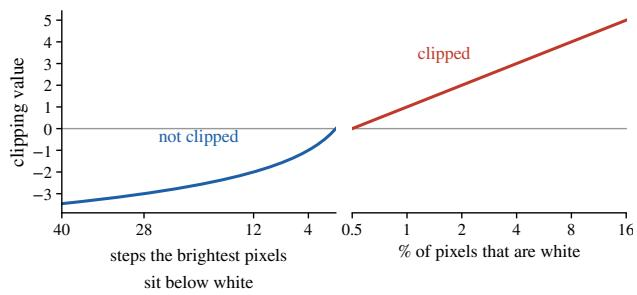  
Figure 4. The highlight clipping value. Left: not clipped, the value falls as the brightest pixels move away from white. Right: clipped, it rises by one each time the white area doubles.

## B. Training defects

Why defects. The corpus holds only finished photographs. To learn how a photograph should change, ATune needs pairs: a worse version and its finished original. We make the worse version by adding defects to the original. The defects should look like real mistakes a camera or a quick edit makes, at a realistic size. We chose defects that an editor tool can reverse, for example a wrong exposure with the exposure slider or noise with noise reduction. The one exception is JPEG compression, which no tool can reverse. The model learns to undo these defects, and an editor can carry out every fix.

Table 7. The training defects at the weakest and strongest strength s a copy can receive. ± and ×/÷: the defect goes either way. σ: standard deviation of the noise. Shot noise varies with brightness, so its σ is given for a mid-grey area.
<table><tr><td>Defect</td><td>Weakest (s=0.3)</td><td>Strongest (s=1.15)</td></tr><tr><td>Tone</td><td></td><td></td></tr><tr><td>Exposure</td><td>±0.6 EV</td><td>±2.2 EV</td></tr><tr><td>Black point</td><td>±5% of range</td><td>±21% of range</td></tr><tr><td>Highlight clipping</td><td>white above 86%</td><td>white above 70%</td></tr><tr><td>Highlight compression</td><td>white at 78%</td><td>white at 14%</td></tr><tr><td>Contrast</td><td>×/÷1.3</td><td>×/÷3.1</td></tr><tr><td>Haze</td><td>16% opacity</td><td>63% opacity</td></tr><tr><td>Local contrast loss</td><td>24%</td><td>92%</td></tr><tr><td>Colour</td><td></td><td></td></tr><tr><td>Temperature</td><td>±12% red/blue gain</td><td>±47% red/blue gain</td></tr><tr><td>Tint</td><td>±7% green gain</td><td>±25% green gain</td></tr><tr><td>Saturation</td><td>×/÷ 1.5 chroma</td><td>×/÷ 4.2 chroma</td></tr><tr><td>Detail</td><td></td><td></td></tr><tr><td>Blur</td><td>σ =0.9 px</td><td>σ =3.4px</td></tr><tr><td>Oversharpening</td><td>amount 0.9</td><td>amount 3.4</td></tr><tr><td>Noise</td><td></td><td></td></tr><tr><td>Luminance noise</td><td>σ=4/255</td><td>σ = 17/255</td></tr><tr><td>Shot noise</td><td>σ=5/255</td><td>σ=9/255</td></tr><tr><td>Chroma noise</td><td>σ = 4 Lab units</td><td>σ = 14 Lab units</td></tr><tr><td>Compression</td><td></td><td></td></tr><tr><td>JPEG</td><td>quality 66</td><td>quality 10</td></tr></table>

## Making a copy.

• Each photograph gets five copies.

• Each copy gets two or three different defects from Tab. 7. They are applied in a fixed order: tone, colour, blur or sharpening, noise, and JPEG. Like Real-ESRGAN [56], we add noise after blur and compress last.

• Each defect gets a strength between 0.3 and a maximum set by the original’s LIQE score: 0.6 below 2.3, 1.0 below 3.85 and 1.15 above. Weaker photographs get milder defects, so they stay recognisable. Where a defect can go either way, such as brighter or darker, the direction is random.

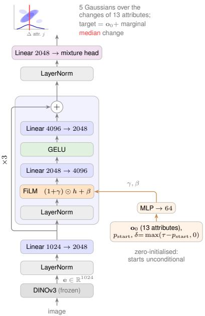  
Figure 5. ATune (Sec. 3.3; 54M parameters): a FiLM-conditioned residual MLP over the frozen DINOv3 embedding. The conditioning carries the photo’s measured attributes o<sub>0</sub>, its quality percentile $p _ { \mathrm { s t a r t } }$ and the requested lift δ; the head emits five fullcovariance Gaussians over the changes of the 13 attributes, and each attribute’s target is its current value plus the median of its marginal change.

• Two safeguards. In a three-defect copy, one defect is capped at 0.85. A copy whose share of clipped pixels rises by more than 40 points is drawn again.

We manually checked copies from this recipe to make sure the defects look reasonable.

## C. Training ATune

Training data. Each training example is one copy (Sec. B), described by:

• its content, as a DINOv3 embedding;

• its 13 attributes, in buckets, with a flag where a value is missing;

• its quality, as a LIQE percentile;

• the lift: how much higher its original’s percentile is.

The target is the change that takes the copy’s attributes to its original’s. One example in five is an untouched original, with lift and change both zero, so the model also learns when to leave a photograph alone.

Why predict the change. If the model predicted the target attributes directly, it could lower its loss by copying the current ones, which it can see. It would learn to leave photographs as they are. Predicting the change removes this shortcut, and the model still sees where the photograph

starts.

## Corpora.

• 1M to 6M. Sampled evenly over Q-Align score bands of width 0.1, from 2 to 5. A band with too few photographs passes the shortfall to the next band up. 41% of the photographs score at least 4.

• 8M. 60% of the photographs score at least 4. Trained for up to 72,000 steps.

• 10M (ATune). 10,000,000 photographs, 68% scoring at least 4. Trained for up to 144,000 steps; we keep step 141,000.

## Optimisation.

• Loss. The negative log-likelihood of the mixture, Eq. (1) of the main paper.

• Optimiser. AdamW with learning rate $3 { \cdot } 1 0 ^ { - 3 }$ and weight decay 0.05. Linear warm-up over the first 10% of steps, then cosine decay to 3·10<sup>−4</sup>.

• Batch. 32,768 examples, 4096 per GPU on 8 H100s. The photographs are measured once; training the 10M model then takes 58 minutes.

• Checkpoint. The one with the lowest validation loss, checked every 1000 steps after the first 20% of training.

Lifts at test time. In training, the lift is the quality gap the defects create: median 0.25, with 99% of lifts below 0.89. At test time with τ=0.99, photographs ask for larger lifts:

<table><tr><td></td><td>FiveK</td><td>PPR10K</td><td>SPAQ</td></tr><tr><td>median lift</td><td>0.63</td><td>0.40</td><td>0.87</td></tr><tr><td>lift above 0.89</td><td>5%</td><td>0%</td><td>47%</td></tr></table>

For lifts above 0.89, the model goes beyond what it saw in training. Even so, a higher τ gives better edits (Sec. 4.5).

Choosing τ. To avoid tuning on the test sets, we took 500 photographs from FiveK’s training split. We edited them with the 4M model at τ set to 0.90, 0.97 and 0.99 and scored the edits with five held-out judges. τ=0.99 gave the highest quality.

## D. Solver

For each attribute, we pick the editor tools a photographer would use to change it (Sec. 3.4). These tools use very different units, such as exposure in stops and a sharpening radius in pixels. So the solver does not set them directly. Instead, each attribute gets a control: one number between −1 and 1. A fixed mapping turns the control into tool settings. Figure 6 shows how attribute, measure, control and tool fit together, and Tab. 8 lists the controls and the tools they set. The solver chooses the control values. It has two aims: bring each attribute close to its goal, and leave no attribute worse than it was.

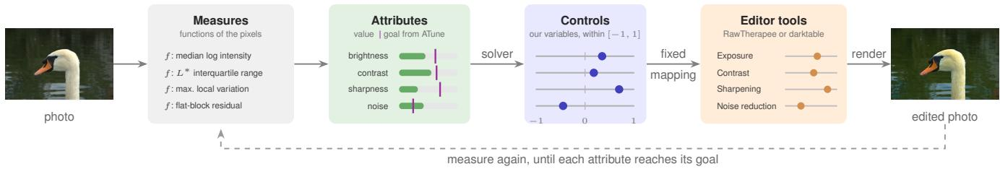  
Figure 6. Attribute, measure, control and tool. An attribute is a quality of the photograph, such as sharpness; its measure is the function that computes it from the pixels (Sec. A). ATune sets a goal for each attribute. Each attribute has one control, our own variable within [−1, 1]; a fixed mapping turns it into settings of the editor’s tools (Tab. 8).

Table 8. Our controls and the editor tools each one sets. Each control is named after the attribute it changes. darktable has a 14th control, used only when the model asks for more noise.
<table><tr><td>Control (attribute)</td><td>RawTherapee 5.8</td><td>darktable 3.8</td></tr><tr><td>temperature, tint</td><td>RGB curves, mid-tone point per channel</td><td>white balance, channel coefficients</td></tr><tr><td>brightness</td><td>exposure: brightness</td><td>exposure</td></tr><tr><td>contrast</td><td>exposure: contrast</td><td>contrast brightness saturation: contrast</td></tr><tr><td>colourfulness</td><td>exposure: saturation</td><td>contrast brightness saturation: saturation</td></tr><tr><td>shadow depth</td><td>shadows &amp; highlights: shadows (lift); tone curve: shadows (deepen)</td><td>shadows and highlights: shadows</td></tr><tr><td>highlight level</td><td>tone curve: highlights</td><td>shadows and highlights: highlights</td></tr><tr><td>shadow clipping</td><td>exposure: black</td><td>exposure: black level correction</td></tr><tr><td>highlight clipping</td><td>tone curve: white point</td><td>shadows and highlights: white point adjustment</td></tr><tr><td>haze</td><td>haze removal: strength</td><td>haze removal: strength</td></tr><tr><td>local contrast</td><td>local contrast, radius 8 px</td><td>local contrast: detail</td></tr><tr><td>sharpness</td><td>sharpening (unsharp mask, radius 0.5 px)</td><td>sharpen (radius 2 px)</td></tr><tr><td>noise (lower)</td><td>noise reduction: luminance</td><td>denoise (non-local means): luma</td></tr><tr><td>noise (raise)</td><td></td><td>sharpen, low threshold (radius 1 px)</td></tr></table>

Objective. For attribute $i , r _ { i }$ is its value after the edit minus its goal, in buckets. $r _ { i } ^ { 0 }$ is the same before the edit. The solver minimises

$$
\begin{array} { l } { { \displaystyle { \cal L } = \sum _ { i } w _ { i } h \big ( \operatorname* { m a x } ( | r _ { i } | - b , 0 ) \big ) } } \\ { { \displaystyle ~ + ~ 4 \sum _ { i } \operatorname* { m a x } \big ( | r _ { i } | - \operatorname* { m a x } ( | r _ { i } ^ { 0 } | , 2 + s _ { i } ) , 0 \big ) ^ { 2 } } . } \end{array}
$$

• First term: reach the goal. b is a tolerance: an attribute within b buckets of its goal counts as on target and costs nothing. h is the Huber loss [28] (knee at 1.5), so the cost grows only linearly far from the goal and an unreachable goal cannot dominate. Each attribute’s term has a weight $w _ { i }$

• Second term: do no harm. It penalises an attribute that ends further from its goal than it started. An attribute may still move within the success tolerance of 2 buckets, adjusted by a slack $s _ { i }$

Search. The solver adjusts all controls together. At each step it renders the photograph, measures the 13 attributes and moves the controls to lower L. The step is a Levenberg– Marquardt step [34, 40] within the controls’ bounds, with the Huber loss handled by iteratively reweighted least squares [25]. How each control moves each attribute (the Jacobian) is estimated by finite differences and then updated cheaply with Broyden’s method [6]. The search stops after at most 50 renders on the 1024 px frame. The final controls are then applied at full resolution; the result is measured again and corrected at most twice.

Calibrating the controls. Each editor needs a mapping from our controls to its tools: which tools a control sets, how strongly per unit, and the solver’s $b , w _ { i }$ and $s _ { i } .$ One file per editor holds this mapping. An LLM coding agent edits it in a keep-if-better loop, following autoresearch [31]: it proposes one change at a time, and a fixed program scores it. A candidate mapping is scored by one number: the share of the model’s goals that the solver reaches within 2 buckets. A change to the mapping is kept only if it raises the score. The calibrated solver settings are:

• RawTherapee. b=0.2; weight 1 and slack 0 for every attribute.

• darktable. b=0.2; weight 0.3 for highlight clipping, 1.4 for sharpness and 1 for the rest; slack −0.5 for highlight level, haze, highlight clipping and local contrast, and 0 for the rest.

Highlights (0 to 100)

- White balance: Red, Green, Blue channel   
coefficients (0 to 8 each, currently 1)   
- Exposure: Exposure (−3 to 4 EV), Black level   
correction (−0.1 to 0.1)   
- Contrast brightness saturation: Contrast (−1   
to 1), Saturation (−1 to 1)   
- Shadows and highlights: Shadows (−100 to 100),   
Highlights (−100 to 100), White point adjustment   
(−10 to 10)   
- Sharpen: Amount (0 to 2)   
- Local contrast: Detail (0% to 500%)   
- Haze removal: Strength (−1 to 1)   
- Denoise (non-local means): Luma (0% to 100%)

Retouch this image as best as possible using   
these RawTherapee 5.8 sliders:

Result. On 953 held-out photographs, the solver reaches 82.8% of the goals on RawTherapee and 77.3% on darktable.

## E. A second editor: darktable

Mapping. To show that ATune is not tied to one editor, we also run it through darktable 3.8 [12]. ATune itself is unchanged; we only write a new mapping from our controls to darktable’s modules (Tab. 8):

• Shared modules. Temperature and tint both set the white-balance module. Contrast and colourfulness both set the contrast-brightness-saturation module.

• Extra control. When the model asks for more noise, a 14th control applies a low-threshold sharpen, which strengthens the photograph’s own fine noise.

• Strength. In RawTherapee, a tool’s setting is mostly the control value times a constant. darktable’s modules do not respond that evenly, so each control maps to a module setting through a few fixed points joined by straight lines. For haze, control values 0, 0.2, 0.4, 0.7 and 1 set the dehaze strength to 0, 0.31, 0.54, 0.82 and 1. The points are calibrated by the same autoresearch loop as RawTherapee’s mapping (Sec. D).

• Defaults. Every other module stays at its default, with automatic sharpening off. We render with darktable-cli.

Nine judges on three test sets give 27 results. On darktable, ATune’s edits significantly improve the photograph in 26 of them and worsen it in none (Tab. 9). At least five of the nine judges prefer them to Claude Opus 5’s and GPT-6 Astra’s on every test set, and at most two prefer theirs (Tab. 10). Against ATune’s own RawTherapee edits, the judges split 1 / 6 / 2 on FiveK, 0 / 4 / 5 on PPR10K and 2 / 4 / 3 on SPAQ (darktable / neither / RawTherapee; first row of Tab. 10), so RawTherapee remains our main editor.

## F. The frontier models

We compare ATune with two frontier vision-language models, Claude Opus 5 and GPT-6 Astra. Each model looks at the photograph and sets the editor’s sliders itself, in one answer. Table 11 compares ATune with Claude judge by judge.

Prompt. Each model gets the photograph (the 1024 px frame, as a lossless PNG), then this text:

RawTherapee (after the image).

\- White Balance: Temperature (1500 to 60000 K, currently 6504 K), Tint (0.02 to 10, currently 1) - Exposure: Compensation (−5 to 12 EV), Contrast (−100 to 100), Saturation (−100 to 100), Black (−16384 to 32768), Highlight compression (0 to 500)

- Sharpening: Amount (1 to 1000)

\- Local Contrast: Amount (0 to 1)

\- Haze Removal: Strength (0 to 100)

\- Noise Reduction: Luminance (0 to 100)

```json
Reply with a JSON object with these 13
keys: {"temperature": <number>, "tint":
<number>, "exposure_compensation": <number>,
"contrast": <number>, "saturation": <number>,
"black": <number>, "highlight_compression":
<number>, "shadows": <number>,
"highlights": <number>, "sharpening_amount":
<number>, "local_contrast_amount":
<number>, "dehaze_strength": <number>,
"denoise_luminance": <number>}
```

## darktable (after the image).

Retouch this image as best as possible using   
these darktable 3.8 sliders:

Reply with a JSON object with these 14 keys: {"wb\_red": <number>, "wb\_green": <number>, "wb\_blue": <number>, "exposure": <number>, "black\_level": <number>, "contrast": <number>, "saturation": <number>, "shadows": <number>, "highlights": <number>, "white\_point": <number>, "sharpen\_amount": <number>, "local\_contrast\_detail\_percent": <number>, "haze\_strength": <number>, "denoise\_luma\_percent": <number>}

## Settings.

Table 9. ATune on both editors, every judge against the unedited original (mean per-photograph change, as in Tab. 2).
<table><tr><td></td><td colspan="4">Used in training</td><td colspan="4">Held out</td><td></td></tr><tr><td>Method</td><td>Q-Align</td><td>Q-AlignA</td><td>LIQE</td><td>PaQ-2-PiQ</td><td>TOPIQ×</td><td>LAION</td><td>CLIP-IQA×</td><td>QualiCLIP×</td><td>DeQA</td></tr><tr><td>FiveK</td><td></td><td></td><td></td><td></td><td></td><td></td><td></td><td></td><td></td></tr><tr><td>ATune on RawTherapee</td><td>+0.207</td><td>+0.225</td><td>+0.71</td><td>+2.03</td><td>+1.99</td><td>+0.210</td><td>+10.48</td><td>+4.36</td><td>+0.102</td></tr><tr><td>ATune on darktable</td><td>+0.207</td><td>+0.237</td><td>+0.60</td><td>+2.06</td><td>+1.98</td><td>+0.205</td><td>+9.17</td><td>+5.78</td><td>+0.102</td></tr><tr><td>PPR10K</td><td></td><td></td><td></td><td></td><td></td><td></td><td></td><td></td><td></td></tr><tr><td>ATune on RawTherapee</td><td>+0.155</td><td>+0.148</td><td>+0.35</td><td>+1.22</td><td>+1.59</td><td>+0.124</td><td>+10.00</td><td>+2.68</td><td>+0.072</td></tr><tr><td>ATune on darktable</td><td>+0.103</td><td>+0.138</td><td>+0.22</td><td>+1.16</td><td>+1.59</td><td>+0.113</td><td>+6.50</td><td>+1.59</td><td>-0.018</td></tr><tr><td>SPAQ</td><td></td><td></td><td></td><td></td><td></td><td></td><td></td><td></td><td></td></tr><tr><td>ATune on RawTherapee</td><td>+0.125</td><td>+0.153</td><td>+0.39</td><td>+3.80</td><td>+1.88</td><td>+0.158</td><td>+5.46</td><td>+0.12</td><td>+0.132</td></tr><tr><td>ATune on darktable</td><td>+0.116</td><td>+0.179</td><td>+0.35</td><td>+3.78</td><td>+1.77</td><td>+0.162</td><td>+3.96</td><td>+1.94</td><td>+0.107</td></tr></table>

Table 10. ATune on darktable against each method, as in Tab. 3; the first row compares the two editors.
<table><tr><td></td><td colspan="2">FiveK</td><td colspan="2">PPR10K</td><td colspan="2">SPAQ</td></tr><tr><td>ATune on darktable vs</td><td>all 9</td><td>held out</td><td>all 9</td><td>held out</td><td>all 9</td><td>held out</td></tr><tr><td>ATune on RawTherapee</td><td>1/6/2</td><td>1/4/1</td><td>0/4/5</td><td>0/3/3</td><td>2/4/3</td><td>1/3/2</td></tr><tr><td>Claude Opus 5, same editor</td><td>5T272</td><td>3/1/2</td><td>7T270</td><td>4/2/0</td><td>8/170</td><td>5/1/0</td></tr><tr><td>GPT-6 Astra, same editor</td><td>8/1/0</td><td>5/1/0</td><td>7/2/0</td><td>4/2/0</td><td>9/0/0</td><td>6/0/0</td></tr><tr><td>CSRNet [23]‡</td><td>7/0/2</td><td>4/0/2</td><td>8/071</td><td>5/0/1</td><td>8/170</td><td>5/1/0</td></tr><tr><td>AdaInt [61]†</td><td>7/1/1</td><td>4/1/1</td><td>7/1/1</td><td>5/0/1</td><td>7/2/0</td><td>4/2/0</td></tr><tr><td>NeurOP [57]†</td><td>8/0/1</td><td>5/0/1</td><td>8/0/1</td><td>5/0/1</td><td>7/2/0</td><td>4/2/0</td></tr><tr><td>UEGAN [43]</td><td>8/1/0</td><td>5/1/0</td><td>7/1/1</td><td>4/1/1</td><td>8/1/0</td><td>5/1/0</td></tr><tr><td>EnlightenGAN [30]</td><td>7/2/0</td><td>4/2/0</td><td>8/0/1</td><td>5/0/1</td><td>9/0/0</td><td>6/0/0</td></tr><tr><td>Zero-DCE [21]</td><td>7/2/0</td><td>4/2/0</td><td>7/2/0</td><td>4/2/0</td><td>8/0/1</td><td>5/0/1</td></tr><tr><td>SCI [39]</td><td>9/0/0</td><td>6/0/0</td><td>9/0/0</td><td>6/0/0</td><td>9/0/0</td><td>6/0/0</td></tr></table>

Table 11. ATune vs Claude Opus 5, judge by judge, paired per photograph. Diff.: mean score of ATune’s edit minus Claude’s, in each judge’s own units (×100 where marked). Green/red: significant in ATune’s/Claude’s favour after Holm’s correction over the nine judges; grey: not significant. W: share of photographs where ATune’s edit scores higher. Last row: the counts of Tab. 3.
<table><tr><td></td><td colspan="2">FiveK</td><td colspan="2">PPR10K</td><td colspan="2">SPAQ</td></tr><tr><td>Judge</td><td>Diff.</td><td>W%</td><td>Diff.</td><td>W%</td><td>Diff.</td><td>W %</td></tr><tr><td>Q-Align</td><td>+0.007</td><td>51</td><td>+0.025</td><td>55</td><td>+0.062</td><td>59</td></tr><tr><td>Q-AlignA</td><td>+0.086</td><td>69</td><td>0.000</td><td>50</td><td>+0.060</td><td>63</td></tr><tr><td>LIQE</td><td>+0.22</td><td>69</td><td>0.00</td><td>50</td><td>+0.17</td><td>62</td></tr><tr><td>PaQ-2-PiQ</td><td>-0.24</td><td>43</td><td>-0.21</td><td>42</td><td>+0.04</td><td>47</td></tr><tr><td>TOPIQ ×100</td><td>-0.26</td><td>41</td><td>+0.13</td><td>51</td><td>-0.17</td><td>42</td></tr><tr><td>LAION</td><td>-0.001</td><td>50</td><td>+0.064</td><td>65</td><td>-0.007</td><td>47</td></tr><tr><td>CLIP-IQA ×100</td><td>+9.44</td><td>89</td><td>+2.26</td><td>66</td><td>+3.28</td><td>70</td></tr><tr><td>QualiCLIP × 100</td><td>+1.77</td><td>65</td><td>+1.89</td><td>71</td><td>+1.77</td><td>61</td></tr><tr><td>DeQA</td><td>0.000</td><td>55</td><td>+0.027</td><td>59</td><td>+0.063</td><td>62</td></tr><tr><td>Judges for ATune / neither / Claude</td><td>4/3/2</td><td></td><td>3/5/1</td><td></td><td>6/3/0</td><td></td></tr></table>

• One call per photograph and editor. No system message.

• Claude Opus 5: adaptive thinking at effort max. GPT-6 Astra: reasoning effort high.

• At most 16,000 output tokens, returned as JSON with one key per slider.

• The slider values are written unchanged into the editor’s own settings file.

Prompt design. The prompt states the task and nothing more:

• The editor’s own sliders. It lists 13 of RawTherapee’s sliders (14 of darktable’s), named and ranged as in the editor. The answer goes into the editor unchanged, with no mapping of ours.

• The current white balance. Without it, both models took a lower temperature as neutral and turned the photographs blue in a 5-photograph pilot.

• No extras. No role, hint, example value, dataset, judge or style.

Answers. Claude returned a valid answer for 1,881 of 1,881 photographs (median 3.3 s per call). GPT-6 Astra returned 1,879 (median 14.6 s); its content filter refused 2 photographs, which count as unedited. Table 12 shows the spread of Claude’s answers.

## G. Baselines

We compare with seven learned retouchers, all run with the authors’ code and released weights:

• Trained on expert edits: CSRNet [23], AdaInt [61] and NeurOP [57], with FiveK weights. On PPR10K, AdaInt and NeurOP use the authors’ PPR10K weights.

Table 12. Claude Opus 5’s answers over all test photographs: median and 10th–90th percentiles per slider.
<table><tr><td>Slider</td><td>median</td><td>p10</td><td>p90</td></tr><tr><td>temperature</td><td>6100</td><td>5600</td><td>6900</td></tr><tr><td>tint</td><td>1.02</td><td>1.00</td><td>1.02</td></tr><tr><td>exposure_compensation</td><td>0.25</td><td>-0.15</td><td>0.65</td></tr><tr><td>contrast</td><td>14.00</td><td>12.00</td><td>22.00</td></tr><tr><td>saturation</td><td>10.00</td><td>6.00</td><td>18.00</td></tr><tr><td>black</td><td>180</td><td>-600</td><td>450</td></tr><tr><td>highlight_compression</td><td>35</td><td>25</td><td>60</td></tr><tr><td>shadows</td><td>28.00</td><td>20.00</td><td>55.00</td></tr><tr><td>highlights</td><td>30.00</td><td>25.00</td><td>45.00</td></tr><tr><td>sharpening_amount</td><td>220</td><td>200</td><td>420</td></tr><tr><td>local_contrast_amount</td><td>0.25</td><td>0.18</td><td>0.35</td></tr><tr><td>dehaze_strength</td><td>25.00</td><td>12.00</td><td>45.00</td></tr><tr><td>denoise_luminance</td><td>25.00</td><td>15.00</td><td>40.00</td></tr></table>

• Trained without paired edits: UEGAN [43], Enlighten-GAN [30], Zero-DCE [21] and SCI [39].

We leave out the image-adaptive 3D LUT [64]: run with current versions of PyTorch, its released weights produce corrupted images.

Input size. Our test photographs are at full resolution, but most baselines were trained on much smaller images, and some work poorly on large ones. So we run each method in two ways and keep the better one:

• Native. The method edits the full photograph.

• Small copy. The method edits a copy at its training size, and we carry the edit over to the full photograph. For AdaInt, CSRNet and NeurOP the edit is a per-pixel colour mapping, so it carries over exactly. Zero-DCE and SCI predict curve or illumination maps, which we upsample, as Zero-DCE++ does. For the GANs we upsample the change they made.

The better way is the one with the higher score, averaged over the three test sets and the five held-out pyiqa judges. We fixed this rule before scoring any baseline. CSRNet, UEGAN, EnlightenGAN and SCI run native; AdaInt, NeurOP and Zero-DCE run on a small copy.

PPR10K reference. We edit the PPR10K photographs at 1024 px, but PPR10K’s own expert edits are only 360 px. MMArt [37] is the only release with PPR10K expert edits at 1024 px, so we use it as the reference.

## H. Test sets

We test on three public sets (Sec. 4). FiveK and PPR10K have expert edits to compare against; SPAQ has phone photographs with no reference edit.

• FiveK. The 500 photographs of the standard test split, as converted from the raw files by a public copy of FiveK on Hugging Face. One of them (a4949) is corrupt in that copy, which leaves 499. For three photographs the expert’s edit is cropped or resized differently from the original, so we leave them out of comparisons with the expert.

• PPR10K. The 382 portraits of the official validation groups that MMArt [37] released (groups 1520–1680, from 148 photo sessions). Photographs from one session look alike, so the bootstrap resamples whole sessions.

• SPAQ. A fixed list of 1000 phone photographs. We rotate the 202 photographs stored sideways and convert the 30 wide-gamut files to sRGB.

Test photographs in training. None of the three sets is used to train ATune. AdaInt and NeurOP train on FiveK photographs a0001–a4500 and on PPR10K’s training groups; we checked that neither contains a test photograph. CSRNet’s authors split FiveK at random, so its released weights were trained on 450 of our 499 FiveK test photographs; the main paper marks it with <sup>‡</sup>. SPAQ test photographs were used to test the attribute measures (Sec. A), but not to train anything.

## I. Against the expert: all methods

A judge can reward an edit that looks nothing like what an expert would do. So we also compare every edit with the expert’s own edit of the same photograph, in two ways (Tab. 13):

• Pixel distance. How far each edit is from the expert’s, by PSNR, SSIM, LPIPS and CIEDE2000 [51, 58, 65]. On FiveK, ATune’s edits are about as far from expert C as the original is (PSNR 18.45 → 18.68 dB, CIEDE2000 10.72 → 10.79). LPIPS rises (0.135 → 0.164) because ATune sharpens and the expert did not. The frontier models come a little closer, and NeurOP closest (20.43 dB), as expected: it was trained to copy expert C. On PPR10K, every method ends further from the retoucher’s pixels than the original. The retoucher’s work is local, and global sliders cannot reproduce it.

• Judge scores. A judge scores both the edit and the expert’s edit; we report the difference. A positive number means the judge rates the edit above the expert’s. On FiveK, the original scores 0.091 below expert C under Q-Align, and ATune’s edits score 0.078 above it. On PPR10K, ATune scores 0.129 above the retoucher (GPT-6 Astra 0.082). ATune is not alone here: both frontier models and three baselines also score above the expert under Q-Align.

A judge’s preference and an expert’s choice are different targets, so we report both.

Table 13. Against the expert (FiveK expert C, n=496; PPR10K retoucher, n=382). Judges: median score change, edit minus expert. Bold: best; first row: the original.
<table><tr><td></td><td colspan="6">FiveK, vs expert C</td><td colspan="6">PPR10K, vs retoucher</td></tr><tr><td>Method</td><td>Q-Align</td><td>LIQE</td><td>PSNR↑</td><td>SSIM↑</td><td>LPIPS↓</td><td> $\Delta E _ { 0 0 } \downarrow$ </td><td>Q-Align</td><td>LIQE</td><td>PSNR↑</td><td>SSIM↑</td><td>LPIPS↓</td><td> $\Delta E _ { 0 0 } \downarrow$ </td></tr><tr><td>Unedited original</td><td>-0.091</td><td>-0.18</td><td>18.45</td><td>0.730</td><td>0.135</td><td>10.72</td><td>+0.004</td><td>+0.01</td><td>20.73</td><td>0.932</td><td>0.101</td><td>7.97</td></tr><tr><td>ATune (10M, τ=0.99)</td><td>+0.078</td><td>+0.43</td><td>18.68</td><td>0.709</td><td>0.164</td><td>10.79</td><td>+0.129</td><td>+0.34</td><td>19.50</td><td>0.926</td><td>0.126</td><td>9.64</td></tr><tr><td>Claude Opus 5, same editor</td><td>+0.074</td><td>+0.24</td><td>18.77</td><td>0.737</td><td>0.132</td><td>10.40</td><td>+0.104</td><td>+0.31</td><td>18.44</td><td>0.896</td><td>0.112</td><td>10.35</td></tr><tr><td>GPT-6 Astra, same editor</td><td>+0.031</td><td>+0.13</td><td>19.41</td><td>0.746</td><td>0.123</td><td>9.92</td><td>+0.082</td><td>+0.23</td><td>18.25</td><td>0.914</td><td>0.124</td><td>11.09</td></tr><tr><td>CSRNet [23]‡</td><td>-0.199</td><td>-0.52</td><td>15.80</td><td>0.719</td><td>0.173</td><td>15.40</td><td>-0.415</td><td>-0.58</td><td>15.50</td><td>0.878</td><td>0.243</td><td>16.35</td></tr><tr><td>AdaInt [61]†</td><td>+0.023</td><td>+0.04</td><td>19.74</td><td>0.766</td><td>0.093</td><td>9.18</td><td>+0.082</td><td>+0.11</td><td>17.31</td><td>0.907</td><td>0.152</td><td>11.68</td></tr><tr><td>NeurOP [57]†</td><td>+0.027</td><td>+0.02</td><td>20.43</td><td>0.768</td><td>0.089</td><td>8.77</td><td>+0.055</td><td>+0.12</td><td>18.11</td><td>0.911</td><td>0.143</td><td>10.72</td></tr><tr><td>UEGAN [43]</td><td>+0.028</td><td>+0.04</td><td>19.02</td><td>0.744</td><td>0.107</td><td>10.14</td><td>+0.039</td><td>+0.02</td><td>19.97</td><td>0.899</td><td>0.112</td><td>9.04</td></tr><tr><td>EnlightenGAN [30]</td><td>-0.407</td><td>-0.61</td><td>11.25</td><td>0.605</td><td>0.203</td><td>23.07</td><td>-0.224</td><td>-0.22</td><td>15.10</td><td>0.853</td><td>0.176</td><td>14.64</td></tr><tr><td>Zero-DCE [21]</td><td>-0.428</td><td>-0.25</td><td>13.14</td><td>0.646</td><td>0.186</td><td>18.63</td><td>-0.176 -1.745</td><td>+0.01 -0.93</td><td>15.86 9.92</td><td>0.861 0.661</td><td>0.192</td><td>14.92</td></tr><tr><td>SCI [39]</td><td>-1.282</td><td>-1.00</td><td>7.52</td><td>0.518</td><td>0.386</td><td>31.97</td><td></td><td></td><td></td><td></td><td>0.431</td><td>22.58</td></tr></table>

## J. Human study

Setup. In each trial, a rater saw two edits of the same photograph side by side, in random order: one by ATune and one by another method. The rater answered “Which image is better?” with Image 1, Image 2 or About the same. We compared ATune with three methods: Claude Opus 5, GPT-6 Astra, and the stronger supervised retoucher on each set, which we chose in advance by Q-Align (NeurOP on FiveK and AdaInt on PPR10K). The photographs were drawn at random from each test set, and every pair was rated by at least five people. The images were JPEGs at quality 95, 2048 px on the long side, except PPR10K’s, which kept their own 1024 px.

Raters. The raters came from a commercial crowdsourcing platform that admits only experienced contributors, and were paid US\$15 for a session of 60 pairs. Each agreed to the platform’s consent notice first, and we replaced their account identifiers with random numbers before analysis. The platform marked 73 answers as invalid; without them, 9,253 votes from 157 raters remain. No IRB reviewed the study, because it collected only preferences between photographs from public research datasets and no personal information, and we judged it to pose minimal risk.

Analysis. For each comparison we report the share of votes that went to ATune, leaving out the About the same answers. Counting those as half a vote for each side instead would change no share by more than 0.8 points. Confidence intervals come from a bootstrap that resamples both raters and photographs [45]. Against Claude, ATune’s share over all three sets has a 95% CI of 46.8–54.2%, close to 50%, so we treat the two as equally preferred [33]. The comparisons with GPT-6 Astra and the supervised retouchers are corrected for multiple testing with Holm’s method. Table 14 gives every result.

Table 14. All human-study results. ATune: its share of votes, ties left out. Ties as $\textstyle { \frac { 1 } { 2 } } :$ the same share with each tie split evenly. p: p-value for ATune’s share differing from 50%, before Holm’s correction. <sup>†</sup>NeurOP on FiveK, AdaInt on PPR10K.
<table><tr><td>ATune vs</td><td>Set</td><td>Answers</td><td>Ties (%)</td><td>ATune (%), 95% CI Ties as</td><td>1 (%)</td><td>p</td></tr><tr><td>Claude Opus 5</td><td>FiveK</td><td>1,345</td><td>8.3</td><td>44.2 (38.4–49.8)</td><td>44.7</td><td>0.044</td></tr><tr><td></td><td>PPR10K</td><td>861</td><td>7.4</td><td>56.1 (49.3–62.8)</td><td>55.6</td><td>0.078</td></tr><tr><td></td><td>SPAQ</td><td>1,325</td><td>17.1</td><td>51.2 (45.3–57.1)</td><td>51.0</td><td>0.687</td></tr><tr><td></td><td>pooled</td><td>3,531</td><td>11.4</td><td>50.5 (46.8–54.2)</td><td>50.4</td><td>0.791</td></tr><tr><td>GPT-6 Astra</td><td>FiveK</td><td>1,333</td><td>7.0</td><td>54.0 (48.1–59.7)</td><td>53.7</td><td>0.186</td></tr><tr><td></td><td>PPR10K</td><td>864</td><td>8.8</td><td>54.1 (47.0–61.3)</td><td>53.7</td><td>0.272</td></tr><tr><td></td><td>SPAQ</td><td>1,327</td><td>15.5</td><td>55.0 (48.9–60.7)</td><td>54.2</td><td>0.112</td></tr><tr><td></td><td>pooled</td><td>3,524</td><td>10.6</td><td>54.3 (50.3–58.3)</td><td>53.9</td><td>0.031</td></tr><tr><td>NeurOP/AdaInt†</td><td>FiveK</td><td>1,338</td><td>7.1</td><td>47.2 (41.5–53.0)</td><td>47.4</td><td>0.347</td></tr><tr><td></td><td>PPR10K</td><td>860</td><td>4.3</td><td>45.3 (38.3–52.6)</td><td>45.5</td><td>0.205</td></tr><tr><td></td><td>pooled</td><td>2,198</td><td>6.0</td><td>46.3 (41.5–51.2)</td><td>46.5</td><td>0.137</td></tr></table>

Judges and raters. We also checked how often each judge agrees with people, following DEAR [48]. A judge agrees on a pair when it gives the higher score to the edit most raters chose. For comparison, we measure how often a single rater agrees with the majority of the other raters (Tab. 15).

Sharpening. ATune’s edits are often sharper than the other method’s, so we looked at whether this sways raters and judges differently. We split the pairs into thirds by how much sharper ATune’s edit is and compare the two in each third (Tab. 16). We chose this analysis after seeing the votes.

Limitations. The study ran on an external platform, so we could not control viewing conditions, and the platform has no attention checks; it screens raters by experience instead.

Table 15. How often each judge picks the raters’ choice (% of pairs). Last row: one rater against the others.
<table><tr><td>Judge</td><td></td><td>vs Claude vs GPT-6</td><td>vs NeurOP / AdaInt</td><td>All (95% CI)</td></tr><tr><td>Q-Align</td><td>63.6</td><td>63.6</td><td>65.2</td><td>64.0 (61.5–66.4)</td></tr><tr><td>Q-AlignA</td><td>54.7</td><td>60.3</td><td>53.2</td><td>56.5 (53.9–59.0)</td></tr><tr><td>LIQE</td><td>57.6</td><td>64.1</td><td>51.6</td><td>58.6 (55.9–61.3)</td></tr><tr><td>PaQ-2-PiQ</td><td>51.9</td><td>56.1</td><td>50.1</td><td>53.1 (50.5–55.6)</td></tr><tr><td>TOPIQ</td><td>56.2</td><td>59.5</td><td>55.7</td><td>57.3 (54.7–59.8)</td></tr><tr><td>LAION</td><td>55.9</td><td>53.7</td><td>52.1</td><td>54.1 (51.4–56.8)</td></tr><tr><td>CLIP-IQA</td><td>51.1</td><td>58.1</td><td>49.6</td><td>53.4 (50.7–56.1)</td></tr><tr><td>QualiCLIP</td><td>59.8</td><td>62.7</td><td>51.3</td><td>58.9 (56.3–61.4)</td></tr><tr><td>DeQA</td><td>59.9</td><td>61.8</td><td>65.3</td><td>61.9 (59.4–64.5)</td></tr><tr><td>Vote of the nine judges</td><td>61.6</td><td>64.5</td><td>55.7</td><td>61.3 (58.7–63.8)</td></tr><tr><td>One rater vs the others&#x27; majority</td><td></td><td></td><td></td><td>67.3 (64.7–69.8)</td></tr></table>

Table 16. Raters and judges, by how much sharper ATune’s edit is. Pairs split into thirds by the sharpness difference, ATune minus the other method, within each set. Raters: ATune’s share of votes, ties left out, with 95% CI. Judges: share of pairs on which more of the nine judges favour ATune.
<table><tr><td>ATune vs</td><td>Third (n pairs)</td><td>Median ∆</td><td>Raters (%), 95% CI</td><td>Judges (% pairs)</td></tr><tr><td>Claude Opus 5</td><td>least (234)</td><td>-0.12</td><td>49.0 (43.0–55.0)</td><td>39.3</td></tr><tr><td></td><td>middle (232)</td><td>+0.28</td><td>54.7 (48.6–60.9)</td><td>75.0</td></tr><tr><td></td><td>most (234)</td><td>+0.74</td><td>45.4 (39.1–51.8)</td><td>76.5</td></tr><tr><td>GPT-6 Astra</td><td>least (234)</td><td>+0.06</td><td>52.0 (45.7–58.2)</td><td>56.0</td></tr><tr><td></td><td>middle (232)</td><td>+0.45</td><td>58.5 (52.2–64.6)</td><td>86.2</td></tr><tr><td></td><td>most (234)</td><td>+0.94</td><td>52.5 (46.0–58.9)</td><td>84.2</td></tr><tr><td>NeurOP/AdaInt†</td><td>least (146)</td><td>+0.12</td><td>39.8 (32.7–47.2)</td><td>60.3</td></tr><tr><td></td><td>middle (145)</td><td>+0.44</td><td>50.0 (42.3–57.5)</td><td>86.2</td></tr><tr><td></td><td>most (146)</td><td>+0.72</td><td>49.8 (42.0–57.7)</td><td>91.8</td></tr></table>

Table 17. ATune vs the frontier models, by how good the original is. Each test set is split into thirds by the original’s Q-Align score. Each cell: judges significantly preferring ATune / neither / the other model.
<table><tr><td>Set</td><td>Third of originals (n)</td><td>vs Claude Opus 5</td><td>vs GPT-6 Astra</td></tr><tr><td>FiveK</td><td>weakest (163)</td><td>4/4/1</td><td>9/0/0</td></tr><tr><td></td><td>middle (169)</td><td>4/5/0</td><td>8/1/0</td></tr><tr><td></td><td>strongest (167)</td><td>2/6/1</td><td>6/3/0</td></tr><tr><td>PPR10K</td><td>weakest (126)</td><td>6/3/0</td><td>8/1/0</td></tr><tr><td></td><td>middle (123)</td><td>4/4/1</td><td>7/2/0</td></tr><tr><td></td><td>strongest (133)</td><td>1/7/1</td><td>4/4/1</td></tr><tr><td>SPAQ</td><td>weakest (333)</td><td>4/5/0</td><td>6/3/0</td></tr><tr><td></td><td>middle (333)</td><td>6/3/0</td><td>9/0/0</td></tr><tr><td></td><td>strongest (334)</td><td>4/2/3</td><td>7/2/0</td></tr></table>

## K. Two exploratory analyses

We ran two further analyses after seeing the results. They suggest explanations but do not prove them.

Does ATune help weak photographs more? We split each test set into thirds by the original’s Q-Align score, from weakest to strongest, and compare ATune with each frontier model in each third (Tab. 17). Against Claude, ATune’s lead is smallest on the strongest photographs, on every set. On FiveK, four judges favour ATune and one

Claude in the weakest third, against two to one in the strongest. On PPR10K it is six to none, against an even one to one; on SPAQ, four to none, against four to three. Against GPT-6 Astra, more judges favour ATune in every third. This fits the idea that ATune learned what weak photographs need, while strong photographs have less to gain.

What makes the judges prefer one edit? ATune’s and Claude’s edits of the same photograph often get different scores (averaged over the six held-out judges). To see why, we predict the score difference from the differences in the 13 attributes, with a linear fit. The fit explains $R ^ { 2 } = 0 . 5 4$ 0.52 and 0.23 of the score difference on FiveK, PPR10K and SPAQ.

• Sharpness matters most. The sharper edit tends to score higher $( r ~ = ~ 0 . 5 8 , ~ 0 . 6 7$ and 0.28). Sharpness is the strongest attribute in the fit on FiveK and PPR10K; on SPAQ, highlight level is.

• Highlights hardly matter. Claude often pulls the highlights back so nothing clips. This barely changes the scores $( | r | \le 0 . 0 9 )$ .

Sharper edits please the judges but are not closer to the expert: against expert C, our edits’ LPIPS rises from 0.135 to 0.164, while PSNR and colour error change little (Tab. 13).

## L. Training-set size: every judge

Figure 7 shows, for each judge, how the score change grows with the number of training photographs, from 1M to 10M. Neighbouring sizes have overlapping intervals here, so this plot cannot tell them apart. The paired comparison in Tab. 5a can, because it compares the two models on the same photographs.

## M. Robustness: judges given the full-size image

Three judges, PaQ-2-PiQ, CLIP-IQA and QualiCLIP, come with an input size set by their authors. In the main paper, every judge sees the image at its authors’ size. To see how much this matters, we also gave these three judges the full-size image (Tab. 18). Their scores change a lot. On FiveK, PaQ-2-PiQ’s score gain for ATune’s edits grows from +1.78 to +6.99, enough to reverse its ranking of ATune and Claude. CLIP-IQA and QualiCLIP also change with the image size. Because a judge’s score depends on the size it sees, the main paper always uses each judge’s own size.

## N. Qualitative examples

Figures 8 and 9 show before-and-after pairs that we picked by hand for variety, among photographs where the judges prefer ATune’s edit to Claude’s. Figures 10 to 12 are not picked by hand. For each test set, we rank every photograph by how much the nine judges prefer ATune’s edit to Claude’s, and show the photographs at the 90th, 50th and 10th percentiles: one where the judges clearly prefer ATune, a typical one, and one where they clearly prefer Claude.

training photographs (millions)  
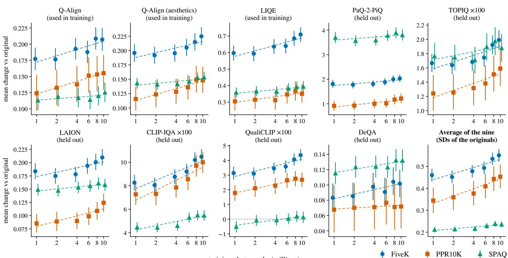  
Figure 7. Every judge against training-set size. Mean score change against the original, with 95% CI, for the six models of Sec. 4.5; the size axis is logarithmic. Dashed: a straight-line fit. Last panel: the average of the nine judges, each scaled by its spread on the originals.

## O. Reproducibility, data and impact

What we will release. The code for every step: the attribute measures, the defects, training, the solver, the editor drivers, the frontier-model runner, and the scripts that build every table. We will also release the bucket scales, the testset lists, and the per-photograph results behind each table.

Software and judges. RawTherapee 5.8 (rawtherapee-cli) and darktable 3.8 (darktable-cli). Q-Align (q-future/one-align, fp16), LIQE and the other five pyiqa judges with their authors’ weights, and DeQA-Score (zhiyuanyou/DeQA-Score-Mix3, fp16) with its authors’ scoring code.

Data. The training photographs come from a licensed commercial stock collection and cannot be shared; Sec. 3.2 describes exactly how we sampled them. FiveK, PPR10K (with MMArt’s exports), SPAQ and KADID-10k are research datasets, used under their terms. The only data we collected about people is the human study’s votes, and we replaced the raters’ account identifiers with random numbers (Sec. J). PPR10K and SPAQ show people, photographed and released by the datasets’ authors; we only change the global colour and tone of their photographs.

Impact. ATune edits photographs only through global sliders, whose values are listed and can be undone. It cannot add, remove or change what is in the scene, so it is harder to misuse for deception than generative editors. Applied at scale, automatic improvement could make photographs look more alike, close to the style of the training photographs, and for portraits could reinforce narrow ideas of appearance. The user keeps control: they set the dial, see every slider value, and can leave a photograph unchanged.

Table 18. Three judges at their authors’ input size (design) and on the full-size image (native). Median score change against the original. Bold: largest gain; underlined: second largest, per set and column.
<table><tr><td></td><td colspan="2">PaQ-2-PiQ</td><td colspan="2">CLIP-IQA × 100</td><td colspan="2">QualiCLIP × 100</td></tr><tr><td></td><td>design</td><td>native</td><td>design</td><td>native</td><td>design</td><td>native</td></tr><tr><td>FiveK</td><td></td><td></td><td></td><td></td><td></td><td></td></tr><tr><td>ATune (10M, τ=0.99)</td><td>+1.78</td><td>+6.99</td><td>+9.72</td><td>+11.02</td><td>+4.08</td><td>+3.36</td></tr><tr><td>Claude Opus 5, same editor</td><td>+1.94</td><td>+2.33</td><td>+1.07</td><td>+6.01</td><td>+2.67</td><td>+1.96</td></tr><tr><td>GPT-6 Astra, same editor</td><td>+1.31</td><td>+1.13</td><td>-1.14</td><td>+2.75</td><td>+2.17</td><td>+1.03</td></tr><tr><td>CSRNet [23]‡</td><td>+2.57</td><td>+3.56</td><td>+0.13</td><td>+5.11</td><td>-4.53</td><td>-5.02</td></tr><tr><td>AdaInt [61]†</td><td>+1.87</td><td>+1.79</td><td>+2.35</td><td>+3.57</td><td>+0.84</td><td>-1.60</td></tr><tr><td>NeurOP [57]†</td><td>+1.66</td><td>+1.45</td><td>+2.34</td><td>+3.17</td><td>+0.80</td><td>-2.00</td></tr><tr><td>UEGAN [43]</td><td>+1.46</td><td>+1.59</td><td>+2.99</td><td>+1.80</td><td>+0.74</td><td>-0.57</td></tr><tr><td>EnlightenGAN [30]</td><td>+1.73</td><td>-0.16</td><td>-4.39</td><td>+1.38</td><td>-2.75</td><td>+4.04</td></tr><tr><td>Zero-DCE [21]</td><td>+1.76</td><td>+1.35</td><td>-1.31</td><td>+2.41</td><td>-0.76</td><td>-0.39</td></tr><tr><td>SCI [39]</td><td>-1.74</td><td>-0.71</td><td>-9.95</td><td>+4.32</td><td>-8.94</td><td>-4.45</td></tr><tr><td>PPR10K</td><td></td><td></td><td></td><td></td><td></td><td></td></tr><tr><td>ATune (10M, τ=0.99)</td><td>+1.02</td><td>+1.21</td><td>+10.99</td><td>+10.91</td><td>+2.77</td><td>+0.76</td></tr><tr><td>Claude Opus 5, same editor</td><td>+1.17</td><td>+1.36</td><td>+7.66</td><td>+10.87</td><td>+0.69</td><td>+0.09</td></tr><tr><td>GPT-6 Astra, same editor</td><td>+0.68</td><td>+0.80</td><td>+3.41</td><td>+6.07</td><td>+0.53</td><td>+0.43</td></tr><tr><td>CSRNet [23]‡</td><td>+1.80</td><td>+2.00</td><td>-1.08</td><td>-1.63</td><td>-7.80</td><td>-11.09</td></tr><tr><td>AdaInt [61]†</td><td>+0.53</td><td>+0.52</td><td>+1.06</td><td>+1.10</td><td>+0.21</td><td>-1.86</td></tr><tr><td>NeurOP [57]†</td><td>+0.25</td><td>+0.31</td><td>-0.26</td><td>-0.23</td><td>-0.17</td><td>-1.86</td></tr><tr><td>UEGAN [43]</td><td>+0.89</td><td>+0.96</td><td>+3.28</td><td>+4.40</td><td>-0.37</td><td>-0.11</td></tr><tr><td>EnlightenGAN [30]</td><td>+1.02</td><td>+1.32</td><td>-3.14</td><td>-2.25</td><td>-1.73</td><td>-1.44</td></tr><tr><td>Zero-DCE [21]</td><td>+1.11</td><td>+1.25</td><td>+0.11</td><td>-0.16</td><td>-0.99</td><td>-1.61</td></tr><tr><td>SCI [39]</td><td>-2.43</td><td>-2.08</td><td>-9.47</td><td>-6.85</td><td>-18.85</td><td>-20.58</td></tr><tr><td>SPAQ</td><td></td><td></td><td></td><td></td><td></td><td></td></tr><tr><td>ATune (10M, τ=0.99)</td><td>+2.83</td><td>+9.70</td><td>+4.23</td><td>+6.37</td><td>0.00</td><td>+1.67</td></tr><tr><td>Claude Opus 5, same editor</td><td>+3.21</td><td>+4.68</td><td>+1.09</td><td>+3.02</td><td>-1.36</td><td>-0.32</td></tr><tr><td>GPT-6 Astra, same editor</td><td>+1.96</td><td>+2.40</td><td>+0.32</td><td>+1.05</td><td>-0.81</td><td>-0.37</td></tr><tr><td>CSRNet [23]‡</td><td>+3.17</td><td>+4.01</td><td>+1.87</td><td>+0.29</td><td>-5.54</td><td>-1.53</td></tr><tr><td>AdaInt [61]†</td><td>+2.20</td><td>+2.51</td><td>+3.24</td><td>+0.90</td><td>+0.06</td><td>-0.26</td></tr><tr><td>NeurOP [57]†</td><td>+2.17</td><td>+2.59</td><td>+3.39</td><td>+0.79</td><td>-0.05</td><td>-0.28</td></tr><tr><td>UEGAN [43]</td><td>+1.54</td><td>+2.08</td><td>+3.04</td><td>+3.06</td><td>+1.12</td><td>+0.43</td></tr><tr><td>EnlightenGAN [30]</td><td>+1.80</td><td>-0.30</td><td>-0.16</td><td>+3.52</td><td>-3.06</td><td>+3.57</td></tr><tr><td>Zero-DCE [21]</td><td>+2.36</td><td>+4.11</td><td>+0.91</td><td>+3.30</td><td>-1.14</td><td>+1.96</td></tr><tr><td>SCI [39]</td><td>-1.55</td><td>+3.77</td><td>-1.50</td><td>+5.67</td><td>–12.65</td><td>-1.09</td></tr></table>

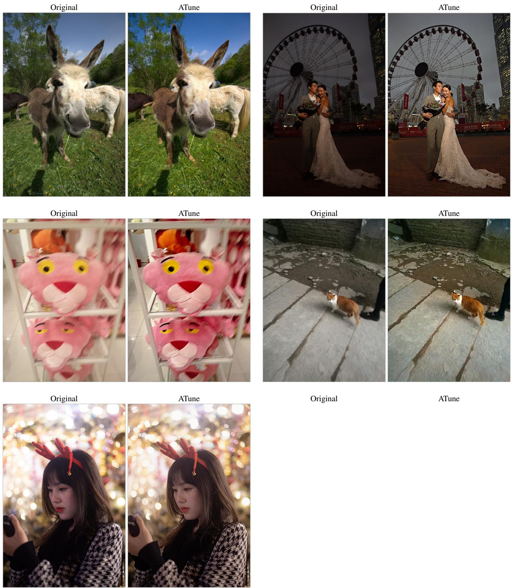  
Figure 8. Selected before-and-after examples, chosen for variety among photographs where the judges prefer ATune’s edit to Claude’s. Figures 10 to 12 show examples picked by a fixed rule.

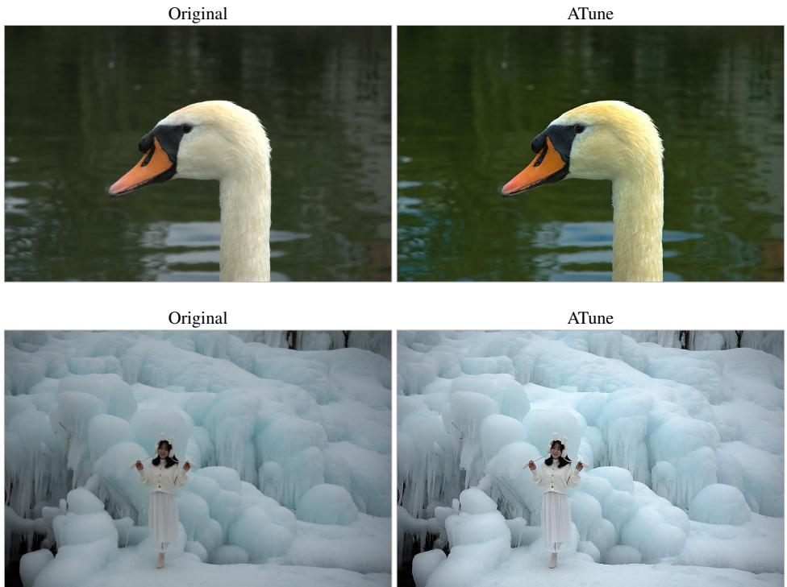  
Figure 9. Selected before-and-after examples (continued).

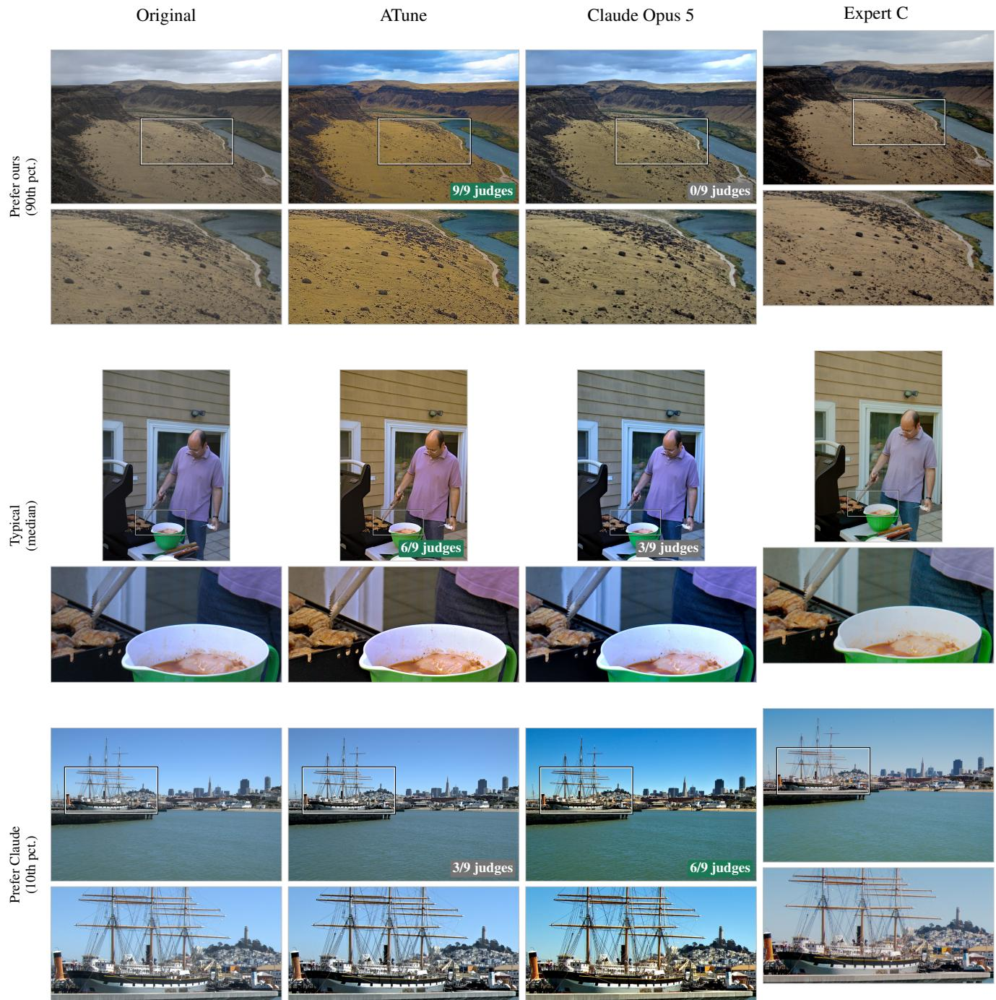  
Figure 10. MIT-Adobe FiveK: where the judges clearly prefer ATune (top), a typical photograph (middle) and where they clearly prefer Claude (bottom). Right: the expert’s edit.

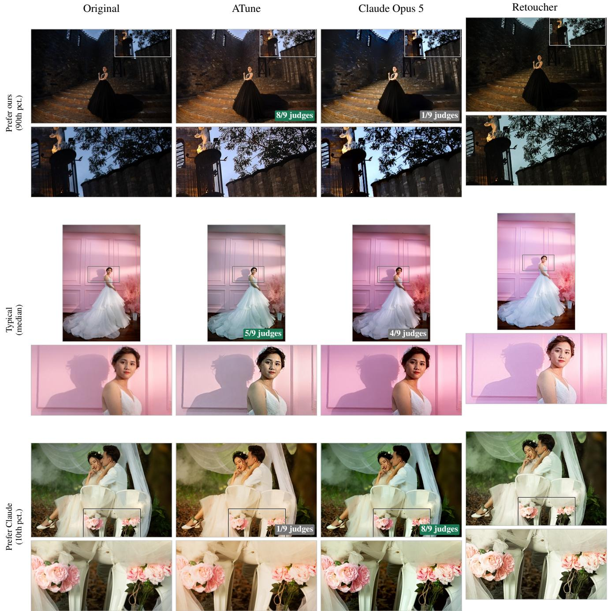  
Figure 11. PPR10K: where the judges clearly prefer ATune (top), a typical photograph (middle) and where they clearly prefer Claude (bottom). Right: the expert’s edit.

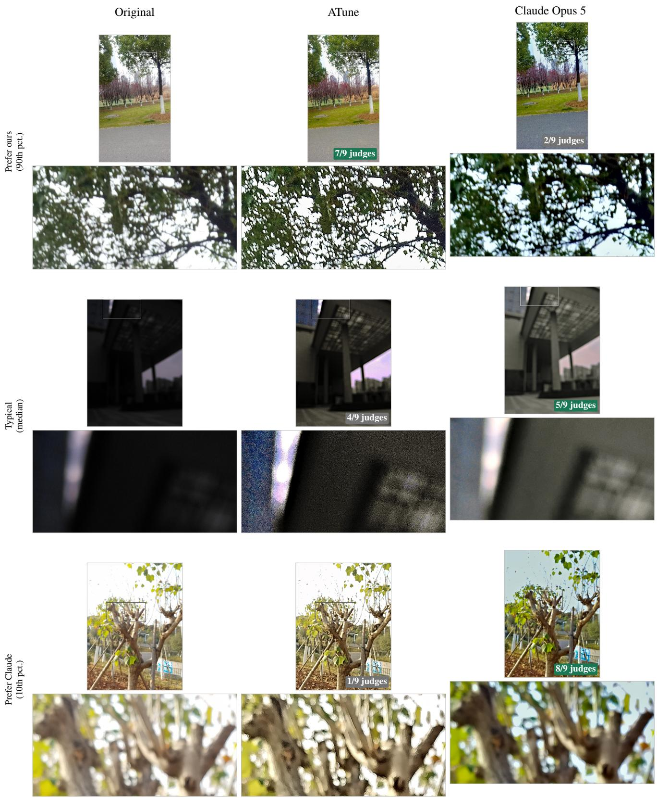  
Figure 12. SPAQ: where the judges clearly prefer ATune (top), a typical photograph (middle) and where they clearly prefer Claude (bottom). SPAQ has no expert edit.