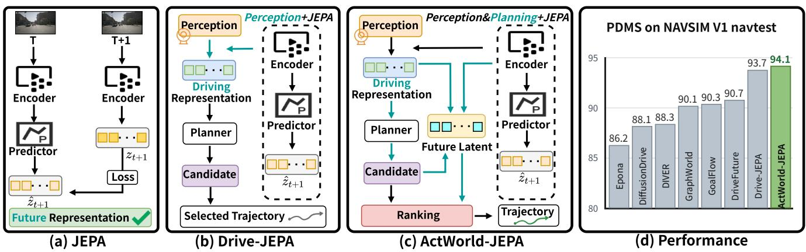
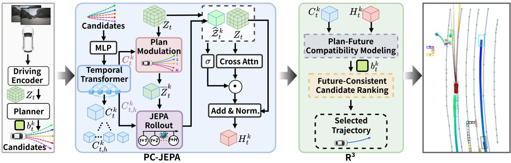
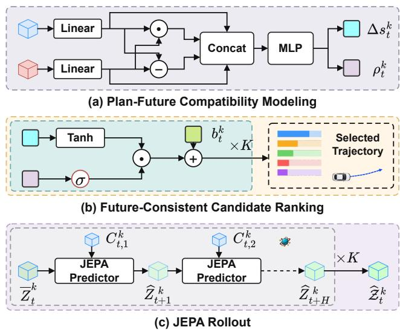
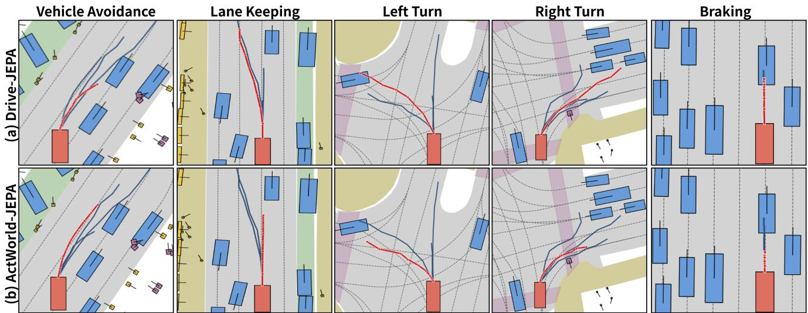
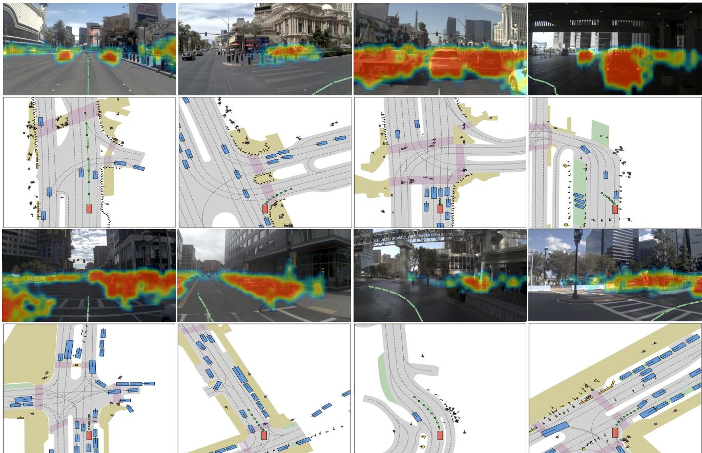
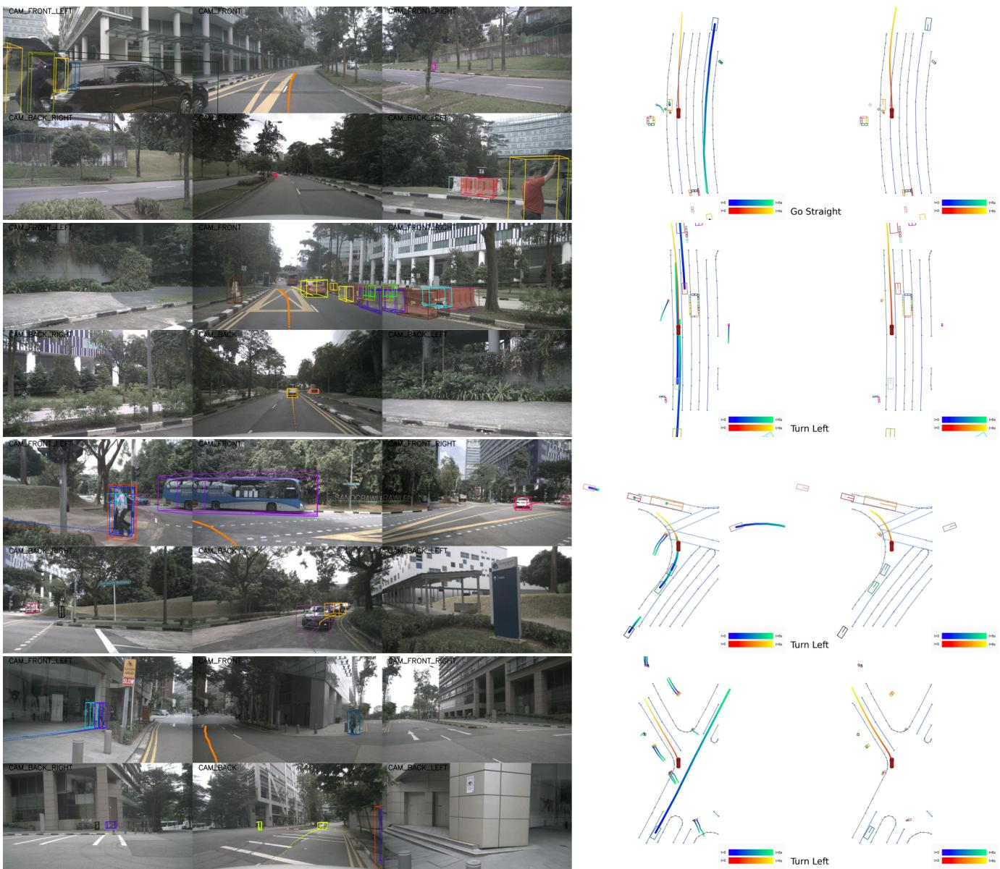

# ActWorld-JEPA: Action-Conditioned JEPA World Models Meet Latent Planning for End-to-End Autonomous Driving

Ziying Song1,†, Shengkai Zhang2,†, Caiyan Jia2, Lei Yang1, Lin Liu3, Yuchen Liu4, Ziyang Liu5, Zirui Li1, Gang Wang6, Peiliang Wu7, Li Wang8, Yadan Luo9, Chen Lv1,∗

1Nanyang Technological University 2Beijing Jiaotong University 3Dalian University of Technology 4North University of China 5Tsinghua University 6NingboTech University 7Yan Shan University 8Beijing Institute of Technology 9The University of Queensland

‡ Code: ActWorld-JEPA Œ Project: adept-thu.github.io/ActWorld-JEPA

## Abstract

Joint-Embedding Predictive Architectures (JEPAs) enable future prediction in latent space without pixel reconstruction. However, latent predictive consistency alone does not establish the relative driving quality of candidate plans. We present ActWorld-JEPA, a joint-embedding formulationfor candidate-based driving. Where Plan-Conditioned JEPA (PC-JEPA) uses global and step-wise trajectory intentions to guide recurrent latent prediction, then combines the predicted future with the current scene through gated cross-attention; Relational Residual Reranking (R3) models agreement and discrepancy between plan and future representations under planning supervision, yielding bounded, gated residual corrections to the base planning scores. This formulation connects latent prediction to candidate selection using only observed context and proposed trajectories at inference. Benchmark-specific implementations report 94.1 PDMS on NAVSIM v1 navtest, with the final selector calibrated using aggregate NAVTEST feedback, and 91.6 and 42.7 EPDMS on NAVSIM v2 navtest and navhard, respectively. The nuScenes evaluation reports a mean L error of 1.20 m and a predicted collision rate of 0.76% over 1–6 s. This work provides an effective path from JEPA’s predictive representations to driving decisions informed by anticipated consequences.

## 1. Introduction

End-to-end autonomous driving brings scene understanding and motion planning into a common framework that maps sensor observations to driving trajectories [6, 19, 22]. Recent planners represent possible maneuvers through trajectory proposals [14, 29] or generative sampling [30, 57]. Choosing among them requires weighing safety, comfort, and progress as traffic evolves [5, 10]. Consider a vehicle approaching a merge as another enters from a ramp. Maintaining speed and slowing down may both be feasible initially, yet the two maneuvers leave different gaps for the merging vehicle a few seconds later.

World models offer a way to anticipate such interactions by predicting how a scene may evolve under a proposed action [12, 13]. Future images depict changes in the scene from the ego vehicle’s viewpoint [52, 53], while occupancy predictions describe how occupied regions change over time [68]. Models that predict compact latent features can supply future scene information directly to a planner [26, 27, 47, 69]. Conditioning these predictions on individual candidates allows a planner to compare how different maneuvers might unfold from the same initial scene.

Joint-Embedding Predictive Architectures (JEPAs) offer a latent-space approach to world modeling by learning to predict target embeddings from observed context [1, 3] (Figure 1 (a)). This objective supports self-supervised learning from video. With an action-conditioned predictor, a planner can compare candidate futures in feature space without decoding each rollout into images [2, 34, 71]. Drive-JEPA uses V-JEPA to pretrain a visual encoder on driving videos and transfers its features to a proposal-based planner [50]. The planner scores proposal features directly, without predicting a future scene representation conditioned on each trajectory (Figure 1 (b)). Auto-JEPA uses predicted driving intent to retrieve trajectories for scene-conditioned ranking [60]. AD-E2E-JEPA compares candidate rollouts with a goal image [77], and DA-WAM estimates planning utility from each candidate’s predicted future [70]. These approaches highlight a distinction between forecasting an outcome and judging its value for driving. At the merge, a predictor could accurately anticipate the gap left by either maneuver. Choosing between them requires weighing that clearance against the progress lost by slowing down. A promising solution is to use planning supervision to learn how the relation between each candidate’s intended motion and its predicted future should refine the base planner’s score.

  
Figure 1. From predictive representations to candidate-conditioned planning. (a) JEPA-style representation learning predicts target features from observed context, as in V-JEPA [3]. (b) Drive-JEPA [50] combines video-JEPA representations with multimodal trajectory distillation and momentum-aware selection. (c) ActWorld-JEPA conditions latent prediction on candidate plans and relates the predicted futures to trajectory ranking through PC-JEPA and $R ^ { 3 }$ . Both observed scene context and candidate intention contribute to the decision. (d) Planning performance. PDMS on NAVSIM v1 navtest [10], comparing ActWorld-JEPA with Epona [65], DiffusionDrive [30] DIVER [43], GraphWorld [45], GoalFlow [57], DriveFuture [16], and Drive-JEPA [50].

Thus, we propose ActWorld-JEPA, a joint-embedding formulation that connects candidate-conditioned future prediction with relational trajectory ranking, as illustrated in Figure 1 (c). Plan-Conditioned JEPA (PC-JEPA) encodes each candidate into global and step-wise intentions. The global intention modulates the initial latent state, and the step-wise intentions condition recurrent prediction. Gated cross-attention then integrates the predicted rollout with the current scene to obtain a candidate-specific, future-aware representation. In the proposed JEPA objective, future observations supply stop-gradient target embeddings for the corresponding observed trajectory. Inference uses only available historical observations and candidate plans. Relational Residual Reranking $( R ^ { 3 } )$ models agreement and discrepancy between the candidate intention and its futureaware representation. A planning-supervised relation head produces a learned gate and a bounded score residual. Together, these components connect trajectory intention, latent future prediction, and score refinement, allowing predictive information to influence candidate preferences.

We conduct benchmark-specific experiments on

NAVSIM v1/v2 [5, 10] and nuScenes [4], covering nonreactive pseudo-simulation and long-horizon open-loop planning. The evaluated systems report 94.1 PDMS on NAVSIM v1 navtest and 91.6 and 42.7 EPDMS on NAVSIM v2 navtest and navhard, respectively. On nuScenes, they achieve an average $L _ { 2 }$ error of 1.20 m and a predicted collision rate of 0.76% across the 1–6 s horizons. Our contributions are summarized as follows:

• We propose ActWorld-JEPA, a joint-embedding predictive framework for end-to-end autonomous driving. It connects plan-conditioned latent future modeling with trajectory selection, enabling candidate decisions to incorporate predicted consequences.

• We introduce two complementary modules, PC-JEPA and $R ^ { 3 }$ . PC-JEPA uses global and step-wise trajectory intentions to predict latent futures and integrate them with the current scene. $R ^ { 3 }$ models plan–future relations to refine candidate scores through bounded, gated residuals.

• We evaluate ActWorld-JEPA on NAVSIM v1/v2 and nuScenes, reporting 94.1 PDMS on v1 navtest and 91.6/42.7 EPDMS on v2 navtest/navhard (leaderboards: v1 navtest, v2 navhard).

## 2. Related Work

## 2.1. World Models for Autonomous Driving

World models anticipate scene evolution to support prediction and planning in autonomous driving. Visual generative approaches synthesize controllable future observations through diffusion or autoregressive modeling for actionconditioned planning [17, 18, 52, 53, 65], with extensions to multi-camera consistency, structured control, and scalable synthetic data [38, 39]. Structured models encode dynamics through occupancy, geometry, and spatiotemporal memory [35, 36, 68], while latent approaches connect action-conditioned feature prediction with trajectory generation and candidate evaluation [16, 26, 27, 45, 47, 56, 69], emphasizing compact temporal dynamics and planningoriented representations [51, 58, 64]. World-action models jointly learn visual dynamics and planning through geometric supervision or shared generative objectives [67, 72], while candidate-centric methods use future evidence to evaluate or refine trajectory hypotheses [33, 54]. These approaches incorporate anticipated dynamics at different planning stages. ActWorld-JEPA focuses on the relation between each candidate intention and its predicted latent future to refine the ranking of an existing proposal set.

  
Figure 2. The overall architecture of ActWorld-JEPA. The driving encoder extracts the current representation, and the planner produces candidate trajectories. PC-JEPA encodes global and step-wise plan conditions, initializes plan-modulated latents, and rolls out candidate specific futures. Cross-attention and gated residual interaction fuse predicted future evidence with the current scene. $R ^ { 3 }$ combines plan and fused-future features to rank the original candidates. The rightmost trajectory panel illustrates future-guided selection.

  
Figure 3. Details of latent prediction and trajectory reranking. (a) Plan-future compatibility modeling combines projected features and their agreement and discrepancy to predict a score correction $\Delta s _ { t } ^ { k }$ and confidence logit $\rho _ { t } ^ { \hat { k } }$ . (b) Future-consistent candidate ranking gates the bounded correction, adds the baseline score $b _ { t } ^ { k }$ , and selects an original trajectory. (c) JEPA rollout predicts latent futures conditioned on step-wise trajectory intentions over the planning horizon.

## 2.2. JEPA for Autonomous Driving

Joint-Embedding Predictive Architectures learn predictive representations by matching target embeddings rather than reconstructing observations. Developments in video representation learning and action-conditioned latent dynamics extend this principle toward prediction and planning [2, 3, 34]. An expanding body of driving research applies JEPA to visual perception, LiDAR detection, and spatiotemporal occupancy forecasting [24, 75, 76], and connects predictive representations with multimodal trajectory learning, futureintent retrieval, and goal-conditioned planning [50, 60, 77]. Together, these studies establish complementary roles for latent prediction in scene understanding and driving decisions. ActWorld-JEPA formulates candidate-conditioned latent prediction and plan–future relational reasoning as a means of refining trajectory scores from available observations and proposed plans.

## 3. Method

Framework Overview. Figure 2 presents ActWorld-JEPA, which connects latent future prediction with candidatebased trajectory planning. We first describe the general formulation; benchmark-specific implementations are detailed in Sec. 4.1 and the implementation details in the supplementary material. Given multi-frame driving observations, a pretrained driving encoder extracts the current representation $\mathbf { Z } _ { t }$ . A base planner then generates K candidate trajectories $\mathcal { T } _ { t } ~ = ~ \{ \bar { \tau _ { t } ^ { k } } \} _ { k = 1 } ^ { K }$ together with their baseline planning scores $\bar { B _ { t } } ~ = ~ \{ \bar { b _ { t } ^ { k } } \} _ { k = 1 } ^ { K }$ . ActWorld-JEPA incorporates the anticipated consequences of each proposal into trajectory selection through two components: (1) Plan-Conditioned JEPA (PC-JEPA) (Sec. 3.1), which conditions latent dynamics on individual candidate trajectories and produces candidate-specific future-aware planning representations; and (2) Relational Residual Reranking $( R ^ { 3 } )$ (Sec. 3.2), which explicitly models plan-future relations and uses them to refine the original candidate ranking. Together, these components connect predictive representations with planning decisions by relating each candidate to its anticipated future.

## 3.1. Plan-Conditioned JEPA (PC-JEPA)

Different candidate plans may induce distinct future evolutions under the same observation. We therefore introduce Plan-Conditioned JEPA (PC-JEPA) to reason about candidate-specific futures. Given the current driving representation $\mathbf { Z } _ { t }$ and candidate trajectories $\mathcal { T } _ { t } ~ = ~ \{ \tau _ { t } ^ { k } \} _ { k = 1 } ^ { K } ,$ PC-JEPA conditions the latent dynamics on each candidate, predicts its latent future, and integrates this prediction with the current scene to obtain future-aware planning features. Trajectory-Conditioned JEPA Rollout. For candidate $\tau _ { t } ^ { k } = \{ \mathbf { p } _ { t + h } ^ { k } \} _ { h = 1 } ^ { H }$ , each waypoint is projected by an MLP and augmented with a horizon-specific temporal embedding. A lightweight temporal Transformer models dependencies across the planning horizon and aggregates the sequence into a global condition:

$$
\mathbf { C } _ { t } ^ { k } = \operatorname { P o o l } \left( T _ { \tau } \left( \left[ \phi _ { \mathrm { M L P } } ( \mathbf { p } _ { t + h } ^ { k } ) + \mathbf { e } _ { h } \right] _ { h = 1 } ^ { H } \right) \right) ,\tag{1}
$$

where $\phi _ { \mathrm { M L P } } ( \cdot )$ denotes waypoint projection, $\mathbf { e } _ { h }$ is the temporal embedding, and $T _ { \tau } ( \cdot )$ is the temporal Transformer. Its h-th contextualized token $\mathbf { \dot { C } } _ { t , h } ^ { k }$ provides the step-wise rollout condition, while $\mathbf { C } _ { t } ^ { k }$ summarizes the overall candidate intention.

We inject this intention into the current latent state through candidate-dependent modulation:

$$
\overline { { \mathbf { Z } } } _ { t } ^ { k } = \mathbf { Z } _ { t } + \gamma ( \mathbf { C } _ { t } ^ { k } ) \odot \psi ( \mathbf { Z } _ { t } ) ,\tag{2}
$$

where $\psi ( \cdot )$ projects the current representation and $\gamma ( \cdot )$ generates the modulation signal. The resulting $\overline { { \mathbf { Z } } } _ { t } ^ { k }$ provides a candidate-specific initialization for the recurrent JEPA predictor shown in Figure 3(c):

$$
\widehat { \mathbf { Z } } _ { t + h } ^ { k } = P _ { \theta } \left( \widehat { \mathbf { Z } } _ { t + h - 1 } ^ { k } , \mathbf { C } _ { t , h } ^ { k } \right) , \qquad h = 1 , \ldots , H ,\tag{3}
$$

where $\widehat { \mathbf { Z } } _ { t } ^ { k }$ is initialized by $\overline { { \mathbf { Z } } } _ { t } ^ { k }$ . We denote the resulting rollout by $\widehat { \mathcal { Z } } _ { t } ^ { k } = \{ \widehat { \mathbf { Z } } _ { t + h } ^ { k } \} _ { h = 1 } ^ { H }$ . Applying this process to all $K$

Algorithm 1: Plan-Conditioned JEPA (PC-JEPA)   
Input: Current scene representation $\overline { { \mathbf { z } _ { t } } } ;$ candidate trajectories   
$\mathcal { T } _ { t } = \{ \tau _ { t } ^ { k } \} _ { k = 1 } ^ { K } .$   
Output: Global conditions $\mathcal { C } _ { t } = \{ \mathbf { C } _ { t } ^ { k } \} _ { k = } ^ { K }$ and future-aware   
features $\mathcal { H } _ { t } = \{ \mathbf { H } _ { t } ^ { k } \} _ { k = 1 } ^ { K } .$   
for $k = 1 , \ldots , K$ do   
Encode $\tau _ { t } ^ { k }$ into $\mathbf { C } _ { t } ^ { k }$ and $\{ \mathbf { C } _ { t , h } ^ { k } \} _ { h = : } ^ { H }$   
Initialize $\widehat { \mathbf { Z } } _ { t } ^ { k } \gets \overline { { \mathbf { Z } } } _ { t } ^ { k }$ using Eq. (2)   
for $h = 1 , \ldots , H$ do   
Predict $\widehat { \mathbf { Z } } _ { t + h } ^ { k }$ by Eq. (3)   
end   
Fuse current and future features into $\mathbf { H } _ { t } ^ { k }$ using Eqs. (4)–(6)   
end   
return $\mathcal { C } _ { t } , \mathcal { H } _ { t }$

candidates yields distinct latent futures conditioned on their respective planning intentions.

Current-Future Latent Interaction. To extract future information relevant to the current scene, we use $\mathbf { Z } _ { t }$ as query and the candidate-specific rollout as key and value:

$$
\mathbf { A } _ { t } ^ { k } = \mathrm { S o f t m a x } \left( \frac { ( \mathbf { Z } _ { t } \mathbf { W } _ { Q } ) ( \widehat { \mathcal { Z } } _ { t } ^ { k } \mathbf { W } _ { K } ) ^ { \top } } { \sqrt { d } } \right) ,\tag{4}
$$

where $\mathbf { W } _ { Q }$ and ${ \bf W } _ { K }$ are learnable projections. A candidate-specific gate further controls the amount of future information injected into the current representation:

$$
\begin{array} { r } { \pmb { \alpha } _ { t } ^ { k } = \sigma \left( G _ { f } \left( \left[ \mathbf { Z } _ { t } ; \mathrm { P o o l } ( \widehat { \mathcal { Z } } _ { t } ^ { k } ) \right] \right) \right) . } \end{array}\tag{5}
$$

The attended future feature is then gated, residually fused with the current representation, and normalized:

$$
\mathbf { H } _ { t } ^ { k } = \operatorname { L N } \left( \mathbf { Z } _ { t } + \alpha _ { t } ^ { k } \odot \mathbf { A } _ { t } ^ { k } \left( \widehat { \mathcal { Z } } _ { t } ^ { k } \mathbf { W } _ { V } \right) \right) ,\tag{6}
$$

where $\mathbf { W } _ { V }$ is the value projection. Applying the interaction to all candidates yields $\mathcal { H } _ { t } = \{ \mathbf { H } _ { t } ^ { k } \} _ { k = 1 } ^ { K }$ , where each $\mathbf { H } _ { t } ^ { k }$ jointly encodes the current scene and the anticipated future of candidate $\tau _ { t } ^ { k }$ . Algorithm 1 summarizes the PC-JEPA computation.

## 3.2. Relational Residual Reranking (R3)

The proposed Relational Residual Reranking $( R ^ { 3 } )$ uses candidate-specific future evidence to refine the ranking of the base planner. Given trajectory conditions $\{ \mathbf { C } _ { t } ^ { k } \} _ { k = 1 } ^ { \bar { K } } ,$ future-aware representations $\mathcal { H } _ { t }$ , and the scores $\begin{array} { r l } { B _ { t } } & { { } = } \end{array}$ $\{ b _ { t } ^ { k } \} _ { k = 1 } ^ { K } , R ^ { 3 }$ first models plan-future relations and then performs confidence-aware score refinement before final ranking.

Plan-Future Compatibility Modeling. As shown in Figure 3(a), we first project the candidate intention and its future-aware representation into a common feature space:

$$
\mathbf { p } _ { t } ^ { k } = \operatorname { L i n e a r } _ { p } ( \mathbf { C } _ { t } ^ { k } ) , \qquad \mathbf { f } _ { t } ^ { k } = \operatorname { L i n e a r } _ { f } \left( \operatorname { P o o l } ( \mathbf { H } _ { t } ^ { k } ) \right)\tag{7}
$$

Algorithm 2: Relational Residual Reranking $( R ^ { 3 } )$   
Input: Candidates $\mathcal { T } _ { t } ;$ baseline scores $\overline { { B _ { t } } } ;$ conditions $\mathcal { C } _ { t }$ and   
future-aware features $\mathcal { H } _ { t }$ from Algorithm 1; residual   
strength $\lambda \geq 0 ;$ temperature $\tau > 0 .$   
Output: Selected trajectory $\tau _ { t } ^ { k ^ { \star } }$   
for $\bar { k } = 1 , \dots , K$ do   
Form the plan–future relation $\mathbf { r } _ { t } ^ { k }$ using Eqs. (7)–(8)   
$[ \Delta s _ { t } ^ { k } , \rho _ { t } ^ { k } ] \gets \mathrm { M L P } _ { \mathrm { r e l } } ( \mathbf { r } _ { t } ^ { k } )$   
sekt ← bk + λσ(ρk) tanh(∆sk)   
end   
πk ← Softmaxk $( \widetilde { s } _ { t } ^ { k } / \tau )$   
k⋆ ← arg max $\pi _ { t } ^ { k }$   
return $\tau _ { t } ^ { k ^ { \star } }$

where $\mathbf { p } _ { t } ^ { k }$ and $\mathbf { f } _ { t } ^ { k }$ denote the projected plan and future features. Rather than reducing their relation to a single similarity score, we preserve both feature agreement and discrepancy through element-wise product and directional difference:

$$
\mathbf { r } _ { t } ^ { k } = { \mathrm { C o n c a t } } \left( \mathbf { p } _ { t } ^ { k } , \mathbf { f } _ { t } ^ { k } , \mathbf { p } _ { t } ^ { k } \odot \mathbf { f } _ { t } ^ { k } , \mathbf { f } _ { t } ^ { k } - \mathbf { p } _ { t } ^ { k } \right) .\tag{8}
$$

A lightweight MLP maps $\mathbf { r } _ { t } ^ { k }$ to a future-dependent score correction $\Delta s _ { t } ^ { k }$ and its confidence logit $\rho _ { t } ^ { k }$

$$
\left[ \Delta s _ { t } ^ { k } , \rho _ { t } ^ { k } \right] = \mathrm { M L P } _ { \mathrm { r e l } } \left( \mathbf { r } _ { t } ^ { k } \right) .\tag{9}
$$

Future-Consistent Candidate Ranking. As shown in Figure 3(b), $R ^ { 3 }$ refines the baseline planning score through a bounded, confidence-aware residual:

$$
\begin{array} { r } { \widetilde { s } _ { t } ^ { k } = b _ { t } ^ { k } + \lambda \sigma ( \rho _ { t } ^ { k } ) \operatorname { t a n h } ( \Delta s _ { t } ^ { k } ) , } \end{array}\tag{10}
$$

where tanh(·) bounds the correction and $\lambda \geq 0$ controls the refinement strength. The sigmoid output $\sigma ( \rho _ { t } ^ { k } )$ acts as a learned confidence gate that modulates the residual contribution under planning supervision. The baseline score anchors each candidate’s preference, while the signed residual adjusts it using predicted future evidence.

The refinement is applied to all K candidates, and the resulting scores are normalized as

$$
\pi _ { t } ^ { k } = \frac { \exp ( \widetilde { s } _ { t } ^ { k } / \tau ) } { \sum _ { j = 1 } ^ { K } \exp ( \widetilde { s } _ { t } ^ { j } / \tau ) } , \qquad k \in [ K ] ,\tag{11}
$$

where τ controls the sharpness of the distribution. The candidate with the highest probability is selected as the final planning trajectory. Algorithm 2 summarizes the reranking procedure.

## 3.3. JEPA-Planning Learning Objectives

We formulate joint learning of plan-conditioned prediction and trajectory selection by augmenting the base planner’s objective with two auxiliary losses.

Plan-Conditioned Future Supervision. Observed future frames are encoded as target latent representations $\mathbf { Z } _ { t + h } ^ { + }$ For the trajectory associated with the observed future, we supervise the latent rollout by

$$
\mathcal { L } _ { \mathrm { f u t u r e } } = \frac { 1 } { H } \sum _ { h = 1 } ^ { H } \left. \widehat { \mathbf { Z } } _ { t + h } ^ { + } - \mathrm { s g } \left( \mathbf { Z } _ { t + h } ^ { + } \right) \right. _ { 2 } ^ { 2 } ,\tag{12}
$$

where $\operatorname { s g } ( \cdot )$ denotes stop-gradient.

Planning Selection Supervision. Let $k ^ { + }$ denote the candidate with the minimum average displacement error to the expert trajectory. $R ^ { 3 }$ is supervised by

$$
\mathcal { L } _ { \mathrm { s e l } } = - \log \pi _ { t } ^ { k ^ { + } } .\tag{13}
$$

Overall Objective. The final objective is

$$
\begin{array} { r } { \mathcal { L } = \mathcal { L } _ { \mathrm { p l a n } } + \lambda _ { \mathrm { f } } \mathcal { L } _ { \mathrm { f u t u r e } } + \lambda _ { \mathrm { s } } \mathcal { L } _ { \mathrm { s e l } } , } \end{array}\tag{14}
$$

where ${ \mathcal { L } } _ { \mathrm { p l a n } }$ is the original planning loss, and $\lambda _ { \mathrm { f } }$ and $\lambda _ { \mathrm { s } }$ balance future prediction and trajectory selection.

## 4. Experiments

## 4.1. Experimental Setup

Datasets and Metrics. We evaluate ActWorld-JEPA on NAVSIM v1/v2 [5, 10], which provide multi-view observations with map and object annotations at 2 Hz and assess planning under non-reactive pseudo-simulation protocols. NAVSIM v1 reports the Predictive Driver Model Score (PDMS), incorporating No at-fault Collision (NC), Drivable Area Compliance (DAC), Time-to-Collision (TTC), Comfort, and Ego Progress (EP). NAVSIM v2 adopts the Extended Predictive Driver Model Score (EPDMS), additionally considering Driving Direction Compliance (DDC), Traffic Light Compliance (TLC), Lane Keeping (LK), History Comfort (HC), and Extended Comfort (EC). We evaluate its navtest and more challenging navhard splits separately. On nuScenes [4], we evaluate camera-only openloop planning over a 6-second horizon. We report the L2 displacement error (m) to measure trajectory accuracy and the predicted Collision Rate (Col. Rate, %) to quantify geometric collisions with surrounding agents. Both metrics are evaluated at each second from 1 to 6 s, with their average computed across the six evaluation horizons. Lower values indicate better performance.

## 4.2. Implementation Details

For NAVSIM, ActWorld-JEPA is built upon iPad [14]. The model uses the current multi-view observations and the preceding front-view frame to evaluate 32 candidate trajectories, each containing eight waypoints over a 4-s horizon. PC-JEPA employs eight 256-dimensional latent tokens to predict candidate-conditioned future representations, while

Table 1. Planning performance on NAVSIM v1 navtest. Protocols: cited studies and Sec. 4.1. Dark rules separate blocks, each sorted by increasing PDMS with column maxima in bold. ‘mmt’: multimodal TransFuser; TF: TransFuser; ∗: re-implementation.
<table><tr><td>Method</td><td>NC↑ DAC↑ TTC↑ Comf.↑</td><td></td><td></td><td></td><td>EP↑</td><td>PDMS↑</td></tr><tr><td colspan="7">E2E-based Methods</td></tr><tr><td>VADv2 [7]</td><td>97.2</td><td>89.1</td><td>91.6</td><td></td><td>100</td><td>76.0 80.9</td></tr><tr><td>UniAD [19]</td><td>97.8</td><td>91.9</td><td>92.9</td><td>100</td><td>78.8</td><td>83.4</td></tr><tr><td>TransFuser [9]</td><td>97.7</td><td>92.8</td><td>92.8</td><td>100</td><td>79.2</td><td>84.0</td></tr><tr><td>PARA-Drive [55]</td><td>97.9</td><td>92.4</td><td>93.0</td><td>99.8</td><td>79.3</td><td>84.0</td></tr><tr><td>TransFusermmt * [9]</td><td>96.2</td><td>95.4</td><td>90.7</td><td>100</td><td>80.7</td><td>85.1 85.5</td></tr><tr><td>DRAMA [63]</td><td>98.0</td><td>93.1</td><td>94.8</td><td>100</td><td>80.1</td><td>86.5</td></tr><tr><td>Hydra-MDP [29]</td><td>98.3</td><td>96.0</td><td>94.6</td><td>100</td><td>78.7</td><td></td></tr><tr><td>ReCogDrive-IL[28]</td><td>98.1</td><td>94.7</td><td>94.2</td><td>100</td><td>80.9</td><td>86.5 87.8</td></tr><tr><td>FUMP [31]]</td><td>98.1</td><td>96.2</td><td>94.2</td><td>100</td><td>82.0</td><td></td></tr><tr><td>DiffusionDrive [30]</td><td>98.2</td><td>96.2</td><td>94.7</td><td>100</td><td>82.2</td><td></td></tr><tr><td>DIVER [43]</td><td>98.5</td><td>96.5</td><td>94.9</td><td>100</td><td>82.6</td><td></td></tr><tr><td>GraphBÈV++ [44]</td><td>98.7</td><td>97.1</td><td></td><td></td><td></td><td></td></tr><tr><td>DriveSuprim [62]</td><td>97.8</td><td>97.3</td><td>93.6</td><td>100</td><td>86.7</td><td>88.7 89.9</td></tr><tr><td>MomADv2 [46]</td><td>98.7</td><td>96.8</td><td>95.4</td><td>100</td><td>84.5</td><td>89.9 90.0</td></tr><tr><td>DriveDPO [40]</td><td>98.5</td><td>98.1</td><td>94.8</td><td>99.9</td><td>84.3</td><td></td></tr><tr><td>GoalFlow [57]</td><td>98.4</td><td>98.3</td><td>94.6</td><td></td><td>100 85.0</td><td></td></tr><tr><td>iPad [14]</td><td>99.2</td><td>97.4</td><td>96.3</td><td>99.7</td><td>87.8</td><td>90.3 91.7</td></tr><tr><td>DrivoR [23]</td><td>98.9</td><td>98.3</td><td>96.2</td><td></td><td>100</td><td>89.1 93.1</td></tr><tr><td colspan="7">VLA-based Methods</td></tr><tr><td>AutoVLA [73]</td><td>98.4</td><td>95.6</td><td>98.0</td><td>99.9</td><td>81.9</td><td>89.1</td></tr><tr><td>Recogdrive [28]</td><td></td><td>97.8</td><td>95.2</td><td>99.8</td><td>83.5</td><td>89.6</td></tr><tr><td>DriveWorld-VLA [20]</td><td>98.2 99.1</td><td>98.2</td><td>96.1</td><td>100</td><td>85.9</td><td>91.3</td></tr><tr><td colspan="7">World-Model-based Methods</td></tr><tr><td>DrivingGPT[8]</td><td>98.9</td><td>90.7</td><td>94.9</td><td>95.6</td><td>79.7</td><td>82.4</td></tr><tr><td>DriveX-S[41]</td><td>97.5</td><td>94.0</td><td>93.0</td><td>100</td><td>79.7</td><td>84.5</td></tr><tr><td>LAW [26]</td><td>96.4</td><td>95.4</td><td>88.7</td><td>99.9</td><td>81.7</td><td>84.6</td></tr><tr><td>World4Drive [69]</td><td>97.4</td><td>94.3</td><td>92.8</td><td>100</td><td>79.9</td><td>85.1</td></tr><tr><td>Epona [65]</td><td>97.9</td><td>95.1</td><td>93.8</td><td>99.9</td><td>80.4</td><td>86.2</td></tr><tr><td>Resim[59]</td><td></td><td></td><td></td><td></td><td></td><td>86.6</td></tr><tr><td>WorldRFT [61]</td><td>97.8</td><td>96.8</td><td>94.0</td><td>100</td><td>81.7</td><td>87.8</td></tr><tr><td>PWM[66]</td><td>98.6</td><td>95.9</td><td>95.4</td><td>100</td><td>81.8</td><td>88.1</td></tr><tr><td>WoTE [27]</td><td>98.5</td><td>96.8</td><td>94.9</td><td>99.9</td><td>81.9</td><td>88.3</td></tr><tr><td>MindDrive [48]</td><td>98.4</td><td>97.0</td><td>95.1</td><td>99.9</td><td>82.8</td><td>88.9</td></tr><tr><td>ResWorld† [64]</td><td>98.9</td><td>96.5</td><td>95.6</td><td>100</td><td>83.1</td><td>89.0</td></tr><tr><td>DriveLaW [56]</td><td>99.0</td><td>97.1</td><td>96.7</td><td>100</td><td>81.3</td><td>89.1</td></tr><tr><td>DriveDreamer-Policy [72]</td><td>98.4</td><td>97.1</td><td>95.1</td><td>100</td><td>83.5</td><td>89.2 90.1</td></tr><tr><td>GraphWorld [45]</td><td>99.0</td><td>97.1</td><td>95.5</td><td>100</td><td>83.2</td><td>90.2</td></tr><tr><td>MomWorld [47]</td><td>98.6</td><td>98.2</td><td>93.9</td><td>100</td><td>85.7</td><td></td></tr><tr><td>ManeuverFlow-TF [54]</td><td>98.4</td><td>98.0</td><td>95.2</td><td>100</td><td>85.4</td><td>90.6</td></tr><tr><td>DriveFuture [16]</td><td>98.8</td><td>99.1</td><td>95.4</td><td>100</td><td>84.2</td><td>90.7</td></tr><tr><td>SimWAM‡ [67]</td><td>98.5</td><td>99.1</td><td>96.1</td><td>99.8</td><td>86.5</td><td>91.9</td></tr><tr><td>PlanWAM [58]</td><td>98.9</td><td>98.8</td><td>96.3</td><td>100</td><td>91.0</td><td>93.8</td></tr><tr><td>Auto-JEPA [60]</td><td>98.4</td><td>98.3</td><td>95.0</td><td>100</td><td>87.1</td><td>91.3 93.7</td></tr><tr><td>Drive-JEPA [50]</td><td>99.1</td><td>98.2</td><td>96.2</td><td>99.9</td><td>91.4</td><td>94.1</td></tr><tr><td>ActWorld-JEPA (Ours)</td><td>99.0</td><td>98.4</td><td>96.1</td><td>99.9</td><td>92.2</td><td></td></tr></table>

R3 exploits the resulting plan–future relations to refine the original candidate scores without altering trajectory geometry. All learnable modules are trained exclusively on NAVTRAIN using AdamW. NAVSIM v1 is trained for 20 epochs, while NAVSIM v2 adopts a two-stage futureevaluation and planning-refinement procedure. Training is conducted on NVIDIA RTX 4090 GPUs with mixed precision, and future observations are used only as training supervision and remain unavailable during inference. For nuScenes, we adopt MomAD [42] as the baseline and follow its standard configuration with a ResNet-50 [15] backbone, 256 × 704 input images, and six trajectory modes.

Table 2. Planning performance on NAVSIM v2 navtest. Evaluation: Sec. 4.1. Dark rules separate blocks, each sorted by increasing EPDMS with column maxima in bold.
<table><tr><td>Method</td><td></td><td>NC↑ DAC↑ DDC↑</td><td></td><td></td><td>TL↑ EP↑</td><td>TTC↑</td><td>LK↑</td><td>HC↑</td><td>EC↑</td><td>EPDMS↑</td></tr><tr><td colspan="9">E2E-based Methods</td></tr><tr><td>TransFuser [9]</td><td>96.9</td><td>89.9</td><td>97.8</td><td>99.7 87.1</td><td></td><td>95.4</td><td></td><td>92.7 98.3 87.2</td><td></td><td>76.7</td></tr><tr><td>Hydra-MDP++ [25]</td><td>97.2</td><td>97.5</td><td>99.4</td><td>99.6 83.1</td><td></td><td>96.5</td><td>94.4</td><td>98.2</td><td>70.9</td><td>81.4</td></tr><tr><td>DÍVER [43]</td><td>97.5</td><td>95.0</td><td>98.3</td><td>99.8 87.8</td><td></td><td>95.9</td><td>93.0</td><td>98.5</td><td>87.7</td><td>82.2</td></tr><tr><td>DriveSuprim [62]</td><td>97.5</td><td>96.5</td><td>99.4</td><td>99.6 88.4</td><td></td><td>96.6</td><td>95.5</td><td>98.3</td><td>77.0</td><td>83.1</td></tr><tr><td>DiffusionDrive [30]</td><td>98.2</td><td>95.9</td><td>99.4</td><td>99.8 87.5</td><td></td><td>97.3</td><td>96.8</td><td>98.3</td><td>87.7</td><td>84.5</td></tr><tr><td>DiffusionDriveV2 [78]</td><td>97.7</td><td>96.6</td><td>99.2</td><td></td><td>99.8 88.9</td><td>97.2</td><td>96.0</td><td>97.8</td><td>91.0</td><td>85.5</td></tr><tr><td>iPad [14]</td><td>98.7</td><td>98.0</td><td>98.9</td><td>99.8</td><td>86.6</td><td>98.3</td><td>97.2</td><td>98.3</td><td>74.6</td><td>85.8</td></tr><tr><td>MomADv2 [46]</td><td>98.3</td><td>97.4</td><td>99.7</td><td>99.3</td><td>89.6</td><td>97.8</td><td>95.5</td><td>98.6</td><td>91.7</td><td>87.9</td></tr><tr><td colspan="9">VLA-based Methods</td><td></td></tr><tr><td>Recogdrive [28]</td><td>98.3</td><td>95.2</td><td>98.3</td><td>99.8 87.1</td><td></td><td>97.5</td><td>96.6</td><td>99.5</td><td>86.5</td><td>83.6</td></tr><tr><td>DriveWorld-VLA [20]</td><td>98.6</td><td>99.1</td><td>99.6</td><td>99.8 87.4</td><td></td><td>97.9</td><td>97.0</td><td>97.8</td><td>78.6</td><td>86.8</td></tr><tr><td colspan="9">World-Model-based Methods</td></tr><tr><td>MindDrive [48]</td><td>98.4</td><td>95.6</td><td></td><td>99.8 86.7</td><td></td><td></td><td>96.5</td><td></td><td></td><td></td></tr><tr><td>GraphWorld [45]</td><td>98.4</td><td>98.8</td><td>99.3 99.1</td><td>99.1</td><td>85.9</td><td>97.5 97.9</td><td>96.0</td><td>100 97.8</td><td>96.8 74.6</td><td>84.2</td></tr><tr><td>DriveFuture [16]</td><td>98.8</td><td>99.1</td><td>99.6</td><td>99.9</td><td>86.6</td><td>98.4</td><td>96.4</td><td>98.3</td><td>74.8</td><td>89.5 89.9</td></tr><tr><td>MomWorld [47]</td><td>98.1</td><td>98.1</td><td>99.5</td><td>99.8</td><td>88.9</td><td>98.2</td><td>96.1</td><td>98.3</td><td>90.6</td><td>90.1</td></tr><tr><td></td><td>98.4</td><td>98.6</td><td>99.1</td><td></td><td></td><td></td><td></td><td></td><td></td><td></td></tr><tr><td>Drive-JEPA [50] ActWorld-JEPA (Ours)</td><td>98.7</td><td>98.7</td><td>99.1</td><td>99.8 88.4 99.8 88.7</td><td></td><td>97.8 98.2</td><td>97.6 97.7</td><td>97.9 97.9</td><td>84.8 85.0</td><td>87.8 91.6</td></tr></table>

Table 3. Planning performance on NAVSIM v2 navhard. [5] EPDMS is the combined two-stage score; ∗ denotes officialweight reproduction. Bold marks the best result within each block separated by dark horizontal rules, separately for each stage and the combined score.
<table><tr><td>Method</td><td>Stage NC↑ DAC↑ DDC↑ TL↑ EP↑ TTC↑ LK↑ HC↑ EC↑ EPDMS↑</td><td colspan="6"></td></tr><tr><td colspan="8">E2E-based Methods</td></tr><tr><td>TransFuser [9]</td><td></td><td>96.2 77.7</td><td>79.5 70.2</td><td>99.1 84.2</td><td>99.5 84.1 98.0 85.1</td><td>95.1 94.2 97.5 79.1 75.6 45.4 95.7 75.9</td><td>23.1</td></tr><tr><td>DiffusionDrive [30]</td><td>Q</td><td>96.0 82.1</td><td>79.7 72.2</td><td>97.4 88.5</td><td>99.5 81.3 98.7 85.1</td><td>93.1 90.8 96.8 73.8 78.8 49.2 89.3 71.2</td><td>24.2</td></tr><tr><td>DIVER [43]</td><td></td><td>96.4 86.4</td><td>80.2 74.9</td><td>96.0 87.9</td><td>98.8 82.1 98.7 84.1</td><td>94.2 90.6 96.5 65.2 84.5 48.8 92.6 43.4</td><td>26.8</td></tr><tr><td>GuideFlow [32]</td><td></td><td>96.6 87.3</td><td>80.5 76.7</td><td>96.3 88.8</td><td>99.3 82.3 99.2 84.3</td><td>94.9 91.5 97.7 67.8 85.1 49.7 93.1 44.5</td><td>27.1</td></tr><tr><td>RAP-DINO [11]</td><td></td><td>97.1 83.2</td><td>94.4 83.9</td><td>98.8 87.4</td><td>99.8 83.9 98.0 86.9</td><td>96.9 94.7 96.4 66.2 80.4 52.3 95.2 52.4</td><td>36.9</td></tr><tr><td>MomADv2 [46]</td><td>① ②</td><td>97.7 85.9</td><td>92.7 87.0</td><td>97.6 87.1</td><td>98.7 73.4 97.5 77.2</td><td>98.0 92.5 96.1 51.0 83.8 50.1 95.4 53.3</td><td>39.5</td></tr><tr><td>DriveSuprim [62]</td><td>① ②</td><td>98.9 87.9</td><td>95.1 88.8</td><td>99.2 89.6</td><td>99.6 76.1 98.8 80.3</td><td>99.1 94.7 97.6 54.2 86.0 53.5 97.1 56.1</td><td>42.1</td></tr><tr><td>GuideFlow+Scorer [32]</td><td></td><td>97.8 87.3</td><td>97.1 92.3</td><td>100 98.0</td><td>100 81.4 96.9 75.8</td><td>98.5 91.4 92.8 34.2 85.5 59.3 95.4 53.5</td><td>46.7</td></tr><tr><td colspan="8">VLA-based Methods</td></tr><tr><td>SpanVLA [74]</td><td>① ②</td><td>98.4 86.9</td><td>94.3 84.3</td><td>97.8 87.1</td><td>99.9 85.7 97.2 98.2 85.5 82.7</td><td>94.2 97.6 72.1 62.3 96.8 67.4</td><td>40.1</td></tr><tr><td>DiffVLA [21]</td><td></td><td>95.7 81.2</td><td>99.2 88.8</td><td>100 94.6</td><td>100 85.9 99.0 86.0</td><td>96.4 97.1 95.0 84.2 59.8 76.4 98.6 80.4</td><td>45.0</td></tr><tr><td colspan="8">World-Model-based Methods</td></tr><tr><td>MindDrive [48]</td><td></td><td>96.1 82.6</td><td>86.0 79.1</td><td>98.8 86.4</td><td>99.3 83.3 95.6 98.0 85.3 79.4</td><td>94.4 97.6 74.7 49.2 96.5 71.0</td><td>30.5</td></tr><tr><td>World4Drive [69]</td><td>① ②</td><td>97.3 91.4</td><td>89.1 82.0</td><td>97.6 91.0</td><td>99.7 60.5 98.5 53.1</td><td>96.8 87.7 93.1 60.0 52.3 93.3 90.6 62.8</td><td>34.9</td></tr><tr><td>MomWorld [47]</td><td></td><td>96.9 86.4</td><td>93.6 88.2</td><td>99.8 94.2</td><td>99.8 80.4 98.3 81.7</td><td>96.9 96.4 97.6 60.0 84.4 55.3 97.0 54.7</td><td>42.8</td></tr><tr><td>GraphWorld [45]</td><td>① ②</td><td>98.1 88.6</td><td>97.9 85.9</td><td>97.9 92.2</td><td>98.0 83.9 97.6 82.4</td><td>97.8 97.2 95.4 64.5 87.0 56.6 91.4 44.0</td><td>53.6</td></tr><tr><td>DriveFuture [16]</td><td>Q</td><td>99.8 90.6</td><td>99.8 87.5</td><td>100 94.1</td><td>99.6 85.7 99.1 84.6</td><td>99.8 98.7 97.6 66.2 88.8 58.3 93.5 45.6</td><td>55.5</td></tr><tr><td>Drive-JEPA* [50]</td><td>Θ</td><td>95.3 87.8</td><td>96.4 86.0</td><td>99.4 92.3</td><td>99.8 85.1 99.1 80.2</td><td>94.9 96.9 97.3 35.1 93.0 27.2 84.7 54.9</td><td>37.7</td></tr><tr><td>ActWorld-JEPA (Ours)</td><td>① ②</td><td>95.8 86.7</td><td>96.4 86.3</td><td>99.4 92.5</td><td>99.8 85.0 99.3 81.4</td><td>95.1 97.3 97.6 44.9 84.1 53.2 93.2 41.4</td><td>42.7</td></tr></table>

## 4.3. Main Results

NAVSIM v1 navtest. Table 1 presents a comprehensive comparison with end-to-end planners [14, 23, 30, 40, 43, 57, 62], VLA methods [20, 28, 73], and world-model-based approaches [16, 50, 54, 58, 60, 64, 67, 72]. ActWorld-JEPA achieves the highest PDMS of 94.1 and EP of 92.2 among all compared methods, establishing leading performance in overall planning quality and ego progress. Notably, it surpasses the Drive-JEPA by 0.4 points in PDMS and 0.8 points in EP, while improving DAC from 98.2 to

Table 4. Planning results for 6-second long-horizon planning on the nuScenes validation set.
<table><tr><td rowspan="2">Method</td><td rowspan="2">Venue</td><td colspan="7">L2 (m) ↓</td><td colspan="7">Col. Rate (%) ↓</td></tr><tr><td>1s</td><td>2s</td><td>3s</td><td>4s</td><td>5s</td><td> $6 s$ </td><td> $\operatorname { A v g } .$ </td><td>1s</td><td>2s</td><td>3s</td><td>4s</td><td>5s</td><td>6s</td><td>Avg.</td></tr><tr><td>UniAD [19]</td><td>CVPR&#x27;23</td><td>0.47</td><td>0.91</td><td>1.35</td><td>1.91</td><td>2.47</td><td>3.07</td><td>1.70</td><td>0.25</td><td>0.36</td><td>0.61</td><td>0.99</td><td>1.64</td><td>2.51</td><td>1.06</td></tr><tr><td>SparseDrive [49]</td><td>CVPR&#x27;23</td><td>0.43</td><td>0.87</td><td>1.23</td><td>1.75</td><td>2.32</td><td>2.95</td><td>1.59</td><td>0.19</td><td>0.31</td><td>0.56</td><td>0.87</td><td>1.54</td><td>2.33</td><td>0.97</td></tr><tr><td>MomAD [42]</td><td>CVPR&#x27;25</td><td>0.41</td><td>0.85</td><td>1.13</td><td>1.67</td><td>1.98</td><td>2.45</td><td>1.42</td><td>0.17</td><td>0.30</td><td>0.54</td><td>0.83</td><td>1.43</td><td>2.13</td><td>0.90</td></tr><tr><td>LAW [26]</td><td>ICLR&#x27;25</td><td>0.40</td><td>0.87</td><td>1.16</td><td>1.71</td><td>2.03</td><td></td><td>1.46</td><td>0.19</td><td>0.33</td><td>0.57</td><td>0.86</td><td>1.51</td><td></td><td>0.96</td></tr><tr><td>Epona [65]</td><td>ICCV&#x27;25</td><td>0.39</td><td>0.91</td><td>1.17</td><td>1.73</td><td>2.02</td><td>27955</td><td>1.50</td><td>0.14</td><td>0.18</td><td>0.45</td><td>0.74</td><td>1.48</td><td>2</td><td>0.87</td></tr><tr><td>DIVER [43]</td><td>TPAMI&#x27;26</td><td>0.38</td><td>0.75</td><td>1.10</td><td>1.53</td><td>1.98</td><td>2.49</td><td>1.37</td><td>0.13</td><td>0.31</td><td>0.44</td><td>0.80</td><td>1.41</td><td>2.11</td><td>0.87</td></tr><tr><td>GuideFlow [32]</td><td>CVPR&#x27;26</td><td>0.42</td><td>0.83</td><td>1.21</td><td>1.73</td><td>2.05</td><td>2.63</td><td>1.48</td><td>0.12</td><td>0.22</td><td>0.42</td><td>0.79</td><td>1.44</td><td>2.15</td><td>0.86</td></tr><tr><td>ActWorld-JEPA(Ours)</td><td></td><td>0.28</td><td>0.54</td><td>0.89</td><td>1.31</td><td>1.82</td><td>2.39</td><td>1.20</td><td>0.01</td><td>0.14</td><td>0.34</td><td>0.72</td><td>1.33</td><td>2.03</td><td>0.76</td></tr></table>

Table 5. Comparison of the two core module configurations on the NAVSIM v1 and v2 navtest splits. PC-JEPA denotes Plan-Conditioned JEPA, and $R ^ { 3 }$ denotes Relational Residual Reranking.
<table><tr><td colspan="2">Components</td><td colspan="5">NAVSIM v1</td><td colspan="10">NAVSIM v2</td></tr><tr><td>PC-JEPA</td><td> $R ^ { 3 }$ </td><td>NC↑</td><td>DAC↑</td><td>EP↑</td><td>TTC↑</td><td>PDMS↑</td><td>NC↑</td><td>DAC↑</td><td>DDC↑</td><td>TLC↑</td><td>EP↑</td><td>TTC↑</td><td></td><td>LK↑</td><td>HC↑ EC↑</td><td>EPDMS↑</td></tr><tr><td></td><td></td><td>96.5</td><td>95.1</td><td>88.2</td><td>94.1</td><td>87.1</td><td>96.9</td><td>98.3</td><td>97.9</td><td>97.6</td><td>87.1</td><td>97.1</td><td>96.1</td><td>95.2</td><td>84.2</td><td>85.3</td></tr><tr><td>√</td><td></td><td>97.6</td><td>96.6</td><td>90.8</td><td>94.6</td><td>90.5</td><td>98.4</td><td>98.6</td><td>98.8</td><td>99.6</td><td>88.1</td><td>98.0</td><td>97.2</td><td>97.6</td><td>84.8</td><td>89.6</td></tr><tr><td>√</td><td>√</td><td>99.0</td><td>98.4</td><td>92.2</td><td>96.1</td><td>94.1</td><td>98.7</td><td>98.7</td><td>99.1</td><td>99.9</td><td>88.7</td><td>98.2</td><td>97.7</td><td>97.9</td><td>85.0</td><td>91.6</td></tr></table>

Table 6. Ablation of core PC-JEPA designs on the NAVSIM v1 and $\mathbf { v } 2$ navtest splits. The PC-JEPA variants are compared with Full PC-JEPA while keeping $R ^ { 3 }$ fixed. Baseline and Full match the reference and full configurations in Table 5, respectively. Bold indicates the best PC-JEPA variant. C–F denotes current–future interaction.
<table><tr><td></td><td colspan="5">NAVSIM v1</td><td>NAVSIM v2</td></tr><tr><td>Variant</td><td>NC↑</td><td>DAC↑</td><td>EP↑</td><td>TTC↑</td><td>PDMS↑</td><td>EPDMS↑</td></tr><tr><td>Baseline</td><td>96.5</td><td>95.1</td><td>88.2</td><td>94.1</td><td>87.1</td><td>85.3</td></tr><tr><td>Shared Future</td><td>98.7</td><td>97.2</td><td>91.1</td><td>95.9</td><td>92.0</td><td>89.1</td></tr><tr><td>Single-Step Prediction</td><td>98.1</td><td>98.1</td><td>90.5</td><td>95.6</td><td>91.5</td><td>90.0</td></tr><tr><td>w/o C-F Interaction</td><td>97.9</td><td>97.1</td><td>90.9</td><td>95.2</td><td>91.8</td><td>90.3</td></tr><tr><td>Full PC-JEPA</td><td>99.0</td><td>98.4</td><td>92.2</td><td>96.1</td><td>94.1</td><td>91.6</td></tr></table>

Table 7. Ablation of $R ^ { 3 }$ designs on the NAVSIM v1 and v2 navtest splits. PC-JEPA is fixed across the $R ^ { 3 }$ variants. Baseline and Full match Table 6; w/o $R ^ { 3 }$ matches PC-JEPA-only in Table 5. Bold indicates the best result at the displayed precision.
<table><tr><td></td><td colspan="5">NAVSIM v1</td><td>NAVSIM v2</td></tr><tr><td>Variant</td><td> $\overline { { \mathrm { N C \uparrow } } }$ </td><td>DAC↑</td><td>EP↑</td><td>TTC↑</td><td>PDMS↑</td><td>EPDMS↑</td></tr><tr><td>Baseline</td><td>96.5</td><td>95.1</td><td>88.2</td><td>94.1</td><td>87.1</td><td>85.3</td></tr><tr><td colspan="7">Plan-Future Relations</td></tr><tr><td>w/o  $R ^ { 3 }$ </td><td>97.6</td><td>96.6</td><td>90.8</td><td>94.6</td><td>90.5</td><td>89.6</td></tr><tr><td>Plan-Only Features</td><td>98.9</td><td>98.1</td><td>92.1</td><td>95.7</td><td>92.1</td><td>90.5</td></tr><tr><td>Simple Concat.</td><td>98.8</td><td>98.3</td><td>92.0</td><td>95.8</td><td>92.3</td><td>90.7</td></tr><tr><td>w/oCompatibility</td><td>98.7</td><td>97.7</td><td>91.9</td><td>96.0</td><td>93.0</td><td>90.0</td></tr><tr><td colspan="7">Score Refinement</td></tr><tr><td>Score Replacement</td><td>98.9</td><td>97.9</td><td>92.0</td><td>95.9</td><td>92.4</td><td>90.1</td></tr><tr><td>Full R³</td><td>99.0</td><td>98.4</td><td>92.2</td><td>96.1</td><td>94.1</td><td>91.6</td></tr></table>

Table 8. Model parameter size, inference speed, and performance. FPS covers perception, planning, and selection on one RTX 4090 (batch size 1; 64 shared navtrain inputs), excluding preprocessing, transfers, and scoring. Dim is the planning latent width; bold marks the best PDMS and FPS within each block. Baseline PDMS is published; ours uses aggregate navtest calibration, not an untouched-test estimate.
<table><tr><td>Method</td><td>Dim</td><td>Params (M)</td><td>PDMS ↑</td><td>FPS ↑</td></tr><tr><td>TransFuser DiffusionDrive</td><td>256 256</td><td>56.0 60.7</td><td>84.0 88.1</td><td>75.56 43.53</td></tr><tr><td>Drive-JEPA ActWorld-JEPA</td><td>256 256</td><td>311.2 324.2</td><td>93.7 94.1</td><td>17.23 21.33</td></tr></table>

98.4. It also outperforms the strongest competing method, PlanWAM, by 0.3 points in PDMS. These results support the effectiveness of integrating candidate-conditioned future reasoning into trajectory selection, yielding improved planning performance while maintaining strong drivablearea compliance.

NAVSIM v2 navtest. As shown in Table 2, ActWorld-JEPA achieves the highest EPDMS of 91.6 among the compared methods, exceeding MomWorld [47] by 1.5 points and the Drive-JEPA [50] by 3.8 points. It also achieves the highest LK score of 97.7, with NC and TTC scores of 98.7 and 98.2, respectively. These results support the effectiveness of candidate-conditioned future reasoning for trajectory selection and lane keeping.

NAVSIM v2 navhard. As shown in Table 3, ActWorld-JEPA achieves 42.7 EPDMS, surpassing reproduced Drive-JEPA [50] by 5.0 points with improved extended comfort in both stages. Our latent prediction avoids pixel reconstruction, with 21.33 FPS under accelerated deployment (Ta-

  
Figure 4. Qualitative comparison of trajectory selection by Drive-JEPA (top) and ActWorld-JEPA (bottom) across five challenging driving scenarios. Selected trajectories are shown in red.

ble 8).

Long-Horizon Planning on nuScenes. Table 4 presents the 6-second planning results on nuScenes. ActWorld-JEPA achieves an average L2 error of 1.20 m and a predicted collision rate of 0.76%, outperforming DIVER [43] and GuideFlow [32] on both metrics. At the 6-second horizon, ActWorld-JEPA records an L2 error of 2.39 m and a collision rate of 2.03%. These results demonstrate competitive long-horizon planning performance, balancing trajectory accuracy with low predicted collision incidence.

## 4.4. Ablation Studies

Roles of Different Components in ActWorld-JEPA. Table 5 shows that PC-JEPA alone reaches 90.5 PDMS on NAVSIM v1 and 89.6 EPDMS on $\mathbf { v } 2 ,$ improving the reference by 3.4 and 4.3 points. Adding $R ^ { 3 }$ yields 94.1 PDMS and 91.6 EPDMS, further gains of 3.6 and 2.0 points. The full model leads across all reported metrics, supporting the combination of candidate-conditioned future modeling and relational reranking. Its v2 EPDMS uses corrected perscene aggregation.

Ablation on Core Designs in PC-JEPA. With $R ^ { 3 }$ fixed, Table 6 evaluates three core PC-JEPA designs. Sharing futures across candidates reduces PDMS/EPDMS from 94.1/91.6 to 92.0/89.1. Replacing recurrent rollout with a single prediction yields 91.5/90.0, while removing current– future interaction yields 91.8/90.3. The single-prediction variant incurs the largest PDMS drop of 2.6 points. Full PC-JEPA leads across all reported metrics, supporting candidate-specific futures, recurrent prediction, and current–future interaction as complementary components of the design.

Ablation on Different Designs in $R ^ { 3 }$ . With PC-JEPA fixed, Table 7 shows that full $R ^ { 3 }$ achieves 94.1 PDMS/91.6 EPDMS, versus 90.5/89.6 without $R ^ { 3 }$ . It outperforms Simple Concat. by 1.8/0.9 points and Score Replacement by 1.7/1.5, supporting explicit plan–future relations and residual refinement over feature concatenation and direct score replacement.

Model size and inference efficiency. Table 8 compares official eager baselines with our accelerated deployment on one RTX 4090. ActWorld-JEPA achieves 21.33 FPS with 324.2M parameters, providing 1.24× the throughput of released Drive-JEPA [50] (17.23 FPS) for the complete model forward. This speedup reflects the reported deployment settings. TransFuser and DiffusionDrive remain faster but achieve lower PDMS. All neural selector heads are counted, with shared weights deduplicated.

## 4.5. Visualization

Figure 4 compares trajectory selection by Drive-JEPA and ActWorld-JEPA across five driving scenarios. ActWorld-JEPA selects trajectories that better accommodate road geometry and surrounding vehicles, qualitatively supporting the use of candidate-conditioned future reasoning to guide trajectory selection.

## 5. Conclusion

We presented ActWorld-JEPA, an action-conditioned joint-embedding world model that connects latent future prediction with candidate-based autonomous driving. PC-JEPA conditions recurrent latent prediction on global and step-wise trajectory intentions, then integrates the predicted future with the current scene through gated crossattention. The resulting candidate-specific representations support $R ^ { 3 }$ , which models plan–future agreement and discrepancy to produce bounded, confidence-weighted score refinements. Together, these modules translate predicted scene evolution into evidence for comparing candidate plans. Benchmark-specific evaluations yield 94.1 PDMS on NAVSIM v1 navtest and 91.6 and 42.7 EPDMS on NAVSIM v2 navtest and navhard, respectively, alongside competitive long-horizon trajectory prediction on nuScenes. Limitation and Future Work. ActWorld-JEPA remains dependent on the coverage of the candidate trajectory set and the reliability of predicted latent futures. Future work will explore adaptive proposal generation and uncertaintyaware candidate evaluation, alongside closed-loop validation with reactive traffic participants.

## LLM Usage Statement

OpenAI ChatGPT and Codex were used to assist with manuscript editing, LaTeX formatting, figure and table layout, and coding and debugging of evaluation and inferenceefficiency scripts. The authors remain responsible for the scientific claims, experimental results, and final manuscript.

## References

[1] Mahmoud Assran, Quentin Duval, Ishan Misra, Piotr Bojanowski, Pascal Vincent, Michael Rabbat, Yann LeCun, and Nicolas Ballas. Self-supervised learning from images with a joint-embedding predictive architecture. In Proceedings of the IEEE/CVF Conference on Computer Vision and Pattern Recognition (CVPR), pages 15619–15629, 2023. 1

[2] Mido Assran, Adrien Bardes, David Fan, Quentin Garrido, Russell Howes, Mojtaba Komeili, Matthew Muckley, Ammar Rizvi, Claire Roberts, Koustuv Sinha, Artem Zholus, Sergio Arnaud, Abha Gejji, Ada Martin, Francois Robert Hogan, Daniel Dugas, Piotr Bojanowski, Vasil Khalidov, Patrick Labatut, Francisco Massa, Marc Szafraniec, Kapil Krishnakumar, Yong Li, Xiaodong Ma, Sarath Chandar, Franziska Meier, Yann LeCun, Michael Rabbat, and Nicolas Ballas. V-JEPA 2: Self-supervised video models enable understanding, prediction and planning. arXiv preprint arXiv:2506.09985, 2025. 1, 3

[3] Adrien Bardes, Quentin Garrido, Jean Ponce, Xinlei Chen, Michael Rabbat, Yann LeCun, Mahmoud Assran, and Nicolas Ballas. Revisiting feature prediction for learning visual representations from video. arXiv preprint arXiv:2404.08471, 2024. 1, 2, 3

[4] Holger Caesar, Varun Bankiti, Alex H Lang, Sourabh Vora, Venice Erin Liong, Qiang Xu, Anush Krishnan, Yu Pan, Giancarlo Baldan, and Oscar Beijbom. nuscenes: A multimodal dataset for autonomous driving. In Proceedings of the IEEE/CVF conference on computer vision and pattern recognition, pages 11621–11631, 2020. 2, 5, 13

[5] Wei Cao, Marcel Hallgarten, Tianyu Li, Daniel Dauner, Xunjiang Gu, Caojun Wang, Yakov Miron, Marco Aiello, Hongyang Li, Igor Gilitschenski, et al. Pseudo-simulation

for autonomous driving. arXiv preprint arXiv:2506.04218, 2025. 1, 2, 5, 6, 13, 14

[6] Li Chen, Penghao Wu, Kashyap Chitta, Bernhard Jaeger, Andreas Geiger, and Hongyang Li. End-to-end autonomous driving: Challenges and frontiers. IEEE Transactions on Pat tern Analysis and Machine Intelligence, 2024. 1

[7] Shaoyu Chen, Bo Jiang, Hao Gao, Bencheng Liao, Qing Xu, Qian Zhang, Chang Huang, Wenyu Liu, and Xinggang Wang. Vadv2: End-to-end vectorized autonomous driving via probabilistic planning. arXiv preprint arXiv:2402.13243, 2024. 6

[8] Yuntao Chen, Yuqi Wang, and Zhaoxiang Zhang. Driving gpt: Unifying driving world modeling and planning with multi-modal autoregressive transformers. In Proceedings of the IEEE/CVF International Conference on Computer Vision, pages 26890–26900, 2025. 6

[9] Kashyap Chitta, Aditya Prakash, Bernhard Jaeger, Zehao Yu, Katrin Renz, and Andreas Geiger. Transfuser: Imitation with transformer-based sensor fusion for autonomous driving. IEEE Transactions on Pattern Analysis and Machine Intelligence, 45(11):12878–12895, 2023. 6

[10] Daniel Dauner, Marcel Hallgarten, Tianyu Li, Xinshuo Weng, Zhiyu Huang, Zetong Yang, Hongyang Li, Igor Gilitschenski, Boris Ivanovic, Marco Pavone, et al. Navsim: Data-driven non-reactive autonomous vehicle simulation and benchmarking. Advances in Neural Information Processing Systems, 37:28706–28719, 2024. 1, 2, 5, 13

[11] Lan Feng, Yang Gao, Eloi Zablocki, Quanyi Li, Wuyang ´ Li, Sichao Liu, Matthieu Cord, and Alexandre Alahi. Rap: 3d rasterization augmented end-to-end planning. In Interna tional Conference on Learning Representations, 2026. 6

[12] Tuo Feng, Wenguan Wang, and Yi Yang. A survey of world models for autonomous driving. arXiv preprint arXiv:2501.11260, 2025. 1

[13] Yanchen Guan, Haicheng Liao, Zhenning Li, Jia Hu, Runze Yuan, Yunjian Li, Guohui Zhang, and Chengzhong Xu. World models for autonomous driving: An initial survey. IEEE Transactions on Intelligent Vehicles, 2024. 1

[14] Ke Guo, Haochen Liu, Xiaojun Wu, Jia Pan, and Chen Lv. ipad: Iterative proposal-centric end-to-end autonomous driving. IEEE Robotics and Automation Letters, 2026. 1, 5, 6, 17

[15] Kaiming He, Xiangyu Zhang, Shaoqing Ren, and Jian Sun. Deep residual learning for image recognition. In Proceed ings ofthe IEEE conference on computer vision and pattern recognition, pages 770–778, 2016. 6

[16] Yufeng Hong, Xiaotian Zhou, Yingyan Li, Xiangpo Zhou, Lin Liu, Yadan Luo, Shaoqing Xu, Lei Yang, and Ziying Song. Drivefuture: Future-aware latent world models for au tonomous driving. arXiv preprint arXiv:2605.09701, 2026. 2, 3, 6

[17] Anthony Hu, Lloyd Russell, Hudson Yeo, Zak Murez, George Fedoseev, Alex Kendall, Jamie Shotton, and Gianluca Corrado. Gaia-1: A generative world model for au tonomous driving. arXiv preprint arXiv:2309.17080, 2023. 2

[18] Xiaotao Hu, Wei Yin, Mingkai Jia, Junyuan Deng, Xiaoyang Guo, Qian Zhang, Xiaoxiao Long, and Ping Tan. Driving-World: Constructing world model for autonomous driving via video GPT. arXiv preprint arXiv:2412.19505, 2024. 2

[19] Yihan Hu, Jiazhi Yang, Li Chen, Keyu Li, Chonghao Sima, Xizhou Zhu, Siqi Chai, Senyao Du, Tianwei Lin, Wenhai Wang, Lewei Lu, Xiaosong Jia, Qiang Liu, Jifeng Dai, Yu Qiao, and Hongyang Li. Planning-oriented autonomous driving. In Proceedings of the IEEE/CVF Conference on Computer Vision and Pattern Recognition (CVPR), pages 17853– 17862, 2023. 1, 6, 7, 16

[20] Feiyang Jia, Lin Liu, Ziying Song, Caiyan Jia, Hangjun Ye, Xiaoshuai Hao, and Long Chen. Driveworld-vla: Unified latent-space world modeling with vision-language-action for autonomous driving. arXiv preprint arXiv:2602.06521, 2026. 6

[21] Anqing Jiang, Yu Gao, Zhigang Sun, Yiru Wang, Jijun Wang, Jinghao Chai, Qian Cao, Yuweng Heng, Hao Jiang, Yunda Dong, et al. Diffvla: Vision-language guided diffusion planning for autonomous driving. arXiv preprint arXiv:2505.19381, 2025. 6

[22] Bo Jiang, Shaoyu Chen, Qing Xu, Bencheng Liao, Jiajie Chen, Helong Zhou, Qian Zhang, Wenyu Liu, Chang Huang, and Xinggang Wang. Vad: Vectorized scene representation for efficient autonomous driving. In Proceedings of the IEEE/CVF International Conference on Computer Vision, pages 8340–8350, 2023. 1, 16

[23] Ellington Kirby, Alexandre Boulch, Yihong Xu, Yuan Yin, Gilles Puy, Eloi Zablocki, Andrei Bursuc, Spyros Gidaris,´ Renaud Marlet, Florent Bartoccioni, et al. Driving on registers. In Proceedings of the IEEE/CVF Conference on Computer Vision and Pattern Recognition, pages 32058–32069, 2026. 6

[24] Christopher Lang, Alexander Braun, and Abhinav Valada. Mask what matters: Saliency-guided video selfsupervised learning for autonomous driving. arXiv preprint arXiv:2608.17178, 2026. Accepted at GCPR 2026. 3

[25] Kailin Li, Zhenxin Li, Shiyi Lan, Yuan Xie, Zhizhong Zhang, Jiayi Liu, Zuxuan Wu, Zhiding Yu, and Jose M Alvarez. Hydra-mdp++: Advancing end-to-end driving via expert-guided hydra-distillation. arXiv preprint arXiv:2503.12820, 2025. 6

[26] Yingyan Li, Lue Fan, Jiawei He, Yuqi Wang, Yuntao Chen, Zhaoxiang Zhang, and Tieniu Tan. Enhancing end-to-end autonomous driving with latent world model. arXiv preprint arXiv:2406.08481, 2024. 1, 3, 6, 7

[27] Yingyan Li, Yuqi Wang, Yang Liu, Jiawei He, Lue Fan, and Zhaoxiang Zhang. End-to-end driving with online trajectory evaluation via bev world model. arXiv preprint arXiv:2504.01941, 2025. 1, 3, 6

[28] Yongkang Li, Kaixin Xiong, Xiangyu Guo, Fang Li, Sixu Yan, Gangwei Xu, Lijun Zhou, Long Chen, Haiyang Sun, Bing Wang, et al. Recogdrive: A reinforced cognitive framework for end-to-end autonomous driving. arXiv preprint arXiv:2506.08052, 2025. 6

[29] Zhenxin Li, Kailin Li, Shihao Wang, Shiyi Lan, Zhiding Yu, Yishen Ji, Zhiqi Li, Ziyue Zhu, Jan Kautz, Zuxuan Wu, et al.

Hydra-mdp: End-to-end multimodal planning with multi target hydra-distillation. arXiv preprint arXiv:2406.06978, 2024. 1, 6

[30] Bencheng Liao, Shaoyu Chen, Haoran Yin, Bo Jiang, Cheng Wang, Sixu Yan, Xinbang Zhang, Xiangyu Li, Ying Zhang, Qian Zhang, et al. Diffusiondrive: Truncated diffusion model for end-to-end autonomous driving. arXiv preprint arXiv:2411.15139, 2024. 1, 2, 6

[31] Lin Liu, Caiyan Jia, Ziying Song, Hongyu Pan, Bencheng Liao, Wenchao Sun, Yongchang Zhang, Lei Yang, and Yandan Luo. Fully unified motion planning for end-to-end au tonomous driving. arXiv preprint arXiv:2504.12667, 2025. 6

[32] Lin Liu, Caiyan Jia, Guanyi Yu, Ziying Song, JunQiao Li, Feiyang Jia, Peiliang Wu, Xiaoshuai Hao, and Yandan Luo. Guideflow: Constraint-guided flow matching for planning in end-to-end autonomous driving. arXiv preprint arXiv:2511.18729, 2025. 6, 7, 8

[33] Shuai Liu, Hechangle Gong, Hao Jiang, Runlin He, Junxiang Zhan, Kai Huang, Sheng Yang, and Shaoqing Ren. MM-Future: Multi-mode joint world-action modeling for autonomous driving. arXiv preprint arXiv:2609.20377, 2026. 3

[34] Lucas Maes, Quentin Le Lidec, Damien Scieur, Yann Le-Cun, and Randall Balestriero. LeWorldModel: Stable endto-end joint-embedding predictive architecture from pixels. arXiv preprint arXiv:2603.19312, 2026. 1, 3

[35] Chen Min, Dawei Zhao, Liang Xiao, Yiming Nie, and Bin Dai. UniWorld: Autonomous driving pre-training via world models. arXiv preprint arXiv:2308.07234, 2023. 3

[36] Chen Min, Dawei Zhao, Liang Xiao, Jian Zhao, Xinli Xu, Zheng Zhu, Lei Jin, Jianshu Li, Yulan Guo, Junliang Xing, et al. Driveworld: 4d pre-trained scene understanding via world models for autonomous driving. In Proceedings of the IEEE/CVF conference on computer vision and pattern recognition, pages 15522–15533, 2024. 3

[37] NAVSIM Contributors. NAVSIM devkit: The extended predictive driver model score. https://github.com/ autonomousvision/navsim/blob/main/docs/ metrics.md, 2026. Accessed October 11, 2026. 14

[38] Xuanchi Ren, Yifan Lu, Tianshi Cao, Ruiyuan Gao, Shengyu Huang, Amirmojtaba Sabour, Tianchang Shen, Tobias Pfaff, Jay Zhangjie Wu, Runjian Chen, Seung Wook Kim, Jun Gao, Laura Leal-Taixe, Mike Chen, Sanja Fidler, and Huan Ling. Cosmos-Drive-Dreams: Scalable synthetic driving data gen eration with world foundation models. arXiv preprint arXiv:2506.09042, 2025. 3

[39] Lloyd Russell, Anthony Hu, Lorenzo Bertoni, George Fedoseev, Jamie Shotton, Elahe Arani, and Gianluca Corrado. GAIA-2: A controllable multi-view generative world model for autonomous driving. arXiv preprint arXiv:2503.20523, 2025. 3

[40] Shuyao Shang, Yuntao Chen, Yuqi Wang, Yingyan Li, and Zhaoxiang Zhang. Drivedpo: Policy learning via safety dpo for end-to-end autonomous driving. arXiv preprint arXiv:2509.17940, 2025. 6

[41] Chen Shi, Shaoshuai Shi, Kehua Sheng, Bo Zhang, and Li Jiang. Drivex: Omni scene modeling for learning generaliz

able world knowledge in autonomous driving. In Proceedings of the IEEE/CVF International Conference on Computer Vision, pages 28599–28609, 2025. 6

[42] Ziying Song, Caiyan Jia, Lin Liu, Hongyu Pan, Yongchang Zhang, Junming Wang, Xingyu Zhang, Shaoqing Xu, Lei Yang, and Yadan Luo. Don’t shake the wheel: Momentumaware planning in end-to-end autonomous driving. In Proceedings of the Computer Vision and Pattern Recognition Conference, pages 22432–22441, 2025. 6, 7, 14, 16, 17

[43] Ziying Song, Lin Liu, Hongyu Pan, Bencheng Liao, Mingzhe Guo, Lei Yang, Yongchang Zhang, Shaoqing Xu, Caiyan Jia, and Yadan Luo. DIVER: Reinforced diffusion breaks imitation bottlenecks in end-to-end autonomous driving. arXiv preprint arXiv:2507.04049, 2025. Version 5, revised June 2026. 2, 6, 7, 8

[44] Ziying Song, Caiyan Jia, Lin Liu, Shaoqing Xu, Lei Yang, and Yadan Luo. GraphBEV++: Multi-modal feature alignment for autonomous driving. arXiv preprint arXiv:2606.16354, 2026. 6

[45] Ziying Song, Caiyan Jia, Lin Liu, Lei Yang, Shengkai Zhang, Feiyang Jia, Fengda Zhao, Peiliang Wu, Shaoqing Xu, Chen Lv, and Yadan Luo. GraphWorld: Long-horizon planning with world models for end-to-end autonomous driving. arXiv preprint arXiv:2606.16274, 2026. 2, 3, 6

[46] Ziying Song, Shengkai Zhang, Lin Liu, Peiliang Wu, Lei Yang, Dongyang Xu, Bin Sun, Li Wang, Shaoqing Xu, Caiyan Jia, and Yadan Luo. Momadv2: Reliable temporal memory for end-to-end autonomous driving. arXiv preprint arXiv:2608.23405, 2026. 6

[47] Ziying Song, Shengkai Zhang, Lei Yang, Haozhuang Chi, Yuchen Liu, Jiangtao Su, Lin Liu, Ziyang Liu, and Chen Lv. MomWorld: Momentum-aware latent world model for long-horizon autonomous driving. arXiv preprint arXiv:2609.33737, 2026. 1, 3, 6, 7

[48] Bin Sun, Yaoguang Cao, Yan Wang, Rui Wang, Jiachen Shang, Xiejie Feng, Jiayi Lu, Jia Shi, Shichun Yang, Xiaoyu Yan, et al. Minddrive: An all-in-one framework bridging world models and vision-language model for end-to-end autonomous driving. arXiv preprint arXiv:2512.04441, 2025. 6

[49] Wenchao Sun, Xuewu Lin, Yining Shi, Chuang Zhang, Haoran Wu, and Sifa Zheng. Sparsedrive: End-to-end autonomous driving via sparse scene representation. arXiv preprint arXiv:2405.19620, 2024. 7, 16

[50] Linhan Wang, Zichong Yang, Chen Bai, Guoxiang Zhang, Xiaotong Liu, Xiaoyin Zheng, Xiao-Xiao Long, Chang-Tien Lu, and Cheng Lu. Drive-jepa: Video jepa meets multimodal trajectory distillation for end-to-end driving. arXiv preprint arXiv:2601.22032, 2026. 1, 2, 3, 6, 7, 8

[51] Linbo Wang, Yupeng Zheng, Qiang Chen, Shiwei Li, Yichen Zhang, Zebin Xing, Qichao Zhang, Xiang Li, Deheng Qian, et al. Latent-wam: Latent world action modeling for end-toend autonomous driving. arXiv preprint arXiv:2603.24581, 2026. 3

[52] Xiaofeng Wang, Zheng Zhu, Guan Huang, Xinze Chen, Jiagang Zhu, and Jiwen Lu. Drivedreamer: Towards real-worlddrive world models for autonomous driving. In European

Conference on Computer Vision, pages 55–72. Springer, 2024. 1, 2

[53] Yuqi Wang, Jiawei He, Lue Fan, Hongxin Li, Yuntao Chen, and Zhaoxiang Zhang. Driving into the future: Multiview visual forecasting and planning with world model for au tonomous driving. In Proceedings of the IEEE/CVF Con ference on Computer Vision and Pattern Recognition, pages 14749–14759, 2024. 1, 2

[54] Yuhao Wei, Yong Chen, Chen Yang, Yingchen Wang, Delin Ouyang, Lingfeng Qi, Qi Lan, Zhanhua Zhang, Jie Li, and Guofa Li. ManeuverFlow: Maneuver hypothesis generation with future evidence for trajectory evaluation and refinement in end-to-end autonomous driving. arXiv preprint arXiv:2610.13409, 2026. 3, 6

[55] Xinshuo Weng, Boris Ivanovic, Yan Wang, Yue Wang, and Marco Pavone. Para-drive: Parallelized architecture for realtime autonomous driving. In Proceedings of the IEEE/CVF Conference on Computer Vision and Pattern Recognition, pages 15449–15458, 2024. 6

[56] Tianze Xia, Yongkang Li, Lijun Zhou, Jingfeng Yao, Kaixin Xiong, Haiyang Sun, Bing Wang, Kun Ma, Guang Chen, Hangjun Ye, et al. Drivelaw: Unifying planning and video generation in a latent driving world. arXiv preprint arXiv:2512.23421, 2025. 3, 6

[57] Zebin Xing, Xingyu Zhang, Yang Hu, Bo Jiang, Tong He, Qian Zhang, Xiaoxiao Long, and Wei Yin. Goalflow: Goal driven flow matching for multimodal trajectories generation in end-to-end autonomous driving. In Proceedings of the Computer Vision and Pattern Recognition Conference, pages 1602–1611, 2025. 1, 2, 6

[58] Jinchang Xu, Hongda Yu, Fengwei Dong, Wenhui Huang, Xi Wei, Yongzhi Liu, Sunan Zhang, Jirao Wang, Chen Lv, Bingbing Li, Guodong Yin, and Weichao Zhuang. PlanWAM: Planning-shaped future representations for end-to-end autonomous driving. arXiv preprint arXiv:2610.11382, 2026. 3, 6

[59] Jiazhi Yang, Kashyap Chitta, Shenyuan Gao, Long Chen, Yuqian Shao, Xiaosong Jia, Hongyang Li, Andreas Geiger, Xiangyu Yue, and Li Chen. Resim: Reliable world simula tion for autonomous driving. Advances in Neural Informa tion Processing Systems, 38:167710–167741, 2025. 6

[60] Jiwei Yang, Zhengxian Chen, Chaosheng Huang, and Jun Li. Auto-JEPA: A latent world model of continuous intent for end-to-end autonomous driving. arXiv preprint arXiv:2607.29031, 2026. 1, 3, 6

[61] Pengxuan Yang, Ben Lu, Zhongpu Xia, Chao Han, Yinfeng Gao, Teng Zhang, Kun Zhan, XianPeng Lang, Yupeng Zheng, and Qichao Zhang. Worldrft: Latent world model planning with reinforcement fine-tuning for autonomous driving. In Proceedings of the AAAI Conference on Artifi cial Intelligence, pages 11649–11657, 2026. 6

[62] Wenhao Yao, Zhenxin Li, Shiyi Lan, Zi Wang, Xinglong Sun, Jose M Alvarez, and Zuxuan Wu. Drivesuprim: To wards precise trajectory selection for end-to-end planning. arXiv preprint arXiv:2506.06659, 2025. 6

[63] Chengran Yuan, Zhanqi Zhang, Jiawei Sun, Shuo Sun, Zefan Huang, Christina Dao Wen Lee, Dongen Li, Yuhang

Han, Anthony Wong, Keng Peng Tee, et al. Drama: An efficient end-to-end motion planner for autonomous driving with mamba. arXiv preprint arXiv:2408.03601, 2024. 6

[64] Jinqing Zhang, Zehua Fu, Zelin Xu, Wenying Dai, Qingjie Liu, and Yunhong Wang. ResWorld: Temporal residual world model for end-to-end autonomous driving. In International Conference on Learning Representations, 2026. 3, 6

[65] Kaiwen Zhang, Zhenyu Tang, Xiaotao Hu, Xingang Pan, Xiaoyang Guo, Yuan Liu, Jingwei Huang, Li Yuan, Qian Zhang, Xiao-Xiao Long, et al. Epona: Autoregressive diffusion world model for autonomous driving. arXiv preprint arXiv:2506.24113, 2025. 2, 6, 7

[66] Zhida Zhao, Talas Fu, Yifan Wang, Lijun Wang, and Huchuan Lu. From forecasting to planning: Policy world model for collaborative state-action prediction. In Advances in Neural Information Processing Systems, pages 134585– 134611. Curran Associates, Inc., 2025. 6

[67] Zongchuang Zhao, Xin Zhou, Tianyang Xu, Zhengyang Sun, Kaixuan Zhou, Yu Wu, Honglin Li, Dingkang Liang, and Xiang Bai. SimWAM: A simple world action model for end-toend autonomous driving. arXiv preprint arXiv:2608.07468, 2026. 3, 6

[68] Wenzhao Zheng, Weiliang Chen, Yuanhui Huang, Borui Zhang, Yueqi Duan, and Jiwen Lu. Occworld: Learning a 3d occupancy world model for autonomous driving. In European conference on computer vision, pages 55–72. Springer, 2024. 1, 3

[69] Yupeng Zheng, Pengxuan Yang, Zebin Xing, Qichao Zhang, Yuhang Zheng, Yinfeng Gao, Pengfei Li, Teng Zhang, Zhongpu Xia, Peng Jia, et al. World4drive: End-to-end autonomous driving via intention-aware physical latent world model. In Proceedings ofthe IEEE/CVF International Conference on Computer Vision, pages 28632–28642, 2025. 1, 3, 6

[70] Ruiguo Zhong, Xiaolong Chen, Benshan Ma, Lang Zhang, Mingyue Feng, Yaonong Wang, Pei Liu, and Jun Ma. DA-WAM: Decision-aligned future latents for driving world models. arXiv preprint arXiv:2608.19085, 2026. 2

[71] Gaoyue Zhou, Hengkai Pan, Yann LeCun, and Lerrel Pinto. DINO-WM: World models on pre-trained visual features enable zero-shot planning. In Proceedings of the 42nd International Conference on Machine Learning, pages 79115– 79135. PMLR, 2025. 1

[72] Yang Zhou, Xiaofeng Wang, Hao Shao, Letian Wang, Guosheng Zhao, Jiangnan Shao, Jiagang Zhu, Tingdong Yu, Zheng Zhu, Guan Huang, and Steven L. Waslander. DriveDreamer-Policy: A geometry-grounded world-action model for unified generation and planning. arXiv preprint arXiv:2604.01765, 2026. 3, 6

[73] Zewei Zhou, Tianhui Cai, Seth Z. Zhao, Yun Zhang, Zhiyu Huang, Bolei Zhou, and Jiaqi Ma. Autovla: A visionlanguage-action model for end-to-end autonomous driving with adaptive reasoning and reinforcement fine-tuning. arXiv preprint arXiv:2506.13757, 2025. 6

[74] Zewei Zhou, Ruining Yang, Yiluan Guo, Sherry X Chen, Tao Feng, Kateryna Pistunova, Yishan Shen, Lili Su, Jiaqi

Ma, et al. Spanvla: Efficient action bridging and learning from negative-recovery samples for vision-language-action model. arXiv preprint arXiv:2604.19710, 2026. 6

[75] Haoran Zhu and Anna Choromanska. Self-supervised JEPAbased world models for LiDAR occupancy completion and forecasting. arXiv preprint arXiv:2602.12540, 2026. 3

[76] Haoran Zhu, Zhenyuan Dong, Kristi Topollai, Beiyao Sha, and Anna Ewa Choromanska. Self-supervised representation learning with joint embedding predictive architecture for automotive LiDAR object detection. In Proceedings of the AAAI Conference on Artificial Intelligence, pages 13925– 13933, 2026. 3

[77] Haoran Zhu, Wancong Zhang, Yann LeCun, and Anna Choromanska. AD-E2E-JEPA: A joint-embedding predictive architecture for end-to-end autonomous driving. arXiv preprint arXiv:2609.34085, 2026. 2, 3

[78] Jialv Zou, Shaoyu Chen, Bencheng Liao, Zhiyu Zheng, Yuehao Song, Lefei Zhang, Qian Zhang, Wenyu Liu, and Xing gang Wang. Diffusiondrivev2: Reinforcement learningconstrained truncated diffusion modeling in end-to-end au tonomous driving. arXiv preprint arXiv:2512.07745, 2025. 6

## A. Appendix

This appendix complements the main paper with technical details, benchmark-specific implementations, and additional planning results. The material is organized as follows.

• Appendix A.1 summarizes the contributions.

• Appendix A.2 discusses broader impacts.

• Appendix A.3 describes the datasets and settings.

• Appendix A.4 defines the metrics and aggregation.

• Appendix A.5 details PC-JEPA, $R ^ { 3 } .$ , and score bounds.

• Appendix A.6 presents the implementations and inference settings.

• Appendix A.7 reports additional planning results.

• Appendix A.8 presents additional ablation results.

• Appendix A.9 provides qualitative examples.

## A.1. Contributions

Our contributions are summarized below.

1) ActWorld-JEPA Framework. We propose a jointembedding predictive framework that connects candidateconditioned future modeling with trajectory selection. By relating each proposed plan to its anticipated scene evolution, ActWorld-JEPA incorporates predictive evidence into candidate ranking.

2) Plan-Conditioned JEPA. We introduce PC-JEPA to construct candidate-specific future representations. Global trajectory intentions modulate the initial latent state, while step-wise intentions guide recurrent prediction. Gated current–future interaction integrates the predicted rollout with observed context to produce future-aware planning features.

3) Relational Residual Reranking. We introduce $R ^ { 3 }$ to translate future-aware features into candidate preferences. Explicit plan–future agreement and discrepancy features inform bounded, gated corrections to the base planner’s scores, connecting predictive representations to score refinement while retaining the original scores as ranking anchors.

4) Empirical Evaluation and Analysis. We evaluate ActWorld-JEPA on NAVSIM v1/v2 and nuScenes, covering pseudo-simulation-based planning evaluation and longhorizon open-loop planning. Comparative experiments assess overall planning performance, while ablation studies examine the contributions of the two modules and their key design choices, including trajectory conditioning, latent rollout, current–future interaction, and relational score refinement.

## A.2. Broader Impacts

ActWorld-JEPA may improve the reliability of autonomous driving by incorporating anticipated action consequences into trajectory selection. PC-JEPA integrates candidateconditioned latent futures with observed context, while $R ^ { 3 }$ translates plan–future relations into bounded, gated refinements of candidate scores. Together, these mechanisms may support more informed decision-making in complex traffic by considering both proposed motions and their predicted consequences. More broadly, this connection between latent prediction and action evaluation may benefit modelbased planning in robotics and embodied intelligence. Realizing these benefits in practice requires evaluation across diverse traffic conditions and integration with system-level safety measures.

## A.3. Datasets

NAVSIM. We evaluate ActWorld-JEPA on NAVSIM v1 navtest, NAVSIM v2 navtest, and NAVSIM v2 navhard [5, 10]. These settings assess ego-trajectory quality using recorded driving scenes and structured driving criteria. NAVSIM v1 evaluates planned trajectories against recorded, non-reactive background traffic using the Predictive Driver Model Score (PDMS). For NAVSIM v2, we report the Extended Predictive Driver Model Score (EPDMS), distinguishing the per-scene average on navtest from the two-stage evaluation on navhard. The latter combines an initial real scene with precomputed synthetic follow-up observations, weighted according to their proximity to the first-stage endpoint. This setting assesses planning under deviations from the recorded trajectory. Metric definitions and aggregation procedures are detailed in Appendix A.4.

nuScenes. We conduct camera-only open-loop planning experiments on nuScenes [4], following the training and validation setting described in Section 4. The dataset comprises 1,000 real-world driving scenes of approximately 20 seconds each, recorded with a surround-view sensor suite. Under the open-loop protocol, predicted ego trajectories are evaluated against logged data without altering subsequent traffic evolution. We use a single 6-s planning setting, predicting twelve waypoints at 2 Hz. All reported horizons are evaluated from these 6-s predictions. The long-horizon evaluation reports L2 displacement error and predicted collision rate at each second from 1 to 6 s, complemented by Trajectory Prediction Consistency (TPC) over 4–6 s. These evaluations characterize trajectory accuracy, predicted collision incidence, and temporal consistency across planning horizons.

## A.4. Evaluation Metrics

We evaluate planning quality using PDMS and EPDMS on NAVSIM v1/v2, and evaluate open-loop planning on nuScenes using displacement error, predicted collision rate, and trajectory prediction consistency.

NAVSIM v1. The Predictive Driver Model Score (PDMS) evaluates ego trajectories against non-reactive background traffic [10]. It combines multiplicative compliance penalties with weighted driving-quality criteria:

$$
s _ { n } ^ { \mathrm { v 1 } } = m _ { n , \mathrm { N C } } m _ { n , \mathrm { D A C } } \frac { 5 m _ { n , \mathrm { E P } } + 5 m _ { n , \mathrm { T T C } } + 2 m _ { n , \mathrm { C } } } { 1 2 } ,\tag{A1}
$$

where $m _ { n , q } ~ \in ~ [ 0 , 1 ]$ denotes component $q$ for scene n. No at-fault collision (NC) penalizes collisions attributable to the ego vehicle, while drivable-area compliance (DAC) assesses whether the vehicle remains within the drivable region. Ego progress (EP) measures advancement along the route, time-to-collision (TTC) evaluates the prescribed collision-time margin, and comfort (C) assesses motion smoothness. The multiplicative terms penalize compliance violations, while the weighted terms balance progress, collision avoidance, and comfort.

NAVSIM v2. The Extended Predictive Driver Model Score (EPDMS) introduces additional rule-compliance and comfort criteria [5]. Its multiplicative and weighted component sets are

$$
\begin{array} { r } { M _ { 2 } = \{ \mathrm { N C , D A C , D D C , T L C } \} , } \\ { \mathcal { W } _ { 2 } = \{ \mathrm { E P , T T C , L K , H C , E C } \} . } \end{array}\tag{A2}
$$

Driving-direction compliance (DDC) and traffic-light compliance (TLC, abbreviated as TL in the tables) assess adherence to the corresponding traffic rules. Lane keeping (LK) evaluates lane-following behavior. History comfort (HC) incorporates preceding ego motion into comfort evaluation, whereas extended comfort (EC) assesses motion consistency across successive planning outputs.

Human-reference filtering suppresses eligible penalties when the corresponding violation is also present in the recorded human trajectory. Let $m _ { n , q } ^ { \mathrm { a g e n t } }$ and $m _ { n , q } ^ { \mathrm { h u m a n } }$ denote the agent and reference scores, respectively, and let $a _ { n , q }$ indicate whether filtering is applicable and enabled. The filtered component is

$$
\begin{array} { r } { \bar { m } _ { n , q } = \left\{ \begin{array} { l l } { 1 , } & { a _ { n , q } = 1 \mathrm { ~ a n d ~ } m _ { n , q } ^ { \mathrm { h u m a n } } = 0 , } \\ { m _ { n , q } ^ { \mathrm { a g e n t } } , } & { \mathrm { o t h e r w i s e } . } \end{array} \right. } \end{array}\tag{A3}
$$

Filtering is applied to individual components before recomputing the composite score.

Let $\mathcal { W } _ { 2 , n } \subseteq \mathcal { W } _ { 2 }$ contain the weighted components avail able for scene n. The per-scene EPDMS is

$$
e _ { n } = \left( \prod _ { q \in \mathcal { M } _ { 2 } } \bar { m } _ { n , q } \right) \frac { \sum _ { q \in \mathcal { W } _ { 2 , n } } w _ { q } \bar { m } _ { n , q } } { \sum _ { q \in \mathcal { W } _ { 2 , n } } w _ { q } } ,\tag{A4}
$$

with weights

$$
\begin{array} { r } { ( w _ { \mathrm { E P } } , w _ { \mathrm { T T C } } , w _ { \mathrm { L K } } , w _ { \mathrm { H C } } , w _ { \mathrm { E C } } ) = ( 5 , 5 , 2 , 2 , 2 ) . } \end{array}\tag{A5}
$$

Unavailable components are omitted from both sums. In particular, when EC is unavailable, the denominator decreases from 16 to 14 rather than treating the missing component as zero. Component thresholds and filtering eligibility follow the NAVSIM devkit [37].

Navtest Aggregation. For the evaluated scene set $s ,$ , the reported NAVSIM v1 and v2 navtest scores are

$$
\begin{array} { c } { { \mathrm { P D M S } _ { \mathrm { n a v t e s t } } = \displaystyle \frac { 1 0 0 } { | S | } \sum _ { n \in S } s _ { n } ^ { \mathrm { v 1 } } , } } \\ { { \mathrm { E P D M S } _ { \mathrm { n a v t e s t } } = \displaystyle \frac { 1 0 0 } { | S | } \sum _ { n \in S } e _ { n } . } } \end{array}\tag{A6}
$$

Each component is averaged over the scenes for which it is available. Composite scores are computed before datasetlevel averaging and therefore cannot generally be reconstructed from the component means reported in the tables.

Navhard Two-Stage Aggregation. NAVSIM v2 navhard evaluates initial observations together with precomputed synthetic follow-up scenes. For an initial evaluation branch $b ,$ let $\hat { \mathbf { x } } _ { b }$ denote the first-stage endpoint and $\mathbf { x } _ { b , j }$ the starting position of follow-up scene $j \in \mathcal { F } _ { b }$ . The proximity weights are

$$
\begin{array} { r l } & { u _ { b , j } = \exp \left( - \frac { \| \mathbf { x } _ { b , j } - \hat { \mathbf { x } } _ { b } \| _ { 2 } ^ { 2 } } { 2 \sigma ^ { 2 } } \right) , } \\ & { \omega _ { b , j } = \frac { u _ { b , j } } { \sum _ { \ell \in \mathcal { F } _ { b } } u _ { b , \ell } } , } \end{array}\tag{A7}
$$

where $\sigma ^ { 2 }$ is the kernel parameter specified by the evaluator. Uniform weights are used when the normalization sum is numerically zero or undefined.

Given first-stage EPDMS $e _ { b } ^ { ( 1 ) }$ and follow-up scores $e _ { b , j } ^ { ( 2 ) }$ the branch score is

$$
c _ { b } = e _ { b } ^ { ( 1 ) } \sum _ { j \in \mathcal { F } _ { b } } \omega _ { b , j } e _ { b , j } ^ { ( 2 ) } .\tag{A8}
$$

The official evaluation mapping pairs the current and preceding initial frames. For G valid mapping groups, the final score is

$$
\mathrm { E P D M S } _ { \mathrm { n a v h a r d } } = \frac { 1 0 0 } { G } \sum _ { g = 1 } ^ { G } \frac { c _ { g , 0 } + c _ { g , 1 } } { 2 } ,\tag{A9}
$$

where $c _ { g , 0 }$ and $c _ { g , 1 }$ denote the branch scores associated with the two initial frames in group $g .$ Thus, stage scores are multiplied within each branch before averaging across groups. All reported NAVSIM scores use a 0–100 scale, with higher values indicating better performance.

nuScenes. Following the MomAD evaluator [42], we report L2 displacement error, predicted collision rate, and Trajectory Prediction Consistency (TPC). Let V denote samples with complete 6-s future annotations and $K _ { T } ~ = ~ 2 T$ the number of prediction steps up to horizon T seconds. The

metrics are computed as

$$
\mathrm { L } 2 ( T ) = \frac { 1 } { | \mathcal { V } | K _ { T } } \sum _ { n \in \mathcal { V } } \sum _ { k = 1 } ^ { K _ { T } } \left. \hat { \mathbf { p } } _ { n , k } - \mathbf { p } _ { n , k } ^ { \mathrm { r e f } } \right. _ { 2 } ,\tag{A10}
$$

$$
\operatorname { C o l } ( T ) = \frac { 1 0 0 } { | \mathcal { V } | K _ { T } } \sum _ { n \in \mathcal { V } } \sum _ { k = 1 } ^ { K _ { T } } \hat { c } _ { n , k } \big ( 1 - c _ { n , k } ^ { \mathrm { r e f } } \big ) ,\tag{A11}
$$

$$
\mathrm { T P C } ( T ) = \frac { 1 } { | \mathcal { V } | K _ { T } } \sum _ { n \in \mathcal { V } } \sum _ { k = 1 } ^ { K _ { T } } \left. \hat { \mathbf { p } } _ { n , k } - \mathbf { h } _ { n , k } \right. _ { 2 } .\tag{A12}
$$

Here, $\hat { \mathbf { p } } _ { n , k }$ and ${ \bf p } _ { n , k } ^ { \mathrm { r e f } }$ are the predicted and reference ego positions, while $\mathbf { h } _ { n , k }$ is the cached historical prediction under the MomAD evaluator’s coordinate and waypoint-index conventions. The indicators $\scriptstyle { { \hat { c } } _ { n , k } }$ and $c _ { n , k } ^ { \mathrm { r e f } }$ identify intersections between surrounding actors and the predicted or reference ego footprint, respectively. Reference collisions are masked from the numerator without changing the denominator.

L2 and collision rate are reported at $1 { - } 6 s ,$ , with their $A \nu g .$ entries computed as

$$
\operatorname { A v g } ( M ) = { \frac { 1 } { 6 } } \sum _ { j = 1 } ^ { 6 } M ( j ) , \qquad M \in \{ \mathrm { L 2 } , \mathrm { C o l } \} ,\tag{A13}
$$

where $j$ denotes the horizon in seconds. TPC is reported at 4–6 s without an additional cross-horizon average. L2 and TPC are measured in meters, whereas collision rate is reported as a percentage. Lower values are preferable for all three metrics.

## A.5. Additional Details of ActWorld-JEPA

Organization of Candidate-Conditioned Future Evidence. PC-JEPA uses shared prediction parameters to construct a latent future for each candidate trajectory. The candidate index is preserved through rollout, current–future interaction, and relational scoring, ensuring that each predicted future contributes to the preference for the plan that conditions it.

For L latent tokens of width $D$ at each prediction step, the rollout is organized into the sequence

$$
\mathbf { F } _ { t } ^ { k } = \operatorname { C o n c a t } _ { \operatorname { t o k e n s } } \left( \widehat { \mathbf { Z } } _ { t + 1 } ^ { k } , \ldots , \widehat { \mathbf { Z } } _ { t + H } ^ { k } \right) ,\tag{A14}
$$

where $\mathbf { F } _ { t } ^ { k } \in \mathbb { R } ^ { H L \times D }$ . This representation retains the complete rollout rather than only the terminal state. For current query token i, the attended future feature within one attention head is

$$
\mathbf { u } _ { t , i } ^ { k } = \sum _ { h = 1 } ^ { H } \sum _ { \ell = 1 } ^ { L } a _ { t , i , h , \ell } ^ { k } \left( \widehat { \mathbf { z } } _ { t + h , \ell } ^ { k } \mathbf { W } _ { V } \right) ,\tag{A15}
$$

where the attention coefficients are nonnegative and sum to one over the future tokens. Multi-head attention combines the head-specific outputs through an output projection. Recurrent prediction encodes the evolution associated with the candidate, while attention determines which parts of this evolution inform the current representation. The interaction therefore aggregates evidence across prediction steps and latent locations without imposing a fixed correspondence between current and future tokens.

Complementary Roles of Feature and Score Gating. The two gates regulate different stages of the prediction– selection pathway. Writing $\mathbf { U } _ { t } ^ { k }$ for the attended future features after combining all attention heads, the PC-JEPA representation is

$$
\mathbf { H } _ { t } ^ { k } = \mathrm { L N } \left( \mathbf { Z } _ { t } + \alpha _ { t } ^ { k } \odot \mathbf { U } _ { t } ^ { k } \right) .\tag{A16}
$$

The feature gate controls the contribution of predicted evidence to the current representation. As this gate approaches zero, the representation approaches the normalized currentscene features. This does not necessarily recover the baseline score, since the relation head still receives the candidate intention and current-scene information. By contrast, as the score gate in $R ^ { 3 }$ approaches zero, the residual correction vanishes.

The agreement and discrepancy features expose interactions between the projected plan and future representations; they do not impose a fixed ordering based on feature similarity. Their contribution to candidate preference is learned through the selection objective. For $\mathcal { L } _ { \mathrm { s e l } } = - \log \pi _ { t } ^ { k ^ { + } }$ ，

$$
\frac { \partial \mathcal { L } _ { \mathrm { s e l } } } { \partial \widetilde { s } _ { t } ^ { k } } = \frac { \pi _ { t } ^ { k } - \mathbb { I } [ k = k ^ { + } ] } { \tau } ,\tag{A17}
$$

where $\tau > 0$ denotes the Softmax temperature and $k ^ { + }$ is treated as a fixed supervision label. This gradient trains the correction and its gate through their effect on selection. When the predictive pathway is trainable, the signal also propagates through relational scoring and current–future interaction into PC-JEPA. The score gate is thus a learned modulation coefficient, rather than a separately calibrated probability of prediction correctness.

Association of Future and Selection Supervision. The prediction and selection objectives use different associations with the recorded trajectory. Let $\tau _ { t } ^ { + }$ denote the recorded plan corresponding to the observed future, and let $\scriptstyle { \mathcal { R } } _ { \theta }$ denote the PC-JEPA rollout operator. The branch supervised by the future loss is

$$
\widehat { \mathcal { Z } } _ { t } ^ { + } = \mathcal { R } _ { \theta } ( \mathbf { Z } _ { t } , \tau _ { t } ^ { + } ) .\tag{A18}
$$

The superscript + identifies the recorded-plan branch, not an index in the generated candidate set. Its predicted states are matched to the detached future embeddings in Eq. (12). The recorded plan can therefore condition prediction supervision without being added to the proposals available for selection.

Selection supervision instead identifies the candidate closest to the expert trajectory:

$$
k ^ { + } \in \mathop { \mathrm { ~ a r g } \operatorname* { m i n } } _ { k \in \{ 1 , \dots , K \} } \frac { 1 } { H } \sum _ { h = 1 } ^ { H } \left. \mathbf { p } _ { t + h } ^ { k } - \mathbf { p } _ { t + h } ^ { \mathrm { e x p e r t } } \right. _ { 2 } .\tag{A19}
$$

Here, $\mathbf { p } _ { t + h } ^ { \mathrm { e x p e r t } }$ is the position at step h of the recorded plan $\tau _ { t } ^ { + }$ . Ties are resolved using a fixed rule. The closest candidate need not coincide with the recorded plan. Its label specifies a preference within the proposal set, whereas the observed future provides a target for prediction under the recorded plan. Keeping these associations distinct avoids assigning the same observed outcome indiscriminately to alternative candidate trajectories.

Algorithm A1 connects the two supervision branches to the shared scoring pathway. It summarizes the formulation in Section 3, using PC-JEPA and the relational head as defined there. The recorded-plan rollout and candidate rollouts share the predictive operator, but only the former receives the observed-future matching target. Candidate selection is trained through the score distribution before the inference-time argmax. The baseline integration and architecture settings are summarized in Appendix A.6.

Here, ∥ · ∥F denotes the Frobenius norm over the latenttoken matrix. Stop-gradient blocks the future loss from updating the target embeddings through the target branch. It does not itself freeze an encoder shared with other trainable branches. The encoder update policy is therefore a separate optimization choice. At inference, neither the recorded plan nor future observations enter the scoring pathway, and the reranking operation selects an existing proposal without changing its geometry.

Residual Bounds and Ranking Preservation. The bounded residual limits how strongly predictive evidence can modify the baseline preference. At a fixed planning step, omit the time subscript and let $c _ { k } = \sigma ( \rho _ { k } )$ . The correction is

$$
\delta _ { k } = \lambda c _ { k } \operatorname { t a n h } ( \Delta s _ { k } ) .\tag{A20}
$$

Its magnitude is bounded by $\lambda c _ { k }$ and hence by λ. For candidates i and $j ,$ , the change in their score difference satisfies

$$
| ( \widetilde s _ { i } - \widetilde s _ { j } ) - ( b _ { i } - b _ { j } ) | \le \lambda ( c _ { i } + c _ { j } ) .\tag{A21}
$$

This follows from the triangle inequality applied to the two residual corrections. A sufficient condition for preserving the baseline preference for candidate i over candidate j is

$$
b _ { i } - b _ { j } > \lambda ( c _ { i } + c _ { j } ) .\tag{A22}
$$

In particular, a baseline margin greater than 2λ cannot be reversed. If this condition holds between the unique baseline maximizer and every competing candidate, the selected trajectory remains unchanged. Smaller margins permit, but do not require, a change in ranking.

Algorithm A1: Prediction–Selection Coupling in   
ActWorld-JEPA   
Input: Available observations $\scriptstyle { \mathcal { O } } _ { \leq t } ;$ mode $\mu \in$ {train, infer};   
residual strength $\lambda \geq 0 ;$ temperature $\tau > 0 ;$ loss weights   
$\lambda _ { f } , \lambda _ { s } \ge 0 .$ . Training additionally provides the recorded   
plan $\tau _ { t } ^ { + }$ and corresponding future observations.   
Output: Training objective L in training mode; selected   
trajectory τˆ in inference mode.   
$\mathbf { Z } _ { t } \gets E ( \bar { \mathcal { O } } _ { \leq t } )$   
$\{ ( \tau _ { t } ^ { k } , b _ { t } ^ { k } ) \} _ { k = 1 } ^ { \bar { K } } $ BasePlanner $\left( \mathbf { Z } _ { t } \right)$   
for $k \gets 1$ to K do   
$( \mathbf { C } _ { t } ^ { k } , \mathbf { H } _ { t } ^ { k } ) \gets \mathrm { P C \mathrm { - } J E P A } ( \mathbf { Z } _ { t } , \tau _ { t } ^ { k } )$   
(∆sk, ρk) ← RelationHead $( \dot { \mathbf { C } } _ { t } ^ { k } , \mathbf { H } _ { t } ^ { k } )$   
$\widetilde { s } _ { t } ^ { k } \gets b _ { t } ^ { k } + \lambda \sigma ( \rho _ { t } ^ { k } ) \operatorname { t a n h } ( \Delta s _ { t } ^ { k } )$   
πt ← Softmax $( \widetilde { \mathbf { s } } _ { t } / \tau )$   
if µ = train then   
k+ ← candidate index obtained from Eq. (A19)   
$\mathcal { L } _ { \mathrm { s e l } }  - \log \pi _ { t } ^ { k ^ { + } }$   
$\widehat { \mathcal { Z } } _ { t } ^ { + } \gets \mathcal { R } _ { \theta } ( \mathbf { Z } _ { t } , \tau _ { t } ^ { + } )$   
for h ← 1 to H do   
$\mathbf { Z } _ { t + h } ^ { + }$ ← embedding of the corresponding observed   
future   
$\mathbf Y _ { t + h } \gets \mathrm { s g } ( \mathbf Z _ { t + h } ^ { + } )$   
$\begin{array} { r } { \mathcal { L } _ { \mathrm { f u t u r e } }  \frac { 1 } { H } \sum _ { h = 1 } ^ { H } \| \widehat { { \mathbf Z } } _ { t + h } ^ { + } - { \mathbf Y } _ { t + h } \| _ { F } ^ { 2 } } \end{array}$   
Lplan ← the base planner’s training objective   
$\mathcal { L }  \mathcal { L } _ { \mathrm { p l a n } } + \lambda _ { f } \mathcal { \bar { L } } _ { \mathrm { f u t u r e } } + \lambda _ { s } \mathcal { L } _ { \mathrm { s e l } }$   
return L   
else   
$\hat { \tau } _ { t } \gets \tau _ { t } ^ { k ^ { \star } }$   
return $\hat { \tau } _ { t }$

Table A1. Trajectory prediction consistency on the nuScenes validation set. TPC is reported in meters at 4–6 s, with lower values indicating better temporal consistency.
<table><tr><td></td><td></td><td colspan="3">TPC (m)↓</td></tr><tr><td>Method</td><td>Venue</td><td>4s</td><td>5s</td><td>6s</td></tr><tr><td>UniAD [19]</td><td>CVPR&#x27;23</td><td>1.49</td><td>1.81</td><td>2.41</td></tr><tr><td>VAD [22]</td><td>ICCV&#x27;23</td><td>1.55</td><td>1.73</td><td>2.17</td></tr><tr><td>SparseDrive [49]</td><td>ICRA&#x27;25</td><td>1.33</td><td>1.66</td><td>1.99</td></tr><tr><td>MomAD [42]</td><td>CVPR&#x27;25</td><td>1.19</td><td>1.45</td><td>1.61</td></tr><tr><td>ActWorld-JEPA (Ours)</td><td></td><td>1.04</td><td>1.31</td><td>1.60</td></tr></table>

Table A2. Ablation study of the two core modules on the nuScenes validation set. Results are reported at the challenging 4–6 s horizons. Lower is better for all metrics.
<table><tr><td colspan="2">Components</td><td colspan="3">L2 (m)↓</td><td colspan="3">Col. Rate (%)↓</td></tr><tr><td>PC-JEPA</td><td> $\overline { { R ^ { 3 } } }$ </td><td>4s</td><td>5s</td><td>6s</td><td>4s</td><td>5s</td><td>6s</td></tr><tr><td></td><td></td><td>1.67</td><td>1.98</td><td>2.45</td><td>0.83</td><td>1.43</td><td>2.13</td></tr><tr><td></td><td></td><td>1.32</td><td>1.83</td><td>2.41</td><td>0.75</td><td>1.38</td><td>2.09</td></tr><tr><td> $\begin{array} { l } { \surd } \\ { \surd } \end{array}$ </td><td>√</td><td>1.31</td><td>1.82</td><td>2.39</td><td>0.72</td><td>1.33</td><td>2.03</td></tr></table>

These bounds explain how baseline anchoring and future-dependent refinement coexist: sufficiently large baseline margins are preserved, while close preferences remain adjustable. Setting λ = 0 recovers the baseline scores and, under the same tie-breaking rule, the baseline selection. For fixed scores, a positive Softmax temperature changes probability concentration but not the maximizing indices, although it affects the training gradients in Eq. (A17). These guarantees apply to the bounded $R ^ { 3 }$ scores and to selection by their argmax. Additional acceptance rules, if used, require separate analysis.

Table A3. Detailed NAVSIM v2 navtest results for the core PC-JEPA variants in Table 6, with $R ^ { 3 }$ fixed. Baseline and Full follow Table 5. Other variant subscores are from the detailed ablation records; EPDMS follows Table 6. C–F denotes current–future interaction. Bold indicates the best result at the displayed precision.
<table><tr><td>Variant</td><td>NC↑ DAC↑</td><td></td><td>DDC↑</td><td>TLC↑ EP↑</td><td></td><td>TTC↑ LK↑ HC↑ EC↑</td><td></td><td></td><td></td><td>EPDMS↑</td></tr><tr><td>Baseline</td><td>96.9</td><td>98.3</td><td>97.9</td><td>97.6</td><td>87.1</td><td>97.1</td><td>96.1</td><td>95.2</td><td>84.2</td><td>85.3</td></tr><tr><td>Shared Future</td><td>97.9</td><td>98.5</td><td>98.7</td><td>98.5</td><td>88.3</td><td>97.2</td><td>97.0</td><td>97.0 83.2</td><td></td><td>89.1</td></tr><tr><td>Single-Step Prediction</td><td>98.5</td><td>98.6</td><td>99.0</td><td>99.8</td><td>88.6</td><td>98.1</td><td>97.6</td><td></td><td>97.1 83.6</td><td>90.0</td></tr><tr><td>w/o C-F Interaction</td><td>98.4</td><td>98.6</td><td>99.1</td><td>99.8</td><td>88.6</td><td>97.9</td><td>97.6 97.4 83.4</td><td></td><td></td><td>90.3</td></tr><tr><td>Full PC-JEPA</td><td>98.7</td><td>98.7</td><td>99.1</td><td>99.9</td><td>88.7</td><td>98.2</td><td>97.7 97.9 85.0</td><td></td><td></td><td>91.6</td></tr></table>

Table A4. Detailed NAVSIM v2 navtest results for the $R ^ { 3 }$ variants in Table 7, with PC-JEPA fixed. Baseline, w/o $R ^ { 3 }$ , and Full follow Table 5. Other variant subscores are from the detailed ablation records; EPDMS follows Table 7. Bold indicates the best result at the displayed precision.
<table><tr><td>Variant</td><td>NC↑ DAC↑ DDC↑</td><td></td><td>TLC↑</td><td>EP↑</td><td>TTC↑ LK↑ C↑ EC↑ </td><td></td><td></td><td>EPDMS↑</td></tr><tr><td>Baseline</td><td>96.9</td><td>98.3</td><td>97.9 97.6</td><td>87.1</td><td>97.1</td><td></td><td>96.1 95.2 84.2</td><td>85.3</td></tr><tr><td colspan="9">Plan-Future Relations</td></tr><tr><td>w/o R3</td><td>98.4</td><td>98.6</td><td>98.8 99.6</td><td>88.1</td><td>98.0</td><td></td><td>97.2 97.6 84.8</td><td>89.6</td></tr><tr><td>Plan-Only Features</td><td>98.5</td><td>98.6</td><td>99.1 99.8</td><td>88.6</td><td>97.9</td><td>97.7</td><td>97.9 84.9</td><td>90.5</td></tr><tr><td>Simple Concat.</td><td>98.6</td><td>98.7</td><td>99.1 98.7</td><td>88.7</td><td>98.1</td><td></td><td>97.7 97.9 84.7</td><td>90.7</td></tr><tr><td>w/o Compatibility</td><td>98.6</td><td>98.6</td><td>99.1 99.2</td><td>88.5</td><td>98.1</td><td></td><td>97.7 97.9 85.0</td><td>90.0</td></tr><tr><td colspan="9">Score Refinement</td></tr><tr><td>Score Replacement 98.3</td><td></td><td>97.7</td><td>98.8 99.7</td><td>88.0</td><td>98.0</td><td></td><td>97.1 97.6 84.9</td><td>90.1</td></tr><tr><td>Full R3</td><td>98.7</td><td>98.7</td><td>99.1</td><td>99.9 88.7</td><td>98.2</td><td></td><td>97.7 97.9 85.0</td><td>91.6</td></tr></table>

## A.6. Implementation Details

Architecture and Trajectory Settings. We build ActWorld-JEPA upon iPad [14] for NAVSIM and MomAD [42] for nuScenes. The base planner provides scene representations, candidate trajectories, and initial candidate scores. The NAVSIM configuration uses a ViT-L visual backbone and 32 candidate trajectories over a 4 s planning horizon, with eight waypoints per candidate at 0.5 s intervals, eight scene-pooling queries, a latent feature dimension of 256, and eight PC-JEPA attention heads. The nuScenes configuration uses a ResNet-50 backbone and six candidates over a 6 s horizon, with 12 waypoints per candidate at the same interval, one scene-pooling query, a latent feature dimension of 128, and four PC-JEPA attention heads. PC-JEPA introduces candidate-conditioned latent future prediction, while $R ^ { 3 }$ incorporates plan–future relations into candidate ranking.

PC-JEPA Configuration. The candidate waypoints define the temporal grid for trajectory conditioning and recurrent latent prediction. Global and step-wise intentions condition the rollout as described in the main text, and gated current– future interaction integrates the predicted sequence with the observed context. The NAVSIM attention modules use a dropout rate of 0.05.

$R ^ { 3 }$ Integration. Each candidate-plan feature is paired with its corresponding future-aware representation throughout relational scoring. The resulting agreement and discrepancy features are mapped to bounded, gated corrections to the original candidate scores. The corrected preferences are then used for trajectory selection, with the baseline scores providing the reference for residual adjustment.

NAVSIM Setup. We initialize the NAVSIM models from the corresponding pretrained iPad checkpoints. Each planning step evaluates 32 candidate trajectories over a 4-s horizon, represented by eight waypoints at 0.5-s intervals. The same temporal resolution is used for candidate-conditioned latent rollout. The learnable components are fitted on NAV-TRAIN. Evaluation covers NAVSIM v1 navtest, NAVSIM v2 navtest, and NAVSIM v2 navhard, with their scoring and aggregation procedures specified in Appendix A.4. For the reported NAVSIM v1 configuration, the final global selection coefficients and acceptance threshold are calibrated using aggregate NAVTEST feedback.

nuScenes Setup. For nuScenes, we initialize ActWorld-JEPA from the pretrained camera-only MomAD baseline and integrate PC-JEPA and $R ^ { 3 }$ into its planning branch. The baseline scene representations and trajectory candidates provide the inputs for adapting the added futuremodeling and reranking modules.

We retain the ResNet-50 backbone, an input resolution of 256 × 704, and six trajectory modes. The model predicts twelve waypoints over a 6-s horizon at 2 Hz. All reported temporal horizons are evaluated from these 6-s predictions using the MomAD evaluation protocol; no separate 3-s model is trained.

Inference Procedure. Online planning uses the available scene observations, ego state, and candidate trajectories supplied by the base planner. PC-JEPA predicts latent futures conditioned on these candidates, and $R ^ { 3 }$ uses the resulting relational features to adjust their preferences. Future observations, reference trajectories, and ground-truth outcome labels used for supervision are unavailable during inference. The additional computation associated with the two modules arises from latent rollout, current–future interaction, and relational candidate scoring.

## A.7. More Planning Results

Trajectory Prediction Consistency. Table A1 evaluates temporal planning consistency on the nuScenes validation set. ActWorld-JEPA achieves the lowest TPC among the compared methods at all three horizons, with values of 1.04, 1.31, and 1.60 m at 4, 5, and 6 s, respectively. Compared with the MomAD baseline, these correspond to reductions of 0.15, 0.14, and 0.01 m. The improvements are more pronounced at 4 and 5 s, while performance remains comparable at 6 s. These results complement the displacement and collision metrics by showing lower prediction discrepancy under the same TPC evaluation convention.

  
Figure A1. Additional qualitative planning results on NAVSIM. Front-view semantic overlays and corresponding bird’s-eye-view trajec tories across diverse driving scenarios illustrate the correspondence between semantic scene awareness and planning decisions. ActWorld JEPA generates plausible trajectories adapted to road geometry and surrounding traffic, illustrating scene-dependent trajectory selection.

## A.8. More Ablation Results

Roles of Different Components on nuScenes. Table A2 reports the effects of progressively adding PC-JEPA and $R ^ { 3 }$ to the MomAD baseline. PC-JEPA consistently reduces both long-horizon displacement error and collision rate, showing that candidate-conditioned future prediction benefits planning beyond the original temporal planner. Adding $R ^ { 3 }$ further improves all reported horizons, supporting the complementary contributions of relational future reasoning and residual reranking.

Detailed PC-JEPA Ablation on NAVSIM v2. Table A3 reports component scores for the core variants in Table $^ { 6 , }$ with $R ^ { 3 }$ fixed. Baseline and Full match the reference and full configurations in Table 5. Shared Future, Single-Step Prediction, and w/o C–F Interaction achieve 89.1, 90.0, and

90.3 EPDMS, respectively, compared with 91.6 for Full PC-JEPA. These correspond to decreases of 2.5, 1.6, and 1.3 points, matching the main ablation. The full configuration has the highest EPDMS, while Shared Future achieves higher EC and Single-Step Prediction achieves higher HC, showing tradeoffs among the component metrics.

Detailed $R ^ { 3 }$ Ablation on NAVSIM v2. Table A4 expands the variants in Table 7, with PC-JEPA fixed. Disabling $R ^ { 3 }$ recovers the PC-JEPA-only configuration in Table 5, with 89.6 EPDMS, compared with 91.6 for Full $R ^ { 3 }$ . Plan-Only Features, Simple Concat., and w/o Compatibility achieve 90.5, 90.7, and 90.0 EPDMS, respectively. Score Replacement reaches 90.1 EPDMS, 1.5 points below the full residual design. Full $R ^ { 3 }$ achieves higher LK, HC, and EC scores of 97.7, 97.9, and 85.0, compared with 97.1, 97.6, and 84.9 for Score Replacement. The full configuration attains the highest EPDMS and the highest or joint-highest component scores.

  
Figure A2. Qualitative 6-second planning results on nuScenes. ActWorld-JEPA generates coherent long-horizon trajectories across diverse driving scenarios, adapting to road geometry and surrounding traffic while producing plausible planned motions.

## A.9. Additional Qualitative Results

Additional Planning Visualizations on NAVSIM. Figure A1 extends the qualitative analysis in the main paper with additional driving scenarios. Across varying road geometries and traffic interactions, ActWorld-JEPA highlights planning-relevant semantic cues and generates trajectories adapted to the surrounding scene. The overlays and trajectories provide complementary views of how the selected plans relate to the surrounding scene.

Long-Horizon Planning Visualization on nuScenes. Figure A2 presents additional 6-second planning results on the nuScenes validation set. Across diverse traffic configurations, ActWorld-JEPA generates coherent trajectories that adapt to road geometry and surrounding vehicles. These examples illustrate the spatial relationship between predicted trajectories, road structure, and nearby vehicles. Together with the quantitative results, they provide a qualitative view of long-horizon trajectory selection.