# AgriSense: Vision-Language Decision Support and Robotic Intervention in a Virtual Greenhouse

Lyes Saad Saoud, Oualid Doukhib, Reza Ghorbanic and Moussa Ayyashd

bJeonbuk National University, Deokjin-gu, Jeonju-si, Jeollabuk-do, Republic of Korea

University of Hawaii at Mānoa, Honolulu, Hawaii, United States

dChicago State University, Chicago, Illinois, United States

## ARTICLE INFO

Keywords: Agricultural robotics Virtual greenhouse Multimodal decision support LiDAR-IMU odometry Experimental evaluation

## ABSTRACT

Autonomous greenhouse management is moving beyond static sensing and conventional control toward embodied systems that can perceive, navigate, regulate, and intervene at plant level. However, coupling multimodal predictions to robotic and environmental-control interfaces requires explicit output definitions and task-specific evaluation. This paper presents AgriSense, a framework integrating an Isaac Sim virtual greenhouse, a quadruped mobile manipulator, RGB and LiDAR-inertial sensing, environmental-reference execution, and a supervised vision-language decision-to-action (VLDA) module. Frozen DINOv2 and BERT encoders and a structured environmental encoder feed a concatenation-based network that jointly proposes twelve environmental references, a target zone, and a binary intervention flag. Checkpoint replay reproduces 41/43 target-zone decisions on the original split. Five-seed retraining on a source-grouped test set gives 43/44 correct decisions in each seed for the full, image-removed, and language-removed configurations; thus an incremental multimodal zone-accuracy benefit is not established. The full model's temperature, humidity, and soil-moisture mean absolute errors are 0.249 °C, 2.030 and 0.997 percentage points, respectively. The sensor-only condition also matches full zone accuracy, while language-only reaches 68.64%. Separate real-image benchmarks reveal a substantial distribution-shift limitation. Five offline Point-LIO routes give rigidly aligned trajectory errors of 5.22–17.32 mm; 32 accepted virtual-arm targets meet geometric criteria, with eight boundary rejections. Six long-horizon climate cases and distinct fault protocols further characterize integration limits. Navigation and integrated treatment use simulator-state inputs; physical greenhouse accuracy and agronomic treatment efficacy are not established. The contribution is a reproducible multimodal decision-support interface and its component-level characterization in a virtual greenhouse, rather than a field-validated autonomous treatment system.

## 1. Introduction

Protected agriculture seeks to improve crop productivity while reducing water, energy, labor, and chemical inputs. Modern smart greenhouses already employ fixed sensors and automated controllers to regulate temperature, humidity, soil moisture, lighting, ventilation, and irrigation. Recent reviews in greenhouse AI, sensory-data integration, and greenhouse temperature prediction/control further emphasize plant-centric intelligence, multimodal sensing, and reliable embedded execution as active research directions (Al-Qudah et al., 2025; Yu et al., 2025). However, most existing systems remain limited to greenhouse- or zone-level monitoring and regulation. Zone-level monitoring does not by itself provide a spatially localized inspection and intervention workflow. Such a workflow must associate observations with management zones and separate environmental references from plant-level treatment proposals.

Mobile robots have therefore been investigated for greenhouse mapping, row following, crop inspection, fruit detection, and pesticide spraying (Sánchez-Molina et al., 2024; Jiang et al., 2022; Abanay et al., 2022; Cañadas-Aránega et al., 2024b; Cheng et al., 2024; El Amraoui et al., 2024; Tan et al., 2025). These studies demonstrate the potential of agricultural robotics, but many existing systems remain restricted to wheeled platforms, predefined task logic, isolated perception modules, or navigation-only demonstrations. Perception, spatial grounding, environmental regulation, and physical intervention are often evaluated independently rather than as components of a unified autonomy pipeline.

Agricultural digital twins are also increasingly used for greenhouse monitoring, prediction, visualization, and decision support (Ariesen-Verschuur et al., 2022; Gund et al. 2025; Lang et al., 2025). However, many of these platforms represent the greenhouse as a passive monitored process rather than an embodied robotic environment. In contrast, an embodied virtual greenhouse must represent robot motion, RGB and LiDAR observations, inertial sensing, local map construction, greenhouse-zone association, actuator feedback and plant-level spray-intervention workflow. Isaac Sim is particularly suitable for this purpose because it supports physically based robotics simulation, multimodal sensor generation, robot-environment interaction, and compatibility with robot-learning workflows (NVIDIA, 2026b;a;c).

Recent embodied multimodal models have shown that visual, textual, and continuous state inputs can support robot decision-making. PaLM-E demonstrated embodied multimodal reasoning from language, vision, and stateestimation inputs (Driess et al., 2023), while RT-2 and Open-VLA connected vision-language representations with robotic actions (Zitkovich et al., 2023; Kim et al., 2025). Nevertheless, directly mapping an unconstrained semantic-model output to greenhouse actuators would be unsafe. Navigation goals must be consistent with the local map, environmental setpoints must satisfy agronomic and actuator bounds, and plant-level interventions must satisfy confidence, freshness, reachability, and safety requirements. This motivates a hierarchical architecture in which multimodal reasoning generates structured decision proposals, while deterministic navigation, PI/PID reference-tracking controllers, and predefined manipulator primitives remain responsible for physical execution.

The research question is how to specify an imagetext-environment proposal interface for greenhouse tasks and determine which inputs contribute to its predictions. AgriSense addresses this question through a three-output supervised model and grouped modality comparisons, with separate virtual experiments characterizing localization, environmental response, targeting and command admission. The model's role is decision support; the supporting interfaces are studied within a common spatial setting.

## 1.1. Related work and positioning

Smart greenhouse systems commonly combine distributed sensors with rule-based, PI/PID, model-predictive, or learning-based controllers to regulate temperature, humidity, soil moisture, lighting, ventilation, and irrigation (Al-Qudah et al., 2025; Yu et al., 2025; Ding et al., 2018). These systems are effective for maintaining greenhouse- or zone-level microclimate conditions, but their sensing and actuation are generally spatially coarse. Measurements are typically obtained from fixed sensor nodes, while control actions are applied to an entire greenhouse compartment or management zone.

This architecture is suitable for broad environmental regulation but is less effective for localized conditions such as leaf disease, pest infestation, fruit-level anomalies, uneven water stress, or isolated crop damage. Addressing these conditions requires more than accurate sensing: the system must acquire close inspection views, associate each observation with a physical location, determine the appropriate response, and execute a localized action. In AgriSense, zonelevel environmental regulation is therefore complemented by mobile robotic inspection and plant-level spray-intervention workflow.

Mobile agricultural robots have been investigated for greenhouse mapping, crop inspection, row following, fruit detection, harvesting, and pesticide spraying (Sánchez-Molina et al., 2024; Cañadas-Aránega et al., 2024b; Fujinaga, 2025; Tan et al., 2025). Representative systems combine 3D LiDAR perception with 2D LiDAR SLAM for greenhouse navigation (Jiang et al., 2022), use LiDAR-based row traversal to support strawberry-greenhouse spraying (Abanay et al., 2022), and apply multi-sensor fusion to greenhouse positioning and navigation (Cheng et al., 2024). Datasets such as GREENBOT further highlight the importance of multimodal sensing and localization for greenhouse robots (Cañadas-Aránega et al., 2024a).

These studies establish important foundations for greenhouse navigation. Nevertheless, localization and motion planning are often evaluated independently from environmental regulation, multimodal semantic reasoning, and localized intervention. Moreover, many greenhouse platforms are wheeled robots designed for relatively uniform aisles. Legged robots provide an alternative for environments containing narrow passages, uneven terrain, irrigation infrastructure, soil patches, and obstacles, although they introduce additional locomotion, stability, and manipulation constraints.

A local pose and map provide the spatial reference for associating observations and proposals with management zones.

Embodied multimodal models provide a mechanism through which robots can interpret visual observations, language instructions, and continuous state information. Prior work has demonstrated embodied reasoning from language, visual, and state-estimation inputs (Driess et al., 2023), connected vision-language representations with robotic actions (Zitkovich et al., 2023), and introduced an open vision– language-action architecture for robotic manipulation (Kim et al., 2025).

Directly applying an unconstrained vision-language output to greenhouse actuators, however, presents substantial safety and reliability risks. A predicted navigation goal may be inconsistent with the current local map, an environmental setpoint may fall outside agronomic or actuator limits, and a requested spray action may be unnecessary, stale, or physically unreachable. Consequently, AgriSense does not use the multimodal model as an end-to-end low-level controller.

The VLDA formulation generates environmentalreference, target-zone and binary intervention proposals. Deterministic navigation, PI/PID environmental controllers, and predefined manipulation primitives remain responsible for physical execution. The distinction between semantic proposal generation and validated control execution is central to the proposed architecture.

Agricultural digital twins are increasingly used for crop monitoring, environmental prediction, resource planning, visualization, and decision support (Ariesen-Verschuur et al. 2022; Gund et al., 2025; Lang et al., 2025). Many existing agricultural twins emphasize process-level representations of crop growth or greenhouse climate. Although valuable for planning and monitoring, they do not necessarily model an embodied robot moving through the greenhouse, generating viewpoint-dependent RGB and LiDAR observations, updating a local map, and executing physical intervention primitives.

High-fidelity robotics simulators provide complementary capabilities. Isaac Sim supports physically based rendering, robot and sensor simulation, synthetic data generation, robot– environment interaction, and integration with robot-learning workflows (NVIDIA, 2026b;a). These capabilities make it suitable for constructing an embodied virtual greenhouse in which sensing, localization, navigation, environmental monitoring, and manipulation can be evaluated within a shared spatial environment.

In AgriSense, the virtual greenhouse is not used only as a visualization interface. It provides a virtual environment for sensing, management-zone association, multimodal inputs, and separate localization/navigation tests, together with plantlevel inspection and targeted intervention workflows.

Table 1  
Positioning by specific task and output contract, rather than universal capability claims.
<table><tr><td>Study</td><td>Primary task/output</td><td>Relation to the present study</td></tr><tr><td>AgriVLN (Zhao et al., 2025)</td><td>Instruction-following agricultural navigation</td><td>Evaluates navigation rather than environmental-reference, target-zone, and intervention prediction.</td></tr><tr><td>2026)</td><td>Horticultural planning (Cuaran et al., Visual-language planning over robot primitives</td><td>A planner and a fixed-format predictor have different evaluation targets.</td></tr><tr><td>AgroGPT (Awais et al., 2025)</td><td>Conversational agricultural visual interpretation</td><td>Evaluates agricultural visual question answering rather than the reference/zone/intervention outputs studied here.</td></tr><tr><td>AGRI-BT (Salman et al., 2026)</td><td>Language-generated behaviour trees and visual perception</td><td>Represents task-planning integration rather than this supervised fusion model.</td></tr><tr><td>AgriSense</td><td>Image-text-environment prediction plus separate robotic/control interfaces</td><td>Evaluated in a virtual greenhouse; no claim of new encoders, a new LIO algorithm, or field-validated treatment.</td></tr></table>

Descriptions summarize the cited task settings, not a common experimental leaderboard or proof of superiority. A matched-input agricultural planning comparison remains outside the available experiments.

The individual components used in AgriSense—LiDAR-IMU localization, PI/PID environmental regulation, multimodal representation learning, quadruped locomotion, and virtual-greenhouse simulation—are not independently new. The contribution is the explicit learned-proposal interface and component-level evaluation of its supporting workflow

Table 1 compares named studies by task and output contract.

Agricultural studies provide more task-specific context. AgriVLN addresses instruction-following navigation in agricultural scenes (Zhao et al., 2025); visual-language-guided horticultural planning connects RGB observations and semantic maps to robot primitives (Cuaran et al., 2026); AgroGPT adapts conversational vision-language models to agricultural concepts (Awais et al., 2025); and AGRI-BT combines language-generated behaviour trees with CLIPbased perception in simulated greenhouse tasks (Salman et al. 2026). These approaches motivate an explicit distinction between a supervised predictor, a generative planner, and a low-level action policy. The present VLDA belongs to the first category: BERT encodes supplied text, and three supervised heads produce fixed-format proposals. Table 1 compares the tasks and output definitions of these systems.

The central contribution is the implemented multimodal proposal interface, specified through its input schema, three nonlinear prediction heads, training objective, and decoding rules. The evaluation combines checkpoint reproduction, five-seed modality ablations, explicit source-group splits and separate image-transfer diagnostics. Navigation, offline localization, environmental regulation, manipulation, and fault tests assess the supporting system interfaces. This focus does not require claiming that ordinary feature concatenation is a new fusion mechanism. Instead, the experiments identify both useful component-level behaviour and limits on the role of the visual and language branches.

The remainder of this paper is organized as follows. Section 2 presents the system interfaces, virtual greenhouse, VLDA implementation, datasets, and evaluation protocols.

Section 3 reports and discusses the prediction, localization, regulation, intervention, and fault-handling results. Section 4 concludes the paper. Detailed protocols, retained historical plots, and extended results are provided in a separate Supplementary Material file.

## 2. Materials and Methods

## 2.1. System architecture and evaluation scope

AgriSense combines a supervised decision-support model with a virtual-greenhouse testbed. The learned component receives RGB, prompt text and 19 structured environmental/current-zone inputs, and produces twelve environmental references, a target zone and a binary intervention proposal. Supporting experiments evaluate offline LiDAR-inertial localization, simulator-pose navigation, environmental responses, geometric targeting and command admission. These are component protocols: the navigation and integrated missions use simulator pose, diagnosis and target positions rather than an estimated-pose, learned-diagnosis feedback chain. No physical greenhouse is used. This scope applies throughout Section 2; outstanding validation requirements are consolidated in Section 3.9.

The four management zones share a local greenhouse frame. Each zone has temperature, relative-humidity and soil-moisture channels, and the model also receives their greenhouse-level aggregates. Reference prediction is separated from actuator execution. Robot-mounted RGB, LiDAR and IMU support observation and spatial measurements, while the supervisory application displays maps, telemetry and mission events. Figure 1 summarizes the evaluated pathways. The extended activity-state and dispatch design is retained in Supplementary Section S9 as a conceptual extension.

System Modules and Interfaces Table 2 summarizes the main modules and the information exchanged across the AgriSense architecture. The inventory separates prediction, spatial state, command admission and execution.

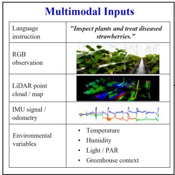

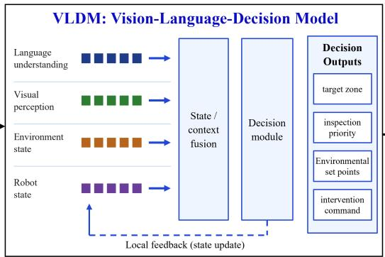

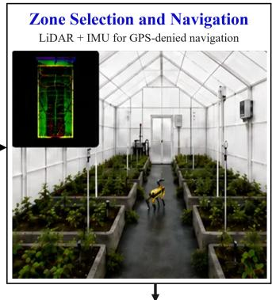

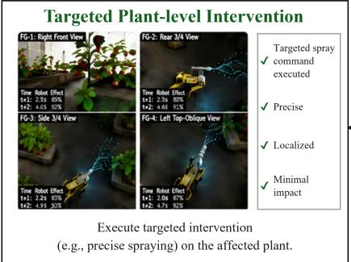

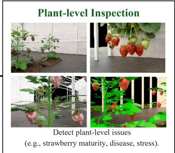

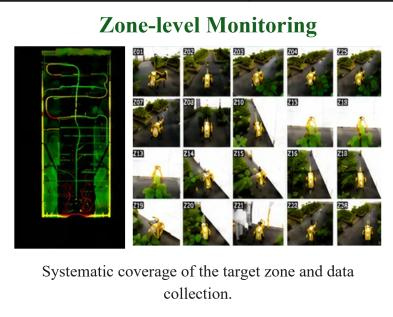  
Figure 1: AgriSense multimodal decision-to-action pipeline. The original system-level illustration is retained to show the proposed sensing, decision, navigation, and intervention interfaces. The learned implementation accepts RGB, text, and 19 structured environmental/context values; LiDAR-IMU processing and continuous robot state belong to separate modules. “"Inspection priority," “precise," and “minimal impact"’ in the illustration are workflow labels or design objectives, not additional learned heads or measured agronomic outcomes. The component-specific evidence and execution boundaries are given in Sections 2.3-3.9.

Table 2  
System modules and interface inventory. The evaluated pathways are specified in the accompanying protocols; extended dispatch requirements are given in Supplementary Section S9.
<table><tr><td>Module</td><td>Inputs</td><td>Outputs</td><td>Representative interface or artifact</td></tr><tr><td>Robot sensing</td><td>RGB, LiDAR, IMU, proprioception</td><td>Images, point clouds, inertial measurements</td><td>Robot-view image stream, LiDAR cloud, IMU and robot-state topics</td></tr><tr><td>Zone sensing</td><td>Fixed environmental sensor nodes</td><td>Temperature, humidity, and soil-moisture states</td><td>Global and per-zone ROS 2 messages and synchronized CSV logs</td></tr><tr><td>LiDAR-IMU spatial grounding</td><td>Point clouds, IMU, local map</td><td>Robot pose, trajectory, current zone, map update</td><td>Local odometry, reconstructed point cloud, zone-association output</td></tr><tr><td>Multimodal dataset recorder</td><td>Image, prompt, zone, pose, and environmental state</td><td>Aligned multimodal samples and target labels</td><td>Dataset CSV, image directory, preprocessing metadata</td></tr><tr><td>VLDA inference</td><td>Prompt, RGB image, environmental vector,</td><td>Setpoint proposals, target zone, spray-intervention</td><td>Prediction packet and offline evaluation outputs</td></tr><tr><td>Validation and command dispatch Environmental control</td><td>current zone Model outputs, timestamps, pose, map, actuator limits Validated references and</td><td>probability Accepted command, rejected proposal, or fallback request Irrigation, ventilation,</td><td>Validated command buffer, event log, execution-mode state PI/PID reference-tracking commands and bounded</td></tr><tr><td>Navigation and</td><td>measured zone states Validated target zone, local</td><td>heating/cooling, and humidity commands Motion command, inspection</td><td>actuator signals Navigation-goal queue and manipulator-action</td></tr><tr><td>intervention Supervision</td><td>map, target region Maps, telemetry, decisions,</td><td>pose, or spray primitive Review displays and high-level operator requests</td><td>interface Non-real-time application and remote dashboard</td></tr></table>

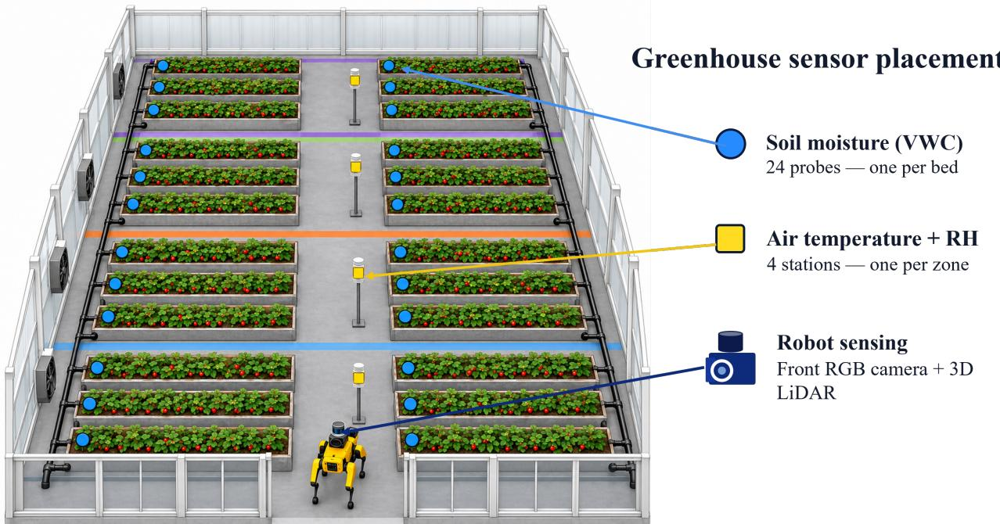  
Figure 2: Sensor and actuator placements in the virtual greenhouse. Blue arrows identify sensing and orange arrows actuation in the supplied cutaway. Fan rotation and water particles visualize model actuator fractions, not computational fluid dynamics or calibrated deposition. Full bed/zone identifiers and coordinates are supplied separately in the supplementary sensor-layout view.

Figure 2 identifies the modeled sensor and actuator placements; the full coordinate view is retained in the supplement.

## 2.2. Virtual greenhouse, visual data and scenario specification

Embodied Virtual-Greenhouse Environment The AgriSense virtual greenhouse is implemented in Isaac Sim as a simulation-centric embodied environment for evaluating robot sensing, spatial grounding, navigation, inspection, environmental regulation, and plant-level spray-intervention workflow. Unlike greenhouse digital twins used primarily for visualization or process monitoring, the proposed environment explicitly represents the robot, its sensors, its local spatial context, and its interaction with the greenhouse.

The simulated scene contains the greenhouse structure, cultivation beds, aisle corridors, management-zone boundaries, structural obstacles, sensing locations, strawberry-like crop assets, and the quadruped mobile manipulator. The environment supports viewpoint-dependent RGB observations, 3D LiDAR returns, IMU measurements, robot-state feedback, and manipulator motion. Management zones are defined within the local map so that robot poses, environmental measurements, inspection observations, and intervention decisions can be associated with a consistent spatial reference.

Figure 3 shows representative RGB observations generated from the robot and greenhouse viewpoints. These images are used for multimodal dataset construction, perceptionpipeline verification, and scenario replay.

Quadruped, Manipulator, and Multimodal Sensor Modeling The simulated mobile platform consists of a quadruped base equipped with a manipulator, robotmounted RGB camera, 3D LiDAR, IMU, local computing interface, and spray end-effector. The quadruped traverses the greenhouse aisles, acquires crop and environmental observations, and moves toward validated inspection or intervention locations.

The RGB camera provides visual information for cropcondition interpretation and plant-level inspection. The 3D LiDAR and IMU provide the measurements required for GNSS-denied localization, local map reconstruction, motion estimation, and greenhouse-zone association. Sensor measurements are timestamped and synchronized with the robot pose and zone-level environmental state before being recorded or passed to the VLDA module.

The manipulator provides the physical interface for localized spray treatment in simulation. The evaluated intervention uses scenario targets and the geometric/dwell admission criteria specified below. The primitive represents a bounded sequence consisting of target approach, directed spray execution, and return to a safe manipulator configuration.

Zone-State Representation and Environmental-Control Emulation In addition to robot and sensor simulation, the virtual-greenhouse workflow maintains synchronized environmental states for each greenhouse management zone. The zone-state channels include temperature, relative humidity, and soil moisture. These values are associated with the corresponding greenhouse zones and are recorded together with the robot pose, RGB observations, mission prompt, and model outputs.

Environmental disturbances are introduced through controlled scenario profiles, including elevated temperature, excessive humidity, low soil moisture, and mixed multi-zone conditions. The VLDA module processes these states together with the visual and spatial inputs and proposes environmental reference values. The proposed references are not treated as direct actuator commands.

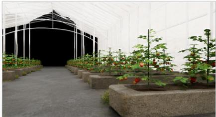  
Close crop view 1

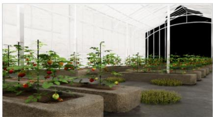  
Close crop view 2

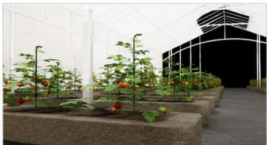  
Close crop view 3

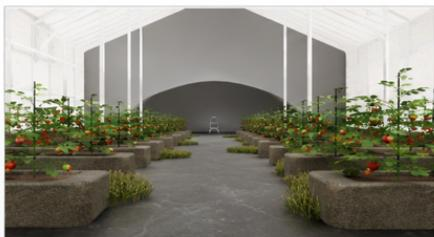  
Aisle view 1

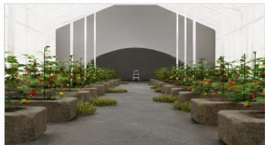  
Aisle view 2

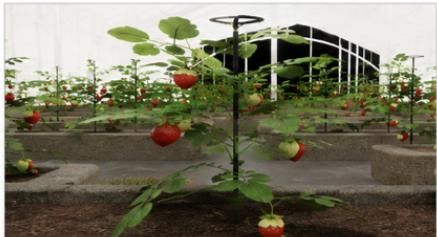  
Inspection view

(a) Representative RGB observations.  
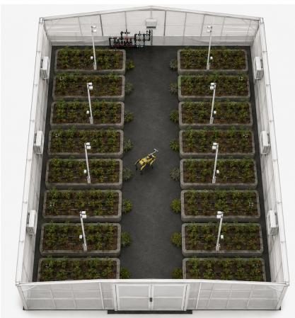  
(b) Top-down greenhouse layout.

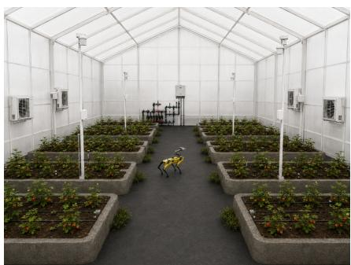  
(c) Interior aisle view.

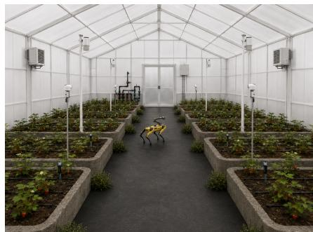  
(d) Complementary interior view.  
Figure 3: Original virtual-greenhouse views combined to retain spatial context alongside the added experimental figures. Representative RGB observations generated in the Isaac Sim virtual greenhouse. The samples include aisle-level robot views, crop-row observations, greenhouse spatial context, and close crop-inspection viewpoints used for multimodal dataset construction and simulation-centric pipeline evaluation. The top-down view provides the global spatial organization, whereas the interior views show the robot operating context, cultivation-bed arrangement, sensing infrastructure, and GNSS-denied navigation corridors. The source images are unchanged; these qualitative views do not measure plant-target registration accuracy.

The environmental execution protocol is described in Section 2.5.

Multimodal Dataset Construction and Controlled Visual Augmentation The AgriSense multimodal dataset was constructed in two stages. The first stage generated the base simulation dataset directly from the embodied greenhouse environment in NVIDIA Isaac Sim. The second stage introduced controlled disease-like visual conditions through post-simulation image-to-image augmentation. This distinction is important because the disease appearances were not physically modeled as plant pathologies inside Isaac Sim.

During the first stage, the quadruped robot was operated from multiple greenhouse locations and viewpoints, including aisle-level traversal, crop-row observation, and close strawberry-inspection poses. Robot-view RGB images were recorded together with the corresponding greenhouse and task context. Each visual observation was associated with its management-zone identifier, global and zone-specific environmental states, and the corresponding task record. The environmental state contained temperature, relative humidity and soil-moisture measurements for the four management zones.

For a recorded sample i, the multimodal dataset entry can be summarized as

$$
\boldsymbol { D _ { i } } = \left\{ \boldsymbol { I _ { i } } , \boldsymbol { q _ { i } } , \boldsymbol { z _ { i } } , \boldsymbol { e _ { i } } , \boldsymbol { s _ { i } ^ { * } } , \boldsymbol { z _ { i } ^ { * } } , \boldsymbol { y _ { i } ^ { p } } \right\} ,\tag{1}
$$

where $I _ { i }$ is the robot-view RGB observation, $\pmb { q } _ { i }$ is the associated task or mission prompt, $z _ { i }$ is the current management zone, $e _ { i }$ contains the global and per-zone environmental measurements, $\boldsymbol { s } _ { i } ^ { * }$ contains the target environmental references, $z _ { i } ^ { * }$ is the target-zone label, and $y _ { i } ^ { p }$ is the binary plant-level spray-intervention label.

Controlled diversity was introduced during simulation through changes in robot viewpoint, crop-observation distance, partial occlusion, illumination, and environmental disturbances. Temperature, humidity, and soil-moisture conditions were varied across the four management zones so that the dataset contained both spatial and environmental variation rather than repeated images associated with a single greenhouse state.

The Isaac Sim crop assets primarily represented healthy strawberry appearances. To expand the visual-condition space without changing the underlying spatial and environmental context, selected robot-view images were therefore processed in a separate post-simulation augmentation stage. The augmentation scripts specify an OpenAI Image API workflow. Per-image execution settings are unavailable; script defaults are recorded separately in Supplementary Section S1. The editing instructions restricted modifications to visible strawberry fruits while preserving the original camera pose, greenhouse geometry, foliage, illumination, shadows, depth relationships, and overall scene composition.

Three controlled disease-like visual classes were introduced: powdery-mildew-like, Botrytis-like, and anthracnoselike appearances. The original script-level sampling specification was

$$
P ( c ) = \left\{ \begin{array} { l l } { 0 . 3 5 , } & { c = \mathrm { p o w d e r y ~ m i l d e w } , } \\ { 0 . 3 5 , } & { c = \mathrm { B o t r y t i s } , } \\ { 0 . 3 0 , } & { c = \mathrm { a n t h r a c n o s e } . } \end{array} \right.\tag{2}
$$

The corresponding editing constraints were designed to produce subtle white powdery regions for the powderymildew-like condition, localized grey-brown mould and fruit degradation for the Botrytis-like condition, and dark sunken lesions for the anthracnose-like condition. These labels describe controlled visual proxies and should not be interpreted as biologically confirmed strawberry diseases.

The final dataset is evaluated using its stored prompts and labels. Source reconciliation identifies which base/edited pairs preserve environmental context and which labels change, as quantified below and detailed in Supplementary Section S1. Script-level sampling and metadata design are retained in Supplementary Section S9.

Figure 4 presents representative visual conditions from this process. The examples illustrate healthy simulated observations, disease-like visual proxies, environmental-stress conditions, occlusion, and illumination variation.

This construction preserves the controlled spatial and environmental context of the virtual greenhouse while expanding the visual appearance space available to the multimodal model. The augmented samples are used to evaluate target-zone, environmental-reference, inspection, and sprayintervention proposal behavior under synthetic visual stress. The final supervised CSV contains 283 decodable images from one episode: 150 base frames at $1 2 8 0 \times 7 2 0$ and 133 edited frames at 1536×1024. The 2,917 raw-directory images are not all labelled examples. Prompts and reference outputs were generated offline; the offline teacher-labeling script requests both in one response and sanitizes output ranges to temperature 16- ${ } ^ { - 2 4 } { } ^ { \circ } \mathbf { C } .$ , humidity 45–65%, soil moisture 55–75%, and zone IDs 1–4. These are historical labeling rules, not expert-validated treatment thresholds. The final CSV omits the teacher request/response history, so the exact generation provenance remains incomplete.

A source reconciliation identifies six base-toaugmentation pairs within the 150 supervised base records. All six preserve the current-zone code, environmental values, and twelve reference targets, but change the final prompt, target-zone label, and intervention flag. The source parents of the remaining 127 augmented records are not represented within that base subset. Accordingly, complete prompt/label inheritance cannot be assumed. Moreover, all base rows have negative intervention labels and all augmented rows positive labels; a case-insensitive rule matching “anthracnose," “powdery mildew," or “botrytis" in the prompt reproduces all 283 intervention labels. The rule is an observed shortcut diagnostic, not proof of which input route the network actually uses.

The historical seed-42 row split is reproducible, but disjoint row indices do not ensure independence. Five crosssplit pairs share a source-frame key, sensor vector, and all twelve references; three test records have training relatives. A separate dHash64-distance-at-most-four screen identifies twenty cross-split candidates, which are not necessarily disjoint from the source-lineage pairs. Before retraining, shared source keys and the same similarity screen define 265 connected components, each assigned to a single subset of the 197/42/44 training/validation/test split. This removes the identified cross-split links without creating a second acquisition episode or independent physical-plant evidence. The original 198/42/43 results are retained as historical reproduction, not pooled with the grouped evaluation.

## 2.3. VLDA inputs, architecture, and training objective

The VLDA module converts multimodal greenhouse observations into structured high-level proposals. At decision time t, the model receives a robot-view RGB image $I _ { t } ,$ a user or mission prompt $\pmb { q } _ { t } .$ and a structured sensor-and-zone vector. The latter is defined as

$$
\boldsymbol { v } _ { t } ^ { \mathrm { s e n } } = \left[ \mathrm { o n e h o t } ( \boldsymbol { z } _ { t } ) ^ { \top } , T _ { g , t } , H _ { g , t } , S _ { g , t } , e _ { 1 , t } ^ { \top } , \ldots , e _ { K , t } ^ { \top } \right] ^ { \top } ,\tag{3}
$$

where $z _ { t }$ is the current management zone; $T _ { g , t } , H _ { g , t } ,$ and $S _ { g , t }$ are greenhouse-level temperature, humidity, and soilmoisture values; and

$$
\mathbf { \Lambda } ^ { e } _ { k , t } = \left[ T _ { k , t } \quad H _ { k , t } \quad S _ { k , t } \right] ^ { \top }\tag{4}
$$

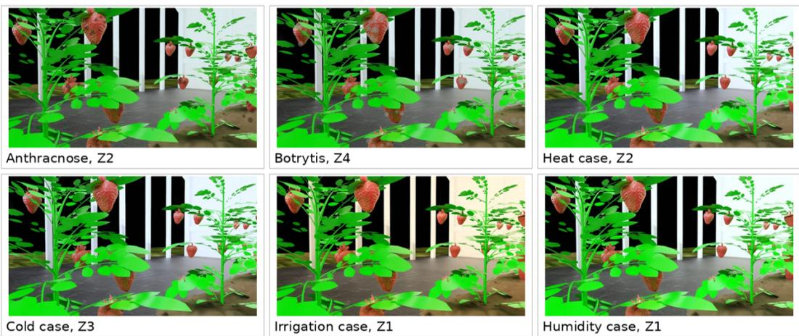  
Figure 4: Representative visual conditions used in the AgriSense multimodal dataset. Healthy robot-view observations originate from the Isaac Sim greenhouse environment, whereas disease-like strawberry appearances are generated through controlled post-simulation image editing. The powdery-mildew-, Botrytis-, and anthracnose-like examples are synthetic visual proxies, not biologically confirmed diagnoses. Labels attached to these examples describe the generated dataset and do not establish disease sensitivity or treatment efficacy.

Table 3  
Original dataset composition and evaluation split definitions. Zone counts list target-zone labels, not current-zone inputs.
<table><tr><td>Subset</td><td>Base/edited</td><td>Total</td><td>Target zones 1/2/3/4</td><td>Negative/positive</td></tr><tr><td>Historical training</td><td>105/93</td><td>198</td><td>27/26/125/20</td><td>105/93</td></tr><tr><td>Historical validation</td><td>22/20</td><td>42</td><td>6/6/26/4</td><td>22/20</td></tr><tr><td>Historical test</td><td>23/20</td><td>43</td><td>6/5/28/4</td><td>23/20</td></tr><tr><td>All supervised rows</td><td>150/133</td><td>283</td><td>39/37/179/28</td><td>150/133</td></tr><tr><td>Grouped split</td><td colspan="4">197 training / 42 validation / 44 test rows; 265 source/similarity components</td></tr></table>

contains the corresponding measurements for zone k. For the four-zone greenhouse considered in this work, $\pmb { v } _ { t } ^ { \mathrm { s e n } }$ contains a four-dimensional zone code, three global measurements, and twelve zone-specific measurements.

All 19 sensor/context channels, including the currentzone one-hot code, are standardized using means and standard deviations computed from the training split. Standard deviations below $1 0 ^ { - 6 }$ are replaced by one. The current-zone code provides coarse spatial context to the learned model, whereas the continuous robot pose and local map are retained by the downstream execution layers.

The model predicts three output types:

$$
\begin{array} { r l } & { \hat { { \mathbf { \mathstrut } } } _ { t } \in \mathbb { R } ^ { 3 K } , \quad { \pmb { \pi } } _ { t } ^ { z } \in [ 0 , 1 ] ^ { K } , } \\ & { \hat { { \ b { p } } } _ { t } \in [ 0 , 1 ] . } \end{array}\tag{5}
$$

Here, $\hat { \boldsymbol { s } } _ { t }$ contains the proposed per-zone environmental references, $\pmb { \pi } _ { t } ^ { z }$ contains the target-zone class probabilities, and $\hat { p } _ { t }$ is the plant-level spray-intervention proposal probability.

The target-zone proposal is obtained as

$$
\hat { z } _ { t } = \arg \operatorname* { m a x } _ { k \in \{ 1 , . . . , K \} } \pi _ { k , t } ^ { z } .\tag{6}
$$

For $K = 4 ,$ the regression head produces twelve values corresponding to temperature, humidity, and soil-moisture references for Zones 1–4. These values are interpreted as high-level reference proposals and are not applied directly to greenhouse actuators.

The image processor converts RGB input to 3× 224×224 tensors. The evaluated model uses pretrained DINOv2- small token embeddings of width 384 and BERT-baseuncased embeddings of width 768 (Oquab et al., 2023; Devlin et al., 2019); BERT tokenization uses a maximum length of 128 and an attention mask. Both backbones are frozen, and the final-layer CLS embedding is selected from each. Projection blocks are Linear(384,256)–ReLU— Dropout(0.1) and Linear(768,128)–ReLU-Dropout(0.1) The environmental encoder is Linear(19,128)-ReLU— Dropout(0.1)–Linear(128,128)–ReLU. The resulting 256, 128, and 128 features are concatenated, not cross-attended, to form a 512-dimensional vector.

Let $f _ { I } ( \cdot ) , f _ { Q } ( \cdot ) .$ and $f _ { E } ( \cdot )$ denote the visual, textual, and structured-state encoders, respectively. Their latent representations are

$$
\begin{array} { r } { \pmb { h } _ { t } ^ { I } = f _ { I } ( I _ { t } ) , } \end{array}\tag{7}
$$

$$
\begin{array} { r } { \pmb { h } _ { t } ^ { Q } = f _ { Q } ( \pmb { q } _ { t } ) , } \end{array}
$$

$$
\begin{array} { r } { \pmb { h } _ { t } ^ { E } = f _ { E } ( \pmb { v } _ { t } ^ { \mathrm { s e n } } ) . } \end{array}\tag{8}
$$

(9)

The evaluated implementation uses a DINOv2-small visual encoder, a BERT-base-uncased text encoder, and a feed-forward network for the structured sensor-and-zone vector. The three projected representations are concatenated and passed through a shared fusion network, Linear(512,256)– ReLU–Dropout(0.2)-Linear(256,256)–ReLU:

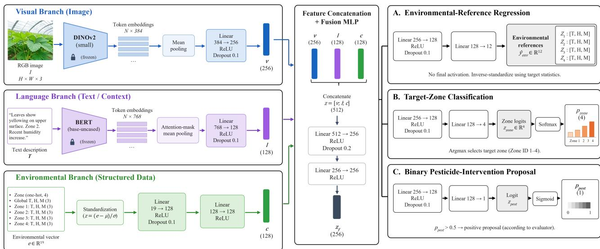  
Figure 5: Internal VLDA architecture for the evaluated checkpoint. Frozen DINOv2-small and BERT-base-uncased encoders provide CLS features, which are projected and concatenated with the encoded 19-channel environmental/context vector. A shared fusion MLP feeds environmental-reference, target-zone, and intervention-proposal heads. Images are processed to 3 × 224 × 224 tensors, and structured inputs and regression targets use training-derived statistics. Input readiness and execution supervision are external to the network. The alternative mean-pooling trainer is distinguished in Table 4.

$$
\begin{array} { r } { \pmb { h } _ { t } = \phi \left( \left[ \pmb { h } _ { t } ^ { I } ; \pmb { h } _ { t } ^ { Q } ; \pmb { h } _ { t } ^ { E } \right] \right) , } \end{array}\tag{10}
$$

Each task head has its own Linear(256,128)–ReLU— Dropout(0.1) hidden block followed by a final linear map of width 12, 4, or 1. Thus the heads are nonlinear functions of the shared representation, not single affine maps. With $g _ { s }$ $g _ { z } ,$ and $g _ { p }$ denoting these three MLPs, the actual decoding is

$$
\widehat { \widetilde { s } } _ { t } = g _ { s } ( \pmb { h } _ { t } ) , \qquad \hat { s } _ { t } = \pmb { \mu } _ { s } + \pmb { \sigma } _ { s } \odot \widehat { \widetilde { s } } _ { t } ,\tag{11}
$$

$$
\pi _ { t } ^ { z } = \operatorname { s o f t m a x } ( g _ { z } ( \pmb { h } _ { t } ) ) ,\tag{12}
$$

$$
\hat { p } _ { t } = \sigma ( g _ { p } ( \pmb { h } _ { t } ) ) , \qquad \hat { y } _ { t } ^ { p } = \mathbb { I } [ \hat { p } _ { t } > 0 . 5 ] .\tag{13}
$$

The regression head has no final activation, and $\mu _ { s } , \pmb { \sigma } _ { s }$ are fitted only to training targets. The target order is temperature, humidity, and soil moisture for Zone 1 followed by Zones 2–4. Proposals are not guaranteed to be optimal setpoints. The binary output is an intervention proposal, not a disease class, lesion mask, dose, or automatic authorization to spray. The model contains 132,052,881 parameters, of which 131,538,816 are frozen and 514,065 trainable.

The VLDA model is trained jointly for environmentalreference regression, target-zone classification, and plantlevel spray-intervention proposal prediction. The total objective is

$$
\begin{array} { r } { \mathcal { L } = \lambda _ { s } \mathcal { L } _ { \mathrm { r e g } } + \lambda _ { z } \mathcal { L } _ { \mathrm { z o n e } } + \lambda _ { p } \mathcal { L } _ { \mathrm { p e s t } } , } \end{array}\tag{14}
$$

where $\lambda _ { s } = \lambda _ { z } = \lambda _ { p } = 1$ in the saved run. The original trainer uses MSE on standardized targets, training-frequencyweighted cross-entropy, and positive-weighted BCE-withlogits. For a batch $B ,$ these terms are

$$
\mathcal { L } _ { \mathrm { r e g } } = \frac { 1 } { 1 2 | \mathcal { B } | } \sum _ { i \in \mathcal { B } } \sum _ { j = 1 } ^ { 1 2 } ( \widehat { \widetilde { s } } _ { i j } - \widetilde { s } _ { i j } ) ^ { 2 } ,\tag{15}
$$

$$
\mathcal { L } _ { \mathrm { z o n e } } = \frac { - \sum _ { i \in \mathcal { B } } w _ { y _ { i } } \log \pi _ { y _ { i } , i } ^ { z } } { \sum _ { i \in \mathcal { B } } w _ { y _ { i } } } , \quad w _ { c } = \frac { N } { 4 n _ { c } } ,\tag{16}
$$

$$
\mathcal { L } _ { \mathrm { p e s t } } = - \frac { 1 } { | \mathcal { B } | } \sum _ { i \in \mathcal { B } } \left[ q y _ { i } ^ { p } \log \hat { p } _ { i } + ( 1 - y _ { i } ^ { p } ) \log ( 1 - \hat { p } _ { i } ) \right] ,\tag{17}
$$

where $q ~ = ~ \mathrm { m a x } ( 1 , N _ { \mathrm { n e g a t i v e } } / N _ { \mathrm { p o s i t i v e } } )$ and all counts come from training labels. Here, N is the number of training samples and $n _ { c }$ is the number with target-zone class c. Checkpoints are selected by minimum total validation loss. Alternative-trainer settings are documented separately in Supplementary Section S1.

## 2.4. Input readiness and command admission

Two distinct checks are evaluated. The neural-interface readiness function requires the input fields to be present, receipt age at most 2 s, and timestamp spread at most 1 s. It does not test numerical ranges or nonfinite values. The virtual-controller command guard is evaluated separately with stale sensor/diagnosis, nonfinite command, out-of-range command, unreachable target, unsafe clearance, disconnect, invalid-state and abort fixtures. Safe dwell requires upright posture, planar speed below 0.035 m/s and yaw rate below 0.06 rad/s for 0.5 s. A numerical upright-angle threshold is not available in the retained protocol. Results use the specific fixture counts in Section 3.8. The broader confidence reference-rate and localization-consistency admission rules are conceptual extensions in Supplementary Section S9.

Table 4  
Model and training configurations. The historical checkpoint and the new retrainings are separate protocols.
<table><tr><td>Item</td><td>Historical checkpoint</td><td>Repeated branch evaluation</td></tr><tr><td>Backbones/pooling</td><td>Frozen DINOv2-small and BERT; CLS/CLS</td><td>Same frozen weights; cached evaluation-mode CLS features</td></tr><tr><td>Trainable capacity</td><td>514,065 parameters</td><td>Same stored projection/encoder/fusion/head topology; removed features zeroed</td></tr><tr><td>Optimizer</td><td>AdamW; learning rate  $1 0 ^ { - 4 }$  , weight decay  $1 0 ^ { - 4 }$ </td><td>AdamW; same rates</td></tr><tr><td>Batch/epoch policy</td><td>16; maximum 300; patience 10</td><td>16; maximum 100; patience 10</td></tr><tr><td>Recorded history</td><td>50 epochs; selected epoch 40</td><td>Validation-selected per run; per-run records supplied</td></tr><tr><td>Seeds</td><td>42</td><td>17, 29, 43, 71, 101</td></tr><tr><td>Objective</td><td>MSE + weighted CE + weighted BCE; weights 1/1/1</td><td>Same objective; training-only standardization</td></tr><tr><td>Decision thresholds</td><td>Zone argmax; intervention probability &gt; 0.5</td><td>Same decoding; no test-threshold selection</td></tr><tr><td>Forward latency</td><td>Median 7.1006 ms; p95 7.4684 ms</td><td>Not a matched timing comparison across training protocols</td></tr></table>

Original training calls model.train(), so freezing weights does not itself disable BERT dropout. Cached-feature retraining disables backbone dropout; it is not an exact replay of stochastic online training. Batch-one FP32 latency was measured on an RTX 5090 Laptop GPU with five warm-ups and 30 timed repeats; it excludes decoding, preprocessing, transfer, I/O, and ROS. Historical training wall time and peak GPU memory are unavailable.

Table 5  
VLDA Dataset Schema and Prediction Targets
<table><tr><td>Field group</td><td>Contents</td></tr><tr><td>Image</td><td>Robot-view RGB image or controlled augmented crop-view sample</td></tr><tr><td>Language</td><td>User request, mission prompt, or task instruction</td></tr><tr><td>Sensor and zone context</td><td>Current-zone code and global/per-zone temperature, humidity, and soil-moisture measurements</td></tr><tr><td>Regression targets</td><td>Twelve environmental references: temperature, humidity, and soil moisture for Zones 1-4</td></tr><tr><td>Classification target</td><td>Target management zone  $z ^ { * } \in \{ 1 , 2 , 3 , 4 \}$ </td></tr><tr><td>Binary-action target</td><td>Apply or skip localized pesticide intervention</td></tr><tr><td>Dispatch context</td><td>Timestamp, robot pose, local map status, safe-goal status, and manipulator reachability</td></tr><tr><td>Evaluation artifacts</td><td>Sample identifier, image path, predicted references, class probabilities, binary-action probability, errors, confusion matrices, and summary metrics</td></tr></table>

Dataset schema and recorded outputs Table 5 summarizes the multimodal inputs, prediction targets, and evaluation artifacts used by the VLDA pipeline. Image, language and sensor/context fields define the supervised records; dispatch context belongs to the separate execution protocols.

## 2.5. Localization, environmental response and robotic protocols

Point-LIO (He et al., 2023) is evaluated by offline replay on five simulated routes. Inputs comprise 16 rings with 200 azimuth samples per ring, 10 Hz rolling scans acquired over 0.1 s, a body-origin IMU at 100 Hz, 35 m range, and a bodyaligned LiDAR translation of [0, 0, 0.33] m. Range, dropout and inertial perturbations vary across routes. The estimator reads LiDAR and IMU streams; a separate evaluator reads reference pose. Collision geometry generates returns. Fullroute rigid and initial-pose alignments are both reported, using the metrics in Section 2.6. Navigation uses simulator pose, as defined by the scope above. Standard estimation mathematics is given in Supplementary Section S7.

The environmental component is an Isaac Sim extension with zone temperature and relative-humidity states, bed water-balance states, and bounded exhaust, circulation and irrigation fractions. Six 12-hour scenarios use synthetic weather inputs and 1 Hz logging: dry substrate, high humidity high temperature, hot/dry conditions, combined disturbance and actuator saturation. Evaluation measures reference error recovery, sustained settling and actuator saturation. The protocol and complete outcomes, including failures, are reported in Section 3.6 and Supplementary Section S4. The present characterization is limited to these logged responses; the missing process parameterization is identified in Section 3.9.

The geometric arm protocol comprises 32 accepted cropedge targets and eight far-boundary requests. It uses 3 s settling, 6 s control, a 0.95 m standoff, target heights of 0.65– 0.85 m and a target-disk radius of 30 mm. Pose acceptance requires position error below 30 mm and nozzle-axis error below 0.1 rad. The modeled nozzle is the finger-link origin Integrated full-route, left-target and right-target missions use scenario-defined diagnosis and target positions to evaluate navigation, dwell, approach, treatment-command sequencing and stow. The stationary-base admission condition is stated in Section 2.4. Geometric pose success, ray/disk intersection and modeled treatment units are reported as separate outcomes.

Navigation/control cohorts comprise ten nominal repeats, six clear-layout robustness cases, two moving obstaclestop cases and 20 valid arm-proxy controls. Arm requests, three integrated missions, 90 isolated forced faults and nine mission-injected faults have separate denominators. Command speed, simulated elapsed time, physics-step checks and dose-command checks retain their distinct units. These definitions prevent pooling unrelated checks into one success rate.

## 2.6. Experimental protocols and statistical reporting

The original AgriSense implementation was evaluated under Ubuntu 22.04.5 LTS using Python 3.10.12 on a workstation with an Intel Core i9-13980HX processor, an NVIDIA

GeForce RTX 4060 Laptop GPU with 8 GB dedicated memory, and 15.2 GB RAM. The added checkpoint replay and image-model campaign are separate executions; replay timing uses an RTX 5090 Laptop GPU, PyTorch 2.9.1+cu128, transformers 4.37.2, and FP32 inference. Hardware and timing scopes are not combined across experiments.

The repeated VLDA experiment trains the actual projection, environmental, fusion, and three-head modules with cached frozen-backbone features. Full, no-image, no-language, and no-sensor/current-zone conditions are each trained with five seeds on both the historical and grouped splits, giving 40 retrainings. Removed embeddings are zeroed during both training and evaluation, preserving fusion width. Five-seed image-only zone probes use ResNet-50, EfficientNet-B0, ViT-B/16, and CLIP image features on the same grouped test. These probes receive less information and have different heads/budgets, so they are not a matched-information proof of fusion superiority. A separate twelve-condition experiment perturbs one fixed historical checkpoint; inference-time removal is not called retraining.

An additional campaign trains five sensor/current-zoneonly models, five language-only models and five matched full controls on the unchanged grouped split. All branches execute before post-projection masking, preserving dropout randomnumber consumption and the 514,065-parameter topology; masks apply during training, validation and test. Sensoronly retains all 19 structured inputs; language-only zeros the complete structured branch. The AdamW, normalization, loss, epoch limit, patience and validation-selection settings are unchanged. The current full controls exactly reproduce historical full predictions, tensors, normalization and histories. The new runs use CPU execution; timings are not compared with prior GPU latency. No historical/current seed pooling is performed.

The real-image benchmark is deliberately separate from VLDA's three-output task. PlantVillage supplies 54,305 decoded colour images; conservative source/leaf/similarity grouping quarantines 5,207 cross-label component members and retains 49,098 images with 34,360/4,910/9,828 train/validation/test membership and 38 crop-condition labels. Quarantine may exclude valid hard lookalikes; 13,194 records lack resolved physical-leaf IDs. PlantSeg v7 supplies 7,774 decoded images/masks, of which 7,551 remain after 223 unique annotation/conflicting-label exclusions. The external classification subset contains 238 official-test images, 238 groups, and fifteen compatible true classes, while keeping all 38 model outputs and unrestricted argmax. No environmental references, greenhouse-zone targets, or intervention labels are fabricated for these datasets.

Four frozen-image representations each have five trained linear heads, and CLIP also has one fixed image-text zeroshot evaluation using predeclared crop/disease templates. Nine further experiments fine-tune all parameters of ResNet-50, EfficientNet-B0, and ViT-B/16 over three seeds and at most ten epochs. Full-network AdamW backbone/head learning rates are $1 0 ^ { - 5 } / 1 0 ^ { - 4 }$ , weight decay $1 0 ^ { - 4 }$ , batch size

64, and checkpoint selection uses validation cross-entropy. Frozen probes use learning rate $1 0 ^ { - 3 }$ , batch 512, and at most 100 epochs with patience 10. Different augmentation, capacity, and budgets prevent interpreting the two cohorts as an isolated unfreezing ablation. Plant Pathology 2021 remained access-blocked (HTTP 401), and no PlantSeg segmentation model was trained.

Continuous errors are reported separately in degrees Celsius and percentage points; the original mixed-unit MAE is retained only as a historical scalar. Classification uses accuracy, fixed-class macro-F1, per-class metrics, and confusion matrices. Seed means and sample standard deviations describe optimization variability, not test-sampling confidence. Source-group bootstrap intervals resample whole discovered groups; crossed seed/group intervals also resample fitted seeds. The available exports use 1,000 draws with declared missing-class handling, while balanced-accuracy intervals are conditional on class-complete draws. No resampling of one episode creates between-greenhouse evidence. Calibration, corruption, risk-coverage, and out-of-distribution diagnostics, together with their thresholds and prevalence, are retained in the supplement rather than merged into intervention-safety claims.

Localization reports initial-pose-aligned and all-position rigid SE(3)-aligned absolute trajectory error (ATE), with scale fixed to one, and one-second relative pose error (RPE). Ground-truth position is interpolated, orientation uses SLERP, and no extrapolation is performed; the RPE pairing tolerance is 0.12 s. A full-route rigid fit and an initial-pose transform answer different questions and are therefore both retained. Robot, arm, and fault cohorts are counted separately; neither physics-step counts nor image-model seeds are treated as independent integrated missions.

## 3. Results and Discussion

## 3.1. Original visual records and their evidentiary scope

The original visual sequence, historical tables and narrative are retained in Supplementary Material, Section S6. The main results figures now emphasize the added quantitative experiments. Original trajectory logs and maps are historical records whose estimator provenance is not equivalent to the separately verified offline Point-LIO experiment. Figure artwork is not recolored; revised captions state these boundaries.

## 3.2. AgriSense Application and Remote Supervision

The AgriSense application functions as a non-real-time supervision layer. It visualizes edge-generated telemetry, greenhouse measurements, perception outputs, local maps, mission coverage, diagnostics, and validated action states. The interface design treats operator inputs as high-level requests rather than direct actuator commands. The screenshots do not establish implementation coverage of every proposed edge-side guard.

Historical checkpoint results and checkpoint replay on the original 43-row test set. Source-group dependence is addressed separately by the grouped experiment.
<table><tr><td>Metric</td><td>Original evaluation</td><td>Checkpoint replay</td></tr><tr><td>Target-zone accuracy</td><td>95.35% (41/43)</td><td>95.35% (41/43)</td></tr><tr><td>Target-zone macro-F1</td><td>0.9311</td><td>0.9311</td></tr><tr><td>Intervention-label agreement</td><td>100% (43/43)</td><td>100% (43/43)</td></tr><tr><td>Mixed-unit reference MAE</td><td>1.266192</td><td>1.265588</td></tr><tr><td>Temperature MAE (°C)</td><td>Not separated</td><td>0.323820</td></tr><tr><td>Humidity MAE (percentage points)</td><td>Not separated</td><td>2.234821</td></tr><tr><td>Soil-moisture MAE (percentage points)</td><td>Not separated</td><td>1.238123</td></tr></table>

Both discrete outputs match the archive; the small regression difference is retained rather than described as bit-exact. Mixed-unit MAE is not a physically homogeneous accuracy measure. Generated intervention labels are not expert treatment decisions.

For readability in the supplementary record, Supplementary Figure S18 includes six representative interface views. These screenshots illustrate the supervision workflow.

## 3.3. Prediction performance and modality dependence

The VLDA model maps prompt text, robot-view RGB observations, greenhouse sensor states, and current-zone context into three types of structured proposal: four-zone environmental references, target-zone selection, and a binary pesticide-intervention proposal. Table S23 retains the original held-out results and places the new reproduction beside them.

The target-zone metrics indicate that the model generally distinguishes the requested or inferred management region on this particular split. The spray-label result should be interpreted cautiously because it was obtained from only 43 samples and is fully reproducible by a prompt-keyword rule. It establishes agreement with the generated dataset, not field-level disease-diagnosis or treatment performance.

The historical checkpoint's source-group 95% interval for zone accuracy is 87.80–100%; the macro-F1 interval is 0.7185–1.0000. These intervals are conditional on the fitted model and observed one-episode groups, and do not repair training/test lineage leakage. Representative original decision-output panels are retained in Supplementary Figure S13; Supplementary Material, Section S6 retains the original loss summaries and full historical narrative.

The new grouped comparison reveals which inputs contribute under the available labels (Table 7, Fig. 6). The full model attains 43/44 correct target zones in every seed, but so do the no-image and no-language variants. Removing the complete sensor/current-zone branch lowers average zone accuracy to 78.636%±4.129 percentage points. Because that removal excludes both current-zone indicators and continuous environmental values, the contrast does not isolate an abiotic causal effect.

The environmental-reference results qualify the apparent zone performance. Removing language increases the mean temperature/RH/soil errors from 0.249/2.030/0.997 to 0.283/2.172/1.158 in their respective units, whereas removing images reduces them to 0.168/1.302/0.664. The lower noimage errors caution against attributing the full model's output quality to visual evidence. On this small teacherlabeled dataset, an additional modality does not necessarily provide independent information about the targets. A future dataset must vary crop observations and intervention outcomes independently of prompt wording and editing format before the necessity of all three modalities can be established.

Image-only grouped zone probes obtain mean accuracies of 65.00% (ResNet-50), 64.55% (EfficientNet-B0), 70.00% (ViT-B/16), and 73.64% (CLIP image probe). The full model's higher 97.73% is a comparison across different information sets, not evidence that its fusion MLP is intrinsically superior. All twelve fixed-checkpoint perturbations retain perfect generated intervention-label agreement; changes in image brightness, blur, noise, or prompt content therefore do not resolve the label shortcut or establish robust disease recognition.

The added sensor/current-zone-only condition matches the full model at 43/44 correct zones and macro-F1 0.9762 in every seed. Its temperature/RH/soil MAEs are 0.222 ± $0 . 0 2 1 ^ { \circ } \mathrm { C } , 1 . 6 5 7 \pm 0 . 2 6 2 \mathrm { a n d } 0 . 9 1 1 \pm 0 . 1 1 5$ percentage points, lower in mean than the full model. Language-only reaches $6 8 . 6 3 6 \pm 2 . 9 6 3 \%$ zone accuracy and macro-F1 0.3988 ± 0.0673, with respective reference MAEs $0 . 3 1 4 \pm 0 . 0 1 7 .$ $2 . 3 7 5 \pm 0 . 0 3 4$ and $1 . 1 2 3 \pm 0 . 0 5 4$ . Sensor-only interventionlabel agreement is 43/44 with F1 0.9744 in every seed; language-only retains 44/44 agreement. Thus the structured inputs suffice for the observed zone accuracy, while generated intervention labels remain predictable from language alone. These findings characterize this supervision and split, without identifying a unique causal feature pathway or establishing treatment validity.

## 3.4. Real-image benchmarks and external transfer

The public-image experiments assess the limits of supporting visual representations, not the greenhouse reference/zone/intervention contract. Table 8 reports clean PlantVillage and compatible external PlantSeg results. ViT-B/16 has the highest observed full-network clean accuracy, $9 9 . 3 4 2 \% \pm 0 . 1 4 9$ percentage points, but external accuracy is $2 7 . 1 7 1 \% \pm 1 . 6 9 8$ . The corresponding approximate crossed seed/group intervals are 99.1097–99.5553% and 21.8487–32.7801%, respectively. Thus high within-dataset disease-label accuracy does not establish a reliable visual component for greenhouse deployment.

Table 7  
Five-seed VLDA retraining on the 197/42/44 grouped split. Values are means plus/minus sample SD; pp denotes percentage points.
<table><tr><td>Condition</td><td>Zone accuracy (%)</td><td>Macro-F1</td><td>Temp. MAE (°C)</td><td>RH MAE (pp)</td><td>Soil MAE (pp)</td></tr><tr><td>Full model</td><td> $9 7 . 7 2 7 \pm 0 . 0 0 0$ </td><td> $0 . 9 7 6 2 \pm 0 . 0 0 0 0$ </td><td> $0 . 2 4 9 \pm 0 . 0 1 1$ </td><td> $2 . 0 3 0 \pm 0 . 0 6 1$ </td><td> $0 . 9 9 7 \pm 0 . 0 3 4$ </td></tr><tr><td>Without language</td><td> $9 7 . 7 2 7 \pm 0 . 0 0 0$ </td><td> $0 . 9 7 6 2 \pm 0 . 0 0 0 0$ </td><td> $0 . 2 8 3 \pm 0 . 0 2 0$ </td><td> $2 . 1 7 2 \pm 0 . 1 0 4$ </td><td> $1 . 1 5 8 \pm 0 . 0 3 6$ </td></tr><tr><td>Without image</td><td> $9 7 . 7 2 7 \pm 0 . 0 0 0$ </td><td> $0 . 9 7 6 2 \pm 0 . 0 0 0 0$ </td><td> $0 . 1 6 8 \pm 0 . 0 3 0$ </td><td> $1 . 3 0 2 \pm 0 . 2 5 7$ </td><td> $0 . 6 6 4 \pm 0 . 0 7 4$ </td></tr><tr><td>Without sensor/current zone</td><td> $7 8 . 6 3 6 \pm 4 . 1 2 9$ </td><td> $0 . 6 6 8 5 \pm 0 . 0 7 5 1$ </td><td> $0 . 3 2 9 \pm 0 . 0 0 7$ </td><td> $2 . 3 6 9 \pm 0 . 0 4 0$ </td><td> $1 . 1 8 8 \pm 0 . 0 3 7$ </td></tr><tr><td>Sensor/current-zone only</td><td> $9 7 . 7 2 7 \pm 0 . 0 0 0$ </td><td> $0 . 9 7 6 2 \pm 0 . 0 0 0 0$ </td><td> $0 . 2 2 2 \pm 0 . 0 2 1$ </td><td> $1 . 6 5 7 \pm 0 . 2 6 2$ </td><td> $0 . 9 1 1 \pm 0 . 1 1 5$ </td></tr><tr><td>Language only</td><td> $6 8 . 6 3 6 \pm 2 . 9 6 3$ </td><td> $0 . 3 9 8 8 \pm 0 . 0 6 7 3$ </td><td> $0 . 3 1 4 \pm 0 . 0 1 7$ </td><td> $2 . 3 7 5 \pm 0 . 0 3 4$ </td><td> $1 . 1 2 3 \pm 0 . 0 5 4$ </td></tr></table>

Full and language-only intervention-label agreement is 100%; sensor-only agreement is 97.727% with F1 0.9744 in each seed. These measure generated-label agreement. Identical accuracy does not imply identical probabilities, regression errors, or calibration; one source-grouped episode remains the sampling population. Full and the two joint-removal conditions use five current runs each; the three earlier single-branch removals use historical runs. Current full controls reproduce the historical full tensors, predictions, histories and normalization exactly; historical/current seeds are not pooled.  
VLDA cached-feature ablations: five seeds, fixed 197/42/44 grouped within-episode split Bars = means; error bars = sample SD across optimization seeds

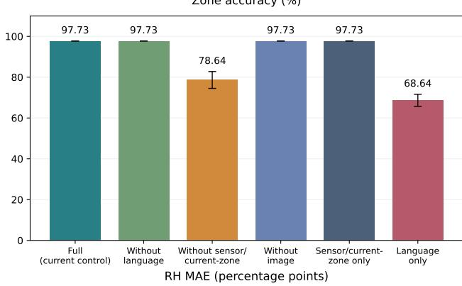

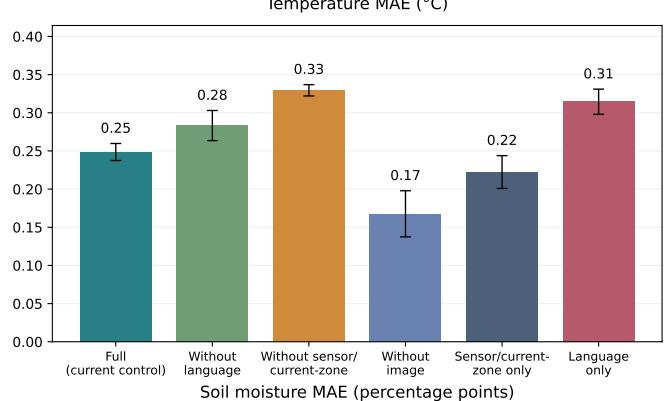

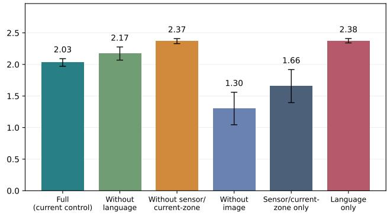

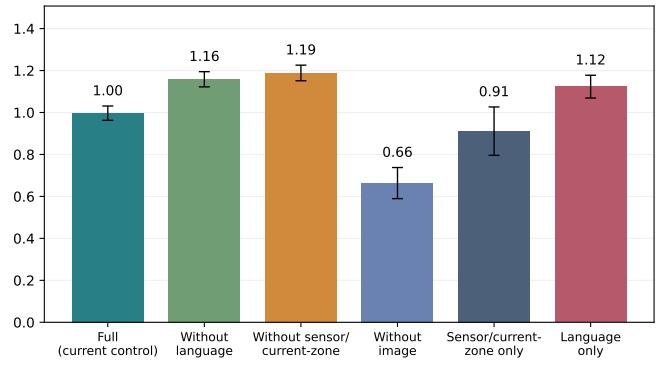  
Figure 6: Six-condition modality evaluation on the frozen grouped split. Error bars show sample SD across five optimization seeds. Full, sensor-only and language-only use current runs; the three earlier single-branch removals retain historical results. Matched current full controls reproduce the historical full predictions and model tensors. Sensor-only matches full zone accuracy with lower mean reference errors; language-only has weaker zone performance.

Filtering PlantVillage test targets to the same fifteen true class names retains 4,106 images in 1,948 groups. Under that post hoc comparison, full-network ViT has an external-minus-PV accuracy gap of –72.212 percentage points, with interval [-77.662, -66.355]. Class frequencies, organs, backgrounds, and acquisition conditions still differ; the comparison is more informative than directly equating the full 38-class and 15-class test mixtures, but it does not isolate a single shift mechanism. This is consistent with positioning agricultural conversational models and planning systems by their task contracts rather than transferring headline accuracy claims between tasks.

Image degradation also matters: under the declared blur, full-network EfficientNet-B0 accuracy falls to 36.91%, ResNet-50 to 59.14%, and ViT-B/16 to 85.54%. The supplement preserves complete frozen/full-network learning curves, per-class results, calibration and risk-coverage plots, and separate novel-host and known-host condition diagnostics. These analyses neither add independent greenhouse episodes nor measure the safety of the intervention proposal. In particular, class-prompt CLIP is an image-text baseline, not a matched greenhouse action planner.

Separate disease-image benchmarks. External F1 uses the fifteen supported true classes; all 38 predicted classes are retained.
<table><tr><td>Model/regime</td><td>Runs</td><td>PV accuracy (%)</td><td>External accuracy (%)</td><td>External macro-F1</td></tr><tr><td>ResNet-50 / frozen probe</td><td>5</td><td> $9 6 . 8 0 3 \pm 0 . 0 5 9$ </td><td> $2 0 . 1 6 8 \pm 1 . 1 8 8$ </td><td> $0 . 1 7 6 4 \pm 0 . 0 0 8 8$ </td></tr><tr><td>EfficientNet-B0 / frozen probe</td><td>5</td><td> $9 7 . 2 7 1 \pm 0 . 0 6 4$ </td><td> $2 4 . 6 2 2 \pm 0 . 7 0 3$ </td><td> $0 . 2 3 0 5 \pm 0 . 0 0 9 4$ </td></tr><tr><td>ViT-B/16 / frozen probe</td><td>5</td><td> $9 8 . 2 0 9 \pm 0 . 0 7 5$ </td><td> $2 1 . 6 8 1 \pm 0 . 9 6 7$ </td><td> $0 . 1 6 1 1 \pm 0 . 0 1 2 8$ </td></tr><tr><td>CLIP / image probe</td><td>5</td><td> $9 7 . 9 0 0 \pm 0 . 0 4 2 $ </td><td> $2 4 . 8 7 4 \pm 0 . 6 9 0$ </td><td> $0 . 2 1 9 8 \pm 0 . 0 0 7 5$ </td></tr><tr><td>CLIP / fixed zero-shot</td><td>1</td><td> $1 2 . 5 6 6$ </td><td> $3 0 . 2 5 2 $ </td><td> $0 . 2 5 4 6$ </td></tr><tr><td>ResNet-50 / full network</td><td>3</td><td> $9 8 . 9 1 1 \pm 0 . 0 9 7$ </td><td> $2 5 . 0 7 0 \pm 0 . 4 8 5$ </td><td> $0 . 2 0 7 6 \pm 0 . 0 1 7 2$ </td></tr><tr><td>EfficientNet-B0 / full network</td><td>3</td><td> $9 8 . 5 8 9 \pm 0 . 1 1 7$ </td><td> $2 5 . 7 7 0 \pm 0 . 8 7 5$ </td><td> $0 . 2 1 4 9 \pm 0 . 0 1 2 6$ </td></tr><tr><td>ViT-B/16 / full network</td><td>3</td><td> $9 9 . 3 4 2 \pm 0 . 1 4 9$ </td><td> $2 7 . 1 7 1 \pm 1 . 6 9 8$ </td><td> $0 . 2 2 9 3 \pm 0 . 0 1 7 7$ </td></tr></table>

PV test: 9,828 images/38 labels. External test: 238 images/15 supported true classes. Error terms are seed sample SD, not confidence intervals. The untuned zero-shot classifier has no optimization-seed SD. Public datasets do not supply the missing greenhouse action labels.

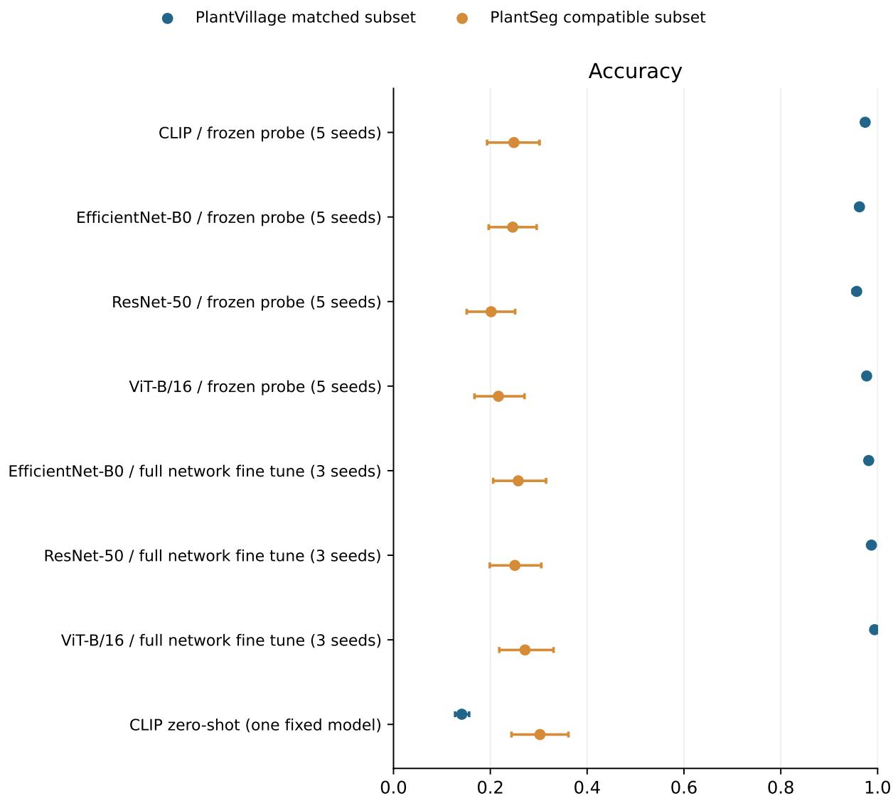  
Figure 7: Shared-true-class accuracy contrast. A post hoc filter retains the same fifteen true class names in 4,106 PlantVillage test images and 238 external images, without restricting the 38-way prediction space. Intervals are approximate crossed seed/group percentile bounds, not a pure causal domain effect. The complete accuracy/F1/calibration transfer panels, the full-network PlantVillage comparison, and the underlying tables remain in Supplementary Material, Section S2.

Figure 7 visualizes the shared-class transfer comparison; the large external performance loss limits claims of visual generalization.

## 3.5. Localization and navigation in the virtual greenhouse

Table 9  
Five offline Point-LIO routes. ATE columns use different alignment conventions and must not be interchanged.
<table><tr><td>Route</td><td>Length (m)</td><td>Initial ATE (mm)</td><td>Rigid-fit ATE (mm)</td><td>RPE 1 s (mm)</td></tr><tr><td>00</td><td>26.89</td><td>19.80</td><td>5.22</td><td>3.80</td></tr><tr><td>01</td><td>26.83</td><td>40.12</td><td>9.63</td><td>4.77</td></tr><tr><td>02</td><td>26.97</td><td>74.26</td><td>17.32</td><td>6.26</td></tr><tr><td>03</td><td>27.05</td><td>20.37</td><td>5.71</td><td>4.16</td></tr><tr><td>04</td><td>27.12</td><td>22.89</td><td>6.35</td><td>4.36</td></tr></table>

Initial ATE uses the first overlapping full pose; rigid-fit ATE uses least-squares SE(3) alignment over all overlapping positions with scale fixed to one RPE measures one-second relative pose differences. The five routes evaluate offline Point-LIO on synthetic LiDAR-IMU streams; the separate navigation experiments use simulator pose. The historical three-mission cohort is reported separately in the supplement

The new localization evaluation contains five actual Point-LIO reconstructions with route lengths of 26.83–27.12 m (Table 9). The registered cloud in Fig. 8 is the route-00 PCD output, with 513,833 voxel-deduplicated points at 0.05 m spacing; the displayed view subsamples every sixth stored point. It is not greenhouse geometry transformed by groundtruth pose and relabelled as an estimator map.

The difference between initial and fitted ATE is substantial on route 02 (74.26 versus 17.32 mm), illustrating why the smaller fitted value alone would obscure the influence of frame alignment and accumulated drift. RPE of 3.80– 6.26 mm characterizes short-horizon relative motion under the supplied synthetic streams. Low aligned errors cannot establish real-sensor calibration, greenhouse survey accuracy, or plant-target registration. The previous three longroute traces remain in Supplementary Figure S15, with full historical records in Supplementary Material, Section S6, as diagnostics rather than silently pooled with the five new routes or retained as verified LIO-driven navigation evidence.

The separate arm-proxy navigation/control suite reports 10/10 nominal route completions, 6/6 clear robustness cases, two intended obstacle stops, and 20/20 valid controls. Nominal routes use four scheduled stops and a 300 s cap; start pose and policy are fixed for those repeated seeds, and estimatornoise changes do not drive navigation. The descriptive Wilson interval for 10/10 is 72.2–100.0%. A 0.50 m/s aisle-transit command is not a minimum instantaneous speed: docking and stops are slower or stationary. This suite characterizes the executed policy/controller under its specified conditions not autonomous performance under estimated localization or field reliability.

Figure 8 shows the newly reconstructed Point-LIO map and both trajectory-alignment conventions.

## 3.6. Environmental dynamics and operating limits

The greenhouse-state logs contain temperature, humidity, and soil-moisture measurements for all four management zones. The original end-to-start changes and raw/rollingmedian plots are retained in Supplementary Material, Section S6; they characterize state variation rather than controller transients. The additional six-case evaluation provides longhorizon regulation evidence under specified forcing and saturation conditions.

These results provide quantitative evidence of environmental regulation within the tested conditions, while also identifying operating limits. The hot/dry failure shows that the modeled actuator/environment combination cannot reach every reference under every disturbance. A supervisory controller should therefore distinguish proposed references from references that the actuators can achieve under the current conditions. The experiments quantify this limitation; they do not yet identify a calibrated physical greenhouse envelope because the complete model coefficients, weather calibration, and cross-zone dynamics are not supplied.

Figure 9 shows representative successful temperature and humidity responses. Table 10 retains all reported operating limits and failed settling cases.

## 3.7. Manipulator geometry and integrated mission execution

After reaching an admitted inspection pose, the robot acquires a close robot-view RGB observation. In the integrated evaluation, diagnosis and target coordinates are taken from the scenario state so that the navigation, alignment, and intervention sequence can be tested separately from uncertain learned perception.

The isolated arm benchmark comprises forty prespecified requests: 32 crop-edge geometric targets and eight far-boundary challenges. All 32 accepted targets meet pose and virtual-disk criteria; the eight unreachable requests are rejected before servo control and are excluded from the accepted-target denominator. Mean position error is $0 . 4 4 9 \pm 0 . 1 5 4$ mm (maximum 0.853 mm); ray/target-plane error is $0 . 8 2 9 \pm 0 . 4 4 0$ mm. These are different quantities. The modeled nozzle is the finger-link origin, and nozzle roll is unspecified. Full-body/self-collision contacts remain uninstrumented.

The full mission records 4,900 treatment-phase physicsstep checks with zero motion violations and 100 admitted instantaneous dose-command samples. These counts describe within-mission checks, not 5,000 independent interventions. The terminal dose is an instantaneous model update on transition to stow; it belongs to dose-command checks but not to the subsequent treatment-phase step count. Treatment units are abstract rather than calibrated liquid volume. The larger integrated target-ray errors compared with the isolated benchmark show why submillimetre pose errors should not be promoted to system-level spray accuracy.

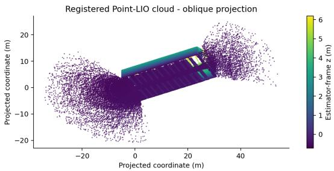  
(a) Registered Point-LIO map from route 00.

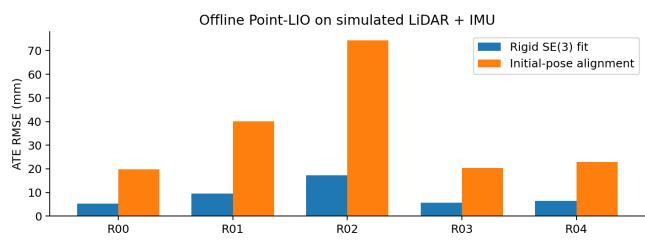  
(b) Initial-pose and rigid-fit trajectory errors.  
Figure 8: Actual offline LiDAR-IMU estimation in the virtual greenhouse. Both alignment conventions are shown; navigation still uses simulator pose. The reconstruction therefore provides estimator evidence, not a demonstration of closed-loop Point-LIO-driven navigation or measured physical greenhouse accuracy.

Table 10  
Environmental-control outcomes and reported limitations. Recovery and sustained settling are different criteria.
<table><tr><td>Case/quantity</td><td>Reported outcome</td><td>Interpretation</td></tr><tr><td>High temperature</td><td>Within 0.5 °C after 2,461 s</td><td>Sustained settling reported for this case</td></tr><tr><td>High humidity</td><td>Within 2 percentage points after 3,448 s</td><td>Sustained settling reported for this case</td></tr><tr><td>Dry-substrate VWC</td><td>90% recovery after 7,457 s; final 0.33266</td><td>Does not meet sustained ±0.01 VWC settling</td></tr><tr><td>Hot/dry</td><td>Final 42.97°C and 10.64% RH</td><td>Temperature, RH, and VWC fail settling</td></tr><tr><td>Combined disturbance</td><td>VWC fails sustained settling</td><td>Multi-disturbance operating limit</td></tr><tr><td>Actuator saturation</td><td>Temperature fails sustained settling</td><td>Actuator-limited operating envelope</td></tr></table>

Six of eighteen variable/case rows fail sustained settling. Water totals are model bookkeeping, not measured physical consumption. VWC denotes modeled volumetric water content; it is not interchangeable with historical percentage-scaled soil channels without a calibration mapping.

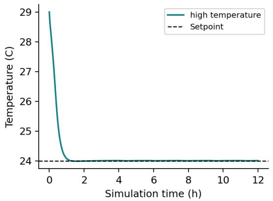

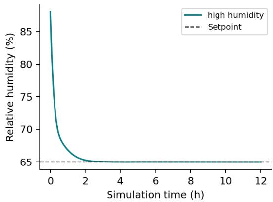  
Figure 9: Temperature and humidity regulation examples from the six-case environmental-model suite. The displayed curves are sampled every 60 s from 12-hour, 1 Hz records. These two successful examples do not represent every case: six of eighteen variable/case combinations fail sustained settling, as reported in the main environmental-response table. Weather inputs are synthetic rather than measured UAE weather.

Table 11  
Integrated precision-arm missions, separate from the isolated geometric benchmark and arm-proxy controls.
<table><tr><td>Case</td><td>Completion time (s)</td><td>Maximum treated-target ray error (mm)</td></tr><tr><td>Four-stop full route</td><td>130.302</td><td>12.94</td></tr><tr><td>Left berry</td><td>30.802</td><td>10.99</td></tr><tr><td>Right berry</td><td>33.802</td><td>6.40</td></tr></table>

All three cases complete. The full route visits beds 1, 7, 13, and 19 and performs two modeled interventions. These are selected virtual cases, not three independent field-reliability trials.

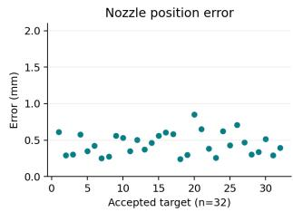

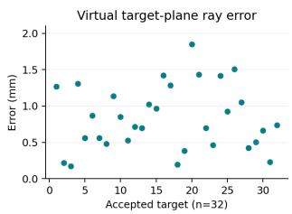  
(a) Thirty-two accepted virtual geometric targets.

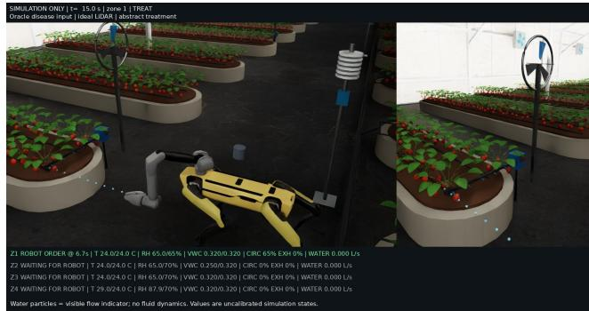  
(b) Recorded integrated mission with authored targets.  
Figure 10: Manipulator geometry and mission integration are evaluated on distinct target sets. The isolated benchmark uses targets at $z = 0 . 6 5 – 0 . 8 5$ m and a 0.95 m standoff; the mission uses lower authored berries and simulator-state diagnosis/positions. Geometric ray error is not pesticide mass deposition, off-target exposure, or biological treatment efficacy.

Table 11 does not establish reduced chemical use. Such a claim requires direct comparison of spray volume, deposition coverage, off-target application, and treatment effectiveness.

Figure 10 pairs the geometric-targeting results with a recorded authored-target mission; these are separate protocols.

## 3.8. Input readiness, fault handling, and evidence summary

The source-faithful neural-interface readiness test and the robot-controller fault tests assess different software. The exact readiness method rejects 52/52 engineered missing/stale/desynchronized fixtures and accepts one valid fixture. It also accepts 64/64 non-finite/extreme numerical probes and one synchronized future timestamp. Therefore its demonstrated function is input presence/age/synchrony checking, not complete numerical-range or non-finite protection. Accepting the single valid fixture does not establish a population false-block rate. These tests used dummy state and fixed time, without invoking ROS or physical actuation.

The separate virtual-controller harness rejects 90/90 isolated faults with zero counted invalid dose and maximum safe-dwell time 0.864 s. Nine faults injected after actual mission treatment admission all stop with safe dwell and no post-fault dose; maximum safe-dwell time is 0.500 s. Fault types include stale sensor, stale diagnosis, non-finite command, out-of-range command, unreachable target, unsafe clearance, disconnect, invalid state, and abort. This shows that the controller's command guard is not the same function as the original neural-interface readiness check. Legitimate dose before injection is retained, and subsequent output and cumulative-dose changes are checked separately.

Treatment-phase injections begin near rest. The two moving obstacle cases have stop-to-dwell times of 3.412 and 3.282 s; one exhausts the logged conservative clearance margin to zero, and contacts are not instrumented. Neither these cases nor the near-rest fault tests establish collisionfree avoidance, emergency braking from maximum speed, or recovery/restart. Same-supervisor-tick invalid-command detection does not measure perception or network latency. The practical contribution is explicit rejection/stop evidence under stated protocols, rather than an undifferentiated claim of a “safe" end-to-end system.

## 3.9. Interpretation, limitations and future work

AgriSense provides a fixed-format observation-toproposal interface and a common virtual environment for studying its supporting robotic operations. The experimental contribution is the joint characterization of prediction, modality dependence, spatial reconstruction, targeting, environmental response and command admission. The architecture uses established encoders, feature concatenation, Point-LIO and deterministic controllers; novelty is not attributed to those individual components.

The modality results distinguish predictive agreement from evidence that each input is necessary. On one grouped episode, image and language removal separately preserve zone accuracy, image removal improves reference MAE, and prompt keywords reproduce the generated intervention labels. These observations expose a supervision problem: aggregate accuracy can reward solutions that need little visual evidence. They do not show that the network uses a particular shortcut nor establish a general failure of multimodal agricultural learning. The sensor/current-zone-only comparison matches full zone accuracy and lowers mean reference errors; a matched-input alternative multimodal model remains a future comparison. The public-image experiments evaluate crop condition recognition under distribution shift; they do not supply the missing greenhouse decision labels or a robotics sim-to-real test.

The virtual greenhouse makes sensor placement, robot viewpoints, zone context and geometric intervention constraints explicit. Its useful role is controlled component evaluation before physical deployment. The present integrated missions use simulator pose, authored diagnosis and known target positions, while Point-LIO is tested offline. Consequently, the experiments do not establish an estimatedpose, learned-diagnosis autonomous treatment loop.

Four limitations bound the conclusions. First, no physicalgreenhouse experiments or biological treatment trials were performed. Sensor calibration, foliage motion, illumination, contact, deposition, crop response and long-duration operation require physical measurements. Second, the decision dataset contains only 283 generated-label records from one episode. Grouping removes identified source links but cannot create independent plants or sites; independent expert decisions and varied prompts are required to break the observed prompt/intervention correspondence. Third, the climate campaign reports logged responses, including six settling failures among 18 variable/case outcomes, but complete governing equations, coefficients, integration settings, controller gains and cross-zone coupling are unavailable in the retained experimental materials. The climate protocol is therefore incompletely reproducible and cannot support calibrated climate-prediction claims. Fourth, geometric targeting and specified rejection/stop tests do not measure chemical deposition, agronomic efficacy, complete collision coverage or recovery/restart reliability. The neural readiness check and virtual-controller command guard remain distinct implementations.

Table 12  
Summary of evidence across the original framework and added experiments. Denominators are not pooled.
<table><tr><td>Component</td><td>Quantitative evidence</td><td>Boundary</td></tr><tr><td>VLDA</td><td>Original 41/43; grouped full/no-image/no-text/sensor-only 43/44 per seed; language-only 68.64%; per-variable MAE</td><td>One episode and generated labels; no demonstrated zone synergy</td></tr><tr><td>Visual baselines</td><td>20 PV probes: nine full-network runs; external and corruption results</td><td>Different target space from VLDA; poor compatible transfer</td></tr><tr><td>Point-LIO</td><td>Five actual offline reconstructions; ATE and 1 s RPE</td><td>Synthetic streams; not navigation feedback</td></tr><tr><td>Navigation/control</td><td>10 nominal, 6 clear, 2 obstacle, 20 valid controls</td><td>Arm-proxy protocol; simulator pose</td></tr><tr><td>Manipulator</td><td>32 accepted targets; eight boundary rejects; three missions</td><td>Geometry/oracle targets, not deposition or crop response</td></tr><tr><td>Environmental model</td><td>Six 12-hour cases; 6/18 settling failures</td><td>Synthetic weather; incomplete process parameterization</td></tr><tr><td>Fault handling</td><td>90 isolated and nine mission faults; stop/dose checks</td><td>Different guards; near-rest tests; no recovery or certification</td></tr><tr><td>Physical greenhouse</td><td>Not performed</td><td>Field accuracy, synchronization, agronomic efficacy remain unestablished</td></tr></table>

Future evaluation should begin with an independently annotated decision dataset in which visual condition, prompt wording, current zone and environmental state vary separately. The completed joint-branch ablations should be extended to independent decision data and a matched-input vision– language comparator using a common output schema and evaluation budget. Physical greenhouse trials should then calibrate sensing and robot geometry, compare estimatedpose navigation with reference measurements, and evaluate perception-derived targets, deposition and crop outcomes. Environmental studies require a fully disclosed process model and controller settings before testing reference changes, disturbances and cross-zone coupling. The extended activitystate, confidence, freshness and dispatch requirements in Supplementary Section S9 define future integration work, to be implemented and tested with fault-injection and recovery protocols.

## 4. Conclusions

This paper presented AgriSense, a framework for multimodal decision support and robotic intervention in a virtual greenhouse. The framework integrates an Isaac Sim environment, a quadruped mobile manipulator, RGB, LiDAR, and inertial sensing, a supervised vision-language-environmental predictor, environmental regulation, and plant-level intervention interfaces. It separates fixed-format learned proposals from navigation, control, and manipulator execution.

The original held-out target-zone result, 41/43 correct decisions and macro-F1 0.9311, is reproducible. Five-seed retraining on a grouped split gives 43/44 correct target-zone predictions for the full, no-image, and no-language variants; the data therefore do not establish an incremental multimodal zone-accuracy advantage. The added joint-removal experiments confirm that sensor/current-zone-only inputs match full zone accuracy, with lower mean reference errors, whereas language-only retains perfect generated intervention-label agreement despite weaker zone predictions. These results sharpen the dataset-specific account of modality dependence.

Added component experiments provide five offline Point-LIO reconstructions, 32 accepted geometric targets with eight boundary rejections, three completed integrated missions, six long-horizon climate cases, and separate fault-handling protocols. These results make the implementation more reproducible and expose operating limits that the original qualitative demonstrations could not quantify.

The results support the feasibility of the specified decision-support interface and selected robotic/control operations within a common virtual greenhouse. Their scientific value lies in making modality contributions, data shortcuts, geometry, and rejection behaviour explicit rather than inferring full autonomy from component accuracy. Physical greenhouse trials, independent expert-labelled decisions, estimated-pose closed-loop navigation, calibrated climate dynamics, and deposition/biological tests remain necessary before field-readiness or treatment-effectiveness claims can be made.

## Code and Data Availability

The AgriSense project webpage is available at http s://lyessaadsaoud.github.io/AgriSense/. The accompanying revision package contains the reported result tables, split/provenance descriptions, original retained figure assets, and separate supplementary material. Source code, experimental configurations, and permitted reproducibility materials will be released through the project repository upon publication. Public benchmark images remain subject to their respective licenses; the present statement does not imply that every raw checkpoint, image, or simulation log is included in the manuscript ZIP.

## Declaration of the Use of Artificial Intelligence

During the preparation of this manuscript, the authors used OpenAI's ChatGPT and Grammarly to assist with language editing, grammar correction, and improvements in clarity and readability. AI-assisted image augmentation and offline teacher labeling are described separately in the dataset methodology and are not treated as independent biological ground truth.

## Supplementary Material

The following appendix reproduces the clean supplementary material in the same LaTeX document. Section and figure numbering use the S-prefix for clarity.

Sections S1-S5 provide datasets, statistical protocols, diagnostic results and the reproducibility catalogue. Section S6 retains the original experimental records, Section S7 the standard LiDAR-inertial derivation, and Section S8 additional visual records. Section S9 separates the extended conceptual architecture from evaluated methods. This is the clean, consolidated manuscript and supplementary appendix.

## S1. Source, datasets, grouping and evaluation protocols

## S1.1. Implemented model and task contract

The implementation, GreenhouseVLA, is the three-output supervised predictor described in the main article. Its checkpoint SHA-256 is 5cb6396ed9eab64384b0e53053694b143efaad7729dc3dc5ff6e9683ff2691eb. Strict loading matches every parameter key. Frozen DINOv2-small (Oquab et al., 2023) and BERT-base-uncased (Devlin et al., 2019) supply 384- and 768-dimensional final CLS representations. Their projections produce 256 and 128 features. A separate 19-input branch combines four current-zone one-hot coordinates and 15 continuous measurements. Concatenated features enter a 512-to-256-to-256 MLP. Three heads predict 12 environmental setpoints, four destination-zone logits and one binary pesticide-label logit. There is no disease-class. lesion-mask, trajectory, uncertainty or neural safety head.

The image path converts to RGB, rescales by 1/255, resizes the shortest side to 256 with bicubic interpolation, centre-crops to 224 × 224, and uses channel means (0.485, 0.456, 0.406) and standard deviations (0.229, 0.224, 0.225). BERT tokenization lowercases using the uncased tokenizer, truncates and pads to 128 tokens, and passes input IDs and the attention mask. Both backbones use CLS pooling, not mean pooling. Image/text projections each use ReLU and dropout 0.1. The sensor MLP is 19- to-128/ReLU/dropout0.1-to-128/ReLU. Fusion uses ReLU, dropout 0.2, then ReLU. Each head is 256-to-128/ReLU/dropout0.1 followed by its output layer, with no final regression activation

The sensor order is current-zone one-hot coordinates 1–4, then global temperature, humidity and soil moisture, followed by the same three measurements for zones 1, 2, 3 and 4 in order. All 19 coordinates are standardized using training-only statistics. The 12 regression coordinates are temperature, humidity and soil-moisture targets for zones 1–4 in that order, also standardized using training-only statistics and inverse-transformed for physical-unit errors. The original code replaces a fitted standard deviation below $1 0 ^ { - 6 }$ by one.

For an RGB image $x _ { i }$ , tokenized prompt $t _ { i }$ (with its tokenizer attention mask), and a training-standardized sensor/context vector $s _ { i } \in \mathbb { R } ^ { 1 9 }$ , the recovered predictor computes

$$
\begin{array} { r l } & { v _ { i } = P _ { v } \big ( D _ { \phi } ( x _ { i } ) _ { \mathrm { C L S } } \big ) \in \mathbb { R } ^ { 2 5 6 } , } \\ & { e _ { i } = S _ { \eta } ( s _ { i } ) \in \mathbb { R } ^ { 1 2 8 } , } \end{array}
$$

$$
\ell _ { i } = P _ { t } \big ( \boldsymbol { B } _ { \psi } ( t _ { i } ) _ { \mathrm { C L S } } \big ) \in \mathbb { R } ^ { 1 2 8 } ,
$$

$$
h _ { i } = F _ { \theta } ( [ v _ { i } ; \ell _ { i } ; e _ { i } ] ) \in \mathbb { R } ^ { 2 5 6 } .\tag{S1}
$$

(S2)

Here $D _ { \phi }$ is frozen DINOv2-small (384-dimensional CLS output), $B _ { \psi }$ is frozen BERT-base (768-dimensional CLS output), and the projections, sensor MI $\mathbf { \delta } _ { \mathbf { { \cal P } } }$ concatenation-fusion MLP and heads are trainable. The sensor vector includes four current-zone one-hot coordinates and 15 continuous global/zonal temperature, humidity and soil-moisture values. The heads output

$$
\widehat { \widetilde { r } _ { i } } = H _ { r } ( h _ { i } ) \in \mathbb { R } ^ { 1 2 } ,
$$

$$
z _ { i } = H _ { z } ( h _ { i } ) \in \mathbb { R } ^ { 4 } ,
$$

$$
a _ { i } = H _ { a } ( h _ { i } ) \in \mathbb { R } .\tag{S3}
$$

Setpoints in original physical units are obtained by the training-fitted inverse transformation $\widehat { r } _ { i } = \mu _ { r } + \sigma _ { r } \odot \widehat { \widetilde { r } _ { i } }$ . The zone prediction is $1 + \arg \operatorname* { m a x } _ { k \in \{ 0 , 1 , 2 , 3 \} } z _ { i k }$ ; the binary pesticide prediction is $\mathbf { 1 } \{ \mathrm { s i g m o i d } ( a _ { i } ) > 0 . 5 \}$ . For a minibatch B, the implemented original objective is

$$
\mathcal { L } _ { B } = \mathrm { M S E } ( \widehat { \widetilde { R } } , \widetilde { R } ) + \mathrm { C E } _ { w } ( Z , y ^ { \mathrm { z o n e } } ) + \mathrm { B C E W i t h L o g i t s } _ { q } ( a , y ^ { \mathrm { p e s t i c i d e } } ) ,\tag{S4}
$$

where uppercase ${ \widehat { \widetilde { R } } } , { \widetilde { R } } ,$ and Z collect minibatch outputs/targets. The code uses default mean reductions: MSE averages all 12|B| continuous values, weighted cross-entropy is

$$
\operatorname { C E } _ { w } ( Z , y ) = \frac { \sum _ { i \in \mathcal { B } } w _ { y _ { i } } [ - \log \operatorname { s o f t m a x } ( z _ { i } ) _ { y _ { i } } ] } { \sum _ { i \in \mathcal { B } } w _ { y _ { i } } } ,\tag{S5}
$$

and positive-weighted BCE-with-logits averages the binary terms over |B|; q multiplies the positive-label term. Zone targets use the zero-based training-class indices 0, 1, 2, 3. Outer task coefficients are all one, $w _ { c } = N / ( 4 n _ { c } )$ from training-zone counts and $q = \mathrm { m a x } ( 1 , N _ { \mathrm { n e g a t i v e } } / N _ { \mathrm { p o s i t i v e } } )$ from training binary-label counts. This is MSE with CLS pooling; mean pooling, Smooth-L1, focal loss or a scheduler from the different historical trainer must not be attributed to this checkpoint.

These equations describe a supervised finite-parameter predictor. They do not supply a trajectory optimizer, certified admissible-action set, calibrated posterior, lesion-mask output or safety theorem. Offline confidence/OOD utilities were tested separately and are not integrated into the recovered VLDA actuation path. A validity predicate or constrained intervention policy remains a proposed extension until implemented and validated against an explicit expert/rule contract.

The original saved run used one training seed, 42, AdamW with learning rate $1 0 ^ { - 4 }$ and weight decay $1 0 ^ { - 4 }$ , batch 16, a 300-epoch limit and patience 10. Its history records 50 epochs and the lowest validation loss at epoch 40. The historical alternative trainer's mean-pooling, Smooth-L1/focal-loss and scheduling defaults do not describe this checkpoint. Original training-time wall-clock cost and peak VRAM are unavailable; present replay timing does not reconstruct them. Software configurations are associated with their respective training protocols.

## Table S1

Recovered implemented VLDA, not a replacement disease classifier.
<table><tr><td>Component</td><td>Implemented operation</td><td>State</td></tr><tr><td>Image encoder</td><td>DINOv2-small CLS 384; projection 384 to 256</td><td>Backbone frozen; projection trainable</td></tr><tr><td>Text encoder</td><td>BERT-base CLS 768; max 128 tokens; projection 768 to 128</td><td>Backbone frozen; projection trainable</td></tr><tr><td>Sensor/context branch</td><td>19 inputs: current-zone one-hot (4) + continuous context (15); MLP 19 to 128 to 128 Trainable; training-fitted standardization</td><td></td></tr><tr><td>Fusion</td><td>Concatenate 256+128+128=512; MLP 512 to 256 to 256</td><td>Trainable; concatenation, not cross-modal attention</td></tr><tr><td>Three heads</td><td>Each 256 to 128, then 12 setpoints / 4 zone logits / 1 pesticide logit</td><td>Trainable; no pixel-mask or trajectory output</td></tr><tr><td>Objective</td><td>MSE + class-weighted CE + positive-weighted BCE-with-logits</td><td>Outer loss coefficients all 1</td></tr></table>

Strict checkpoint loading verifies 132,052,881 total parameters: 131,538,816 frozen and 514,065 trainable. The saved run used AdamW, learning rate 10-4, weight decay 10-4, batch 16, seed 42, maximum 300 epochs, patience 10; history records 50 epochs, with minimum validation loss at epoch 40. The later alternative trainer's mean pooling/Smooth-L1 defaults do not describe this checkpoint. Fresh FP32 batch-one forward latency was median 7.1006 ms, p95 7.4684 ms on an RTX 5090 Laptop GPU, excluding preprocessing/I/O; this is not an end-to-end control latency.

## Table S3

Audited sample counts and evaluation units. Derived test subsets are not additional acquired datasets.
<table><tr><td>Data or derived evaluation</td><td></td><td>Samples Train / validation / test</td><td>Interpretation</td></tr><tr><td>Original episode, historical split</td><td>283</td><td>198 / 42 / 43</td><td>150 base + 133 disease-named augmentations; teacher/simulation labels</td></tr><tr><td>Same original episode, grouped split</td><td>283</td><td>197 / 42 / 44</td><td>265 screened source/similarity components; one episode</td></tr><tr><td>PlantVillage retained v2</td><td></td><td>49,098 34,360 / 4,910 / 9,828</td><td>54,305 decode; 5,207 quarantined</td></tr><tr><td>PlantSeg eligible</td><td></td><td>7,551 5,228 / 821 / 1,502</td><td>7,774 image/mask pairs decode; 223 unique exclusions</td></tr><tr><td>Compatible external test</td><td></td><td>238 - / -/238</td><td>15 true classes; 238 groups; all 38 outputs retained</td></tr><tr><td>Novel-host OOD test</td><td></td><td>671 -/-/671</td><td>19 literal host labels; 666 groups</td></tr><tr><td>Known-host condition OOD test</td><td></td><td>131 -/-/131</td><td>15 annotated conditions; 131 groups; exploratory</td></tr><tr><td>Plant Pathology 2021</td><td>0</td><td></td><td>HTTP 401 access blocker; no images downloaded</td></tr></table>

Historical indices are disjoint but five source-lineage pairs cross subsets; three test rows have training relatives. The prompt-keyword rule matches all 283 pesticide labels. Group/hash screens address discovered relations, not physical-plant, episode or pretraining independence. PlantVillage quarantine includes false-positive pHash chains; 13,194 original image records lack resolved physical-leaf IDs. PlantSeg exclusions are 20 annotation issues plus 205 conflicting exact-duplicate rows, with two rows overlapping: 223 unique.

## S1.2. Original episode, label provenance and dependence

The supervised CSV contains 283 rows: 150 base JPEG frames of 1280 × 720 pixels and 133 disease-named augmented PNG images of 1536 × 1024 pixels. All indexed images decode. The raw directory contains 2,917 images, but only 150 enter this labelled CSV; unindexed frames are not additional labelled samples. The augmentations have 35 botrytis, 52 anthracnose and 46 powdery-mildew filenames. Source metadata and historical scripts support offline teacher labelling and image-edit augmentation; the trimmed final CSV does not preserve a complete per-row teacher/API history. No paid labelling or image-generation API was run in the validation campaign. An exact final-CSV filename-stem reconciliation identifies six base-to-augmented pairs. All six preserve current zone, all 15 continuous context values and all 12 setpoints, but all six change the final prompt, destination-zone target and pesticide label. The source parents of the remaining 127 augmented records are not represented among the 150 supervised base rows; this does not imply that their original raw images are absent. Thus historical initial row-copy code does not support an equation of complete final-label inheritance. API model, quality, fidelity, seed and weighting script defaults do not establish per-image API settings, and scene preservation instructions are not verified geometric preservation.

Table S2: Exact filename-stem matches in the final supervised CSV, with zero-based row indices. All six preserve the source current-zone value, all 15 context values, and all 12 setpoint values, but differ in prompt, target-zone label, and intervention flag. The source parents of the remaining 127 augmented records are not represented among the 150 supervised base rows; no claim is made that their raw images are absent. Historical initial row-copy code does not establish complete final-label inheritance.
<table><tr><td>Base row</td><td>Aug. row</td><td>Context</td><td>12 targets Prompt</td><td></td><td>Zone</td><td>Pesticide</td></tr><tr><td>102</td><td>152</td><td>Identical</td><td>Identical</td><td>Different</td><td>3 to 2</td><td>False to True</td></tr><tr><td>130</td><td>163</td><td>Identical</td><td>Identical</td><td></td><td></td><td>Different 3 to 2 False to True</td></tr><tr><td>122</td><td></td><td>164 Identical</td><td>Identical</td><td></td><td></td><td>Different 3 to 2 False to True</td></tr><tr><td>108</td><td></td><td>170 Identical</td><td>Identical</td><td></td><td></td><td>Different 3 to 2 False to True</td></tr><tr><td>26</td><td>181</td><td>Identical Identical</td><td></td><td></td><td></td><td>Different 3 to 1 False to True</td></tr><tr><td>131</td><td></td><td>252 Identical Identical</td><td></td><td></td><td></td><td>Different 3 to 2 False to True</td></tr></table>

All base rows have a false pesticide label, and all augmented rows have a true label. A prompt rule matching the three disease names agrees with all 283 labels, including all 43 historical test labels. This is a measured shortcut and confound, not an expert intervention baseline or proof of real disease recognition. The generated binary labels must not be treated as expert treatment decisions.

The historical split is 198/42/43 training/validation/test rows, stratified jointly by zone and pesticide label with seed 42. Paic&aare tsjbinP,rbrtinvuboitedtfbagiepairs cross subsets; three test rows have training relatives. Twenty crosagep dHash pairs at Hamming distance at most four provide additional similarity-screening evidence. Source inheritance and image similarity need not be disjoint categories. Exact encoded/decoded equality alone misses this lineage. All samples are from one

PlantVillage (Mohanty et al., 2016) was obtained from the specified author repository. The colour archive has 54,305 valid decoded 256 × 256 images in 38 crop-condition classes. The v2 policy links class-qualified leaf-ID suggestions, exact encoded and decoded hashes, and DCT pHash64 distance at most four. Forty-five cross-label components containing 5,207 images are quarantined, including conservative false-positive similarity chains. The retained 49,098 images are frozen as 34,360/4,910/9,828 train/validation/test images. Their observed group counts are 13,535/1,932/3,864. A legacy leaf-name alias is handled without changing image class labels. Across the original image inventory, 13,194 image records lack resolved physical-leaf IDs. Thus group-disjointness is a documented screen, not complete plant/site or pretraining independence. The recorded author declaration is CC BY-SA 3.0; attribution and the archived licence text are retained.

PlantSeg v7 (Wei et al., 2026) contains 7,774 decoded image/mask pairs, 34 host labels and 115 crop–condition categories. Twenty annotation inconsistencies and 205 rows in exact-image groups with conflicting labels overlap in two rows: 223 unique rows are excluded, leaving 7,551 eligible pairs, including 1,502 official test images. Masks use background zero and disease index plus one. The dataset has no healthy class. Archive metadata record 7,741 per-image CC-BY-NC abbreviations and 33 CCO entries; the dataset-level declaration is CC BY-NC 4.0. No version is inferred for an abbreviated per-image licence. Use remains noncommercial research

The compatible classification subset has 238 official-test images in 238 screened source/similarity groups with 15 supported true classes. Source URLs, encoded and decoded equality and pHash are checked against all retained PlantVillage images; ambiguous taxonomies and conflicting components are excluded. All 38 output classes and unrestricted argmax remain. A post hoc comparison restricts existing PV test true classes to those same 15 labels, yielding 4,106 images/1,948 groups; it is not a new independent split or a causal domain intervention.

Plant Pathology 2021 FGVC8 remains unexecuted: official file-list access returned HTTP 401 and no exposed authorized session was available. Zero images were downloaded; no new terms were accepted. Its multilabel task was not replaced by synthetic labels or an incompatible single-label merge. The public disease/mask datasets do not supply the original model's 19 measured context inputs, 12 setpoints, destination-zone labels or expert pesticide decisions. They cannot validate the unchanged VLDA control-label task by inventing missing annotations.

The checkpoint architecture is shown in main Figure 5; its input and parameter details are provided in the architecture table above.

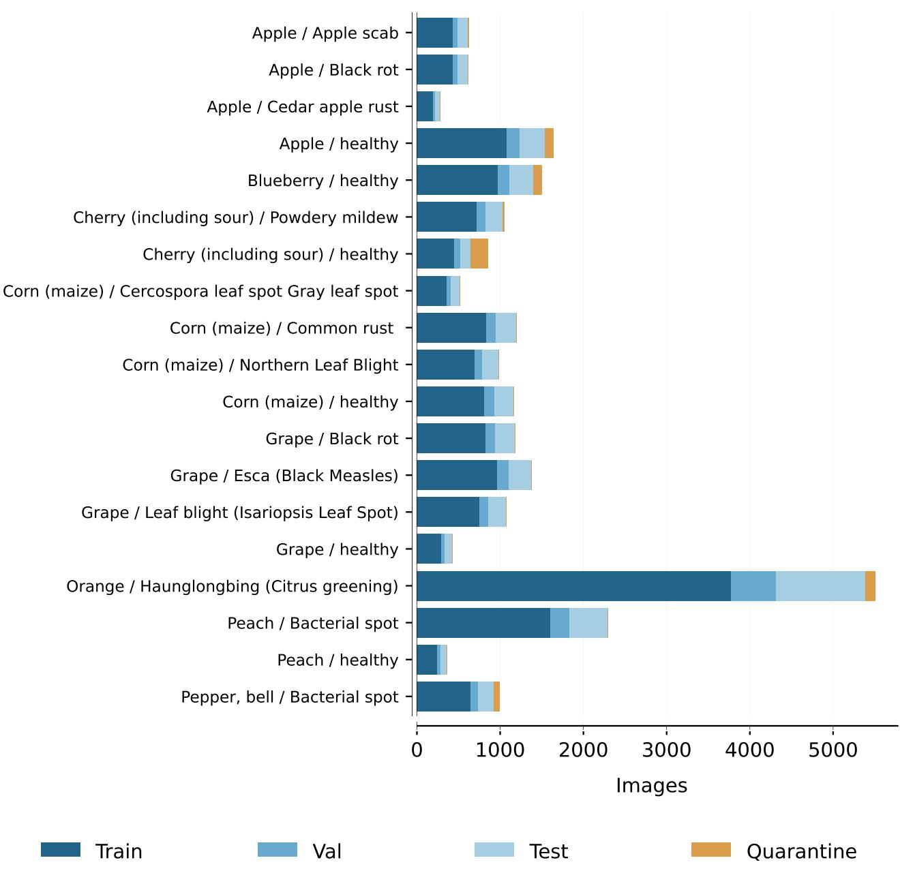  
Figure S1: Complete PV class distribution and conservative quarantine. The split is frozen before training; leaf suggestions and hash grouping do not prove biological/site independence. The two panels include all 38 classes, rather than selected favourable categories. Panel (a) shows the first 19 classes; panel (b) shows the remaining 19, with the same linear horizontal scale. The dataset contains 54,305 valid images and 49,098 eligible images. Quarantine includes cross-label pHash similarity components; this screening has false positives

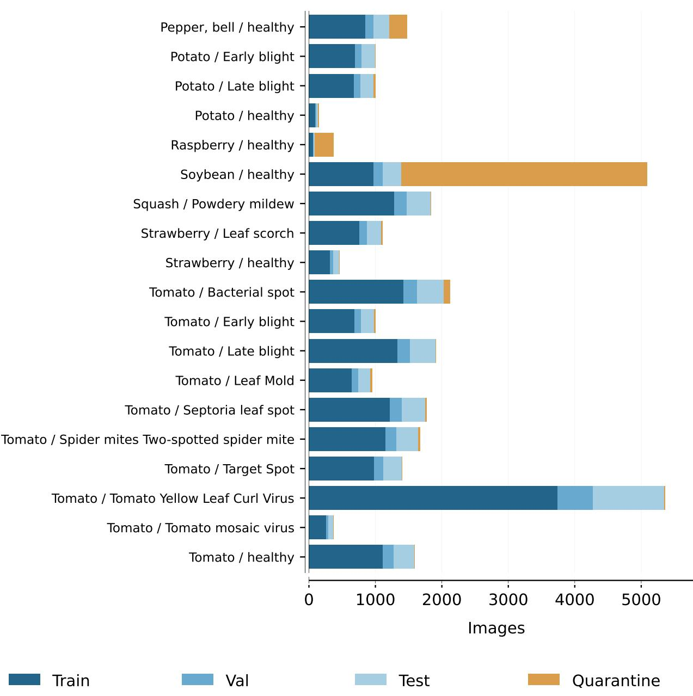  
Figure S1: Continued: (b) the remaining 19 PV classes, using the same horizontal scale and split legend as panel (a).

## S2. Training, full classification results and uncertainty

## S2.1. Completed run census and validation selection

The historical campaign completed 109 trainings: 40 VLDA retrainings (two splits, four conditions, five seeds), 40 image-only zone probes (two splits, four encoders, five seeds), 20 PV disease probes and nine full-network PV fine-tunes. The additional grouped-split campaign contributes fifteen runs (five matched full controls, five sensor-only and five language-only), bringing the combined total to 124 training executions. Historical/current full seeds are not pooled. Fixed CLIP zero-shot introduces no new training. The 230 classification exports include clean, corruption, compatible external and original zone-task evaluations, not 230 independently trained models. Twelve original checkpoint inference conditions and the two separate OOD diagnostic cohorts have their own output registries and are not added as new biological samples.

The official pretrained comparison models are ResNet-50 (He et al., 2016), EfficientNet-B0 (Tan and Le, 2019), ViT-B/16 (Dosovitskiy et al., 2021) and CLIP ViT-B/32 (Radford et al., 2021). Frozen encoders run their official deterministic preprocessing in BF16, storing FP32 embeddings. Each linear probe standardizes embeddings using training means and standard deviations, lower-bounded at $1 0 ^ { - 6 }$ , and uses FP32 AdamW, learning rate $1 0 ^ { - 3 }$ , weight decay $1 0 ^ { - \overline { { 4 } } }$ , batch 512, maximum 100 epochs, patience 10 and unweighted cross-entropy. The earliest validation-cross-entropy minimum, with improvement tolerance $1 0 ^ { - 6 }$ , determines the immutable checkpoint. No training augmentation is used for these cached representations. Five seeds are 17, 29, 43, 71 and 101. CLIP zero-shot uses one deterministic class-name prompt per class and its original logit scale, without prompt ensembling or retuning after test inspection.

Full-network runs update every parameter for each of the three non-CLIP architectures, using seeds 17, 29 and 43. They use AdamW backbone/head rates $1 0 ^ { - 5 } / 1 0 ^ { - 4 }$ , weight decay $1 0 ^ { - 4 }$ , batch 64, maximum ten epochs, patience three, fixed learning rates, BF16, and validation-cross-entropy selection. Training-only random-resized 224 × 224 crops use scale [0.7, 1] and horizontal flips with probability 0.5; official evaluation transforms remain unchanged. Every run completed ten epochs. On-the-fly augmented presentations total 3,092,400 across nine runs, rather than that many independent images; no augmented image files were saved. Training plus selection budgets, updated capacity and augmentation differ from frozen probes, so their contrast is not an isolated causal ablation of backbone unfreezing.

Genuine VLDA branch removals retain the original 514,065 stored trainable parameters and fusion width, with removed features zeroed throughout training and evaluation. Their common objective, AdamW $1 0 ^ { - 4 }$ , weight decay $1 0 ^ { - 4 }$ , batch 16. maximum 100 epochs and patience 10 are matched. Frozen CLS embeddings are cached in evaluation mode. This disables the frozen BERT dropout enabled by the original trainer's recursive model. train(), so these runs are explicitly retrainings with cached frozen-backbone features rather than an exact rerun of the original stochastic training path. Inactive zeroed branches remain in the stored parameter count.

Table S4: Measured resources on the local RTX 5090 Laptop GPU. Frozen extraction is a shared one-time 49,098-image cost; training seconds are mean per seed for heads or full networks, respectively. Peak memory is extraction peak for frozen rows and maximum training allocation for full rows, so those columns are different operations. Device batch-one latency excludes decoding, transforms and host transfer; it is not system control latency.
<table><tr><td>Model regime</td><td>Trainable params</td><td>Extract s</td><td>Train s</td><td>Peak MiB</td><td>Latency ms</td></tr><tr><td>ResNet-50 frozen</td><td>77862</td><td>25.59</td><td>1.60</td><td>471.2</td><td>2.800</td></tr><tr><td>EffNet-B0 frozen</td><td>48678</td><td>13.72</td><td>1.52</td><td>437.9</td><td>3.863</td></tr><tr><td>ViT-B/16 frozen</td><td>29222</td><td>49.96</td><td>2.26</td><td>799.5</td><td>5.130</td></tr><tr><td>CLIP probe frozen</td><td>19494</td><td>44.49</td><td>3.52</td><td>773.4</td><td>9.763</td></tr><tr><td>ResNet-50 full</td><td>23585894</td><td>一</td><td>427.95</td><td>3322.5</td><td>2.815</td></tr><tr><td>EffNet-B0 full</td><td>4056226</td><td>一</td><td>272.86</td><td>3268.3</td><td>3.688</td></tr><tr><td>ViT-B/16 full</td><td>85827878</td><td>1</td><td>1141.77</td><td>6173.1</td><td>4.546</td></tr></table>

## S2.2. Metrics and distinct uncertainty quantities

Accuracy uses each declared sample denominator. Macro-F1 averages the fixed declared class universe with zero contribution at a zero denominator; balanced accuracy uses the fixed originally supported true classes. ROC/AP use applicable one-versus-rest class support; unsupported AUCs are not filled with invented zero values. Confusion matrices and class precision, recall, specificity and support are exported. Calibration includes multiclass Brier sum, negative log-likelihood and 15-bin top-label ECE. Raw softmax confidence is not assumed calibrated. Offline risk-coverage curves retain confidence ties together; their test-score sweep is descriptive and is not an implemented treatment abstention policy.

Optimization-seed sample SD measures dispersion among fitted runs. Per-run source-group percentile intervals instead resample complete observed groups; crossed aggregate intervals additionally resample the observed fitted seeds. They condition on these models, groups and chosen subsets and exclude new-site, calibration, pretraining and broader model-selection uncertainty. The fixed zero-shot model has no optimization-seed SD. Paired contrasts retain shared within-domain group

## Table S5

One recovered checkpoint on the historical 43-row test: descriptive reproduction, not independent field validation.
<table><tr><td>Metric</td><td>Point</td><td>Observed-group interval</td><td>Valid draws</td></tr><tr><td>Zone accuracy (41/43), %</td><td>95.349</td><td>[87.805, 100.000]</td><td>1000/1000</td></tr><tr><td>Zone macro-F1, fixed four classes</td><td>0.9311</td><td>[0.7185,1.0000]</td><td>1000/1000</td></tr><tr><td>Zone balanced accuracy</td><td>0.9494</td><td>[0.8500, 1.0000]</td><td>971/1000</td></tr><tr><td>Pesticide generated-label (43/43)</td><td>1.0000</td><td>[1,1]</td><td>1000/1000</td></tr></table>

Intervals are approximate 95% percentile bounds from 1,000 whole-group draws over 41 screened components, conditional on one fixed model. Balanced-accuracy bounds condition on retaining all four classes (971/1,000 draws); fixed-four-class F1 assigns zero to absent sampled classes. The degenerate pesticide interval reflects zero observed generated-label errors and does not bound unseen intervention risk. Saved-split contamination and one-episode dependence remain; these intervals are not field guarantees.

## Table S6

VLDA cached-feature ablations on the frozen grouped split: five seeds per condition.
<table><tr><td>Condition</td><td>Zone accuracy %</td><td>Four-class macro-F1</td><td>Temperature MAE °C</td><td> $\mathbf { R H M A E } \mathbf { p p }$ </td><td>Soil MAE pp</td></tr><tr><td>Full</td><td> $9 7 . 7 2 7 \pm 0 . 0 0 0$ </td><td> $0 . 9 7 6 2 \pm 0 . 0 0 0 0$ </td><td> $0 . 2 4 9 \pm 0 . 0 1 1$ </td><td> $2 . 0 3 0 \pm 0 . 0 6 1$ </td><td> $0 . 9 9 7 \pm 0 . 0 3 4$ </td></tr><tr><td>Without language</td><td> $9 7 . 7 2 7 \pm 0 . 0 0 0$ </td><td> $0 . 9 7 6 2 \pm 0 . 0 0 0 0$ </td><td> $0 . 2 8 3 \pm 0 . 0 2 0$ </td><td> $2 . 1 7 2 \pm 0 . 1 0 4$ </td><td> $1 . 1 5 8 \pm 0 . 0 3 6$ </td></tr><tr><td>Without sensor/current-zone</td><td> $7 8 . 6 3 6 \pm 4 . 1 2 9$ </td><td> $0 . 6 6 8 5 \pm 0 . 0 7 5 1$ </td><td> $0 . 3 2 9 \pm 0 . 0 0 7$ </td><td> $2 . 3 6 9 \pm 0 . 0 4 0$ </td><td> $1 . 1 8 8 \pm 0 . 0 3 7$ </td></tr><tr><td>Without image</td><td> $9 7 . 7 2 7 \pm 0 . 0 0 0$ </td><td> $0 . 9 7 6 2 \pm 0 . 0 0 0 0$ </td><td> $0 . 1 6 8 \pm 0 . 0 3 0$ </td><td> $1 . 3 0 2 \pm 0 . 2 5 7$ </td><td> $0 . 6 6 4 \pm 0 . 0 7 4$ </td></tr><tr><td>Sensor/current-zone only</td><td> $9 7 . 7 2 7 \pm 0 . 0 0 0$ </td><td> $0 . 9 7 6 2 \pm 0 . 0 0 0 0$ </td><td> $0 . 2 2 2 \pm 0 . 0 2 1$ </td><td> $1 . 6 5 7 \pm 0 . 2 6 2$ </td><td> $0 . 9 1 1 \pm 0 . 1 1 5$ </td></tr><tr><td>Language only</td><td> $6 8 . 6 3 6 \pm 2 . 9 6 3$ </td><td> $0 . 3 9 8 8 \pm 0 . 0 6 7 3$ </td><td> $0 . 3 1 4 \pm 0 . 0 1 7$ </td><td> $2 . 3 7 5 \pm 0 . 0 3 4$ </td><td> $1 . 1 2 3 \pm 0 . 0 5 4$ </td></tr></table>

Values are means ± sample SD across seeds 17, 29, 43, 71 and 101 on the unchanged 197/42/44 grouped, single-episode split. Zone macro-F1 explicitly includes all four classes, with undefined class contributions set to zero. RH and soil errors are percentage points. Current full controls reproduce all historical full prediction arrays, trainable checkpoint tensors, normalization tensors, training histories and comparable metrics exactly. The three earlier single-branch removals are retained from the verified historical campaign; full and the two new single-branch conditions use five current runs each. All branches remain in the topology, are evaluated before masking, and removed projected vectors are zeroed during training, validation and testing. Sensor/current-zone contains four one-hot coordinates and 15 continuous values. Cached DINOv2/BERT CLS features were extracted in evaluation mode; this differs from earliest online frozen-BERT dropout training. Seed SD is not a sampling confidence interval. All intervention metrics describe simulation-label agreement, not field treatment safety.

## Table S7

Disease-image classification on the frozen PlantVillage v2 test (9,828 images, 3,864 screened groups, 38 output classes).
<table><tr><td>Cohort / model</td><td>Runs</td><td>Accuracy  $\% \pm \mathrm { S D } \mathrm { p p }$ </td><td>Accuracy interval %</td><td>Macro-F1 ± SD</td></tr><tr><td>Frozen probe / ResNet-50</td><td>5</td><td> $9 6 . 8 0 3 \pm 0 . 0 5 9$ </td><td>[96.351,97.224]</td><td> $0 . 9 6 2 3 \pm 0 . 0 0 1 0$ </td></tr><tr><td>Frozen probe / EfficientNet-B0</td><td>5</td><td> $9 7 . 2 7 1 \pm 0 . 0 6 4$ </td><td>[96.885,97.673]</td><td> $0 . 9 6 8 2 \pm 0 . 0 0 0 9$ </td></tr><tr><td>Frozen probe / ViT-B/16</td><td>5</td><td> $9 8 . 2 0 9 \pm 0 . 0 7 5$ </td><td>[97.892,98.521]</td><td> $0 . 9 7 7 3 \pm 0 . 0 0 0 7$ </td></tr><tr><td>Frozen probe / CLIP image probe</td><td>5</td><td> $9 7 . 9 0 0 \pm 0 . 0 4 2 $ </td><td>[97.520,98.231]</td><td> $0 . 9 7 4 6 \pm 0 . 0 0 0 7$ </td></tr><tr><td>CLIP image-text zero-shot</td><td>1</td><td>12.566</td><td>[11.516, 13.564]</td><td>0.1195</td></tr><tr><td>Full network / ResNet-50</td><td>3</td><td> $9 8 . 9 1 1 \pm 0 . 0 9 7$ </td><td>[98.610,99.194]</td><td> $0 . 9 8 6 4 \pm 0 . 0 0 1 2$ </td></tr><tr><td>Full network / EfficientNet-B0</td><td>3</td><td> $9 8 . 5 8 9 \pm 0 . 1 1 7$ </td><td>[98.279,98.882]</td><td> $0 . 9 8 2 1 \pm 0 . 0 0 1 2$ </td></tr><tr><td>Full network / ViT-B/16</td><td>3</td><td> $9 9 . 3 4 2 \pm 0 . 1 4 9$ </td><td>[99.110,99.555]</td><td> $0 . 9 9 0 6 \pm 0 . 0 0 1 9$ </td></tr></table>

Intervals are approximate 95% crossed seed/group percentile bounds (1,000 draws), conditional on observed seeds, groups and the frozen subset. Frozen heads use five seeds; full-network runs use three seeds. Fixed CLIP zero-shot has no new training or seed SD. Full-network training changes optimizer, augmentation, capacity and epoch budget and is not an isolated unfreezing ablation. These disease-label results are not the recovered VLDA zone/setpoint/action task. All 230 per-run, 56 aggregate and eight paired balanced-accuracy intervals are finite-only conditional on required class support; aggregate valid counts are 867–981/1,000, including 872/1,000 for each full-network clean family. Fixed-label F1 assigns zero to absent sampled classes; its wider lower bootstrap tails are retained.

draws, while external domains are resampled separately. Intervals use 1,000 draws with seed 20261015 unless a preserved historical analysis is explicitly identified otherwise

Balanced accuracy is undefined in a replicate that omits a required true class. Finite-only intervals condition on retaining that support and report valid versus requested counts; they do not recode the undefined value to zero. Across the 56 final aggregate families, balanced-accuracy valid counts range from 867 to 981 of 1,000; the three clean full-network families each have 872. Fixed-class F1 follows a different convention: an absent sampled class can lower the macro average even when all observed predictions are correct.

For the historical checkpoint, the 43 saved test rows map to 41 screened groups: source IDs 1, 6 and 7 form one component and the remaining 40 are singletons. The full-model zone accuracy is 41/43, with group-percentile bounds [0.878049, 1]; macro-F1 is 0.931061 with [0.718478, 1]. Balanced accuracy is 0.949405 with conditional bounds [0.85, 1] from 971/1,000 class-complete draws. All 12 inference conditions retain the same source alignment and grouping. Generated pesticide-label agreement is one with degenerate empirical bounds [1, 1], which do not estimate unseen treatment risk. Historical independentrow Wilson/row-bootstrap files remain descriptive; group resampling cannot repair the saved split's leakage or one-episode origin.

Regression errors are reported separately in degrees Celsius and humidity/soil percentage points. Mixed-unit MAE is retained only to reproduce the historical file. Full, no-language and no-image grouped models each obtain 43/44 zone accuracy in all five seeds; removing images reduces all three recorded physical-unit MAEs. Removing the combined sensor/current-zone branch lowers accuracy, but cannot isolate an abiotic causal effect because current-zone one-hot coordinates are removed with the 15 continuous values. These are retained negative findings against a claim of demonstrated image/language synergy.

Table S8 catalogs the 56 historical campaign families. The additional sensor-only and language-only grouped conditions and matched current full controls are reported separately in Table S6; they are not pooled into those historical aggregates.

Table S8: All 56 classification families. Each row retains its own task, split and sample count; these rows are not a unified VLDA/disease leaderboard. Values are means with sample SD across completed seeds; accuracy is percent and SD is percentage points. Other metrics are on [0, 1]. Fixed zero-shot has no seed SD. The complete sampling intervals and valid counts are supplied separately in CSV.
<table><tr><td>Cohort / model / condition</td><td>Runs / N</td><td>Acc.</td><td>Macro-F1</td><td>Bal. acc.</td><td>ECE</td></tr><tr><td>External frozen / CLIP probe / external clean</td><td>5 / 238</td><td>24.87±0.69</td><td>0.087±0.003</td><td>0.250±0.005</td><td>0.532±0.014</td></tr><tr><td>External frozen / CLIP zero-shot / external clean</td><td>1/ 238</td><td>30.25</td><td>0.100</td><td>0.240</td><td>0.091</td></tr><tr><td>External frozen / EffNet-B0 / external clean</td><td>5 / 238</td><td>24.62±0.70</td><td>0.091±0.004</td><td>0.262±0.016</td><td>0.416±0.013</td></tr><tr><td>External frozen / ResNet-50 / external clean</td><td>5 /238</td><td>20.17±1.19</td><td>0.070±0.003</td><td>0.203±0.010</td><td>0.567±0.016</td></tr><tr><td>External frozen / ViT-B/16 / external clean</td><td>5 / 238</td><td>21.68±0.97</td><td>0.064±0.005</td><td>0.193±0.009</td><td>0.500±0.007</td></tr><tr><td>External full / EffNet-B0 / external clean</td><td>3 / 238</td><td>25.77±0.87</td><td>0.085±0.005</td><td>0.252±0.013</td><td>0.355±0.007</td></tr><tr><td>External full / ResNet-50 / external clean</td><td>3 / 238</td><td>25.07±0.49</td><td>0.082±0.007</td><td>0.247±0.015</td><td>0.414±0.017</td></tr><tr><td>External full / ViT-B/16 / external clean</td><td>3 / 238</td><td>27.17±1.70</td><td>0.091±0.007</td><td>0.261±0.023</td><td>0.280±0.009</td></tr><tr><td>PV corruption full / EffNet-B0 / blur radius2</td><td>3 / 9828</td><td>36.91±1.97</td><td>0.271±0.011</td><td>0.265±0.012</td><td>0.312±0.026</td></tr><tr><td>PV corruption full / ResNet-50 / blur radius2</td><td>3 / 9828</td><td>59.14±1.00</td><td>0.528±0.017</td><td>0.512±0.012</td><td>0.231±0.003</td></tr><tr><td>PV corruption full / ViT-B/16 / blur radius2</td><td>3 / 9828</td><td>85.54±2.62</td><td>0.855±0.027</td><td>0.846±0.018</td><td>0.049±0.014</td></tr><tr><td>PV corruption full / EffNet-B0 / illumination 0.5</td><td>3 / 9828</td><td>91.12±0.31</td><td>0.893±0.003</td><td>0.895±0.002</td><td>0.015±0.001</td></tr><tr><td>PV corruption full / ResNet-50 / illumination 0.5</td><td>3 / 9828</td><td>93.07±1.34</td><td>0.911±0.017</td><td>0.900±0.019</td><td>0.012±0.002</td></tr><tr><td>PV corruption full / ViT-B/16 / illumination 0.5</td><td>3 /9828</td><td>97.81±1.07</td><td>0.974±0.013</td><td>0.977±0.010</td><td>0.005±0.004</td></tr><tr><td>PV corruption full / EffNet-B0 / noise std0.05</td><td>3 / 9828</td><td>67.11±2.41</td><td>0.594±0.031</td><td>0.592±0.033</td><td>0.060±0.017</td></tr><tr><td>PV corruption full / ResNet-50 / noise std0.05</td><td>3 / 9828</td><td>95.24±1.00</td><td>0.944±0.013</td><td>0.941±0.011</td><td>0.006±0.002</td></tr><tr><td>PV corruption full / ViT-B/16 / noise std0.05</td><td>3 / 9828</td><td>98.63±0.32</td><td>0.982±0.004</td><td>0.983±0.004</td><td>0.004±0.001</td></tr><tr><td>Original saved / VLDA full / clean</td><td>5 /43</td><td>96.74±2.08</td><td>0.956±0.026</td><td>0.960±0.023</td><td>0.055±0.024</td></tr><tr><td>Original saved / VLDA no sensor branch / clean</td><td>5/43</td><td>68.84±2.08</td><td>0.521±0.041</td><td>0.540±0.044</td><td>0.162±0.037</td></tr><tr><td>Original saved / VLDA no image / clean</td><td>5/43</td><td>100.00±0.00</td><td>1.000±0.000</td><td>1.000±0.000</td><td>0.018±0.005</td></tr><tr><td>Original saved / VLDA no language / clean</td><td>5/43</td><td>92.09±3.89</td><td>0.914±0.043</td><td>0.930±0.039</td><td>0.067±0.026</td></tr><tr><td>Original saved / CLIP probe / clean</td><td>5/43</td><td>67.91±1.95</td><td>0.478±0.045</td><td>0.505±0.043</td><td>0.189±0.033</td></tr><tr><td>Original saved / EffNet-B0 / clean</td><td>5/43</td><td>64.19±4.22</td><td>0.417±0.093</td><td>0.448±0.097</td><td>0.225±0.050</td></tr><tr><td>Original saved / ResNet-50 / clean</td><td>5/43</td><td>57.67±4.16</td><td>0.420±0.033</td><td>0.458±0.046</td><td>0.177±0.031</td></tr><tr><td>Original saved / ViT-B/16 / clean</td><td>5 /43</td><td>67.91±2.55</td><td>0.573±0.035</td><td>0.615±0.041</td><td>0.143±0.038</td></tr><tr><td>PV full / EffNet-B0 / clean</td><td>3 / 9828</td><td>98.59±0.12</td><td>0.982±0.001</td><td>0.982±0.002</td><td>0.004±0.000</td></tr><tr><td>PV full / ResNet-50 / clean</td><td>3 / 9828</td><td>98.91±0.10</td><td>0.986±0.001</td><td>0.987±0.001</td><td>0.002±0.001</td></tr><tr><td>PV full / ViT-B/16 / clean</td><td>3 / 9828</td><td>99.34±0.15</td><td>0.991±0.002</td><td>0.992±0.001</td><td>0.002±0.001</td></tr><tr><td>PV frozen / CLIP probe / clean</td><td>5 / 9828</td><td>97.90±0.04</td><td>0.975±0.001</td><td>0.976±0.000</td><td>0.003±0.001</td></tr><tr><td>PV frozen / CLIP zero-shot / clean</td><td>1 / 9828</td><td>12.57</td><td>0.120</td><td>0.153</td><td>0.139</td></tr><tr><td>PV frozen / EffNet-B0 / clean</td><td>5 / 9828</td><td>97.27±0.06</td><td>0.968±0.001</td><td>0.969±0.001</td><td>0.003±0.000</td></tr><tr><td>PV frozen / ResNet-50 / clean</td><td>5 / 9828</td><td>96.80±0.06</td><td>0.962±0.001</td><td>0.961±0.001</td><td>0.005±0.001</td></tr><tr><td>PV frozen / ViT-B/16 / clean</td><td>5 / 9828</td><td>98.21±0.08</td><td>0.977±0.001</td><td>0.978±0.001</td><td>0.004±0.001</td></tr><tr><td>PV corruption frozen / CLIP probe / blur radius2</td><td>5 / 9828</td><td>66.86±0.40</td><td>0.603±0.005</td><td>0.582±0.005</td><td>0.196±0.006</td></tr><tr><td>PV corruption frozen / CLIP zero-shot / blur radius2</td><td>1 / 9828</td><td>10.03</td><td>0.080</td><td>0.138</td><td>0.152</td></tr><tr><td>PV corruption frozen / EffNet-B0 / blur radius2</td><td>5 / 9828</td><td>72.71±0.63</td><td>0.716±0.007</td><td>0.692±0.007</td><td>0.125±0.007</td></tr><tr><td>PV corruption frozen / ResNet-50 / blur radius2</td><td>5 / 9828</td><td>76.52±0.33</td><td>0.741±0.004</td><td>0.721±0.002</td><td>0.124±0.004</td></tr><tr><td>PV corruption frozen / ViT-B/16 / blur radius2</td><td>5 / 9828</td><td>70.63±0.44</td><td>0.722±0.003</td><td>0.688±0.003</td><td>0.177±0.006</td></tr><tr><td>PV corruption frozen / CLIP probe / illumination 0.5</td><td>5 / 9828</td><td>86.90±0.24</td><td>0.844±0.005</td><td>0.836±0.004</td><td>0.058±0.004</td></tr><tr><td>PV corruption frozen / CLIP zero-shot / illumination</td><td>1 / 9828</td><td>13.05</td><td>0.099</td><td>0.142</td><td>0.093</td></tr><tr><td>0.5 PV corruption frozen / EffNet-B0 / illumination 0.5</td><td>5 / 9828</td><td>93.71±0.16</td><td></td><td></td><td></td></tr><tr><td>PV corruption frozen / ResNet-50 / illumination 0.5</td><td>5 / 9828</td><td>95.14±0.08</td><td>0.933±0.002 0.940±0.001</td><td>0.928±0.001 0.944±0.001</td><td>0.014±0.002 0.010±0.002</td></tr><tr><td></td><td></td><td></td><td></td><td></td><td></td></tr><tr><td>PV corruption frozen / ViT-B/16 / illumination 0.5</td><td>5 / 9828</td><td>97.29±0.08</td><td>0.967±0.001</td><td>0.969±0.001</td><td>0.004±0.001</td></tr></table>

Continued on next page

Continued from previous page
<table><tr><td>Cohort / model / condition</td><td>Runs / N</td><td>Acc.</td><td>Macro-F1</td><td>Bal. acc.</td><td>ECE</td></tr><tr><td>PV corruption frozen / CLIP probe / noise std0.05</td><td>5 / 9828</td><td> $8 2 . 7 9 { \scriptstyle \pm 0 . 2 6 }$ </td><td> $0 . 8 1 3 { \scriptstyle \pm 0 . 0 0 4 }$ </td><td> $0 . 8 1 2 { \scriptstyle \pm 0 . 0 0 3 }$ </td><td> $0 . 0 9 7 { \scriptstyle \pm 0 . 0 0 3 }$ </td></tr><tr><td>PV corruption frozen / CLIP zero-shot / noise std0.05</td><td>1 / 9828</td><td>12.19</td><td>0.088</td><td>0.119</td><td>0.119</td></tr><tr><td>PV corruption frozen / EffNet-B0 / noise std0.05</td><td>5 / 9828</td><td> $9 4 . 0 3 { \pm } 0 . 0 9$ </td><td> $0 . 9 2 9 { \scriptstyle \pm 0 . 0 0 1 }$ </td><td> $0 . 9 2 8 { \scriptstyle \pm 0 . 0 0 1 }$ </td><td>0.012±0.002</td></tr><tr><td>PV corruption frozen / ResNet-50 / noise std0.05</td><td>5 / 9828</td><td> $7 9 . 0 8 { \pm } 2 . 3 4 $ </td><td> $0 . 7 7 3 { \scriptstyle \pm 0 . 0 1 4 }$ </td><td> $0 . 7 8 8 { \pm } 0 . 0 2 1$ </td><td> $0 . 1 2 2 { \scriptstyle \pm 0 . 0 2 2 }$ </td></tr><tr><td>PV corruption frozen / ViT-B/16 / noise std0.05</td><td>5 / 9828</td><td> $9 4 . 2 7 { \pm } 0 . 0 6 $ </td><td> $0 . 9 4 0 { \scriptstyle \pm 0 . 0 0 1 }$ </td><td> $0 . 9 4 0 { \scriptstyle \pm 0 . 0 0 1 }$ </td><td> $0 . 0 1 4 { \scriptstyle \pm 0 . 0 0 2 }$ </td></tr><tr><td>Original grouped / VLDA full / clean</td><td>5/44</td><td> $9 7 . 7 3 { \scriptstyle \pm 0 . 0 0 }$ </td><td> $0 . 9 7 6 { \scriptstyle \pm 0 . 0 0 0 }$ </td><td> $0 . 9 6 4 { \scriptstyle \pm 0 . 0 0 0 }$ </td><td> $0 . 0 2 9 { \scriptstyle \pm 0 . 0 1 6 }$ </td></tr><tr><td>Original grouped / VLDA no sensor branch / clean</td><td>5/44</td><td> $7 8 . 6 4 { \pm } 4 . 1 3$ </td><td>0.669±0.075</td><td> $0 . 7 0 0 { \scriptstyle \pm 0 . 0 7 7 }$ </td><td> $0 . 1 2 6 { \scriptstyle \pm 0 . 0 2 3 }$ </td></tr><tr><td>Original grouped / VLDA no image / clean</td><td>5/44</td><td>97.73±0.00</td><td> $0 . 9 7 6 { \scriptstyle \pm 0 . 0 0 0 }$ </td><td> $0 . 9 6 4 { \scriptstyle \pm 0 . 0 0 0 }$ </td><td> $0 . 0 2 1 { \scriptstyle \pm 0 . 0 0 0 }$ </td></tr><tr><td>Original grouped / VLDA no language / clean</td><td>5/44</td><td>97.73±0.00</td><td>0.976±0.000</td><td> $0 . 9 6 4 { \scriptstyle \pm 0 . 0 0 0 }$ </td><td> $0 . 0 2 9 { \scriptstyle \pm 0 . 0 1 2 }$ </td></tr><tr><td>Original grouped / CLIP probe / clean</td><td>5/44</td><td>73.64±2.59</td><td>0.554±0.073</td><td>0.569±0.078</td><td> $0 . 1 4 7 { \scriptstyle \pm 0 . 0 0 8 }$ </td></tr><tr><td>Original grouped / EffNet-B0 / clean</td><td>5/44</td><td>64.55±6.55</td><td>0.444±0.105</td><td>0.457±0.119</td><td> $0 . 1 5 8 { \pm } 0 . 0 5 4$ </td></tr><tr><td>Original grouped / ResNet-50 / clean</td><td>5/44</td><td> $6 5 . 0 0 { \pm } 4 . 1 3 $ </td><td>0.447±0.075</td><td>0.456±0.081</td><td> $0 . 1 5 8 { \pm } 0 . 0 4 6$ </td></tr><tr><td>Original grouped / ViT-B/16 / clean</td><td>5/44</td><td> $7 0 . 0 0 { \scriptstyle \pm 6 . 3 1 }$ </td><td>0.550±0.082</td><td>0.571±0.080</td><td> $0 . 1 8 9 { \pm } 0 . 0 6 0$ </td></tr></table>

Table S9: Per-class F1 averaged over completed optimization seeds on the 9,828-image PV test. Full-network families use three seeds; frozen ViT uses five; fixed CLIP zero-shot uses one model. Complete precision, recall, specificity, AUC/AP and all family/condition rows are delivered in the per-class CSV.
<table><tr><td>True class</td><td></td><td>N Full R50</td><td>Full EB0</td><td>Full ViT</td><td>Frozen ViT</td><td>CLIP zero</td></tr><tr><td>Apple: Apple scab</td><td>123</td><td>0.997</td><td>0.999</td><td>0.997</td><td>0.985</td><td>0.000</td></tr><tr><td>Apple: Black rot</td><td>124</td><td>1.000</td><td>1.000</td><td>0.996</td><td>0.996</td><td>0.000</td></tr><tr><td>Apple: Cedar apple rust</td><td>56</td><td>0.994</td><td>1.000</td><td>0.994</td><td>1.000</td><td>0.000</td></tr><tr><td>Apple: healthy</td><td>308</td><td>0.993</td><td>0.997</td><td>0.999</td><td>0.993</td><td>0.000</td></tr><tr><td>Blueberry: healthy</td><td>279</td><td>0.997</td><td>0.999</td><td>1.000</td><td>0.998</td><td>0.000</td></tr><tr><td>Cherry (including sour): Powdery mildew</td><td>206</td><td>0.998</td><td>0.997</td><td>1.000</td><td>0.995</td><td>0.000</td></tr><tr><td>Cherry (including sour): healthy</td><td>131</td><td>0.984</td><td>0.986</td><td>0.982</td><td>0.984</td><td>0.000</td></tr><tr><td>Corn (maize): Cercospora leaf spot Gray leaf spot</td><td>103</td><td>0.896</td><td>0.859</td><td>0.900</td><td>0.876</td><td>0.339</td></tr><tr><td>Corn (maize): Common rust</td><td>238</td><td>0.994</td><td>0.997</td><td>0.998</td><td>1.000</td><td>0.722</td></tr><tr><td>Corn (maize): Northern Leaf Blight</td><td>197</td><td>0.944</td><td>0.929</td><td>0.936</td><td>0.932</td><td>0.093</td></tr><tr><td>Corn (maize): healthy</td><td>232</td><td>1.000</td><td>0.999</td><td>0.999</td><td>0.998</td><td>0.288</td></tr><tr><td>Grape: Black rot</td><td>236</td><td>0.987</td><td>0.982</td><td>0.994</td><td>0.980</td><td>0.030</td></tr><tr><td>Grape: Esca (Black Measles)</td><td>276</td><td>0.990</td><td>0.990</td><td>0.996</td><td>0.984</td><td>0.000</td></tr><tr><td>Grape: Leaf blight (Isariopsis Leaf Spot)</td><td>216</td><td>0.999</td><td>0.995</td><td>0.999</td><td>0.999</td><td>0.105</td></tr><tr><td>Grape: healthy</td><td>85</td><td>1.000</td><td>0.996</td><td>1.000</td><td>0.995</td><td>0.437</td></tr><tr><td>Orange: Haunglongbing (Citrus greening)</td><td>1079</td><td>0.999</td><td>0.999</td><td>1.000</td><td>0.999</td><td>0.000</td></tr><tr><td>Peach: Bacterial spot</td><td>458</td><td>0.999</td><td>0.997</td><td>0.999</td><td>0.997</td><td>0.103</td></tr><tr><td>Peach: healthy</td><td>71</td><td>0.988</td><td>0.979</td><td>0.993</td><td>0.986</td><td>0.014</td></tr><tr><td>Pepper, bell: Bacterial spot</td><td>187</td><td>0.973</td><td>0.980</td><td>0.991</td><td>0.957</td><td>0.000</td></tr><tr><td>Pepper, bell: healthy</td><td>243</td><td>0.990</td><td>0.993</td><td>0.994</td><td>0.987</td><td>0.000</td></tr><tr><td>Potato: Early blight</td><td>200</td><td>0.996</td><td>0.990</td><td>0.998</td><td>0.978</td><td>0.036</td></tr><tr><td>Potato: Late blight</td><td>192</td><td>0.990</td><td>0.978</td><td>0.992</td><td>0.968</td><td>0.226</td></tr><tr><td>Potato: healthy</td><td>28</td><td>0.994</td><td>0.964</td><td>0.983</td><td>0.900</td><td>0.000</td></tr><tr><td>Raspberry: healthy</td><td>19</td><td>1.000</td><td>1.000</td><td>1.000</td><td>1.000</td><td>0.647</td></tr><tr><td>Soybean: healthy</td><td>278</td><td>0.993</td><td>0.993</td><td>0.997</td><td>0.996</td><td>0.145</td></tr><tr><td>Squash: Powdery mildew</td><td>367</td><td>1.000</td><td>1.000</td><td>1.000</td><td>1.000</td><td>0.667</td></tr><tr><td>Strawberry: Leaf scorch</td><td>218</td><td>0.996</td><td>0.994</td><td>0.999</td><td>0.995</td><td>0.050</td></tr><tr><td>Strawberry: healthy</td><td>92</td><td>1.000</td><td>1.000</td><td>1.000</td><td>1.000</td><td>0.000</td></tr><tr><td>Tomato: Bacterial spot</td><td>407</td><td>0.987</td><td>0.974</td><td>0.993</td><td>0.966</td><td>0.000</td></tr><tr><td>Tomato: Early blight</td><td>196</td><td>0.930</td><td>0.925</td><td>0.972</td><td>0.917</td><td>0.087</td></tr><tr><td>Tomato: Late blight</td><td>380</td><td>0.976</td><td>0.968</td><td>0.986</td><td>0.961</td><td>0.196</td></tr><tr><td>Tomato: Leaf Mold</td><td>184</td><td>0.988</td><td>0.974</td><td>0.986</td><td>0.980</td><td>0.085</td></tr><tr><td>Tomato: Septoria leaf spot</td><td>350</td><td>0.976</td><td>0.962</td><td>0.995</td><td>0.948</td><td>0.078</td></tr><tr><td>Tomato: Spider mites Two-spotted spider mite</td><td>328</td><td>0.983</td><td>0.981</td><td>0.993</td><td>0.968</td><td>0.000</td></tr><tr><td>Tomato: Target Spot</td><td>280</td><td>0.973</td><td>0.966</td><td>0.988</td><td>0.949</td><td>0.000</td></tr><tr><td>Tomato: Tomato Yellow Leaf Curl Virus</td><td>1069</td><td>0.998</td><td>0.996</td><td>0.998</td><td>0.994</td><td>0.174</td></tr><tr><td>Tomato: Tomato mosaic virus</td><td>74</td><td>0.982</td><td>0.982</td><td>0.998</td><td>0.984</td><td>0.022</td></tr><tr><td>Tomato: healthy</td><td>318</td><td>0.999</td><td>1.000</td><td>0.999</td><td>0.989</td><td>0.000</td></tr></table>

The added sensor/current-zone-only condition matches the full model at 43/44 correct zones and macro-F1 0.9762 in every seed. Its temperature/RH/soil MAEs are $0 . 2 2 2 \pm 0 . 0 2 1 \ ^ { \circ } \mathrm { C } , 1 . 6 5 7 \pm 0 . 2 6 2$ and $0 . 9 1 1 \pm 0 . 1 1 5$ percentage points, lower in mean than the full model. Language-only reaches $6 8 . 6 3 6 \pm 2 . 9 6 3 \%$ zone accuracy and macro-F1 $0 . 3 9 8 8 \pm 0 . 0 6 7 3$ , with respective reference MAEs $0 . 3 1 4 \pm 0 . 0 1 7 , 2 . 3 7 5 \pm 0 . 0 3 4$ and $1 . 1 2 3 \pm 0 . 0 5 4$ . Sensor-only intervention-label agreement is 43/44 with F1 0.9744 in every seed; language-only retains 44/44 agreement. Thus the structured inputs suffice for the observed zone accuracy, while generated intervention labels remain predictable from language alone. These findings characterize this supervision and split, without identifying a unique causal feature pathway or establishing treatment validity

An additional campaign trains five sensor/current-zone-only models, five language-only models and five matched full controls on the unchanged grouped split. All branches execute before post-projection masking, preserving dropout randomnumber consumption and the 514,065-parameter topology; masks apply during training, validation and test. Sensor-only retains all 19 structured inputs; language-only zeros the complete structured branch. The AdamW, normalization, loss, epoch limit, patience and validation-selection settings are unchanged. The current full controls exactly reproduce historical full predictions, tensors, normalization and histories. The new runs use CPU execution; timings are not compared with prior GPU latency. No historical/current seed pooling is performed.

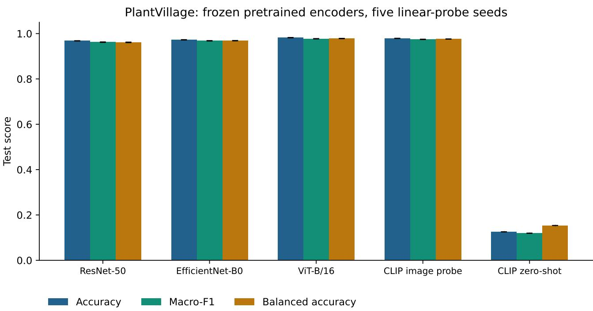  
Error bars: sample SD across probe seeds on one fixed split; zero-shot has no seed. Encoders remain frozen.

Figure S2: Complete frozen representation and fixed CLIP comparison under the same PV split. Seed SD and conditional sampling intervals are distinct quantities; this disease-image task is separate from original VLDA zone/setpoint prediction.  
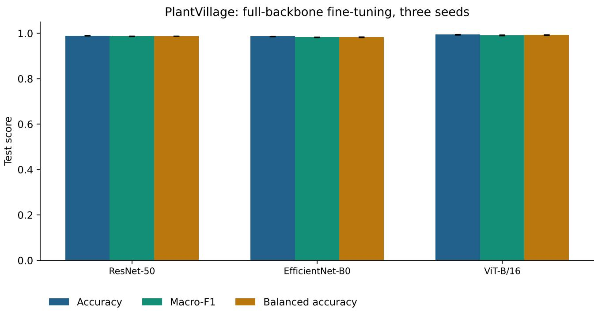  
Error bars: sample SD across full-network training seeds on one fixed split. All backbone parameters are trainable.  
Figure S3: All nine full-network trainings, three seeds per architecture. The observed clean mean performance does not imply compatible external or field accuracy.

PlantVillage: frozen pretrained encoders, five linear-probe seeds Training (colored) and validation (gray), all executed probe seeds

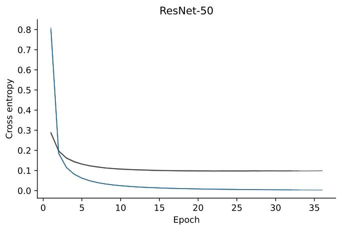

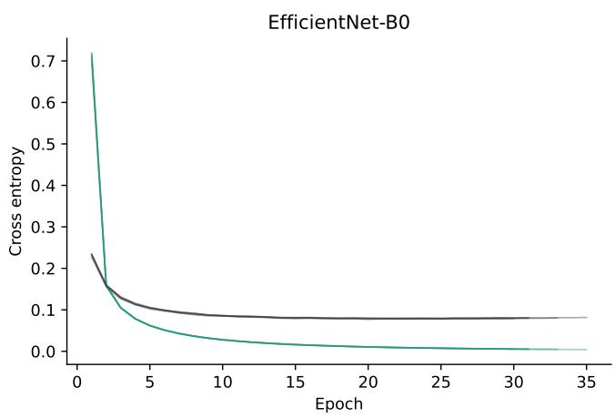

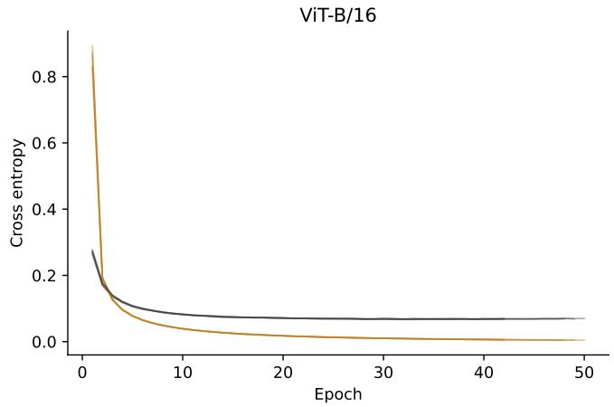

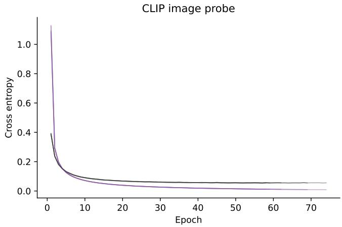  
Figure S4: Completed frozen-head learning histories. Checkpoints are selected by validation loss, not these test outcomes. Shared encoder extraction is separate from head-training time.

PlantVillage: full-backbone fine-tuning, three seeds Training (colored) and validation (gray), all executed seeds

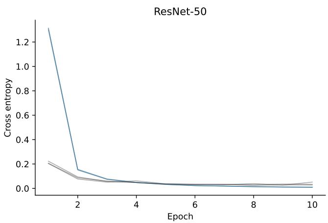

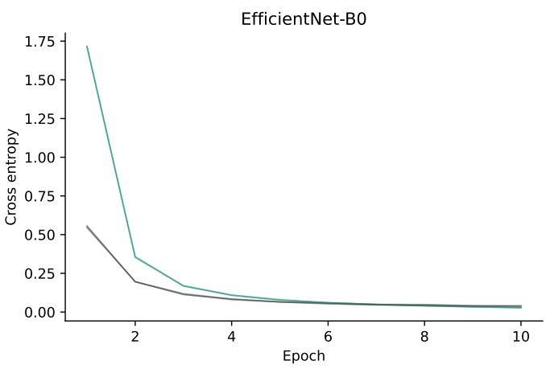

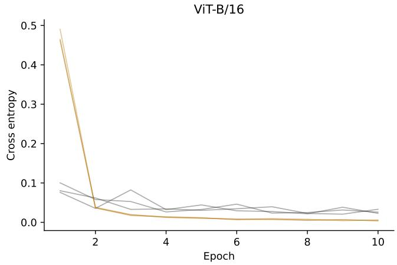  
Figure S5: All full-network learning histories under the ten-epoch protocol. Epochs and repeated augmented views are not independent sample counts.

Original checkpoint: 43 saved test rows, 41 screened source/similarity groups  
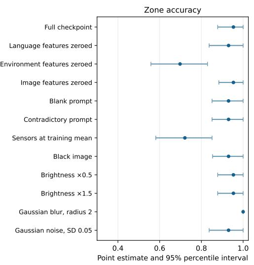

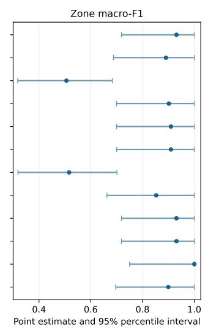

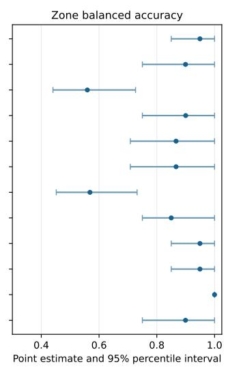  
1,000 whole-group resamples; one shared episode and original split leakage remain. Balanced-accuracy intervals condition on all four classes present (971/1,000 draws).

Figure S6: One historical checkpoint, 12 inference conditions, 43 saved rows and 41 screened groups. Balanced-accuracy intervals condition on 971 class-complete draws; fixed-four-class F1 uses zero contribution for an absent class. Original leakage and one-episode dependence remain

## S3. Corruptions, compatible transfer and OOD diagnostics

## S3.1. Adverse image and context conditions

Brightness multiplier 0.5, Gaussian blur radius 2 and Gaussian noise standard deviation 0.05 precede unchanged official model preprocessing on the same 9,828 PV test images. All requested model/seed outcomes are retained. Full EfficientNet-B0 blur accuracy of 36.91% is a measured negative result. An independent clean replay of the first 64 test images for seed 17 of each full-network architecture matches saved probabilities bitwise, with maximum absolute difference zero. That bounded parity check does not prove every corruption implementation or a causal explanation for blur sensitivity.

The historical checkpoint's separate inference conditions include zeroed image, language or sensor features; blank and contradictory prompts; sensors at the training mean; black images; brightness 0.5 and 1.5; blur radius $2 ;$ and noise standard deviation 0.05. Those 12 fixed-checkpoint evaluations are perturbations, not retrained ablations. Generated pesticide-label agreement stays perfect, consistent with its severe label shortcuts rather than verified intervention robustness. Missing-feature representations may themselves lie outside training

Compatible external evaluation keeps all 38 outputs and unrestricted argmax on 238 PlantSeg images with 15 supported true classes. Supported-15 macro-F1 and fixed-38 macro-F1 are different metrics; the latter includes unsupported classes under the declared zero-division convention. The shared-true-class contrast uses 4,106 existing PV test images versus the 238 external images. It retains the poor transfer outcomes and does not remove frequency, acquisition, organ or annotation differences. Neither side supplies the original VLDA action/context supervision. No external prompt tuning, training or restricted-class softmax is performed.

## S3.2. Frozen threshold, score direction and distinct OOD cohorts

For every model, the OOD score is $1 - \operatorname* { m a x } _ { 1 \le c \le 3 8 } p _ { c }$ . The original global PV-validation confidence fifth percentile is frozen using the lower order statistic; a sample is accepted as ID when confidence is greater than or equal to that threshold, with ties accepted. No OOD image selects a threshold. Later condition diagnostics reference those exact prior calibration files by SHA, without recomputation. Validation coverage near 95% does not guarantee 95% coverage for new ID data.

ROC and AP use OOD as positive. ROC false positives are therefore ID rejections; operating OOD acceptance is a different quantity: OOD images accepted as ID at the unchanged validation-derived threshold. It is not test-tuned FPR at 95% OOD recall, nor a false-intervention rate. Each diagnostic preserves predictions, scores, probabilities, calibrated threshold identities and 1,000 separate-domain whole-source-group bootstrap draws. Per-run intervals exclude calibration variation; seed SD is reported separately.

Table S14: Additional known-host condition OOD statistics with unchanged prior global validation thresholds and all 38 outputs. Global ID has 9,828 images/3,864 groups; host-restricted healthy ID has 576/58. AP prevalence is 0.01315393 versus 0.18528996; differences in AP across references do not alone imply better detection. Values with SD describe seeds, not group-bootstrap sampling intervals.
<table><tr><td>Model regime</td><td>ID reference</td><td>Runs</td><td></td><td>AP ID reject % OOD accept %</td><td></td></tr><tr><td>Fixed zero / CLIP probe</td><td>Global</td><td>1</td><td>0.0096</td><td>5.91</td><td>98.47</td></tr><tr><td>Fixed zero / CLIP probe</td><td>Host-restricted</td><td>1</td><td>0.1155</td><td>10.59</td><td>98.47</td></tr><tr><td>Frozen / CLIP probe</td><td>Global</td><td>5</td><td> $0 . 2 2 2 6 { \scriptstyle \pm 0 . 0 1 3 8 }$ </td><td> $6 . 0 7 { \pm } 0 . 1 7$ </td><td> $3 7 . 8 6 { \pm } 3 . 4 4 $ </td></tr><tr><td>Frozen / CLIP probe</td><td>Host-restricted</td><td>5</td><td> $0 . 7 6 9 3 { \scriptstyle \pm 0 . 0 1 2 1 }$ </td><td> $3 . 9 2 { \pm } 0 . 2 6 $ </td><td> $3 7 . 8 6 { \pm } 3 . 4 4 $ </td></tr><tr><td>Frozen / EffNet-B0</td><td>Global</td><td>5</td><td> $0 . 1 9 8 2 { \pm } 0 . 0 2 5 4$ </td><td> $5 . 1 7 { \pm } 0 . 0 5$ </td><td> $3 7 . 8 6 { \pm } 1 . 5 8 $ </td></tr><tr><td>Frozen / EffNet-B0</td><td>Host-restricted</td><td>5</td><td> $0 . 7 8 7 6 { \scriptstyle \pm 0 . 0 0 8 3 }$ </td><td> $3 . 3 7 { \pm } 0 . 2 6 $ </td><td> $3 7 . 8 6 { \pm } 1 . 5 8 $ </td></tr><tr><td>Frozen / ResNet-50</td><td>Global</td><td>5</td><td> $0 . 1 6 4 2 { \scriptstyle \pm 0 . 0 0 7 2 }$ </td><td> $5 . 3 1 { \pm } 0 . 1 2 $ </td><td> $5 3 . 2 8 { \pm } 4 . 0 2 $ </td></tr><tr><td>Frozen / ResNet-50</td><td>Host-restricted</td><td>5</td><td> $0 . 7 4 9 7 { \scriptstyle \pm 0 . 0 0 9 0 }$ </td><td> $2 . 1 5 { \pm } 0 . 1 0 $ </td><td> $5 3 . 2 8 { \pm } 4 . 0 2 $ </td></tr><tr><td>Frozen / ViT-B/16</td><td>Global</td><td>5</td><td> $0 . 3 7 0 6 { \scriptstyle \pm 0 . 0 1 1 2 }$ </td><td> $5 . 4 8 { \pm } 0 . 1 2$ </td><td> $1 8 . 1 7 { \pm } 2 . 1 2$ </td></tr><tr><td>Frozen / ViT-B/16</td><td>Host-restricted</td><td>5</td><td> $0 . 9 3 8 0 { \scriptstyle \pm 0 . 0 0 6 9 }$ </td><td> $1 . 6 0 { \pm } 0 . 3 3 $ </td><td> $1 8 . 1 7 { \pm } 2 . 1 2$ </td></tr><tr><td>Full / EffNet-B0</td><td>Global</td><td>3</td><td> $0 . 5 7 5 5 { \scriptstyle \pm 0 . 0 1 5 0 }$ </td><td> $5 . 3 6 { \pm } 0 . 2 3 $ </td><td> $7 . 8 9 { \pm } 1 . 1 7 $ </td></tr><tr><td>Full / EffNet-B0</td><td>Host-restricted</td><td>3</td><td> $0 . 9 6 1 6 { \scriptstyle \pm 0 . 0 0 6 7 }$ </td><td> $2 . 6 0 { \pm } 0 . 1 7$ </td><td> $7 . 8 9 { \pm } 1 . 1 7 $ </td></tr><tr><td>Full / ResNet-50</td><td>Global</td><td>3</td><td> $0 . 5 9 7 1 { \scriptstyle \pm 0 . 0 1 2 0 }$ </td><td> $5 . 4 5 { \pm } 0 . 2 0 $ </td><td> $8 . 1 4 { \pm } 1 . 1 7$ </td></tr><tr><td>Full / ResNet-50</td><td>Host-restricted</td><td>3</td><td> $0 . 9 5 2 9 { \scriptstyle \pm 0 . 0 1 3 1 }$ </td><td> $2 . 0 3 { \pm } 0 . 6 6$ </td><td> $8 . 1 4 { \pm } 1 . 1 7$ </td></tr><tr><td>Full / ViT-B/16</td><td>Global</td><td>3</td><td> $0 . 8 6 1 3 { \scriptstyle \pm 0 . 0 3 8 4 }$ </td><td> $5 . 0 4 { \pm } 0 . 4 1 $ </td><td> $0 . 7 6 { \scriptstyle \pm 0 . 7 6 }$ </td></tr><tr><td>Full / ViT-B/16</td><td>Host-restricted</td><td>3</td><td> $0 . 9 9 6 4 { \scriptstyle \pm 0 . 0 0 0 4 }$ </td><td> $2 . 6 6 { \pm } 0 . 5 6 $ </td><td> $0 . 7 6 { \scriptstyle \pm 0 . 7 6 }$ </td></tr></table>

Novel-host OOD contains 671 official PlantSeg test images, 666 screened groups and 19 predeclared literal host labels absent from the downstream PV crop labels. Citrus and Zucchini are conservatively excluded because their relation to PV Orange and generic Squash is ambiguous. Crop/domain/organ differences remain confounded and global pathogen novelty is not established. The fixed CLIP zero-shot negative outcome is retained: AUROC 0.2454 and OOD acceptance 99.25%, with no score reversal or prompt retuning.

## Table S10

Fixed image-corruption evaluations on the same 9,828 PlantVillage test images; accuracy in percent, mean ± optimization-seed sample SD in percentage points.
<table><tr><td>Cohort / model</td><td>Brightness ×0.5</td><td>Blur radius 2</td><td> $\operatorname { N o i s e } \sigma = 0 . 0 5$ </td></tr><tr><td>Frozen probe / ResNet-50</td><td> $9 5 . 1 4 \pm 0 . 0 8$ </td><td> $7 6 . 5 2 \pm 0 . 3 3$ </td><td> $7 9 . 0 8 \pm 2 . 3 4$ </td></tr><tr><td>Frozen probe / EfficientNet-B0</td><td> $9 3 . 7 1 \pm 0 . 1 6$ </td><td> $7 2 . 7 1 \pm 0 . 6 3$ </td><td> $9 4 . 0 3 \pm 0 . 0 9$ </td></tr><tr><td>Frozen probe / ViT-B/16</td><td> $9 7 . 2 9 \pm 0 . 0 8$ </td><td> $7 0 . 6 3 \pm 0 . 4 4$ </td><td> $9 4 . 2 7 \pm 0 . 0 6$ </td></tr><tr><td>Frozen probe / CLIP image probe</td><td> $8 6 . 9 0 \pm 0 . 2 4$ </td><td> $6 6 . 8 6 \pm 0 . 4 0$ </td><td> $8 2 . 7 9 \pm 0 . 2 6$ </td></tr><tr><td>CLIP image-text zero-shot</td><td>13.05</td><td> $1 0 . 0 3$ </td><td> $1 2 . 1 9$ </td></tr><tr><td>Full network / ResNet-50</td><td> $9 3 . 0 7 \pm 1 . 3 4$ </td><td> $5 9 . 1 4 \pm 1 . 0 0$ </td><td> $9 5 . 2 4 \pm 1 . 0 0$ </td></tr><tr><td>Full network / EfficientNet-B0</td><td> $9 1 . 1 2 \pm 0 . 3 1 $ </td><td> $3 6 . 9 1 \pm 1 . 9 7$ </td><td> $6 7 . 1 1 \pm 2 . 4 1$ </td></tr><tr><td>Full network / ViT-B/16</td><td> $9 7 . 8 1 \pm 1 . 0 7$ </td><td> $8 5 . 5 4 \pm 2 . 6 2$ </td><td> $9 8 . 6 3 \pm 0 . 3 2 $ </td></tr></table>

Corruptions precede the unchanged official model transforms. There are five seeds per frozen probe, three per full network and one fixed zero-shot model. Negative outcomes, including full EfficientNet-B0 blur accuracy $3 6 . 9 1 \% ,$ remain unchanged. An executed clean replay of the first 64 test images for seed 17 of each full-network architecture matches saved probabilities bitwise (maximum absolute difference zero). This checked-subset parity does not prove every corruption path or a causal blur mechanism. No checkpoint/threshold/test-driven correction was made. Regime differences prevent an isolated causal interpretation of unfreezing.

## Table S11

Post hoc shared-true-class transfer comparison: PlantVillage 4,106 images/1,948 groups versus PlantSeg 238 images/238 groups, both with the same 15 true classes.
<table><tr><td>Cohort / model</td><td>Runs</td><td>PV accuracy %</td><td> $\mathrm { E x t e r n a l \ a c c u r a c y \pm S D \ p p }$ </td><td> $\mathrm { E x t e r n a l } \mathrm { F } 1 _ { 1 5 } \pm \mathrm { S D }$ </td><td>External–PV gap pp [interval]</td></tr><tr><td>Frozen probe / CLIP image probe</td><td>5</td><td>97.428</td><td> $2 4 . 8 7 4 \pm 0 . 6 9 0$ </td><td> $0 . 2 1 9 8 \pm 0 . 0 0 7 5$ </td><td>-72.554 [-77.921,-67.295]</td></tr><tr><td>Frozen probe / EfficientNet- B0</td><td>5</td><td>96.249</td><td> $2 4 . 6 2 2 \pm 0 . 7 0 3$ </td><td> $0 . 2 3 0 5 \pm 0 . 0 0 9 4$ </td><td>-71.628 [-76.511,-66.624]</td></tr><tr><td>Frozen probe / ResNet-50</td><td>5</td><td>95.675</td><td> $2 0 . 1 6 8 \pm 1 . 1 8 8$ </td><td> $0 . 1 7 6 4 \pm 0 . 0 0 8 8$ </td><td>-75.507 [-80.608,-70.492]</td></tr><tr><td>Frozen probe / ViT-B/16</td><td>5</td><td>97.735</td><td> $2 1 . 6 8 1 \pm 0 . 9 6 7$ </td><td> $0 . 1 6 1 1 \pm 0 . 0 1 2 8$ </td><td>-76.054 [-81.077,-70.759] -72.387</td></tr><tr><td>Full network / EfficientNet- B0</td><td>3</td><td>98.157</td><td> $2 5 . 7 7 0 \pm 0 . 8 7 5$ </td><td> $0 . 2 1 4 9 \pm 0 . 0 1 2 6$ </td><td>[-77.560,-66.782]</td></tr><tr><td>Full network / ResNet-50</td><td>3</td><td>98.717</td><td> $2 5 . 0 7 0 \pm 0 . 4 8 5$ </td><td> $0 . 2 0 7 6 \pm 0 . 0 1 7 2$ </td><td>-73.647 [-78.962,-68.307] -72.212</td></tr><tr><td>Full network / ViT-B/16</td><td>3</td><td>99.383</td><td> $2 7 . 1 7 1 \pm 1 . 6 9 8$ </td><td> $0 . 2 2 9 3 \pm 0 . 0 1 7 7$ </td><td>[-77.662,-66.355] 16.151</td></tr><tr><td>Fixed zero-shot / CLIP image-text zero-shot</td><td>1</td><td>14.101</td><td>30.252</td><td>0.2546</td><td>[10.150,21.814]</td></tr></table>

All 38 output probabilities and unrestricted argmax predictions remain; there is no 15-class softmax restriction or external fine-tuning. The gap uses approximate 95% crossed seed/group percentile bounds (1,000 draws) with common within-domain group draws across seeds, independent domain draws and paired seed weights. The derived subset is post hoc; frequencies, organs and acquisition differ. This is a conditional transfer contrast, not a pure causal domain effect or a field-validation estimate. $\mathsf { F } \mathsf { 1 } _ { 1 5 }$ averages supported true classes; full-38 F1 is a separate metric. SD describes optimization seeds; a fixed model has no seed SD.

The separate known-host condition cohort was selected post hoc/exploratorily and frozen before its own inference: 131 images/groups and 15 source annotations on Blueberry (27), Raspberry (12) and Soybean (92), crop labels represented only as healthy in the downstream PV taxonomy. This defines annotated host-condition categories outside that closed label space, not globally novel pathogens or absence from pretraining. Thirty models produce 60 reference analyses: global ID has 9,828 images/3,864 groups; the host-set restricted healthy ID reference has 576 images/58 groups (279 Blueberry, 19 Raspberry, 278 Soybean). True-class membership and source positions were frozen before OOD scores. It is not pair-matching. equal-proportion matching or organ matching. All 38 outputs and the original global validation thresholds remain.

The identical OOD scores/thresholds imply identical OOD acceptance in both ID references, whereas AUROC, AP and ID rejection can differ. AP prevalence is 1.315393% globally and 18.528996% in the restricted reference, so a direct AP change cannot alone imply improved detection. Full ViT has mean global/restricted AUROC 0.996169/0.999121 with seed SD 0.001050/0.000146, while the fixed CLIP zero-shot model has 0.374028/0.224502 and 98.47% OOD acceptance. These contrastive outcomes remain exploratory and acquisition-confounded. In the full-ViT seed-17 global analysis, group-percentile AUROC bounds are [0.992958, 0.997642] and OOD acceptance bounds [0, 0.038168]; the observed zero-acceptance seed-43 bootstrap is degenerate and cannot prove zero unseen acceptance.

Separate novel-host OOD diagnostics: 671 official PlantSeg test images, 19 literal host labels and 666 groups; ID reference is the 9,828-image PlantVillage test.
<table><tr><td>Cohort / model</td><td>Runs</td><td> $\mathrm { O O D \ A U R O C \pm S D }$ </td><td> $\mathrm { O O D } \mathrm { A P } \pm \mathrm { S D }$ </td><td> $\mathrm { I D \ r e j e c t e d \ \% } \pm \mathrm { S D \ p p }$ </td><td>OOD accepted % ± SD pp</td></tr><tr><td>Frozen probe / ResNet-50</td><td>5</td><td> $0 . 8 4 1 1 \pm 0 . 0 0 6 2$ </td><td> $0 . 3 2 0 5 \pm 0 . 0 0 8 6$ </td><td> $5 . 3 1 \pm 0 . 1 2$ </td><td> $6 1 . 1 6 \pm 1 . 2 4$ </td></tr><tr><td>Frozen probe / EfficientNet- B0</td><td>5</td><td> $0 . 9 2 7 0 \pm 0 . 0 0 4 3$ </td><td> $0 . 5 1 1 8 \pm 0 . 0 0 7 9$ </td><td> $5 . 1 7 \pm 0 . 0 5$ </td><td> $3 7 . 7 3 \pm 0 . 7 8$ </td></tr><tr><td>Frozen probe / ViT-B/16</td><td>5</td><td> $0 . 9 5 3 9 \pm 0 . 0 0 2 8$ </td><td> $0 . 6 2 3 1 \pm 0 . 0 1 5 7$ </td><td> $5 . 4 8 \pm 0 . 1 2$ </td><td> $2 5 . 1 6 \pm 1 . 1 7$ </td></tr><tr><td>Frozen probe / CLIP image probe</td><td>5</td><td> $0 . 8 9 0 3 \pm 0 . 0 0 5 1$ </td><td> $0 . 3 8 2 1 \pm 0 . 0 1 3 0$ </td><td> $6 . 0 7 \pm 0 . 1 7$ </td><td> $4 7 . 7 8 \pm 1 . 8 1$ </td></tr><tr><td>Full network / ResNet-50</td><td>3</td><td> $0 . 9 8 3 6 \pm 0 . 0 0 3 0$ </td><td> $0 . 8 1 7 1 \pm 0 . 0 2 0 5$ </td><td> $5 . 4 5 \pm 0 . 2 0$ </td><td> $6 . 1 6 \pm 1 . 8 6$ </td></tr><tr><td>Full network / EfficientNet- B0</td><td>3</td><td> $0 . 9 8 2 5 \pm 0 . 0 0 0 2$ </td><td> $0 . 8 1 6 9 \pm 0 . 0 0 6 2$ </td><td> $5 . 3 6 \pm 0 . 2 3$ </td><td> $7 . 3 5 \pm 0 . 2 3$ </td></tr><tr><td>Full network / ViT-B/16</td><td>3</td><td> $0 . 9 9 7 2 \pm 0 . 0 0 0 4$ </td><td> $0 . 9 6 3 8 \pm 0 . 0 0 3 7$ </td><td> $5 . 0 4 \pm 0 . 4 1$ </td><td> $0 . 4 5 \pm 0 . 1 5$ </td></tr><tr><td>CLIP fixed image-text zero- shot</td><td>1</td><td>0.2454</td><td>0.0389</td><td>5.91</td><td>99.25</td></tr></table>

OOD score is $1 - \operatorname* { m a x } _ { k } p _ { k }$ over all 38 outputs. Each acceptance threshold uses only 4,910 global PV validation images (lower fifth confidence percentile, with ties accepted), then is fixed. It does not guarantee 95% unseen-ID coverage. SD across seeds is separate from each run's 1,000 conditional source-group bootstrap intervals; calibration/model-selection uncertainty is excluded. Constant-score AP equals the pooled OOD prevalence 0.063911. Host names, organs and acquisition are confounded; these are not intervention-safety or globally novel-pathogen claims.

## Table S13

Exploratory known-host condition OOD: 131 images/131 groups across 15 annotated conditions on Blueberry, Raspberry and Soybean host names represented only as healthy in PV38.
<table><tr><td>Cohort / model</td><td>Runs</td><td> $\mathrm { G l o b a l - I D \ A U R O C \pm S D }$ </td><td> $\mathrm { R e s t r i c t e d - I D \ A U R O C } \pm \mathrm { S D }$ </td><td>OOD accepted % ± SD pp</td></tr><tr><td>CLIP fixed image-text zero-shot</td><td>1</td><td>0.37403</td><td> $0 . 2 2 4 5 0 ^ { }$ </td><td> $9 8 . 4 7 $ </td></tr><tr><td>Frozen probe / CLIP image probe</td><td>5</td><td> $0 . 8 9 4 3 2 \pm 0 . 0 0 8 1 1$ </td><td> $0 . 8 9 4 5 2 \pm 0 . 0 0 9 5 9$ </td><td> $3 7 . 8 6 \pm 3 . 4 4$ </td></tr><tr><td>Frozen probe / EfficientNet-B0</td><td>5</td><td> $0 . 9 2 9 9 2 \pm 0 . 0 0 2 9 4$ </td><td> $0 . 9 5 0 7 5 \pm 0 . 0 0 2 6 0$ </td><td> $3 7 . 8 6 \pm 1 . 5 8 $ </td></tr><tr><td>Frozen probe / ResNet-50</td><td>5</td><td> $0 . 8 6 5 5 0 \pm 0 . 0 0 9 4 1$ </td><td> $0 . 8 9 4 5 5 \pm 0 . 0 0 9 9 7$ </td><td> $5 3 . 2 8 \pm 4 . 0 2$ </td></tr><tr><td>Frozen probe / ViT-B/16</td><td>5</td><td> $0 . 9 6 6 7 2 \pm 0 . 0 0 0 4 6$ </td><td> $0 . 9 8 4 2 1 \pm 0 . 0 0 0 7 7$ </td><td> $1 8 . 1 7 \pm 2 . 1 2$ </td></tr><tr><td>Full network / EfficientNet-B0</td><td>3</td><td> $0 . 9 8 2 2 9 \pm 0 . 0 0 0 6 7$ </td><td> $0 . 9 9 1 5 7 \pm 0 . 0 0 1 2 7$ </td><td> $7 . 8 9 \pm 1 . 1 7$ </td></tr><tr><td>Full network / ResNet-50</td><td>3</td><td> $0 . 9 7 9 0 0 \pm 0 . 0 0 5 0 9$ </td><td> $0 . 9 8 6 5 1 \pm 0 . 0 0 5 2 0$ </td><td> $8 . 1 4 \pm 1 . 1 7$ </td></tr><tr><td>Full network / ViT-B/16</td><td>3</td><td> $0 . 9 9 6 1 7 \pm 0 . 0 0 1 0 5$ </td><td> $0 . 9 9 9 1 2 \pm 0 . 0 0 0 1 5$ </td><td> $0 . 7 6 \pm 0 . 7 6$ </td></tr></table>

Values with ± are optimization-seed means and sample SD; fixed zero-shot has no seed SD. Conditional source-group sampling intervals are separate. Thirty model diagnostics yield 60 reference analyses, not 60 independent models. All prior global validation thresholds and 38 outputs remain unchanged. Global ID comprises 9,828 images/3,864 groups; the host-set restricted healthy ID reference contains 576 images/58 groups (Blueberry 279, Raspberry 19, Soybean 278). This restricts host-label support; it is not paired or equal-proportion matching. AP prevalence differs: 1.315393% globally versus 18.528996% restricted. The same OOD scores/threshold imply identical OOD acceptance under both references. Inputs/protocol were frozen before extension inference, after the main campaign was defined; selection is post hoc/exploratory. Sparse conditions, host proportions, organs and web acquisition remain confounded. No globally novel pathogen, causal disease isolation, healthy-class correctness or intervention safety follows.

Confidence-based diagnostic abstention; these curves do not establish intervention safety  
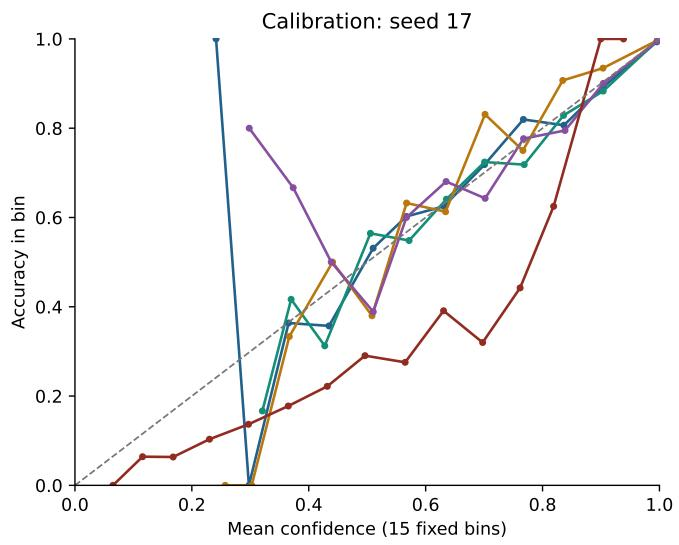

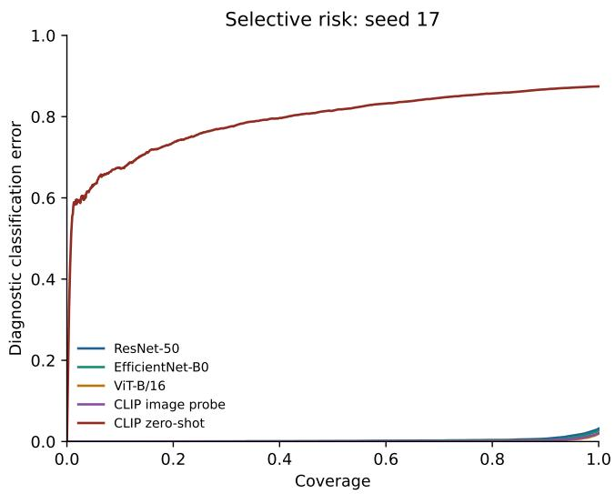  
Figure S7: Raw-confidence calibration and descriptive selective risk-coverage evidence for declared classification tasks. Test-confidence sweeps do not implement or certify an agricultural treatment abstention rule.

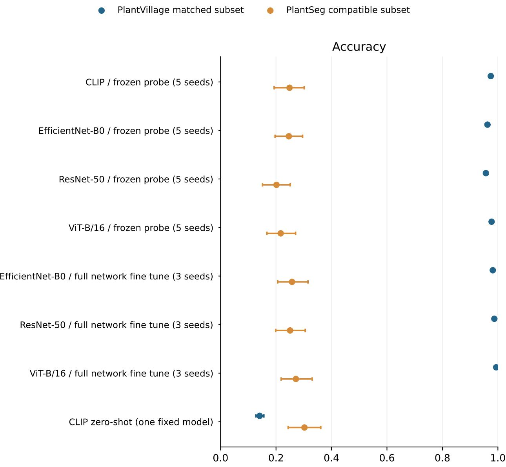  
Figure S8: Post hoc shared true-class support with unrestricted 38-output predictions. Approximate crossed seed/group intervals condition on the selected subsets and fitted seeds; frequency, organ and acquisition differences remain. (a) Accuracy. The derived saved-prediction analysis uses 4,106 PV images and 238 external images. Lines show 95% observed-group and paired-seed percentile intervals.

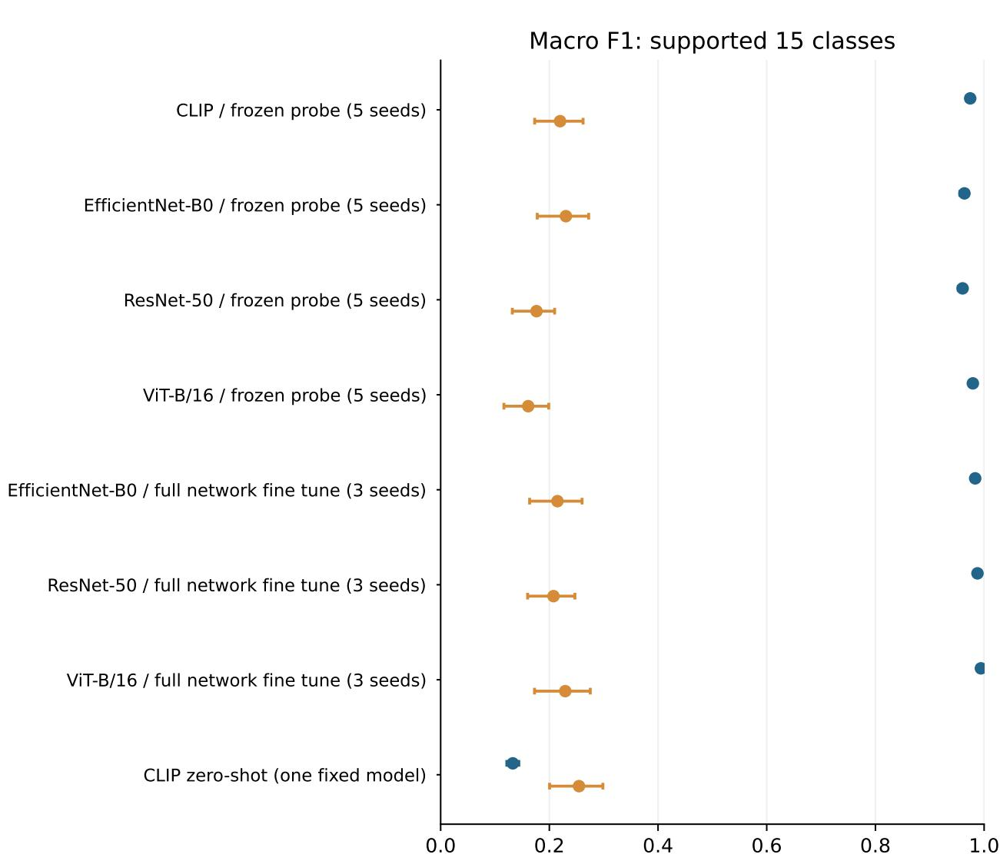  
Figure S8: Continued: (b) macro F1 over the 15 shared true classes. The cohorts, unrestricted 38-output predictions and interval definition are unchanged from panel (a).

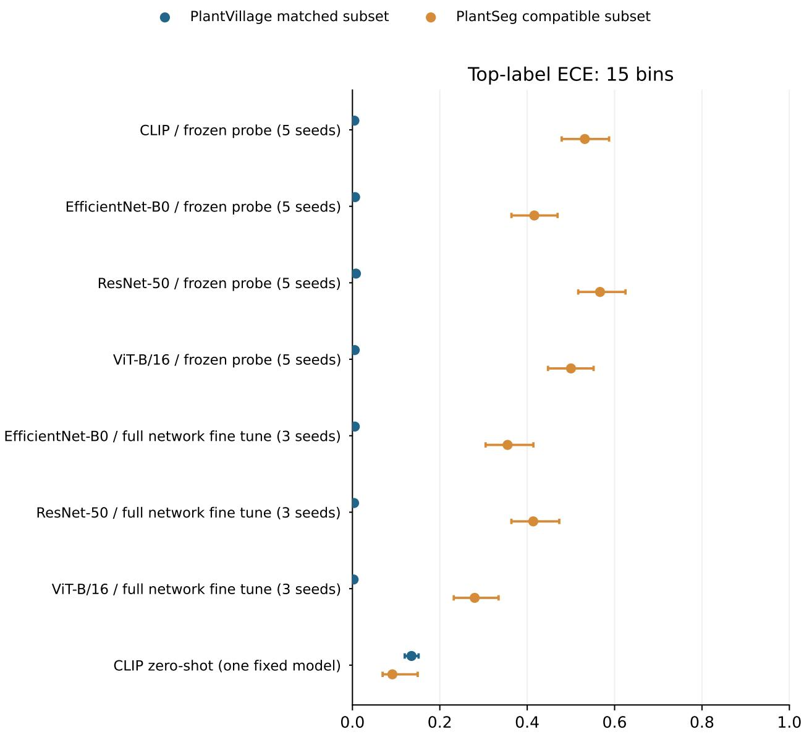  
Figure S8: Continued: (c) top-label ECE with 15 bins. The cohorts, unrestricted 38-output predictions and interval definition are unchanged from panel (a).

Frozen encoders: novel-host diagnosis OOD at validation-fixed operating points  
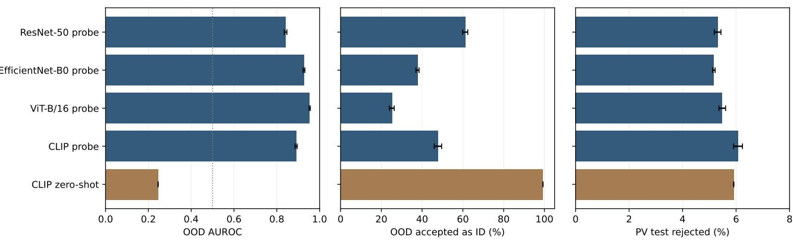  
Figure S9: Novel-host confidence diagnostics for the frozen encoders and fixed CLIP. Thresholds are validation-only; whiskers are optimization-seed SD. Per-run sampling intervals are separate. OOD acceptance is not unsafe treatment. Full-network rows are given in the complete numerical table and CSV.

  
Figure S10: Exploratory known-host condition OOD against global and host-restricted healthy ID references. Identical OOD scores and unchanged thresholds give identical OOD acceptance; reference composition and AP prevalence differ. Bars show seed SD, not group confidence intervals or causal disease effects. (a) AUROC, with OOD as the positive class. The cohort contains 131 PlantSeg images. All 38 outputs and the original global PV validation thresholds are retained. Host restriction is not pair matching; domain, organ and condition differences remain confounded. Seed SD applies to repeatedly trained configurations; the fixed CLIP model has no optimization-seed SD.

  
Figure S10: Continued: (b) ID rejection at the original validation threshold, for the same global and host-restricted healthy ID references as panel (a). Bars show sample SD across seeds.

OOD accepted as ID  
  
Figure S10: Continued: (c) OOD accepted as ID at the original validation threshold. The OOD scores and threshold are identical for the two ID-reference analyses. Bars show sample SD across seeds.

## S4. Virtual-greenhouse simulation protocols and outcomes

## S4.1. Protocol cohorts and reporting scope

This section reports the team's virtual-greenhouse component experiments. Navigation/control, arm geometry, integrated missions, environmental responses and command faults use separate protocols and denominators. Numerical summaries are transcribed from the retained experiment reports; the present revision does not recompute them from raw simulation traces. Complete climate parameterization and raw-trace reproducibility remain limitations, as stated in the main discussion.

The 38 navigation/control cases comprise ten nominal repeats, six clear-layout robustness cases, two intended obstacle stops and 20 valid controls under an arm-proxy protocol. They are distinct from three precision-arm integrated missions, nine integrated faults, 40 arm requests and 90 forced-state isolated faults. These denominators must not be pooled into an overall reliability rate. The aisle speed 0.50 m/s is a command, not a minimum measured speed. Nominal starting pose and learned policy stay fixed; estimator noise does not drive navigation. The first five nominal runs start the mission at 5 s and later runs at 3 s, and the total-time chart preserves that initialization difference.

Table S15: Navigation/control and fault-test cohorts. Counts retain their protocol-specific denominators. Near-rest treatment dwell and moving obstacle stopping are separate measurements.
<table><tr><td>Protocol</td><td>Metric</td><td>Reported value</td></tr><tr><td>arm-proxy nominal</td><td>completion</td><td>10/10 cases</td></tr><tr><td>arm-proxy nominal</td><td>reported Wilson95 interval</td><td>72.2–100.0 percent</td></tr><tr><td>arm-proxy clear robustness</td><td>completion</td><td>6/6 cases</td></tr><tr><td>arm-proxy physical obstacles</td><td>intended safe-stop outcomes</td><td>2/2 cases</td></tr><tr><td>arm-proxy valid controls</td><td>completion</td><td>20/20 cases</td></tr><tr><td>navigation command</td><td>aisle-transit speed command</td><td>0.50 m/s</td></tr><tr><td>precision-arm integrated full route</td><td>route completion duration</td><td>130.302 s</td></tr><tr><td>isolated forced-TREAT fallback harness</td><td>invalid-input rejection</td><td>90/90 trials</td></tr><tr><td>isolated forced-TREAT fallback harness</td><td>maximum safe-dwell time</td><td>0.864 s</td></tr><tr><td>integrated faults after treatment admission</td><td>stopped with safe dwell</td><td>9/9 faults</td></tr><tr><td>integrated faults after treatment admission</td><td>no post-fault dose</td><td>9/9 faults</td></tr><tr><td>integrated faults after treatment admission</td><td>maximum safe-dwell time</td><td>0.500 s</td></tr><tr><td>physical safe-dwell definition</td><td>planar speed and yaw-rate criteria</td><td>&lt;0.035;&lt;0.06;0.5 m/s;rad/s;s</td></tr><tr><td>moving-route obstacle stop case1</td><td>stop-to-dwell time</td><td>3.412 s</td></tr><tr><td>moving-route obstacle stop case2</td><td>stop-to-dwell time</td><td>3.282 s</td></tr><tr><td>one moving-route obstacle case</td><td>minimum conservative logged clearance margin</td><td>0 m</td></tr></table>

Table S16: Modeled scene components and authored placement coordinates. Additional visual demonstration assemblies are separate from these primary counts.
<table><tr><td>Protocol</td><td>Metric</td><td>Reported value</td></tr><tr><td>Capacitive soil VWC probes</td><td>authored component count</td><td>24 components</td></tr><tr><td>Shielded temperature/RH stations</td><td>authored component count</td><td>4 components</td></tr><tr><td>Zone irrigation valves</td><td>authored component count</td><td>4 components</td></tr><tr><td>Exhaust fans</td><td>authored component count</td><td>4 components</td></tr><tr><td>Suspended circulation fans</td><td>authored component count</td><td>3 components</td></tr></table>

The authored placement table specifies soil-probe prong centres at approximately $z ~ = ~ 0 . 2 7 0 \ \mathrm { m } ;$ four shielded temperature/RH stations at $x = 1 . 0 5$ m, y = 4, 11, 18, 25 m and shield z = 1.3375 m; four irrigation-valve anchors at $x = - 6 . 7 \mathrm { m }$ , the same four y positions and z = 0.18 m; four exhaust fans at x = –7.4 m, those four y positions and z = 2.7 m; and three suspended circulation fans at $x = 0 , y = 6 , 1 7 , 2 7$ m and z = 3.1 m. These are modeled placements, not surveyed/calibrated measurements. Additional near-aisle visual assemblies are not silently added to the primary counts.

## S4.2. Targeting geometry and oracle-driven missions

Table S17: Virtual-target geometric benchmark: 32 accepted requests and eight boundary rejections. Pose-success and disk-hit rates use accepted targets only.
<table><tr><td>Protocol</td><td>Metric</td><td>Reported value</td></tr><tr><td>virtual crop-edge targets</td><td>pre-specified total requests</td><td>40 requests</td></tr><tr><td>accepted virtual targets</td><td>position error mean ± sampleSD</td><td>0.449 ± 0.154 mm</td></tr><tr><td>accepted virtual targets</td><td>maximum position error</td><td>0.853 mm</td></tr><tr><td>accepted virtual targets</td><td>mean nozzle-axis error</td><td>0.000502 rad</td></tr><tr><td>accepted virtual targets</td><td>pose acceptance</td><td>32/32 requests</td></tr><tr><td>accepted virtual targets</td><td>virtual disk hits</td><td>32/32 requests</td></tr><tr><td>accepted virtual targets</td><td>ray error mean ± sampleSD</td><td>0.829 ± 0.440 mm</td></tr><tr><td>far-boundary requests</td><td>rejected before servo control</td><td>8/8 requests</td></tr><tr><td>virtual benchmark</td><td>observed upright failures</td><td>0 failures</td></tr><tr><td>accepted virtual targets</td><td>settling and control windows</td><td>3;6 s</td></tr></table>

Table S18: Integrated authored-target missions, each completed. These three cases use simulator-state diagnosis and targets and are separate from the 32-target geometric benchmark.
<table><tr><td>Case / seed</td><td>Duration s Max treated-target ray error mm</td><td></td></tr><tr><td>full route / 1200</td><td>130.302</td><td>12.94</td></tr><tr><td>left berry / 1201</td><td>30.802</td><td>10.99</td></tr><tr><td>right berry / 1202</td><td>33.802</td><td>6.40</td></tr></table>

The virtual geometric benchmark comprises 32 accepted crop-edge targets and eight far-boundary requests. The mean position error across accepted targets is $0 . 4 4 9 \pm 0 . 1 5 4$ mm (sample SD), maximum 0.853 mm; virtual target-plane ray error is $0 . 8 2 9 \pm 0 . 4 4 0 \mathrm { m m }$ . The 32/32 pose-success and 32/32 disk-hit counts for accepted targets exclude all eight pre-servo boundary rejections. They use 3 s settling, 6 s control, 0.95 m standoff and virtual target heights 0.65–0.85 m. Pose criteria are position below 30 mm and nozzle-axis error below 0.1 rad; virtual disk radius is 30 mm. The finger-link origin is the modeled nozzle and roll is unspecified.

These selected submillimetre virtual statistics are not the integrated authored berry results. Integrated full-route, left-berry and right-berry maximum treated target ray errors are 12.94, 10.99 and 6.40 mm, respectively. Diagnosis and target positions in those missions use simulator-state oracles, not demonstrated camera localization or the VLDA inference pathway. Modelled treatment units, fan fractions and water particles are not calibrated pesticide volume, deposition, CFD or biological efficacy. Physical joint/contact control is reported, but full-body/self/environment contact coverage is not instrumented.

The full-route mission is reported COMPLETE at 130.302 simulated seconds, visiting beds 1, 7, 13 and 19 and issuing two modeled interventions. Its 4,900 TREAT-phase physics-step checks and 100 instantaneous dose-command checks are different denominators. A terminal dose on transition to STOW belongs to the command checks, not subsequent TREAT-step checks. A separate recorded repeat contains 255 frames at 2 fps, 127.5 s of playback sampling simulated 3.0–130.0 s; the terminal COMPLETE event at 130.302 s follows the final sampled frame. Paused-physics rendering preserves the recorded capture pose; playback frame count and simulated elapsed time have distinct meanings.

## S4.3. Offline localization and modeled climate

Table S19: Offline Point-LIO on simulated LiDAR/IMU streams. Initial ATE uses first-overlap full-pose alignment; fit ATE uses all-overlap rigid SE(3) alignment at unit scale. Navigation uses simulator pose.

<table><tr><td>Route</td><td></td><td>Length m Initial ATE mm Fit ATE mm 1 s RPE mm</td><td></td></tr><tr><td>route_00</td><td>26.89</td><td>19.80</td><td>5.22 3.80</td></tr><tr><td>route_01</td><td>26.83</td><td>40.12</td><td>9.63 4.77</td></tr><tr><td>route_02</td><td>26.97</td><td>74.26</td><td>17.32 6.26</td></tr><tr><td>route_03</td><td>27.05</td><td>20.37</td><td>5.71 4.16</td></tr><tr><td>route_04</td><td>27.12</td><td>22.89</td><td>6.35 4.36</td></tr></table>

Point-LIO (He et al., 2023) consumes simulated LiDAR and IMU together in offline replay. The documented inputs are 16 rings, 200 azimuth samples/ring, rolling acquisition at 500 Hz over 0.1 s, 10 Hz scans, a body-origin IMU at 100 Hz, 35 m range and body-aligned LiDAR translation (0, 0, 0.33) m. Range/dropout/inertial perturbations vary across five routes, without real optical returns, foliage motion or calibration errors. RGB/environment do not enter that estimator. Navigation continues to use simulator pose; offline reconstruction is not Point-LIO-driven closed-loop navigation.

Table S21  
Exact source-method readiness fixtures and limits; no ROS/actuator invocation or physical treatment.
<table><tr><td>Fixture or evidence</td><td>Observed outcome</td><td>Permitted interpretation</td></tr><tr><td>Engineered missing/stale/desynchronized inputs 52 rejected / 52 invalid fixtures</td><td></td><td>Existing presence/age/synchrony branches match specification</td></tr><tr><td>Fresh valid control</td><td>1 accepted / 1 valid control; false blocks 0/1</td><td>Only one valid control; no population false-block rate</td></tr><tr><td>Nonfinite/extreme numeric inputs</td><td>64 accepted / 64 probes</td><td>This method does not enforce finite/range bounds</td></tr><tr><td>Synchronized future timestamp</td><td>1 accepted / 1 probe</td><td>Future-time admissibility not enforced by this method</td></tr><tr><td>Expert intervention outcomes</td><td>Unavailable; no unsafe-action/false-intervention rate</td><td>Generated-label agreement is not field safety</td></tr></table>

The 53 presence/age/synchrony cases comprise 52 invalid fixtures and one valid control; they are not 53 invalid rejection trials. The exact method was tested with dummy state and fixed time; the control interface was not run. Confidence/OOD utilities are offline and are not integrated into the VLDA actuation path. Numerical command guards and alternative fusion architectures are not part of this readiness test. Physical sensor/LiDAR/manipulator evidence and expert labels remain separate requirements. The corresponding controller tests use the separate protocols in this section.

Fit ATE uses rigid SE(3) Kabsch alignment across all overlapping trajectory positions with scale fixed at one. Initial ATE uses the first overlapping full pose. Ground-truth positions are linearly interpolated and orientation uses SLERP without extrapolation; one-second RPE has a 0.12 s pairing tolerance. Raw unregistered frame RMSE is not physical localization error when origins/yaw differ. The figure uses the registered route-00 PCD, with 513,833 points after 0.05 m voxel deduplication and every sixth stored point displayed. Neither low aligned error nor simulated input consistency establishes surveyed greenhouse accuracy.

Table S20: Six-case virtual climate suite under synthetic weather. Outcomes use the stated recovery and settling criteria; process parameterization remains incomplete.
<table><tr><td>Protocol</td><td>Metric</td><td>Reported value</td></tr><tr><td>environmental suite</td><td>Cases, duration and logging rate</td><td>6 cases; 12 h each; 1 Hz logging</td></tr><tr><td>high temperature</td><td>Sustained settling within 0.5 degrees C</td><td>2461 s</td></tr><tr><td>high humidity</td><td>Sustained settling within 2 RH percentage points</td><td>3448 s</td></tr><tr><td>dry substrate</td><td>90% recovery time</td><td>7457 s</td></tr><tr><td>dry substrate</td><td>final VWC</td><td>0.33266 fraction</td></tr><tr><td>all variable/case rows</td><td>sustained settling failures</td><td>6/18 rows</td></tr><tr><td>hot/dry</td><td>final temperature</td><td>42.97 degrees C</td></tr><tr><td>hot/dry</td><td>final relative humidity</td><td>10.64%RH</td></tr></table>

The six 12-hour, 1 Hz climate cases are dry substrate, high humidity, high temperature, hot/dry, combined disturbance and actuator saturation. Six of 18 variable/case rows fail sustained settling: dry-substrate VWC; hot/dry temperature, RH and VWC; combined-disturbance VWC; saturation temperature. High temperature settles within 0.5 degrees Celsius after 2,461 s and high RH within two percentage points after 3,448 s. Dry substrate reaches 90% recovery after 7,457 s but fails sustained ±0.01 VWC settling, ending at 0.33266 VWC. Recovery and settling are different criteria. Hot/dry finishes at 42.97 degrees Celsius and 10.64% RH. Synthetic weather and model bookkeeping do not validate measured UAE weather or a physical greenhouse. Complete process equations, coefficients, numerical integration settings, controller gains and cross-zone coupling remain unavailable; this limits reproducibility as discussed in the main article. The 1 Hz value denotes logging frequency.

## S4.4. Original learned-model readiness versus simulation command guards

The original source readiness function checks presence, receipt age at most 2 s and timestamp spread at most 1 s. Exact isolated tests reject 52/52 engineered invalid presence/age/synchrony fixtures and accept one valid control, giving 0/1 false blocks in that sole valid fixture. All 64 nonfinite/extreme numerical probes and one synchronized future timestamp pass this readiness method. No ROS module, control interface or physical actuator was run in these tests.

The separate virtual-controller command guard reports nonfinite/out-of-range command rejection, bookkeeping restoration, treatment closure and physical dwell. The latter's 90/90 forced isolated faults have a maximum safe-dwell time of 0.864 s; nine faults injected after genuine mission treatment admission stop with no post-fault dose and maximum dwell time 0.500 s. Legitimate prefault dose is retained. Safe dwell is upright posture, planar speed below 0.035 m/s and yaw rate below 0.06 rad/s for 0.5 s. The retained protocol does not specify a numerical upright-angle bound. Faults include stale sensor/diagnosis, nonfinite or out-of-range command, unreachable target, unsafe clearance, disconnect, invalid state and abort. Treatment-phase starts near rest do not measure travel-speed emergency braking. Separate moving obstacle stops take 3.412 and 3.282 s: one logged conservative clearance margin reaches 0 m and contacts are uninstrumented, so collision-free avoidance is not established.

Neither readiness nor the virtual-controller guard is a neural safety head in the predictor. Same-tick rejection does not measure perception or network latency, and restoring unexecuted dose bookkeeping is not physical spray reversibility. Recovery/restart, complete collision instrumentation, expert false-intervention labels and field certification remain absent.

Completed nominal runs - 4 scheduled stops each  
  
Figure S11: Rounded total simulated durations for ten nominal arm-proxy runs, with four scheduled stops. The first five mission starts are at 5 s and the later five at 3 s; this difference remains in the plotted elapsed time. The nominal runs use one fixed mission configuration and are not independent field-reliability trials

## S5. Reproducibility catalogue and remaining experiments

## S5.1. Portable tables and full evidence package

The accompanying supplement\_data/CSV\_CATALOG.csv and supplement\_data/PROVENANCE.json identify copied versus derived files, row counts, source paths, byte sizes and SHA-256 hashes. The small tabular exports are included beside this source. The restoration manifest, RESToRED\_EVIDENCE\_PRoVENANCE. json, records their original source identities and hashes. The restoration preserves historical evidence; the additional 24 October campaign contributes fifteen separately identified runs. Full per-run probabilities, predictions, checkpoints, configuration/history records and large curve/bootstrap files remain in the complete validation-project deliverable. They are indexed, not falsely claimed embedded as thousands of miniature supplement plots. The two source reports are included in the evidence\_reports directory. Larger campaign artifacts are indexed in the supplied catalogues; they are not claimed to be embedded in this manuscript package.

Table S22: Supplementary CSV catalogue; exact hashes and source identities are in the machine-readable catalogue.
<table><tr><td>File under supplement_data/</td><td>Contents and interpretation</td></tr><tr><td>classification_per_run_230.csv</td><td>All 230 portable classification evaluations, metrics and conditional CI valid counts; not 230 trainings.</td></tr><tr><td>classification_model_means_56.csv</td><td>56 task/condition/model families, seed means and sample SD.</td></tr><tr><td>classification_interval_rows_224.csv</td><td>Four aggregate interval metrics per family, with fi- nite/requested counts and scope.</td></tr><tr><td>classification_all_per_class_230.csv</td><td>All class precision/recall/F1, confusion counts, applicable ROC/AP and calibration rows with run identity.</td></tr><tr><td>classification_curve_and_draw_catalog_230.csv</td><td>Relative paths, sizes and hashes for full per-run curves, confusion, calibration, risk-coverage and draws in the</td></tr><tr><td>matched_taxonomy_transfer.csv</td><td>validation package. Per-seed and aggregate post hoc shared-15-class transfer contrasts; all 38 outputs retained.</td></tr><tr><td>frozen_model_resources.csv; full_network_resources.csv</td><td>Shared feature extraction versus head/full training costs, memory and device-only latency scopes.</td></tr><tr><td>genuine_vlda_40_runs.csv</td><td>Historical ledger: two splits, four branch conditions and five seeds; the fifteen additional runs are reported sepa-</td></tr><tr><td>original_checkpoint_12_group_intervals.csv</td><td>rately in Table S6. Fixed original checkpoint, 12 conditions, 43 rows/41 screened groups.</td></tr><tr><td>novel_host_frozen_21_diagnostics.csv; novel_host_full_9_ Separate novel-host diagnostic cohorts; no new training. diagnostics.csv</td><td></td></tr><tr><td>known_host_condition_60_references.csv; known_host_condi tion_seed_aggregates.csv</td><td>Thirty models, both global/restricted ID references, fixed</td></tr><tr><td>plantvillage_38_class_splits.csv</td><td>prior thresholds and prevalence-sensitive AP. Original/retained/quarantined class support and frozen</td></tr><tr><td>virtual_greenhouse_simulation_74_facts.csv</td><td>assignments. Simulation protocol definitions, reported values, units, de- nominators and source locations; raw-trace recomputation</td></tr></table>

The reproducibility package indexes per-run metrics, group assignments, model configurations, curve data and figure assets. Historical and repeated experiments retain their own software and hardware records; PyTorch 2.9.1+cu128, torchvision 0.24.1 and transformers 4.37.2 describe the added campaign. Historical checkpoints and original assets are preserved Numerical summaries in Section S4 come from retained experiment reports; raw-trace recomputation and complete climate parameterization remain outstanding.

## S5.2. Specific experiments that remain unexecuted

1. Authorized Plant Pathology 2021 acquisition and a correct multilabel training/evaluation protocol remain blocked by access, rather than being substituted with artificial labels. PlantSeg masks are audited, but no segmentation model or IoU/Dice result is claimed.

2. Independent greenhouse episodes, physical plants and field sites with expert disease and intervention labels are required to resolve the single-episode teacher-data shortcuts. No generated prompt/context annotation is measured ground truth for that missing external control task.

3. Camera-based target localization, surveyed LiDAR/IMU calibration, sensor-to-controller estimator integration and Point-LIO-driven closed-loop navigation need physical, time-synchronized evaluation; offline aligned maps and simulator pose do not close those requirements.

4. Actual learned VLDA output driving integrated missions remains to be demonstrated with an explicit contract. Simulator diagnosis/target oracles and independent disease-image classifiers cannot substitute for this evidence.

5. Expert-verified pesticide applicability, dose, timing, contraindications, false interventions, deposition and biological efficacy remain unmeasured. Confidence ranking, generated binary labels and simulated dose bookkeeping are not treatment-safety outcomes.

6. Complete physical contact instrumentation, moving-stop clearance, recovery/restart and timing under real perception/network delays remain open. The one zero-clearance logged obstacle case and uninstrumented contacts are retained as hazards, not described as collision-free avoidance

7. The climate model requires verified governing equations/parameters, measured weather provenance, physical calibration and validation across its failed envelope. Proposed balance equations must be labelled proposed until matched to executed source and traces; no UAE-weather validation is supplied.

8. Alternative fusion, a genuine deployed numerical intervention guard, calibrated model uncertainty and a matched-budget causal unfreezing study remain unexecuted. No missing component, theorem, convergence, novelty or optimality claim is invented to fill these gaps.

The supported contribution is a reproducible implementation/evaluation with explicit negative results and evidence boundaries. High clean image scores, generated-label agreement on a small test and bounded oracle-driven simulation outcomes answer different questions; they are not pooled into a universal system accuracy or a physical digital-twin/safety validation.

## S6. Original experimental records and supplementary results

This section preserves the earlier manuscript's reported results and detailed narrative as historical records, not as newly validated experiments. The original 43-row model test, three historical missions and their LIO-labelled channels are distinct from the later grouped model tests and five offline Point-LIO routes in Sections S1–S5. The archived records do not independently establish which estimator drove each historical mission or that its controller excluded simulator pose. Design-level validation conditions are not evidence that the learned-model readiness gate passed. The historical and new cohorts retain their separate interpretations. This section reports the simulation-centric evaluation of AgriSense across prediction, localization, mapping, environmental monitoring, intervention replay, and supervision outputs. The results are organized to separate quantitative evidence from qualitative demonstrations. Quantitative evaluation includes held-out VLDA prediction metrics, GNSS-denied localization accuracy, trajectory analysis, point-cloud reconstruction, and variation in four-zone environmental state. Qualitative evaluation includes digital-twin views, plant-level inspection and intervention replay, the remote-supervision interface, and mission-replay evidence. The section explicitly distinguishes system-integration evidence from biological treatment or field-deployment validation.

## S6.1. Experimental Setup and Evaluation Scope

The proposed AgriSense framework was implemented under Ubuntu 22.04.5 LTS using Python 3.10.12 and evaluated on a workstation equipped with a 13th Gen Intel Core i9-13980HX processor, an NVIDIA GeForce RTX 4060 Laptop GPU with 8 GB of dedicated memory, 15.2 GB of RAM, and NVMe solid-state storage.

The original evaluation covers held-out supervised VLDA predictions, historical LIO-labelled localization and mapping records, four-zone environmental-state monitoring, spatially grounded digital-twin visualization, non-real-time supervision and qualitative plant-level inspection/intervention replay. Their evidentiary status is separated below rather than treating all components as one validated autonomous experiment.

Three inspection missions are considered: an all-zone mission, a Zone 2-focused mission, and a Zone 4-focused mission. Each mission contains synchronized ground-truth and LiDAR-inertial odometry trajectories, greenhouse-state measurements for four management zones, localization-error records, reconstructed LiDAR maps, digital-twin outputs, and robot-view visual logs.

The historical archive contains LIO-labelled and simulator-reference channels, but does not independently establish the online estimator identity or the pose stream consumed by navigation. The later five-route Point-LIO replay excludes reference pose from estimation; its robot-control results still use simulator pose, as distinguished in Sections S4–S5. Localization errors are computed from temporally synchronized ground-truth–LIO pairs. This avoids direct row-by-row comparison of streams recorded at different sampling rates

The results are simulation-centric. Plant-level spray demonstrations evaluate command sequencing, geometric reachability, and integration with the mobile platform; they do not constitute measurements of spray deposition, chemical-use reduction. crop response, or biological treatment efficacy.

## S6.2. VLDA Decision-Output Evaluation

The VLDA model maps prompt text, robot-view RGB observations, greenhouse sensor states, and current-zone context into three types of structured proposal: four-zone environmental references, target-zone selection, and a binary pesticide-intervention decision. Table S23 summarizes performance on the held-out test split.

The target-zone metrics indicate that the model generally distinguishes the requested or inferred management region while retaining balanced performance across classes. The spray-label result should be interpreted cautiously because it was obtained from a test split of only 43 samples. It establishes consistency on the present dataset but does not establish field-level disease-diagnosis or treatment performance.

Figure S12 presents four representative decision-output examples. Each case combines environmental-reference prediction, pesticide-action probability, and robot-view RGB context, thereby showing the relationship between sensor state, visual evidence, and the resulting high-level proposal.

The historical outputs illustrate a joint supervised interface for environmental references, zone labels and intervention labels. They do not establish causal benefit from every modality or learned end-to-end control. Confidence, freshness, range, localization consistency, feasibility and reachability are retained as the original design-level validation contract; the completed readiness and simulator-command-guard tests are reported separately in Section S4.

## S6.3. GNSS-Denied Localization and Mapping

The original manuscript reports three simulated greenhouse inspection missions with LiDAR, inertial and reference records. Their archived metrics are retained without treating the historical estimator or controller provenance as independently verified. Table S24 reports the localization and mission-level results computed from synchronized ground-truth–LIO pairs.

## Table S23

VLDA performance on the historical 43-row held-out test split. These are the original reported values, not the later strict replay or grouped-test results. The overall setpoint MAE mixes units and is retained for historical comparison only; unit-specific errors are reported separately.

<table><tr><td>Metric</td><td>Value</td></tr><tr><td>Number of test samples</td><td>43</td></tr><tr><td>Overall setpoint MAE</td><td>1.266</td></tr><tr><td>Target-zone accuracy</td><td>95.35%</td></tr><tr><td>Target-zone macro-F1</td><td>93.11%</td></tr><tr><td>Spray-label accuracy (exploratory)</td><td>100.00%</td></tr><tr><td>Spray-label F1 (exploratory) Overall loss</td><td>100.00%</td></tr><tr><td>Regression loss</td><td>1.172</td></tr><tr><td>Zone-classification loss</td><td>1.046</td></tr><tr><td>Pesticide-decision loss</td><td>0.126</td></tr><tr><td></td><td>0.0002</td></tr></table>

## Table S24

Historical localization and mission metrics computed from synchronized ground-truth and LIO-labelled records. These original numerical summaries do not independently establish estimator identity or controller-pose provenance.
<table><tr><td>Mission</td><td>Pairs</td><td>Time [s]</td><td>Path [m]</td><td>XY RMSE [cm]</td><td>XY P95 [cm]</td><td>XY Max [m]</td><td>3D RMSE [cm]</td><td>Sync [ms]</td></tr><tr><td>Inspect All Zones</td><td>7643</td><td>607.95</td><td>151.23</td><td>5.34</td><td>9.94</td><td>0.18</td><td>5.64</td><td>69.93</td></tr><tr><td>Inspect Zone 2</td><td>2893</td><td>235.54</td><td>50.21</td><td>3.43</td><td>7.60</td><td>0.10</td><td>3.69</td><td>80.78</td></tr><tr><td>Inspect Zone 4</td><td>3181</td><td>222.94</td><td>81.34</td><td>5.16</td><td>8.98</td><td>0.11</td><td>5.39</td><td>80.38</td></tr></table>

## Table S25

Four-zone greenhouse-state statistics across the three inspection missions. Here, ∆ denotes the final value minus the initial value.
<table><tr><td>Mission</td><td>Variable</td><td>Zone 1 ∆</td><td>Zone 2 ∆</td><td>Zone 3 ∆</td><td>Zone 4∆</td><td>Min</td><td>Max</td></tr><tr><td>Inspect All Zones</td><td>Temperature [°C]</td><td>0.00</td><td>-0.00</td><td>1.01</td><td>-1.40</td><td>20.27</td><td>25.38</td></tr><tr><td>Inspect All Zones</td><td>Humidity [%]</td><td>12.70</td><td>17.01</td><td>30.99</td><td>11.65</td><td>40.68</td><td>81.00</td></tr><tr><td>Inspect All Zones</td><td>Soil moisture [%]</td><td>0.02</td><td>-25.38</td><td>-12.48</td><td>-13.17</td><td>62.00</td><td>92.18</td></tr><tr><td>Inspect Zone 2</td><td>Temperature [°C]</td><td>-2.87</td><td>-1.69</td><td>1.25</td><td>-0.31</td><td>20.28</td><td>25.37</td></tr><tr><td>Inspect Zone 2</td><td>Humidity [%]</td><td>11.12</td><td>5.79</td><td>8.79</td><td>-1.84</td><td>58.00</td><td>81.00</td></tr><tr><td>Inspect Zone 2</td><td>Soil moisture [%]</td><td>-22.20</td><td>-14.72</td><td>-9.58</td><td>-21.23</td><td>62.00</td><td>92.18</td></tr><tr><td>Inspect Zone 4</td><td>Temperature [°C]</td><td>0.38</td><td>0.11</td><td>-0.22</td><td>-0.44</td><td>20.27</td><td>25.38</td></tr><tr><td>Inspect Zone 4</td><td>Humidity [%]</td><td>-2.09</td><td>-7.22</td><td>-6.30</td><td>-0.11</td><td>31.15</td><td>81.00</td></tr><tr><td>Inspect Zone 4</td><td>Soil moisture [%]</td><td>10.02</td><td>-3.75</td><td>-13.42</td><td>-8.42</td><td>62.00</td><td>91.69</td></tr></table>

The all-zone mission covered 151.23 m over 607.95 s, while the Zone 2 and Zone 4 missions covered 50.21 m and 81.34 m, respectively. Across the three missions, XY RMSE ranged from 3.43 cm to 5.34 cm and 3D RMSE ranged from 3.69 cm to 5.64 cm. The XY 95th-percentile error remained below 10 cm for all missions.

The instantaneous error was mostly below approximately 15 cm, although the all-zone mission reached a maximum XY error of 0.18 m. This distinction avoids describing 15 cm as a strict upper bound.

Figure S14 compares the ground-truth and LIO trajectories and shows the evolution of localization error.

The archived path alignment documents agreement between the recorded LIO-labelled and reference channels. It does not by itself verify the estimator identity, independence of the control pose source, or adequacy for deployment. Plant-level target localization, however, requires an additional close-range perception and manipulator-registration stage and should not be inferred directly from the global trajectory RMSE.

Figure S13 presents the reconstructed point-cloud maps. Despite differences in mission length and spatial coverage, the maps preserve the principal greenhouse structure, including aisle geometry, cultivation-bed boundaries, and structural elements.

## S6.4. Four-Zone Environmental-State Variation

The greenhouse-state logs contain temperature, humidity, and soil-moisture measurements for all four management zones. Figure S15 summarizes the end-to-start change in each variable during each mission.

Temperature variation is comparatively limited, whereas humidity and soil moisture exhibit stronger zone-dependent changes. This supports the use of spatially associated measurements rather than relying only on greenhouse-wide averages.

These statistics characterize the environmental conditions recorded during the missions. They should not be interpreted as complete PI/PID performance metrics because settling time, rise time, overshoot, steady-state error, and disturbance-rejection

## Table S26

Comparison of zone-level regulation and plant-level intervention
<table><tr><td>Criterion</td><td>Zone-level regulation</td><td>Plant-level intervention</td></tr><tr><td>Spatial scope</td><td>Entire management zone</td><td>Selected plant or local region</td></tr><tr><td>Primary actuator</td><td>Fixed greenhouse actuator</td><td>Mobile manipulator and spray end-effector</td></tr><tr><td>Spatial requirement</td><td>Zone association</td><td>Zone, inspection pose, and local target</td></tr><tr><td>Decision context</td><td>Environmental measurements and references</td><td>Image, state, pose, and reachability</td></tr><tr><td>Available evidence</td><td>Recorded zone states and proposed references</td><td>Qualitative simulated command execution</td></tr><tr><td>Main uncertainty</td><td>Environmental dynamics and controller tuning</td><td>Target localization, reachability, and spray deposition</td></tr></table>

experiments are not reported here. The four representative response plots in Fig. S12 instead illustrate the decision-to-control interface qualitatively.

## S6.5. Spatially Grounded Digital-Twin Views

Figure 3 (main manuscript) presents complementary views of the greenhouse digital twin. The top-down view shows greenhouse geometry, cultivation beds, management regions, and robot position, while the interior views show the crop rows. navigation corridors, sensing infrastructure, and local operating context.

The views demonstrate how robot observations and environmental measurements can be associated with a common local map. They are qualitative digital-twin visualizations and do not independently constitute localization-accuracy evidence.

## S6.6. Plant-Level Inspection and Intervention Demonstration

The plant-level workflow begins with zone navigation and close-range inspection. Once the robot reaches a validated inspection pose, a scenario-defined or separately annotated target is checked for localization consistency, base stability, and manipulator reachability. In the original design, a bounded spray primitive is dispatched only after the intervention proposal and validation conditions pass. The retained replay does not establish that the learned model passed this gate; the later simulator tests use separately supplied proposals.

Figure S16 presents four digital-twin views of the intervention sequence. The figure illustrates inspection context, robot approach, manipulator alignment, and directed spray execution. It should be interpreted as a qualitative demonstration of system integration rather than a quantitative evaluation of spraying accuracy or biological effectiveness.

The table intentionally avoids claiming reduced chemical use. Such a claim requires direct comparison of spray volume, deposition coverage, off-target application, and treatment effectiveness.

## S6.7. AgriSense Application and Remote Supervision

The AgriSense application functions as a non-real-time supervision layer. It visualizes edge-generated telemetry, greenhouse measurements, perception outputs, local maps, mission coverage, diagnostics, and validated action states. Operator inputs are intended as high-level requests within the original validation architecture. The screenshots alone do not verify enforcement against every bypass or failure mode.

For readability, Fig. S17 includes six representative interface views.

## S6.8. Qualitative Mission Replay

A continuous greenhouse inspection mission was recorded and replayed to complement the numerical localization results. Figure S18 shows eight representative frames covering mission initialization, aisle traversal, turning, row alignment, inspection, obstacle-aware motion, return, and completion.

The replay provides qualitative evidence of the robot behavior associated with the recorded trajectories. It does not replace the synchronized trajectory metrics reported in Table S24.

## S6.9. Summary of Experimental Evidence

The historical evaluation records three kinds of output: joint supervised environmental-reference, zone and intervention predictions; centimeter-scale agreement in three archived LIO-labelled/reference trajectory records; and qualitative digital-twin views of monitoring, navigation, supervision, inspection and manipulation. These are component or documentary records, not proof of a validated learned end-to-end autonomous pipeline. Later verified component evaluations are retained separately in Sections S1-S5.

The current evidence remains simulation-centric. Physical-greenhouse evaluation, biological disease validation, closed-loop PI/PID transient metrics, quantitative target-localization accuracy, manipulator reachability success rate, and spray-deposition measurements remain necessary before claims of field readiness or treatment effectiveness can be made.

## S6.10. Original supplementary traces and metric definitions

The supplementary material provides the mission-level audit trail supporting the quantitative and qualitative results reported in the main Results and Discussion section. It retains the synchronized localization-error histories, cumulative localization metrics, and raw and rolling-median greenhouse-state traces for the all-zone, Zone 2, and Zone 4 inspection missions. The supplementary files are intended to expose the underlying recorded signals rather than only the mission-level summary statistics reported in the main manuscript

The original design requires LiDAR-inertial spatial estimation without privileged reference pose. The retained historical files do not independently verify that this requirement held for every estimator and controller component. Their ground-truth channels are therefore treated as evaluator records, without inferring controller independence. The later offline Point-LIO and simulator-pose robot tests have separate protocols in Section S4.

For each temporally synchronized ground-truth–LIO pair n, the planar localization error is

$$
e _ { x y , n } = \sqrt { \left( x _ { n } ^ { \mathrm { L I O } } - x _ { n } ^ { \mathrm { G T } } \right) ^ { 2 } + \left( y _ { n } ^ { \mathrm { L I O } } - y _ { n } ^ { \mathrm { G T } } \right) ^ { 2 } } ,\tag{S6}
$$

and the cumulative planar RMSE through sample N is

$$
\mathrm { R M S E } _ { x y } ( N ) = \sqrt { \frac { 1 } { N } \sum _ { n = 1 } ^ { N } e _ { x y , n } ^ { 2 } } .\tag{S7}
$$

The same synchronization and metric definitions are used for all three missions. When estimated and reference trajectories already share the same simulation coordinate frame, no additional rigid alignment is introduced before computing these errors. These historical errors use their recorded simulation frame and are distinct from the rigid-fit ATE in the later offline Point-LIO routes.

The environmental plots retain the original recorded temperature, relative humidity, and soil-moisture signals for all four management zones. The rolling-median traces are provided only as visualization aids for identifying slow trends in the presence of short-term fluctuations. All numerical environmental statistics reported in the main manuscript are derived from the recorded raw signals, not from the smoothed traces. The supplementary environmental plots should therefore be interpreted as evidence of zone-dependent state variation and data-recording consistency rather than as a complete PI/PID transient-response evaluation.

## S6.10.1. Supplementary Methodological Traceability

The supplementary results should be interpreted together with the methodological definitions provided in the main paper. In the localization experiments, high-rate IMU measurements propagate robot motion between LiDAR updates, while LiDAR geometric constraints correct accumulated inertial drift through scan-to-map registration. In the design specification, the corrected state updates the local pose and map for management-zone association and navigation; the historical logs alone do not establish that complete causal data path. AgriSense does not claim a new LiDAR-inertial odometry algorithm; the localization stack provides the spatial estimate required by the integrated greenhouse decision-to-action framework.

The synchronized historical records pair LIO-labelled channels with simulator reference channels. They preserve the numerical error calculations, but do not independently establish the estimator implementation or the navigation controller input. These plots must not be presented as verification that privileged simulator pose was excluded from robot control.

The multimodal dataset used for VLDA development is also distinct from the mission-level localization logs presented below. The base robot-view RGB observations were generated in the Isaac Sim greenhouse together with their management-zone and environmental context. Disease-like strawberry appearances were introduced afterward through controlled image-to-image augmentation and were not physically modeled as plant pathology inside Isaac Sim. The later record-level label reconciliation in Section S1 supersedes the assumption that all prompt and decision labels were inherited unchanged. The controlled image edits are a separate model-development process and do not themselves modify the recorded historical localization or environmental-state histories.

These distinctions are included to separate three different forms of evidence used in the paper: localization evaluation against simulator ground truth, recorded greenhouse-state variation, and controlled visual augmentation for multimodal model development.

## S6.10.2. Dashboard Outputs and Reproducibility Files

The supplementary package contains the numerical logs and interactive dashboard artifacts used to generate and review the reported results. The HTML dashboards are supplied separately because their interactive behavior cannot be preserved in the static manuscript PDF. They provide non-real-time mission replay and diagnostic review and are not part of the safety-critical localization, navigation, environmental-control, or manipulator-execution loops.

Table S27  
Supplementary files provided for mission-level result reproduction.
<table><tr><td>Mission</td><td>Directory and supplied artifacts</td></tr><tr><td>All zones</td><td>inspect_allzones/: synced_errors.csv, greenhouse_state.csv, metrics_summary.csv, and live_dashboard.html</td></tr><tr><td>Zone 2</td><td>inspect_zone2/: synced_errors.csv, greenhouse_state.csv, metrics_summary.csv, and live_dashboard.html</td></tr><tr><td>Zone 4</td><td>inspect_zone4/:synced_errors.csv, greenhouse_state.csv, metrics_summary.csv, and live_dashboard.html</td></tr></table>

For each mission, synced\_errors. csv contains the temporally synchronized ground-truth and LIO positions, instantaneous position errors, cumulative RMSE traces, and synchronization information. greenhouse\_state. csv contains the recorded fourzone temperature, relative-humidity, and soil-moisture histories. metrics\_summary. csv stores the corresponding mission-level evaluator outputs and configuration metadata. The interactive live\_dashboard. html file provides non-real-time inspection of the same recorded telemetry.

The synchronization record is important because the simulator ground-truth and localization streams can operate at different sampling rates. Errors are therefore evaluated from matched timestamp pairs rather than from direct row-by-row comparison of independently sampled files.

## S6.10.3. All-Zone Inspection Results

The all-zone mission provides the longest and most spatially extensive historical trajectory record. The robot traversed all four management regions over a path length of 151.23 m, producing 7,643 synchronized ground-truth–LIO pairs over 607.95 s. The mission-level XY RMSE was 5.34 cm, the 95th-percentile planar error was 9.94 cm, and the 3D position RMSE was 5.64 cm.

Figure S19(a) preserves the complete instantaneous localization-error history, including short-duration excursions that are not represented by a single mission-level statistic. Figure S19(b) shows the evolution of cumulative localization performance and converges to the reported 5.34 cm XY RMSE.

The environmental panels provide the corresponding four-zone temporal context. The left column retains the recorded measurements, whereas the right column provides rolling-median representations to expose slower trends. These traces demonstrate zone-dependent environmental variation but are not used to claim PI/PID transient-performance characteristics such as settling time, overshoot, or disturbance rejection.

## S6.10.4. Zone 2 Inspection Results

The Zone 2-focused mission covered 50.21 m over 235.54 s and produced 2,893 synchronized ground-truth–LIO pairs. The resulting XY RMSE was 3.43 cm, the planar 95th-percentile error was 7.60 cm, and the 3D RMSE was 3.69 cm.

The Zone 2 mission produced the lowest localization error among the three evaluated missions. The cumulative trace in Fig. S21(b) converges to the reported 3.43 cm XY RMSE. Although the navigation objective was concentrated on Zone 2, the complete four-zone environmental state was retained throughout the mission because the multimodal model uses both current-zone and greenhouse-wide environmental context

## S6.10.5. Zone 4 Inspection Results

The Zone 4-focused mission covered 81.34 m over 222.94 s and produced 3,181 synchronized ground-truth–LIO pairs. The resulting XY RMSE was 5.16 cm, the planar 95th-percentile error was 8.98 cm, and the 3D RMSE was 5.39 cm.

The Zone 4 localization traces show the complete sample-level behavior behind the mission-level 5.16 cm XY RMSE. As in the other missions, the environmental channels from all four management zones are retained even though the navigation objective is zone-specific. This preserves the greenhouse-wide state available to the VLDA decision layer and supports reproducible comparison across missions.

## S6.10.6. Interpretation and Reporting Boundaries

The supplementary historical files preserve centimeter-scale agreement between recorded LIO-labelled and reference trajectories, corresponding spatial/environmental context, and raw numerical information for reproducing their summary metrics. They do not independently verify the estimator identity, controller pose consumption, or successful downstream learned-policy validation.

Several conclusions are intentionally outside the scope of these supplementary figures. The localization results do not establish absolute global positioning or indefinitely drift-free operation without additional global constraints or loop closure. They also do not establish plant-level manipulator-targeting accuracy, which depends additionally on close-range perception, camera-robot calibration, depth or target estimation, base stability, and manipulator registration.

Likewise, the environmental traces demonstrate recorded zone-state evolution but do not constitute a systematic PI/PID tuning study. Quantities such as rise time, settling time, overshoot, steady-state error, disturbance rejection, actuator effort, and saturation behavior require dedicated closed-loop experiments

Finally, the disease-like samples used by the multimodal model are controlled visual proxies generated after simulation. They are not biologically confirmed disease observations and do not establish field-level diagnosis, disease severity, spray efficacy, crop response, or agronomic treatment performance. These boundaries are consistent with the simulation-centric scope of the present work.

  
(a) Representative Case 1.

  
(b) Representative Case 2.

  
(c) Representative Case 3.

  
(d) Representative Case 4.

Figure S12: Representative VLDA decision-output examples under different greenhouse conditions. Each panel shows current and predicted or desired temperature, humidity, and soil-moisture values together with pesticide-action probability and robot-view RGB context. The panels illustrate how multimodal observations are transformed into structured environmental and intervention proposals before validation and deterministic execution. These historical prediction panels do not establish independent generalization; the checkpoint replay and grouped evaluation below provide the revised quantitative interpretation.

  
(a) All-zone mission.

  
(b) Zone 2 mission.

  
(c) Zone 4 mission.  
Figure S13: LiDAR point-cloud reconstructions retained from the three historical greenhouse mission records. The maps preserve the main aisle, cultivation-bed, and greenhouse structural geometry over missions with different spatial extents.

  
(a) Ground-truth and LIO path alignment.

  
(b) Localization-error evolution.  
Figure S14: Historical logged trajectories and error traces for the all-zone, Zone 2 and Zone 4 missions. Original plot labels are retained. but the estimator provenance of these records is not independently established. They are not the new offline Point-LIO experiment or proof of LIO-driven robot navigation.

Temperature Change [C]
<table><tr><td rowspan=1 colspan=1>Scenario</td><td rowspan=1 colspan=1>Zone 1</td><td rowspan=1 colspan=1>Zone 2</td><td rowspan=1 colspan=1>Zone 3</td><td rowspan=1 colspan=1>Zone 4</td></tr><tr><td rowspan=1 colspan=1>Inspect All Zones</td><td rowspan=1 colspan=1>0.00</td><td rowspan=1 colspan=1>-0.00</td><td rowspan=1 colspan=1>1.01</td><td rowspan=1 colspan=1>-1.40</td></tr><tr><td rowspan=1 colspan=1>Inspect Zone 2</td><td rowspan=1 colspan=1>-2.87</td><td rowspan=1 colspan=1>-1.69</td><td rowspan=1 colspan=1>1.25</td><td rowspan=1 colspan=1>-0.31</td></tr><tr><td rowspan=1 colspan=1>Inspect Zone 4</td><td rowspan=1 colspan=1>0.38</td><td rowspan=1 colspan=1>0.11</td><td rowspan=1 colspan=1>-0.22</td><td rowspan=1 colspan=1>-0.44</td></tr></table>

Humidity Change [%]
<table><tr><td rowspan=1 colspan=1>Scenario</td><td rowspan=1 colspan=1>Zone 1</td><td rowspan=1 colspan=1>Zone 2</td><td rowspan=1 colspan=1>Zone 3</td><td rowspan=1 colspan=1>Zone 4</td></tr><tr><td rowspan=1 colspan=1>Inspect All Zones</td><td rowspan=1 colspan=1>12.70</td><td rowspan=1 colspan=1>17.01</td><td rowspan=1 colspan=1>30.99</td><td rowspan=1 colspan=1>11.65</td></tr><tr><td rowspan=1 colspan=1>Inspect Zone 2</td><td rowspan=1 colspan=1>11.12</td><td rowspan=1 colspan=1>5.8</td><td rowspan=1 colspan=1>8.8</td><td rowspan=1 colspan=1>-1.8</td></tr><tr><td rowspan=1 colspan=1>Inspect Zone 4</td><td rowspan=1 colspan=1>-2.1</td><td rowspan=1 colspan=1>-7.2</td><td rowspan=1 colspan=1>-6.3</td><td rowspan=1 colspan=1>-0.1</td></tr></table>

Soil Moisture Change [%]
<table><tr><td rowspan=1 colspan=1>Scenario</td><td rowspan=1 colspan=1>Zone 1</td><td rowspan=1 colspan=1>Zone 2</td><td rowspan=1 colspan=1>Zone 3</td><td rowspan=1 colspan=1>Zone 4</td></tr><tr><td rowspan=1 colspan=1>Inspect All Zones</td><td rowspan=1 colspan=1>0.0</td><td rowspan=1 colspan=1>-25.38</td><td rowspan=1 colspan=1>-12.48</td><td rowspan=1 colspan=1>-13.17</td></tr><tr><td rowspan=1 colspan=1>Inspect Zone 2</td><td rowspan=1 colspan=1>-22.20</td><td rowspan=1 colspan=1>-14.72</td><td rowspan=1 colspan=1>-9.6</td><td rowspan=1 colspan=1>-21.23</td></tr><tr><td rowspan=1 colspan=1>Inspect Zone 4</td><td rowspan=1 colspan=1>10.02</td><td rowspan=1 colspan=1>-3.8</td><td rowspan=1 colspan=1>-13.42</td><td rowspan=1 colspan=1>-8.4</td></tr></table>

Figure S15: End-to-start environmental-state variation across the all-zone, Zone 2, and Zone 4 missions. Positive and negative values indicate increases and decreases, respectively, in temperature, humidity, and soil moisture for each management zone. Original historical environmental-state visualization recovered from the reference project history. These state changes do not alone measure closed-loop controller quality.

  
Figure S16: Qualitative plant-level inspection and intervention demonstration in the AgriSense virtual greenhouse. The four views show crop inspection, robot approach, manipulator alignment, and execution of a bounded directed-spray primitive. The environmental overlay links the action with its management-zone context. Historical simulated intervention illustration; scenario-defined targeting does not establish learned diagnosis or biological treatment efficacy.

  
Figure S17: AgriSense application and remote-supervision interface. The selected views show mission telemetry, environmental-control status, perception output, GNSS-denied mapping, and application and module information displayed by the supervision interface. The original six screenshots are retained unchanged as qualitative supervision records. Their mapping labels do not independently establish estimator provenance.

  
(a) Mission start

  
(b) Aisle traversal.

  
(c) Turning maneuver.

  
(d) Row alignment.

  
(e) Crop inspection.

  
(f) Obstacle-aware motion.

  
(g) Return traversal.

  
(h) Mission completion.  
Figure S18: Representative frames from the AgriSense greenhouse mission replay. The sequence illustrates aisle navigation, turning, row alignment, close-range inspection, obstacle-aware motion, and mission completion. The frames do not independently verify which estimator or pose stream drove the historical navigation controller.

Inspect All Zones: Localization Errors  

Inspect All Zones: Cumulative RMSE  

(a) Instantaneous planar localization error.  
Inspect All Zones: Four-Zone Temperature (Raw)  
  
(c) Raw four-zone temperature.

(b) Cumulative planar localization RMSE.  
Inspect All Zones: Four-Zone Temperature (Rolling Median)  
  
(d) Rolling-median temperature.

Figure S19: All-zone original supplementary traces, part 1. Raw measurements and visualization-only rolling medians are retained. The plotted localization stream is historical and is not the new offline Point-LIO result.

Inspect All Zones: Four-Zone Humidity (Raw)  
  
(a) Raw four-zone relative humidity.

Inspect All Zones: Four-Zone Humidity (Rolling Median)  
  
(b) Rolling-median relative humidity.

Inspect All Zones: Four-Zone Soil Moisture (Raw)  
  
(c) Raw four-zone soil moisture.

Inspect All Zones: Four-Zone Soil Moisture (Rolling Median)  
  
(d) Rolling-median soil moisture.  
Figure S20: All-zone original supplementary traces, part 2. Raw measurements and visualization-only rolling medians are retained. The plotted localization stream is historical and is not the new offline Point-LIO result.

Inspect Zone 2: Localization Errors  
  
(a) Instantaneous planar localization error.

Inspect Zone 2: Cumulative RMSE  
  
(b) Cumulative planar localization RMSE.

Inspect Zone 2: Four-Zone Temperature (Raw)  
  
(c) Raw four-zone temperature.

Inspect Zone 2: Four-Zone Temperature (Rolling Median)  
  
(d) Rolling-median temperature.  
Figure S21: Zone 2 original supplementary traces, part 1. Raw measurements and visualization-only rolling medians are retained. The plotted localization stream is historical and is not the new offline Point-LIO result.

Inspect Zone 2: Four-Zone Humidity (Raw)  
  
(a) Raw four-zone relative humidity

Inspect Zone 2: Four-Zone Humidity (Rolling Median)  
  
(b) Rolling-median relative humidity.

Inspect Zone 2: Four-Zone Soil Moisture (Raw)  
  
(c) Raw four-zone soil moisture.

Inspect Zone 2: Four-Zone Soil Moisture (Rolling Median)  
  
(d) Rolling-median soil moisture.  
Figure S22: Zone 2 original supplementary traces, part 2. Raw measurements and visualization-only rolling medians are retained. The plotted localization stream is historical and is not the new offline Point-LIO result.

Inspect Zone 4: Localization Errors  
  
(a) Instantaneous planar localization error.

Inspect Zone 4: Cumulative RMSE  
  
(b) Cumulative planar localization RMSE.

Inspect Zone 4: Four-Zone Temperature (Raw)  
  
(c) Raw four-zone temperature.

Inspect Zone 4: Four-Zone Temperature (Rolling Median)  
  
(d) Rolling-median temperature.  
Figure S23: Zone 4 original supplementary traces, part 1. Raw measurements and visualization-only rolling medians are retained. The plotted localization stream is historical and is not the new offline Point-LIO result.

Inspect Zone 4: Four-Zone Humidity (Raw)  
  
(a) Raw four-zone relative humidity

Inspect Zone 4: Four-Zone Humidity (Rolling Median)  
  
(b) Rolling-median relative humidity.

Inspect Zone 4: Four-Zone Soil Moisture (Raw)  
  
(c) Raw four-zone soil moisture.

Inspect Zone 4: Four-Zone Soil Moisture (Rolling Median)  
  
(d) Rolling-median soil moisture.  
Figure S24: Zone 4 original supplementary traces, part 2. Raw measurements and visualization-only rolling medians are retained. The plotted localization stream is historical and is not the new offline Point-LIO result.

## S7. Retained standard LiDAR-inertial mathematics

This section preserves the original standard LiDAR-inertial derivations outside the main narrative, following the reviewer request to shorten that non-novel derivation in the main text. Original activity-state and validation/dispatch specifications are retained in Section S9. They are future integration requirements rather than evaluated methods. The actual saved neural configuration and the two separately tested readiness/command guards are specified in Sections S1 and S4.

## S7.1. LiDAR-inertial estimation background

Let $\mathcal { F } _ { M }$ denote the local greenhouse/map frame, $\mathcal { F } _ { I }$ the IMU/body frame, and $\mathcal { F } _ { L }$ the LiDAR sensor frame. A nominal LIO state can be written as

$$
S _ { t } ^ { \mathrm { l i o } } = \left( R _ { I , t } ^ { M } , p _ { I , t } ^ { M } , v _ { I , t } ^ { M } , b _ { g , t } , b _ { a , t } , g \right) ,\tag{S8}
$$

where $R _ { I , t } ^ { M }$ is the IMU orientation in the local map frame, $p _ { I , t } ^ { M }$ and $\pmb { v } _ { I , t } ^ { M }$ are its position and velocity, $\pmb { b } _ { g , t }$ and $\pmb { b } _ { a , t }$ are gyroscope and accelerometer biases, and g is gravity.

For downstream navigation, the six-degree-of-freedom robot pose is summarized as

$$
\begin{array} { r } { \pmb { x } _ { t } ^ { M } = \left[ \pmb { p } _ { I , t } ^ { M \top } \quad \pmb { \vartheta } _ { t } ^ { \top } \right] ^ { \top } , \qquad \pmb { \vartheta } _ { t } = \left[ \phi _ { t } \quad \theta _ { t } \quad \psi _ { t } \right] ^ { \top } , } \end{array}\tag{S9}
$$

where $\phi _ { t } , \theta _ { t }$ , and $\psi _ { t }$ denote roll, pitch, and yaw.

## S7.1.1. IMU propagation

The IMU measures angular velocity and specific force. The measurements contain slowly varying biases and measurement noise:

$$
\begin{array} { r l } & { \pmb { \omega } _ { m , t } = \pmb { \omega } _ { t } + \pmb { b } _ { g , t } + \pmb { n } _ { g , t } , } \\ & { \pmb { a } _ { m , t } = \pmb { R } _ { I , t } ^ { M \top } \left( \pmb { \dot { v } } _ { I , t } ^ { M } - \pmb { g } \right) + \pmb { b } _ { a , t } + \pmb { n } _ { a , t } , } \end{array}\tag{S10}
$$

where ${ \pmb n } _ { g , t }$ and $\pmb { n } _ { a , t }$ denote gyroscope and accelerometer noise.

Over an IMU sampling interval $\Delta t ,$ the bias-corrected angular velocity propagates orientation according to

$$
\hat { R } _ { I , k + 1 } ^ { M , - } = R _ { I , k } ^ { M } \mathrm { E x p } \left[ \left( \pmb { \omega } _ { m , k } - \pmb { b } _ { g , k } \right) \Delta t \right] ,\tag{S11}
$$

where Exp(·) denotes the exponential map from a rotation vector to SO(3).

The corresponding acceleration in the map frame is

$$
\begin{array} { r } { \pmb { a } _ { k } ^ { M } = R _ { I , k } ^ { M } \left( \pmb { a } _ { m , k } - \pmb { b } _ { a , k } \right) + \pmb { g } , } \end{array}\tag{S12}
$$

and velocity and position are propagated as

$$
\begin{array} { r l } & { \hat { \boldsymbol { v } } _ { I , k + 1 } ^ { M , - } = \boldsymbol { v } _ { I , k } ^ { M } + \pmb { a } _ { k } ^ { M } \Delta t , } \\ & { \hat { \boldsymbol { p } } _ { I , k + 1 } ^ { M , - } = \boldsymbol { p } _ { I , k } ^ { M } + \pmb { v } _ { I , k } ^ { M } \Delta t + \frac { 1 } { 2 } \pmb { a } _ { k } ^ { M } \Delta t ^ { 2 } . } \end{array}\tag{S13}
$$

The associated state covariance is propagated using the linearized inertial dynamics and IMU-noise model. Biases are treated as slowly varying states. IMU propagation alone is insufficient for sustained greenhouse navigation: gyroscope bias produces increasing orientation error, while accelerometer bias and gravity-projection errors accumulate through integration and produce position drift.

The high-rate inertial estimate is also used to deskew the LiDAR scan. Because individual LiDAR points are acquired at different instants during a scan, each point is compensated to a common reference time before geometric registration. This step reduces motion-induced distortion of greenhouse walls, crop rows, beds, and other structural features.

Algorithm S1 LiDAR-IMU Spatial Estimation Cycle

Require: LiDAR scan $P _ { t } ,$ synchronized IMU measurements, previous LIO state, covariance, and local map $\mathcal { M } _ { t - 1 }$

1: Synchronize the LiDAR scan with the IMU stream and reject stale data

2: Deskew LiDAR points using high-rate IMU motion propagation

3: Propagate orientation, velocity, position, biases, and covariance

4: Transform the deskewed LiDAR points through the calibrated LiDAR-IMU extrinsics

5: Search local-map neighbors and construct valid geometric correspondences

6: Compute point-to-plane residuals and their Jacobians

7: Correct the propagated state using the LiDAR geometric constraints

8: Update pose, velocity, biases, and pose uncertainty

9: Insert accepted corrected points into the bounded local map

10: Publish pose, map, uncertainty, and localization timestamp

## S7.1.2. LiDAR geometric correction

Let $R _ { I L }$ and $t _ { I L }$ denote the calibrated rigid LiDAR-to-IMU transformation. A deskewed LiDAR point $\pmb { p } _ { i } ^ { L }$ is transformed into the local map frame as

$$
\begin{array} { r } { \pmb { p } _ { i } ^ { M } = R _ { I , t } ^ { M } \left( R _ { I L } \pmb { p } _ { i } ^ { L } + \pmb { t } _ { I L } \right) + \pmb { p } _ { I , t } ^ { M } . } \end{array}\tag{S14}
$$

For each transformed point, neighboring points in the current local map are used to determine a local geometric surface. For a point-to-plane formulation, let ${ \pmb n } _ { i }$ denote the estimated unit surface normal and $\pmb { q } _ { i }$ a point on the corresponding plane. The geometric residual is

$$
r _ { i } ^ { L } ( \xi _ { t } ) = n _ { i } ^ { \top } \left[ p _ { i } ^ { M } ( \xi _ { t } ) - q _ { i } \right] .\tag{S15}
$$

The LiDAR measurements then correct the IMU-propagated state. A compact representation of the tightly coupled estimation problem is

$$
\boldsymbol { \xi } _ { t } ^ { * } = \arg \operatorname* { m i n } _ { \boldsymbol { \xi } _ { t } } \left[ \sum _ { i \in C _ { t } } \rho \left( \frac { \left( r _ { i } ^ { L } ( \boldsymbol { \xi } _ { t } ) \right) ^ { 2 } } { \sigma _ { L , i } ^ { 2 } } \right) + \left\| \delta \boldsymbol { \xi } _ { t } \right\| _ { P _ { I , t } ^ { - 1 } } ^ { 2 } \right] ,\tag{S16}
$$

where $c _ { t }$ is the set of accepted LiDAR correspondences, $\rho ( \cdot )$ is a robust loss, $\sigma _ { L , i } ^ { 2 }$ represents LiDAR residual uncertainty, $P _ { I , t }$ is the covariance of the IMU-propagated state, and $\delta \pmb { \xi } _ { t }$ denotes the local error state relative to the inertial prediction.

The first term in (S16) enforces agreement with observed greenhouse geometry, whereas the second term incorporates the propagated inertial prior. Weak or geometrically inconsistent correspondences are rejected before the correction step. The corrected state updates robot pose, velocity, IMU biases, and pose uncertainty.

This fusion follows the complementary sensing principle used by established tightly coupled LIO approaches such as FAST-LIO2 and LIO-SAM (Xu et al., 2022; Shan et al., 2020). AgriSense does not claim a new LiDAR–IMU estimator.

## S7.1.3. Local-map update and LIO cycle

After state correction, accepted LiDAR points are transformed with the corrected pose and inserted into the local map:

$$
\boldsymbol { \mathcal { M } } _ { t } = \mathrm { V o x e l F i l t e r } \left( \boldsymbol { \mathcal { M } } _ { t - 1 } \cup \left\{ \boldsymbol { p } _ { i } ^ { M } ( \boldsymbol { \xi } _ { t } ^ { * } ) \right\} _ { i \in C _ { t } } \right) .\tag{S17}
$$

Voxel filtering and bounded local-map maintenance limit redundant points and keep the map suitable for repeated scan-to-map registration.

A representative LiDAR-IMU estimation cycle is summarized in Algorithm S1. This generic background algorithm is not an audited line-by-line description of the original three mission implementations.

The resulting localization packet is

$$
\mathcal { O } _ { t } ^ { \mathrm { l i o } } = \left\{ x _ { t } ^ { M } , \mathcal { M } _ { t } , \Sigma _ { t } ^ { x } , \tau _ { t } ^ { x } \right\} ,\tag{S18}
$$

Here, $\Sigma _ { t } ^ { x }$ denotes a pose-uncertainty estimate and $\tau _ { t } ^ { x }$ a localization timestamp in the design-level packet. Availability and publication of every packet field are not established by the offline trajectory metrics alone.

A localization-valid flag could require a map, fresh timestamp, and acceptable uncertainty. These are interface requirements, not measured recovery or indefinitely drift-free operation. The new Point-LIO experiment remains offline; navigation uses simulator pose.

## S7.2. Original bounded intervention-sequence specification

The earlier backup source additionally expresses the intended intervention primitive as four bounded phases:

$$
\mathrm { S A F E P O S T U R E } \to \mathrm { T A R G E T A P P R O A C H }
$$

$$
\mathrm { D I R E C T E D S P R A Y }  \mathrm { S A F E R E T U R N } .\tag{S19}
$$

This original sequence is retained as a design-level contract. The later documented targeting and integrated-mission experiments use separately supplied targets/proposals and do not establish successful execution driven by the learned interface. It does not measure spray deposition, chemical-use reduction, crop response, or biological-treatment effectiveness.

## S8. Additional verified-result figures and original variants

The sensor-placement, external-transfer, offline Point-LIO, climate-response, and targeting/mission figures are presented with the corresponding main-text methods and results. The original qualitative and historical figures are retained in Section S6. This section provides additional historical representations and original variants; no new experiment was run for this reorganization.

## S8.1. Original architecture and spatial-grounding variants

The designated reference project also contains a distinct earlier architecture rendition and references a spatial-grounding diagram. The spatial-grounding diagram is retained below; the repeated architecture rendition is omitted because the system overview appears in main Figure 1. The diagrams reflect the original design; they do not establish that every depicted gate or data path was implemented or validated in subsequent component tests.

  
Figure S25: Original three-mission environmental changes, reconstructed from the archived raw CSVs as an additional representation alongside the original delta-map asset, retained in Figure S15 of this supplementary record. Each bar is the final recorded value minus the initial recorded value for the named zone. Humidity and soil-moisture differences are percentage points, not relative percentage changes. These original state histories remain separate from the added six-case control-response experiment.

## S9. Conceptual activity-state and dispatch extensions

This section retains the extended architecture specifications from the original manuscript. They are conceptual requirements for future integration, not methods used to obtain the experimental results. Main-text Methods now contains the evaluated neural architecture and component protocols. Parameters such as confidence bounds, reference slew limits and map-consistency thresholds in these formulations require implementation and prospective evaluation. These specifications are retained to preserve the original design contribution without attributing unexecuted methods to the experiments.

## S9.1. Conceptual design: System architecture, activity state and module interfaces

This section describes the internal organization of AgriSense and defines the state variables, interfaces, and execution logic used throughout the paper. The framework is presented as a hierarchical cyber-physical autonomy stack in which sensing, localization, multimodal proposal generation, validation, control, and supervision are separated into explicit layers This separation is important because greenhouse autonomy requires semantic decision-making to remain coupled to spatial context while preventing direct access from learned models to safety-critical actuators. The section first introduces the physical, edge-autonomy, and supervisory layers; then defines the greenhouse-zone state representation, quadruped sensing and intervention model, activity-state packet, and module-level interfaces used for reproducible execution and post-mission analysis.

Hierarchical System Framework AgriSense is organized as a hierarchical autonomy stack comprising physical, edgeautonomy, and supervisory layers. In the virtual experiments, physical-layer elements are represented by simulator assets and state variables; no physical greenhouse installation is used. The physical layer contains the greenhouse, crop rows, fixed environmental sensors, greenhouse actuators, and the quadruped mobile manipulator. The edge-autonomy layer performs sensor synchronization, LiDAR-IMU localization, zone association, VLDA inference, decision validation, command buffering, navigation, PI/PID environmental reference execution, and manipulator-action dispatch. The supervisory layer provides non-real-time visualization, event review, alerts, diagnostics, and operator requests.

Safety-critical sensing, validation, and control remain on the local edge platform. This local-execution design is consistent with recent edge-computing analyses in smart agriculture, which emphasize reduced latency, lower bandwidth dependence, and improved resilience relative to cloud-only pipelines (Sapna et al., 2026). The supervisory application can request a mission or review a proposed intervention, but it does not directly bypass the edge-side validation and control layers. This separation is intended to reduce dependence on supervisory connectivity; uninterrupted operation under arbitrary network loss is not established by the present experiments.

The complete system state at time t is represented by

$$
\begin{array} { r } { \mathcal { X } _ { t } = \left( I _ { t } , P _ { t } , \boldsymbol { m } _ { t } , \boldsymbol { q } _ { t } , \boldsymbol { e } _ { t } , z _ { t } , \boldsymbol { x } _ { t } , \mathcal { M } _ { t } , \boldsymbol { u } _ { t } \right) , } \end{array}\tag{S20}
$$

where $I _ { t }$ is the robot-view RGB observation, $P _ { t }$ is the LiDAR point cloud, ${ \pmb m } _ { t }$ is the IMU measurement, $\pmb { q } _ { t }$ is the user prompt or mission request, $e _ { t }$ is the greenhouse environmental state, $z _ { t }$ is the current management zone, $\pmb { x } _ { t }$ is the robot pose in the local map frame, $\mathcal { M } _ { t }$ is the locally reconstructed greenhouse map, and $\pmb { u } _ { t }$ denotes the active navigation, environmental-control, and intervention commands.

The system follows a proposal-validation-execution structure. The VLDA module produces structured decision proposals, whereas deterministic navigation, PI/PID reference-tracking control, and predefined manipulator primitives remain responsible for physical execution. This separation prevents direct semantic-model access to safety-critical actuators.

Greenhouse Zones, Environmental States, and Control The greenhouse is partitioned into K management zones, $\mathcal { Z } _ { 1 } , \ldots , \mathcal { Z } _ { K }$ . For zone k, the environmental state is defined as

$$
\begin{array} { r } { \boldsymbol { e } _ { k , t } = \left[ T _ { k , t } \quad H _ { k , t } \quad S _ { k , t } \right] ^ { \top } , } \end{array}\tag{S21}
$$

where $T _ { k , t } , H _ { k , t } ;$ and $S _ { k , t }$ denote temperature, relative humidity, and soil moisture, respectively.

The multimodal model receives both global and zone-specific environmental information:

$$
\begin{array} { r } { \boldsymbol { e } _ { t } = \left[ T _ { g , t } \quad H _ { g , t } \quad S _ { g , t } \quad e _ { 1 , t } ^ { \top } \quad \cdots \quad e _ { K , t } ^ { \top } \right] ^ { \top } , } \end{array}\tag{S22}
$$

where $T _ { g , t } , H _ { g , t }$ , and $S _ { g , t }$ are greenhouse-level aggregate measurements.

The VLDÀ module predicts a proposed environmental reference vector

$$
\hat { \boldsymbol { s } } _ { t } = \left[ \hat { \boldsymbol { s } } _ { 1 , t } ^ { \top } \quad \cdots \quad \hat { \boldsymbol { s } } _ { K , t } ^ { \top } \right] ^ { \top } , \qquad \hat { \boldsymbol { s } } _ { k , t } = \left[ \hat { T } _ { k , t } \quad \hat { H } _ { k , t } \quad \hat { S } _ { k , t } \right] ^ { \top } .\tag{S23}
$$

These values are treated as proposed references rather than direct actuator commands. The design specifies range, freshness, feasibility and safety admission before reference tracking; the present experiments do not establish implementation of this entire admission contract. For a controlled environmental variable $y _ { k , t }$ with reference $r _ { k , t }$ , the tracking error is

$$
e _ { k , t } ^ { c } = r _ { k , t } - y _ { k , t } ,\tag{S24}
$$

and a representative feedback command can be written as

$$
u _ { k , t } ^ { c } = K _ { p } e _ { k , t } ^ { c } + K _ { i } \int _ { 0 } ^ { t } e _ { k , \tau } ^ { c } d \tau + K _ { d } \frac { d e _ { k , t } ^ { c } } { d t } .\tag{S25}
$$

Depending on the regulated variable, $u _ { k , t } ^ { c }$ is converted into bounded irrigation, ventilation, heating/cooling, or humiditycontrol actuation. This design separates high-level environmental reasoning from low-level closed-loop regulation.

Quadruped Mobile Manipulator and Onboard Sensing The mobile platform consists of a quadruped robot equipped with an onboard RGB camera, 3D LiDAR, IMU, local computing hardware, communication interfaces, and a manipulator-mounted spray end-effector. The quadruped configuration is intended for greenhouse environments that may contain narrow aisles, irregular floor surfaces, soil patches, crop-bed boundaries, irrigation infrastructure, and obstacles that can restrict conventional wheeled platforms.

The RGB camera provides crop-level visual context for inspection and intervention reasoning. LiDAR and IMU measurements support GNSS-denied localization, map construction, obstacle perception, and zone association. The current zone is determined from the local pose and greenhouse map:

$$
z _ { t } = \mathrm { Z o n e A s s o c } \left( x _ { t } , \mathcal { M } _ { t } \right) .\tag{S26}
$$

The intended inspection workflow acquires a closer crop observation after arrival and admits a predefined spray primitive only after target, base-stability and reachability checks. In the evaluated integrated missions the target and diagnosis are scenario-defined, not inferred autonomously from a measured crop condition; the implemented admission criteria are reported separately.

The system therefore distinguishes two physical-action scales:

Zone-level regulation, executed through fixed greenhouse actuators and PI/PID controllers; and Plant-level spray intervention, executed locally through the quadruped-mounted manipulator in the virtual-greenhouse workflow.

Activity-State Representation To support synchronized reasoning, validation, execution, and post-mission analysis AgriSense maintains an activity-state record at each decision instant. The activity state is defined as

$$
\pmb { a } _ { t } ^ { \mathrm { s t a t e } } = \left[ \pmb { x } _ { t } ^ { \top } \quad z _ { t } \quad e _ { t } ^ { \top } \quad \pmb { d } _ { t } ^ { \top } \quad \rho _ { t } \quad \eta _ { t } \quad \tau _ { t } \right] ^ { \top } ,\tag{S27}
$$

where the compact decision vector is

$$
\pmb { d } _ { t } = \left[ \hat { z } _ { t } \hat { \quad } \hat { \pmb { s } } _ { t } ^ { \top } \hat { \quad } \hat { p } _ { t } c _ { t } \right] ^ { \top } .\tag{S28}
$$

Here, $\hat { z } _ { t }$ is the proposed target zone, $\hat { \boldsymbol { s } } _ { t }$ is the proposed environmental-reference vector, $\hat { p } _ { t }$ is the pesticide-intervention probability, $c _ { t }$ is the model confidence, $\rho _ { t }$ is the validation status, $\eta _ { t }$ is the current execution mode, and $\tau _ { t }$ is the packet timestamp.

The execution mode belongs to the finite set

$$
\begin{array} { r l } & { \eta _ { t } \in \mathcal { E } , } \\ & { \mathcal { E } = \left\{ \begin{array} { l l } { \mathrm { { M O N I T O R } } , } & { \mathrm { { N A V I G A T E } , } } \\ { \mathrm { R E G U L A T E } , } & { \mathrm { { I N S P E C T } , } } \\ { \mathrm { I N T E R V E N E } , } & { \mathrm { F A L L B A C K } } \end{array} \right\} . } \end{array}\tag{S29}
$$

The validation variable is defined as

$$
\rho _ { t } = { \left\{ \begin{array} { l l } { 1 , } & { { \mathrm { v a l i d ~ p r o p o s a l } } , } \\ { 0 , } & { { \mathrm { o t h e r w i s e } } . } \end{array} \right. }\tag{S30}
$$

The activity-state logging contract calls for synchronized inputs, outputs, validation outcomes and commands to support event reconstruction and traceability. This does not establish complete availability of those fields in every historical log. The confidence field is external summary metadata, not a fourth learned prediction head

Algorithm S2 Design specification: activity-state packet construction and dispatch   
Require: RGB image $I _ { t } ,$ LiDAR cloud $P _ { t } ,$ IMU data ${ \pmb m } _ { t }$ , environmental state $e _ { t }$ , local pose $\mathbf { \boldsymbol { x } } _ { t }$ , map $\mathcal { M } _ { t } .$ , and prompt $\pmb { q } _ { t }$   
1: Associate the robot with the current zone:   
$\boldsymbol { z } _ { t } \gets \mathrm { Z o n e A s s o c } ( \boldsymbol { x } _ { t } , \mathcal { M } _ { t } )$   
2: Construct the multimodal inference packet;   
$\mathcal { P } _ { t }  \{ I _ { t } , \boldsymbol { q } _ { t } , \boldsymbol { e } _ { t } , \boldsymbol { z } _ { t } , \boldsymbol { x } _ { t } \}$   
3: Run VLDA inference to obtain $\hat { z } _ { t } , \hat { s } _ { t } , \hat { p } _ { t } ,$ and $c _ { t }$   
4: Check schema, confidence, freshness, numerical range, agronomic feasibility, localization consistency, navigation safety,   
and manipulator reachability   
5: if all required validation conditions are satisfied then   
6: Set $\rho _ { t } \gets 1$   
7: Select execution mode $\eta _ { t }$   
8: Dispatch the accepted proposal to navigation, PI/PID reference tracking, or the intervention queue   
9: else   
10: Set $\rho _ { t } \gets 0$   
11: Reject the proposal and maintain the previous valid command or safe fallback   
12: end if   
13: Store $\pmb { a } _ { t } ^ { \mathrm { s t a t e } }$ and the associated sensor, decision, and execution records

Original alternative validation-score specification For traceability, the original design expressed a weighted MAE/F1 validation score as follows. It is retained as an alternative specification, not the selection rule of the saved checkpoint, which minimizes validation loss as documented above.

$$
\mathcal { I } _ { \mathrm { v a l } } = \alpha \frac { \mathrm { M A E } _ { s } } { \gamma _ { s } } + \beta \left( 1 - F 1 _ { z } ^ { \mathrm { m a c r o } } \right) + \delta \left( 1 - F 1 _ { p } \right) ,\tag{S31}
$$

where $\gamma _ { s }$ normalizes the setpoint MAE and lower values indicate better overall validation performance. The historical coefficients are not established for the saved run and no result is attributed to this alternative score.

## S9.2. Conceptual design: Proposal-validation and dispatch specification

The VLDA outputs are treated as structured proposals rather than direct actuator commands. At time t, the proposal packet is

$$
\boldsymbol { D } _ { t } = \left\{ \hat { \mathbf { s } } _ { t } , \pmb { \pi } _ { t } ^ { z } , \hat { z } _ { t } , \hat { p } _ { t } , \tau _ { t } \right\} ,\tag{S32}
$$

$$
\tau _ { t }
$$

Let

$$
\begin{array} { r l } & { \chi _ { t } ^ { \mathrm { c o m m o n } } = \mathbb { I } \big [ D _ { t } \mathrm { i s ~ s c h e m a - v a l i d } \big ] \mathbb { I } \big [ t - \tau _ { t } \leq \tau _ { \mathrm { m a x } } \big ] } \\ & { \qquad \times \mathbb { I } \big [ \ell _ { t } = 1 \big ] . } \end{array}\tag{S33}
$$

where $\ell _ { t }$ indicates that the current localization and map state are valid. Each action pathway then applies command-specific conditions.

For navigation, the target-zone proposal is accepted only if its class confidence exceeds $c _ { z } ^ { \mathrm { m i n } }$ and the corresponding map goal belongs to the safe-goal set:

$$
\rho _ { t } ^ { \mathrm { n a v } } = \chi _ { t } ^ { \mathrm { c o m m o n } } \mathbb { I } \left[ \operatorname* { m a x } _ { k } \pi _ { k , t } ^ { z } \geq c _ { z } ^ { \mathrm { m i n } } \right] \mathbb { I } \left[ g ( \hat { z } _ { t } ) \in \mathcal { G } _ { \mathrm { s a f e } } \right] .\tag{S34}
$$

For environmental regulation, the predicted references must lie within the admissible agronomic and actuator bounds:

$$
\rho _ { t } ^ { \mathrm { r e g } } = \chi _ { t } ^ { \mathrm { c o m m o n } } \mathbb { I } \left[ \hat { \boldsymbol { s } } _ { t } \in \mathcal { B } \right] \mathbb { I } \left[ \left. \hat { \boldsymbol { s } } _ { t } - \boldsymbol { s } _ { t - 1 } ^ { \mathrm { a c c } } \right. _ { \infty } \leq \Delta s _ { \operatorname* { m a x } } \right] ,\tag{S35}
$$

Algorithm S3 Design specification: VLDA inference and command dispatch   
Require: RGB image $I _ { t } ,$ prompt $\mathbf { } q _ { t } ,$ sensor state $\pmb { v } _ { t } ^ { \mathrm { s e n } }$ , robot pose $\mathbf { \boldsymbol { x } } _ { t } ,$ and local map $\mathcal { M } _ { t }$   
1: Normalize continuous sensor channels using training-set statistics   
2: Compute $\begin{array} { r } { \pmb { h } _ { t } ^ { I } , \pmb { h } _ { t } ^ { Q } \qquad } \end{array}$ and $\boldsymbol { h } _ { t } ^ { E }$   
3: Fuse the multimodal features to obtain $\pmb { h } _ { t }$   
4: Predict $\hat { \pmb { s } } _ { t } , \pmb { \pi } _ { t } ^ { z } , \hat { \pmb { z } } _ { t } .$ and $\hat { p } _ { t }$   
5: Convert the regression outputs back to physical units   
6: Construct the proposal packet $D _ { t }$   
7: Check schema, numerical validity, freshness, and localization status   
8: if common validation fails then   
9: Reject $D _ { t }$ and retain the previous valid command or safe fallback   
10: else   
11: Evaluate $\rho _ { t } ^ { \mathrm { n a v } } , \rho _ { t } ^ { \mathrm { r e g } }$ and $\rho _ { t } ^ { \mathrm { s p r a y } }$   
12: if $\rho _ { t } ^ { \mathrm { n a v } } = 1$ then   
13: Submit the validated target-zone goal to the navigation queue   
14: end if   
15: if $\rho _ { t } ^ { \mathrm { r e g } } = 1$ then   
16: Submit the validated references to the PI/PID setpoint buffer   
17: end if   
18: if $\rho _ { t } ^ { \mathrm { s p r a y } } = 1$ then   
19: Submit the bounded spray primitive to the intervention queue   
20: end if   
21: end if   
22: Log all predictions, validation outcomes, and dispatched commands

where $s _ { t - 1 } ^ { \mathrm { a c c } }$ is the most recently accepted reference vector. The second condition prevents abrupt reference changes. For plant-level spray intervention, the proposal must exceed the action threshold and satisfy manipulator reachability:

$$
\rho _ { t } ^ { \mathrm { s p r a y } } = \chi _ { t } ^ { \mathrm { c o m m o n } } \mathbb { I } \left[ \hat { p } _ { t } \geq \theta _ { p } \right] \mathbb { I } \left[ r _ { t } = 1 \right] ,\tag{S36}
$$

where $r _ { t }$ is the reachability and execution-feasibility flag. Additional checks may reject the simulated intervention workflow when the robot has not reached a valid inspection pose or the target region cannot be localized reliably.

Accepted outputs are dispatched through separate interfaces:

$\rho _ { t } ^ { \mathrm { n a v } } = 1 \Rightarrow g ( \hat { z } _ { t } )$ → navigation-goal queue,   
$\rho _ { t } ^ { \mathrm { r e g } } = 1 \Rightarrow \hat { s } _ { t } $ PI/PID reference buffer,   
$\rho _ { t } ^ { \mathrm { s p r a y } } = 1 \Rightarrow$ spray primitive → manipulator-action queue.

(S37)

This separation specifies that semantic outputs should not directly control motion, environmental actuators or manipulator joints; implementation coverage must be judged from the component-specific tests.

## S9.3. Conceptual design: Spatial grounding, reference execution and robotic interfaces

Greenhouse operation is represented without GNSS access. Tightly coupled LiDAR-IMU odometry estimates motion relative to a local greenhouse map: the IMU provides high-rate short-term propagation, whereas LiDAR supplies geometric constraints that correct inertial drift. The objective of this work is not to introduce a new LIO estimator. The new quantitative localization experiment uses actual Point-LIO (He et al., 2023) in offline replay; the robot navigation runs continue to consume simulator pose.

The Point-LIO input model uses 16 rings and 200 azimuth samples per ring, 10 Hz scans with 0.1 s rolling acquisition, a 100 Hz body-origin IMU, 35 m range, and a body-aligned LiDAR translation of [0, 0, 0.33] m. Range, dropout, and inertial perturbations vary over five routes. Replay opens only LiDAR scans and IMU streams; ground truth is opened by a separate evaluator. Collision geometry supplies simulated returns, without a calibrated optical-return, moving-foliage, or physical sensor-error model. RGB and environmental values do not enter this estimator. The standard estimation derivation and retained historical trajectory records are moved to the supplement, together with an explicit distinction between their provenance and the new replay results.

For downstream navigation, the six-degree-of-freedom robot pose is summarized as

$$
\begin{array} { r } { \pmb { x } _ { t } ^ { M } = \left[ \pmb { p } _ { I , t } ^ { M \top } \quad \pmb { \vartheta } _ { t } ^ { \top } \right] ^ { \top } , \qquad \pmb { \vartheta } _ { t } = \left[ \phi _ { t } \quad \theta _ { t } \quad \psi _ { t } \right] ^ { \top } , } \end{array}\tag{S38}
$$

where $\phi _ { t } , \theta _ { t }$ , and $\psi _ { t }$ denote roll, pitch, and yaw.

Management-Zone Association and Spatial Grounding The greenhouse floor is partitioned into K management regions $\mathcal { Z } _ { 1 } , \ldots , \mathcal { Z } _ { K }$ , defined in the same local map frame used by the LIO estimator. The horizontal projection of the estimated robot pose is

$$
\Pi ( \pmb { x } _ { t } ^ { M } ) = \left[ p _ { x , t } ^ { M } \quad p _ { y , t } ^ { M } \right] ^ { \top } .\tag{S39}
$$

The current management-zone identifier is represented by $\zeta _ { t } \mathrm { : }$

$$
\zeta _ { t } = \left\{ \begin{array} { l l } { \displaystyle k , } & { \Pi ( { \pmb x } _ { t } ^ { M } ) \in \mathcal { Z } _ { k } , } \\ { \displaystyle } \\ { 0 , } & { \Pi ( { \pmb x } _ { t } ^ { M } ) \notin \bigcup _ { k = 1 } ^ { K } \mathcal { Z } _ { k } . } \end{array} \right.\tag{S40}
$$

Here, $\zeta _ { t } = 0$ denotes an entrance, corridor, boundary region, or location outside the defined management zones. A boundary tolerance or hysteresis rule is a proposed means of limiting rapid zone switching; its tuning and efficacy are not quantified here.

Each robot-view observation, environmental measurement, decision output, and executed command is associated with its estimated pose, zone identifier, local map, and timestamp:

$$
\mathcal { G } _ { t } = \left\{ I _ { t } , e _ { t } , \boldsymbol { x } _ { t } ^ { M } , \boldsymbol { \zeta } _ { t } , \mathcal { M } _ { t } , \boldsymbol { \tau } _ { t } \right\} .\tag{S41}
$$

This association connects the semantic decision layer to physical greenhouse locations. It enables observations and environmental trends to be linked to consistent management regions and provides the spatial context required to validate target-zone navigation requests.

Validated Environmental-Reference Execution Environmental regulation is executed separately from robot locomotion and manipulation. The VLDA model proposes zone-specific temperature, humidity, and soil-moisture references, but these references are applied only when the regulation-validation flag ${ \boldsymbol \rho } _ { t } ^ { \mathrm { r e g } }$ , defined in Section S9.2, is satisfied.

For environmental variable j in zone k, the accepted reference is

$$
r _ { k , j , t } = \left\{ \begin{array} { l l } { \hat { s } _ { k , j , t } , } & { \rho _ { t } ^ { \mathrm { r e g } } = 1 , } \\ { r _ { k , j , t - 1 } ^ { \mathrm { a c c } } , } & { \rho _ { t } ^ { \mathrm { r e g } } = 0 , } \end{array} \right.\tag{S42}
$$

where $r _ { k , j , t - 1 } ^ { \mathrm { a c c } }$ is the most recently accepted reference. A rate limiter prevents abrupt changes:

$$
\left| \boldsymbol { r } _ { k , j , t } - \boldsymbol { r } _ { k , j , t - 1 } \right| \leq \Delta r _ { k , j } ^ { \operatorname* { m a x } } .\tag{S43}
$$

The tracking error is

$$
e _ { k , j , t } ^ { c } = r _ { k , j , t } - y _ { k , j , t } ,\tag{S44}
$$

where $y _ { k , j , t }$ is the measured environmental state. A PI or PID controller computes the corresponding actuator request:

$$
\tilde { u } _ { k , j , t } ^ { c } = K _ { p , j } e _ { k , j , t } ^ { c } + K _ { i , j } \int _ { 0 } ^ { t } e _ { k , j , \tau } ^ { c } d \tau + K _ { d , j } \frac { d e _ { k , j , t } ^ { c } } { d t } .\tag{S45}
$$

The resulting physical command is constrained by the actuator limits:

$$
\boldsymbol { u } _ { k , j , t } ^ { c } = \mathrm { s a t } \left( \tilde { u } _ { k , j , t } ^ { c } ; \boldsymbol { u } _ { k , j } ^ { \mathrm { m i n } } , \boldsymbol { u } _ { k , j } ^ { \mathrm { m a x } } \right) .\tag{S46}
$$

Depending on the controlled variable, this request is converted into bounded irrigation, ventilation, heating/cooling, or humidity-regulation actuation. Thus, VLDA determines the desired high-level environmental condition, whereas deterministic feedback controllers remain responsible for continuous closed-loop execution.

Validated Zone Navigation and Quadruped Execution A target-zone proposal is converted into a navigation request only when $\rho _ { t } ^ { \mathrm { n a v } } = 1$ . In particular, the localization state must be valid and fresh, the local map must be available, pose uncertainty must remain within the configured acceptance bound, and the target-zone proposal must satisfy the semantic and safe-goal checks defined in Section S9.2

Each management zone is associated with one or more admissible inspection goals:

$$
\mathcal { G } _ { k } = \left\{ \mathbf { g } _ { k , 1 } , \ldots , \mathbf { g } _ { k , N _ { k } } \right\} ,\tag{S47}
$$

where every candidate goal lies within a traversable aisle or inspection region. The selected goal is

$$
{ \pmb g } _ { t } ^ { * } = \arg \operatorname* { m i n } _ { { \pmb g } \in { \mathscr G } _ { \hat { z } _ { t } } } J \left( { \pmb g } , { \pmb x } _ { t } ^ { M } , { \pmb \mathcal M } _ { t } \right) ,\tag{S48}
$$

where $J ( \cdot )$ can account for path length, obstacle clearance, heading alignment, and inspection-view quality. The navigation layer computes a collision-free path

$$
\Gamma _ { t } = \left\{ \pmb { w } _ { 0 , t } , \pmb { w } _ { 1 , t } , \ldots , \pmb { w } _ { N , t } \right\} ,\tag{S49}
$$

from the current robot pose to the selected inspection goal. The path is accepted only when

$$
\mathrm { d i s t } \left( \pmb { w } _ { n , t } , \pmb { \mathcal { O } } _ { t } \right) \geq d _ { \operatorname* { m i n } } , \qquad \forall \pmb { w } _ { n , t } \in \Gamma _ { t } ,\tag{S50}
$$

where ${ \mathcal { O } } _ { t }$ denotes the obstacle and forbidden-region set and $d _ { \mathrm { m i n } }$ is the required clearance. The local planner converts the accepted path into linear and angular velocity references,

$$
\pmb { v } _ { t } ^ { \mathrm { c m d } } = \left[ \pmb { v } _ { t } ^ { x } \quad v _ { t } ^ { y } \quad \omega _ { t } ^ { z } \right] ^ { \top } ,\tag{S51}
$$

which are tracked by the quadruped platform's low-level locomotion controller. The present work evaluates the resulting localization and navigation behavior at the trajectory level and does not claim a new quadruped gait-generation or locomotioncontrol policy.

The original navigation contract calls for pausing or rejecting a request when localization is stale, the local map is unavailable, pose uncertainty or obstacle-clearance limits are violated, or the goal is unsafe. It specifies retaining a safe state, selecting another admissible inspection goal or requesting supervisory review. These requirements define future fault-injection and recovery experiments.

Plant-Level Inspection and Localized Intervention The original workflow specifies a close robot-view observation and a new multimodal proposal after arrival at an inspection pose. This handoff is a future integration requirement.

The current VLDA implementation predicts whether a localized spray intervention should be considered, but it does not independently produce a pixel-level disease mask or a three-dimensional treatment point. Accordingly, the simulation experiments use a scenario-defined or separately annotated plant target associated with the inspection task.

Let

$$
p _ { \mathrm { t a r } } ^ { M }\tag{S52}
$$

denote the target point in the local greenhouse/map frame. The point is transformed into the robot-base frame according to

$$
\bar { p } _ { \mathrm { t a r } } ^ { B } = { T } _ { M , t } \bar { p } _ { \mathrm { t a r } } ^ { M } ,\tag{S53}
$$

where homogeneous coordinates are denoted by $\bar { p } ,$ and $^ B T _ { M , i }$ is obtained from the current robot pose. The original geometric reachability condition is specified as

$$
r _ { t } = \mathbb { I } \left[ p _ { \mathrm { t a r } } ^ { B } \in \mathcal { W } _ { \mathrm { a r m } } \right] \mathbb { I } \left[ q _ { t } ^ { \mathrm { a r m } } \in \mathcal { Q } _ { \mathrm { s a f e } } \right] ,\tag{S54}
$$

Algorithm S4 Design specification: plant-level inspection and admitted intervention   
Require: Validated target zone $\hat { z } _ { t } .$ local map $\mathcal { M } _ { t } .$ , robot pose $\pmb { x } _ { t } ^ { M }$ , RGB image $I _ { t } ,$ spray-validation status $\rho _ { t } ^ { \mathrm { s p r a y } }$ , and target   
point $p _ { \mathrm { t a r } } ^ { M }$   
1: Select an admissible inspection goal in the validated target zone   
2: Navigate to the goal using the current local map   
3: if localization is stale or the inspection goal is not reached then   
4: Reject the intervention and maintain a safe robot state   
5: else   
6: Stop the mobile base and acquire a close crop-view image   
7: Update the VLDA spray-intervention proposal   
8: Transform $p _ { \mathrm { t a r } } ^ { M }$ into the robot-base frame   
9: Check target validity, manipulator workspace, joint limits, and base stability   
10: if $\rho _ { t } ^ { \mathrm { { s p r a y } } } = 1$ and all execution checks pass then   
11: Move the manipulator from the safe posture to the target-approach pose   
12: Execute the bounded directed-spray primitive   
13: Return the manipulator to its safe posture   
14: Log target, zone, pose, timestamp, and execution status   
15: else   
16: Reject or defer the intervention for supervisory review   
17: end if   
18: end if

where ${ \mathcal { W } } _ { \mathrm { a r m } }$ denotes the reachable manipulator workspace and $\mathcal { Q } _ { \mathrm { s a f e } }$ the admissible joint-state set.

Because reachability is already included in the spray-validation condition $\rho _ { t } ^ { \mathrm { s p r a y } }$ , the final intervention authorization additionally requires a sufficiently stationary mobile base:

$$
\rho _ { t } ^ { \mathrm { i n t } } = \rho _ { t } ^ { \mathrm { s p r a y } } \parallel \left[ \left\| v _ { t } ^ { \mathrm { b a s e } } \right\| \leq v _ { \mathrm { s t a b l e } } \right] ,\tag{S55}
$$

where $v _ { \mathrm { s t a b l e } }$ is the maximum permitted base velocity during manipulation. This speed-only expression is a schematic admission condition; the evaluated dwell guard additionally checks upright posture, yaw rate and duration, as reported below.

Once the intervention is authorized, the manipulator executes a predefined bounded primitive consisting of four stages; safe-posture initialization, target approach, directed spray execution, and return to the safe configuration.

The simulation evaluates command sequencing, geometric reachability, and integration between navigation and manipulator execution. It does not evaluate spray deposition, chemical-use reduction, crop response, disease suppression, or biological treatment effectiveness.

Execution Logging and Safe Fallback The original logging contract associates accepted or rejected actions with localization, zone, environment, prediction, validation, reference and execution fields. The intended execution record is

$$
\mathcal { E } _ { t } = \left\{ x _ { t } ^ { M } , \zeta _ { t } , e _ { t } , \mathcal { D } _ { t } , \rho _ { t } ^ { \mathrm { n a v } } , \rho _ { t } ^ { \mathrm { r e g } } , \rho _ { t } ^ { \mathrm { s p r a y } } , { u } _ { t } , \eta _ { t } , \tau _ { t } \right\} .\tag{S56}
$$

The design calls for retaining the last admitted environmental reference, pausing navigation on invalid spatial state, rejecting unsafe motion, and returning the manipulator to a safe configuration when possible. These intended fallback behaviors are distinct from the implemented stop/admission tests; full recovery and restart behavior is not established.

Scenario-Instance Defnition and Reproducible Execution Each virtual-greenhouse experiment is represented as a scenario instance containing the initial robot state, mission request, environmental condition, visual condition, localization configuration, and expected system response. A scenario instance i is written as

$$
\begin{array} { r } { S _ { i } = \left( x _ { 0 , i } , q _ { i } , z _ { i } ^ { \mathrm { t a r } } , e _ { 0 , i } , v _ { i } , \ell _ { i } , a _ { i } ^ { \mathrm { e x p } } , r _ { i } \right) , } \end{array}\tag{S57}
$$

where $\pmb { x } _ { 0 , i }$ is the initial robot pose, $\pmb { q } _ { i }$ is the mission prompt, $z _ { i } ^ { \mathrm { t a r } }$ is the requested or expected target zone, $e _ { 0 , i }$ is the initial environmental state, $v _ { i }$ denotes the visual condition, $\ell _ { i }$ specifies the localization mode, $a _ { i } ^ { \mathrm { { e x p } } }$ is the expected high-level response, and $r _ { i }$ is the scenario configuration or random seed.

The scenario schema calls for synchronized sensor streams, trajectories, maps, zone association, predictions, validation outcomes, references and execution status. Completeness depends on the individual retained experiment artifacts; the schema itself is not evidence that every field was logged in every historical scenario.

Table S28  
Virtual-Greenhouse Scenario-Instance Specification. These are specification fields and representative values, not a claim that every combination was executed.
<table><tr><td>Field</td><td>Meaning</td><td>Representative values</td><td>Evaluation output</td></tr><tr><td>Mission prompt</td><td>High-level operator request</td><td>Inspect Zone 2; inspect all zones; regulate dry soil; inspect and treat an affected crop</td><td>Prompt interpretation and task proposal</td></tr><tr><td>Initial robot pose</td><td>Starting pose in the local greenhouse frame</td><td>Entrance, central aisle, or zone-specific starting location</td><td>Localization initialization and mission repeatability</td></tr><tr><td>Target zone</td><td>Requested or inferred management zone</td><td>Zones 1-4 or complete-greenhouse inspection</td><td>Target-zone prediction and navigation-goal consistency</td></tr><tr><td>Environmental condition</td><td>Global and per-zone sensor state</td><td>High humidity, low soil moisture, elevated temperature, or mixed disturbances</td><td>Environmental-reference prediction and PI/PID response</td></tr><tr><td>Visual condition</td><td>Crop and scene appearance in the RGB input</td><td>Healthy, disease-like, occluded, low-light, or viewpoint-varied</td><td>Inspection priority and intervention proposal</td></tr><tr><td>Localization mode</td><td>Spatial-grounding configuration</td><td>GNSS denied; LiDAR-IMU localization and local mapping</td><td>Trajectory error, map consistency, and zone association</td></tr><tr><td>Expected response</td><td>Intended high-level system behavior</td><td>Patrol, navigate, regulate, inspect, spray, verify, or reject</td><td>Validation status and selected execution mode</td></tr><tr><td>Configuration identifier</td><td>Scenario version and repeatability information</td><td>Mission identifier, disturbance profile, augmentation setting, and</td><td>Reproduction of data, decisions, and evaluation outputs</td></tr><tr><td>Recorded artifacts</td><td>Synchronized evidence produced during execution</td><td>random seed RGB frames, point clouds, IMU, poses, environmental states, predictions, and command logs</td><td>Offline metrics, trajectory analysis, event review, and failure diagnosis</td></tr></table>

Table S28 retains the scenario specification. The verified campaign protocols below identify the fields and evidence actually evaluated.

The recovered workflow specifies source sampling with replacement and seed $^ { 4 2 , }$ rather than documenting every executed invocation. The following equality retains the original intended metadata-inheritance contract for an augmented sample i′ from parent $i ;$ it must not be read as an observed property of all final records:

$$
\left( { { q } _ { i ^ { \prime } } } , { { z } _ { i ^ { \prime } } } , { { e } _ { i ^ { \prime } } } , s _ { i ^ { \prime } } ^ { * } , { { z } _ { i ^ { \prime } } ^ { * } } \right) = \left( { { q } _ { i } } , { { z } _ { i } } , { { e } _ { i } } , s _ { i } ^ { * } , { { z } _ { i } ^ { * } } \right) ,\tag{S58}
$$

while the RGB observation is replaced by the controlled edited image $I _ { i ^ { \prime } } .$

The intended provenance schema records the parent, source path, augmentation type, class, prompt, model, quality, fidelity and creation time. These fields are not all recoverable for the final dataset; the empirical reconciliation below therefore takes precedence over the intended inheritance contract. The original and augmented records are then combined to form the multimodal dataset used for VLDA model development and evaluation.

## References

Abanay, A., Masmoudi, L., El Ansari, M., Gonzalez-Jimenez, J., Moreno, F.A., 2022. LIDAR-based autonomous navigation method for an agricultural mobile robot in strawberry greenhouse: AgriEco Robot. AIMS Electronics and Electrical Engineering 6, 317–328. URL: https://www. aimspress. com/arti cle/doi/10.3934/electreng.2022019, doi:10.3934/electreng.2022019.

Al-Qudah, R., Almuhajri, M., Suen, C.Y., 2025. Unveiling the potential of sustainable agriculture: A comprehensive survey on the advancement of AI and sensory data for smart greenhouses. Computers and Electronics in Agriculture 229, 109721. doi:10.1016/j. compag. 2024.109721.

Ariesen-Verschuur, N., Verdouw, C., Tekinerdogan, B., 2022. Digital twins in greenhouse horticulture: A review. Computers and Electronics in Agriculture 199,107183. doi:10.1016/j.compag.2022.107183.

Awais, M., Alharthi, A.H.S.A., Kumar, A., Cholakkal, H., Anwer, R.M., 2025. AgroGPT: Efficient agricultural vision-language model with expert tuning, in: Proceedings of the IEEE/CVF Winter Conference on Applications of Computer Vision (WACV), pp. 5687–5696. URL: https: //openaccess. thecvf . com/ content/WACV2025/html/Awais\_AgroGPT\_Efficient\_Agricultural\_Vision-Language\_Model\_with\_Expert\_Tuning\_WACV\_2025\_paper.html.

Cañadas-Aránega, F., Blanco-Claraco, J.L., Moreno, J.C., Rodriguez, F., 2024a. The GREENBOT Dataset: Multimodal mobile robotic dataset for a typical mediterranean greenhouse. arXiv preprint arXiv:2402.00438 .

Cañadas-Aránega, F., Moreno, J.C., Blanco-Claraco, J.L., Giménez, A., Rodríguez, F., Sánchez-Hermosilla, J., 2024b. Autonomous collaborative mobile robot for greenhouses: Design, development, and validation tests. Smart Agricultural Technology 9, 100606. doi:10.1016/j. atech. 2024.100606.

Cheng, B., He, X., Li, X., Zhang, N., Song, W., Wu, H., 2024. Research on positioning and navigation system of greenhouse mobile robot based on multi-sensor fusion. Sensors 24, 4998. doi:10.3390/s24154998.

Cuaran, J., Koe, K., Potnis, A., Uppalapati, N.K., Chowdhary, G., 2026. Visual-language-guided task planning for horticultural robots. URL: https://arxiv.org/abs/2601.11906v2, doi:10.48550/arXiv.2601.11906, arXiv:2601.11906. preprint, version 2, 24 June 2026; first submitted 17 January 2026.

Devlin, J., Chang, M.W., Lee, K., Toutanova, K., 2019. BERT: Pre-training of deep bidirectional transformers for language understanding, in: Proceedings of the 2019 Conference of the North American Chapter of the Association for Computational Linguistics: Human Language Technologies, Volume 1 (Long and Short Papers), Association for Computational Linguistics, Minneapolis, Minnesota. pp. 4171–4186. URL: https://aclanthology . org/N19-1423/, doi:10.18653/v1/N19-1423.

Ding, Y., Wang, L., Li, Y., Li, D., 2018. Model predictive control and its application in agriculture: A review. Computers and Electronics in Agriculture 151, 104-117. doi:10.1016/j.compag.2018.06.004.

Dosovitskiy, A., Beyer, L., Kolesnikov, A., Weissenborn, D., Zhai, X., Unterthiner, T., Dehghani, M., Minderer, M., Heigold, G., Gelly, S., Uszkoreit, J., Houlsby, N., 2021. An image is worth 16x16 words: Transformers for image recognition at scale, in: International Conference on Learning Representations. URL:https://arxiv.org/abs/2010.11929v2.

Driess, D., Xia, F., Sajjadi, M.S.M., Lynch, C., Chowdhery, A., Ichter, B., Wahid, A., Tompson, J., Vuong, Q., Yu, T., Huang, W., Chebotar, Y., Sermanet, P., Duckworth, D., Levine, S., Vanhoucke, V., Hausman, K., Toussaint, M., Greff, K., Zeng, A., Mordatch, I., Florence, P., 2023. PaLM-E: An embodied multimodal language model. arXiv preprint arXiv:2303.03378 .

El Amraoui, K., El Ansari, M., Lghoul, M., El Alaoui, M., Abanay, A., Jabri, B., Masmoudi, L., Valente de Oliveira, J., 2024. Embedding a realtime strawberry detection model into a pesticide-spraying mobile robot for greenhouse operation. Applied Sciences 14, 7195. URL: ht tps: //www.mdpi.com/2076-3417/14/16/7195,doi:10.3390/app14167195.

Fujinaga, T., 2025. Autonomous navigation method for agricultural robots in high-bed cultivation environments. Computers and Electronics in Agriculture 231,110001.doi:10.1016/j.compag.2025.110001.

Gund, R., Badgujar, C.M., Samiappan, S., Jagadamma, S., 2025. Application of digital twin technology in smart agriculture: A bibliometric review. Agriculture 15,1799. URL: https://www.mdpi.com/2077-0472/15/17/1799, doi:10.3390/agriculture15171799.

He, D., Xu, W., Chen, N., Kong, F., Yuan, C., Zhang, F., 2023. Point-LIO: Robust high-bandwidth light detection and ranging inertial odometry. Advanced Intelligent Systems 5,2200459. URL: https://advanced.onlinelibrary.wiley.com/doi/10.1002/aisy.202200459, doi:10.1002/aisy.202200459.

He, K., Zhang, X., Ren, S., Sun, J., 2016. Deep residual learning for image recognition, in: Proceedings of the IEEE Conference on Computer Vision and Pattern Recognition (CVPR), pp. 770-778. URL: https://www.cv-foundation.org/openaccess/content\_cvpr\_2016/html/He\_Deep\_Residual\_Learning\_CVPR\_2 016\_paper.html.

Jiang, S., Wang, S., Yi, Z., Zhang, M., Lv, X., 2022. Autonomous navigation system of greenhouse mobile robot based on 3D lidar and 2D lidar SLAM. Frontiers in Plant Science 13, 815218. URL: https://www.frontiersin.org/journals/plant-science/articles/10.3389/fpls.2022.815218/ful1, doi:10.3389/fpls.2022.815218.

Kim, M.J., Pertsch, K., Karamcheti, S., Xiao, T., Balakrishna, A., Nair, S., Rafailov, R., Foster, E.P., Sanketi, P.R., Vuong, Q., Kollar, T., Burchfiel, B.. Tedrake, R., Sadigh, D., Levine, S., Liang, P., Finn, C., 2025. OpenVLA: An open-source vision-language-action model, in: Proceedings of the 8th Conference on Robot Learning, PMLR. pp. 2679–2713. URL: https://proceedings.mlr.press/v270/kim25c.html.

Lang, Y., Zhang, Y., Sun, T., Chai, X., Zhang, N., 2025. Digital twin-driven system for efficient tomato harvesting in greenhouses. Computers and Electronics in Agriculture 236, 110451. doi:10.1016/j.compag.2025.110451.

Mohanty, S.P., Hughes, D.P., Salathé, M., 2016. Using deep learning for image-based plant disease detection. Frontiers in Plant Science 7, 1419. URL: https://www.frontiersin.org/journals/plant-science/articles/10.3389/fpls.2016.01419/full,doi:10.3389/fpls.2016.01419.

NVIDIA, 2026a. NVIDIA Isaac Lab: Open-source Framework for Robot Learning. Online. URL: https://developer. nvidia. com/isaac/lab. accessed: 2026-06-21.

NVIDIA, 2026b. NVIDIA Isaac Sim: Robotics Simulation and Synthetic Data Generation. Online. URL: https://developer.nvidia. com/isaac/sim. accessed: 2026-06-21.

NVIDIA, 2026c. Synthetic Data Generation in Isaac Sim Documentation. Online. URL: https://docs.isaacsim.omniverse.nvidia.com/6.0.0/synthetic\_dat a\_generation/index.html. accessed: 2026-06-21.

Oquab, M., Darcet, T., Moutakanni, T., Vo, H., Szafraniec, M., Khalidov, V., Fernandez, P., Haziza, D., Massa, F., El-Nouby, A., Assran, M., Ballas, N., Galuba, W., Howes, R., Huang, P.Y., Li, S.W., Misra, I., Rabbat, M., Sharma, V., Synnaeve, G., Xu, H., Jégou, H., Mairal, J., Labatut, P., Joulin, A., Bojanowski, P., 2023. DINOv2: Learning robust visual features without supervision. URL: https://arxiv.org/abs/2304.07193v2, doi:10.48550/arXiv.2304.07193, arXiv: 2304.07193. first submitted 14 April 2023; version 2, 2 February 2024.

Radford, A., Kim, J.W., Hallacy, C., Ramesh, A., Goh, G., Agarwal, S., Sastry, G., Askell, A., Mishkin, P., Clark, J., Krueger, G., Sutskever, I., 2021. Learning transferable visual models from natural language supervision, in: Proceedings of the 38th International Conference on Machine Learning, PMLR. pp 8748–8763. URL: https://proceedings.mlr.press/v139/radford21a.html.

Salman, M., Din, M.U., Hussain, I., 2026. AGRI-BT robot: LLM-driven behaviour trees and VLM perception for intelligent autonomous greenhouse operations. Smart Agricultural Technology 14, 102298. URL: https://www.sciencedirect.com/science/article/pii/S277237552600523X, doi:10.1016/j.atech.2026.102298.

Sapna, Gauttam, H., Chauhan, V., Pattanaik, K.K., Trivedi, A., Ghosh, H., 2026. A comprehensive review of Edge Computing empowered smart agriculture: Trends, opportunities and future directions. Computers and Electronics in Agriculture 241, 111252. doi:10.1016/j. compag. 2025.111252.

Shan, T., Englot, B., Meyers, D., Wang, W., Ratti, Ć., Rus, D., 2020. LIO-SAM: Tightly-coupled lidar inertial odometry via smoothing and mapping, in: IEEE/RSJ International Conference on Intelligent Robots and Systems, pp. 5135–5142.

Sánchez-Molina, J.A., Rodríguez, F., Moreno, J.C., Sánchez-Hermosilla, J., Giménez, A., 2024. Robotics in greenhouses. scoping review. Computers and Electronics in Agriculture 219, 108750. doi:10.1016/j. compag. 2024.108750.

Tan, H., Zhao, X., Fu, H., Yang, M., Zhai, C., 2025. A novel fusion positioning navigation system for greenhouse strawberry spraying robot using LiDAR and ultrasonic tags. Agriculture Communications 3, 100087. doi:10.1016/j.agrcom.2025.100087.

Tan, M., Le, Q., 2019. EfficientNet: Rethinking model scaling for convolutional neural networks, in: Proceedings of the 36th International Conference on Machine Learning, PMLR. pp.6105–6114. URL: https://proceedings.mlr.press/v97/tan19a.html.

Wei, T., Chen, Z., Yu, X., Chapman, S., Melloy, P., Huang, Z., 2026. A large-scale in-the-wild dataset for plant disease segmentation. Scientific Data 13, 205. URL:https://www.nature.com/articles/s41597-025-06513-4,doi:10.1038/s41597-025-06513-4.

Xu, W., Cai, Y., He, D., Lin, J., Zhang, F., 2022. FAST-LIO2: Fast direct lidar-inertial odometry. IEEE Transactions on Robotics 38, 2053–2073.

Yu, J., Sun, C., Zhao, J., Ma, L., Zheng, W., Xie, Q., Wei, X., 2025. Prediction and control of greenhouse temperature: Methods, applications, and future directions. Computers and Electronics in Agriculture 237, 110603. doi:10.1016/j.compag. 2025.110603.

Zhao, X., Lyu, X., Li, X., 2025. AgriVLN: Vision-and-language navigation for agricultural robots. URL: https://arxiv.org/abs/2508.07406v1, doi:10.48550/arXiv.2508.07406, arXiv:2508.07406. preprint, version 1, 10 August 2025.

Zitkovich, B., Yu, T., Xu, S., Xu, P., Xiao, T., Xia, F., Wu, J., Wohlhart, P., Welker, S., Wahid, A., Vuong, Q., Vanhoucke, V., Tran, H., Soricut, R., Singh, A., Singh, J., Sermanet, P., Sanketi, P.R., Salazar, G., Ryoo, M.S., Reymann, K., Rao, K., Pertsch, K., Mordatch, I., Michalewski, H., Lu, Y., Levine, S., Lee, L., Lee, T.W.E., Leal, I., Kuang, Y., Kalashnikov, D., Julian, R., Joshi, N.J., Irpan, A., Ichter, B., Hsu, J., Herzog, A., Hausman, K., Gopalakrishnan, K., Fu, C., Florence, P., Finn, C., Dubey, K.A., Driess, D., Ding, T., Choromanski, K.M., Chen, X., Chebotar, Y., Carbajal, J., Brown, N., Brohan, A., Arenas. M.G., Han, K., 2023. RT-2: Vision-language-action models transfer web knowledge to robotic control, in: Proceedings of the 7th Conference on Robot Learning, PMLR. pp.2165-2183. URL: https://proceedings.mlr.press/v229/zitkovich23a.html.