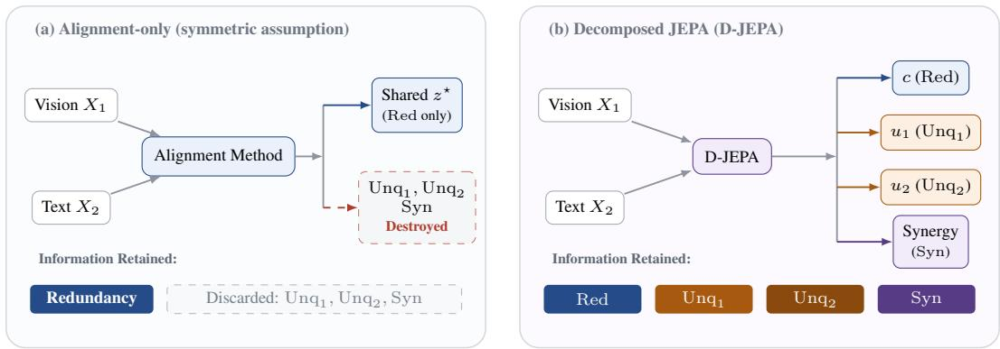
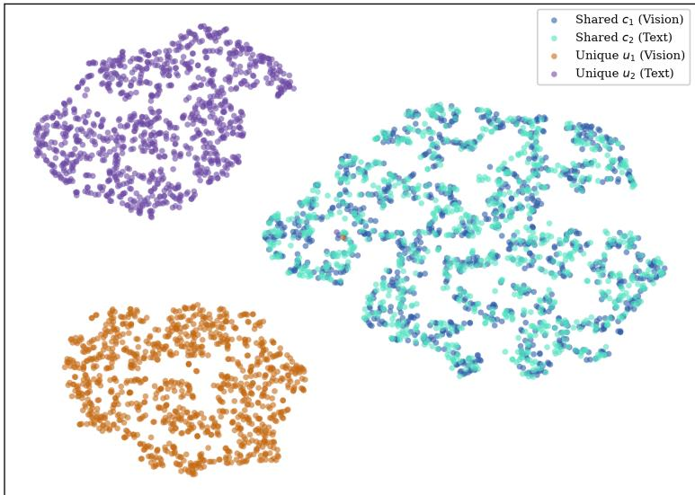
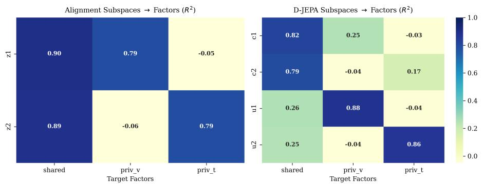

# Asymmetric Multimodal Learning with Decomposed JEPAs

Yusuf Shihata yusufshihata2006@gmail.com

## Abstract

Cross-modal alignment is the standard objective for building multimodal representations. We show that alignment as a sole objective is lossy wherever modalities are informationally asymmetric—where neither can express what the other carries. Visual question answering is an obvious case: a question is a selective relational operator probing a dense visual field whose fine-grained features no query recovers, so what alignment preserves is not what the task requires. We prove an Alignment Redundancy Bound: alignment-only Dirichlet energy minimization retains at most the redundant information atom Red(Z; X1, X2), annihilating private modalityspecific structure Unq(Z; Xm) and cross-modal synergy $\mathrm { S y n } ( \overline { { Z } } ; X _ { 1 } , X _ { 2 } )$

We introduce Decomposed JEPA (D-JEPA), which factorizes latents into an aligned shared core and private modality-specific fibers. The shared core retains most of the structure alignment targets; the private fibers recover what alignment discards, via contextual masked prediction and asymmetric cross-subspace independence. Under information asymmetry, alignment-only training undergoes catastrophic semantic collapse on compositional reasoning benchmarks, surviving only on binary queries. D-JEPA averts this collapse, substantially improving downstream accuracy over both alignment-only and alignment-with-reconstruction baselines, and restoring a positive multimodal synergy gap in place of the baseline’s inverted gap. Information-theoretic audits confirm that D-JEPA recovers most of the mutual information available from a frozen backbone, and causal fiber-swap interventions demonstrate that the recovered information is causally localized in the private fibers.

## 1 Introduction

Cross-modal alignment is the default objective for building multimodal representations. Its appeal is not merely practical: it rests on a specific and usually implicit claim about the data. When two observations $X _ { 1 }$ and $X _ { 2 }$ are equally informative views of the same underlying state Z—two simultaneous camera angles of one scene, or a dense image paired with an exhaustive caption—the task-relevant content of each view is content the other also carries, and forcing their latents to agree is the right thing to do. We call this the redundancy premise: that what matters about Z is shared across the modalities that observe it. Under the redundancy premise, alignment is not merely a convenient proxy for shared structure; it is the objective that recovers it, and anything alignment discards is, by construction, not worth keeping.

The premise is rarely true, and it is rarely checked. Real multimodal pairs satisfy it only when the pairing is dense and descriptive. Consider visual question answering: the image $\dot { X _ { 1 } }$ encodes a dense field of objects, textures, and spatial relations, while the question ${ \breve { X } } _ { 2 }$ encodes a selective relational operator (e.g., “how many blue cubes are behind the cylinder?”). The question does not describe the scene; it interrogates it. Much of what the image contains is unexpressible in the query, and much of what the query asserts is nowhere in the image. The two modalities are informationally asymmetric:

  
Figure 1: Alignment under informational asymmetry. (a) When two modalities are not redundant views of one state (e.g., scene context vs. relational query), cross-modal invariance projects both onto their redundant intersection Red, destroying unique referents $\mathrm { U n q } _ { m }$ and synergistic bindings Syn. (b) D-JEPA factorizes the latent space into an aligned shared core c and modality-specific private fibers $u _ { m } .$ , anchored by contextual masked prediction.

neither can express what the other carries, and the information the task requires is not the information the pair shares.

When an alignment objective is applied to such a pair, it forces the dense observation and the selective query to predict each other in latent space. Because Dirichlet energy minimization treats any feature absent from both modalities as noise, alignment discards the specific linguistic referent from $X _ { 2 }$ and the fine-grained visual structure from $\bar { X _ { 1 } }$ that no query names. This is not a small correction to an otherwise sound objective. It is the objective working exactly as specified, on data the specification was not meant for. The redundancy premise is not approximately violated here; it is inverted, and the loss is concentrated precisely in the structure the task depends on.

We therefore ask: what information does alignment discard when modalities are informationally asymmetric, and what architecture retains it?

Through the lens of Partial Information Decomposition (PID) [Williams and Beer, 2010, Bertschinger et al., 2014], we make four contributions:

1. The Alignment Redundancy Bound. We prove that any optimal alignment-only method captures at most the redundant information atom Red $( Z ; \bar { X _ { 1 } } , \bar { X _ { 2 } } )$ . The unique components $\operatorname { U n q } ( Z ; X _ { 1 } ) , \operatorname { U n q } ( Z ; X _ { 2 } )$ and the synergistic component $\operatorname { S y n } ( Z ; X _ { 1 } , X _ { 2 } )$ are annihilated by cross-modal invariance (Theorem 2.4). The bound is a statement about the alignment objective alone: it follows from Dirichlet energy minimization over conditionally dependent, asymmetric views, and assumes nothing about how representations might converge absent that objective.

2. Theoretical bound and empirical collapse. We prove that complete cross-modal invariance bounds retained information by the redundant atom, and demonstrate empirically that under asymmetric task-relevant structure this manifests as dimensional collapse: the model suppresses fine-grained linguistic and visual referents to predict generic centroids. On CLEVR, an alignment-only model falls to 0.43% on attributes and 4.88% on counting, inverting the multimodal synergy gap to −1.56 pp.

3. Decomposed JEPA (D-JEPA). We introduce an architecture that factorizes representations into an aligned shared core (C) and private modality-specific fibers $( \mathcal { U } _ { m } )$ . Factorization escapes the redundancy bound by construction, combining scale-invariant cosine Dirichlet alignment, contextual target-backbone prediction, and an asymmetric covariance penalty $( \mathrm { C o v } ( u _ { m } , c _ { m } ) = 0 )$ that prevents leakage without suppressing cross-modal coordination.

4. Empirical auditing on diagnostic benchmarks. On CLEVR, D-JEPA reaches 39.61 ± 3.07% downstream accuracy against 21.25 ± 0.69% for alignment-only (+18.36 pp, 95% paired bootstrap CI [17.21, 19.44] pp) and 27.96% for the same baseline augmented with reconstruction (+11.65 pp). Probe-PID and Flow-PID audits show D-JEPA restores mutual information from 0.24 to 1.94 bits (84.5% of the frozen-backbone ceiling), and causal fiber-swap interventions demonstrate that the recovered information is causally localized in the private fibers.

Code and reproducibility. The reference implementation, the synthetic-data generator, the CLEVR preprocessing pipeline, the probe and PID audit scripts, and the figure-generation code for every table and figure in this paper are available at https://github.com/Vixel2006/D-JEPA.

## 2 The Alignment Redundancy Bound

We formalize the redundancy premise and derive what an alignment-only objective can retain when it fails.

## 2.1 Setup and Notation

Let Z denote the underlying world state, $X _ { 1 }$ the visual observation, and $X _ { 2 }$ the textual observation. We model each modality through a decomposition that separates shared from modality-private variation.

Definition 2.1 (Causal decomposition). Each modality is generated as

$$
X _ { m } = g _ { m } ( Z , U _ { m } ) , \qquad m \in \{ 1 , 2 \} ,
$$

where $g _ { m }$ is a fixed (possibly stochastic) map, $Z$ is the world state, and $U _ { m }$ is a modality-private nuisance variable. We assume $U _ { 1 } ~ \bot ~ ( Z , \dot { U } _ { 2 } )$ and $U _ { 2 } ~ \bot ~ ( Z , U _ { 1 } )$ , so that private variation is independent ofthe world state and ofthe other modality’s private variation.

Assumption 2.2 (Conditional independence of views). $X _ { 1 } \perp X _ { 2 } \mid Z .$

Assumption 2.2 is the structural content of the redundancy premise: once the world state is fixed, the two observations carry no further information about each other. In the symmetric regime it holds together with the condition that Z is recoverable from either modality alone. Our analysis concerns what happens when the second condition fails.

## 2.2 The Alignment Objective

An alignment-only model learns encoders $f _ { m }$ by minimizing the cross-modal Dirichlet energy,

$$
\begin{array} { r } { \mathcal { E } ( f _ { 1 } , f _ { 2 } ) = \frac { 1 } { 2 } \mathbb { E } \big [ \| f _ { 1 } ( X _ { 1 } ) - f _ { 2 } ( X _ { 2 } ) \| ^ { 2 } \big ] , } \end{array}\tag{1}
$$

subject to non-degeneracy constraints on Cov $\left( f _ { m } ( { \cal X } _ { m } ) \right)$ . We write $Z ^ { \star } = f _ { 1 } ^ { \star } ( X _ { 1 } )$ for the latent recovered at an optimum, and refer to $\mathcal { E } = 0$ as the exactly aligned regime.

Definition 2.3 (Aligned solution). An encoder pair $( f _ { 1 } ^ { \star } , f _ { 2 } ^ { \star } )$ is aligned $i f \mathcal { E } ( f _ { 1 } ^ { \star } , f _ { 2 } ^ { \star } ) = 0 ,$ , equivalently $f _ { 1 } ^ { \star } ( X _ { 1 } ) = f _ { 2 } ^ { \star } ( X _ { 2 } )$ almost surely.

Definition 2.3 is the idealized limit of (1); the approximate case is treated in Appendix A.3.

## 2.3 Partial Information Decomposition

We decompose the information the pair carries about the world state using Partial Information Decomposition [Williams and Beer, 2010, Bertschinger et al., 2014] under the Williams–Beer axioms:

$$
I ( Z ; X _ { 1 } , X _ { 2 } ) = \operatorname { R e d } ( Z ; X _ { 1 } , X _ { 2 } ) + \operatorname { U n q } ( Z ; X _ { 1 } ) + \operatorname { U n q } ( Z ; X _ { 2 } ) + \operatorname { S y n } ( Z ; X _ { 1 } , X _ { 2 } ) ,\tag{2}
$$

where Red is the information both modalities carry, $\operatorname { U n q } ( Z ; X _ { m } )$ the information carried by $X _ { m }$ alone, and Syn the information available only from the pair jointly. Informational asymmetry is the regime in which Unq and Syn are not negligible relative to Red.

## 2.4 The Alignment Redundancy Bound

Theorem 2.4 (Alignment Redundancy Bound). Let $( f _ { 1 } ^ { \star } , f _ { 2 } ^ { \star } )$ be an aligned solution in the sense of Definition 2.3. Then

$$
I ( Z ^ { \star } ; Z ) \ \leq \ \operatorname { R e d } ( Z ; X _ { 1 } , X _ { 2 } ) .
$$

The theorem establishes that an exactly aligned latent cannot carry more about the world state than the two modalities redundantly share. Its proof uses only the Williams–Beer monotonicity and self-redundancy axioms; it invokes no identifiability or convergence result, and makes no claim about encoders trained without a cross-modal term. Note that Assumption 2.2 is not used in the proof: the bound holds distribution-free, for any joint law of $( Z , X _ { 1 } , X _ { 2 } )$ . Conditional independence is used only to interpret Red as the shared-world-state atom. The proof is given in Appendix A.

Corollary 2.5 (Annihilation of unique and synergistic structure). Under the conditions of Theorem 2.4,

$$
I ( Z ; X _ { 1 } , X _ { 2 } ) - I ( Z ^ { \star } ; Z ) \ \ge \ \mathrm { U n q } ( Z ; X _ { 1 } ) + \mathrm { U n q } ( Z ; X _ { 2 } ) + \mathrm { S y n } ( Z ; X _ { 1 } , X _ { 2 } ) .
$$

Corollary 2.5 formalizes the central representational loss: everything the multimodal pair carries about Z beyond the redundant atom is annihilated by cross-modal invariance. Because $Z ^ { \star }$ is a function of $X _ { m ^ { \prime } }$ , it carries no information about any variable independent of $X _ { m ^ { \prime } }$ (by the data processing inequality); this is the information-theoretic form of the annihilation claim. The proof is provided in Appendix A.

Remark 2.6 (The symmetric regime as a benign special case). The bound is not an indictment of alignment under symmetry. When the two modalities are equally informative views of Z, the unique and synergistic terms are negligible by construction, so Red $\overset { \cdot } { \approx } I ( \overset { \cdot } { Z } ; X _ { 1 } , X _ { 2 } )$ and bounding $Z ^ { \star }$ by Red incurs negligible penalty. The bound becomes damaging precisely when Red ≪ $\check { \iota } = I ( Z ; \check { X } _ { 1 } , X _ { 2 } )$ which defines informational asymmetry.

Remark 2.7 (Scope). Theorem 2.4 constrains what the alignment term retains. It does not characterize the full training objective of any particular model, and a model that adds non-alignment terms may retain more than the bound allows. D-JEPA (§3) introduces structured auxiliary terms designed to escape the bound while preserving the shared core.

## 3 The Decomposed JEPA (D-JEPA) Architecture

To recover the non-redundant atoms annihilated by alignment under asymmetry, we introduce Decomposed JEPA (D-JEPA). Rather than projecting representations into a single invariant vector, D-JEPA factorizes the output of each modality encoder into two distinct, orthogonal subspaces:

$$
h _ { v } \xrightarrow [ ] { \mathrm { V i s i o n H e a d } } [ c _ { v } | | u _ { v } ] \in \mathbb { R } ^ { 2 d _ { \mathrm { c o m p } } } , \qquad h _ { t } \xrightarrow [ ] { \mathrm { T e x t H e a d } } [ c _ { t } | | u _ { t } ] \in \mathbb { R } ^ { 2 d _ { \mathrm { c o m p } } } ,\tag{3}
$$

where $c _ { m } \in \mathbb { R } ^ { d _ { \mathrm { c o m p } } }$ isolates the shared (redundant) core, and $u _ { m } \in \mathbb { R } ^ { d _ { \mathrm { c o m p } } }$ isolates the private (unique) fiber.

## 3.1 Objective Formulations

1. Scale-Invariant Common Alignment. In asymmetric regimes where one visual scene is queried by multiple distinct questions, Euclidean MSE pulls $c _ { v }$ toward the generic centroid of all questions, triggering a $c \to 0$ magnitude collapse. We eliminate this failure mode by enforcing unit-normalized cosine Dirichlet energy:

$$
\mathcal { L } _ { \mathrm { c r o s s } } = \frac { 1 } { 2 } \sum _ { ( a , b ) \in \{ ( v , t ) , ( t , v ) \} } \left( 2 - 2 \left. \frac { c _ { a } } { \| c _ { a } \| _ { 2 } } , \frac { c _ { b } } { \| c _ { b } \| _ { 2 } } \right. \right) .\tag{4}
$$

2. Separate Subspace Regularization (Anti-Collapse). Applying empirical characteristic function regularization (SIGReg) over the concatenated stream $\left[ c _ { m } \parallel u _ { m } \right]$ permits a shortcut where $u _ { m }$ expands its variance while $c _ { m }$ collapses. We enforce SIGReg on c and u independently:

$$
\mathcal { L } _ { \mathrm { s i g } } = \frac { 1 } { 2 } \left( \mathrm { S I G R e g } ( c _ { v } ) + \mathrm { S I G R e g } ( c _ { t } ) \right) + \frac { 1 } { 2 } \left( \mathrm { S I G R e g } ( u _ { v } ) + \mathrm { S I G R e g } ( u _ { t } ) \right) .\tag{5}
$$

3. Contextual JEPA Fiber Prediction. To guarantee that $u _ { m }$ preserves task-relevant information discarded by cross-modal invariance, lightweight predictors $\mathrm { P r e d } _ { m }$ are trained to reconstruct the target-view representation $\tilde { h } _ { m } ^ { b }$ from the context latent $\left[ c _ { m } ^ { a } \parallel u _ { m } ^ { a } \right]$

$$
\mathcal { L } _ { \mathrm { r e c } } = \Big \| \mathrm { P r e d } _ { v } ( [ c _ { v } ^ { a } \parallel u _ { v } ^ { a } ] ) - \mathrm { s g } \Big [ \tilde { h } _ { v } ^ { b } \Big ] \Big \| ^ { 2 } + \Big \| \mathrm { P r e d } _ { t } ( [ c _ { t } ^ { a } \parallel u _ { t } ^ { a } ] ) - \mathrm { s g } \Big [ \tilde { h } _ { t } ^ { b } \Big ] \Big \| ^ { 2 } .\tag{6}
$$

Table 1: Downstream representation probing on the synthetic benchmark (test set, mean ± std). Alignment-only training collapses on private and synergistic factors (48.33% on synergy), producing an inverted synergy gap (−3.20 pp). D-JEPA preserves factor decodability across all atoms (84.20% on synergy), restoring a positive multimodal synergy gap (+33.13 pp) matching the raw ceiling $( + 3 5 . 0 0 \mathrm { p p } )$ . The $\Delta _ { \mathrm { j o i n t - m a x } ( v , t ) }$ column is computed as acc(joint) − max(acc(vision), acc(text)).
<table><tr><td>Model / Arm</td><td>Shared (%)</td><td>Private Vis (%)</td><td>Private Txt (%)</td><td>Synergy (%)</td><td>Synergy Gap  $\Delta _ { \mathrm { j o i n t - m a x } ( v , t ) } \left( \mathbf { p } \mathbf { p } \right)$ </td></tr><tr><td>Raw (Frozen Backbone Ceiling)</td><td> $8 4 . 6 0 \pm 3 . 1 1$ </td><td> $7 9 . 4 7 \pm 1 . 1 3$ </td><td> $7 7 . 3 3 \pm 1 . 7 0$ </td><td> $8 5 . 8 7 \pm 0 . 1 9$ </td><td>+35.00 ± 0.09</td></tr><tr><td>Alignment-only  $[ z _ { 1 } , z _ { 2 } ]$ </td><td> $8 1 . 0 7 \pm 2 . 0 7$ </td><td> $5 5 . 3 3 \pm 3 . 7 7$ </td><td> $5 1 . 9 3 \pm 1 0 . 6 5$ </td><td> $4 8 . 3 3 \pm 2 . 7 3$ </td><td> $- 3 . 2 0 \pm 2 . 8 3$ </td></tr><tr><td>Alignment-only + Rec</td><td> $8 1 . 2 7 \pm 2 . 1 7$ </td><td> $6 9 . 4 7 \pm 1 . 1 3$ </td><td> $6 7 . 8 0 \pm 2 . 5 5$ </td><td> $4 9 . 7 3 \pm 0 . 9 4$ </td><td> $- 1 . 6 7 \pm 2 . 3 6$ </td></tr><tr><td>D-JEPA (No-Independence)</td><td> ${ \bf 8 3 . 0 0 \pm 1 . 7 9 }$ </td><td> ${ \bf 7 7 . 6 0 \pm 0 . 7 5 }$ </td><td> ${ \bf 7 5 . 4 0 \pm 3 . 6 8 }$ </td><td> ${ \bf 8 6 . 8 7 \pm 1 . 0 4 }$ </td><td> $\mathbf { + 3 5 . 7 3 \pm 1 . 7 0 }$ </td></tr><tr><td>D-JEPA (No-Reconstruction)</td><td> $7 8 . 2 7 \pm 2 . 8 3$ </td><td> $7 5 . 2 7 \pm 1 . 9 8$ </td><td> $7 2 . 8 7 \pm 1 . 0 4$ </td><td> $8 3 . 0 0 \pm 0 . 8 5$ </td><td> $+ 3 2 . 1 3 \pm 1 . 5 1$ </td></tr><tr><td>D-JEPA (Full Proposed)</td><td> $7 9 . 4 0 \pm 2 . 3 6$ </td><td> $7 4 . 8 7 \pm 1 . 4 1$ </td><td> $7 3 . 8 0 \pm 1 . 0 4$ </td><td> $8 4 . 2 0 \pm 0 . 4 7$ </td><td> $+ 3 3 . 1 3 \pm 0 . 4 7$ </td></tr></table>

4. Asymmetric Cross-Subspace Independence. To prevent $u _ { m }$ from leaking into the redundant code without suppressing cross-modal coordination, we penalize correlation strictly between unique and shared components:

$$
\mathcal { L } _ { \mathrm { i n d } } = \mathcal { C } _ { \mathrm { c o r r } } ( u _ { v } , c _ { v } ) + \mathcal { C } _ { \mathrm { c o r r } } ( u _ { t } , c _ { t } ) + \mathcal { C } _ { \mathrm { c o r r } } ( u _ { v } , c _ { t } ) + \mathcal { C } _ { \mathrm { c o r r } } ( u _ { t } , c _ { v } ) ,\tag{7}
$$

where $\begin{array} { r } { \mathcal { C } _ { \mathrm { c o r r } } ( A , B ) = \frac { 1 } { \operatorname* { m a x } ( d _ { A } , d _ { B } ) } \| \operatorname { C o r r } ( A , B ) \| _ { F } ^ { 2 } } \end{array}$ . Crucially, $\mathcal { C } _ { \mathrm { c o r r } } ( u _ { v } , u _ { t } )$ is omitted, allowing visual and textual private fibers to coordinate freely on compositional reasoning tasks.

Total Training Objective. The unified D-JEPA loss is given by:

$$
\mathcal { L } _ { \mathrm { D - J E P A } } = \left( 1 - \lambda _ { \mathrm { s i g } } \right) \left( \mathcal { L } _ { \mathrm { i n v } } + \mathcal { L } _ { \mathrm { c r o s s } } \right) + \lambda _ { \mathrm { s i g } } \mathcal { L } _ { \mathrm { s i g } } + w _ { \mathrm { r e c } } \mathcal { L } _ { \mathrm { r e c } } + w _ { \mathrm { i n d } } \mathcal { L } _ { \mathrm { i n d } } .\tag{8}
$$

## 4 Experiments

## 4.1 Experimental Protocol

We evaluate across two complementary suites designed to isolate the mechanics of representation learning under asymmetry:

• Synthetic Controlled Ground-Truth Benchmark: To evaluate our theorems where groundtruth PID atoms are mathematically known, we generate paired streams $( X _ { 1 } , X _ { 2 } )$ from non-linear mixtures of four independent latent factors: a shared factor $S \in \mathbb { R } ^ { d }$ , modalityprivate factors $U _ { 1 } , U _ { 2 } \in \mathbb { R } ^ { d }$ , and a non-linear synergistic parity factor $Y _ { \mathrm { s y n } } \in \mathbb { R } ^ { d } \left( d = \dot { 6 4 } \right.$ $N = 3 { , } 0 0 0$ paired samples per seed across 2 seeds).

• Real Multimodal Benchmark (CLEVR): To test the architecture on real-world informational asymmetry where questions act as selective relational operators over dense scenes, we train on 12,000 image–question pairs (3,000 Blender-rendered CLEVR scenes with 6 relational questions each), evaluated across 3 random seeds. Questions are categorized into functional types: Attribute, Counting, Exist/Compare, and Other. Encoders use frozen DINOv2 ${ \mathrm { V i T } } { \mathrm { - } } { \mathrm { S } } / { 1 4 } \left( 4 \times 4 \right.$ patch grid) and BERT-base $( T = 3 2 )$

• Fair Baseline Arms: Every model arm uses identical encoder architectures, parameter counts, and total latent dimensionality $( 4 \times d _ { \mathrm { c o m p } } = 2 5 6 ) \colon$ (1) Raw: Concatenated frozen features $( h _ { 1 } \parallel h _ { 2 } ) ; ( 2 )$ Alignment-only: Standard cross-modal invariance and SIGReg; (3) Alignment-only + Rec: Alignment-only augmented with contextual predictors; (4) D-JEPA (No-Indep): D-JEPA setting $w _ { \mathrm { i n d } } = 0 ; ( 5 )$ D-JEPA (No-Rec): D-JEPA setting $w _ { \mathrm { r e c } } = 0 ;$ (6) D-JEPA (Full Proposed): The complete factorized architecture.

## 4.2 Downstream Reasoning and Modality Gap Recovery

The evaluations in Tables 1 and 2 confirm our theoretical predictions:

1. Collapse of alignment-only baselines: In synthetic benchmarks (Table 1), alignmentonly training retains shared structure (81.07%) but collapses to chance on synergistic factors (48.33%). On real CLEVR data (Table 2), this manifests as relational collapse:

Table 2: Downstream compositional reasoning on CLEVR (3 seeds, mean ± std, %). Alignmentonly training collapses on fine-grained visual reasoning categories (Attribute: 0.43%, Counting: 4.88%), surviving only on binary queries (Exist: 48.90%), which inverts the synergy gap to −1.56 pp. D-JEPA prevents dimensional collapse, restoring positive multimodal synergy (+0.54 pp) and gaining +18.36 pp overall (95% paired bootstrap CI [17.21, 19.44] pp). In every row, the text probe exceeds the vision probe, so $\Delta _ { \mathrm { j o i n t - m a x } ( v , t ) } = \Delta _ { \mathrm { j o i n t - t e x t } } .$
<table><tr><td></td><td colspan="3">Modality Probing Acc (%)</td><td>Synergy Gap</td><td colspan="4">Category Breakdown (%)</td><td>Paired Gain vs.</td></tr><tr><td>Model / Arm</td><td>Vision (v)</td><td>Text (t)</td><td> $\mathbf { J o i n t } \left( v + t \right)$ </td><td> $\Delta _ { \mathrm { j o i n t - m a x } ( v , t ) }$ </td><td>Attribute</td><td>Counting</td><td>Exist/Cmp</td><td>Other</td><td>Alignment-only (CI)</td></tr><tr><td>Raw (Frozen Ceiling)</td><td> $\overline { { 2 0 . 7 9 \pm 0 . 2 1 } }$ </td><td> $\overline { { 4 2 . 0 2 \pm 0 . 7 9 } }$ </td><td> $\overline { { 4 5 . 5 7 \pm 0 . 3 5 } }$ </td><td> $\overline { { + 3 . 5 5 \pm 0 . 4 7 } }$ </td><td> $\overline { { 4 2 . 8 3 \pm 0 . 2 5 } }$ </td><td> $\overline { { 3 7 . 0 8 \pm 0 . 4 4 } }$ </td><td> $\overline { { 5 2 . 4 9 \pm 0 . 8 5 } }$ </td><td> $\overline { { 3 7 . 9 6 \pm 0 . 3 7 } }$ </td><td> $\overline { { + 2 4 . 3 2 \ [ 2 3 . 1 8 , 2 5 . 4 6 ] } }$ </td></tr><tr><td>Alignment-only  $[ z _ { 1 } , z _ { 2 } ]$ </td><td> $\overline { { 2 0 . 5 0 \pm 0 . 4 2 } }$ </td><td>22.81 ± 1.11</td><td> $\overline { { 2 1 . 2 5 \pm 0 . 6 9 } }$ </td><td> $- 1 . 5 6 \pm 0 . 6 5$ </td><td> $0 . 4 3 \pm 0 . 6 4$ </td><td> $\overline { { 4 . 8 8 \pm 3 . 9 3 } }$ </td><td> $\overline { { 4 8 . 9 0 \pm 2 . 7 2 } }$ </td><td> $\overline { { 4 . 8 0 \pm 4 . 8 2 } }$ </td><td></td></tr><tr><td>Alignment-only  $\dot { + } \operatorname { R e c }$ </td><td> $2 1 . 3 3 \pm 0 . 2 0$ </td><td> $2 9 . \dot { 1 } 4 \pm 2 . 1 8$ </td><td> $2 7 . 9 6 \pm 2 . 2 2$ </td><td> $- 1 . 1 9 \pm 0 . 1 1$ </td><td>10.61 ± 0.98</td><td> $2 4 . 3 5 \pm 3 . 9 5$ </td><td> $4 5 . 5 9 \pm 2 . 3 3$ </td><td> $2 3 . 5 5 \pm 4 . 4 7$ </td><td> $+ 6 . 7 0 \ [ 5 . 7 5 , 7 . 5 9 ] ^ { * }$ </td></tr><tr><td>D-JEPA (No-Indep)</td><td> $\overline { { 2 1 . 2 5 \pm 0 . 1 2 } }$ </td><td> $\overline { { 2 8 . 4 4 \pm 1 . 1 0 } }$ </td><td> $2 7 . 9 9 \pm 1 . 5 4$ </td><td> $- 0 . 4 5 \pm 0 . 8 1$ </td><td> $\overline { { 1 1 . 1 0 \pm 1 . 9 8 } }$ </td><td> $2 4 . 3 5 \pm 1 . 7 0$ </td><td> $\overline { { 4 4 . 3 7 \pm 1 . 5 1 } }$ </td><td> $\overline { { 2 6 . 3 9 \pm 3 . 1 6 } }$ </td><td> $\overline { { + 6 . 7 4 \ [ 5 . 8 2 , 7 . 6 6 ] ^ { * } } }$ </td></tr><tr><td>D-JEPA (No-Rec)</td><td> $2 0 . 4 9 \pm 0 . 4 0$ </td><td> $3 6 . 3 9 \pm 5 . 9 0$ </td><td> $3 5 . 3 8 \pm 6 . 4 0$ </td><td>−1.01 ± 0.52</td><td> $2 5 . 9 2 \pm 9 . 8 1$ </td><td> $2 9 . 3 0 \pm 2 . 9 9$ </td><td> $4 7 . 6 5 \pm 4 . 3 8$ </td><td> $2 7 . 7 0 \pm 6 . 4 2$ </td><td>+14.13 [12.89, 15.37]*</td></tr><tr><td>D-JEPA (Full Proposed)</td><td> ${ \bf 2 0 . 9 6 \pm 0 . 2 9 }$ </td><td> $\mathbf { 3 9 . 0 7 \pm 2 . 4 6 }$ </td><td> $\mathbf { 3 9 . 6 1 \pm 3 . 0 7 }$ </td><td> $\mathbf { + 0 . 5 4 \pm 0 . 6 5 }$ </td><td>29.69 ± 8.01</td><td> $\mathbf { 3 2 . 4 1 \pm 1 . 2 5 }$ </td><td> ${ \bf 5 1 . 8 0 \pm 0 . 6 2 }$ </td><td> $\mathbf { 3 4 . 4 6 \pm 1 . 1 8 }$ </td><td> $+ 1 8 . 3 6 \ [ \mathbf { 1 7 . 2 1 } , \mathbf { 1 9 . 4 \dot { 4 } } ] ^ { * }$ </td></tr></table>

overall accuracy drops to $2 1 . 2 5 \pm 0 . 6 9 \%$ , falling to 0.43% on attributes and 4.88% on counting. Only binary queries (exist/compare, 48.90%) survive via majority-class guessing. Adding reconstruction without latent factorization (Alignment-only + Rec) improves overall accuracy to 27.96%, but remains severely depressed.

2. Multimodal Synergy Gap Inversion: Under alignment-only training, adding vision representations to language probes actively degrades performance compared to text probes alone, inverting the synergy gap to negative territory (−3.20 pp on synthetic, −1.56 pp on CLEVR). D-JEPA resolves this pathology, recovering positive multimodal synergy (+33.13 pp synthetic, +0.54 pp CLEVR).

3. D-JEPA Restores Compositional Factorization: D-JEPA achieves $\mathbf { 3 9 . 6 1 \pm 3 . 0 7 \% }$ overall accuracy on CLEVR (+18.36 pp gain over alignment-only, 95% bootstrap CI [17.21, 19.44] pp), capturing 87% of the frozen backbone ceiling (45.57%). Performance on fine-grained attributes rebounds from 0.43% to 29.69%, and counting rebounds from 4.88% to 32.41%. Notably, D-JEPA’s full-latent probe on shared factors (79.40%) is slightly below the alignment-only baseline (81.07%): a 1.67 pp reduction in shared decodability, well within the reported std. D-JEPA trades a small amount of shared decodability for large gains on private and synergistic structure, which is the empirically observed form of the escape from the bound.

CLEVR as a downstream demonstration, not a test of the bound. On CLEVR, linear crossmodal CKA for the alignment-only arm is 0.016 against a shuffled-pair null of 0.004 (Table 12), two orders of magnitude below the synthetic benchmark’s 0.914: under this degree of asymmetry there is no common linear view for the encoders to converge to. The alignment-only model’s downstream collapse (21.25% against the 45.57% frozen ceiling) is therefore not a measurement of Theorem 2.4; it is a measurement of what happens when an alignment objective is applied to pairs that do not satisfy its premise. D-JEPA’s shared code is also at the null level on CLEVR (0.001 vs 0.001), which we read as further evidence that CLEVR is a regime in which no linear shared core exists: the recovery (+18.36 pp) is attributable to the private fibers and the JEPA grounding, not to recovering an aligned core. The theorem is tested on the synthetic benchmark, where alignment is achieved and the PID atoms are known; CLEVR demonstrates the downstream consequence of applying the objective to data it was not designed for.

Ablation interaction with data regime. An apparent tension in Table 1 warrants direct comment: on the synthetic benchmark, D-JEPA (No-Independence) matches or exceeds the Full model across all four factor categories (83.00, 77.60, 75.40, 86.87 vs. 79.40, 74.87, 73.80, 84.20). We read this as evidence that factorization with a private fiber is the load-bearing ingredient, and the independence penalty is a tuning knob rather than a required component when the generative process already separates shared and private factors. On CLEVR, where real frozen features entangle shared and private content, the regime reverses: the Full model outperforms No-Independence by 11.62 pp (39.61% vs. 27.99%, Table 2), indicating that the independence penalty becomes essential when the underlying features are not already separated by construction. We retain ${ \mathcal { L } } _ { \mathrm { i n d } }$ as the default because the real-data regime is where factorization is most needed; we do not claim the penalty is required in the idealized synthetic regime. The causal fiber-swap intervention (§4.6) provides independent evidence that the recovered information is carried by the private fiber rather than by the specific loss combination: swapping $u _ { 2 }$ flips 71.36% of predictions on CLEVR, confirming causal binding.

Table 3: CLEVR subspace specialization and factor decodability. (a) Probe accuracy from isolated D-JEPA subspace blocks on downstream CLEVR answers. (b) Linear regression decodability $( R ^ { 2 } )$ of question type (qtype) and mentioned entities (mentions). Alignment-only collapses question semantics $( \dot { R } ^ { \bar { 2 } } = \mathsf { \bar { 0 } } . \mathsf { \bar { 1 } } 5 9 )$ , whereas D-JEPA retains robust linguistic structure across $c _ { 2 }$ and $u _ { 2 }$ $( R ^ { 2 } = 0 . 7 1 3 )$
<table><tr><td colspan="7">(a) Isolated D-JEPA Subspace Probing Accuracy on CLEVR Answers  $( \% )$ </td></tr><tr><td>Metric</td><td>Shared Pair (c)</td><td>Private Pair (u)</td><td></td><td>Vision Private  $( u _ { 1 } )$ </td><td>Text Shared  $\left( c _ { 2 } \right)$ </td><td>Text Private  $\left( u _ { 2 } \right)$ </td></tr><tr><td>Probe Accuracy</td><td> $3 5 . 7 6 \pm 2 . 5 7$ </td><td></td><td> $3 2 . 0 7 \pm 0 . 5 9$ </td><td> $2 0 . 9 9 \pm 0 . 2 1$ </td><td> $3 6 . 6 2 \pm 2 . 5 8$ </td><td> $3 4 . 6 5 \pm 1 . 8 2$ </td></tr><tr><td colspan="7">(b) Factor Identification Matrix (R2 Held-Out Decodability)</td></tr><tr><td></td><td colspan="3">Question Type (qtype)</td><td></td><td colspan="2"></td></tr><tr><td colspan="4">Subspace Stream</td><td>Mentioned Concepts (mentions)</td><td>Total Stream R²</td><td>Functional Role / Interpretation</td></tr><tr><td colspan="4">Raw Language Backbone (h2)</td><td>0.844</td><td></td><td>Frozen linguistic ceiling</td></tr><tr><td colspan="4">Alignment-only Text Latent (z2)</td><td>0.080</td><td>0.159</td><td>Severe semantic collapse</td></tr><tr><td colspan="4">Alignment-only + Rec Text (z2)</td><td>0.184</td><td>0.452</td><td>Partial reconstruction rescue</td></tr><tr><td colspan="4">D-JEPA Shared Text (c2)</td><td>0.332</td><td></td><td>Grounded question component</td></tr><tr><td colspan="4">D-JEPA Private Text (u2)</td><td>0.318</td><td>0.713</td><td>Private relational query operator</td></tr></table>

## 4.3 Factor Dissection: What Lives in Each Subspace

To verify that D-JEPA’s learned subspaces achieve the designed functional decomposition, we perform linear regression audits $( R ^ { 2 }$ ; Table 3 and Appendix D).

Under Alignment-only training on CLEVR, forcing language representations to predict visual features pulls $z _ { 2 }$ toward generic visual centroids: question type decodability collapses from $R ^ { 2 } = 0 . 9 6 3$ to 0.159 (an 83% loss), and entity referents drop from 0.844 to 0.080 (a 90% loss). In D-JEPA, question semantics are preserved across the factorized text stream $( R ^ { 2 } = 0 . 7 1 3 )$ , with private fiber u capturing the unaligned relational logic $( R ^ { 2 } = 0 . 5 8 3 )$ and shared code $c _ { 2 }$ capturing grounded concepts $( R ^ { \mathbf { \breve { 2 } } } = 0 . 4 9 9 )$ . Isolated probing confirms that c alone reaches 35.76% and u reaches 32.07%, verifying that both streams carry distinct task-relevant information.

## 4.4 Representation Geometry and Latent Disentanglement

Figure 2 visualizes the held-out latent space geometry via t-SNE. Under Alignment-only training, representations collapse onto a unified shared manifold, reflecting excessive invariance. In D-JEPA, the four distinct codes organize into structured, well-separated geometric manifolds: shared codes $c _ { 1 }$ (vision) and $c _ { 2 }$ (text) align in representation space, while private fibers $u _ { 1 }$ (vision) and $u _ { 2 }$ (text) occupy isolated, non-overlapping subspaces.

## 4.5 Information-Theoretic Audits: Probe-PID and Flow-PID

We audit representations using discrete Probe-PID and continuous Flow-PID estimators (Table 4 and Appendix E).

The Probe-PID audit on CLEVR (Table 4) empirically validates the Alignment Redundancy Bound: alignment-only training obliterates downstream task mutual information, falling from 2.293 bits (raw) to 0.242 bits. D-JEPA restores mutual information to 1.938 bits (84.5% of the ceiling). On counting queries, where answer determination requires combining visual object features with textual counting criteria, alignment-only yields 0.000 bits of synergy, while D-JEPA recovers 0.037 bits of pure synergy. The Flow-PID continuous latent density audit corroborates this finding: D-JEPA maintains $I _ { 1 2 } = 0 . 3 7 0$ bits on object count density, comfortably above the null floor of 0.219 bits, while alignment-only degrades to 0.249 bits, only marginally above the null floor of 0.219. Probe-PID and Flow-PID target different quantities—discrete answer labels versus a continuous object-count density—so they agree in direction but not magnitude; we treat the discrete Probe-PID as the operational test of the bound and the continuous Flow-PID as a corroborating check that the effect survives a different estimator.

  
Figure 2: t-SNE latent geometry of D-JEPA subspaces. Held-out latents of the four learned codes: shared $c _ { 1 }$ (vision, blue) and $c _ { 2 }$ (text, teal) exhibit close cross-modal alignment, while private fibers $u _ { 1 }$ (vision, orange) and $u _ { 2 }$ (text, purple) occupy isolated, non-overlapping subspaces.

Table 4: Information-theoretic audits on CLEVR (bits). (Top) Probe-PID on CLEVR answer labels $( I ( Y ; S _ { 1 } , S _ { 2 } ) )$ . Alignment-only destroys mutual information down to 0.242 bits, whereas D-JEPA restores 1.938 bits (84.5% of raw ceiling) and recovers counting synergy. (Bottom) Flow-PID continuous latent density estimation on object count $\left( I _ { 1 2 } \right)$
<table><tr><td>Model / Stream</td><td>Redundancy (Red)</td><td>Vision-Unq (Unq1)</td><td>Text-Unq (Unq2)</td><td>Synergy (Syn)</td><td>Total I(Y; S1, S2)</td><td>% Raw Ceiling</td></tr><tr><td colspan="7">Probe-PID: Downstream CLEVR Answer Prediction (All Categories)</td></tr><tr><td>Raw (h1∥h2)</td><td>0.010</td><td>0.000</td><td>2.250</td><td>0.033</td><td>2.293 bits</td><td>100.0%</td></tr><tr><td>Alignment-only (z1∥z2)</td><td>0.004</td><td>0.000</td><td>0.237</td><td>0.000</td><td>0.242 bits</td><td>10.6%</td></tr><tr><td>Alignment-only + Rec</td><td>0.006</td><td>0.000</td><td>1.000</td><td>0.000</td><td>1.006 bits</td><td>43.9%</td></tr><tr><td>D-JEPA (Full Stream)</td><td>0.002</td><td>0.000</td><td>1.935</td><td>0.000</td><td>1.938 bits</td><td>84.5%</td></tr><tr><td>Category: Counting Only</td><td>0.071</td><td>0.000</td><td>2.075</td><td>0.037</td><td>2.182 bits</td><td>(Raw Syn = 0.082)</td></tr><tr><td>Category: Attribute Only</td><td>0.024</td><td>0.000</td><td>2.524</td><td>0.000</td><td>2.548 bits</td><td>(Raw I = 3.335)</td></tr><tr><td colspan="7">Flow-PID: Continuous Latent Density Decomposition (Object Count Target)</td></tr><tr><td>Model / Stream</td><td> ${ \bf \bar { I } _ { 1 } }$ </td><td>I2</td><td> $\mathbf { I _ { 1 2 } }$ </td><td>Red</td><td> $\operatorname { S y n }$ </td><td>I1211</td></tr><tr><td>Raw (h1∥h2)</td><td>0.124</td><td>0.348</td><td>0.492</td><td>0.124</td><td>0.143</td><td>0.212</td></tr><tr><td>Alignment-only (z1 || z2)</td><td>0.112</td><td>0.125</td><td>0.249</td><td>0.108</td><td>0.120</td><td>0.211</td></tr><tr><td>D-JEPA (Full Stream)</td><td>0.134</td><td>0.225</td><td>0.370</td><td>0.134</td><td>0.145</td><td>0.219</td></tr></table>

## 4.6 Causal Fiber-Swap Intervention

To establish that the learned fibers causally control predictions rather than acting as passive statistical decorrelators, we perform a randomized donor fiber-swap intervention: for each test sample, a single fiber block is replaced by the corresponding block from an independent donor pair (Table 5 and Appendix F).

Table 5: Causal donor fiber-swap intervention on CLEVR (prediction flip rate, $\mathrm { m e a n } \pm \mathrm { s t d } , \% )$ Replacing a test sample’s fiber with that of a random donor demonstrates active causal binding: swapping $u _ { 2 }$ (private text) flips 71.36% of predictions, while swapping $c _ { 2 }$ flips 65.82%. The private visual fiber $u _ { 1 }$ causes 35.03% flips, confirming that downstream reasoning actively depends on both private channels.
<table><tr><td>Intervention</td><td></td><td></td><td>Swap Shared Vis (c1) Swap Private Vis (u1) Swap Shared Txt (c2)</td><td>Swap Private Txt (u2)</td></tr><tr><td>Alignment-only (z1 / z2) Alignment-only + Rec</td><td> $4 4 . 4 8 \pm 1 6 . 7 8$ </td><td></td><td> $4 4 . 6 0 \pm 1 8 . 3 3$ </td><td></td></tr><tr><td></td><td> $5 2 . 9 7 \pm 1 0 . 2 4$ </td><td></td><td> $8 1 . 8 1 \pm 2 5 . 0 1$ </td><td></td></tr><tr><td>D-JEPA (No-Indep)</td><td> $1 3 . 5 3 \pm 9 . 7 5$ </td><td> $4 2 . 9 0 \pm 9 . 5 5$ </td><td> $2 4 . 8 7 \pm 1 0 . 5 4$ </td><td> $7 7 . 8 0 \pm 2 3 . 1 4$ </td></tr><tr><td>D-JEPA (No-Rec)</td><td> $3 4 . 9 3 \pm 7 . 8 4$ </td><td> $3 2 . 8 0 \pm 8 . 0 5$ </td><td> $5 7 . 5 1 \pm 1 6 . 1 6$ </td><td> $7 0 . 0 1 \pm 1 9 . 2 7$ </td></tr><tr><td>D-JEPA (Full Proposed)</td><td> ${ \bf 2 7 . 9 6 \pm 7 . 1 0 }$ </td><td> ${ \bf 3 5 . 0 3 \pm 7 . 3 6 }$ </td><td> ${ \bf 6 5 . 8 2 \pm 1 7 . 1 7 }$ </td><td> ${ \bf 7 1 . 3 6 \pm 1 9 . 5 9 }$ </td></tr></table>

On CLEVR (Table 5), swapping $u _ { 2 }$ flips $7 1 . 3 6 \pm 1 9 . 5 9 \%$ of answer predictions, while swapping c2 flips $6 5 . 8 2 \pm 1 7 . 1 7 \%$ . Swapping the private visual fiber u1 causes $3 5 . 0 3 \pm 7 . 3 6 \%$ flips, demonstrating that downstream decisions causally bind private perceptual details from vision with relational logic from text.

## 5 Related Work

Contrastive Cross-Modal Alignment: CLIP, ALIGN, and Their Blind Spots. The dominant recipe for multimodal representation learning aligns two encoders through a contrastive objective on paired data. CLIP [Radford et al., 2021] and ALIGN [Jia et al., 2021] established that a symmetric InfoNCE loss over large-scale noisy image–text pairs yields embeddings with strong zero-shot and retrieval performance, and the CLIP-style dual-encoder has become the default backbone for crossmodal alignment. The objective itself, however, enforces invariance rather than preservation: it pulls paired embeddings together and pushes unpaired embeddings apart, without any term that assigns value to information present in only one modality.

What alignment discards: gaps and bottlenecks. The observation that alignment can discard modality-specific information has been documented across several literatures. Liang et al. [2022] identified the modality gap as a structural property of contrastive training, and Tsai et al. [2019] linked it to the loss of view-specific content in factorized objectives. The information-bottleneck perspective gives a general account: alignment is a rate constraint, and anything outside the constraint is discarded. What has been missing is a tight statement of which information is discarded by the specific cross-modal Dirichlet energy that JEPAs and CLIP-style models minimize. Theorem 2.4 supplies this: retained information is bounded by the redundancy atom of the PID decomposition, a distribution-free statement about the alignment term alone. The bound is a statement about the optimum of a specific objective, not a claim about what any convergent algorithm must recover; algorithm-level identifiability is a separate question that we leave open.

Shared-private decomposition. Splitting a latent into shared and private parts has a long history in multi-view learning. Generative approaches such as Multimodal VAEs [Shi et al., 2019] use modality-specific decoders; canonical-correlation approaches such as Deep CCA [Andrew et al., 2013] and its extensions learn maximally correlated subspaces; non-contrastive regularizers such as VICReg [Bardes et al., 2022] and Barlow Twins [Zbontar et al., 2021] prevent collapse through variance and decorrelation terms without partitioning the latent. D-JEPA differs from each in specific ways. It uses masked prediction rather than pixel reconstruction to anchor the private fibers, tying them to task-relevant structure rather than fine-grained detail. It applies the independence penalty asymmetrically — between private and shared, but not between the two private fibers — which allows the visual and textual private fibers to coordinate on compositional binding, the exact capability that pure independence would suppress. And it evaluates the private fibers through causal and informationtheoretic audits, not just downstream accuracy. our contribution is not the factorization itself but the masked-prediction anchor and the asymmetric independence penalty that let the factorization carry task-relevant information under informational asymmetry.

Partial Information Decomposition and diagnostic audits. PID decomposes the information that multiple sources carry about a target into redundant, unique, and synergistic atoms [Williams and Beer, 2010, Bertschinger et al., 2014], and has been used to analyze information sharing in static and dynamical Gaussian systems [Harder et al., 2013]. Exact PID is intractable for high-dimensional continuous variables, but recent work has made it practical through Gaussian and flow-based [Zhao et al., 2025] estimators. Our Probe-PID and Flow-PID audits use these estimators as diagnostics ofthe training objective: to test whether the objective recovers the atoms it is designed to recover. The framework in Section 2 makes a specific prediction — that alignment-only representations have near-zero unique and synergistic atoms — and the audits in Section 4.5 test it. To our knowledge this is the first use of PID to test a theoretical claim about representation learning rather than to measure information sharing in a fixed model.

Compositional reasoning. Benchmarks such as CLEVR [Johnson et al., 2016] and Winoground [Thrush et al., 2022] have established that models optimizing for cross-modal agreement fail on compositional queries — relational, counting, and binding questions that require connecting a linguistic operator to specific visual referents. The failure is well-documented but the explanation is not. Our work proposes a specific explanation and tests it: alignment discards the binding structure that compositional queries require, and decomposition recovers it. Section 4 makes this concrete by isolating the failure to attribute and counting questions, and by showing that private fibers restore accuracy on exactly those categories.

## 6 Discussion, Limitations, and Future Directions

The Limits of Pure Alignment. Cross-modal alignment is an information projection, not an information-preserving operation. Under cross-modal Dirichlet energy minimization, features absent from both modalities are treated as noise. In asymmetric multimodal settings—where language interrogates a scene and vision provides fine-grained spatial context—aligned models undergo category collapse (0.43% on attributes, 4.88% on counting). D-JEPA demonstrates that factorizing latents into shared and private subspaces recovers this lost structure without requiring generative pixel-level decoders.

Functional Modularity and Non-Interfering Representations. A key architectural insight of D-JEPA is that representation learning benefits from explicit separation between common and private evidence streams. In standard monolithic alignment $( z _ { 1 } \approx z _ { 2 } )$ ), the model forces the language encoder to predict visual features it cannot express, eroding linguistic semantics (question type decodability drops by 83%). By factorizing each modality into a shared core and a private fiber, D-JEPA allows private channels to carry modality-specific evidence without corrupting the common grounded core. The asymmetric independence penalty ${ \mathcal { L } } _ { \mathrm { i n d } }$ further refines this separation when the underlying features are not already well-separated, as on CLEVR; on synthetic data, where the generative process already separates factors, the penalty is not required (§4).

Choice of Diagnostic Benchmarks. We evaluate on controlled nonlinear manifolds and CLEVR precisely because these benchmarks expose the ground-truth latent factors $( S , U _ { 1 } , U _ { 2 } , Y _ { \mathrm { s y n } } )$ and explicit relational query graphs that the PID audit and fiber-swap intervention require. The controlled setting is what makes the causal claims auditable: on CLEVR, the question taxonomy and scene graph allow us to compute exact per-category probe accuracy, and the synthetic benchmark gives known PID atoms against which the estimators can be checked. Together they provide the diagnostic resolution needed to distinguish shared, private, and synergistic contributions; natural web image-text pairs do not offer this resolution.

Limitations and Future Work. Our evaluation focuses on frozen ViT-S and BERT representations evaluated on CLEVR and synthetic manifolds at reduced scale. CLEVR provides rigorous ground truth for compositional question types, but scaling D-JEPA to web-scale pretraining datasets (e.g., DataComp, CC3M) and continuous robotic action spaces remains an important direction for future investigation. On CLEVR, D-JEPA narrows but does not close the gap to frozen-backbone baselines: joint D-JEPA accuracy is 39.61%, below raw text-only (42.02%) and raw joint (45.57%). The contribution is escaping the alignment bound, not recovering the full ceiling. On the synergy gap specifically, D-JEPA recovers 0.54 of the raw 3.55 pp on CLEVR (15%); the near-complete recovery (33.13 of 35.00 pp, 95%) is on the synthetic benchmark where the generative process isolates the factors. On CLEVR, text dominates because the question carries the relational operator, and vision contributes at the margin; the weaker recovery is the empirical form of the asymmetry the bound describes. Developing adaptive mechanisms that dynamically adjust capacity allocation between shared (c) and private (u) fibers based on mutual information density is a promising avenue for future work. Finally, the synthetic benchmark is evaluated over 2 seeds and CLEVR over 3; we report both and flag the asymmetry. A further direction is robustness under modality or sensor dropout: because the private fiber $\boldsymbol { \mathcal { U } } _ { m }$ is decorrelated from the shared core, we conjecture that D-JEPA would degrade more gracefully than alignment-only models when one sensory channel is lost; we leave a systematic evaluation to future work.

Conclusion. An alignment-only representation is a projection, not a summary. While cross-modal alignment successfully recovers shared world structure in symmetric view regimes, it discards private and synergistic information under informational asymmetry. Decomposed JEPA resolves this limitation by preserving private representations via masked predictive grounding, closing the gap between alignment-only training and compositional multimodal understanding.

## References

Galen Andrew, Raman Arora, Jeff Bilmes, and Karen Livescu. Deep canonical correlation analysis. In Proceedings ofthe 30th International Conference on Machine Learning (ICML), volume 28 of Proceedings ofMachine Learning Research, pages 1247–1255. PMLR, 2013.

Adrien Bardes, Jean Ponce, and Yann LeCun. Vicreg: Variance-invariance-covariance regularization for self-supervised learning, 2022. URL https://arxiv.org/abs/2105.04906.

Nils Bertschinger, Johannes Rauh, Eckehard Olbrich, Jürgen Jost, and Nihat Ay. Quantifying unique information. Entropy, 16(4):2161–2183, April 2014. ISSN 1099-4300. doi: 10.3390/e16042161. URL http://dx.doi.org/10.3390/e16042161.

Malte Harder, Christoph Salge, and Daniel Polani. Bivariate measure of redundant information. Physical Review E, 87(1), January 2013. ISSN 1550-2376. doi: 10.1103/physreve.87.012130. URL http://dx.doi.org/10.1103/PhysRevE.87.012130.

Chao Jia, Yinfei Yang, Ye Xia, Yi-Ting Chen, Zarana Parekh, Hieu Pham, Quoc V. Le, Yunhsuan Sung, Zhen Li, and Tom Duerig. Scaling up visual and vision-language representation learning with noisy text supervision, 2021. URL https://arxiv.org/abs/2102.05918.

Justin Johnson, Bharath Hariharan, Laurens van der Maaten, Li Fei-Fei, C. Lawrence Zitnick, and Ross Girshick. Clevr: A diagnostic dataset for compositional language and elementary visual reasoning, 2016. URL https://arxiv.org/abs/1612.06890.

Weixin Liang, Yuhui Zhang, Yongchan Kwon, Serena Yeung, and James Zou. Mind the gap: Understanding the modality gap in multi-modal contrastive representation learning, 2022. URL https://arxiv.org/abs/2203.02053.

Alec Radford, Jong Wook Kim, Chris Hallacy, Aditya Ramesh, Gabriel Goh, Sandhini Agarwal, Girish Sastry, Amanda Askell, Pamela Mishkin, Jack Clark, Gretchen Krueger, and Ilya Sutskever. Learning transferable visual models from natural language supervision, 2021. URL https: //arxiv.org/abs/2103.00020.

Yuge Shi, N. Siddharth, Brooks Paige, and Philip H. S. Torr. Variational mixture-of-experts autoencoders for multi-modal deep generative models, 2019. URL https://arxiv.org/abs/1911. 03393.

Tristan Thrush, Ryan Jiang, Max Bartolo, Amanpreet Singh, Adina Williams, Douwe Kiela, and Candace Ross. Winoground: Probing vision and language models for visio-linguistic compositionality, 2022. URL https://arxiv.org/abs/2204.03162.

Yao-Hung Hubert Tsai, Paul Pu Liang, Amir Zadeh, Louis-Philippe Morency, and Ruslan Salakhutdinov. Learning factorized multimodal representations. In International Conference on Learning Representations (ICLR), 2019.

Paul L. Williams and Randall D. Beer. Nonnegative decomposition of multivariate information, 2010. URL https://arxiv.org/abs/1004.2515.

Jure Zbontar, Li Jing, Ishan Misra, Yann LeCun, and Stéphane Deny. Barlow twins: Self-supervised learning via redundancy reduction, 2021. URL https://arxiv.org/abs/2103.03230.

Wenyuan Zhao, Adithya Balachandran, Chao Tian, and Paul Pu Liang. Partial information decomposition via normalizing flows in latent gaussian distributions, 2025. URL https: //arxiv.org/abs/2510.04417.

## A Proofs

## A.1 Proof of Theorem 2.4

Proof. Let $( f _ { 1 } ^ { \star } , f _ { 2 } ^ { \star } )$ be aligned in the sense of Definition 2.3, i.e. $\mathcal { E } ( f _ { 1 } ^ { \star } , f _ { 2 } ^ { \star } ) = 0$ , and set $Z ^ { \star } =$ $f _ { 1 } ^ { \star } ( X _ { 1 } )$ .

Step 1 (common function). Since $\begin{array} { r } { \mathcal { E } \big ( f _ { 1 } ^ { \star } , f _ { 2 } ^ { \star } \big ) = \frac { 1 } { 2 } \mathbb { E } \big [ \| f _ { 1 } ^ { \star } ( X _ { 1 } ) - f _ { 2 } ^ { \star } ( X _ { 2 } ) \| ^ { 2 } \big ] = 0 } \end{array}$ and the integrand is non-negative, $f _ { 1 } ^ { \star } ( X _ { 1 } ) = f _ { 2 } ^ { \star } ( X _ { 2 } )$ P-almost surely. Write $h _ { 1 } = f _ { 1 } ^ { \star }$ and $h _ { 2 } = f _ { 2 } ^ { \star }$ ; then $Z ^ { \star } =$ $h _ { 1 } ( X _ { 1 } ) = { h _ { 2 } ( X _ { 2 } ) }$ a.s., so $Z ^ { \star }$ is a common function of the two observations.

$S t e p ~ 2$ (coarsening the sources). We invoke the Williams–Beer monotonicity axiom: for any function g and any source X, Red $( Z ; g ( X ) , Y ) \leq \operatorname { R e d } ( Z ; X , Y )$ —coarsening a source cannot increase redundancy. Applying this with $\overset { \cdot } { ( { g } , \boldsymbol { X } , Y ) } = \left( h _ { 1 } , \boldsymbol { X } _ { 1 } , \boldsymbol { X } _ { 2 } \right)$ yields

$$
\operatorname { R e d } ( Z ; Z ^ { \star } , X _ { 2 } ) \ \leq \ \operatorname { R e d } ( Z ; X _ { 1 } , X _ { 2 } ) .
$$

Applying it again with $\left( g , X , Y \right) = \left( h _ { 2 } , X _ { 2 } , Z ^ { \star } \right)$ yields

$$
\operatorname { R e d } ( Z ; Z ^ { \star } , Z ^ { \star } ) \ \leq \ \operatorname { R e d } ( Z ; Z ^ { \star } , X _ { 2 } ) .
$$

Step 3 (self-redundancy). When both sources coincide, the Williams–Beer self-redundancy axiom gives $\operatorname { R e d } ( Z ; Z ^ { \star } , Z ^ { \star } ) \stackrel { \cdot } { = } I ( Z ^ { \star } ; Z )$

Chaining Steps 2 and 3,

$$
I ( Z ^ { \star } ; Z ) = \mathrm { R e d } ( Z ; Z ^ { \star } , Z ^ { \star } ) \le \mathrm { R e d } ( Z ; Z ^ { \star } , X _ { 2 } ) \le \mathrm { R e d } ( Z ; X _ { 1 } , X _ { 2 } ) ,
$$

which is the claim.

## A.2 Proof of Corollary 2.5

Proof. By the Partial Information Decomposition identity,

$$
I ( Z ; X _ { 1 } , X _ { 2 } ) = \operatorname { R e d } ( Z ; X _ { 1 } , X _ { 2 } ) + \operatorname { U n q } ( Z ; X _ { 1 } ) + \operatorname { U n q } ( Z ; X _ { 2 } ) + \operatorname { S y n } ( Z ; X _ { 1 } , X _ { 2 } ) .
$$

Subtracting $I ( Z ^ { \star } ; Z )$ and applying Theorem 2.4 yields the claim.

## A.3 Approximate Alignment

Proposition A.1 (Slack under approximate alignment). Suppose $( f _ { 1 } , f _ { 2 } )$ satisfies $\mathcal { E } ( f _ { 1 } , f _ { 2 } ) \le \epsilon$ and $\| f _ { m } \| _ { \infty } \le B f o r m \in \{ 1 , 2 \}$ (equivalently, finite discretization with at most K bins per coordinate). Then

$$
I \big ( f _ { 1 } ( X _ { 1 } ) ; Z \big ) \ \le \ \mathrm { R e d } ( Z ; X _ { 1 } , X _ { 2 } ) + O \big ( \sqrt { \epsilon } \log B \big ) .
$$

Proof. Let $\delta = \mathbb { P } \big [ f _ { 1 } ( X _ { 1 } ) \ne f _ { 2 } ( X _ { 2 } ) \big ]$ . By Markov’s inequality, $\delta \le \epsilon / ( 2 c )$ for a discretization constant $c > 0$ determined by the bin width. The total variation distance between the joint law of $( f _ { 1 } ( X _ { 1 } ) , f _ { 2 } ( X _ { 2 } ) )$ and that of an exactly aligned pair is $O ( \delta )$ . Applying Pinsker’s inequality bounds the mutual-information discrepancy by $O ( \sqrt { \delta \log ( 1 / \delta ) } )$ · log B, yielding the stated slack.

## B Per-Condition Probe Accuracies

Table 6 reports the complete per-condition downstream probing accuracy across all representational conditions and targets on the synthetic benchmark (mean ± std over 2 seeds, %).

## C Hyperparameters

Table 7 summarizes training and evaluation configurations across all experiments.

## D Factor Decodability and Identification Matrices (Synthetic)

Table 8 reports the full held-out $R ^ { 2 }$ of regressing ground-truth target factors onto learned subspace blocks across arms on the synthetic benchmark.

Table 6: Per-condition downstream probe accuracies on the synthetic benchmark (test set, mean ± std, %). Probing single-modality vision (v), text (t), joint stream (joint), and individual component blocks (c, u, c1, u1, c2, u2).
<table><tr><td>Arm / Target</td><td>V</td><td>t</td><td>joint</td><td>c</td><td>u</td><td>c1</td><td>u1</td><td>C2</td><td>u2</td></tr><tr><td colspan="10">Target: Shared Factor (S)</td></tr><tr><td>Raw</td><td>81.53 ± 2.17</td><td>78.07 ± 0.28</td><td>84.60 ± 3.11</td><td></td><td></td><td></td><td></td><td></td><td></td></tr><tr><td>Alignment-only Alignment-only + Rec</td><td>79.47 ± 2.83</td><td>74.27 ± 1.70</td><td>81.07 ± 2.07</td><td></td><td></td><td></td><td></td><td></td><td></td></tr><tr><td>D-JEPA (Full)</td><td>78.80 ± 2.45 79.80 ± 2.17</td><td>74.93 ± 0.57 73.87 ± 1.51</td><td>81.27 ± 2.17 79.40 ± 2.36</td><td>72.47 ± 11.03</td><td>66.87 ± 5.75</td><td>72.13 ± 9.62</td><td>69.67 ± 0.28</td><td>65.47 ± 10.56</td><td>64.07 ± 7.45</td></tr><tr><td>D-JEPA (No-Indep)</td><td>79.40 ± 2.17</td><td>74.87 ± 1.23</td><td>83.00 ± 1.79</td><td>81.53 ± 2.36</td><td>83.47 ± 0.94</td><td>80.00 ± 1.89</td><td>80.07 ± 1.23</td><td>75.67 ± 1.04</td><td>76.33 ± 0.47</td></tr><tr><td>D-JEPA (No-Rec)</td><td>78.07 ± 1.98</td><td>72.87 ± 1.41</td><td>78.27 ± 2.83</td><td>72.00 ± 11.31</td><td>67.13 ± 7.64</td><td>68.00 ± 13.58</td><td>67.20 ± 3.21</td><td>61.20 ± 16.22</td><td>61.87 ± 7.35</td></tr><tr><td colspan="10">Target: Synergistic Interaction Factor (Ysyn)</td></tr><tr><td>Raw</td><td>47.53 ± 0.85</td><td>50.87 ± 0.09</td><td>85.87 ± 0.19</td><td></td><td></td><td></td><td></td><td></td><td></td></tr><tr><td>Alignment-only</td><td>51.53 ± 0.09</td><td>48.20 ± 1.23</td><td>48.33 ± 2.73</td><td></td><td></td><td></td><td></td><td></td><td></td></tr><tr><td>Alignment-only + Rec</td><td>51.40 ± 1.41</td><td>49.33 ± 1.70</td><td>49.73 ± 0.94</td><td></td><td></td><td></td><td></td><td></td><td></td></tr><tr><td>D-JEPA (Full)</td><td>51.07 ± 0.94</td><td>48.40 ± 1.89</td><td>84.20 ± 0.47</td><td>49.33 ± 1.70</td><td>84.27 ± 0.57</td><td>49.60 ± 3.77</td><td>51.33 ± 2.64</td><td>49.80 ± 1.41</td><td>48.80 ± 0.94</td></tr><tr><td colspan="10"></td></tr><tr><td>Category</td><td colspan="7">Parameter</td><td colspan="3"></td></tr><tr><td rowspan="4">Synthetic Benchmark</td><td colspan="7">Value</td><td colspan="3" rowspan="6">3,000 / 3 views / 4 factors (d = 64)</td></tr><tr><td colspan="8">Samples (N) / views / latent factors Steps / batch size</td></tr><tr><td colspan="4">Latent component dim dcomp / Total dim</td><td colspan="5">300 / 256 64 / 256</td></tr><tr><td colspan="5">Images / QA pairs per image / Total pairs</td><td colspan="5">3,000 / 6 / 12,000</td></tr><tr><td colspan="5">CLEVR Benchmark Pretraining steps / batch size / views Encoders: Vision / Language</td><td colspan="5">3,000 / 256 / 3</td></tr><tr><td colspan="5"></td><td colspan="5">DINOv2 ViT-S/14 (4 × 4) / BERT-base (T = 32)</td></tr><tr><td colspan="2">Architectures</td><td colspan="3">Encoder depth / heads / width (dmodel)</td><td colspan="5">2 layers / 4 heads / 256 0.05 / 1.0 each</td></tr><tr><td colspan="2">Losses</td><td colspan="5">λ (SIGReg) / Winv, Wcross, Wrec wind (decorrelation penalty)</td><td colspan="4"></td></tr><tr><td rowspan="2">Audits</td><td colspan="5"></td><td colspan="5">0.2 64</td></tr><tr><td colspan="5">Probe-PID / Flow-PID projection dim</td><td colspan="5"></td></tr></table>

Table 7: Experimental hyperparameters across synthetic and real evaluations.

## E Synthetic Information-Theoretic Audits

Tables 9 and 10 report the Probe-PID and continuous Flow-PID audits on the synthetic benchmark.

## F Synthetic Causal Fiber-Swap Intervention

Table 11 reports the randomized donor fiber-swap intervention on the synthetic benchmark.

## G Cross-Modal Alignment Diagnostics

Table 12 reports cross-modal linear similarity (CKA), mutual nearest-neighbor overlap (mKNN), and Procrustes alignment on synthetic data, with a comparison against the CLEVR benchmark.

Table 8: Factor decodability per subspace on synthetic data (held-out $R ^ { 2 } .$ , mean across seeds). Alignment-only eliminates cross-modal private decodability, whereas D-JEPA concentrates shared and private factors into their respective designed blocks.
<table><tr><td></td><td colspan="3">Raw Backbones</td><td colspan="3">Alignment-only</td><td colspan="3">D-JEPA (Proposed)</td></tr><tr><td>Subspace</td><td>shared</td><td> $\mathtt { p r i v \_ v }$ </td><td> $\mathtt { p r i v \_ t }$ </td><td>shared</td><td> $\mathtt { p r i v \_ v }$ </td><td> $\mathtt { p r i v \_ t }$ </td><td>shared</td><td> $\mathtt { p r i v \_ v }$ </td><td> $\mathtt { p r i v \_ t }$ </td></tr><tr><td>Modality 1  $: h _ { 1 } / z _ { 1 } / c _ { 1 }$ </td><td>0.961</td><td>0.960</td><td>-0.033</td><td>0.897</td><td>0.790</td><td> $- 0 . 0 4 7$ </td><td>0.821</td><td>0.252</td><td>-0.031</td></tr><tr><td>Modality 2:  $h _ { 2 } / z _ { 2 } / c _ { 2 }$ </td><td>0.949</td><td>-0.026</td><td>0.948</td><td>0.888</td><td>-0.056</td><td>0.787</td><td>0.793</td><td>-0.036</td><td>0.171</td></tr><tr><td>Private Vis: u1</td><td></td><td></td><td></td><td></td><td></td><td></td><td>0.257</td><td>0.880</td><td>-0.035</td></tr><tr><td>Private Txt: u2</td><td></td><td></td><td></td><td></td><td></td><td></td><td>0.245</td><td>-0.039</td><td>0.863</td></tr></table>

  
Figure 3: Feature dissection heatmap of learned subspaces $( R ^ { 2 } )$ on synthetic data. Decodability of ground-truth target factors from each subspace block across arms.

Table 9: Probe-PID decomposition on the synthetic benchmark (bits; vision stream $S _ { 1 }$ , text stream $S _ { 2 } )$
<table><tr><td>Model / Stream</td><td>Redundancy (Red)</td><td>Vision-Unique  $\mathbf { ( \mathrm { U n q _ { 1 } } ) }$ </td><td>Text-Unique (Unq2)</td><td>Synergy (Syn)</td><td>Total  $I ( Y ; S _ { 1 } , S _ { 2 } )$ </td></tr><tr><td colspan="6">Target: Synergistic Interaction Factor  $( Y _ { \mathrm { s y n } } )$ </td></tr><tr><td>Raw (h1∥h2)</td><td>0.000</td><td>0.000</td><td>0.000</td><td>0.528</td><td>0.528 bits</td></tr><tr><td>Alignment-only  $\left( z _ { 1 } \parallel z _ { 2 } \right)$ </td><td>0.000</td><td>0.000</td><td>0.000</td><td>0.000</td><td>0.000 bits</td></tr><tr><td>Alignment-only + Rec</td><td>0.000</td><td>0.000</td><td>0.000</td><td>0.000</td><td>0.000 bits</td></tr><tr><td>D-JEPA (Full Stream)</td><td>0.000</td><td>0.000</td><td>0.000</td><td>0.517</td><td>0.517 bits</td></tr><tr><td>D-JEPA (Shared Pair [c1∥[c2])</td><td>0.000</td><td>0.000</td><td>0.000</td><td>0.000</td><td>0.000 bits</td></tr><tr><td>D-JEPA (Private Pair [u1[u2])</td><td>0.000</td><td>0.000</td><td>0.000</td><td>0.496</td><td>0.496 bits</td></tr><tr><td colspan="6">Target: Shared Factor (S)</td></tr><tr><td>Raw  $( h _ { 1 } \parallel h _ { 2 } )$ </td><td>1.312</td><td>0.078</td><td>0.000</td><td>0.101</td><td>1.491 bits</td></tr><tr><td>Alignment-only  ${ \bf \Psi } ( z _ { 1 } \parallel z _ { 2 } )$ </td><td>1.150</td><td>0.134</td><td>0.000</td><td>0.054</td><td>1.338 bits</td></tr><tr><td>D-JEPA (Full Stream)</td><td>1.130</td><td>0.167</td><td>0.000</td><td>0.061</td><td>1.359 bits</td></tr></table>

Table 10: Flow-PID continuous latent density decomposition on synthetic data (bits; target: shared). Shuffled null baseline $I _ { 1 2 } ^ { \mathrm { n u l l } }$ ≈ 0.12 bits.
<table><tr><td>Model / Representation</td><td> $\mathbf { I _ { 1 } }$ </td><td> $\mathbf { I _ { 2 } }$ </td><td> $\mathbf { I _ { 1 2 } }$ </td><td>Redundancy Red</td><td> $\mathrm { { U n q } _ { 1 } }$ </td><td> $\mathbf { S y n e r g y S y n }$ </td><td> $\bf { I } _ { 1 2 } ^ { n u l l }$ </td></tr><tr><td>Raw  $( h _ { 1 } \parallel h _ { 2 } )$ </td><td>2.170</td><td>1.997</td><td>2.644</td><td>1.997</td><td>0.172</td><td>0.474</td><td>0.118</td></tr><tr><td>Alignment-only  ${ \displaystyle ( z _ { 1 } \parallel z _ { 2 } ) }$ </td><td>1.453</td><td>1.512</td><td>1.804</td><td>1.453</td><td>0.000</td><td>0.292</td><td>0.126</td></tr><tr><td>Alignment-onl  $\mathbf { \nabla } . \mathbf { y } + \mathbf { R e c }$ </td><td>1.473</td><td>1.532</td><td>1.816</td><td>1.473</td><td>0.000</td><td>0.285</td><td>0.117</td></tr><tr><td>D-JEPA (Full Stream)</td><td>1.506</td><td>1.399</td><td>1.838</td><td>1.399</td><td>0.107</td><td>0.332</td><td>0.125</td></tr><tr><td>D-JEPA (Shared Pair  $\left[ c _ { 1 } \| c _ { 2 } \right] )$ </td><td>1.005</td><td>0.905</td><td>1.262</td><td>0.905</td><td>0.100</td><td>0.257</td><td>0.129</td></tr><tr><td>D-JEPA (Private Pair  $[ u _ { 1 } | | u _ { 2 } ] )$ </td><td>0.664</td><td>0.626</td><td>0.914</td><td>0.626</td><td>0.037</td><td>0.250</td><td>0.134</td></tr></table>

Table 11: Randomized donor fiber-swap intervention on the synthetic benchmark (prediction flip rate, %).
<table><tr><td>Target Task</td><td>Swap c1 (Shared Vis)</td><td>Swap u1 (Private Vis)</td><td>Swap c2 (Shared Txt)</td><td>Swap u2 (Private Txt)</td></tr><tr><td>Shared Target</td><td>33.8%</td><td>28.0%</td><td>30.2%</td><td>20.3%</td></tr><tr><td>Private Vision</td><td>12.9%</td><td>78.0%</td><td>10.7%</td><td>10.7%</td></tr><tr><td>Private Text</td><td>13.0%</td><td>16.5%</td><td>14.5%</td><td>74.2%</td></tr><tr><td>Synergy Target</td><td>14.4%</td><td>48.8%</td><td>14.6%</td><td>47.2%</td></tr></table>

Table 12: Cross-modal representation alignment diagnostics (mean across seeds). Null = shuffled pair baseline. On CLEVR, per-question text diversity means linear CKA and mKNN between modality streams are uninformative about functional alignment; downstream probe accuracy (§4.2) and causal fiber-swap (§4.6) are the operational tests.
<table><tr><td></td><td colspan="2">CKA</td><td colspan="2">mKNN</td><td colspan="2">Procrustes</td></tr><tr><td>Subspace Pair</td><td>Value</td><td>Null</td><td>Value</td><td>Null</td><td>Value</td><td>Null</td></tr><tr><td colspan="7">Synthetic Ground-Truth Benchmark</td></tr><tr><td>Raw  $h _ { 1 } \sim h _ { 2 }$ </td><td>0.232</td><td>0.018</td><td>0.045</td><td>0.014</td><td></td><td></td></tr><tr><td> $\mathrm { A l i g n m e n t - o n l y } \ z _ { 1 } \sim z _ { 2 }$ </td><td>0.914</td><td>0.005</td><td>0.394</td><td>0.015</td><td>0.938</td><td>-0.002</td></tr><tr><td> $\mathrm { A l i g n m e n t - o n l y } + \mathrm { R e c } z _ { 1 } \sim z _ { 2 }$ </td><td>0.914</td><td>0.006</td><td>0.402</td><td>0.015</td><td>0.925</td><td>-0.012</td></tr><tr><td> $\mathrm { D - J E P A } \ c _ { 1 } \sim c _ { 2 } \ ( \mathrm { S h a r e d } )$ </td><td>0.867</td><td>0.009</td><td>0.281</td><td>0.014</td><td>0.892</td><td>0.007</td></tr><tr><td>D-JEPA  $u _ { 1 } \sim u _ { 2 } ( \mathrm { P r i v a t e } )$ </td><td>0.091</td><td>0.006</td><td>0.024</td><td>0.014</td><td>0.123</td><td>0.003</td></tr><tr><td> $\mathrm { D \mathrm { - } J E P A } \left( \mathrm { N o \mathrm { - } I n d e p } \right) u _ { 1 } \sim u _ { 2 }$ </td><td>0.432</td><td>0.012</td><td>0.105</td><td>0.014</td><td>0.471</td><td>-0.006</td></tr><tr><td>CLEVR Multimodal Benchmark</td><td></td><td></td><td></td><td></td><td></td><td></td></tr><tr><td colspan="7"></td></tr><tr><td>Raw  $h _ { 1 } \sim h _ { 2 }$ </td><td>0.012</td><td>0.006</td><td>0.005</td><td>0.004</td><td></td><td></td></tr><tr><td> $\mathrm { A l i g n m e n t - o n l y } \ z _ { 1 } \sim z _ { 2 }$ </td><td>0.016</td><td>0.004</td><td>0.006</td><td>0.005</td><td>0.076</td><td>0.003</td></tr><tr><td> $\mathrm { A l i g n m e n t - o n l y } + \mathrm { R e c } z _ { 1 } \sim z _ { 2 }$ </td><td>0.015</td><td>0.004</td><td>0.005</td><td>0.004</td><td>0.071</td><td>0.003</td></tr><tr><td> $\mathrm { D - J E P A } \ c _ { 1 } \sim c _ { 2 } \ ( \mathrm { S h a r e d } )$ </td><td>0.001</td><td>0.001</td><td>0.005</td><td>0.005</td><td>0.009</td><td>0.001</td></tr><tr><td></td><td>0.003</td><td></td><td></td><td></td><td></td><td></td></tr><tr><td> $\mathrm { D - J E P A } \ u _ { 1 } \sim u _ { 2 } \ \mathrm { ( P r i v a t e ) }$ </td><td></td><td>0.003</td><td>0.005</td><td>0.005</td><td>0.020</td><td>-0.003</td></tr></table>