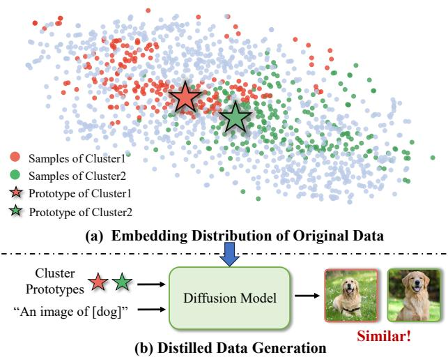
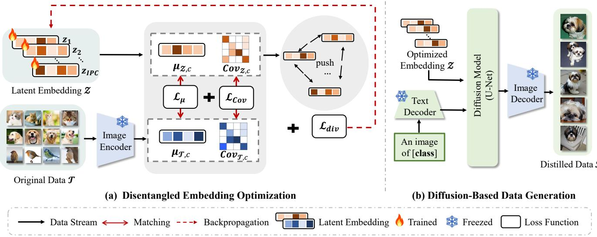
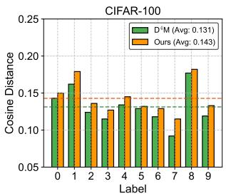
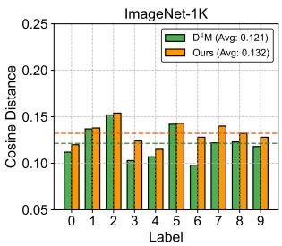
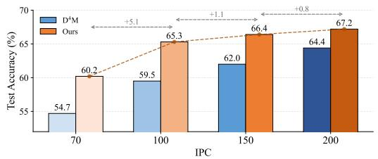
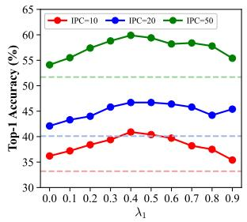
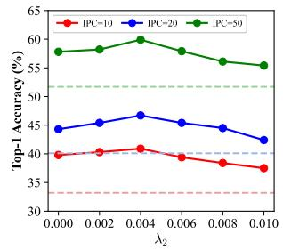
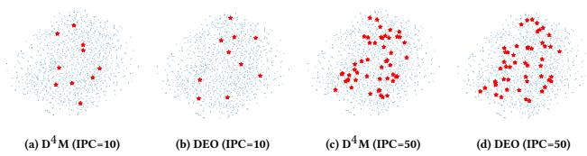
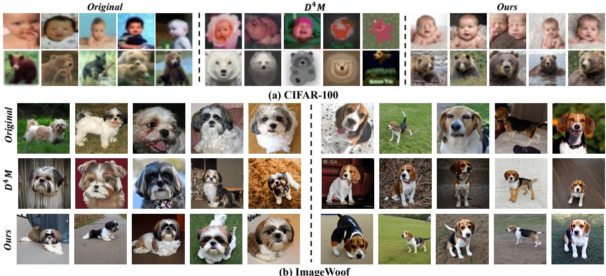

# Disentangled Embedding Optimization for Difusion-Based Dataset Distillation

Hongcheng Li   
Institute of Information Engineering,   
Chinese Academy of Sciences &   
School of Cyber Security, University   
of Chinese Academy of Sciences &   
State Key Laboratory of Cyberspace   
Security Defense   
Beijing, China   
lihongcheng@iie.ac.cn   
Xiaoyan Gu✉   
Institute of Information Engineering,   
Chinese Academy of Sciences &   
School of Cyber Security, University   
of Chinese Academy of Sciences &   
State Key Laboratory of Cyberspace   
Security Defense   
Beijing, China   
guxiaoyan@iie.ac.cn   
Yucan Zhou   
College of Intelligence and   
Computing, Tianjin University   
Tianjin, China   
zhouyucan@tju.edu.cn   
Bo Li   
Institute of Information Engineering,   
Chinese Academy of Sciences   
State Key Laboratory of Cyberspace   
Security Defense   
Beijing, China   
libo@iie.ac.cn   
Yibin Wang   
Institute of Information Engineering,   
Chinese Academy of Sciences &   
School of Cyber Security, University   
of Chinese Academy of Sciences &   
State Key Laboratory of Cyberspace   
Security Defense   
Beijing, China   
wangyibin18@mails.ucas.ac.cn

Weiping Wang Institute of Information Engineering, Chinese Academy of Sciences Beijing, China wangweiping@iie.ac.cn

## Abstract

Dataset distillation aims to compress large-scale datasets into com-pact synthetic subsets that enable eficient model training with com- parable performance to the original data. Recent advances show that difusion models are highly efective for this task due to their strong generative capability. Existing difusion-based approaches typically perform class-wise clustering and use the obtained clus- ter prototypes as difusion inputs to generate distilled samples. However, the uniformly distributed original samples in a category inevitably lead to entanglement near cluster boundaries, pulling the cluster prototypes closer and reducing the inter-cluster separation. Consequently, the difusion model receives overly similar latent inputs, resulting in synthetic data with limited diversity. To address this issue, we propose Disentangled Embedding Optimization (DEO), a simple yet efective framework that replaces static cluster ing with trainable embeddings. These embeddings are optimized to match the Gaussian statistics (i.e., mean and covariance) of the original data distribution, while a diversity regularizer is designed to encourage separation among these embeddings to improve the intra-class variability. Extensive experiments demonstrate that our proposed DEO can generate more diversified and representative distilled data than existing cluster-based difusion methods, achiev- ing state-of-the-art performance and superior generalization across multiple datasets.

  
Figure 1: Illustration of the entanglement issue in distilled data generation. (a) t-SNE visualization shows that entangled sub-cluster prototypes in the original data reduce separability. (b) These less-separable latent inputs for the difusion model result in indistinguishable synthesized images.

• Computing methodologies → Artificial intelligence.

## CCS Concepts

## Keywords

Dataset Distillation, Representative Learning, Semantic Diversity

## 1 Introduction

The success of deep learning in vision, language, and multimodal tasks largely stems from the availability of large-scale datasets [13,

17, 22, 25, 36]. However, the growing size of such datasets leads to substantial costs in storage, training time, and computation. To mitigate these issues, dataset distillation has emerged as a promising paradigm that synthesizes compact datasets capable of retaining the training eficacy of the original datasets [19, 34, 40]. Beyond eficiency, distilled datasets also benefit privacy-sensitive [8, 48] and resource-constrained scenarios [12, 37].

Early dataset distillation (DD) methods typically employ a bi level optimization framework, where the outer loop updates model parameters and the inner loop refines synthetic data by aligning training trajectories [1, 9, 23] or gradients [18, 43, 44]. Despite their efectiveness, the interdependent optimization of models and dis- tilled data incurs prohibitive computational costs, often restricting their application to low-resolution datasets like CIFAR-10/100. To mitigate this, subsequent research has decoupled the process by directly matching feature statistics [33, 39, 45, 46]. However, these methods still rely on pixel-space optimization, which makes scaling to high-resolution datasets inherently dificult [4, 24, 47].

To overcome the limitations of pixel-space optimization, several pioneering studies have incorporated generative priors into dataset distillation. For example, GLAD [2] improves distillation by projecting optimization losses onto the intermediate latent layers of a pre-trained GAN, thereby exploiting the structural and semantic information captured at diferent depths to regularize synthesized samples toward the natural image manifold. However, GAN-based frameworks still require backpropagation through complex gen-erator architectures, resulting in substantial memory overhead. To alleviate this issue, more recent research has shifted toward difusion-based distillation. Compared with GANs, difusion models operate in a highly expressive and semantically linearized latent space induced by a pre-trained VAE. Within this paradigm, the VAE encoder first projects original images into a compact latent manifold, allowing distillation to be performed in a lower-dimensional yet semantically structured space. Specifically, D4M [31] facilitates distillation by using �-means cluster prototypes as the latent foun dation for difusion. Building upon this paradigm, VLCP [49] inte-grates textual guidance by extracting LLaVA-generated descriptions for each cluster, leveraging these rich semantic prompts to further steer the synthesis of distilled samples.

However, a critical limitation is overlooked: in the latent space of a pretrained VAE encoder, features within each class tend to be uniformly distributed. Under such conditions, samples lying near the boundary of two clusters are inevitably and often arbitrarily assigned to one cluster or the other, which will reduce the distance between the corresponding cluster prototypes. As illustrated in Figure 1(a), we visualize the latent embeddings of a class, where samples belonging to two clusters are highlighted in orange and green, respectively. It is obvious that the entangled samples tend to pull their corresponding cluster prototypes closer in the feature space, thereby reducing inter-cluster separation. As shown in Fig- ure 1(b), when these less separable cluster prototypes are used as latent inputs to the difusion model, the generated distilled images appear visually similar and lack diversity. Consequently, the synthe-sized data fail to capture the full spectrum of intra-class semantic variations, limiting the performance of downstream tasks.

To address this issue, we propose Disentangled Embedding Op- timization (DEO), a simple yet efective framework for difusionbased dataset distillation. Instead of performing clustering analysis in the latent space, our method directly optimizes the latent em- beddings, which serve as inputs of the difusion model to generate distilled data. Specifically, we treat the latent embeddings as learn- able parameters that are optimized to approximate the original data distribution. For each class, we estimate a Gaussian distribution in the latent space by computing the empirical mean and covariance matrix with the original data. Then, the mean and covariance of the trainable latent embeddings are aligned with those of the corre- sponding class distributions, ensuring semantic representativeness. To further enhance intra-class diversity of the distilled data, we introduce an explicit dispersion regularization that promotes mutual separation among the trainable latent embeddings. Finally, the optimized embeddings, together with their corresponding class textual prompts, are fed into the difusion model to generate distilled data. Extensive experiments on CIFAR-10/100, ImageNet-1K, and several ImageNet subsets (ImageWoof, ImageNette, and ImageIDC) demonstrate that our DEO can generate diversified distilled data, which will consistently improve the performance of downstream tasks, all without introducing any external knowledge.

Our main contributions are summarized as follows:

• We propose a simple yet efective framework, termed Disentangled Embedding Optimization (DEO) for difusion-based dataset distillation, which makes the input latent space train- able rather than relying on conventional clustering.

• We design a dispersion regularizer that explicitly encourages diversity among synthetic embeddings, efectively miti-gating prototype collapse and promoting richer intra-class representations.

• Extensive experiments on CIFAR-10/100, ImageNet-1K, and multiple ImageNet subsets show that DEO consistently out-performs prior difusion-based baselines with strong cross- architecture generalization and lower computational cost.

## 2 Related Work

## 2.1 Matching-Based Methods

Early approaches to dataset distillation typically adopt a bi-level optimization framework, where the outer loop updates model pa- rameters and the inner loop optimizes the distilled data to match either gradient signals or training trajectories. Specially, gradient matching aligns the stepwise gradients computed on the original and distilled data [15, 18, 43, 44], whereas trajectory matching extends this idea by aligning the entire optimization paths [1, 5, 9, 23]. Despite demonstrating strong performance, these methods are com-putationally expensive due to the repeated alternation between model updates and data optimization.

To improve eficiency, recent methods leverage distribution matching, which aligns feature distributions without updating the model [45]. Early variants typically utilize randomly initialized networks to extract features. For example, CAFE [33] performs multi-layer prototype alignment; DataDAM [28] selects informative regions via attention mechanisms; and M3D [42] conducts feature alignment in a reproducing kernel Hilbert space. Building on this line of work,

IDM [46] and DANCE [41] enhance representational capacity by em-ploying multiple pretrained extractors, while IID [7] and DSDM [20] introduce feature moment matching to promote semantic diversity. However, these methods require both the dataset and the model to reside in memory, which limits scalability to large-scale settings.

To address the scalability challenge, decoupled distillation strate- gies have emerged [30, 32, 38]. A representative example is SRe2L [39], which first trains a reference model to absorb the knowledge from the full dataset, and then optimizes the distilled data by match- ing per-batch BatchNorm statistics to the model’s global statistics. Additionally, soft labels generated by the reference model provide supervisory signals for distillation. While this strategy substantially reduces computational cost, it may compromise diversity in synthetic samples, limiting generalization to unseen architectures. To mitigate this issue, DWA [10] introduces training perturbations and variance-aware weighting to encourage diverse sample generation. Complementarily, DEDA [21] incorporates a decorrelation regularization term that reduces redundancy among distilled features, thereby further enhancing semantic diversity. Although the decou- pled distillation methods are more computationally eficient, they still follow the pixel-level optimization paradigm, where memory usage and computational cost grow greatly with image resolution, ultimately limiting their scalability to high-resolution datasets.

## 2.2 Generative-Based Methods

Recent research has shifted from pixel-space optimization to leveraging generative priors. As a pioneering work, GLAD [2] introduces a deep generative prior from GANs to regularize the distillation process, significantly enhancing cross-architecture generalization. However, GAN-based methods often struggle with high-resolution scaling or necessitate complex, memory-intensive optimization. Building on the success of generative modeling [26], difusion mod els have emerged as robust backbones for dataset distillation due to their superior capacity for high-fidelity image synthesis. For instance, Gu et al. [11] enhance the representativeness of synthetic data by fine-tuning difusion models to align predicted embeddings with those of original images. Although efective, this multi-stage fine-tuning pipeline is computationally expensive, especially for large-scale datasets. To mitigate the overhead, subsequent studies exploit a frozen VAE and perform distillation directly in its latent space. D4M [31] clusters latent codes using �-means and conditions the generation process on cluster prototypes combined with label text prompts. $\bar { \mathrm { M G D } } ^ { 3 }$ [3] further discovers intra-class patterns through clustering to guide the denoising trajectory of the difusion model. Inspired by this idea, VLCP [49] enhances textual conditioning by leveraging LLaVA to generate per-image descriptions and selecting the most frequent sentence within each cluster to provide fine-grained textual descriptions for each cluster prototype. In these approaches, clustering is a crucial step for generating distilled data. However, clustering-based distillation often falls into a homogene- ity trap. Because cluster prototypes frequently overlap in dense data regions, the resulting synthetic samples become repetitive, sacrificing dataset diversity for mere representative proximity.

## 3 Method

## 3.1 Preliminaries

Dataset distillation aims to construct a compact synthetic dataset $\boldsymbol { S } = \{ ( s _ { i } , y _ { i } ) \} _ { i = 1 } ^ { | S | }$ , on which models trained can achieve comparable generalization performance to those trained on the full dataset $\bar { \mathcal { T } } = \{ ( x _ { i } , y _ { i } ) \} _ { i = 1 } ^ { | \bar { \mathcal { T } } | }$ , where $y _ { i } \in \mathcal { Y } = \{ 0 , 1 , . . . , C - 1 \}$ . Typically, S contains only IPC × � samples (IPC: images per class), satisfying $| S | \ll | \mathcal { T } |$ . The goal is to train $\theta _ { S }$ on $s$ such that it achieves comparable generalization to $\theta _ { \mathcal { T } }$ trained on $\mathcal { T }$

Latent Difusion Model for Dataset Distillation. Recently, latent difusion models (LDM) have emerged as a promising paradigm for dataset distillation, due to their strong cross-architecture generalization and eficient sample generation [31, 49]. A typical LDM pipeline consists of: (1) a VAE image encoder E for mapping input images into the latent space, (2) a conditioning text encoder that encodes class labels or descriptions, (3) a denoising U-Net $\epsilon _ { \theta }$ trained to reverse noise corruption, and (4) a VAE decoder D that reconstructs images from the denoised latents.

Latent Difusion Objective. The latent difusion model is trained to predict additive noise injected into latent embeddings:

$$
\mathcal { L } _ { \mathrm { L D M } } = \mathbb { E } _ { \boldsymbol { x } , \boldsymbol { y } , \epsilon , t } \left[ \left. \epsilon - \epsilon _ { \boldsymbol { \theta } } \left( z _ { t } , t , \tau _ { \boldsymbol { \phi } } ( \boldsymbol { y } ) \right) \right. _ { 2 } ^ { 2 } \right] ,\tag{1}
$$

where $z _ { t }$ is a noised latent obtained from an original image � through a VAE encoder and a forward difusion process, $\epsilon \sim { \cal N } ( 0 , I )$ is the ground-truth noise, and $t \sim \mathcal { U } \{ 1 , T \}$ is the difusion timestep. The term $\tau _ { ( \mathcal { Y } ) }$ denotes the embedding of the class label � produced by a text encoder $\tau _ { \phi } ,$ , which provides semantic conditioning for the denoising network $\epsilon _ { \theta } .$ . During inference, a scheduler progressively denoises the latent from $z _ { T }$ to $z _ { 0 } ,$ , which is then decoded into an im- age using the VAE decoder. In the context of difusion-based dataset distillation, the collection of such generated images constitutes the distilled dataset S.

## 3.2 Disentangled Embedding Optimization

Recent difusion-based dataset distillation methods typically per- form clustering on the latent embeddings extracted by a VAE image encoder for each class and use the cluster prototypes as the inputs to the latent difusion model to generate distilled images. However, since the samples of a class are often uniformly distributed in the latent space, the resulting cluster prototypes tend to lie close to one another. This will lead to the synthetic samples with limited intra-class diversity.

To mitigate this issue, instead of following the clustering-based pipeline, we propose to explicitly optimize the embeddings of distilled data $\mathcal { Z } _ { c } = \{ z _ { i } \} _ { i = 1 } ^ { \mathrm { I P C } }$ . This design enables the generated samples to preserve the diversity of the original data distribution. As shown in Figure 2(a), we initialize the learnable latent embeddings ${ \boldsymbol { \mathcal { Z } } } _ { c }$ independently and align them with the Gaussian distribution of the original data in the latent space of a pre-trained VAE encoder E by minimizing a mean alignment loss $\mathcal { L } _ { \mu }$ and a covariance alignment loss $\mathcal { L } _ { C o v }$ . In addition, to promote sample-level diversity within each class, we introduce a diversity loss $\mathcal { L } _ { d i v }$ that encourages the optimized embeddings to be mutually dispersed in the latent space.

Specifically, for each class �, let $\{ \pmb { e } _ { i } = \pmb { \mathcal { E } } ( \pmb { x } _ { i } ) \} _ { i = 1 } ^ { N _ { c } }$ denote the latent embeddings extracted from the original samples in class $c ,$ where

  
Figure 2: Overview of our Disentangled Embedding Optimization (DEO) for difusion-based distillation. (a) Learnable latent embeddings ${ \boldsymbol { \mathcal { Z } } } _ { c }$ are optimized to match the mean and covariance of the original data, with a diversity loss to encourage separation. (b) The optimized $z _ { c }$ and text prompts are fed into the difusion model to generate distilled samples S.

$N _ { c }$ is the number of original samples. We define the mean alignment loss as follows:

$$
\begin{array} { r } { \mathcal { L } _ { \mu } = \left\| \mu _ { \mathcal { Z } , c } - \mu _ { \mathcal { T } , c } \right\| _ { 2 } ^ { 2 } } \\ { s . t . \quad \mu _ { \mathcal { Z } , c } = \displaystyle \frac { 1 } { \mathrm { I P C } } \sum _ { i = 1 } ^ { \mathrm { I P C } } z _ { i } , \quad \mu _ { \mathcal { T } , c } = \frac { 1 } { N _ { c } } \sum _ { i = 1 } ^ { N _ { c } } e _ { i } , } \end{array}\tag{2}
$$

where $\pmb { \mu } _ { Z , c }$ and $\mu _ { \mathcal { T } , c }$ are the mean latent embeddings of the syn- thetic and original samples in class $c ,$ respectively. Similarly, we define the covariance alignment loss as follows:

$$
\begin{array} { r l } & { \mathcal { L } _ { C o v } = \left\| C o v _ { \mathcal { T } , c } - C o v _ { \mathcal { T } , c } \right\| _ { 2 } ^ { 2 } } \\ { s . t . } & { C o v _ { \mathcal { Z } , c } = \frac { 1 } { \mathrm { I P C } } \displaystyle \sum _ { i = 1 } ^ { \mathrm { I P C } } ( z _ { i } - \mu _ { \mathcal { Z } , c } ) ( z _ { i } - \mu _ { \mathcal { Z } , c } ) ^ { \top } , } \\ & { C o v _ { \mathcal { T } , c } = \frac { 1 } { N _ { c } } \displaystyle \sum _ { i = 1 } ^ { N _ { c } } ( e _ { i } - \mu _ { \mathcal { T } , c } ) ( e _ { i } - \mu _ { \mathcal { T } , c } ) ^ { \top } . } \end{array}\tag{3}
$$

To further encourage sample-level diversity within each class, we introduce a separation regularization term that penalizes latent embeddings with high similarity:

$$
\mathcal { L } _ { d i v } = \frac { 1 } { \mathrm { I P C } } \sum _ { i = 1 } ^ { \mathrm { I P C } } \sum _ { j = 1 } ^ { \mathrm { I P C } } \log \left( 1 + \exp \left( \tilde { z } _ { i } ^ { \top } \tilde { z } _ { j } \right) \right) ,\tag{4}
$$

where $\tilde { \boldsymbol { z } } _ { i }$ denotes the $\ell _ { 2 } \cdot$ -normalized version of $z _ { i }$ . This term encour- ages the learnable embeddings to be well separated in the latent space, thereby promoting intra-class diversity in the distilled data.

## 3.3 Overall Objective and Generation Procedure

The training objective combines distribution alignment with diversity regularization:

$$
\mathcal { L } \ = \mathcal { L } _ { \mu } + \lambda _ { 1 } \mathcal { L } _ { C o v } \ + \lambda _ { 2 } \mathcal { L } _ { d i v } ,\tag{5}
$$

Algorithm 1: DEO   
Input: T: Original dataset; �: Number of classes; IPC: Images per   
class; �: Number of optimization steps; �: Learning rate.   
1 (a): Disentangled Embedding Optimization   
2 for each class � = 1 to � do   
3 Initialize learnable latent embeddings $Z _ { c } = \{ z _ { i } \} _ { i = 1 } ^ { \mathrm { I P C } } .$   
4 Compute the class-wise feature mean $\mu _ { \mathcal { T } , c }$ and covariance   
� ��T� from T.   
5 for iteration � = 1 to � do   
6 Compute the mean $\pmb { \mu } _ { Z , c }$ and covariance $C o v _ { Z , c }$ of the   
latent embeddings $z _ { c }$   
7 Compute the mean loss ${ \mathcal { L } } _ { \mu }$ via $\operatorname { E q . } ( 2 ) .$   
8 Compute the covariance loss $\mathcal { L } _ { C o v }$ via $\operatorname { E q . } ( 3 ) .$   
9 Compute the diversity regularization loss ${ \mathcal { L } } _ { \mathrm { d i v } }$ via Eq. (4).   
10 Compute the overall objective L via Eq. (5).   
11 Update latent embeddings: $\mathcal { Z } _ { c } \gets \mathcal { Z } _ { c } - \eta \nabla _ { \mathcal { Z } _ { c } } \mathcal { L } .$   
12 (b): Difusion-Based Data Generation   
13 for each class � = 1 to � do   
14 Combine the optimized latent embeddings $z _ { c }$ with the   
class-specific textual prompt $P _ { \mathrm { t e x t } } ^ { c }$ (i.e., “An image of   
[class]”).   
15 Generate synthetic images $\left\{ s _ { i } \right\}$ according to Eq. (6).   
16 Append generated images to the distilled dataset:   
S ← S ∪ {�� }.   
Output: Distilled synthetic dataset S.

where $\lambda _ { 1 }$ and $\lambda _ { 2 }$ are tunable hyperparameters.

After the latent embeddings are optimized, we feed them into the difusion model following prior work [31, 49]. As illustrated in Figure 2(b), the per-class distilled latent set ${ \mathcal Z } _ { c } ~ = ~ \{ z _ { i } \} _ { i = 1 } ^ { \mathrm { I P C } }$ is paired with a class-specific textual prompt $P _ { \mathrm { t e x t } } ^ { c } ( \mathrm { e . g . }$ , “An image of [class]”). The prompt embedding $\tau _ { \phi } ( P _ { \mathrm { t e x t } } ^ { c } )$ conditions the U-Net, and each distilled image $\pmb { s } _ { i }$ is synthesized as:

$$
\begin{array} { r } { \pmb { s } _ { i } = \mathcal { D } \big ( \mathcal { U } _ { t } \big ( \mathrm { C o n c a t } \big ( \tilde { z } _ { i , t } ^ { c } , ~ \tau _ { \phi } \left( P _ { \mathrm { t e x t } } ^ { c } \right) \big ) \big ) \big ) , } \end{array}\tag{6}
$$

where $\tilde { z } _ { i , t } ^ { c }$ is the noise-perturbed version of �� at difusion timestep $t , \mathcal { U } _ { t } ( \cdot )$ denotes the timestep-dependent U−Net backbone, $\mathcal { D } ( \cdot )$ is the image decoder, and Concat(·, ·) denotes channel-wise concate-nation. This formulation enables the optimized latent codes and textual semantics to jointly guide the denoising process to generate the distilled dataset S. The complete training and generation pipeline is summarized in Algorithm 1.

## 4 Discussion

The advantage of DEO over clustering-based latent distillation methods can be understood from the perspective of prototype bias caused by boundary ambiguity. In the latent space of a pretrained VAE, samples within the same class are often uniformly distributed without clear sub-cluster boundaries. As a result, samples near the overlapping region may be arbitrarily assigned to diferent clusters, which will pull the estimated cluster prototypes near each other.

Consider two ideal semantic modes with centers $\mu _ { 1 }$ and $\mu _ { 2 } .$ Due to boundary ambiguity, the estimated prototypes can be written as

$$
\hat { \mu } _ { 1 } = ( 1 - \alpha ) \mu _ { 1 } + \alpha \mu _ { 2 } , \qquad \hat { \mu } _ { 2 } = ( 1 - \beta ) \mu _ { 2 } + \beta \mu _ { 1 } ,\tag{7}
$$

where $\alpha , \beta \in \ [ 0 , 0 . 5 )$ quantify cross-mode contamination. Their distance then becomes

$$
\| \hat { \mu } _ { 1 } - \hat { \mu } _ { 2 } \| _ { 2 } = ( 1 - \alpha - \beta ) \| \mu _ { 1 } - \mu _ { 2 } \| _ { 2 } < \| \mu _ { 1 } - \mu _ { 2 } \| _ { 2 } .\tag{8}
$$

This simple analysis shows that boundary ambiguity naturally shrinks the separation between cluster prototypes, causing the difusion model to receive similar latent inputs. In contrast, DEO avoids hard cluster assignment and directly optimizes learnable embeddings under distribution matching and dispersion regular ization, thereby preserving richer intra-class semantic variability.

## 5 Experiment

## 5.1 Experimental Setup

Datasets. We evaluate our proposed DEO method on a diverse suite of image benchmarks. For low-resolution settings, we utilize CIFAR-10 and CIFAR-100 [16], two widely used datasets containing 60,000 images at 32 × 32 resolution, with 10 and 100 classes respectively. For high-resolution evaluation, we employ ImageNet-1K [6], a large-scale dataset comprising 1.28 million images across 1,000 categories at 224×224 resolution, which ofers a comprehensive test of generalization under diverse visual concepts. Additionally, we assess performance on several widely adopted subsets of ImageNet- 1K, specifically ImageWoof, ImageNette [14], and ImageIDC [49]. ImageWoof focuses on fine-grained recognition among ten visually similar dog breeds, while ImageNette and ImageIDC serve as more general benchmarks with ten coarse-grained categories each.

Implementation Details. We follow the experimental protocols established in prior work [31, 49]. Unless otherwise specified, we fine-tune Stable Difusion v1.5 on each dataset using paired imagelabel supervision. The trainable latent embeddings are optimized using the Adam optimizer with a learning rate of $1 \times 1 0 ^ { - 3 }$ for 10,000 steps. To ensure both distribution alignment and sample diversity, we incorporate a covariance matching loss weighted by $\lambda _ { 1 } = 0 . 5$ , alongside a diversity-promoting separation regularizer applied to the denoised latents with a coeficient of $\lambda _ { 2 } ~ = ~ 0 . 0 0 4$ All experiments are conducted on NVIDIA RTX A6000 or NVIDIA A100 (80GB) GPUs.

Evaluation Protocol. For a fair comparison, we follow the evaluation settings used in VLCP [49]. Two evaluation strategies are employed: (1) Direct Training: a classifier is trained from scratch using the generated images and their labels, with performance evaluated on the standard test split. This setting is used for Im ageWoof, ImageNette, and ImageIDC. (2) Soft-Label Supervision: soft labels are obtained by applying the teacher model pre-trained by the original data to the distilled images, which are then used to train a new classifier. This setting is adopted for ImageNet-1K and CIFAR-10/100. All reported Top-1 accuracies are averaged over three random seeds.

Compared Methods. We compare DEO against a comprehensive set of state-of-the-art baselines: (1) Core-set selection methods, including K-Center [29] and Herding [35]; (2) Matching-based distillation methods, such as DM [45], IDC-1 [15] SRe2L [39], and RDED [32]; and (3) Difusion-based distillation methods, including DiT [27], Minimax [11], D4M [31], and VLCP [49].

## 5.2 Main Results

ImageWoof, ImageNette, and ImageIDC. Table 1 reports the re-sults on three benchmarks under a unified ResNetAP-10 evaluation protocol. DEO consistently achieves the best performance across all datasets and all IPC settings. On ImageWoof, DEO reaches 40.9%, 46.7%, and 59.9% at IPC=10, 20, and 50, respectively, outperforming the strongest baseline VLCP by 1.4%, 2.2%, and 2.6%. Similarly, on ImageNette, DEO improves over VLCP by 1.4%, 1.2%, and 1.0%, while on ImageIDC, the gains are 1.6%, 1.3%, and 0.7%. These results show that DEO produces more efective distilled samples across datasets with diferent visual characteristics and compression ratios.

ImageNet-1K. Table 2 further demonstrates the scalability of DEO on the challenging ImageNet-1K benchmark. DEO achieves 49.2% at IPC=10 and 61.4% at IPC=50, surpassing the strongest base- line VLCP by 2.5% and 0.9%, respectively. The consistent advantage on ImageNet-1K indicates that our embedding optimization strat-egy remains efective even when the dataset scale and semantic diversity increase substantially.

CIFAR-10/100. We further evaluate DEO on low-resolution benchmarks in Table 3. On CIFAR-10, DEO achieves 41.8% and 64.1% at IPC=10 and 50, improving over VLCP by 2.8% and 0.9%, re-spectively. On CIFAR-100, DEO reaches 52.4% and 66.8%, exceeding VLCP by 1.8% and 0.7%. Compared with earlier baselines, the gains are even more pronounced; for example, on CIFAR-100 with IPC=10, DEO outperforms SRe2L and RDED by 25.4% and 9.8%, respectively. Overall, these results demonstrate that DEO consistently delivers superior distilled data quality on both large-scale high-resolution benchmarks and standard low-resolution datasets.

## 5.3 Cross-architecture Evaluation

Table 4 reports the results on ImageWoof using two target architectures, ConvNet and ResNet-18. DEO consistently achieves the best performance across all IPC settings on both backbones, demonstrat- ing strong cross-architecture generalization of the distilled data.

Table 1: Performance comparison on ImageWoof, ImageNette, and ImageIDC with ResNetAP-10 under diferent IPC settings. The best and second-best results are highlighted in bold and underline, respectively; “–” denotes unavailable results.
<table><tr><td rowspan="2">Method</td><td colspan="3">ImageWoof</td><td colspan="3">ImageNette</td><td colspan="3">ImageIDC</td></tr><tr><td>IPC=10</td><td>IPC=20</td><td>IPC=50</td><td>IPC=10</td><td>IPC=20</td><td>IPC=50</td><td> $\mathrm { I P C } { = } 1 0$ </td><td>IPC=20</td><td>IPC=50</td></tr><tr><td>Random</td><td> $2 9 . 4 { \pm } 0 . 8 $ </td><td> $3 2 . 7 { \pm } 0 . 4 $ </td><td> $4 7 . 2 { \pm } 1 . 3 $ </td><td> $5 4 . 2 { \pm } 1 . 6 $ </td><td> $6 3 . 5 { \pm } 0 . 5 $ </td><td> $7 6 . 1 { \pm } 1 . 1 $ </td><td> $4 8 . 1 { \pm } 0 . 8 $ </td><td> $5 2 . 5 { \pm } 0 . 9$ </td><td> $6 8 . 1 { \pm } 0 . 7 \ $ </td></tr><tr><td>K-Center</td><td> $2 2 . 1 { \pm } 0 . 1$ </td><td> $2 5 . 1 { \pm } 0 . 7 $ </td><td> $4 0 . 6 { \pm } 0 . 4 $ </td><td></td><td></td><td></td><td></td><td></td><td></td></tr><tr><td>Herding</td><td> $3 2 . 0 { \pm } 0 . 3 $ </td><td> $3 4 . 9 { \pm } 0 . 1$ </td><td> $4 9 . 1 { \pm } 0 . 7 $ </td><td></td><td></td><td></td><td></td><td></td><td></td></tr><tr><td>DiT</td><td> $3 4 . 7 { \pm } 0 . 5 $ </td><td> $4 1 . 1 { \pm } 0 . 8 $ </td><td> $4 9 . 3 { \pm } 0 . 2 $ </td><td> $5 9 . 1 { \pm } 0 . 7 $ </td><td> $6 4 . 8 { \pm } 1 . 2 $ </td><td> $7 3 . 3 { \pm } 0 . 9 $ </td><td> $5 4 . 1 { \pm } 0 . 4 $ </td><td> $5 8 . 9 { \pm } 0 . 2 $ </td><td> $6 4 . 3 { \pm } 0 . 6 $ </td></tr><tr><td>DM</td><td> $3 0 . 3 { \pm } 1 . 2 $ </td><td> $3 5 . 2 { \pm } 0 . 6 $ </td><td> $4 7 . 1 { \pm } 1 . 1 $ </td><td> $6 0 . 8 { \pm } 0 . 6 $ </td><td> $6 6 . 5 { \pm } 1 . 1 $ </td><td> $7 6 . 2 { \pm } 0 . 4 $ </td><td> $5 2 . 8 { \pm } 0 . 5 $ </td><td> $5 8 . 5 { \pm } 0 . 4 $ </td><td> $6 9 . 1 { \pm } 0 . 8 $ </td></tr><tr><td>IDC-1</td><td> $3 9 . 1 { \pm } 0 . 5 $ </td><td> $4 3 . 4 { \pm } 0 . 3 $ </td><td> $4 8 . 3 { \pm } 1 . 0 $ </td><td></td><td></td><td></td><td></td><td></td><td></td></tr><tr><td>Minimax</td><td> $3 6 . 2 { \pm } 3 . 2 $ </td><td> $4 3 . 3 { \pm } 2 . 7 $ </td><td> $5 3 . 9 { \pm } 0 . 7 $ </td><td> $5 7 . 7 { \pm } 1 . 2 $ </td><td> $6 4 . 7 { \pm } 0 . 8 $ </td><td> $7 3 . 9 { \pm } 0 . 3 $ </td><td> $5 1 . 9 { \pm } 1 . 4 $ </td><td> $5 9 . 1 { \pm } 3 . 7 $ </td><td> $6 9 . 4 { \pm } 1 . 4 $ </td></tr><tr><td>D⁴M</td><td> $3 3 . 2 { \pm } 2 . 1$ </td><td> $4 0 . 1 { \pm } 1 . 6 $ </td><td> $5 1 . 7 { \pm } 3 . 2 $ </td><td> $6 0 . 9 { \pm } 1 . 7 $ </td><td> $6 6 . 3 { \pm } 1 . 3 $ </td><td> $7 7 . 7 { \pm } 1 . 1 $ </td><td> $5 0 . 3 { \pm } 1 . 0 $ </td><td> $5 5 . 8 { \pm } 0 . 2 $ </td><td> $6 9 . 1 { \pm } 2 . 4 $ </td></tr><tr><td>VLCP</td><td>39.5±1.5</td><td> $\underline { { 4 4 . 5 \pm 2 . 2 } }$ </td><td>57.3±0.5</td><td> $\underline { { 6 4 . 8 \pm 3 . 6 } }$ </td><td>71.4±0.5</td><td> $\underline { { 8 1 . 2 \pm 0 . 8 } }$ </td><td> $5 7 . 0 { \pm } 1 . 4 $ </td><td> $\underline { { 6 3 . 3 \pm 1 . 2 } }$ </td><td> $\underline { { 7 1 . 9 \pm 0 . 4 } }$ </td></tr><tr><td>DEO (Ours)</td><td>40.9±0.5</td><td> ${ \bf 4 6 . 7 \pm 0 . 4 }$ </td><td> ${ \bf 5 9 . 9 2 0 . 6 }$ </td><td> ${ \bf 6 6 . 2 2 1 . 2 }$ </td><td> $7 2 . 6 { \pm } 0 . 4$ </td><td> $\mathbf { 8 2 . 2 \pm 0 . 4 }$  </td><td> ${ \bf 5 8 . 6 { \pm 0 . 7 } }$ </td><td> ${ \bf 6 4 . 6 { \pm 0 . 6 } }$ </td><td> $7 2 . 6 { \pm } 0 . 3$ </td></tr></table>

Efect of High IPC. We further analyze the efect of high IPC settings in Figure 3 by comparing D4M and DEO on ImageWoof. As IPC increases, both methods achieve better accuracy, showing

Ablation Study. To evaluate the efectiveness of each component in our DEO, we conduct ablation studies on ImageWoof under three IPC settings: $\mathrm { I P C } = 1 0 , 2 0 .$ , and 50. We analyze the impact of three core losses: mean alignment $( { \mathcal { L } } _ { \mu } ) ,$ covariance ali nment $( \mathcal { L } _ { C o v } ) _ { : }$ and diversity regularization $( \mathcal { L } _ { d i v } )$ . As summarized in Table $^ { 5 , }$ we can draw four key conclusions. First, using only $\mathcal { L } _ { \boldsymbol { \mu } }$ already out- performs D4M by 1.1% and 0.5%, demonstrating that aligning the class-wise means of latent embeddings efectively preserves the core semantics of the original data. Second, adding $\mathcal { L } _ { C o v }$ further captures intra-class variations around the class centers and brings the performance up to par with VLCP. This indicates that matching both the mean and covariance statistics is suficient to reconstruct rich semantic information without relying on large pretrained models or long-horizon reasoning. Third, incorporating $\mathcal { L } _ { d i v }$ alongside $\mathcal { L } _ { \mu }$ yields an additional gain of1.9%–2.5%, suggesting that enforcing separation among embeddings promotes greater semantic diver-sity and expressiveness. Finally, the combination of all three losses consistently achieves the best performance across all IPC settings, validating the efectiveness ofjointly optimizing for semantic align-ment and intra-class diversity in the latent embedding space.

Table 2: Performance comparison on ImageNet-1K with IPC=10/50.
<table><tr><td>IPC</td><td>SRe2L</td><td>RDED</td><td>DiT</td><td>Minimax</td><td>VLCP</td><td>DEO (Ours)</td></tr><tr><td>10</td><td> $2 1 . 3 { \pm } 0 . 6 $ </td><td></td><td>42.0±0.1 39.6±0.4</td><td>44.3±0.5</td><td> $4 6 . 7 { \pm } 0 . 4 $ </td><td> ${ \bf 4 9 . 2 \pm 0 . 8 }$ </td></tr><tr><td>50</td><td> $4 6 . 8 { \pm } 0 . 2 $ </td><td></td><td>56.5±0.1 52.9±0.6 58.6±0.3</td><td></td><td> $6 0 . 5 { \pm } 0 . 2 $ </td><td> ${ \bf 6 1 . 4 } { \bf \pm 0 . 3 }$ </td></tr></table>

Specifically, on ConvNet, DEO improves over the strongest baseline VLCP by 1.4%, 1.5%, and 1.1% at IPC=10, 20, and 50, respectively. On ResNet-18, the corresponding gains are 1.6%, 0.5%, and 1.2%. More-over, compared with the most relevant difusion-based baseline D4M, DEO achieves substantially larger gains, ranging from 5.4% to 9.2% across diferent settin s. These results indicate that DEO learns more transferable and discriminative latent representations, leading to superior performance across diferent model families rather than on a single evaluation architecture only.

## 5.4 Analysis

Table 3: Performance comparison on CIFAR-10 and CIFAR-100 with $\mathbf { I P C = 1 0 } / 5 0$
<table><tr><td>Dataset</td><td>IPC</td><td>SRe2L</td><td>RDED</td><td>VLCP</td><td>DEO (Ours)</td></tr><tr><td rowspan="2">CIFAR-10</td><td>10</td><td> $2 9 . 3 { \pm } 0 . 5 $ </td><td> $3 7 . 1 { \pm } 0 . 3 $ </td><td> $3 9 . 0 { \pm } 0 . 7 \ $ </td><td> ${ \bf 4 1 . 8 } { \bf \pm 0 . 6 }$ </td></tr><tr><td>50</td><td> $4 5 . 0 { \pm } 0 . 7 \ $ </td><td> $6 2 . 1 { \pm } 0 . 1$ </td><td> $6 3 . 2 { \pm } 0 . 3 $ </td><td>_  ${ \bf 6 4 . 1 { \pm } 0 . 7 }$ </td></tr><tr><td rowspan="2">CIFAR-100</td><td>10</td><td> $2 7 . 0 { \pm } 0 . 4 $ </td><td> $4 2 . 6 { \pm } 0 . 2 $ </td><td> $5 0 . 6 { \pm } 0 . 7 $ </td><td> ${ \bf 5 2 . 4 } { \bf \pm 0 . 3 }$ </td></tr><tr><td>50</td><td> $5 0 . 2 { \pm } 0 . 4 $ </td><td> $6 2 . 6 { \pm } 0 . 1 $ </td><td> $6 6 . 1 { \pm } 0 . 3 $ </td><td> ${ \bf 6 6 . 8 \pm 0 . 5 }$ </td></tr></table>

that a larger distilled budget generally improves downstream per- formance. DEO consistently surpasses D4M across all IPC settings, indicating its stronger ability to preserve informative class semantics. At the same time, the marginal gain of DEO gradually decreases as IPC grows, suggesting a clear diminishing-return efect. This implies that once suficient semantic coverage is achieved, further increasing IPC brings only limited additional improvement.

Efect of $\lambda _ { 1 } .$ . In our DEO framework, the hyperparameter $\lambda _ { 1 }$ controls the weight of the covariance alignment loss ${ \mathcal { L } } _ { C o v } ,$ which is designed to match the second-order statistics of the learnable embeddings to those of the original data. Covariance reflects both intra-class dispersion and inter-dimensional correlations, thereby capturing semantic variations around the class center. As shown in the left panel of Figure 4, on ImageWoof with IPC ∈ {10, 20, 50}, increasing $\lambda _ { 1 }$ from 0 to 0.5 consistently improves classification performance, demonstrating the efectiveness of incorporating higherorder statistical alignment. However, when $\lambda _ { 1 }$ exceeds 0.5, the per- formance drops noticeably. We attribute this decline to the trade-of between mean alignment and covariance alignment: an overly large $\lambda _ { 1 }$ may overemphasize noisy covariance estimates, especially in low-IPC settings, and drive the embeddings to fit outlier samples. Unless otherwise specified, we set $\lambda _ { 1 } = 0 . 5$ in all experiments.

Efect of $\lambda _ { 2 } .$ . The hyperparameter $\lambda _ { 2 }$ controls the strength of the diversity regularization, which encourages the learned embed- dings to be more dispersed in the latent space. Such dispersion helps the difusion model generate synthetic samples that are both more diverse and more representative. As shown in the right panel of Figure 4, we conduct a sensitivity analysis on ImageWoof with $\mathrm { I P C } \in \{ 1 0 , 2 0 , 5 0 \}$ . The results indicate that performance reaches its peak at $\lambda _ { 2 } = 0 . 0 0 4 .$ When $\lambda _ { 2 }$ becomes excessively large, how ever, the embeddings become over-dispersed, weakening intra-class compactness and leading to a gradual performance drop.

Table 4: Performance comparison of dataset distillation methods on ImageWoof under varying IPC values. Evaluations are conducted using ConvNet and ResNet-18. The best results are shown in bold.
<table><tr><td>Backbone</td><td></td><td>IPC | Random</td><td> $\scriptstyle \mathrm { K - C e n t e r }$ </td><td>Herding</td><td>DiT</td><td>DM</td><td>IDC-1</td><td>Minimax</td><td> $\mathrm { D } ^ { 4 } \mathrm { M }$ </td><td>VLCP</td><td>DEO (Ours)</td></tr><tr><td rowspan="3">ConvNet</td><td>10</td><td> $2 4 . 3 { \pm } 1 . 1$ </td><td> $1 9 . 4 { \pm } 0 . 9 $ </td><td> $2 6 . 7 { \pm } 0 . 5 $ </td><td> $3 4 . 2 { \pm } 1 . 1$ </td><td> $2 6 . 9 { \pm } 1 . 2 $ </td><td> $3 3 . 3 { \pm } 1 . 1$ </td><td> $3 3 . 3 { \pm } 1 . 7 $ </td><td> $2 9 . 4 { \pm } 0 . 9$ </td><td> $3 4 . 8 { \pm } 2 . 4 $ </td><td> ${ \bf 3 6 . 2 \pm 0 . 8 }$ </td></tr><tr><td>20</td><td> $2 9 . 1 { \pm } 0 . 7 $ </td><td> $2 1 . 5 { \pm } 0 . 8 $ </td><td> $2 9 . 5 { \pm } 0 . 3 $ </td><td> $3 6 . 1 { \pm } 0 . 8 $ </td><td> $2 9 . 9 { \pm } 1 . 0 $ </td><td> $3 5 . 5 { \pm } 0 . 8 $ </td><td> $3 7 . 3 { \pm } 0 . 1 $ </td><td> $3 4 . 0 { \pm } 2 . 3 $ </td><td> $3 7 . 9 { \pm } 1 . 9 $ </td><td> $\mathbf { 3 9 . 4 } \pm \mathbf { 0 . 3 }$ </td></tr><tr><td>50</td><td> $4 1 . 3 { \pm } 0 . 6 $ </td><td> $3 6 . 5 { \pm } 1 . 0 $ </td><td> $4 0 . 3 { \pm } 0 . 7 \ $ </td><td> $4 6 . 5 { \pm } 0 . 8 $ </td><td> $4 4 . 4 { \pm } 1 . 0 $ </td><td> $4 3 . 9 { \pm } 1 . 2 $ </td><td> $5 0 . 9 { \pm } 0 . 8 $ </td><td> $4 7 . 4 { \pm } 0 . 9 $ </td><td> $5 4 . 5 { \pm } 0 . 6 $ </td><td> ${ \bf 5 5 . 6 { \pm 0 . 3 } }$ </td></tr><tr><td rowspan="3">ResNet-18</td><td>10</td><td> $2 7 . 7 { \pm } 0 . 9 $ </td><td> $2 1 . 1 { \pm } 0 . 4 $ </td><td> $3 0 . 2 { \pm } 1 . 2 $ </td><td> $3 4 . 7 { \pm } 0 . 4 $ </td><td> $3 3 . 4 { \pm } 0 . 7 $ </td><td> $3 7 . 3 { \pm } 0 . 2 $ </td><td> $3 5 . 7 { \pm } 1 . 6 $ </td><td> $3 2 . 3 { \pm } 1 . 2 $ </td><td> $3 9 . 9 { \pm } 2 . 6 $ </td><td> ${ \bf 4 1 . 5 2 1 . 1 . 1 }$ </td></tr><tr><td>20</td><td> $2 9 . 7 { \pm } 0 . 5 $ </td><td> $2 3 . 6 { \pm } 0 . 3 $ </td><td> $3 2 . 2 { \pm } 0 . 6 $ </td><td> $4 0 . 5 { \pm } 0 . 5 $ </td><td> $2 9 . 8 { \pm } 1 . 7 $ </td><td> $3 8 . 6 { \pm } 0 . 2 $ </td><td> $4 1 . 8 { \pm } 1 . 9 $ </td><td> $3 8 . 4 { \pm } 1 . 1$ </td><td> $4 4 . 5 { \pm } 2 . 0 $ </td><td> ${ \bf 4 5 . 0 { \pm } 0 . 8 }$ </td></tr><tr><td>50</td><td> $4 7 . 9 { \pm } 1 . 8 $ </td><td> $3 9 . 6 { \pm } 1 . 0 $ </td><td> $4 8 . 3 { \pm } 1 . 2 $ </td><td> $5 0 . 1 { \pm } 0 . 5 $ </td><td> $4 6 . 2 { \pm } 0 . 6 $ </td><td> $4 8 . 3 { \pm } 0 . 8 $ </td><td> $5 3 . 7 { \pm } 0 . 6 $ </td><td> $5 3 . 7 { \pm } 2 . 2 $ </td><td> $5 8 . 9 { \pm } 1 . 5 $ </td><td> ${ \bf 6 0 . 1 \pm 0 . 9 }$ </td></tr></table>

Table 5: Ablation study on ImageWoof.
<table><tr><td>Method |</td><td> ${ \mathcal { L } } _ { \mu }$ </td><td> $\scriptstyle { \mathcal { L } } _ { C o o }$ </td><td> $\mathcal { L } _ { d i v }$  —</td><td> $\mathrm { I P C } { = } 1 0$ </td><td> $\mathrm { I P C } { = } 2 0$ </td><td> $\mathrm { I P C } { = } 5 0$ </td></tr><tr><td>D⁴M</td><td>-</td><td>一</td><td>-</td><td>33.2</td><td>40.1</td><td>51.7</td></tr><tr><td rowspan="4">Ours</td><td>√</td><td>一</td><td>-</td><td>34.3</td><td>39.6</td><td>52.2</td></tr><tr><td>√</td><td>√</td><td>一</td><td>39.8</td><td>44.3</td><td>57.8</td></tr><tr><td>√</td><td>一</td><td>√</td><td>36.2</td><td>42.1</td><td>54.1</td></tr><tr><td>√</td><td>√</td><td>√</td><td>40.9</td><td>46.7</td><td>59.9</td></tr></table>

Figure 3: Performance of D4M and DEO under diferent high IPC settings on ImageWoof.  

  
Figure 4: Efect of $\lambda _ { 1 }$ and $\lambda _ { 2 }$ on ImageWoof with IPC ∈ {10, 20, 50}. Red, blue, and green lines represent $\mathbf { I P C } = 1 0 , 2 0 ,$ and 50, respectively, while dashed lines denote the corresponding results from $\mathbf { D } ^ { 4 } \mathbf { M }$

Diversity Analysis. The average cosine distance between sam-ples and their class prototypes serves as a principled metric for intra-class diversity, which is fundamentally linked to the general- ization capability of downstream models. To validate this, we report the average cosine distance for the first ten classes of CIFAR-100 and ImageNet-1K in Figure 5. As illustrated, our DEO consistently outperforms the D4M baseline across both datasets. Specifically, on CIFAR-100, DEO achieves an average cosine distance of 0.143, marking a 9.2% relative improvement over $\mathrm { D } ^ { 4 } \mathrm { M }$ (0.131). A similar trend is observed on ImageNet-1K, where DEO elevates the metric from 0.121 to 0.132 (a 9.1% gain). These quantitative results demonstrate that DEO more efectively captures intrinsic semantic variability, thereby enriching the diversity of the distilled dataset and ultimately boosting downstream performance.

Figure 5: Comparison of intra-class diversity. Average cosine distance between distilled samples and class prototypes on CIFAR-100 and ImageNet-1K.  
Table 6: Per-class computational cost (minutes) at $\mathbf { I P C } \mathbf { = } \mathbf { 1 0 }$ on CIFAR-100 and ImageNet-1K.
<table><tr><td rowspan="2">Stage (min)</td><td colspan="2">CIFAR-100</td><td colspan="2">ImageNet-1K</td></tr><tr><td>VLCP</td><td>DEO (Ours)</td><td>VLCP</td><td>DEO (Ours)</td></tr><tr><td>Clustering</td><td>1.3</td><td>一</td><td>3.5</td><td>一</td></tr><tr><td>LLaVA Inf.</td><td>8.2</td><td>一</td><td>21.7</td><td>一</td></tr><tr><td>Emb. Stats</td><td>一</td><td>3.6</td><td>一</td><td>9.6</td></tr><tr><td>Optim.</td><td>-</td><td>3.8</td><td>一</td><td>3.8</td></tr><tr><td>Total Time</td><td>9.5</td><td>7.4</td><td>25.2</td><td>13.4</td></tr></table>

  
Figure 6: t-SNE visualization of latent distributions for original and distilled images. Results are shown for ImageWoof under IPC 10 and 50. Blue dots indicate original data; red stars denote distilled data from D4M and DEO.

  
Figure 7: Visualization of distilled data. We compare original samples with distilled data generated by D4M and DEO on (a) CIFAR-100 (baby, bear) and (b) ImageWoof (Shih-Tzu, Beagle).

Computational Eficiency. We benchmark DEO against existing methods on a single NVIDIA A100 (80GB) GPU. As shown in Table 6, DEO substantially reduces the computational overhead of the distillation pipeline. On CIFAR-100, it decreases the per-class processing time from 9.5 to 7.4 minutes. The advantage is more pronounced on the large-scale ImageNet-1K dataset, where VLCP requires 25.2 minutes per class, mainly due to the heavy cost of LLaVA inference (21.7 minutes) and latent-space clustering (3.5 minutes). By removing these expensive stages and relying instead on eficient embedding-statistics computation with lightweight op- timization, DEO reduces the total time to 13.4 minutes per class, yielding a 47% reduction in computational cost while also improving Top-1 accuracy. These results demonstrate that DEO achieves better performance with significantly lower resource demands.

## 5.5 Visualization

Latent Space Visualization. To qualitatively demonstrate the efectiveness of our DEO in capturing the intrinsic semantic struc- ture of original data, we visualize the distilled embeddings of the same class on ImageWoof using t-SNE under IPC = 10 and 50, com-paring D4M with DEO as shown in Figure 6. In these plots, blue dots represent original samples, while red stars indicate distilled ones. For D4M, the clustering-based approach results in distilled points that are relatively close to each other, with two points nearly overlapping under IPC=10, and even more clustered under IPC=50, suggesting limited diversity. In contrast, DEO produces embeddings that better align with the original data distribution and maintain a higher degree of dispersion in the latent space. This suggests that optimizing learnable embeddings enables the difusion model to capture and reproduce meaningful semantic structures from the dataset, rather than memorizing superficial patterns.

Distilled Images. We further compare the visual quality and semantic fidelity of the distilled data generated by D4M and our

DEO on CIFAR-100 and ImageWoof in Figure 7. Two major observations can be drawn: (1) On the low-resolution CIFAR-100, our DEO produces distilled samples that more faithfully retain the se- mantic characteristics of the original data. For example, in the bear and baby classes, DEO generates samples with diverse poses and expressions, whereas those from D4M tend to look very similar. (2) On the high-resolution ImageWoof, our DEO not only maintains clear class discriminability but also captures richer semantic diversity. For instance, in the Shih-Tzu class, D4M frequently generates seated samples with similar hair color and style, whereas DEO produces samples in both seated and lying poses with diverse hair colors (e.g., brown and black), better capturing the true intra-class variability. These results show that DEO more efectively captures semantic structure, yielding distilled samples with higher realism and diversity.

## 6 Conclusion

In this paper, we introduce Disentangled Embedding Optimization (DEO), a novel clustering-free framework for difusion-based dataset distillation. Instead of relying on latent clustering, DEO directly optimizes the learnable embeddings, which are utilized to generate distilled data, by matching the Gaussian statistics (classlevel means and covariances) of the original data distribution. To further enhance the diversity among embeddings, a separation regularization term is incorporated to encourage inter-embedding decorrelation. Extensive experiments across multiple benchmarks demonstrate that the proposed DEO consistently outperforms prior methods. It generates more diversified and informative distilled data, demonstrates strong generalization across diferent model architectures, and maintains lower computational overhead.

## 7 Acknowledgments

This work was supported by Strategic Priority Research Program of the Chinese Academy of Sciences under grant No.XDB0690302.

## References

[1] George Cazenavette, Tongzhou Wang, Antonio Torralba, Alexei A. Efros, and Jun-Yan Zhu. 2022. Dataset Distillation by Matching Training Trajectories. In Proceedings ofthe IEEE/CVFConference on ComputerVision and Pattern Recognition (CVPR). 10718–10727.

[2] George Cazenavette, Tongzhou Wang, Antonio Torralba, Alexei A Efros, and Jun-Yan Zhu. 2023. Generalizing dataset distillation via deep generative prior. In Proceedings of the IEEE/CVF conference on computer vision and pattern recognition. 3739–3748.

[3] Jefrey A. Chan Santiago, Praveen Tirupattur, Gaurav Kumar Nayak, Gaowen Liu, and Mubarak Shah. 2025. MGD3: Mode-Guided Dataset Distillation using Difusion Models. In Proceedings ofthe 42nd International Conference on Machine Learning (ICML).

[4] Mingyang Chen, Jiawei Du, Bo Huang, Yi Wang, Xiaobo Zhang, and Wei Wang. 2025. Influence-Guided Difusion for Dataset Distillation. In Proceedings ofthe International Conference on Learning Representations (ICLR).

[5] Justin Cui, Ruochen Wang, Si Si, and Cho-Jui Hsieh. 2023. Scaling up dataset distillation to imagenet-1k with constant memory. In International Conference on Machine Learning. PMLR, 6565–6590.

[6] Jia Deng, Wei Dong, Richard Socher, Li-Jia Li, Kai Li, and Li Fei-Fei. 2009. Imagenet: A large-scale hierarchical image database. In 2009 IEEE conference on computer vision and pattern recognition. Ieee, 248–255.

[7] Wenxiao Deng, Wenbin Li, Tianyu Ding, Lei Wang, Hongguang Zhang, Kuihua Huang, Jing Huo, and Yang Gao. 2024. Exploiting Inter-sample and Inter-feature Relations in Dataset Distillation. In Proceedings of the IEEE/CVF Conference on Computer Vision and Pattern Recognition (CVPR). 17057–17066.

[8] Tian Dong, Bo Zhao, and Lingjuan Liu. 2022. Privacy for Free: How does Dataset Condensation Help Privacy?. In Proceedings ofthe International Conference on Machine Learning (ICML). 5378–5396.

[9] Jiawei Du, Yidi Jiang, Vincent YF Tan, Joey Tianyi Zhou, and Haizhou Li. 2023. Minimizing the accumulated trajectory error to improve dataset distillation. In Proceedings ofthe IEEE/CVF conference on computer vision and pattern recognition. 3749–3758.

[10] Jiawei Du, Xin Zhang, Juncheng Hu, Wenxin Huang, and Joey Tianyi Zhou. 2024. Diversity-Driven Synthesis: Enhancing Dataset Distillation through Directed Weight Adjustment. In Adv. Neural Inf. Process. Syst. (NeurIPS).

[11] Jianyang Gu, Saeed Vahidian, Vyacheslav Kungurtsev, Haonan Wang, Wei Jiang, Yang You, and Yiran Chen. 2024. Eficient dataset distillation via minimax difu sion. In Proceedings ofthe IEEE/CVF Conference on Computer Vision and Pattern Recognition. 15793–15803.

[12] Jianyang Gu, Kai Wang, Wei Jiang, and Yang You. 2024. Summarizing Stream Data for Memory-Restricted Online Continual Learning. In Proceedings ofthe AAAI Conference on Artificial Intelligence (AAAI).

[13] Zenghao Guan, Guojun Zhu, Yucan Zhou, Wu Liu, Weiping Wang, Jiebo Luo, and Xiaoyan Gu. 2026. Enhancing Federated Class-Incremental Learning via Spatial Temporal Statistics Aggregation. In Proceedings of the ACM Web Conference 2026 (United Arab Emirates) (WWW ’26). Association for Computing Machinery, New York, NY, USA, 5356–5367. doi:10.1145/3774904.3792350

[14] Jeremy Howard. 2019. Imagenette: A smaller subset of 10 easily classified classes from ImageNet (and a little more French). https://github.com/fastai/imagenette. GitHub repository.

[15] Jang-Hyun Kim, Jinuk Kim, Seong Joon Oh, Sangdoo Yun, Hwanjun Song, Joonhyun Jeong, Jung-Woo Ha, and Hyun Oh Song. 2022. Dataset condensation via eficient synthetic-data parameterization. In International Conference on Machine Learning. PMLR, 11102–11118.

[16] Alex Krizhevsky, Geofrey Hinton, et al. 2009. Learning multiple layers of features from tiny images. (2009).

[17] Alina Kuznetsova, Hassan Rom, Neil Alldrin, Jasper Uijlings, Ivan Krasin, Jordi Pont-Tuset, Shahab Kamali, Stefan Popov, Matteo Malloci, Alexander Kolesnikov, et al. 2020. The open images dataset v4: Unified image classification, object detection, and visual relationship detection at scale. International journal of computer vision 128, 7 (2020), 1956–1981.

[18] Saehyung Lee, Sanghyuk Chun, Sangwon Jung, Sangdoo Yun, and Sungroh Yoon. 2022. Dataset condensation with contrastive signals. In International Conference on Machine Learning. PMLR, 12352–12364.

[19] Shiye Lei and Dacheng Tao. 2023. A Comprehensive Survey to Dataset Distillation. IEEE Transactions on Pattern Analysis and Machine Intelligence 46, 1 (2023), 17–32.

[20] Hongcheng Li, Yucan Zhou, Xiaoyan Gu, Bo Li, and Weiping Wang. 2024. Diversified Semantic Distribution Matching for Dataset Distillation. In Proceedings of the ACM International Conference on Multimedia (MM).

[21] Hongcheng Li, Yucan Zhou, Xiaoyan Gu, Bo Li, and Weiping Wang. 2025. Diversity-Enhanced Distribution Alignment for Dataset Distillation. In Proceedings of the IEEE/CVF International Conference on Computer Vision (ICCV).

[22] Tsung-Yi Lin, Michael Maire, Serge Belongie, James Hays, Pietro Perona, Deva Ramanan, Piotr Dollár, and C Lawrence Zitnick. 2014. Microsoft coco: Common objects in context. In Computer Vision–ECCV 2014: 13th European Conference,

Zurich, Switzerland, September 6-12, 2014, Proceedings, Part V 13. Springer, 740– 755.

[23] Dai Liu, Jindong Gu, Hu Cao, Carsten Trinitis, and Martin Schulz. 2024. Dataset Distillation by Automatic Training Trajectories. In Proceedings of the European Conference on Computer Vision (ECCV).

[24] Ping Liu and Jiawei Du. 2025. The Evolution of Dataset Distillation: Toward Scalable and Generalizable Solutions. arXiv preprint arXiv:2502.05673 (2025).

[25] Yijun Liu, Wu Liu, Xiaoyan Gu, Yong Rui, Xiaodong He, and Yongdong Zhang. 2026. LMAgent: A Large-scale Multimodal Agents Society for Multi-user Simulation. IEEE Transactions on Multimedia (2026) 1–12. doi:10.1109/TMM.2026. 3651078

[26] Yufan Liu, Wanqian Zhang, Huashan Chen, Lin Wang, XiaojunJia, Zheng Lin, and Weiping Wang. 2025. AutoPrompt: Automated Red-Teaming of Text-to-Image Models via LLM-Driven Adversarial Prompts. In Proceedings of the IEEE/CVF International Conference on Computer Vision. 17557–17566.

[27] William Peebles and Saining Xie. 2023. Scalable difusion models with transformers. In Proceedings ofthe IEEE/CVF international conference on computer vision. 4195–4205.

[28] Ahmad Sajedi, Samir Khaki, Ehsan Amjadian, Lucy Z Liu, Yuri A Lawryshyn, and Konstantinos N Plataniotis. 2023. Datadam: Eficient dataset distillation with attention matching. In Proceedings ofthe IEEE/CVF International Conference on Computer Vision. 17097–17107.

[29] Ozan Sener and Silvio Savarese. 2018. Active Learning for Convolutional Neural Networks: A Core-Set Approach. In International Conference on Learning Representations.

[30] Shitong Shao, Zeyuan Yin, Muxin Zhou, Xindong Zhang, and Zhiqiang Shen. 2024. Generalized Large-Scale Data Condensation via Various Backbone and Statistical Matching. In Proceedings of the IEEE/CVF Conference on Computer Vision and Pattern Recognition (CVPR). 16709–16718.

[31] Duo Su, Junjie Hou, Weizhi Gao, Yingjie Tian, and Bowen Tang. 2024. D^4M: Dataset Distillation via Disentangled Difusion Model. In Proceedings of the IEEE/CVF Conference on Computer Vision and Pattern Recognition (CVPR). 5809– 5818.

[32] Peng Sun, Bei Shi, Daiwei Yu, and Tao Lin. 2024. On the Diversity and Realism of Distilled Dataset: An Eficient Dataset Distillation Paradigm. In Proceedings of the IEEE/CVF Conference on Computer Vision and Pattern Recognition (CVPR).

[33] Kai Wang, Bo Zhao, Xiangyu Peng, Zheng Zhu, Shuo Yang, Shuo Wang, Guan Huang, Hakan Bilen, Xinchao Wang, and Yang You. 2022. CAFE: Learning to Condense Dataset by Aligning Features. In Proceedings ofthe IEEE/CVFConference on Computer Vision and Pattern Recognition (CVPR). 12196–12205.

[34] Tongzhou Wang, Jun-Yan Zhu, Antonio Torralba, and Alexei A Efros. 2018. Dataset distillation. arXiv preprint arXiv:1811.10959 (2018).

[35] Max Welling. 2009. Herding dynamical weights to learn. In Proceedings ofthe 26th Annual International Conference on Machine Learning (Montreal, Quebec, Canada) (ICML ’09). Association for Computing Machinery, New York, NY, USA, 1121–1128. doi:10.1145/1553374.1553517

[36] Yongkang Wong, Shaojing Fan, Yangyang Guo, Ziwei Xu, Karen Stephen, Rishabh Sheoran, Anusha Bhamidipati, Vivek Barsopia, Jianquan Liu, and Mohan Kankanhalli. 2022. Compute to Tell the Tale: Goal-Driven Narrative Generation. In Proceedings of the 30th ACM International Conference on Multimedia (MM ’22). Association for Com utin Machiner New York NY USA 6875–6882. doi:10.1145/3503161.3549202

[37] Enneng Yang, Li Shen, Zhenyi Wang, Tongliang Liu, and Guibing Guo. 2023. An Eficient Dataset Condensation Plugin and Its Application to Continual Learning. In Proceedings ofthe Advances in Neural Information Processing Systems (NeurIPS).

[38] Zeyuan Yin and Zhiqiang Shen. 2024. Dataset Distillation via Curriculum Data Synthesis in Large Data Era. Transactions on Machine Learning Research (2024).

[39] Zeyuan Yin, Eric Xing, and Zhiqiang Shen. 2023. Squeeze, Recover and Relabel: Dataset Condensation at Ima eNet Scale From A New Pers ective. In Thirtyseventh Conference on Neural Information Processing Systems.

[40] Ruonan Yu, Songhua Liu, and Xinchao Wang. 2023. A Comprehensive Survey to Dataset Distillation. IEEE Transactions on Pattern Analysis and Machine Intelligence 46, 1 (2023), 150–170.

[41] Hansong Zhang, Shikun Li, Fanzhao Lin, Weiping Wang, Zhenxing Qian, and Shiming Ge. 2024. DANCE: Dual-View Distribution Alignment for Dataset Condensation. In Proceedings of the International Joint Conference on Artificial Intelligence (IJCAI).

[42] Hansong Zhang, Shikun Li, Pengju Wang, Dan Zeng, and Shiming Ge. 2024. M3D: Dataset Condensation by Minimizing Maximum Mean Discrepancy. In The 38th Annual AAAI Conference on Artificial Intelligence (AAAI).

[43] Bo Zhao and Hakan Bilen. 2021. Dataset condensation with Diferentiable Siamese Augmentation. In Proceedings of the International Conference on Machine Learning (ICML). 12674–12685.

[44] Bo Zhao and Hakan Bilen. 2021. Dataset Condensation with Gradient Matching. In Proceedings ofthe International Conference on Learning Representations (ICLR).

[45] Bo Zhao and Hakan Bilen. 2023. Dataset Condensation with Distribution Matching. In Proceedings of the IEEE/CVF Winter Conference on Applications of Computer Vision (WACV). 6514–6523.

[46] Ganlong Zhao, Guanbin Li, Yipeng Qin, and Yizhou Yu. 2023. Improved distribution matching for dataset condensation. In Proceedings ofthe IEEE/CVFConference on Computer Vision and Pattern Recognition. 7856–7865.

[47] Lin Zhao, Yushu Wu, Xinru Jiang, Jianyang Gu, Yanzhi Wang, Xiaolin Xu, Pu Zhao, and Xue Lin. 2025. Taming Difusion for Dataset Distillation with High Representativeness. In Proceedings ofthe International Conference on Machine Learning (ICML).

[48] Runkai Zheng, Vishnu Asutosh Dasu, Yinong Oliver Wang, Haohan Wang, and Fernando De la Torre. 2025. Improving Noise Eficiency in Privacy-preserving Dataset Distillation. In Proceedings of the IEEE/CVF International Conference on Computer Vision (ICCV).

[49] Yawen Zou, Guang Li, Duo Su, Zi Wang, Jun Yu, and Chao Zhang. 2025. Dataset Distillation via Vision-Language Category Prototype. In Proceedings of the IEEE/CVF International Conference on Computer Vision (ICCV).