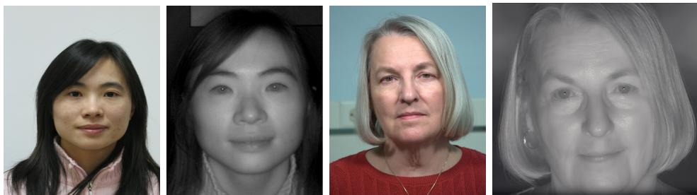
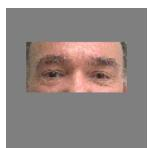
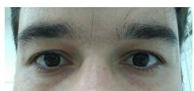
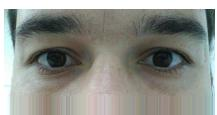
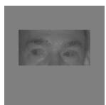
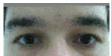
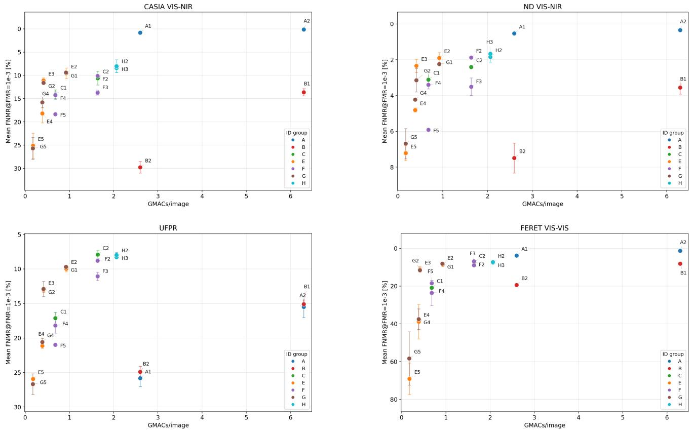
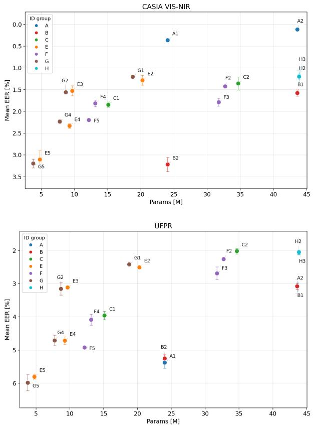
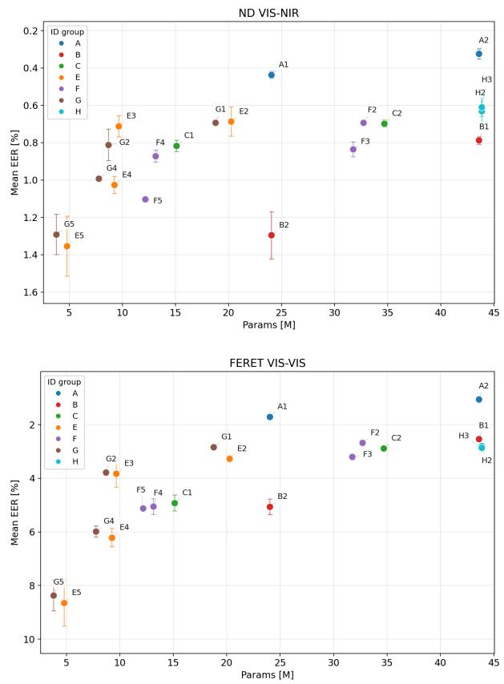

# Efficient Periocular Recognition through Model Scaling and Cross-Spectral VIS–NIR Verification

Fabian Stockhard, Juan E. Tapia, Senior Member, IEEE, and Christoph Busch, Fellow Member, IEEE

Abstract—Periocular recognition can provide a computationally efficient alternative to full-face verification, particularly when facial regions are occluded or image resolution is limited. This work presents AdaEye, a systematic development of input and backbone scaling for periocular verification under visiblespectrum (VIS) and cross-spectral conditions (VIS-NIR). Starting from an AdaFace-style face-recognition framework, we compare full-face models, masked-face inputs, and dedicated 80 × 40 periocular models while varying backbone width and embedding dimensionality. Experiments cover four VIS–VIS and VIS–NIR verification protocols and evaluate biometric accuracy together with computational cost, inference throughput, training memory, template size, and training stability. Direct periocular processing substantially improves deployment efficiency, reducing recognition cost from 6.30 to 1.64 GMACs per image while increasing measured throughput by approximately three times. The results further demonstrate that its effectiveness is strongly linked to the evaluation protocol: direct periocular models deliver improved performance on native UFPR periocular images, while face-based protocols favor retaining more input information. Moderate backbone-width reductions maintain comparable mean verification performance on CASIA and ND-NIVL, indicating that these settings can achieve meaningful computational savings without sacrificing accuracy. Embedding compression further reduces template-storage requirements, with a primarily practical impact on deployment. Multi-seed experiments also identify con figurations requiring careful numerical stabilization, particularly when embedding and backbone reductions are combined. Taken together, these findings provide a reliable basis for selecting compact periocular architectures according to the target protocol and deployment constraints, balancing verification accuracy, computational efficiency, storage requirements, and robustness.

Index Terms—Biometrics, periocular recognition, face recognition, efficient neural networks, heterogeneous recognition, VIS– NIR recognition.

## I. INTRODUCTION

IOMETRIC recognition systems are increasingly required to operate under real-world constraints: partial visibility, limited computational resources, mobile or edge deployment, and heterogeneous acquisition conditions [1]. While full-face recognition achieves high accuracy in controlled settings, it is not always feasible. In scenarios involving occlusion (e.g., masks, make-up, glasses), suboptimal camera framing, privacypreserving data minimization, or dynamic biometric capture (e.g., on-the-move), the periocular region often becomes the most reliable and delivers complementary accessible biometric cues.

The periocular region, encompassing the eyes, eyelids, eyebrows, and surrounding facial skin, offers a compact yet rich biometric trait, bridging the gap between full-face and iris-based recognition. It retains discriminative identity information even when the lower face is obscured, while requiring significantly less acquisition precision than high-resolution iris recognition. In this work, we treat periocular recognition as a reducedinput face recognition problem, rather than a dedicated iris recognition task. Although the iris may be visible within the periocular crop and complementary facial cues are present, we do not assume the availability of iris-recognition-quality texture. Our focus is on robust, efficient recognition using aligned face for periocular crops, particularly in VIS–NIR cross-spectral scenarios, where the input is constrained but sufficient for identity verification.

Based on these limitations, we address two central questions:

1) How do input-region reduction and subsequent scaling of backbone depth, channel width, embedding dimension ality, and final spatial representation affect the accuracyefficiency trade-off in periocular recognition?

2) How do these trade-offs vary across evaluation protocols, operating points, and training seeds, including the reliability of training under a fixed protocol?

The general-purpose EfficientNet network [2] has demonstrated that input resolution, network depth and channel width must be jointly optimized to achieve optimal accuracyefficiency trade-offs across several tasks. Following this principle, we adopt a systematic framework for periocular recognition.

Instead of introducing a new backbone architecture, we develop AdaEye as a dedicated periocular-recognition model. We adapt, modify, and train the AdaFace network from scratch to investigate the effects of key architectural and representational choices. This controlled design enables us to isolate the contribution of each dimension and identify efficient configurations tailored specifically to hardware restricted periocular biometrics. All the models will be available in GitHub upon acceptance.

The contribution of this work is a controlled accuracyefficiency study for periocular recognition:

• A unified AdaEye framework trained from scratch enables fair comparison across full-face, masked periocular, and direct 80 × 40 periocular inputs, demonstrating adaptability to efficient, reduced-input periocular recognition in VIS/NIR.

• Comprehensive evaluation for biometric performance (FNMR@FMR) and key computational metrics, including model parameters, multiply-accumulate operations, inference throughput, training memory footprint, and template size, facilitates direct system comparison.

• Cross-spectral VIS–NIR verification protocols are incorpo rated as a robustness stress test, while the primary focus remains on efficient, reduced-input periocular recognition under real-world constraints.

• Systematic ablation studies evaluate the impact of model scaling across key architectural dimensions: backbone depth, channel width, embedding dimensionality, and spatial bottle neck design, revealing critical trade-offs between efficiency and performance.

The rest of the article is organized as follows: Section II summarizes the state of the art. Section III describes the set of images used, input conditions, and the metrics. Section IV describes our proposal. The experimental framework of this work is then presented in Section V. The discussion is presented in Section VI, and the conclusion of the article in Section VII.

## II. RELATED WORK

Recent border-management technology roadmaps, such as those from European Border and Coast Guard Agency (Frontex), highlight ”biometrics on the move” for future travel as an important operational topic [3]. This initiative motivates the study of robust and efficient recognition methods for semicontrol environments and partially visible biometric inputs.

Modern face recognition is dominated by deep convolutional embeddings trained on large amounts of data using angular-margin losses [4], [5]. One of the most widely used implementations is AdaFace [4], which adapts the classification margin based on estimated image quality and provides strong baselines for face recognition.

Cross-spectral face recognition is important for low-light and biometric-on-the-move applications. Recent lightweight approaches also study how to reduce model complexity under VIS–NIR domain shift [6], [1].

Periocular recognition has been studied as a biometric alternative when the full face is partially unavailable, masked, or difficult to acquire, for example in semi-controlled, mobile, or biometric-on-the-move scenarios.

Classical iris recognition relies on high-quality iris texture, segmentation, normalization, as well as specialized comparison algorithms [7]. This is a different acquisition regime from the aligned face and periocular crops considered here.

The periocular region is not defined by a single universally adopted standard and has no standardized extent. Prior work has noted that the term generally refers to the area around the eye, while exact boundaries vary across studies and datasets [8]. We therefore explicitly define the direct periocular crop used in this paper instead of treating it as a standard crop (Subsection:III-A).

Recent surveys frame the periocular region [9], [10], [11] as a useful cue under partial occlusion, mobile acquisition, unconstrained imaging as well as heterogeneous spectra [12], [9]. Prior work on periocular verification and periocular datasets also shows that the eye region contains useful identity information under mobile and unconstrained conditions [13], [14], [15]. In contrast to work that primarily evaluates existing feature extractors or image enhancement methods, we focus on how much neural network capacity is needed once the input region itself is reduced.

Regarding the data, few high-resolution datasets are available, and some were captured several years ago [16], [17]; as a result, available training data does not represent the real-world scenario in this domain. While being forced to rely on older training data, we can test on current datasets, like UFPRperiocular [14]. It is a native periocular dataset and one of the latest collected in the state of the art.

Regarding the model’s efficiency, based on our review, there is no periocular recognition work that also focuses on the computational complexity of the models. Efficient model [2] design is commonly analyzed in terms of input resolution, network depth, channel width, and computational cost.

The EfficientNet [2] formalized the idea that these dimensions should be scaled jointly rather than independently. Recent ocular-cropping work has also trained CNNs on large-scale face-derived ocular crops and compared architectures such as SqueezeNet, MobileNetV2 as well as ResNet50 [10]. That line of work is close to our motivation, but it does not isolate full-face, masked-periocular as well as direct low-resolution periocular recognition within the same AdaFace-style scaling framework.

Efficiency-oriented periocular work also includes lightweight backbones, quantization, compression as well as mobile periocular authentication. We treat these directions as complementary. Our focus is not post-hoc compression or a new mobile architecture; instead, we ask what recognition-stage compute is saved when the input itself is reduced and the IR-style backbone, embedding size as well as final spatial representation are scaled under a common training protocol.

## III. DATASETS

Several datasets were used in this work; the MS1MV2 [18] dataset is used to train all models. The standard AdaFace validation sets are used for model selection [4]. The CASIA NIR-VIS 2.0 [19], ND-NIVL [20], FERET [21] as well as UFPR-Periocular [14] are used for final verification benchmarks.

The CASIA and ND-NIVL datasets are evaluated using VIS– NIR protocols, FERET provides a VIS–VIS face protocol, while UFPR provides a periocular VIS protocol.

The CASIA NIR-VIS 2.0 database offers pairs of mugshot images and their corresponding Near InfraRed (NIR) and Visible-Spectrum (VIS) images. The images in this database were collected in four recording sessions: 2007 spring, 2009 summer, 2009 fall, and 2010 summer, with the first session identical to the CASIA-HFB database [6].

The ND-NIVL dataset was collected by the University of Notre Dame, USA. The ND-NIVL contains VIS and NIR face images from the same subjects. The capture process was carried out over two semesters (fall 2011 and spring 2012). The VIS images were collected using a Nikon-D90 camera. The Nikon-D90 uses a 23.6 × 15.8 mm CMOS sensor, and the resulting images have a resolution of 4288 × 2848 pixels. The images were acquired using automatic focus settings. All images were acquired under normal indoor lighting at a 5-foot stand-off, with a frontal pose and a neutral expression.

The NIR images were acquired using a Honeywell CFAIRS system. The CFAIRS uses a modified Canon-EOS-50D camera with a 22.3 × 14.9 CMOS sensor. The resulting images have a resolution of $4 7 7 0 \times 3 1 7 7$ . All images were acquired under normal indoor lighting with frontal pose and neutral facial expression. NIR images were acquired at both a $5 \textless f o o t$ and 7-foot stand-off.

TABLE I: Datasets and roles. Counts refer to the data version used in this work when available from the prepared manifests.
<table><tr><td>Dataset</td><td>Role</td><td>Spectrum</td><td>IDs</td><td>Images</td><td>Notes</td></tr><tr><td>MS1MV2</td><td>training</td><td>VIS face</td><td>85,164</td><td>3,804,846</td><td>MTCNN aligned 112 × 112 used for all training runs</td></tr><tr><td>LFW, CFP-FP, AgeDB-30, CALFW, CPLFW</td><td>validation</td><td>VIS face</td><td></td><td>31,000 pairs</td><td>AdaFace model-selection validation set.[4]</td></tr><tr><td>CASIA NIR-VIS 2.0</td><td>test</td><td>VIS/NIR face</td><td>725</td><td>17,345</td><td>VIS-NIR final protocol</td></tr><tr><td>ND-NIVL</td><td>test</td><td>VIS/NIR face</td><td>584</td><td>22,228</td><td>VIS-NIR final protocol</td></tr><tr><td>FERET</td><td>test</td><td>VIS face</td><td>994</td><td>8,564</td><td>VIS-VIS final protocol</td></tr><tr><td>UFPR Periocular</td><td>test</td><td>VIS periocular</td><td>1,122</td><td>16,789</td><td>retained after preprocessing from 16, 830 native periocular images</td></tr></table>

  
Fig. 1: Left: Examples of the CASIA VIS-NIR dataset and Right: Examples of the ND-NIVL VIS-NIR dataset.

The UFPR-Periocular dataset was created to capture images in uncontrolled environments, incorporating realistic noise from factors such as occlusion, blur, and variations in lighting, distance, and angles. To facilitate the capture process, was developed a mobile application that allows participants to collect their own pictures using their smartphones. The dataset contains 16, 830 images of both eyes from 1, 122 subjects. The resolution of the images varies, depending on the mobile devices used to capture the images.

Table I summarizes the datasets used in this work. Figure 1 illustrates an example of the datasets.

## A. Input Definitions

All inputs for AdaEye follow the AdaFace preprocessing convention. MTCNN [22] provides face detections and five landmark locations for alignment and cropping to $1 1 2 \times 1 1 2 .$ Pixel-value normalization is applied separately before network inference. No universally adopted periocular ROI definition fixes the crop location or aspect ratio. The crop was selected as a compact rectangular eye-region input that is compatible with the spatial dimensions of the IR-style backbone and avoids irregular final-layer dimensions.

We explicitly define the direct crop as $y = 2 7 : 6 7 , x = 1 6 :$ 96 in the aligned $1 1 2 \times 1 1 2$ image, resulting in an $8 0 \times 4 0$ input. This compact rectangular crop preserves the eye-region context in the aligned coordinate system and yields regular feature-map dimensions for the IR-style backbone.

For masked-periocular evaluation, the network input remains $1 1 2 \times 1 1 2$ , but all pixels outside the same periocular region are set to zero.

UFPR preprocessing. UFPR contains native, tightly cropped periocular images rather than complete faces. Before detection, each image is centered on a gray canvas (RGB128, 128, 128), adding a border of width $p = \operatorname* { m i n } ( W , H )$ on all four sides, where W and H are the original image dimensions. Padding preserves the original pixels without resizing; the padded image is then processed by the detection and alignment pipeline. When the MTCNN-based path fails, MediaPipe-FaceMesh[23] provides a fallback set of five landmarks. These correspond to the two eyes, nose and two mouth corners; the five MediaPipe landmark indices were selected once by manual comparison with the MTCNN reference locations and remain fixed for all images. The fallback replaces landmark estimation while retaining the same five-point alignment procedure, reference template and 112 × 112 output size.

Historical processing logs show that MTCNN successfully processed 8,397 of 16,830 images (49.893%). MediaPipe recovered a further 8,392 (49.863%), yielding 16,789 usable outputs (99.756%). The remaining 41 images (0.244%) were excluded after both paths failed.

All full-size, masked and direct-periocular evaluations use the same retained images and aligned $1 1 2 \times 1 1 2$ outputs; only the subsequent input definition differs. For UFPR, “full-face” therefore denotes the full-size input condition, not the presence of a complete face. Figure 2 illustrates the transformations for UFPR and the input definitions for ND-NIVL.

## B. Metrics

Given a threshold $\tau ,$ we distinguish between mated and non-mated comparison pairs. Mated pairs correspond to comparisons between images of the same subject, while non-mated pairs correspond to comparisons between different subjects. For a distance-based score, a verification attempt is accepted if $s \leq \tau$ and rejected otherwise. The false non-match rate (FNMR) at threshold τ is defined in Eq. 1.

$$
\mathrm { F N M R } ( \tau ) = \frac { \left| \left\{ \mathrm { m a t e d \ c o m p a r i s o n s \ w i t h } \ s > \tau \right\} \right| } { \left| \left\{ \mathrm { a l l \ m a t e d \ c o m p a r i s o n s } \right\} \right| }\tag{1}
$$

that is, the proportion of mated comparisons that are incorrectly rejected. Conversely, the false match rate (FMR) at threshold τ

  
(a) VIS original

  
(b) VIS periocular masked

  
(f) original aligned

(e) original  
(c) NIR original  
  
(g) AdaFace-PP 112 × 112

(d) NIR periocular masked  
  
(h) AdaFace-PP 80 × 40  
Fig. 2: Input construction examples. Top row: shows ND-NIVL VIS and NIR aligned face images with their corresponding periocular crops. Bottom row: shows a native UFPR periocular image, the UFPR provided aligned version, the AdaFace compatible 112 × 112 image obtained through padded detection and alignment, and the corresponding 80 × 40 periocular input.

is the proportion of non-mated comparisons that are incorrectly accepted, Eq. 2.

$$
\mathrm { F M R } ( \tau ) = \frac { \left| \left\{ \mathrm { n o n - m a t e d ~ c o m p a r i s o n s ~ w i t h ~ } s \leq \tau \right\} \right| } { \left| \left\{ \mathrm { a l l ~ n o n - m a t e d ~ c o m p a r i s o n s } \right\} \right| }\tag{2}
$$

Biometric performance is reported using Equal Error Rate (EER) and False Non-match Rate at fixed False Match Rate (FNMR@FMR). The EER summarizes the thresholdindependent operating point at which the false match rate and the false non-match rate coincide. The FNMR@FMR represents the biometric performance at an operationally relevant security level of maximum acceptance of non-mated comparison trials.

## IV. METHOD

We trained all versions from scratch and refer to those as AdaEye. During training, each model state is saved and used for validation. For the main result tables, we select the model state that maximizes the unweighted mean accuracy over the standard AdaFace validation benchmarks LFW [24], CFP-FP [25], AgeDB-30 [26], CALFW [27] as well as CPLFW [28].

Target evaluation protocols such as CASIA, ND-NIVL, FERET as well as UFPR are only used for testing and not take part of selection criterion. This avoids selecting a model specifically for a single final protocol or a single VIS–NIR dataset.

We use custom exhaustive verification protocols over the retained images, including all eligible mated and non-mated pairs without session-based restrictions or a separate gallery/probe partition; VIS–NIR protocols include only cross-spectral pairs. The same image inventories and pair lists are used for every model and training seed. Table II summarizes the full protocol sizes. VIS–NIR are strictly cross-spectral and contain only VIS–NIR image pairs, not within-spectrum comparisons.

TABLE II: Final verification protocols. All eligible mated and non-mated pairs are used.
<table><tr><td>Protocol</td><td>Mated</td><td>Non-mated</td></tr><tr><td>CASIA VIS-NIR</td><td>87,478</td><td>62,297,636</td></tr><tr><td>ND-NIVL VIS-NIR</td><td>117,696</td><td>46,385,124</td></tr><tr><td>FERET VIS</td><td>57,189</td><td>36,609,577</td></tr><tr><td>UFPR VIS</td><td>117,260</td><td>140,809,606</td></tr></table>

## A. Training protocol

All variants and models are trained from scratch on MS1MV2 dataset under the same optimization protocol: 60 epochs, batch size 512, SGD with momentum 0.9, initial learning rate 0.1, MultiStepLR decay by 0.1 at epochs 18, 30 and 42, mixed-precision training. The main biometric results aggregate successful runs from seeds 42, 50 and 51. B1 and B2 reuse the corresponding A2 and A1 checkpoints for each seed.

Evaluation across seeds assesses both variation in verification performance and training reliability under the fixed training protocol. Biometric results are summarized as mean and sample standard deviation over successful runs among seeds 42, 50 and 51; the tables report the number of contributing runs, n.

The AdaFace loss is used with the parameters $m = 0 . 4 ,$ h = 0.333, s = 64 and $t _ { \alpha } = 0 . 0 1$ . The augmentation probabilities are 0.2 for low-resolution cropping and photometric augmentation. For periocular variants, these augmentations are applied to the aligned 112 × 112 input before extracting the fixed periocular crop. Weight decay of $5 \cdot 1 0 ^ { - 4 } $ is applied to convolutional, linear, and classification-head parameters, while batch-normalization parameters are excluded.

## B. Scaling Axes and Experiment Groups

The experiments are organized using letters from A to K to separate input-region effects from architectural capacity effects. C2 serves as the baseline for experiments E/F/G/H. Table IV lists all model identifiers, while this section defines the scaling axes used to construct them. This separation is important because the goal is not to propose a new backbone, but to quantify how much depth, channel width, embedding dimensionality, and late spatial capacity remain necessary once the input is restricted to the periocular region. Each number aside to the letter represents some change in the model compared with the previous one (i.e, C1 and C2, the change is the backbone used).

Input-region scaling compares three cases: 1) full-face 112× 112 inputs, 2) masked-periocular 112 × 112 inputs and 3) direct 80 × 40 periocular inputs. The masked-periocular setting uses the same full-size network input as the full-face model but suppresses all pixels outside the fixed periocular ROI. It therefore measures whether a full-face model can exploit periocular information, but it does not reduce recognition-stage computation. The direct periocular setting crops the input area and reduces the input size.

The channel-width scaling is implemented as a uniform backbone width multiplier. The multiplier is applied to the stem and all residual stages, followed by rounding to channel counts divisible by 8.

The residual block counts and spatial downsampling pattern remain unchanged, so width scaling affects representational channel capacity without changing depth or the final featuremap size. The resulting channel plans are given in Table III.

TABLE III: Backbone channel plans for width scaling. The multiplier is applied to the stem and all residual stages; channel counts are rounded to multiples of 8.
<table><tr><td>Width</td><td>Stem</td><td>Stage 1</td><td>Stage 2</td><td>Stage 3</td><td>Stage 4</td></tr><tr><td>1.00</td><td>64</td><td>64</td><td>128</td><td>256</td><td>512</td></tr><tr><td>0.75</td><td>48</td><td>48</td><td>96</td><td>192</td><td>384</td></tr><tr><td>0.50</td><td>32</td><td>32</td><td>64</td><td>128</td><td>256</td></tr></table>

Depth scaling compares IR-50 and IR-18 backbones. The IR-50 variants use residual stage depths of [3, 4, 14, 3], while the IR-18 variants use [2, 2, 2, 2]. In both cases, the same stage layout is kept, so depth changes the number of residual units but not the input definition or recognition loss.

Embedding scaling changes the final embedding dimension ality from 512 to 256 or 128. This directly reduces template size and the final projection layer, while leaving most convolutional computation unchanged.

Projections, for the default 80 × 40 architecture, the final feature map before the embedding projection is $3 \times 5$ . This strongly reduces the final projection from 12.85M parameters in the full-face IR-50 reference to 3.93M parameters in the direct periocular IR-50 baseline.

Spatial Representation: It disables the final downsampling step to retain a larger 5×10 map, increasing the final projection to 13.11M parameters and thereby testing whether the reduced, input-size-aligned periocular architecture creates an overly narrow final-projection bottleneck.

Moreover, it keeps this larger final map and uses dilation in the final stage to preserve a larger effective receptive field under the modified downsampling pattern. The G and K groups combine width and embedding reductions; K is intentionally aggressive and is used to identify the convergence boundary of the fixed training protocol. Table IV summarizes all the experiment definitions ordered by identifier from A to K.

## V. EXPERIMENT AND RESULTS

Inference throughput is measured on an NVIDIA H100 NVL using PyTorch 2.4.1, CUDA 12.1 and automatic mixed precision where applicable. In Table V, the column Images/s@512 denotes median inference throughput at batch size 512 using synthetic tensors, model evaluation mode, no gradient tracking, and CUDA-event timing. Measurements use 100 warm-up iterations followed by three measured repeats of 300 iterations each. Dataloader, image decoding, detection, alignment and crop generation are excluded.

## A. Computational performance

Because computational performance is relevant to this study, we report Giga Multiply-Accumulate Operations (GMACs) per image, inference throughput, inference parameter count, Ada-Eye training-head size, peak allocated training memory and template size. These values refer to the recognition network after successful detection, alignment, and ROI extraction. They do not include the upstream cost of face detection, landmark localization, padding-based fallback preprocessing, or crop generation. One MAC denotes one multiply-accumulate operation.

The GMACs are counted for convolutional and linear layers of the inference embedding extractor and exclude the AdaEye classification head used during training. The FLOP counts are convention-dependent and would be twice the MAC count under the common multiply-plus-add convention; we therefore report the GMACs as the architecture-level compute measure.

The Parameter counts distinguish between the deployed recognition model and the training-only AdaEye classification head. Inference parameters include the backbone, optional post-body head and embedding projection. The AdaEye head contains $d _ { \mathrm { e m b } } \times N _ { \mathrm { c l s } }$ parameters, where $d _ { \mathrm { e m b } }$ is the embedding dimensionality and $N _ { \mathrm { c l s } } ~ = ~ 8 5$ ,164 for MS1MV2. The total number of training parameters is therefore the sum of inference parameters and AdaEye head parameters, but only the inference parameters remain in the deployed embedding extractor.

Peak train GB reports peak CUDA allocated memory, not reserved caching-allocator memory, during synthetic batchsize-512 training steps with automatic mixed precision. The training step includes the recognition model, AdaEye head, loss, backward pass and optimizer update.

Template bytes denote the raw uncompressed FP32 embedding payload, computed as $d _ { \mathrm { e m b } } \times 4$ bytes, excluding identifiers, metadata, index structures, encryption, compression and filesystem overhead.

Table V summarizes the computational profile of all model variants from A to K. The results show a trade-off among inference model size, GMACs, inference throughput, peak allocated training memory, and template size. Models with the highest throughput, such as E5 (101,485 images/s@512) and G5 (101,561 images/s@512), are also among the smallest in inference parameter count and computational demand. However, increasing capacity from E5 to A1 or H2 substantially reduces inference throughput, even when the template size remains unchanged.

## B. Accuracy-Efficiency Overview

Tables VI-IX report biometric performance based on EER and FNMR at fixed FMR operating points for each evaluation protocol. Full-face IR50 remains the strongest VIS–NIR reference, but it is also the most computationally expensive model.

Masked-periocular full-face baselines remain strong, yet they retain full $1 1 2 \times 1 1 2$ network cost. Direct 80 × 40 periocular models substantially reduce computation. The IR50 periocular baseline reduces the MAC count from 6.30 GMACs to 1.64 GMACs and increases inference throughput by approximately three times, while still retaining useful verification performance. The UFPR protocol is particularly important because it is a native periocular dataset; here, the dedicated periocular baseline improves over the full-face reference. Checkpoints use the combined standard validation score.

TABLE IV: Experiment definitions ordered by identifier. All models use the same AdaEye training protocol unless indicated by the experiment identifier. Projection parameters refer to the final linear embedding projection.
<table><tr><td>ID Input</td><td></td><td>Resolution</td><td>Backbone</td><td>Width Embedding</td><td></td><td>Final map Stage4</td><td></td><td>Proj. [M] Notes</td><td></td></tr><tr><td></td><td>A1 full-face</td><td> $1 1 2 \times 1 1 2$ </td><td>IR-18</td><td>1.00</td><td>512</td><td> $7 \times 7$ </td><td>default</td><td>12.85</td><td></td></tr><tr><td></td><td>A2 full-face</td><td> $1 1 2 \times 1 1 2$ </td><td>IR-50</td><td>1.00</td><td>512</td><td>7×7</td><td>default</td><td>12.85</td><td></td></tr><tr><td>B1</td><td>masked periocular 112 × 112</td><td></td><td>IR-50</td><td>1.00</td><td>512</td><td> $\overline { { 7 \times 7 } }$ </td><td>default</td><td>12.85</td><td>A2 model weights, masked input</td></tr><tr><td>B2</td><td>masked periocular 112 × 112</td><td></td><td>IR-18</td><td>1.00</td><td>512</td><td>7 × 7</td><td>default</td><td>12.85</td><td>A1 model weights, masked input</td></tr><tr><td>C1</td><td>periocular</td><td> $\overline { { 8 0 \times 4 0 } }$ </td><td>IR-18</td><td>1.00</td><td>512</td><td>3 × 5</td><td>default</td><td>3.93</td><td></td></tr><tr><td>C2</td><td>periocular</td><td>80 × 40</td><td>IR-50</td><td>1.00</td><td>512</td><td>3×5</td><td>default</td><td>3.93</td><td>baseline for E/F/G/H</td></tr><tr><td>E2</td><td>periocular</td><td> $8 0 \times 4 0$ </td><td>IR-50</td><td>0.75</td><td>512</td><td>3×5</td><td>default</td><td>2.95</td><td></td></tr><tr><td>E3</td><td>periocular</td><td> $8 0 \times 4 0$ </td><td>IR-50</td><td>0.50</td><td>512</td><td>3 × 5</td><td>default</td><td>1.97</td><td></td></tr><tr><td>E4</td><td>periocular</td><td> $8 0 \times 4 0$ </td><td>IR-18</td><td>0.75</td><td>512</td><td>3 × 5</td><td>default</td><td>2.95</td><td></td></tr><tr><td>E5</td><td>periocular</td><td> $8 0 \times 4 0$ </td><td>IR-18</td><td>0.50</td><td>512</td><td>3 × 5</td><td>default</td><td>1.97</td><td></td></tr><tr><td>F2</td><td>periocular</td><td> $8 0 \times 4 0$ </td><td>IR-50</td><td>1.00</td><td>256</td><td>3 × 5</td><td>default</td><td>1.97</td><td></td></tr><tr><td>F3</td><td>periocular</td><td>80 × 40</td><td>IR-50</td><td>1.00</td><td>128</td><td>3 × 5</td><td>default</td><td>0.98</td><td></td></tr><tr><td>F4</td><td>periocular</td><td> $8 0 \times 4 0$ </td><td>IR-18</td><td>1.00</td><td>256</td><td>3 × 5</td><td>default</td><td>1.97</td><td></td></tr><tr><td>F5</td><td>periocular</td><td> $8 0 \times 4 0$ </td><td>IR-18</td><td>1.00</td><td>128</td><td>3× 5</td><td>default</td><td>0.98</td><td></td></tr><tr><td>G1</td><td>periocular</td><td> $8 0 \times 4 0$ </td><td>IR-50</td><td>0.75</td><td>256</td><td>3 × 5</td><td>default</td><td>1.47</td><td></td></tr><tr><td>G2</td><td>periocular</td><td>80 × 40</td><td>IR-50</td><td>0.50</td><td>256</td><td>3 × 5</td><td>default</td><td>0.98</td><td></td></tr><tr><td>G4</td><td>periocular</td><td>80 × 40</td><td>IR-18</td><td>0.75</td><td>256</td><td>3 × 5</td><td>default</td><td>1.47</td><td></td></tr><tr><td>G5</td><td>periocular</td><td>80 × 40</td><td>IR-18</td><td>0.50</td><td>256</td><td>3 × 5</td><td>default</td><td>0.98</td><td></td></tr><tr><td>H2</td><td>periocular</td><td>80 × 40</td><td>IR-50</td><td>1.00</td><td>512</td><td>5 × 10</td><td>no downsample</td><td>13.11</td><td></td></tr><tr><td>H3</td><td>periocular</td><td>80 × 40</td><td>IR-50</td><td>1.00</td><td>512</td><td>5 × 10</td><td>no downsample, dilated 13.11</td><td></td><td></td></tr><tr><td>K2</td><td>periocular</td><td>80 × 40</td><td>IR-50</td><td>0.75</td><td>128</td><td>3 × 5</td><td>default</td><td>0.74</td><td>aggressive compression</td></tr><tr><td>K3</td><td>periocular</td><td>80 × 40</td><td>IR-50</td><td>0.50</td><td>128</td><td>3 × 5</td><td>default</td><td>0.49</td><td>aggressive compression</td></tr><tr><td>K4</td><td>periocular</td><td>80 × 40</td><td>IR-18</td><td>0.75</td><td>128</td><td>3 × 5</td><td>default</td><td>0.74</td><td>aggressive compression</td></tr><tr><td>K5</td><td>periocular</td><td>80 × 40</td><td>IR-18</td><td>0.50</td><td>128</td><td>3 × 5</td><td>default</td><td>0.49</td><td>aggressive compression</td></tr></table>

TABLE V: Computational performance by experiment identifier. GMACs and Images/s@512 refer to recognition-stage inference only. Inference parameters exclude the AdaEye classification head, which is reported separately because it is used only during training. Peak train GB is peak CUDA allocated memory during synthetic batch-size-512 training steps. Template bytes assume uncompressed FP32 embedding size. C2 is the baseline.
<table><tr><td colspan="6">ID GMACs Images/s@512 Inf. params [M] AdaEye head [M] Peak train [GB] Template bytes</td></tr><tr><td>A1</td><td>2.60</td><td>15,014</td><td>24.02</td><td>43.60</td><td>15.08 2,048</td></tr><tr><td>A2</td><td>6.30</td><td>8,107</td><td>43.59</td><td>43.60</td><td>25.04 2,048</td></tr><tr><td>B1</td><td>6.30</td><td>8,107</td><td>43.59</td><td>43.60</td><td>25.04 2,048</td></tr><tr><td>B2</td><td>2.60</td><td>15,014</td><td>24.02</td><td>43.60</td><td>15.08 2,048</td></tr><tr><td>C1</td><td>0.68</td><td>50,827</td><td>15.11</td><td>43.60</td><td>5.30 2,048</td></tr><tr><td>C2</td><td>1.64</td><td>25,295</td><td>34.67</td><td>43.60</td><td>7.94 2,048</td></tr><tr><td>E2</td><td>0.92</td><td>32,905</td><td>20.25</td><td>43.60</td><td>6.40 2,048</td></tr><tr><td>E3</td><td>0.41</td><td>50,062</td><td>9.66</td><td>43.60</td><td>4.88 2,048</td></tr><tr><td>E4</td><td>0.38</td><td>65,463</td><td>9.24</td><td>43.60</td><td>4.43 2,048</td></tr><tr><td>E5</td><td>0.17</td><td>101,485</td><td>4.76</td><td>43.60</td><td>3.58 2,048</td></tr><tr><td>F2</td><td>1.63</td><td>25,266</td><td>32.71</td><td>21.80</td><td>7.81 1,024</td></tr><tr><td>F3</td><td>1.63</td><td>25,259</td><td>31.72</td><td>10.90</td><td>7.73 512</td></tr><tr><td>F4</td><td>0.68</td><td>51,206</td><td>13.14</td><td>21.80</td><td>5.17 1,024</td></tr><tr><td>F5</td><td>0.68</td><td>51,202</td><td>12.16</td><td>10.90</td><td>5.10 512</td></tr><tr><td>G1</td><td>0.92</td><td>33,129</td><td>18.77</td><td>21.80</td><td>6.27 1,024</td></tr><tr><td>G2</td><td>0.41</td><td>44,010</td><td>8.68</td><td>21.80</td><td>7.00 1,024</td></tr><tr><td>G4</td><td>0.38</td><td>65,313</td><td>7.76</td><td>21.80</td><td>4.31 1,024</td></tr><tr><td>G5</td><td>0.17</td><td>101,561</td><td>3.78</td><td>21.80</td><td>3.45 1,024</td></tr><tr><td>H2</td><td>2.06</td><td>23,497</td><td>43.85</td><td>43.60</td><td>8.41 2,048</td></tr><tr><td>H3</td><td>2.06</td><td>23,843</td><td>43.85</td><td>43.60</td><td>8.41 2,048</td></tr><tr><td>K2</td><td>0.92</td><td>33,163</td><td>18.04</td><td>10.90</td><td>6.20 512</td></tr><tr><td>K3</td><td>0.41</td><td>50,213</td><td>8.19</td><td>10.90</td><td>4.68 512</td></tr><tr><td>K4</td><td>0.38</td><td>65,293</td><td>7.03</td><td>10.90</td><td>4.24 512</td></tr><tr><td>K5</td><td>0.17</td><td>101,629</td><td>3.29</td><td>10.90</td><td>3.39 512</td></tr></table>

Figures 3 and 4 visualize complementary accuracy-efficiency trade-offs. Color points show means and error bars show sample standard deviations over successful runs; no standard deviation is available for a single successful run. Numerically failed runs are excluded from biometric averages.

Tables VI-IX report the number of successful runs. The plots show that a substantial part of the computational reduction is obtained simply by moving from full-face $1 1 2 \times 1 1 2$ inputs to direct $8 0 \times 4 0$ periocular inputs. Further reductions in width and embedding size provide additional savings, but the biometric cost depends on the target protocol and operating point.

## C. Input Reduction: Masked Reuse versus Direct Periocular Training

The input-region variants separate information content from recognition-stage efficiency. The full-face references A1 and A2 retain the original $1 1 2 \times 1 1 2$ recognition input.

B1 and B2 evaluate a practical reuse baseline: the same fullface-trained model weights are evaluated with all pixels outside the periocular ROI set to zero (masked). This evaluation is not a matched training study of masked $1 1 2 \times 1 1 2$ inputs versus direct $8 0 \times 4 0$ crops, because B1 and B2 reuse full-face-trained weights whereas C1 (IR-18) and C2 (IR-50) are trained directly on periocular crops. Instead, it asks whether simple full-face recognizer reuse remains competitive when only the eye region is visible.

  
Fig. 3: FNMR@ $\scriptstyle \mathrm { F M R = 1 0 ^ { - 3 } }$ versus computational cost. Lower FNMR and lower GMACs are better. The plots emphasize operational behavior at a fixed low-FMR point and show how direct periocular models compare with masked full-face reuse.

Under this protocol, direct periocular training is usually preferable to masked full-face reuse. For IR-50, C2 improves over B1 on CASIA VIS–NIR, ND-NIVL VIS–NIR and UFPR while reducing recognition cost from 6.30 to 1.64 GMACs and increasing inference throughput from 8, 107 to 25, 295 images.

The FERET VIS–VIS is the main EER exception, where B1 remains stronger; at $\mathrm { F M R } { = } 1 0 ^ { - 3 }$ , however, the FNMR values are nearly tied. For IR-18, C1 improves EER over B2 on all evaluated protocols and also lowers FNMR at $\mathrm { F M R } { = } 1 0 ^ { - 3 }$ on CASIA, ND-NIVL and UFPR, but not FERET while reducing cost from 2.60 to 0.68 GMACs.

These results suggest that direct periocular models are not only cheaper because they remove unused input area; they are also better adapted to the reduced visible region than full face recognizers evaluated under zero-masked inputs. A likely explanation is train-test mismatch: the masked baselines are trained on complete aligned faces but evaluated with most non-periocular pixels suppressed, whereas the direct models observe compact periocular inputs during both training and evaluation.

## D. Depth, Width and Embedding Scaling

As defined, depth scaling changes the number of residual units while preserving the input definition and loss. The IR-18 periocular model (C1) is much faster than the IR-50 periocular baseline (C2), but it loses accuracy on most protocols. Width scaling provides a smoother trade-off than switching directly from IR-50 to IR-18. Because the width multiplier reduces channel counts throughout the stem and residual stages, it lowers both parameters and convolutional MACs substantially. The width 0.75 model (E2) reduces parameters by about 42% relative to C2 and reduces MACs by about 44%, while preserving competitive VIS–NIR performance. The width 0.5 model (E3) is considerably cheaper, but shows a larger degradation on UFPR and FERET.

Embedding-size reduction directly reduces template size and the parameters and MACs of the final fully connected projection. The convolutional backbone remains unchanged, so the reduction in total inference MACs is comparatively small. This is visible in F2 and F3: reducing the embedding from 512 to 256 or 128 dimensions approximately halves or quarters the template size, while throughput remains close to the baseline. The 256-dimensional model (F2) is a useful trade-off; the 128-dimensional model (F3) remains trainable but exhibits a clearer loss in accuracy.

  
Fig. 4: EER versus inference parameter count. Lower EER and fewer parameters are better. The plots separately represen capacity from image-level MAC cost, including the masked full-face baselines that retain full-face model parameters.

## E. Combined Reductions and Failure Boundary

The combined width and embedding reductions show where the model begins to reach the practical lower bound. The G1, using width 0.75 and a 256-dimensional embedding, is one of the most attractive trade-offs: it reduces MACs to 0.92 GMACs and the template to 1, 024 bytes while keeping EER close to the stronger periocular models. The G2 further reduces width to 0.5 and remains usable, but performance decreases.

More aggressive combinations with 128-dimensional embeddings and reduced width did not converge reliably in our controlled training setup. We report these runs explicitly as diverged cases, marked DVG in the tables, rather than omitting them. In these configurations, training became numerically unstable before a valid model state could be selected, so no verification metrics are reported. They are useful because they indicate that the reduced periocular input does not support arbitrary compression under the fixed AdaEye training protocol.

Evaluation across seeds reveals numerical instability in less aggressively reduced configurations as well. Across the 18 configurations evaluated using seeds 42, 50 and 51, 45 runs completed successfully and eight numerical failures were observed: F2 and F3 at seed 51, F5 and G1 at seeds 50 and 51, G2 at seed 50, and G4 at seed 51. All three seeds in the A, C, E and H groups completed successfully. These findings distinguish verification performance after successful training from training reliability under the fixed protocol.

Failed runs contribute no verification scores. Consequently,

F3, G2 and G4 have two contributing runs, whereas F5 and G1 contribute only the result from seed 42. For F2, only seed 50 contributes within the selected seed set.

## F. Final Spatial Representation

The H2 and H3 evaluate whether the default late 3×5 spatial representation is too restrictive for 80×40 inputs. These models increase parameters and MACs relative to the direct periocular baseline, but improve mean EER and FNMR at $\mathrm { F M R } { = } 1 0 ^ { - 3 }$ on CASIA and ND-NIVL relative to C2, without a consistent improvement on UFPR. This suggests that the spatial bottleneck is relevant for low-resolution periocular inputs: preserving more late-stage spatial information can improve recognition, but it moves the model away from the most efficient operating point.

## VI. DISCUSSION

The results distinguish three properties of a reduced recognition model: biometric performance after successful training, recognition-stage computational cost, and reliability of training under the fixed protocol. These properties need not improve together. Reducing input size or model capacity saves resources, but the resulting accuracy changes depend on the scaling axis, dataset and operating point.

## A. Scaling Effects and Protocol Dependence

Moving from the full-face IR-50 reference A2 to the direct periocular baseline C2 reduces recognition cost from 6.30 to

TABLE VI: CASIA VIS–NIR biometric performance (%). All eligible mated and non-mated pairs. Each cell shows the mean (top) and standard deviation (bottom) over n successful runs; means unavailable for n = 1. C2 is the baseline.
<table><tr><td>ID</td><td>n</td><td>EER</td><td colspan="4">FNMR at FMR</td></tr><tr><td></td><td></td><td></td><td> $1 0 ^ { - 1 }$ </td><td> $1 0 ^ { - 2 }$ </td><td> $1 0 ^ { - 3 }$ </td><td> $1 0 ^ { - 4 }$ </td></tr><tr><td></td><td></td><td>0.360</td><td>0.052</td><td>0.177</td><td>0.799</td><td>2.652</td></tr><tr><td>A1</td><td>3</td><td>±0.018</td><td>±0.004</td><td>±0.015</td><td>±0.075</td><td>±0.173</td></tr><tr><td></td><td></td><td>0.117</td><td>0.012</td><td>0.026</td><td>0.132</td><td>0.697</td></tr><tr><td>A2</td><td>3</td><td>±0.010</td><td>±0.002</td><td>±0.006</td><td>±0.021</td><td>±0.091</td></tr><tr><td></td><td></td><td>1.576</td><td>0.163</td><td>2.442</td><td>13.638</td><td>37.656</td></tr><tr><td>B1</td><td>3</td><td>±0.071</td><td>±0.026</td><td>±0.162</td><td>±0.764</td><td>±2.208</td></tr><tr><td></td><td></td><td>3.218</td><td>0.814</td><td>8.701</td><td>29.771</td><td>57.985</td></tr><tr><td>B2</td><td>3</td><td>±0.160</td><td>±0.126</td><td>±0.334</td><td>±1.227</td><td>±1.646</td></tr><tr><td></td><td></td><td>1.844</td><td>0.362</td><td>3.204</td><td>14.108</td><td>35.781</td></tr><tr><td>Cl</td><td>3</td><td>±0.061</td><td>±0.061</td><td>±0.121</td><td>±0.993</td><td>±0.822</td></tr><tr><td></td><td></td><td>1.358</td><td>0.120</td><td>1.872</td><td>10.603</td><td>28.651</td></tr><tr><td>C2</td><td>3</td><td>±0.152</td><td>±0.027</td><td>±0.411</td><td>±1.453</td><td>±1.893</td></tr><tr><td></td><td></td><td>1.283</td><td>0.127</td><td>1.658</td><td>9.562</td><td>28.690</td></tr><tr><td>E2</td><td>3</td><td>±0.113</td><td>±0.015</td><td>±0.307</td><td>±1.151</td><td>±1.555</td></tr><tr><td></td><td></td><td>1.524</td><td>0.194</td><td>2.272</td><td>11.101</td><td>30.734</td></tr><tr><td>E3</td><td>3</td><td>±0.113</td><td>±0.022</td><td>±0.243</td><td>±0.585</td><td>±1.424</td></tr><tr><td></td><td></td><td>2.332</td><td>0.492</td><td>4.657</td><td>18.157</td><td>43.215</td></tr><tr><td>E4</td><td>3</td><td>±0.059</td><td>±0.023</td><td>±0.201</td><td>±2.067</td><td>±3.826</td></tr><tr><td></td><td></td><td>3.102</td><td>0.934</td><td>7.233</td><td>25.109</td><td>50.002</td></tr><tr><td>E5</td><td>3</td><td>±0.200</td><td>±0.160</td><td>±0.966</td><td>±2.695</td><td>±4.071</td></tr><tr><td>F2</td><td>1</td><td>1.424</td><td>0.176</td><td>1.884</td><td>10.115</td><td>28.787</td></tr><tr><td></td><td></td><td>1.787</td><td>0.251</td><td>2.939</td><td>13.717</td><td>35.630</td></tr><tr><td>F3</td><td>2</td><td>±0.090</td><td>±0.008</td><td>±0.339</td><td>±0.514</td><td>±1.591</td></tr><tr><td></td><td></td><td>1.813</td><td>0.310</td><td>3.118</td><td>14.223</td><td>36.026</td></tr><tr><td>F4</td><td>3</td><td>±0.076</td><td>±0.023</td><td>±0.371</td><td>±0.691</td><td>±1.203</td></tr><tr><td>F5</td><td>1</td><td>2.196</td><td>0.351</td><td>4.302</td><td>18.365</td><td>43.611</td></tr><tr><td>G1</td><td>1</td><td>1.205</td><td>0.134</td><td>1.515</td><td>9.384</td><td>27.794</td></tr><tr><td></td><td></td><td>1.558</td><td>0.198</td><td>2.289</td><td>11.587</td><td>31.899</td></tr><tr><td>G2</td><td>2</td><td>±0.008</td><td>±0.026</td><td>±0.027</td><td>±0.444</td><td>±0.992</td></tr><tr><td></td><td></td><td>2.230</td><td>0.458</td><td>4.151</td><td>15.778</td><td>38.186</td></tr><tr><td>G4</td><td>2</td><td>±0.049</td><td>±0.012</td><td>±0.061</td><td>±1.179</td><td>±1.162</td></tr><tr><td></td><td></td><td>3.195</td><td>1.033</td><td>7.618</td><td>25.674</td><td>51.651</td></tr><tr><td>G5</td><td>3</td><td>±0.101</td><td>±0.143</td><td>±0.584</td><td>±2.365</td><td>±3.965</td></tr><tr><td></td><td></td><td>1.201</td><td>0.124</td><td>1.438</td><td>8.419</td><td>25.206</td></tr><tr><td>H2</td><td>3</td><td>±0.055</td><td>±0.025</td><td>±0.160</td><td>±0.865</td><td>±2.041</td></tr><tr><td></td><td></td><td>1.198</td><td>0.138</td><td>1.396</td><td>8.017</td><td>24.146</td></tr><tr><td>H3</td><td>3</td><td>±0.139</td><td>±0.047</td><td>±0.286</td><td>±1.366</td><td>±3.834</td></tr><tr><td>K2-K5</td><td></td><td colspan="5">DVG (historical training failures)</td></tr></table>

1.64 GMACs/image, but entails substantial accuracy losses on the face-based protocols, especially at stringent FMRs. UFPR behaves differently: C2 improves mean EER from 3.083% to 2.020%. Since UFPR contains native periocular images, its full-size input is not a complete face; this result concerns adaptation to periocular content rather than a general advantage over full-face recognition.

The scaling axes affect different resources. Width reduction lowers both parameter count and convolutional cost, whereas smaller embeddings primarily reduce template storage and the training classification head. For example, reducing width from C2 to E2 lowers GMACs by approximately 44%. Mean EER changes from 1.358% to 1.283% on CASIA and from 0.697% to 0.687% on ND-NIVL, but increases from 2.020% to 2.505% on UFPR and from 2.880% to 3.273% on FERET. These differences do not establish statistical superiority, but show that reductions do not uniformly worsen every metric. Conversely, enlarging the final spatial representation in H2/H3 improves mean EER and FNMR at $\mathrm { F M R } { = } 1 0 ^ { - 3 }$ on CASIA and ND-NIVL relative to C2, without a consistent advantage on UFPR.

Training uses VIS data, yet the reduced models retain useful verification performance on both VIS–NIR protocols. The width-scaling results therefore do not suggest a uniformly greater penalty on the evaluated cross-spectral protocols.

TABLE VII: ND-NIVL VIS–NIR biometric performance (%). All eligible mated and non-mated pairs. Each cell shows the mean (top) and standard deviation (bottom) over n successful runs; means unavailable for n = 1. C2 is the baseline.
<table><tr><td>ID</td><td>n</td><td>EER</td><td colspan="4">FNMR at FMR</td></tr><tr><td></td><td></td><td></td><td> $1 0 ^ { - 1 }$ </td><td> $1 0 ^ { - 2 }$ </td><td> $1 0 ^ { - 3 }$ </td><td> $1 0 ^ { - 4 }$ </td></tr><tr><td></td><td></td><td>0.436</td><td>0.304</td><td>0.395</td><td>0.530</td><td>0.740</td></tr><tr><td>A1</td><td>3</td><td>±0.020</td><td>±0.017</td><td>±0.019</td><td>±0.014</td><td>±0.016</td></tr><tr><td></td><td></td><td>0.324</td><td>0.268</td><td>0.307</td><td>0.346</td><td>0.407</td></tr><tr><td>A2</td><td>3</td><td>±0.027</td><td>±0.030</td><td>±0.025</td><td>±0.042</td><td>±0.050</td></tr><tr><td></td><td></td><td>0.787</td><td>0.303</td><td>0.688</td><td>3.549</td><td>14.811</td></tr><tr><td>B1</td><td>3</td><td>±0.021</td><td>±0.027</td><td>±0.019</td><td>±0.367</td><td>±1.340</td></tr><tr><td></td><td></td><td>1.296</td><td>0.420</td><td>1.561</td><td>7.491</td><td>23.307</td></tr><tr><td>B2</td><td>3</td><td>±0.127</td><td>±0.027</td><td>±0.258</td><td>±0.838</td><td>±1.675</td></tr><tr><td></td><td></td><td>0.817</td><td>0.332</td><td>0.740</td><td>3.108</td><td>13.011</td></tr><tr><td>C1</td><td>3</td><td>±0.030</td><td>±0.010</td><td>±0.039</td><td>±0.351</td><td>±1.474</td></tr><tr><td></td><td></td><td>0.697</td><td>0.295</td><td>0.580</td><td>2.402</td><td>9.482</td></tr><tr><td>C2</td><td>3</td><td>±0.019</td><td>±0.026</td><td>±0.038</td><td>±0.030</td><td>±0.610</td></tr><tr><td>E2</td><td></td><td>0.687</td><td>0.309</td><td>0.590</td><td>1.901</td><td>8.526</td></tr><tr><td></td><td>3</td><td>±0.079</td><td>±0.017</td><td>±0.088</td><td>±0.301</td><td>±0.927</td></tr><tr><td></td><td></td><td>0.711</td><td>0.311</td><td>0.615</td><td>2.342</td><td>11.361</td></tr><tr><td>E3</td><td>3</td><td>±0.056</td><td>±0.015</td><td>±0.052</td><td>±0.377</td><td>±1.299</td></tr><tr><td></td><td></td><td>1.026</td><td>0.380</td><td>1.040</td><td>4.809</td><td>15.647</td></tr><tr><td>E4</td><td>3</td><td>±0.045</td><td>±0.020</td><td>±0.067</td><td>±0.118</td><td>±0.905</td></tr><tr><td></td><td></td><td>1.353</td><td>0.470</td><td>1.684</td><td>7.219</td><td>20.987</td></tr><tr><td>E5</td><td>3</td><td>±0.161</td><td>±0.026</td><td>±0.342</td><td>±0.408</td><td>±1.904</td></tr><tr><td>F2</td><td>1</td><td>0.692</td><td>0.333</td><td>0.597</td><td>1.876</td><td>7.800</td></tr><tr><td></td><td></td><td>0.835</td><td>0.277</td><td>0.731</td><td>3.508</td><td>13.779</td></tr><tr><td>F3</td><td>2</td><td>±0.041</td><td>±0.014</td><td>±0.088</td><td>±0.491</td><td>±2.145</td></tr><tr><td></td><td></td><td>0.871</td><td>0.363</td><td>0.814</td><td>3.401</td><td>14.081</td></tr><tr><td>F4</td><td>3</td><td>±0.032</td><td>±0.051</td><td>±0.051</td><td>±0.228</td><td>±0.693</td></tr><tr><td>F5</td><td>1</td><td>1.103</td><td>0.325</td><td>1.185</td><td>5.916</td><td>18.349</td></tr><tr><td>G1</td><td>1</td><td>0.693</td><td>0.273</td><td>0.593</td><td>2.241</td><td>9.086</td></tr><tr><td></td><td></td><td>0.811</td><td>0.329</td><td>0.721</td><td>3.140</td><td>12.720</td></tr><tr><td>G2</td><td>2</td><td>±0.084</td><td>±0.033</td><td>±0.110</td><td>±0.658</td><td>±2.471</td></tr><tr><td></td><td></td><td>0.992</td><td>0.359</td><td>0.988</td><td>4.223</td><td>15.385</td></tr><tr><td>G4</td><td>2</td><td>±0.004</td><td>±0.025</td><td>±0.009</td><td>±0.049</td><td>±0.683</td></tr><tr><td></td><td></td><td>1.291</td><td>0.457</td><td>1.534</td><td>6.689</td><td>20.255</td></tr><tr><td>G5</td><td>3</td><td>±0.108</td><td>±0.032</td><td>±0.221</td><td>±0.845</td><td>±0.837</td></tr><tr><td></td><td></td><td>0.631</td><td>0.292</td><td>0.533</td><td>1.843</td><td>8.471</td></tr><tr><td>H2</td><td>3</td><td>±0.077</td><td>±0.008</td><td>±0.083</td><td>±0.285</td><td>±0.721</td></tr><tr><td></td><td></td><td>0.609</td><td>0.290</td><td>0.493</td><td>1.670</td><td>7.023</td></tr><tr><td>H3</td><td>3</td><td>±0.050</td><td>±0.009</td><td>±0.043</td><td>±0.019</td><td>±0.610</td></tr><tr><td>K2-K5</td><td></td><td colspan="4">DVG (historical training failures)</td><td></td></tr></table>

However, the VIS–VIS and VIS–NIR protocols use different datasets, so these comparisons do not isolate spectral mismatch from other dataset characteristics. Robustness also depends on the operating point: FERET-E3 has an EER of 3.827±0.506%, but FNMR at FMR=10−4 of 55.664 ± 30.611%. Stability at EER should therefore not be interpreted as stability throughout the low-FMR region.

## B. Training Reliability and Practical Model Selection

Training across multiple seeds shows that successful optimization is not guaranteed for every configuration. Numerical failures occur in the F and G groups, whereas all three seeds complete successfully in the A, C, E and H groups. Training instability is therefore not a monotonic consequence of lower parameter count alone. G1 illustrates this distinction: its successful seed-42 run combines useful verification performance with 0.92 GMACs/image and a 1, 024-byte template, while seeds 50 and 51 fail numerically. Its favorable accuracy-cost trade-off must therefore be considered alongside its limited training reliability.

Model selection consequently depends on the required operating point and resources. The E2 combines reduced compute with comparable mean performance on the evaluated VIS–NIR protocols and successful training at all three seeds;

TABLE VIII: UFPR biometric performance (%). All eligible mated and non-mated pairs. Each cell shows the mean (top) and standard deviation (bottom) over n successful runs; means unavailable for n = 1. C2 is the baseline.
<table><tr><td>ID</td><td>n</td><td>EER</td><td colspan="4">FNMR at FMR</td></tr><tr><td></td><td></td><td></td><td> $1 0 ^ { - 1 }$ </td><td> $1 0 ^ { - 2 }$ </td><td> $1 0 ^ { - 3 }$ </td><td> $1 0 ^ { - 4 }$ </td></tr><tr><td></td><td></td><td>5.376</td><td>3.375</td><td>12.523</td><td>25.826</td><td>40.635</td></tr><tr><td>A1</td><td>3</td><td>±0.169</td><td>±0.201</td><td>±0.715</td><td>±1.212</td><td>±1.535</td></tr><tr><td></td><td></td><td>3.083</td><td>1.219</td><td>6.025</td><td>15.502</td><td>28.708</td></tr><tr><td>A2</td><td>3</td><td>±0.214</td><td>±0.138</td><td>±0.686</td><td>±1.548</td><td>±2.432</td></tr><tr><td></td><td></td><td>3.075</td><td>1.245</td><td>5.910</td><td>15.082</td><td>27.931</td></tr><tr><td>B1</td><td>3</td><td>±0.094</td><td>±0.022</td><td>±0.315</td><td>±0.590</td><td>±1.086</td></tr><tr><td></td><td></td><td>5.252</td><td>3.339</td><td>12.035</td><td>24.896</td><td>39.731</td></tr><tr><td>B2</td><td>3</td><td>±0.116</td><td>±0.158</td><td>±0.433</td><td>±0.794</td><td>±1.156</td></tr><tr><td></td><td></td><td>3.956</td><td>2.116</td><td>7.943</td><td>17.132</td><td>28.954</td></tr><tr><td>Cl</td><td>3</td><td>±0.126</td><td>±0.083</td><td>±0.419</td><td>±0.862</td><td>±0.965</td></tr><tr><td></td><td></td><td>2.020</td><td>0.761</td><td>2.969</td><td>7.920</td><td>16.213</td></tr><tr><td>C2</td><td>3</td><td>±0.083</td><td>±0.040</td><td>±0.183</td><td>±0.570</td><td>±1.282</td></tr><tr><td></td><td></td><td>2.505</td><td>1.016</td><td>4.014</td><td>9.974</td><td>19.071</td></tr><tr><td>E2</td><td>3</td><td>±0.051</td><td>±0.050</td><td>±0.156</td><td>±0.426</td><td>±0.613</td></tr><tr><td></td><td></td><td>3.114</td><td>1.442</td><td>5.565</td><td>12.995</td><td>23.481</td></tr><tr><td>E3</td><td>3</td><td>±0.059</td><td>±0.038</td><td>±0.130</td><td>±0.395</td><td>±0.631</td></tr><tr><td></td><td></td><td>4.715</td><td>2.813</td><td>10.093</td><td>21.123</td><td>34.327</td></tr><tr><td>E4</td><td>3</td><td>±0.114</td><td>±0.150</td><td>±0.235</td><td>±0.411</td><td>±0.619</td></tr><tr><td></td><td></td><td>5.800</td><td>4.035</td><td>13.332</td><td>25.922</td><td>39.616</td></tr><tr><td>E5</td><td>3</td><td>±0.072</td><td>±0.157</td><td>±0.175</td><td>±0.240</td><td>±0.199</td></tr><tr><td>F2</td><td>1</td><td>2.256</td><td>0.861</td><td>3.470</td><td>8.805</td><td>17.865</td></tr><tr><td></td><td></td><td>2.688</td><td>1.135</td><td>4.490</td><td>11.065</td><td>21.184</td></tr><tr><td>F3</td><td>2</td><td>±0.191</td><td>±0.165</td><td>±0.420</td><td>±0.595</td><td>±0.620</td></tr><tr><td></td><td></td><td>4.083</td><td>2.214</td><td>8.308</td><td>18.182</td><td>30.849</td></tr><tr><td>F4</td><td>3</td><td>±0.163</td><td>±0.123</td><td>±0.573</td><td>±1.108</td><td>±1.341</td></tr><tr><td>F5</td><td>1</td><td>4.923</td><td>3.114</td><td>10.372</td><td>20.989</td><td>33.411</td></tr><tr><td>G1</td><td>1</td><td>2.416</td><td>0.959</td><td>3.813</td><td>9.693</td><td>18.913</td></tr><tr><td></td><td></td><td>3.156</td><td>1.513</td><td>5.603</td><td>12.897</td><td>22.885</td></tr><tr><td>G2</td><td>2</td><td>±0.186</td><td>±0.112</td><td>±0.482</td><td>±1.106</td><td>±1.292</td></tr><tr><td></td><td></td><td>4.709</td><td>2.798</td><td>9.938</td><td>20.568</td><td>33.473</td></tr><tr><td>G4</td><td>2</td><td>±0.159</td><td>±0.124</td><td>±0.523</td><td>±0.539</td><td>±0.392</td></tr><tr><td></td><td></td><td>5.979</td><td>4.240</td><td>13.864</td><td>26.678</td><td>40.400</td></tr><tr><td>G5</td><td>3</td><td>±0.243</td><td>±0.308</td><td>±0.980</td><td>±1.487</td><td>±1.736</td></tr><tr><td></td><td></td><td>2.075</td><td>0.729</td><td>3.096</td><td>8.272</td><td>16.633</td></tr><tr><td>H2</td><td>3</td><td>±0.057</td><td>±0.047</td><td>±0.126</td><td>±0.270</td><td>±0.626</td></tr><tr><td></td><td></td><td>2.044</td><td>0.723</td><td>3.015</td><td>7.973</td><td>16.058</td></tr><tr><td>H3</td><td>3</td><td>±0.050</td><td>±0.045</td><td>±0.152</td><td>±0.369</td><td>±0.554</td></tr><tr><td>K2-K5</td><td></td><td>DVG (historical training failures)</td><td></td><td></td><td></td><td></td></tr></table>

F variants target template storage; H2/H3 trade additional computation for improvements on selected protocols. No configuration dominates across all these criteria. Means and standard deviations describe successful runs only and must be interpreted alongside the reported failures. Computational measurements concern recognition-stage cost and H100 throughput at batch size 512; they do not establish end-to-end latency or performance on mobile hardware.

## VII. CONCLUSION

AdaEye shows that periocular input and backbone scaling offer substantial recognition-stage resource savings, but their biometric consequences depend on the scaling axis, dataset and operating point. Direct periocular inputs reduce computation, width reduction provides further parameter and MAC savings, and embedding reduction mainly reduces template storage. Some reductions retain comparable mean VIS–NIR performance, whereas others incur substantial losses, particularly at stringent FMRs. VIS-only training supports cross-spectral verification on the evaluated protocols, without establishing that spectral mismatch is generally insensitive to compression.

Evaluation across seeds identifies training reliability as a separate consideration: configurations with favorable accuracy cost trade-offs after successful training can still fail numerically under other seeds. The resulting contribution is a characterization of complementary operating points and their limitations under a common training protocol, rather than a universal winning model. Practical selection should account jointly for verification performance, recognition-stage resource requirements and observed training reliability.

TABLE IX: FERET VIS–VIS biometric performance (%). All eligible mated and non-mated pairs. Each cell shows the mean (top) and standard deviation (bottom) over n successful runs; means unavailable for $n = 1$ . C2 is the baseline.
<table><tr><td>ID</td><td>n</td><td>EER</td><td colspan="4">FNMR at FMR</td></tr><tr><td></td><td></td><td></td><td> $1 0 ^ { - 1 }$ </td><td> $1 0 ^ { - 2 }$ </td><td> $1 0 ^ { - 3 }$ </td><td> $1 0 ^ { - 4 }$ </td></tr><tr><td></td><td></td><td>1.708</td><td>1.054</td><td>1.980</td><td>3.824</td><td>7.117</td></tr><tr><td>A1</td><td>3</td><td>±0.042</td><td>±0.050</td><td>±0.077</td><td>±0.255</td><td>±0.369</td></tr><tr><td></td><td></td><td>1.051</td><td>0.881</td><td>1.053</td><td>1.246</td><td>1.792</td></tr><tr><td>A2</td><td>3</td><td>±0.014</td><td>±0.057</td><td>±0.015</td><td>±0.019</td><td>±0.126</td></tr><tr><td></td><td></td><td>2.530</td><td>1.627</td><td>3.484</td><td>8.120</td><td>17.349</td></tr><tr><td>B1</td><td>3</td><td>±0.055</td><td>±0.045</td><td>±0.084</td><td>±0.122</td><td>±0.802</td></tr><tr><td></td><td></td><td>5.062</td><td>3.615</td><td>9.497</td><td>19.412</td><td>32.113</td></tr><tr><td>B2</td><td>3</td><td>±0.291</td><td>±0.353</td><td>±0.434</td><td>±0.479</td><td>±0.721</td></tr><tr><td></td><td></td><td>4.920</td><td>3.694</td><td>8.598</td><td>20.832</td><td>74.410</td></tr><tr><td>Cl</td><td>3</td><td>±0.297</td><td>±0.275</td><td>±0.837</td><td>±3.784</td><td>±7.314</td></tr><tr><td>C2</td><td></td><td>2.880</td><td>1.946</td><td>3.961</td><td>7.530</td><td>22.933</td></tr><tr><td></td><td>3</td><td>±0.019</td><td>±0.016</td><td>±0.132</td><td>±0.491</td><td>±4.216</td></tr><tr><td></td><td></td><td>3.273</td><td>2.294</td><td>4.548</td><td>8.604</td><td>53.365</td></tr><tr><td>E2</td><td>3</td><td>±0.122</td><td>±0.117</td><td>±0.233</td><td>±0.424</td><td>±7.397</td></tr><tr><td></td><td></td><td>3.827</td><td>2.851</td><td>5.563</td><td>11.147</td><td>55.664</td></tr><tr><td>E3</td><td>3</td><td>±0.506</td><td>±0.587</td><td>±0.696</td><td>±1.551</td><td>±30.611</td></tr><tr><td></td><td></td><td>6.214</td><td>5.037</td><td>12.187</td><td>38.824</td><td>87.276</td></tr><tr><td>E4</td><td>3</td><td>±0.344</td><td>±0.377</td><td>±0.649</td><td>±9.134</td><td>±6.536</td></tr><tr><td></td><td></td><td>8.645</td><td>8.041</td><td>24.221</td><td>69.065</td><td>94.386</td></tr><tr><td>E5</td><td>3</td><td>±0.867</td><td>±1.222</td><td>±5.118</td><td>±8.307</td><td>±2.973</td></tr><tr><td>F2</td><td>1</td><td>2.681</td><td>1.944</td><td>3.634</td><td>6.828</td><td>18.086</td></tr><tr><td></td><td></td><td>3.203</td><td>2.069</td><td>4.634</td><td>8.892</td><td>17.182</td></tr><tr><td>F3</td><td>2</td><td>±0.112</td><td>±0.176</td><td>±0.116</td><td>±0.135</td><td>±1.296</td></tr><tr><td></td><td></td><td>5.049</td><td>3.863</td><td>8.952</td><td>23.620</td><td>80.093</td></tr><tr><td>F4</td><td>3</td><td>±0.290</td><td>±0.245</td><td>±0.858</td><td>±6.619</td><td>±8.652</td></tr><tr><td>F5</td><td>1</td><td>5.123</td><td>3.885</td><td>9.329</td><td>18.402</td><td>41.386</td></tr><tr><td>G1</td><td></td><td>2.834</td><td>1.897</td><td>3.982</td><td>8.145</td><td>19.479</td></tr><tr><td></td><td>1</td><td>3.786</td><td>2.694</td><td>5.665</td><td>11.537</td><td>58.464</td></tr><tr><td>G2</td><td>2</td><td>±0.028</td><td>±0.070</td><td>±0.006</td><td>±0.094</td><td>±7.854</td></tr><tr><td></td><td></td><td>5.985</td><td>4.829</td><td>11.426</td><td>37.528</td><td>87.627</td></tr><tr><td>G4</td><td>2</td><td>±0.211</td><td>±0.206</td><td>±0.842</td><td>±5.440</td><td>±0.905</td></tr><tr><td></td><td></td><td>8.371</td><td>7.631</td><td>20.967</td><td>58.308</td><td>86.269</td></tr><tr><td>G5</td><td>3</td><td>±0.573</td><td>±0.824</td><td>±1.686</td><td>±14.088</td><td>±13.226</td></tr><tr><td></td><td></td><td>2.788</td><td>1.930</td><td>3.762</td><td>7.538</td><td>20.446</td></tr><tr><td>H2</td><td>3</td><td>±0.081</td><td>±0.030</td><td>±0.143</td><td>±0.283</td><td>±3.689</td></tr><tr><td></td><td></td><td>2.866</td><td>2.043</td><td>3.790</td><td>7.311</td><td>21.547</td></tr><tr><td>H3</td><td>3</td><td>±0.084</td><td>±0.112</td><td>±0.109</td><td>±0.257</td><td>±4.547</td></tr><tr><td>K2-K5</td><td></td><td>DVG (historical training failures)</td><td></td><td></td><td></td><td></td></tr></table>

## ACKNOWLEDGEMENTS

This research work has been partially funded by the European Union’s Horizon research and innovation programs under grant CarMen (101168325), and by the German Federal Ministry of Education and Research and by the Hessian Ministry of Higher Education, Research, Science and the Arts within their joint support of the National Research Center for Applied Cybersecurity ATHENE.

## REFERENCES

[1] A. George and S. Marcel, “Lightweight cross-spectral face recognition via contrastive alignment and distillation,” IEEE Transactions on Biometrics, Behavior, and Identity Science, pp. 1–1, 2026.

[2] M. Tan and Q. Le, “EfficientNet: Rethinking model scaling for convolutional neural networks,” in Proc. of the 36th Intl. Conf. on Machine Learning, ser. Proc. of Machine Learning Research, K. Chaudhuri and R. Salakhutdinov, Eds., vol. 97. PMLR, 09–15 Jun 2019, pp. 6105–6114.

[3] European Border and Coast Guard Agency (Frontex), “Technology foresight on biometrics for the future of travel: Executive summary,” European Border and Coast Guard Agency (Frontex), Tech. Rep., 2023, accessed: 2024-04-05. [Online]. Available: https://www.frontex.europa. eu/assets/Publications/Research/Technology Foresight on Biometrics for the Future of Travel Executive Summary.pdf

[4] M. Kim, A. K. Jain, and X. Liu, “Adaface: Quality adaptive margin for face recognition,” in Proc. of the IEEE/CVF Conf. on Computer Vision and Pattern Recognition, 2022.

[5] Q. Meng, S. Zhao, Z. Huang, and F. Zhou, “MagFace: A universal representation for face recognition and quality assessment,” 2021.

[6] S. Z. Li, Z. Lei, and M. Ao, “The hfb face database for heterogeneous face biometrics research,” in IEEE Computer Society Conference on Computer Vision and Pattern Recognition Workshops, 2009, pp. 1–8.

[7] J. Daugman, “How iris recognition works,” IEEE Trans. Cir. and Sys. for Video Technol., vol. 14, no. 1, p. 21–30, Jan. 2004.

[8] V. Talreja, N. M. Nasrabadi, and M. C. Valenti, “Attribute-based deep periocular recognition: Leveraging soft biometrics to improve periocular recognition,” in IEEE/CVF Winter Conference on Applications of Computer Vision (WACV), 2022, pp. 1141–1150.

[9] F. Alonso-Fernandez, J. Bigun, J. Fierrez, N. Damer, H. Proenc¸a, and A. Ross, “Periocular biometrics: A modality for unconstrained scenarios,” Computer, 2024.

[10] F. Alonso-Fernandez, K. Hernandez-Diaz, J. M. Buades Rubio, and J. Bigun, “Leveraging large-scale face datasets for deep periocular recognition via ocular cropping,” in Intl. Workshop on Artificial Intelligence and Pattern Recognition, 2025, arXiv:2510.26294.

[11] F. Alonso-Fernandez, K. B. Raja, R. Raghavendra, C. Busch, J. Bigun, R. Vera-Rodriguez, and J. Fierrez, “Cross-sensor periocular biometrics in a global pandemic: Comparative benchmark and novel multialgorithmic approach,” Information Fusion, vol. 83-84, pp. 110–130, 2022.

[12] R. Sharma and A. Ross, “Periocular biometrics and its relevance to partially masked faces: A survey,” Computer Vision and Image Understanding, vol. 226, p. 103583, 2023.

[13] J. E. Tapia, A. Valenzuela, R. Lara, M. Gomez-Barrero, and C. Busch, “Selfie periocular verification using an efficient super-resolution approach,” IEEE Access, vol. 10, pp. 67 573–67 589, 2022.

[14] L. A. Zanlorensi, R. Laroca, D. R. Lucio, L. R. Santos, A. S. Britto Jr., and D. Menotti, “A new periocular dataset collected by mobile devices in unconstrained scenarios,” Scientific Reports, vol. 12, p. 17989, 2022.

[15] A. Valenzuela, J. E. E. Tapia, V. Chang, and C. Busch, “Presentation attack detection using iris periocular visual spectrum images,” Frontiers in Imaging, vol. Volume 3 - 2024, 2024.

[16] H. Proenca, S. Filipe, R. Santos, J. Oliveira, and L. Alexandre, “The UBIRIS.v2: A database of visible wavelength images captured on-themove and at-a-distance,” Transaction on Pattern Recognition. PAMI, vol. 32, no. 8, pp. 1529–1535, August 2010.

[17] H. M. Nguyen, N. Reddy, A. Rattani, and R. Derakhshani, “VISOB 2.0 - the 2nd intl. competition on mobile ocular biometric recognition,” in Pattern Recognition. ICPR Intl. Workshops and Challenges: Virtual Event, January 10-15, 2021, Proc., Part VIII. Berlin, Heidelberg: Springer-Verlag, 2021, p. 200–208. [Online]. Available: https://doi.org/10.1007/978-3-030-68793-9 14

[18] J. Deng, J. Guo, N. Xue, and S. Zafeiriou, “ArcFace: Additive angular margin loss for deep face recognition,” in Proc. of the IEEE/CVF Conf. on Computer Vision and Pattern Recognition (CVPR), June 2019, pp. 4690–4699.

[19] S. Z. Li, D. Yi, Z. Lei, and S. Liao, “The CASIA NIR-VIS 2.0 face database,” in Computer Vision and Pattern Recognition Workshops (CVPRW), 2013 IEEE Conference on. IEEE, 2013, pp. 348–353.

[20] J. Bernhard, J. Barr, K. W. Bowyer, and P. Flynn, “Near-IR to visible light face matching: Effectiveness of pre-processing options for commercial matchers,” in 7th Intl. Conf. on Biometrics Theory, Applications and Systems (BTAS), 2015, pp. 1–8.

[21] P. J. Phillips, P. J. Flynn, T. Scruggs, K. W. Bowyer, J. Chang et al., “Overview of the Face Recognition Grand Challenge,” in Conf. on Computer Vision and Pattern Recognition (CVPR), vol. 1, 2005, pp. 947–954.

[22] K. Zhang, Z. Zhang, Z. Li, and Y. Qiao, “Joint face detection and alignment using multitask cascaded convolutional networks,” IEEE Signal Processing Letters, vol. 23, no. 10, pp. 1499–1503, Oct 2016.

[23] C. Lugaresi, J. Tang, H. Nash, C. McClanahan, E. Uboweja, M. Hays, F. Zhang, C.-L. Chang, M. Yong, J. Lee, W.-T. Chang, W. Hua, M. Georg, and M. Grundmann, “Mediapipe: A framework for perceiving and processing reality,” in 3rd Workshop on Computer Vision for AR/VR at Computer Vision and Pattern Recognition (CVPR), 2019. [Online]. Available: https://mixedreality.cs.cornell.edu/s/NewTitle May1 MediaPipe CVPR CV4ARVR Workshop 2019.pdf

[24] G. B. Huang, M. A. Mattar, T. L. Berg, and E. Learned-Miller, “Labeled faces in the wild: A database forstudying face recognition in unconstrained environments,” 2008. [Online]. Available: https://api.semanticscholar.org/CorpusID:88166

[25] S. Sengupta, J.-C. Chen, C. Castillo, V. M. Patel, R. Chellappa, and D. W. Jacobs, “ Frontal to profile face verification in the wild ,” in IEEE Winter Conf. on Applications of Computer Vision (WACV). Los Alamitos, CA, USA: IEEE Computer Society, Mar. 2016, pp. 1–9.

[26] S. Moschoglou, A. Papaioannou, C. Sagonas, J. Deng, I. Kotsia, and S. Zafeiriou, “AgeDB: The first manually collected, in-the-wild age database,” in Conf. on Computer Vision and Pattern Recognition Workshops (CVPRW), 2017, pp. 1997–2005.

[27] T. Zheng, W. Deng, and J. Hu, “Cross-age LFW: A database for studying cross-age face recognition in unconstrained environments,” CoRR, vol. abs/1708.08197, 2017. [Online]. Available: http://arxiv.org/ abs/1708.08197

[28] T. Zheng and W. Deng, “Cross-Pose LFW: A database for studying cross-pose face recognition in unconstrained environments,” 2018. [Online]. Available: https://api.semanticscholar.org/CorpusID:202721170

  
Fabian Stockhardt is a member of the Darmstadtbased da/sec research group. He received the LL.B. and B.Sc. degrees from Hochschule Darmstadt. His main research interests include computer vision, biometrics, privacy and deep learning systems.

Juan E. Tapia is a Senior Researcher at Hochschule Darmstadt (h-da) in Germany, where he leads EU funded projects like EINSTEIN, iMARS, and CAR-MEN in biometrics and digital forensics. With over 15 years of experience in artificial intelligence, computer vision, and identity security, he is an entrepreneur and leading expert in Iris and Face Recognition, Presentation Attack Detection (PAD) for ID documents, Fitness-For-Duty evaluation (FFD), and generative AI for biometrics. He holds a PhD in Electrical Engineering from the Universidad de Chile

(2016), an MSc (2012), and a BSc in Electronics Engineering from Universidad Mayor (2004). He was awarded the Best PhD Thesis Award in 2016. Professor at several Universities in Chile in the computer science department. Dr. Tapia is an active reviewer for top-tier journals and conferences and serves as an Associate Editor for the IET Image Processing Journal. He is also a member of the German DIN on behalf of the ISO/IEC SC-37 on biometrics. His research focuses on foundation models (ViT, GANs, diffusion models), deep learning, and pattern recognition applied to biometrics, morphing, and Presentation Attack Detection on iris, faces, and ID cards.

Christoph Busch is a member of the Department of Information Security and Communication Technology (IIK) at the Norwegian University of Science and Technology (NTNU), Norway. He holds a joint appointment with the computer science faculty at Hochschule Darmstadt (HDA), Germany. On behalf of the German BSI, he has been the coordinator for the project series BioIS, BioFace, BioFinger, BioKeyS Pilot-DB, KBEinweg and NFIQ2.0. In the European research program, he was the initiator of the Integrated Project 3D-Face, FIDELITY and iMARS. Further, he was/is a partner in the projects TURBINE, BEST Network, ORIGINS, INGRESS, PIDaaS, SOTAMD, RESPECT and TReSPAsS. He is also the principal investigator at the German National Research Centre for Applied Cybersecurity (ATHENE). Moreover, Christoph Busch is a co-founder and board member of the European Association for Biometrics (www.eab.org), which was established in 2011 and comprises more than 200 institutional members. Christoph co-authored more than 700 technical papers and has been a speaker at international conferences. Christoph Busch is a member of the German Gesellschaft fur Informatik (GI) and the International Association of Pattern Recognition (IAPR), as well as an IEEE Fellow.