# Evaluating Video LLMs’ Understanding of Corner Cases in Autonomous Driving

Gabriel Manalu gabrieldavin23@kaist.ac.kr

Minh Son Hoang sonhm2910@kaist.ac.kr

0Hyeontaek Hwang 2hwanght@kaist.ac.kr

vJaesung Lee oljs6017@kaist.ac.kr

Hyojin Choi 2hyojinchoi@kaist.ac.kr

1Tran Tuan Phong ]phongtt263@kaist.ac.kr

Korea Advanced Institute of Science   
and Technology   
Daejeon, Korea

VSeon Kwon Kim Clukaskim@kaist.ac.kr

sSaad Wazir saad.wazir@kaist.ac.kr

Daeyoung Kim kimd@kaist.ac.kr

## Abstract

Natural language explanations promised by modern Video Large Language Models (Video LLMs) offer autonomous driving systems a path toward detailed scene description and interpretable decision making on the road. While recent benchmarks have begun assessing these models on driving scenes, they mainly target routine traffic conditions and general comprehension tasks based on existing driving datasets and therefore fail to evaluate model performance on the rarest and most safety-critical driving events, also known as "corner cases". To provide a comprehensive evaluation of Video LLMs on precisely these scenarios, we introduce DashBench, a benchmark testing 25 Video LLMs on 1,709 carefully curated driving videos spanning not only collision-related corner cases but also rare non-collision ones. Through extensive prompts and open-ended question answering, we expose a critical capability gap: all evaluated models perform substantially below the threshold required for safety-critical driving applications, frequently misjudging or missing dangerous events on the road ahead and hallucinating non-existent agents or actions in their explanations. We believe DashBench, combining an extensive dataset with a rigorous evaluation toolkit and a detailed diagnosis of current model limitations, drives progress toward safer, more explainable autonomous driving systems. The code and data will be shared at: cornercase-dashbench.github.io

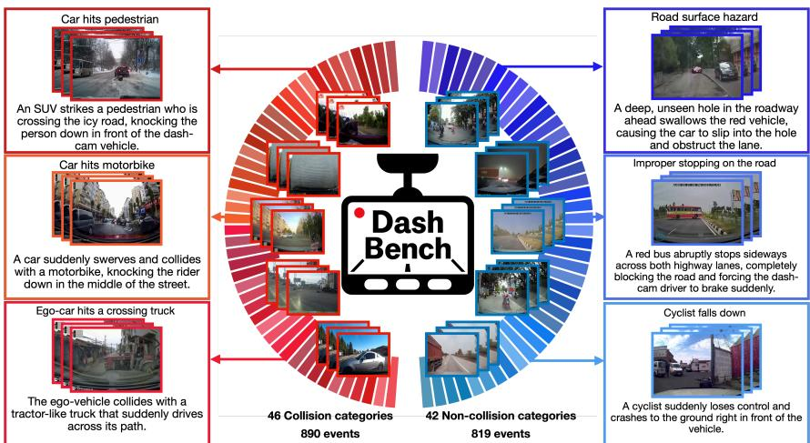  
Figure 1: Overview of DashBench. Our dataset spans 88 fine-grained categories to cover diverse corner case scenarios. Sample keyframes of corner case scenarios as well as their categories and annotations are shown.

## 1 Introduction

Autonomous driving systems (ADS) face a fundamental transparency barrier: the learned models that process continuous dashcam video streams and translate perception into planning decisions [8] generate no real-time account of their reasoning, yet real-time naturallanguage explanations of individual maneuvers are increasingly recognised as an operational necessity: they support passenger awareness, enable operator oversight, and are a decisive factor in how drivers calibrate their reliance on the system [13, 61]. Video Large Language Models (Video LLMs), multimodal models capable of reasoning over video inputs and generating grounded language descriptions have emerged as the leading candidate to close this interpretability gap in autonomous driving (AD). Video LLMs have been adapted for drivingspecific scene comprehension, safety-critical event understanding, and language-grounded planning [9, 22]; leading commercial ADS have begun incorporating them for real-time narration [26, 51, 52]. Whether Video LLMs can fulfil this promise under the most demanding road conditions which are rare, safety-critical events far outside routine traffic which are referred to as corner cases [2, 4], is a question made especially urgent by a possible failure mode of Video LLMs. These models do not merely underperform on hard scenes, they can hallucinate and systematically omit important details from their descriptions [27], producing active misinformation precisely where accurate perception matters most [42].

Although there have been several works probing Video LLMs’ scene understanding in corner cases for AD, they present several distinguishable limitations: (1) Insufficient coverage of corner case diversity. Existing benchmarks in this domain [7, 53, 59] restrict themselves either to collision-related events [59] or to object-level corner case detection [7], leaving scenario-level non-collision hazards largely untested [4]. (2) Limitations of experimental design and evaluation metrics. DVBench [59], the benchmark most closely related to ours, relies solely on a multiple-choice question (MCQ) format, narrowing evaluation to option-picking and providing limited evidence of the model’s genuine perception and explanatory reasoning [25]; subsequent work has highlighted the need for nuanced automatic judges to evaluate free-text responses in AD scenarios [53]. (3) Lack of evaluation of driving-specialized Video LLMs on corner case scenarios. Existing benchmarks that do evaluate models on driving corner cases assess general-purpose models exclusively and do not include driving-specialist Video LLMs [22, 32] that are explicitly designed and finetuned for driving video understanding. Whether such driving-specialized models close the corner-case reasoning gap over general-purpose Video LLMs remains an unanswered and practically important question, especially for guiding the development of road-ready Video LLMs.

We present DashBench, the first benchmark to not only systematically stress-test Video LLMs on corner case scenarios on the road under a multi-prompt evaluation protocol but also investigate the challenges presented by our task through anomaly-localized experiments and hallucination mitigation efforts in order to gain deeper insights. Our contributions are:

1. We curate, annotate, and process a dataset of 1,709 dashcam-video clips spanning 88 categories explicitly balanced across collision-related and non-collision hazardous events. As shown in Figure 1, our dataset covers a broad array of scenario-level events.

2. We evaluate 25 Video LLMs including SOTA closed-source models, open-source models, and driving-specialist Video LLMs fine-tuned on AD datasets, and find a consistent capability gap: even the highest-scoring model reaches only 46.52% accuracy, well below any threshold that safety-critical deployment would demand. Notably, model design such as reasoning and driving-specialist fine-tuning yields no clear, consistent advantage over general-purpose models on corner-case scenarios.

3. We document systematic failure modes through qualitative analysis of model outputs which are corner-case blindness (the model produces a fluent, confident description that entirely ignores the hazard) and road agent/action hallucination (non-existent vehicles, objects, or actions of other agents are fabricated). As shown in Figures 3, 4, and 5, these failures are not isolated errors but structural patterns that recur across model families.

4. We demonstrate through extensive experiments that neither varying prompt formulations nor providing temporally localized corner case windows (isolating the frames where the hazard occurs) substantially improves corner-case reasoning, with performance gains remaining well below what safety-critical driving applications require. Additionally, applying existing hallucination mitigation techniques yields no consistent gains on safety-critical scenarios. Together, these findings suggest that closing the corner-case gap requires fundamentally new approaches.

## 2 Related Works

## 2.1 Open-Ended QA with Video LLMs

Closed-set, multiple-choice video-QA formats [33] are susceptible to inflating apparent model capability by rewarding answer-option pattern matching [11], motivating a shift to open-ended, free-text evaluation. Video-MME [16] evaluates Video LLMs across diverse domains and task types and shows that state-of-the-art models fall substantially below human-level performance, while TemporalBench [5] specifically targets fine-grained temporal understanding and finds similarly large gaps. Beyond format, evaluation is sensitive to prompt design: the same question phrased differently substantially affects output quality and can reverse rankings between models [15]. Reliable capability assessment of Video LLMs therefore demands multiple prompt formulations across free-text, multi-frame conditions.

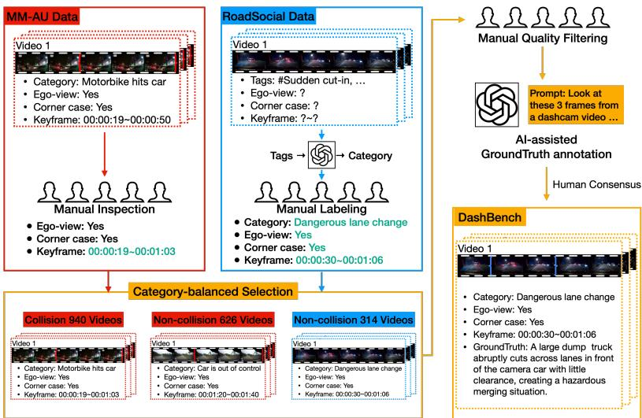  
Figure 2: DashBench construction pipeline. MM-AU and RoadSocial videos pass through source-specific filtering and annotation steps before a category-balanced merge, quality check, and AI-assisted ground truth annotation produce the final 1,709-clip benchmark.

## 2.2 Benchmarking Video LLMs for Corner Cases in AD

Early benchmarks for driving video understanding evaluate Video LLMs exclusively on routine traffic conditions [34], without systematic coverage of safety-critical events. This gap was formalized by [7], establishing CODA-LM as the first benchmark to probe VLMs on corner cases, though limited to static, object-level anomalies. DVBench [59] evaluated 14 Video LLMs on 10K crash and near-crash MCQs, finding that no model exceeded 40% accuracy, yet the closed-set format could not provide deeper insights on whether failures stemmed from perceptual blindness, reasoning errors, or output formatting. CrashSight [18] broadens this further to roadside-camera footage with phase-aware reasoning tasks. Despite these advances, all existing corner-case benchmarks remain narrow, covering either object-level anomalies or crash-only events, and none systematically characterize the types of perceptual errors that drive underperformance. No benchmark to date provides diverse scenario-level coverage with open-ended, multi-prompt free-text scoring.

## 3 DashBench

We present DashBench, a benchmark of 1,709 ego-view dashcam video clips designed to evaluate Video LLMs on scenario-level corner cases in autonomous driving, spanning 88 corner case categories drawn from two complementary sources: MM-AU [14] and RoadSocial [39], with a deliberate balance between collision and non-collision scenarios. Unless otherwise stated, 16 frames are uniformly sampled per clip as a standardized multi-frame evaluation protocol; benchmark construction is described thoroughly in this section, and the experimental setup is presented in Section 4.

## 3.1 Motivation

Driving corner cases are broadly defined as rare and unexpected situations that deviate from normal traffic behavior, challenging the reliability of autonomous perception systems [2, 3, 4]. Following the scenario-level corner case taxonomy in [3], DashBench targets scenariolevel corner-cases which are well-suited for Video LLM evaluation since recognition of these events requires temporal reasoning over a video sequence. Within this level, the taxonomy separates anomalous, novel, and risky scenarios primarily by whether they carry collision potential. Building on this, our distinct dataset design splits clips by collision outcome (which is whether physical impact occurred). Collision clips capture scenarios in which the hazard resulted in actual impact; non-collision clips span the remaining range, from averted dangers and near-misses to unusual but safe road events.

We build DashBench’s primary video corpus from MM-AU, the most fine-grained publicly available ego-view dashcam accident benchmark with 57 annotated categories and keyframe annotations. However, dashcam footage is predominantly collected for collisionrelated accident documentation [6] and datasets curated from such footage therefore systematically over-represent collision events. Out of MM-AU’s 57 categories, 46 describe direct collision events, yielding 9,142 collision samples against only 626 non-collision samples which is a ratio of approximately 14.6:1 and a collision share of 93.6% of all annotated clips. Underrepresented non-collision categories include vehicle loss of control, traffic rule violations without impact, and various road surface and environmental hazards, even though these are scenarios which are safety-critical as well. Therefore, a benchmark constructed solely from MM-AU would cover almost exclusively scenarios in which collision potential resulted in actual impact, leaving other real-world safety-critical events that do not end in collision absent from evaluation.

Therefore, to achieve broad scenario-level coverage, we augment the samples we will select from MM-AU with non-collision corner case clips from RoadSocial, a large-scale social-media road event dataset spanning varied geographies, camera perspectives, and road event types. This dataset captures a wide spectrum of non-collision events absent from typical accident-focused datasets, and its video-level descriptive tags provide a principled basis for mapping clips to standardized corner case categories. Though we do not claim exhaustive coverage of all possible corner cases as no finite collection of videos can enumerate all possible real-world road hazards [4], we believe that our constructed dataset provides the most wide-ranging and balanced ego-view collection yet assembled for scenario-level corner case evaluation, spanning 88 different categories.

## 3.2 Dataset Composition

As established in our motivation, non-collision corner cases are severely underrepresented in existing ego-view dashcam datasets; to address this gap and achieve balanced scenario-level coverage, DashBench is composed of two sources. From MM-AU, we first retain all 626 non-collision clips spanning 11 categories (including vehicle loss of control and component failures); although MM-AU already provides ego-view footage and keyframe annotations, each clip still undergoes manual inspection to confirm that the corner case is visually identifiable and correctly categorized, and to refine keyframe boundaries where needed. To extend coverage beyond these 11 categories, we additionally draw on RoadSocial, comprising of 13.2K social-media road event videos across different camera viewpoints, each associated with descriptive tags out of a vocabulary of 21,325 video-level tags. Filtering and preparing these clips required three steps: an LLM-assisted pipeline mapping video-level tags to candidate corner case categories to identify relevant clips, a check to ensure clips exhibit ego-view dashcam perspective, and manual verification that a corner case is visually present, with annotators additionally labeling corner case keyframes (frame at the start of the corner case, the frame at which it is most observable, and the frame marking its end). This selection and annotation process was carried out by five annotators over four months, and the complete protocol is described in Figure 2. Through this pipeline, RoadSocial yields 314 clips covering 31 new corner case categories.

For the collision-side subset, we sample from MM-AU’s 9,142 collision clips across all 46 collision categories, targeting a category-balanced selection matching the size of the constructed non-collision subset. MM-AU provides keyframe annotations for the corner cases in all clips, but as previously mentioned, we manually refine keyframe boundaries where needed (cases where the keyframe does not exactly show the start, end, or the most observable frame of the corner case event).

To ensure that all clips are evaluable under the 16-frame uniform sampling protocol, we apply two quality criteria across all candidate clips from both sources. First, we ensure that the corner case must be self-contained (not requiring additional context outside of the images, e.g. sound/narration). Second, the corner case must be unambiguously identifiable from the 16 uniformly sampled frames. The final DashBench benchmark comprises 1,709 clips across 88 corner case categories. The average length for all clips in our benchmark is 7.70s while the average length of the corner case window for all clips is 3.47s. The full category list along with sample counts are provided in Table 5 in the Appendix.

## 3.3 AI-Assisted Ground Truth Annotation

Writing detailed scene descriptions for thousands of clips from the ground up is labour-intensive; we therefore leverage a strong thinking VLM, OpenAI’s o3 model which can reason with images in its chain of thought [36], to assist us in writing ground truth annotations. In each sample’s prompt, we provide three keyframes (video start frame, corner case occurrence frame, and video end frame) and pass the corner case category as a cue to guide o3’s annotation. Three independent annotators refine each generated model caption to a consensus fi-

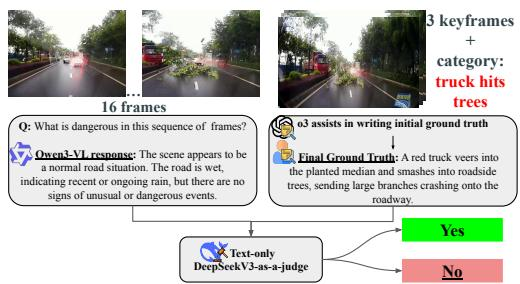  
Figure 3: Illustration of how we obtain a model’s response and ground truth description and pass them to DeepSeekV3-as-a-judge.

nal label, ensuring reliable ground-truth quality. The detailed prompt and annotation process can be found in Appendix B and C, respectively.

## 4 Experiments

## 4.1 Experimental Setups

DashBench is an open-ended, free-text response benchmark. While early video-QA datasets often relied on fixed multiple-choice formats, recent studies highlight that these multiplechoice tasks allow models to exploit shortcuts, revealing little about genuine multimodal reasoning or visual grounding [25, 29]. As a result, recent benchmark efforts have shifted toward open-ended evaluation to properly stress-test Video LLMs’ understanding of timesensitive and knowledge-intensive visual events [12, 45]. Figure 3 shows the concise pipeline of experiments in our dataset, from how we obtain both a model’s response and a ground truth description to then subsequently pass them to DeepSeekV3-as-a-judge for evaluation.

## 4.1.1 Prompts

For each sample, we query the Video LLM with five prompts:

(Q1) What is unusual in this sequence of frames?

(Q2) What is dangerous in this sequence offrames?

(Q3) Describe this sequence of frames in detail.

(Q4) Asks the model to return a single JSON object with two fields:

(a) (Q4TF) – true if there is an unusual/dangerous event and false if it is a normal road situation

(b) (Q4 ) – free-text reasoning that justifies the answer in $\mathrm { ( Q 4 _ { T F } ) }$

(Q5) First gives a definition of a corner case scenario along with some examples. Then, asks the model to identify if there is any corner case and to describe it.

Q1–Q2 are designed as explicit questions to force the model to search for anomalies, using both unusual and dangerous to cover diverse wording that can be used to describe corner cases. Q3 takes a different approach by asking for a general scene description with no explicit mention of danger, anomalies, or corner cases. We consider this a critical test since a Video LLM that truly understands the unfolding scene should identify the evident corner case naturally, without any textual hint to guide it. Q4 serves as an integrated detectionand-explanation prompt where we jointly check two aspects: (i) Q4 , the binary question format is designed to check whether the model might be sensitive to the wording in the prompt, and (ii) in Q4 we ask the Video LLM to give its reasoning as to what factors in the images display a routine traffic scene or corner case on the road. This "reasoning" test examines the Video LLM’s visual grounding capability and whether it guesses in Q4 due to the prompt’s nature. Since the format of Q4 requires the model to return JSON outputs, we could not provide Q4 results on several models since they cannot do this consistently. Lastly, Q5 introduces a definition-guided setting: we provide the model with a description of what a corner case is as well as some examples, then direct it to identify and describe any such event in the clip. Video-QA benchmarks generally avoid including in-context examples directly in the prompt [29, 34, 44], as video inputs already consume a large context budget and make adding examples computationally expensive. Q5 therefore stays within this convention by providing contextual framing through a short textual definition and examples, without adding concrete video instances to the prompt. We also use a system prompt to encourage the model to answer concisely as a road assistant. Detailed prompt templates are provided in Appendix B

## 4.1.2 Models

We perform a comprehensive evaluation of 25 Video LLMs: 2 SOTA closedsource models, GPT-5 [37] and Gemini-3-Flash [41], 16 general-purpose open-source models including Qwen3-VL [47] (8B, 32B, and 235B variants), InternVL3.5 [49] (8B, 38B, and 241B variants), Ovis2.5 [30], KeyeVL [55], MiniCPM4.5 [57], GLM-4.1V-Thinking [21], LLaVA-Next-Video [62], Tarsier2 [58], VITA-1.5 [17], IXC-2.5 [60], InternVideo2.5 [50] and LLaVA-OV-1.5 [1], as well as a group of 7 Video LLMs, which we will refer to as specialists, that have been fine-tuned on different established AD datasets. These include Dolphins [32], fine-tuned on the BDD-X dataset [24], DriveMM [22] which was finetuned on 6 separate AD datasets to promote versatility in handling different AD tasks, two domain-adapted versions of MiniInternVL2 [19] fine-tuned on the DriveLM dataset [46] and the BDD dataset [56] respectively, DriveLMM-o1 [23] which incorporates step-bystep chain-of-thought reasoning adapted to driving scene understanding, CrashChat [28] fine-tuned for multitask traffic crash video analysis, and LlaVA-OV-RS, a 7B model fine-tuned on the training split of the RoadSocial dataset [39]. See Appendix A for details on model access and deployment.

## 4.1.3 Evaluation

To reliably evaluate the alignment between Video LLM responses and ground truth annotations, we employ the LLM-as-judge evaluation protocol [63]. This has become the standard practice for open-ended benchmarks, with recent work employing GPT variants [7, 34], DeepSeekV3 [43], and Llama3.1(70B) [31] as evaluators. In our setup, the LLM-asjudge assesses Q1–Q3 and Q4 using a structured binary judgment prompt that asks whether each model response captures the same corner case as the ground truth in terms of its cause, the agents responsible, and event timing. This criterion counts only responses receiving a Yes verdict toward the accuracy score, ensuring a metric that reflects semantic alignment, while Q4 is reported separately as an independent binary detection score. We validate LLM-asjudge selection by randomly sampling 100 responses of several representative Video LLMs and comparing each candidate judge’s verdicts on those responses to actual human judgments using Cohen’s kappa (κ) [10] as the inter-rater agreement measure. As shown in Table 2, DeepSeekV3 achieves the highest agreement with human judgments (κ = 0.96) among all candidates tested, including Llama3.1(70B) [35] and a multi-LLM ensemble based on [48] (the details for this ensemble setup are explained in Appendix D), so we select DeepSeekV3 as our LLM-as-judge. As an open-source model from a different family than the evaluated Video LLMs, DeepSeekV3 additionally supports reproducible evaluation and avoids circular self-evaluation bias [38]. Furthermore, to verify that our evaluation scheme is not sensitive to stochastic variation, we run the DeepSeekV3-as-a-judge evaluation five times on a representative set of model responses; the mean accuracy and standard deviation across all prompts and models confirm consistent evaluation (std < 1% in all cases). The complete judge prompt is shown in Appendix B, while the details for the judging experiments including multi-run stability results are saved in Table 7 in the Appendix.

<table><tr><td>Model</td><td>Q1</td><td>Q2</td><td>Q3</td><td> $\mathbf { Q 4 _ { R } }$ </td><td>Q5</td><td>Min Agree</td><td>Max Agree</td><td>Avg Agree</td><td> $\mathbf { Q 4 _ { T F } }$ </td></tr><tr><td colspan="8">Closed-source</td><td></td><td></td><td></td></tr><tr><td>GPT-5</td><td>19.95</td><td>36.92</td><td>31.19</td><td>46.52</td><td>39.15</td><td>19.95</td><td>46.52</td><td>34.75</td><td></td><td>97.83</td></tr><tr><td>Gemini-3-Flash</td><td>32.36</td><td>35.28</td><td>29.84</td><td>39.58</td><td>34.99</td><td></td><td>29.84</td><td>39.58</td><td>34.41</td><td>94.85</td></tr><tr><td colspan="9">Open-source</td></tr><tr><td>Qwen3-VL (235B)</td><td>18.72</td><td>20.19</td><td>16.79</td><td>25.92</td><td>21.71</td><td>16.79</td><td>25.92</td><td>20.67</td><td></td><td>72.03</td></tr><tr><td>Qwen3-VL (8B)</td><td>18.90</td><td>15.51</td><td>14.45</td><td>22.00</td><td></td><td>21.53</td><td>14.45</td><td>22.00</td><td>18.48</td><td>74.96</td></tr><tr><td>Qwen3-VL (32B)</td><td>17.20</td><td>18.90</td><td>12.87</td><td>18.78</td><td></td><td>18.31</td><td>12.87</td><td>18.90</td><td>17.21</td><td>71.04</td></tr><tr><td>Ovis2.5(9B)</td><td>19.68</td><td>15.41</td><td>7.77</td><td>18.72</td><td></td><td>20.55</td><td>7.77</td><td>20.55</td><td>16.43</td><td>64.47</td></tr><tr><td>InternVL3.5 (241B)</td><td>19.31</td><td>12.81</td><td>11.47</td><td>19.13</td><td></td><td>17.61</td><td>11.47</td><td>19.31</td><td>16.07</td><td>76.36</td></tr><tr><td>InternVL3.5 (38B)</td><td>12.64</td><td>13.22</td><td>8.66</td><td>16.44</td><td></td><td>12.93</td><td>8.66</td><td>16.44</td><td>12.78</td><td>77.65</td></tr><tr><td>Tarsier2 (7B)</td><td>13.28</td><td>13.11</td><td>11.70</td><td></td><td></td><td>12.35</td><td>11.70</td><td>13.28</td><td>12.61</td><td></td></tr><tr><td>MiniCPM4.5 (8B)</td><td>13.34</td><td>11.18</td><td>6.38</td><td>17.27</td><td></td><td>13.53</td><td>6.38</td><td>17.27</td><td>12.34</td><td>87.53</td></tr><tr><td>KeyeVL (8B)</td><td>12.40</td><td>11.01</td><td>5.03</td><td>13.13</td><td></td><td>15.69</td><td>5.03</td><td>15.69</td><td>11.45</td><td>80.09</td></tr><tr><td>InternVL3.5 (8B)</td><td>4.27</td><td>7.67</td><td>6.55</td><td>12.17</td><td></td><td>12.52</td><td>4.27</td><td>12.52</td><td>8.64</td><td>78.17</td></tr><tr><td>InternVideo2.5 (8B)</td><td>4.86</td><td>9.71</td><td>4.15</td><td>9.95</td><td></td><td>10.12</td><td>4.15</td><td>10.12</td><td>7.76</td><td>54.00</td></tr><tr><td>IXC-2.5(7B)</td><td>6.26</td><td>9.89</td><td>4.92</td><td>9.07</td><td></td><td>8.54</td><td>4.92</td><td>9.89</td><td>7.74</td><td>54.44</td></tr><tr><td>GLM-4.1V-Thinking (9B)</td><td>7.85</td><td>5.50</td><td>2.05</td><td>6.32</td><td></td><td>9.91</td><td>2.05</td><td>9.91</td><td>6.33</td><td>35.34</td></tr><tr><td>VITA-1.5 (8B)</td><td>7.31</td><td>3.63</td><td>3.16</td><td>6.03</td><td></td><td>7.08</td><td>3.16</td><td>7.31</td><td>5.44</td><td>61.32</td></tr><tr><td>LLaVA-OV-1.5(8B)</td><td>3.28</td><td>3.10</td><td>1.46</td><td>7.14</td><td></td><td>6.90</td><td>1.46</td><td>7.14</td><td>4.38</td><td>54.13</td></tr><tr><td>LLaVA-Next-Video(7B)</td><td>1.11</td><td>3.16</td><td>0.18</td><td>2.00</td><td>1.40</td><td></td><td>0.18</td><td>3.16</td><td>1.57</td><td>67.12</td></tr><tr><td colspan="9">Specialists</td><td></td></tr><tr><td>LlaVA-OV-RS(7B)</td><td>6.09</td><td>14.86</td><td>11.59</td><td></td><td></td><td>7.49</td><td>6.09</td><td>14.86</td><td>10.01</td><td>一</td></tr><tr><td>CrashChat (7B)</td><td>6.79</td><td>8.84</td><td>4.27</td><td></td><td></td><td>3.74</td><td>3.74</td><td>8.84</td><td>5.91</td><td></td></tr><tr><td>DriveLMM-o1 (8B)</td><td>3.92</td><td>2.28</td><td>1.11</td><td></td><td></td><td>3.74</td><td>1.11</td><td>3.92</td><td>2.76</td><td>一</td></tr><tr><td>DriveMM(8B)</td><td>1.70</td><td>1.76</td><td>0.06</td><td></td><td></td><td>2.17</td><td>0.06</td><td>2.17</td><td>1.42</td><td></td></tr><tr><td>MiniInternVL2-BDD (4B)</td><td>2.28</td><td>0.64</td><td>0.00</td><td></td><td></td><td>1.46</td><td>0.00</td><td>2.28</td><td>1.10</td><td>1</td></tr><tr><td>MiniInternVL2-DLM (4B)</td><td>0.82</td><td>0.35</td><td>0.12</td><td></td><td></td><td>2.17</td><td>0.12</td><td>2.17</td><td>0.87</td><td></td></tr><tr><td>Dolphins (7B)</td><td>0.12</td><td>1.05</td><td>0.00</td><td></td><td></td><td>0.12</td><td>0.00</td><td>1.05</td><td>0.32</td><td>1</td></tr><tr><td></td><td></td><td></td><td></td><td></td><td></td><td></td><td></td><td></td><td></td><td></td></tr></table>

Table 1: Video LLMs’ accuracy (%) on all corner-case driving scenarios in DashBench. "Minimum/Maximum/Average Agreement" are computed over Q1, Q2, Q3, Q4R, and Q5, and models are ordered based on Average Agreement in their own family. $\mathrm { Q 4 _ { T F } }$ is reported separately because it simply measures event detection rather than grounded explanation. Bold numbers mark the best value in each Q1–Q5 column within a model family; underlined numbers mark the second-best. - denotes cases where models could not consistently respond to Q4 in a structured format.

## 4.2 Results

Table 1 reports the accuracy of all evaluated Video LLMs on the full dataset across all five prompts. No model surpasses 50% on any individual prompt, and none exceeds 35% on average, highlighting the fundamental difficulty of open-ended corner-case understanding. Furthermore, our extensive experiments reveal distinct patterns in how architectural choices and prompt design affect model capabilities. The results demonstrate clear differences based on model type, training approach, and prompt structure, with ADS deployment implications.

<table><tr><td>Judge</td><td>GPT-5 K</td><td>-Flash K</td><td>(8B)K</td><td>Gemini-3 Qwen3-VL InternVL3.5 Ovis2.5 (8B) K</td><td>(9B) K</td><td>Avg K</td></tr><tr><td>DeepSeekV3</td><td>0.98</td><td>0.93</td><td>0.93</td><td>0.95</td><td>1.00</td><td>0.96</td></tr><tr><td>Llama3.1(70B)</td><td>0.90</td><td>0.92</td><td>0.76</td><td>0.81</td><td>0.85</td><td>0.85</td></tr><tr><td>Multi-LLM []</td><td>0.63</td><td>0.57</td><td>0.44</td><td>0.52</td><td>0.54</td><td>0.54</td></tr></table>

Table 2: Cohen’s κ agreement between different judge setups and evaluated Video LLM responses.

Corner-Case Understanding Remains Challenging Across All Model Types and Scale. Among all models, GPT-5 achieves the highest $\mathrm { Q 4 _ { R } }$ accuracy at a lacking 46.52% and an average agreement of 34.75%, while Gemini-3-Flash follows closely at 34.41% average. Though these numbers remain far below any practical safety threshold, the lead over the strongest open-source model Qwen3-VL (235B, 20.67% avg), still exceeds 14% in average agreement (34.75% vs. 20.67%), suggesting that our task remains challenging even as opensource general multimodal capabilities continue to improve. Notably, scaling model size within the same model family yields only modest and inconsistent gains. While scaling to extremely large open-source models (235B+) does improve performance, the gains remain surprisingly modest. For example, Qwen3-VL (235B) achieves only a ∼2% higher average agreement than its 8B counterpart (20.67% vs. 18.48%). Similarly, scaling InternVL3.5 from 8B to 241B improves average agreement by only ∼7.43% (8.64% vs. 16.07%). These results suggest that simply increasing model scale alone is insufficient for robust understanding of rare and safety-critical driving corner cases.

Neither Reasoning nor Driving Specialization Solves Corner-Case Understanding. Additionally, neither extended chain-of-thought reasoning nor domain-specific driving specialization appears sufficient for robust corner-case understanding. Reasoning-oriented models such as Ovis2.5, KeyeVL, and GLM-4.1V-Thinking show no clear advantage over similarly sized open-source Video LLMs, as Ovis2.5 reaches 16.43% average, behind the non-reasoning Qwen3-VL at 18.48%, while GLM-4.1V-Thinking scores only 6.33% despite its thinking mode. In particular, specialist driving Video LLMs achieve at most 10.01% average agreement despite being explicitly fine-tuned on AD datasets and for AD tasks, with several models collapsing to near-random performance. This suggests that current specialist training strategies may encourage shortcut learning tied to benchmark-specific patterns rather than genuine understanding of complex driving events.

Video LLMs Depend Heavily on Linguistic Cueing Rather Than Robust Visual Understanding. Variations in our prompts’ wording reveal that model performance can be highly sensitive to semantic framing: the same scene queried under different linguistic formulations shows score swings of up to 26% within a single model (e.g., 19.95% on Q1 to 46.52% on Q4 for GPT-5), a critical consideration for prompt design when deploying Video LLMs in driving scenarios. Additionally, through $\mathrm { Q 4 _ { R } }$ and Q4TF, we reveal the importance of freetext reasoning: are Video LLMs’ grounded explanations on successfully detecting a corner case valid? All evaluated models suffer a sharp drop in performance when asked to explain their decisions. On average, accuracy falls by 55 percentage points between $\mathrm { Q 4 _ { T F } }$ and Q4R. This insight calls for the integration of additional modules that verify visual evidence before explaining. Most critically, Q3, which asks for a detailed temporal description of the video without explicitly cuing the model to look for corner cases, ranks as the lowest-scoring prompt across almost all evaluated models, regardless of model family or scale. Therefore, the consistent drop on Q3, which removes any implicit guidance on searching for corner cases in the scene, exposes that performance can be driven by what models are told to look for, not by what they can independently perceive.

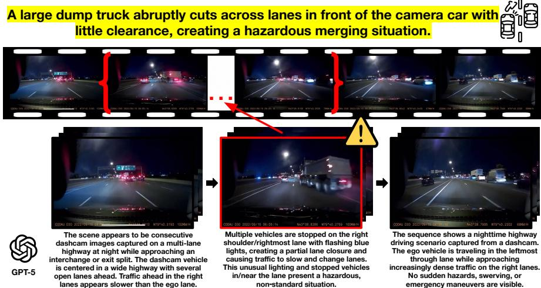  
Figure 4: Illustration of a corner case window in a clip. The red brackets mark the annotated corner-case window in the clip. We show GPT-5’s responses to different parts of the clip; GPT-5 is able to explain the scenario well outside of the corner case window. However, despite using 16 frames and concentrating the visual input on the critical event (a truck performing hazardous lane merging ahead), GPT-5 fails to identify the dangerous maneuver.

Video LLMs Fail Both by Missing Hazards and Hallucinating Them. Detailed qualitative analysis on our benchmark reveals the important issue on not only that Video LLMs fail but also ”how they fail”. Across many evaluated instances, Video LLMs simply struggle to identify the corner case in the scene (Figure 4, 5, Appendix G.1). Beyond failures in visual grounding, we observe that Video LLMs have a tendency to hallucinate nonexistent road agents, which are especially important in vision-language-action frameworks where imagined hazards will directly influence an ADS’ road maneuvers. Especially in Q1 and Q2 results, these models might invent scenarios instead of claiming the absence of anything unusual or dangerous or even uncertainty (Figure 5, Appendix G.2). Though the resulting limited performance for all corner cases are most commonly related to failing to identify the corner case and hallucinating non-existent road agents (Appendix G.1 and G.2 respectively), observation of collision event examples specifically show that Video LLMs additionally hallucinate imaginary actions of road agents (Appendix G.4) and fail to identify the actual collision, instead describing them as near-misses (Appendix G.3).

## 4.2.1 Corner Case Window Experiments

In our main evaluation, 16 frames are sampled uniformly across each dashcam clip. As illustrated in Figure 4 (top), corner-case events occupy only a fraction of the clip on average, meaning the frame budget is shared between the hazardous segment and surrounding routine footage. The corner-case window (CCW) experiment tests whether this is a limiting factor: rather than sampling from the full clip, we restrict the 16 frames to the annotated start-toend span of the corner case only, keeping everything else such as prompts, models, and evaluation, identical. We apply this experiment to the 823 out of 1,709 samples (48.2%) in which the anomalous window covers less than half of the total clip duration. These are where the localization argument is strongest and uniformly sampling throughout the video is most likely to fail to sufficiently cover the anomalous segment within the frame budget.

<table><tr><td>Model</td><td>Q1</td><td>Q2</td><td>Q3</td><td> $\mathbf { Q 4 _ { R } }$ </td><td>Q5</td><td>Avg Agree</td><td> $\mathbf { Q 4 _ { T F } }$ </td></tr><tr><td colspan="8">Closed-source</td></tr><tr><td>GPT-5</td><td>20.90</td><td>36.09</td><td>29.28</td><td>47.39</td><td>38.40</td><td>34.41</td><td>96.96</td></tr><tr><td>+CCW</td><td> $1 9 . 6 8 _ { - 1 . 2 2 }$ </td><td> $4 2 . 4 1 _ { + 6 . 3 2 }$ </td><td> $3 4 . 5 1 _ { + 5 . 2 3 }$ </td><td> $5 1 . 4 0 _ { + 4 . 0 1 }$ </td><td> $4 3 . 0 1 _ { + 4 . 6 1 }$ </td><td> $3 8 . 2 0 _ { + 3 . 7 9 }$ </td><td> $9 7 . 8 1 _ { + 0 . 8 5 }$ </td></tr><tr><td>Gemini-3-Flash</td><td>32.56</td><td>34.99</td><td>28.43</td><td>37.96</td><td>34.39</td><td>33.67</td><td>92.34</td></tr><tr><td>+CCW</td><td> $3 4 . 6 3 _ { + 2 . 0 7 }$ </td><td> $3 9 . 3 7 _ { + 4 . 3 8 }$ </td><td> $3 0 . 1 3 _ { + 1 . 7 0 }$ </td><td> $4 5 . 4 4 _ { + 7 . 4 8 }$ </td><td> $4 0 . 3 4 _ { + 5 . 9 5 }$ </td><td> $3 7 . 9 8 _ { + 4 . 3 1 }$ </td><td> $9 4 . 2 9 _ { + 1 . 9 5 }$ </td></tr><tr><td colspan="8">Open-source</td></tr><tr><td>Qwen3-VL (8B)</td><td>17.98</td><td>14.95</td><td>13.97</td><td>20.90</td><td>21.02</td><td>17.76</td><td>70.84</td></tr><tr><td>+CCW</td><td> $1 3 . 6 1 _ { - 4 . 3 7 }$ </td><td> $1 8 . 3 5 _ { + 3 . 4 0 }$ </td><td> $1 5 . 1 9 _ { + 1 . 2 2 }$ </td><td> $2 2 . 1 1 _ { + 1 . 2 1 }$ </td><td> $2 3 . 5 7 _ { + 2 . 5 5 }$ </td><td> $1 8 . 5 7 _ { + 0 . 8 1 }$ </td><td> $7 3 . 3 9 _ { + 2 . 5 5 }$ </td></tr><tr><td>Ovis2.5 (9B)</td><td>18.57</td><td>13.62</td><td>7.01</td><td>18.10</td><td>21.37</td><td>15.73</td><td>60.59</td></tr><tr><td>+CCW</td><td> $2 0 . 7 9 _ { + 2 . 2 2 }$ </td><td> $1 7 . 3 0 _ { + 3 . 6 8 }$ </td><td> $7 . 7 4 _ { + 0 . 7 3 }$ </td><td> $1 9 . 6 6 _ { + 1 . 5 6 }$ </td><td> $2 3 . 0 8 _ { + 1 . 7 1 }$ </td><td> $1 7 . 7 1 _ { + 1 . 9 8 }$ </td><td> $6 4 . 9 9 _ { + 4 . 4 0 }$ </td></tr><tr><td>InternVL3.5 (8B)</td><td>3.65</td><td>8.02</td><td>6.68</td><td>10.57</td><td>12.15</td><td>8.21</td><td>74.48</td></tr><tr><td>+CCW</td><td> $4 . 7 4 _ { + 1 . 0 9 }$ </td><td> $9 . 1 1 _ { + 1 . 0 9 }$ </td><td> $7 . 6 5 _ { + 0 . 9 7 }$ </td><td> $1 4 . 2 2 _ { + 3 . 6 5 }$ </td><td> $1 5 . 1 9 _ { + 3 . 0 4 }$ </td><td> $1 0 . 1 8 _ { + 1 . 9 7 }$ </td><td> $8 5 . 0 5 _ { + 1 0 . 5 7 }$ </td></tr></table>

Table 3: Accuracy (%) of selected models on the CCW subset. Each model’s full-video run (16 frames sampled across the full clip) is compared against its CCW run (16 frames sampled from the corner case window only). Subscripts show the change in score: $\mathrm { { g r e e n } = }$ improvement, red = regression.

As reported in Table 3 as well as expanded results in Appendix Table 9, restricting to the corner-case window improves average agreement, confirming that temporal localization is broadly beneficial. The magnitude of improvement seems to scale with model capability: closed-source models gain +3.79 pp (GPT-5) and +4.31 pp (Gemini-3-Flash), while open-source models improve by only +0.81 to +1.98 pp, suggesting that stronger models are better positioned to exploit the concentrated event signal. Notably, in Q1, both GPT-5 (−1.22 pp) and Qwen3-VL (−4.37 pp) regress on the narrow window. Q1 asks what is unusual about the scene, a judgment that inherently requires comparative context from the surrounding normal driving footage; excluding that context by narrowing to the event window alone removes the reference frames against which the anomaly is assessed. Taken together, these results suggest that while temporal event localization meaningfully reduces the visual noise that hinders corner-case understanding, the ceiling for open-source models still remains limited by capability rather than by sampling strategy alone.

## 4.2.2 Hallucination Mitigation On the Road

Due to the difficulty of acquiring sufficient annotated corner-case examples and curating a class-balanced training set across 88 scenario categories, fine-tuning Video LLMs for cornercase robustness remains practically expensive. We therefore investigate recent training-free methods for multimodal LLMs that require no additional data or model updates, and whose implementations are publicly available. Specifically, we focus on training-free decoding, which mitigate hallucinations at inference time by contrasting the model’s normal predictions with degraded or perturbed visual references, thereby amplifying visually grounded tokens and suppressing language-driven priors.

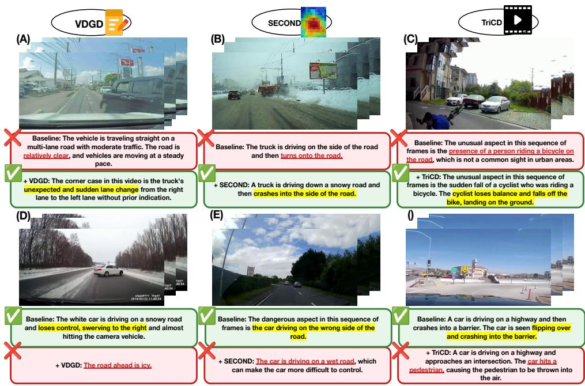  
Figure 5: Samples of "flip" cases as a result of hallucination mitigation methods applied to the baseline model, InternVL3.5 8B. ✓ denotes a response that correctly identifies the corner case, while ✗ denotes a response that fails to do so, either missing the hazard entirely or substituting a hallucinated description. The top row (A–C) shows recovery cases, whereas the bottom row (D–F) shows regression cases.

VDGD [20] grounds generation using a detailed visual description and KL-based decoding. SECOND [40] uses multi-scale object-relevant patches and coarse-to-fine contrastive decoding. TRiCD [54] targets video hallucinations through temporal perturbations and saliency-guided visual enhancement. As reported in Table 4, none of the three methods yields substantial improvement. TRiCD achieves the largest gain (+1.16 pp, reaching 9.80% avg), with positive deltas across all five question types, suggesting that its videonative contrastive signal is best aligned with the multi-frame temporal structure of cornercase events. While SECOND provides a marginal improvement (+0.36 pp avg), VDGD hurts performance (−1.41 pp avg), suggesting that description-grounded decoding does not transfer well to dynamic, multi-frame driving inputs. Qualitative examples in Figure 5 show several flip cases where these decoding methods can either improve or degrade the quality of scene descriptions. Implementation details are in Appendix E.

Though these methods have shown strong results on object-level hallucination with multiple-choice verification, corner-case driving evaluation is inherently harder, targeting temporally concentrated events and based on open-ended generation, a setting in which Video-LLMs are known to exhibit substantially high hallucination rates [42].Taken together, these results on InternVL3.5 indicate that existing training-free hallucination mitigation methods provide, at best, marginal and inconsistent benefits on safety-critical corner cases.

<table><tr><td>Model</td><td>Q1</td><td>Q2</td><td>Q3</td><td> $\overline { { \mathbf { Q } 4 _ { \mathbf { R } } } }$ </td><td>Q5</td><td>Avg Agr.</td><td> $\mathbf { Q 4 } _ { \mathrm { T F } }$ </td></tr><tr><td>InternVL3.5 (8B)</td><td>4.27</td><td>7.67</td><td>6.55</td><td>12.17</td><td>12.52</td><td>8.64</td><td>78.17</td></tr><tr><td>+ VDGD []</td><td> $4 . 1 0 \mathrm { - } 0 . 1 7$ </td><td> $5 . 3 2 \mathrm { - } 2 . 3 5$ </td><td> $6 . 9 6 \substack { + 0 . 4 1 }$ </td><td> $9 . 1 3 _ { - 3 . 0 4 }$ </td><td> $1 0 . 6 5 \substack { - 1 . 8 7 }$ </td><td>7.23–1.41</td><td>58.46–19.71</td></tr><tr><td>+ SECOND []</td><td>4.04-0.23</td><td> $7 . 5 5 \substack { - 0 . 1 2 }$ </td><td> $7 . 1 4 \substack { + 0 . 5 9 }$ </td><td> $1 3 . 4 0 \substack { + 1 . 2 3 }$ </td><td> $1 2 . 8 7 \substack { + 0 . 3 5 }$ </td><td> $9 . 0 0 \substack { + 0 . 3 6 }$ </td><td>81.33+3.16</td></tr><tr><td>+ TRiCD []</td><td> $5 . 0 3 \substack { + 0 . 7 6 }$ </td><td> $8 . 7 2 \substack { + 1 . 0 5 }$ </td><td> $7 . 2 0 \substack { + 0 . 6 5 }$ </td><td> $1 3 . 3 4 \substack { + 1 . 1 7 }$ </td><td> $1 4 . 6 9 \substack { + 2 . 1 7 }$ </td><td> $9 . 8 0 \substack { + 1 . 1 6 }$ </td><td>75.13–3.04</td></tr></table>

Table 4: Accuracy (%) of training-free decoding methods applied to InternVL3.5 (8B) on the full DashBench. Subscripts show the change in score: green = improvement, red = regression.

## 5 Discussion and Conclusion

Our results reveal that the latest Video LLMs, regardless of open vs. proprietary status, model scale, reasoning capability, or fine-tuning on established driving datasets, fall critically short when tasked with understanding corner cases. No evaluated model surpasses 50% on any individual prompt, and none exceeds 35% on average: GPT-5, the highest performer, reaches only 46.52% on $\mathrm { Q 4 _ { R } }$ and 34.75% average agreement. Open-source models are further behind still, with the strongest open-source result (Qwen3-VL 235B, 20.67% average) lagging the closed-source best by over 14 percentage points. When considering model training recipes neither extended chain-of-thought reasoning nor domain-specific driving specialization on existing datasets narrows this gap, as specialist models fine-tuned on AD datasets achieve at most 10.01% average agreement, with several performing near chance. More critically, all Video LLMs frequently hallucinate nonexistent road agents, fabricate imaginary actions, or misclassify collisions as near-misses in addition to simply missing the evident corner case on the road. These failure modes direct safety risks when Video LLMs are embedded as explainability or planning components in an ADS.

Our benchmark design and additional experiments conducted further expose the depth of the problem. Prompt formulation is far from a trivial design choice when deploying Video LLMs for road scene analysis, as the expectation that models can robustly describe scenes without being cued to look for anomalies does not hold. We also explored whether narrowing the temporal context to the anomalous event itself could help: isolating the corner-case window does benefit stronger models by several percentage points (+3.79 pp for GPT-5), but the gains for open-source models are negligible (+0.81–1.98 pp), ruling out insufficient visual context as the primary obstacle. We further attempt to address these failures by applying three recent hallucination mitigation methods,with the best approach gaining only +1.16 pp on average. Together, these findings indicate that closing the corner-case gap requires fundamentally new approaches: future Video LLM assistants and planners should demonstrate robust visual grounding and must be exposed to diverse scenarios during training. Additionally, motivated by the scarcity of rare non-collision corner cases in naturalistic footage, we believe that the development of driving-domain world models that can synthesize diverse, controllable safety-critical scenarios is a promising direction for future dataset construction.

DashBench provides the most comprehensive ego-view corner-case evaluation of Video LLMs to date: 1,709 dashcam clips across 88 fine-grained categories, balanced across collision and non-collision events, with open-ended free-text QA evaluated by a reliable, SOTA LLM-as-a-judge. Together with a detailed characterization of systematic failure modes and a suite of diagnostic experiments, we offer both a rigorous stress test and a practical guide for the limitations that must be overcome. We believe DashBench serves as a foundational resource for advancing Video LLMs toward the perceptual robustness and safety-critical reliability that trustworthy autonomous driving demands.

## Acknowledgements

This work was supported by the National Research Foundation of Korea(NRF) grant funded by the Korea government(MSIT)(RS-2025-00573160), and the “Advanced GPU Utilization Support Program” funded by the Government of the Republic of Korea (Ministry of Science and ICT).

## References

[1] Xiang An, Yin Xie, Kaicheng Yang, Wenkang Zhang, Xiuwei Zhao, Zheng Cheng, Yirui Wang, Songcen Xu, Changrui Chen, Chunsheng Wu, Huajie Tan, Chunyuan Li, Jing Yang, Jie Yu, Xiyao Wang, Bin Qin, Yumeng Wang, Zizhen Yan, Ziyong Feng, Ziwei Liu, Bo Li, and Jiankang Deng. Llava-onevision-1.5: Fully open framework for democratized multimodal training. CoRR, abs/2509.23661, 2025. doi: 10.48550/ARXIV. 2509.23661. URL https://doi.org/10.48550/arXiv.2509.23661.

[2] Daniel Bogdoll, Jasmin Breitenstein, Florian Heidecker, Maarten Bieshaar, Bernhard Sick, Tim Fingscheidt, and J. Marius Zöllner. Description of corner cases in automated driving: Goals and challenges. In IEEE/CVF International Conference on Computer Vision Workshops, ICCVW 2021, Montreal, QC, Canada, October 11-17, 2021, pages 1023–1028. IEEE, 2021. doi: 10.1109/ICCVW54120.2021.00119. URL https: //doi.org/10.1109/ICCVW54120.2021.00119.

[3] Jasmin Breitenstein, Jan-Aike Termöhlen, Daniel Lipinski, and Tim Fingscheidt. Systematization of corner cases for visual perception in automated driving. In IEEE Intelligent Vehicles Symposium, IV 2020, Las Vegas, NV, USA, October 19 - November 13, 2020, pages 1257–1264. IEEE, 2020. doi: 10.1109/IV47402.2020.9304789. URL https://doi.org/10.1109/IV47402.2020.9304789.

[4] Jasmin Breitenstein, Jan-Aike Termöhlen, Daniel Lipinski, and Tim Fingscheidt. Corner cases for visual perception in automated driving: Some guidance on detection approaches. CoRR, abs/2102.05897, 2021. URL https://arxiv.org/abs/2102. 05897.

[5] Mu Cai, Reuben Tan, Jianrui Zhang, Bocheng Zou, Kai Zhang, Feng Yao, Fangrui Zhu, Jing Gu, Yiwu Zhong, Yuzhang Shang, Yao Dou, Jaden Park, Jianfeng Gao, Yong Jae Lee, and Jianwei Yang. Temporalbench: Benchmarking fine-grained temporal understanding for multimodal video models. CoRR, abs/2410.10818, 2024. doi: 10.48550/ARXIV.2410.10818. URL https://doi.org/10.48550/arXiv. 2410.10818.

[6] Fu-Hsiang Chan, Yu-Ting Chen, Yu Xiang, and Min Sun. Anticipating accidents in dashcam videos. In Shang-Hong Lai, Vincent Lepetit, Ko Nishino, and Yoichi Sato, editors, Computer Vision - ACCV 2016 - 13th Asian Conference on Computer Vision, Taipei, Taiwan, November 20-24, 2016, Revised Selected Papers, Part IV, Lecture Notes in Computer Science, pages 136–153. Springer, 2016. doi: 10.1007/978-3-319-54190-7\_9. URL https://doi.org/10.1007/ 978-3-319-54190-7\_9.

[7] Kai Chen, Yanze Li, Wenhua Zhang, Yanxin Liu, Pengxiang Li, Ruiyuan Gao, Lanqing Hong, Meng Tian, Xinhai Zhao, Zhenguo Li, Dit-Yan Yeung, Huchuan Lu, and Xu Jia. Automated evaluation of large vision-language models on self-driving corner cases. In IEEE/CVF Winter Conference on Applications of Computer Vision, WACV 2025, Tucson, AZ, USA, February 26 - March 6, 2025, pages 7817–7826. IEEE, 2025. doi: 10.1109/WACV61041.2025.00759. URL https://doi.org/ 10.1109/WACV61041.2025.00759.

[8] Li Chen, Penghao Wu, Kashyap Chitta, Bernhard Jaeger, Andreas Geiger, and Hongyang Li. End-to-end autonomous driving: Challenges and frontiers. IEEE Trans. Pattern Anal. Mach. Intell., 46(12):10164–10183, 2024. doi: 10.1109/TPAMI.2024. 3435937. URL https://doi.org/10.1109/TPAMI.2024.3435937.

[9] Siran Chen, Yuxiao Luo, Yue Ma, Yu Qiao, and Yali Wang. H-MBA: hierarchical mamba adaptation for multi-modal video understanding in autonomous driving. In Toby Walsh, Julie Shah, and Zico Kolter, editors, Thirty-Ninth AAAI Conference on Artificial Intelligence, Thirty-Seventh Conference on Innovative Applications of Artificial Intelligence, Fifteenth Symposium on Educational Advances in Artificial Intelligence, AAAI 2025, Philadelphia, PA, USA, February 25 - March 4, 2025, pages 2212–2220. AAAI Press, 2025. doi: 10.1609/AAAI.V39I2.32220. URL https: //doi.org/10.1609/aaai.v39i2.32220.

[10] Jacob Cohen. A coefficient of agreement for nominal scales. Educational and psychological measurement, 20(1):37–46, 1960.

[11] Daniel Cores, Michael Dorkenwald, Manuel Mucientes, Cees G. M. Snoek, and Yuki M. Asano. Tvbench: Redesigning video-language evaluation. CoRR, abs/2410.07752, 2024. doi: 10.48550/ARXIV.2410.07752. URL https://doi. org/10.48550/arXiv.2410.07752.

[12] Shangzhe Di and Weidi Xie. Grounded question-answering in long egocentric videos. In IEEE/CVF Conference on Computer Vision and Pattern Recognition, CVPR 2024, Seattle, WA, USA, June 16-22, 2024, pages 12934–12943. IEEE, 2024. doi: 10.1109/ CVPR52733.2024.01229. URL https://doi.org/10.1109/CVPR52733. 2024.01229.

[13] Jiqian Dong, Sikai Chen, Mohammad Miralinaghi, Tiantian Chen, Pei Li, and Samuel Labi. Why did the ai make that decision? towards an explainable artificial intelligence (xai) for autonomous driving systems. Transportation research part C: emerging technologies, 156:104358, 2023.

[14] Jianwu Fang, Lei-Lei Li, Junfei Zhou, Junbin Xiao, Hongkai Yu, Chen Lv, Jianru Xue, and Tat-Seng Chua. Abductive ego-view accident video understanding for safe driving perception. In IEEE/CVF Conference on Computer Vision and Pattern Recognition, CVPR 2024, Seattle, WA, USA, June 16-22, 2024, pages 22030–22040. IEEE, 2024. doi: 10.1109/CVPR52733.2024.02080. URL https://doi.org/10. 1109/CVPR52733.2024.02080.

[15] Haiwen Feng, Long Lian, Lisa Dunlap, Jiahao Shu, Xudong Wang, Renhao Wang, Trevor Darrell, Alane Suhr, and Angjoo Kanazawa. Visually prompted benchmarks are

surprisingly fragile. CoRR, abs/2512.17875, 2025. doi: 10.48550/ARXIV.2512.17875. URL https://doi.org/10.48550/arXiv.2512.17875.

[16] Chaoyou Fu, Yuhan Dai, Yongdong Luo, Lei Li, Shuhuai Ren, Renrui Zhang, Zihan Wang, Chenyu Zhou, Yunhang Shen, Mengdan Zhang, Peixian Chen, Yanwei Li, Shaohui Lin, Sirui Zhao, Ke Li, Tong Xu, Xiawu Zheng, Enhong Chen, Caifeng Shan, Ran He, and Xing Sun. Video-mme: The first-ever comprehensive evaluation benchmark of multi-modal llms in video analysis. In IEEE/CVF Conference on Computer Vision and Pattern Recognition, CVPR 2025, Nashville, TN, USA, June 11-15, 2025, pages 24108–24118. Computer Vision Foundation / IEEE, 2025. doi: 10.1109/CVPR52734.2025.02245. URL https://openaccess.thecvf.com/content/CVPR2025/html/ Fu\_Video-MME\_The\_First-Ever\_Comprehensive\_Evaluation\_ Benchmark\_of\_Multi-modal\_LLMs\_in\_CVPR\_2025\_paper.html.

[17] Chaoyou Fu, Haojia Lin, Xiong Wang, Yifan Zhang, Yunhang Shen, Xiaoyu Liu, Haoyu Cao, Zuwei Long, Heting Gao, Ke Li, Long Ma, Xiawu Zheng, Rongrong Ji, Xing Sun, Caifeng Shan, and Ran He. VITA-1.5: towards gpt-4o level real-time vision and speech interaction. CoRR, abs/2501.01957, 2025. doi: 10.48550/ARXIV.2501. 01957. URL https://doi.org/10.48550/arXiv.2501.01957.

[18] Rui Gan, Junyi Ma, Pei Li, Xingyou Yang, Kai Chen, Sikai Chen, and Bin Ran. Crashsight: A phase-aware, infrastructure-centric video benchmark for traffic crash scene understanding and reasoning. CoRR, abs/2604.08457, 2026. doi: 10.48550/ARXIV. 2604.08457. URL https://doi.org/10.48550/arXiv.2604.08457.

[19] Zhangwei Gao, Zhe Chen, Erfei Cui, Yiming Ren, Weiyun Wang, Jinguo Zhu, Hao Tian, Shenglong Ye, Junjun He, Xizhou Zhu, Lewei Lu, Tong Lu, Yu Qiao, Jifeng Dai, and Wenhai Wang. Mini-internvl: A flexible-transfer pocket multimodal model with 5% parameters and 90% performance. CoRR, abs/2410.16261, 2024. doi: 10.48550/ARXIV.2410.16261. URL https://doi.org/10.48550/arXiv. 2410.16261.

[20] Sreyan Ghosh, Chandra Kiran Reddy Evuru, Sonal Kumar, Utkarsh Tyagi, Oriol Nieto, Zeyu Jin, and Dinesh Manocha. Visual description grounding reduces hallucinations and boosts reasoning in lvlms. In The Thirteenth International Conference on Learning Representations, ICLR 2025, Singapore, April 24-28, 2025. OpenReview.net, 2025. URL https://openreview.net/forum?id=3PRvlT8b1R.

[21] Wenyi Hong, Wenmeng Yu, Xiaotao Gu, Guo Wang, Guobing Gan, Haomiao Tang, Jiale Cheng, Ji Qi, Junhui Ji, Lihang Pan, Shuaiqi Duan, Weihan Wang, Yan Wang, Yean Cheng, Zehai He, Zhe Su, Zhen Yang, Ziyang Pan, Aohan Zeng, Baoxu Wang, Boyan Shi, Changyu Pang, Chenhui Zhang, Da Yin, Fan Yang, Guoqing Chen, Jiazheng Xu, Jiali Chen, Jing Chen, Jinhao Chen, Jinghao Lin, Jinjiang Wang, Junjie Chen, Leqi Lei, Letian Gong, Leyi Pan, Mingzhi Zhang, Qinkai Zheng, Sheng Yang, Shi Zhong, Shiyu Huang, Shuyuan Zhao, Siyan Xue, Shangqin Tu, Shengbiao Meng, Tianshu Zhang, Tianwei Luo, Tianxiang Hao, Wenkai Li, Wei Jia, Xin Lyu, Xuancheng Huang, Yanling Wang, Yadong Xue, Yanfeng Wang, Yifan An, Yifan Du, Yiming Shi, Yiheng Huang, Yilin Niu, Yuan Wang, Yuanchang Yue, Yuchen Li, Yutao Zhang, Yuxuan Zhang, Zhanxiao Du, Zhenyu Hou, Zhao Xue, Zhengxiao Du, Zihan Wang, Peng

Zhang, Debing Liu, Bin Xu, Juanzi Li, Minlie Huang, Yuxiao Dong, and Jie Tang. Glm-4.1v-thinking: Towards versatile multimodal reasoning with scalable reinforcement learning. CoRR, abs/2507.01006, 2025. doi: 10.48550/ARXIV.2507.01006. URL https://doi.org/10.48550/arXiv.2507.01006.

[22] Zhijian Huang, Chengjian Feng, Feng Yan, Baihui Xiao, Zequn Jie, Yujie Zhong, Xiaodan Liang, and Lin Ma. Drivemm: All-in-one large multimodal model for autonomous driving. CoRR, abs/2412.07689, 2024. doi: 10.48550/ARXIV.2412.07689. URL https://doi.org/10.48550/arXiv.2412.07689.

[23] Ayesha Ishaq, Jean Lahoud, Ketan More, Omkar Thawakar, Ritesh Thawkar, Dinura Dissanayake, Noor Ahsan, Yuhao Li, Fahad Shahbaz Khan, Hisham Cholakkal, Ivan Laptev, Rao Muhammad Anwer, and Salman H. Khan. Drivelmm-o1: A step-bystep reasoning dataset and large multimodal model for driving scenario understanding. In IEEE/RSJ International Conference on Intelligent Robots and Systems, IROS 2025, Hangzhou, China, October 19-25, 2025, pages 20501–20508. IEEE, 2025. doi: 10.1109/IROS60139.2025.11247360. URL https://doi.org/10.1109/ IROS60139.2025.11247360.

[24] Jinkyu Kim, Anna Rohrbach, Trevor Darrell, John F. Canny, and Zeynep Akata. Textual explanations for self-driving vehicles. In Vittorio Ferrari, Martial Hebert, Cristian Sminchisescu, and Yair Weiss, editors, Computer Vision - ECCV 2018 - 15th European Conference, Munich, Germany, September 8-14, 2018, Proceedings, Part II, volume 11206 of Lecture Notes in Computer Science, pages 577–593. Springer, 2018. doi: 10.1007/978-3-030-01216-8\_35. URL https://doi.org/10. 1007/978-3-030-01216-8\_35.

[25] Dohwan Ko, Ji Soo Lee, Miso Choi, Jaewon Chu, Jihwan Park, and Hyunwoo J. Kim. Open-vocabulary video question answering: A new benchmark for evaluating the generalizability of video question answering models. In IEEE/CVF International Conference on Computer Vision, ICCV 2023, Paris, France, October 1-6, 2023, pages 3078–3089. IEEE, 2023. doi: 10.1109/ICCV51070.2023.00288. URL https://doi.org/10.1109/ICCV51070.2023.00288.

[26] Kodiak. Llms take the wheel. Kodiak Blog, 2024. https://kodiak.ai/news/llms-takethe-wheel.

[27] Chaoyu Li, Eun Woo Im, and Pooyan Fazli. Vidhalluc: Evaluating temporal hallucinations in multimodal large language models for video understanding. In IEEE/CVF Conference on Computer Vision and Pattern Recognition, CVPR 2025, Nashville, TN, USA, June 11-15, 2025, pages 13723–13733. Computer Vision Foundation / IEEE, 2025. doi: 10.1109/CVPR52734.2025.01281. URL https://openaccess.thecvf.com/content/CVPR2025/ html/Li\_VidHalluc\_Evaluating\_Temporal\_Hallucinations\_in\_ Multimodal\_Large\_Language\_Models\_for\_CVPR\_2025\_paper.html.

[28] Kaidi Liang, Ke Li, Xianbiao Hu, and Ruwen Qin. Crashchat: A multimodal large language model for multitask traffic crash video analysis. CoRR, abs/2512.18878, 2025. doi: 10.48550/ARXIV.2512.18878. URL https://doi.org/10.48550/ arXiv.2512.18878.

[29] Ye Liu, Zongyang Ma, Zhongang Qi, Yang Wu, Ying Shan, and Chang Wen Chen. E.T. bench: Towards open-ended event-level video-language understanding. In Amir Globersons, Lester Mackey, Danielle Belgrave, Angela Fan, Ulrich Paquet, Jakub M. Tomczak, and Cheng Zhang, editors, Advances in Neural Information Processing Systems 38: Annual Conference on Neural Information Processing Systems 2024, NeurIPS 2024, Vancouver, BC, Canada, December 10 - 15, 2024, 2024. URL http://papers.nips.cc/paper\_files/paper/2024/hash/ 38ace89a980ead30c6be2b46afc1a5bd-Abstract-Datasets\_and\_ Benchmarks\_Track.html.

[30] Shiyin Lu, Yang Li, Yu Xia, Yuwei Hu, Shanshan Zhao, Yanqing Ma, Zhichao Wei, Yinglun Li, Lunhao Duan, Jianshan Zhao, Yuxuan Han, Haijun Li, Wanying Chen, Junke Tang, Chengkun Hou, Zhixing Du, Tianli Zhou, Wenjie Zhang, Huping Ding, Jiahe Li, Wen Li, Gui Hu, Yiliang Gu, Siran Yang, Jiamang Wang, Hailong Sun, Yibo Wang, Hui Sun, Jinlong Huang, Yuping He, Shengze Shi, Weihong Zhang, Guodong Zheng, Junpeng Jiang, Sensen Gao, Yi-Feng Wu, Sijia Chen, Yuhui Chen, Qing-Guo Chen, Zhao Xu, Weihua Luo, and Kaifu Zhang. Ovis2.5 technical report. CoRR, abs/2508.11737, 2025. doi: 10.48550/ARXIV.2508.11737. URL https://doi. org/10.48550/arXiv.2508.11737.

[31] Xinxi Lyu, Yizhong Wang, Hannaneh Hajishirzi, and Pradeep Dasigi. HREF: human response-guided evaluation of instruction following in language models. CoRR, abs/2412.15524, 2024. doi: 10.48550/ARXIV.2412.15524. URL https://doi. org/10.48550/arXiv.2412.15524.

[32] Yingzi Ma, Yulong Cao, Jiachen Sun, Marco Pavone, and Chaowei Xiao. Dolphins: Multimodal language model for driving. In Ales Leonardis, Elisa Ricci, Stefan Roth, Olga Russakovsky, Torsten Sattler, and Gül Varol, editors, Computer Vision - ECCV 2024 - 18th European Conference, Milan, Italy, September 29-October 4, 2024, Proceedings, Part XLV, volume 15103 of Lecture Notes in Computer Science, pages 403–420. Springer, 2024. doi: 10.1007/978-3-031-72995-9\_23. URL https://doi.org/10.1007/978-3-031-72995-9\_23.

[33] Karttikeya Mangalam, Raiymbek Akshulakov, and Jitendra Malik. Egoschema: A diagnostic benchmark for very long-form video language understanding. In Alice Oh, Tristan Naumann, Amir Globerson, Kate Saenko, Moritz Hardt, and Sergey Levine, editors, Advances in Neural Information Processing Systems 36: Annual Conference on Neural Information Processing Systems 2023, NeurIPS 2023, New Orleans, LA, USA, December 10 - 16, 2023, 2023. URL http://papers.nips.cc/paper\_files/paper/2023/hash/ 90ce332aff156b910b002ce4e6880dec-Abstract-Datasets\_and\_ Benchmarks.html.

[34] Ana-Maria Marcu, Long Chen, Jan Hünermann, Alice Karnsund, Benoît Hanotte, Prajwal Chidananda, Saurabh Nair, Vijay Badrinarayanan, Alex Kendall, Jamie Shotton, Elahe Arani, and Oleg Sinavski. Lingoqa: Visual question answering for autonomous driving. In Ales Leonardis, Elisa Ricci, Stefan Roth, Olga Russakovsky, Torsten Sattler, and Gül Varol, editors, Computer Vision - ECCV 2024 - 18th European Conference, Milan, Italy, September 29-October 4, 2024, Proceedings, Part LXXVII, volume 15135 of Lecture Notes in Computer Science, pages 252–269. Springer,

2024. doi: 10.1007/978-3-031-72980-5\_15. URL https://doi.org/10. 1007/978-3-031-72980-5\_15.

[35] AIa Meta. Introducing llama 3.1: Our most capable models to date. Meta AI Blog, 12, 2024.

[36] OpenAI. Introducing OpenAI o3 and o4-mini, 2025. URL https://openai. com/index/introducing-o3-and-o4-mini/. https://openai.com/ index/introducing-o3-and-o4-mini/.

[37] OpenAI. Openai GPT-5 system card. CoRR, abs/2601.03267, 2026. doi: 10.48550/ARXIV.2601.03267. URL https://doi.org/10.48550/arXiv. 2601.03267.

[38] Arjun Panickssery, Samuel R. Bowman, and Shi Feng. LLM evaluators recognize and favor their own generations. In Amir Globersons, Lester Mackey, Danielle Belgrave, Angela Fan, Ulrich Paquet, Jakub M. Tomczak, and Cheng Zhang, editors, Advances in Neural Information Processing Systems 38: Annual Conference on Neural Information Processing Systems 2024, NeurIPS 2024, Vancouver, BC, Canada, December 10 - 15, 2024, 2024. URL http://papers.nips.cc/paper\_files/paper/2024/hash/ 7f1f0218e45f5414c79c0679633e47bc-Abstract-Conference.html.

[39] Chirag Parikh, Deepti Rawat, Rakshitha R. T, Tathagata Ghosh, and Ravi Kiran Sarvadevabhatla. Roadsocial: A diverse videoqa dataset and benchmark for road event understanding from social video narratives. In IEEE/CVF Conference on Computer Vision and Pattern Recognition, CVPR 2025, Nashville, TN, USA, June 11-15, 2025, pages 19002–19011. Computer Vision Foundation / IEEE, 2025. doi: 10.1109/CVPR52734.2025.01770. URL https: //openaccess.thecvf.com/content/CVPR2025/html/Parikh\_ RoadSocial\_A\_Diverse\_VideoQA\_Dataset\_and\_Benchmark\_for\_ Road\_Event\_CVPR\_2025\_paper.html.

[40] Woohyeon Park, Woojin Kim, Jaeik Kim, and Jaeyoung Do. SECOND: mitigating perceptual hallucination in vision-language models via selective and contrastive decoding. In Aarti Singh, Maryam Fazel, Daniel Hsu, Simon Lacoste-Julien, Felix Berkenkamp, Tegan Maharaj, Kiri Wagstaff, and Jerry Zhu, editors, Forty-second International Conference on Machine Learning, ICML 2025, Vancouver, BC, Canada, July 13-19, 2025, Proceedings of Machine Learning Research. PMLR / OpenReview.net, 2025. URL https://proceedings.mlr.press/v267/park25c.html.

[41] Sundar Pichai, Demis Hassabis, and Koray Kavukcuoglu. A new era of intelligence with gemini 3. Google. URL: https://blog. google/products-andplatforms/products/gemini/gemini, 3, 2025.

[42] Ruchit Rawal, Reza Shirkavand, Heng Huang, Gowthami Somepalli, and Tom Goldstein. ARGUS: hallucination and omission evaluation in video-llms. In IEEE/CVF International Conference on Computer Vision, ICCV 2025, Honolulu, HI, USA, October 19-25, 2025, pages 20280–20290. IEEE, 2025. doi: 10.1109/ICCV51701.2025.01886. URL https://doi.org/10.1109/ICCV51701.2025.01886.

[43] Luca Rolshoven, Vishvaksenan Rasiah, Srinanda Brügger Bose, Sarah Hostettler, Lara Burkhalter, Matthias Stürmer, and Joel Niklaus. Unlocking legal knowledge: A multilingual dataset for judicial summarization in switzerland. In Christos Christodoulopoulos, Tanmoy Chakraborty, Carolyn Rose, and Violet Peng, editors, Findings ofthe Association for Computational Linguistics: EMNLP 2025, Suzhou, China, November 4-9, 2025, pages 15382–15411. Association for Computational Linguistics, 2025. URL https://aclanthology.org/2025.findings-emnlp.832/.

[44] Mohammadreza Salehi, Jae Sung Park, Aditya Kusupati, Ranjay Krishna, Yejin Choi, Hanna Hajishirzi, and Ali Farhadi. Actionatlas: A videoqa benchmark for domainspecialized action recognition. In Amir Globersons, Lester Mackey, Danielle Belgrave, Angela Fan, Ulrich Paquet, Jakub M. Tomczak, and Cheng Zhang, editors, Advances in Neural Information Processing Systems 38: Annual Conference on Neural Information Processing Systems 2024, NeurIPS 2024, Vancouver, BC, Canada, December 10 - 15, 2024, 2024. URL http://papers.nips.cc/paper\_files/paper/2024/ hash/f8643596721dbac71d67f89497323efe-Abstract-Datasets\_ and\_Benchmarks\_Track.html.

[45] Shaden Shaar, Bradon Thymes, Sirawut Chaixanien, Claire Cardie, and Bharath Hariharan. Movierecapsqa: A multimodal open-ended video question-answering benchmark. CoRR, abs/2601.02536, 2026. doi: 10.48550/ARXIV.2601.02536. URL https://doi.org/10.48550/arXiv.2601.02536.

[46] Chonghao Sima, Katrin Renz, Kashyap Chitta, Li Chen, Hanxue Zhang, Chengen Xie, Jens Beißwenger, Ping Luo, Andreas Geiger, and Hongyang Li. Drivelm: Driving with graph visual question answering. In Ales Leonardis, Elisa Ricci, Stefan Roth, Olga Russakovsky, Torsten Sattler, and Gül Varol, editors, Computer Vision - ECCV 2024 - 18th European Conference, Milan, Italy, September 29-October 4, 2024, Proceedings, Part LII, volume 15110 of Lecture Notes in Computer Science, pages 256–274. Springer, 2024. doi: 10.1007/978-3-031-72943-0\_15. URL https://doi.org/10.1007/978-3-031-72943-0\_15.

[47] Qwen Team. Qwen3-vl technical report. CoRR, abs/2511.21631, 2025. doi: 10.48550/ARXIV.2511.21631. URL https://doi.org/10.48550/arXiv. 2511.21631.

[48] Pat Verga, Sebastian Hofstätter, Sophia Althammer, Yixuan Su, Aleksandra Piktus, Arkady Arkhangorodsky, Minjie Xu, Naomi White, and Patrick Lewis. Replacing judges with juries: Evaluating LLM generations with a panel of diverse models. CoRR, abs/2404.18796, 2024. doi: 10.48550/ARXIV.2404.18796. URL https://doi. org/10.48550/arXiv.2404.18796.

[49] Weiyun Wang, Zhangwei Gao, Lixin Gu, Hengjun Pu, Long Cui, Xingguang Wei, Zhaoyang Liu, Linglin Jing, Shenglong Ye, Jie Shao, Zhaokai Wang, Zhe Chen, Hongjie Zhang, Ganlin Yang, Haomin Wang, Qi Wei, Jinhui Yin, Wenhao Li, Erfei Cui, Guanzhou Chen, Zichen Ding, Changyao Tian, Zhenyu Wu, JingJing Xie, Zehao Li, Bowen Yang, Yuchen Duan, Xuehui Wang, Zhi Hou, Haoran Hao, Tianyi Zhang, Songze Li, Xiangyu Zhao, Haodong Duan, Nianchen Deng, Bin Fu, Yinan He, Yi Wang, Conghui He, Botian Shi, Junjun He, Yingtong Xiong, Han Lv, Lijun Wu, Wenqi Shao, Kaipeng Zhang, Huipeng Deng, Biqing Qi, Jiaye Ge, Qipeng Guo,

Wenwei Zhang, Songyang Zhang, Maosong Cao, Junyao Lin, Kexian Tang, Jianfei Gao, Haian Huang, Yuzhe Gu, Chengqi Lyu, Huanze Tang, Rui Wang, Haijun Lv, Wanli Ouyang, Limin Wang, Min Dou, Xizhou Zhu, Tong Lu, Dahua Lin, Jifeng Dai, Weijie Su, Bowen Zhou, Kai Chen, Yu Qiao, Wenhai Wang, and Gen Luo. Internvl3.5: Advancing open-source multimodal models in versatility, reasoning, and efficiency. CoRR, abs/2508.18265, 2025. doi: 10.48550/ARXIV.2508.18265. URL https://doi.org/10.48550/arXiv.2508.18265.

[50] Yi Wang, Xinhao Li, Ziang Yan, Yinan He, Jiashuo Yu, Xiangyu Zeng, Chenting Wang, Changlian Ma, Haian Huang, Jianfei Gao, Min Dou, Kai Chen, Wenhai Wang, Yu Qiao, Yali Wang, and Limin Wang. Internvideo2.5: Empowering video mllms with long and rich context modeling. CoRR, abs/2501.12386, 2025. doi: 10.48550/ARXIV.2501. 12386. URL https://doi.org/10.48550/arXiv.2501.12386.

[51] Waymo. Introducing waymo’s research on an end-to-end multimodal model for autonomous driving (emma). Waymo Blog, October 2024. https://waymo.com/blog/2024/10/introducing-emma/.

[52] Wayve. Lingo-2: Driving with natural language. Wayve Press / Thinking Blog, 2024. https://wayve.ai/thinking/lingo-2-driving-with-language/.

[53] Shaoyuan Xie, Lingdong Kong, Yuhao Dong, Chonghao Sima, Wenwei Zhang, Qi Alfred Chen, Ziwei Liu, and Liang Pan. Are vlms ready for autonomous driving? an empirical study from the reliability, data, and metric perspectives. CoRR, abs/2501.04003, 2025. doi: 10.48550/ARXIV.2501.04003. URL https://doi.org/10.48550/ arXiv.2501.04003.

[54] Wenbin Xing, Quanxing Zha, Lizheng Zu, Mengran Li, Ming Li, and Junchi Yan. Learning to decode against compositional hallucination in video multimodal large language models. CoRR, abs/2602.00559, 2026. doi: 10.48550/ARXIV.2602.00559. URL https://doi.org/10.48550/arXiv.2602.00559.

[55] Biao Yang, Bin Wen, Boyang Ding, Changyi Liu, Chenglong Chu, Chengru Song, Chongling Rao, Chuan Yi, Da Li, Dunju Zang, Fan Yang, Guorui Zhou, Guowang Zhang, Han Shen, Hao Peng, Haojie Ding, Hao Wang, Haonan Fan, Hengrui Ju, Jiaming Huang, Jiangxia Cao, Jiankang Chen, Jingyun Hua, Kaibing Chen, Kaiyu Jiang, Kaiyu Tang, Kun Gai, Muhao Wei, Qiang Wang, Ruitao Wang, Sen Na, Shengnan Zhang, Siyang Mao, Sui Huang, Tianke Zhang, Tingting Gao, Wei Chen, Wei Yuan, Xiangyu Wu, Xiao Hu, Xingyu Lu, Yifan Zhang, Yiping Yang, Yulong Chen, Zeyi Lu, Zhenhua Wu, Zhixin Ling, Zhuoran Yang, Ziming Li, Di Xu, Haixuan Gao, Hang Li, Jing Wang, Lejian Ren, Qigen Hu, Qianqian Wang, Shiyao Wang, Xinchen Luo, Yan Li, Yuhang Hu, and Zixing Zhang. Kwai keye-vl 1.5 technical report. CoRR, abs/2509.01563, 2025. doi: 10.48550/ARXIV.2509.01563. URL https://doi.org/10.48550/arXiv.2509.01563.

[56] Fisher Yu, Haofeng Chen, Xin Wang, Wenqi Xian, Yingying Chen, Fangchen Liu, Vashisht Madhavan, and Trevor Darrell. BDD100K: A diverse driving dataset for heterogeneous multitask learning. In 2020 IEEE/CVF Conference on Computer Vision and Pattern Recognition, CVPR 2020, Seattle, WA, USA, June 13-19, 2020, pages 2633–2642. Computer Vision

Foundation / IEEE, 2020. doi: 10.1109/CVPR42600.2020.00271. URL https://openaccess.thecvf.com/content\_CVPR\_2020/html/ Yu\_BDD100K\_A\_Diverse\_Driving\_Dataset\_for\_Heterogeneous\_ Multitask\_Learning\_CVPR\_2020\_paper.html.

[57] Tianyu Yu, Zefan Wang, Chongyi Wang, Fuwei Huang, Wenshuo Ma, Zhihui He, Tianchi Cai, Weize Chen, Yuxiang Huang, Yuanqian Zhao, Bokai Xu, Junbo Cui, Yingjing Xu, Liqing Ruan, Luoyuan Zhang, Hanyu Liu, Jingkun Tang, Hongyuan Liu, Qining Guo, Wenhao Hu, Bingxiang He, Jie Zhou, Jie Cai, Ji Qi, Zonghao Guo, Chi Chen, Guoyang Zeng, Yuxuan Li, Ganqu Cui, Ning Ding, Xu Han, Yuan Yao, Zhiyuan Liu, and Maosong Sun. Minicpm-v 4.5: Cooking efficient mllms via architecture, data, and training recipe. CoRR, abs/2509.18154, 2025. doi: 10.48550/ARXIV.2509.18154. URL https://doi.org/10.48550/arXiv.2509.18154.

[58] Liping Yuan, Jiawei Wang, Haomiao Sun, Yuchen Zhang, and Yuan Lin. Tarsier2: Advancing large vision-language models from detailed video description to comprehensive video understanding. CoRR, abs/2501.07888, 2025. doi: 10.48550/ARXIV. 2501.07888. URL https://doi.org/10.48550/arXiv.2501.07888.

[59] Tong Zeng, Longfeng Wu, Liang Shi, Dawei Zhou, and Feng Guo. Are vision llms road-ready? A comprehensive benchmark for safety-critical driving video understanding. CoRR, abs/2504.14526, 2025. doi: 10.48550/ARXIV.2504.14526. URL https://doi.org/10.48550/arXiv.2504.14526.

[60] Pan Zhang, Xiaoyi Dong, Yuhang Zang, Yuhang Cao, Rui Qian, Lin Chen, Qipeng Guo, Haodong Duan, Bin Wang, Linke Ouyang, Songyang Zhang, Wenwei Zhang, Yining Li, Yang Gao, Peng Sun, Xinyue Zhang, Wei Li, Jingwen Li, Wenhai Wang, Hang Yan, Conghui He, Xingcheng Zhang, Kai Chen, Jifeng Dai, Yu Qiao, Dahua Lin, and Jiaqi Wang. Internlm-xcomposer-2.5: A versatile large vision language model supporting long-contextual input and output. CoRR, abs/2407.03320, 2024. doi: 10.48550/ARXIV.2407.03320. URL https://doi.org/10.48550/arXiv. 2407.03320.

[61] Tingru Zhang, Weitao Li, Weixing Huang, and Liang Ma. Critical roles of explainability in shaping perception, trust, and acceptance of autonomous vehicles. International Journal ofIndustrial Ergonomics, 100:103568, 2024.

[62] Yuanhan Zhang, Jinming Wu, Wei Li, Bo Li, Zejun Ma, Ziwei Liu, and Chunyuan Li. Llava-video: Video instruction tuning with synthetic data. Trans. Mach. Learn. Res., 2025, 2025. URL https://openreview.net/forum?id=EElFGvt39K.

[63] Lianmin Zheng, Wei-Lin Chiang, Ying Sheng, Siyuan Zhuang, Zhanghao Wu, Yonghao Zhuang, Zi Lin, Zhuohan Li, Dacheng Li, Eric P. Xing, Hao Zhang, Joseph E. Gonzalez, and Ion Stoica. Judging llm-as-a-judge with mt-bench and chatbot arena. In Alice Oh, Tristan Naumann, Amir Globerson, Kate Saenko, Moritz Hardt, and Sergey Levine, editors, Advances in Neural Information Processing Systems 36: Annual Conference on Neural Information Processing Systems 2023, NeurIPS 2023, New Orleans, LA, USA, December 10 - 16, 2023, 2023. URL http://papers.nips.cc/paper\_files/paper/2023/hash/ 91f18a1287b398d378ef22505bf41832-Abstract-Datasets\_and\_ Benchmarks.html.

# Supplementary Material: Evaluating Video LLMs’ Understanding of Corner Cases in Autonomous Driving

## A Models and Access Details

In this section, we provide the implementation and deployment details for all evaluated Video LLMs used in DashBench.

## A.1 Closed-source Video LLMs

We evaluate 2 closed-source Video LLMs through their official APIs.

## A.1.1 GPT-5

We access GPT-5 via the OpenAI API at platform.openai.com with the following settings:

• Reasoning effort: medium (default)

• Model: gpt-5-2025-08-07

## A.1.2 Gemini-3-Flash

We access Gemini-3-Flash via OpenRouter at https://openrouter.ai/ google/gemini-3-flash-preview with the following settings:

• Thinking mode: high (default)

• Model: Gemini-3-Flash

## A.2 Open-source and Specialist Video LLMs

We evaluate 23 open-source Video LLMs deployed locally using vLLM (when supported) or HuggingFace Transformers. For all models, we use these default parameters: max\_new\_tokens = 512, do\_sample = False, temperature = 0.0. Exact details related to hardware inference are detailed in the following section.

## A.3 o3 for AI-Assisted Ground Truth Annotation

We evaluate o3 via the OpenAI API at platform.openai.com with the following settings:

• reasoning\_effort: medium (default thinking mode setting)

• Model: o3-2025-04-16

## A.4 Hardware Configuration

Experiments for 2 230B+ models (Qwen3-VL 235B, InternVL3.5 241B) and the model as well as methods involved with hallucination mitigation were conducted using the following hardware configuration:

• GPU: 4 x Nvidia B200

• CPU: Dual-socket Intel Xeon 6960P — 144 cores / 288 threads

• RAM: 2 TB

• CUDA: 13.0

Experiments for all 7 specialist models were conducted using the following hardware configurations:

• GPU: 1 x Nvidia 5090

• CPU: AMD Ryzen 9 9900X (12 cores / 24 threads)

• RAM: 113 GB

• CUDA: 12.8

The remaining experiments for all other models are run with the following hardware configuration:

• GPU: 4 x Pro 6000

• CPU: Dual-socket AMD EPYC 9654 — 112 cores / 224 threads

• RAM: 462 GB

• CUDA: 12.8

## B Prompts

In this section, we provide details for the prompts used for different components of our benchmark. The ground truth annotation prompt (Figure 6) was used with o3 to assist in the process of creating descriptive annotations for each scenario. The evaluation prompts (Figure 8), detailed in the main paper, were passed to the Video LLMs to test their responses across a range of question types, along with a system prompt (Figure 9). Finally, the judge prompt (Figure 7) was used to instruct DeepSeekV3 to compare model outputs against the ground truth and determine alignment.

Ground truth annotation prompt   
Look at these 3 frames from a dashcam video.   
Describe in one sentence what unusual or dangerous   
event is visible. The unusual or dangerous event   
happening in this scene is: {description}.  
Figure 6: The prompt passed to o3 for assisting in ground truth annotation. {description} is the corner case category.

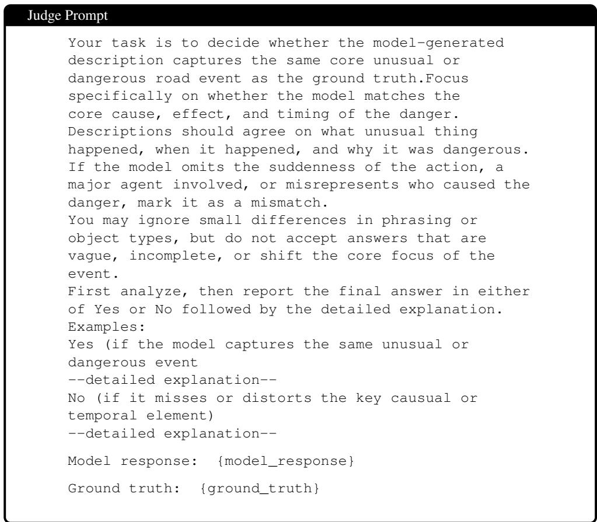  
Figure 7: The prompt passed to DeepSeekV3 for judging. {model\_response} and {ground\_truth} contains the evaluated Video LLM’s response for a specific scenario and the manually created ground truth annotation for the same scenario in the given order.

Detailed prompts for DashBench   
(Q1) What is unusual in this sequence of frames?   
(Q2) What is dangerous in this sequence of frames?   
(Q3) Describe this sequence of frames in detail.   
(Q4) You are an expert in analyzing dash-cam footage   
and should determine if the sequence of frames   
depicts an unusual or dangerous event on the road,   
or if it is a normal road situation. What unusual   
or dangerous event is happening in this scene?   
Provide your answer in the following JSON format:   
{   
"reasoning": "Brief explanation of why you   
think this is an unusual or dangerous event or if   
it is a normal situation.",   
"unusual\_or\_dangerous\_event\_detected":   
true/false   
}   
(Q5) A corner case is an unexpected or unusual driving   
situation that deviates from normal traffic   
behavior, often rare and potentially hazardous.   
Corner cases may appear as visual anomalies,   
environmental shifts, unexpected objects, unusual   
object arrangements, or rare dynamic events.   
Examples include a pedestrian suddenly running   
onto the road from behind an occlusion, a car   
running a red light, or dropped cargo on the   
street.   
Here is a sequence of frames from a dashcam   
video. Identify if there is a corner case in   
this dashcam video, and describe the corner case   
you identified.  
Figure 8: The extensive prompts passed to test the Video LLMs in our benchmark.

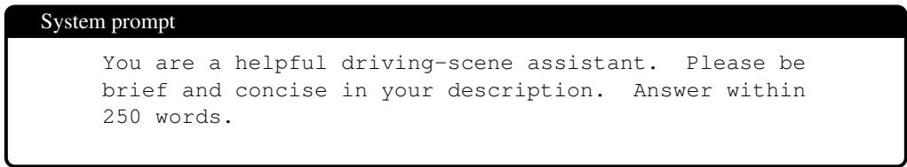  
Figure 9: The system prompt passed to the Video LLM along with the evaluation prompts.

<table><tr><td>Collision Categories (46 types, 890 samples)</td><td>Non-Collision Categories (42 types, 819 samples)</td></tr><tr><td>car hits a curb (32) car hits car (30) car hits cyclist (32) car hits motorbike (30)</td><td>car has failure of components (22) car is out of control (105)</td></tr><tr><td rowspan="8">car hits pedestrian (31) car hits telegraphpoles (22) car hits trees (23) car scratches truck (28) cyclist hits cyclist (2)</td><td>cyclist falls down (6)</td></tr><tr><td>ego-car has failure of components (1)</td></tr><tr><td>ego-car is out of control (81)</td></tr><tr><td>ego-car is overtaken by a car (105)</td></tr><tr><td>ego-car is overtaken by a truck (29)</td></tr><tr><td></td></tr><tr><td>motorbike falls down (45)</td></tr><tr><td></td></tr><tr><td>ego-car hits a car (28)</td><td>pedestrian falls down (3) truck has failure of components (42)</td></tr><tr><td>ego-car hits a crossing car (29)</td><td>truck is out of control (66)</td></tr><tr><td>ego-car hits a crossing cyclist (18)</td><td></td></tr><tr><td>ego-car hits a crossing motorbike (31)</td><td>dangerous lane change/merging (44)</td></tr><tr><td>ego-car hits a crossing pedestrian (29)</td><td>car drives against traffic flow (36)</td></tr><tr><td>ego-car hits a crossing truck (25)</td><td>car runs a red light without collision (31)</td></tr><tr><td>ego-car hits a curb (29)</td><td>pedestrian hazard (23)</td></tr><tr><td>ego-car hits a cyclist (11)</td><td>dangerous overtaking (17)</td></tr><tr><td>ego-car hits a motorbike (29)</td><td>motorbike drives against traffic flow (16)</td></tr><tr><td>ego-car hits a pedestrian (7)</td><td>improper stopping on the road (15)</td></tr><tr><td>ego-car hits a truck (27)</td><td>animal hazard (12)</td></tr><tr><td>ego-car hits telegraphpoles (9)</td><td>near-miss (11)</td></tr><tr><td>ego-car hits trees (22)</td><td>parking/roadside stopping hazard (11)</td></tr><tr><td>motorbike hits a curb (2)</td><td>slippery road conditions due to water on the road (10)</td></tr><tr><td>motorbike hits motorbike (22)</td><td>large object dropped from vehicle (9)</td></tr><tr><td></td><td>vehicle collapses onto road (9)</td></tr><tr><td>motorbike hits pedestrian (3)</td><td>bus drives against traffic flow (8)</td></tr><tr><td>motorbike scratches car (24)</td><td>truck drives against traffic flow (7)</td></tr><tr><td>motorbike scratches truck (1)</td><td>improper turning (6)</td></tr><tr><td>truck hits a curb (29)</td><td>dangerous car reversing (5)</td></tr><tr><td>truck hits car (28)</td><td>motorbike runs a red light without collision (5)</td></tr><tr><td>truck hits cyclist (3)</td><td></td></tr><tr><td>truck hits motorbike (31)</td><td>slippery road conditions due to snow (5)</td></tr><tr><td>truck hits pedestrian (4)</td><td>vehicle goes off-road (5)</td></tr><tr><td>truck hits telegraphpoles (4)</td><td>road obstruction &amp; blockage (4)</td></tr><tr><td>truck hits trees (2)</td><td>cyclist violating traffic rules (3)</td></tr><tr><td>truck hits truck (30)</td><td>emergency vehicle interaction (3)</td></tr><tr><td>car hits large roadblocks (31)</td><td>flooded road segment (3)</td></tr><tr><td>car hits other road facilities (31)</td><td>limited visibility from structure/object (3)</td></tr><tr><td>car hits small roadblocks/road pothholes (15)</td><td>road surface hazard (3)</td></tr><tr><td>ego-car hits large roadblocks (30)</td><td>burning object hazard (2)</td></tr><tr><td>ego-car hits other road facilities (12)</td><td>crime/safety threats on the road (2)</td></tr><tr><td></td><td>structure collapses onto road (2)</td></tr><tr><td>ego-car hits small roadblocks/road pothholes (27)</td><td>tree collapses onto road (2)</td></tr><tr><td>motorbike hits large roadblocks (2)</td><td>truck runs a red light without collision (2)</td></tr><tr><td>motorbike hits other road facilities (1)</td><td></td></tr><tr><td>truck hits large roadblocks (30)</td><td></td></tr><tr><td>truck hits other road facilities (2)</td><td></td></tr><tr><td>truck hits small roadblocks/road pothholes (2)</td><td></td></tr></table>

Table 5: Categorization of corner cases in DashBench (1,709 total samples, 88 categories). Collision categories are on the left (46 types, 890 samples) and non-collision categories on the right (42 types, 819 samples). Underlined categories are sourced from the RoadSocial dataset.

<table><tr><td>Collision Categories (46 types, 890 samples)</td><td colspan="3">Non-Collision Categories (42 types, 819 samples)</td></tr><tr><td>car hits a curb</td><td>32.50%</td><td>car has failure of components</td><td>20.00%</td></tr><tr><td>car hits car</td><td>9.33%</td><td>car is out of control</td><td>31.05%</td></tr><tr><td>car hits cyclist</td><td>31.25%</td><td>cyclist falls down</td><td>23.33%</td></tr><tr><td>car hits motorbike</td><td>28.00%</td><td>ego-car has failure of components</td><td>0.00%</td></tr><tr><td>car hits pedestrian</td><td>21.29%</td><td>ego-car is out of control</td><td>22.47%</td></tr><tr><td>car hits telegraphpoles</td><td>26.36%</td><td>ego-car is overtaken by a car</td><td>11.24%</td></tr><tr><td>car hits trees</td><td>18.26%</td><td>ego-car is overtaken by a truck</td><td>9.66%</td></tr><tr><td>car scratches truck</td><td>6.43%</td><td>motorbike falls down</td><td>29.33%</td></tr><tr><td>cyclist hits cyclist</td><td>20.00%</td><td>pedestrian falls down</td><td>46.67%</td></tr><tr><td>ego-car hits a car</td><td>5.71%</td><td>truck has failure of components</td><td>21.43%</td></tr><tr><td>ego-car hits a crossing car</td><td>11.03%</td><td>truck is out of control</td><td>39.09%</td></tr><tr><td>ego-car hits a crossing cyclist</td><td>16.67%</td><td>dangerous lane change/merging</td><td>16.36%</td></tr><tr><td>ego-car hits a crossing motorbike</td><td>11.61%</td><td>car drives against traffic flow</td><td>1.67%</td></tr><tr><td>ego-car hits a crossing pedestrian</td><td>22.07%</td><td>car runs a red light without collision</td><td>18.71%</td></tr><tr><td>ego-car hits a crossing truck</td><td>9.60%</td><td>pedestrian hazard</td><td>29.57%</td></tr><tr><td>ego-car hits a curb</td><td>3.45%</td><td>dangerous overtaking</td><td>0.00%</td></tr><tr><td>ego-car hits a cyclist</td><td>1.82%</td><td>motorbike drives against traffic flow</td><td>2.50%</td></tr><tr><td>ego-car hits a motorbike</td><td>3.45%</td><td>improper stopping on the road</td><td>8.00%</td></tr><tr><td>ego-car hits a pedestrian</td><td>11.43%</td><td>animal hazard</td><td>63.33%</td></tr><tr><td>ego-car hits a truck</td><td>6.67%</td><td>near-miss</td><td>7.27%</td></tr><tr><td>ego-car hits telegraphpoles</td><td>4.44%</td><td>parking/roadside stopping hazard</td><td>7.27%</td></tr><tr><td>ego-car hits trees</td><td>24.55%</td><td>slippery road conditions due to water on road</td><td>26.00%</td></tr><tr><td>motorbike hits a curb</td><td>0.00%</td><td>large object dropped from vehicle</td><td>20.00%</td></tr><tr><td>motorbike hits motorbike</td><td>10.00%</td><td>vehicle collapses onto road</td><td>37.78%</td></tr><tr><td>motorbike hits pedestrian</td><td>0.00%</td><td>bus drives against traffic flow</td><td>5.00%</td></tr><tr><td>motorbike scratches car</td><td>8.33%</td><td>truck drives against traffic flow</td><td>2.86%</td></tr><tr><td>motorbike scratches truck</td><td>0.00%</td><td>improper turning</td><td>23.33%</td></tr><tr><td>truck hits a curb</td><td>30.34%</td><td>dangerous car reversing</td><td>0.00%</td></tr><tr><td>truck hits car</td><td>13.57%</td><td>motorbike runs a red light without collision</td><td>20.00%</td></tr><tr><td>truck hits cyclist</td><td>6.67%</td><td>slippery road conditions due to snow</td><td>8.00%</td></tr><tr><td>truck hits motorbike</td><td>15.48%</td><td>vehicle goes off-road</td><td>56.00%</td></tr><tr><td>truck hits pedestrian</td><td>5.00%</td><td>road obstruction &amp; blockage</td><td>30.00%</td></tr><tr><td>truck hits telegraphpoles</td><td>10.00%</td><td>cyclist violating traffic rules</td><td>0.00%</td></tr><tr><td>truck hits trees</td><td>0.00%</td><td>emergency vehicle interaction</td><td>33.33%</td></tr><tr><td>truck hits truck</td><td>9.33%</td><td>flooded road segment</td><td>86.67%</td></tr><tr><td>car hits large roadblocks</td><td>32.90%</td><td>limited visibility from structure/object</td><td>6.67%</td></tr><tr><td>car hits other road facilities</td><td>28.39%</td><td>road surface hazard</td><td>6.67%</td></tr><tr><td>car hits small roadblocks/road pothholes</td><td>8.00%</td><td>burning object hazard</td><td>50.00%</td></tr><tr><td>ego-car hits large roadblocks</td><td>9.33%</td><td>crime/safety threats on the road</td><td>40.00%</td></tr><tr><td>ego-car hits other road facilities</td><td>10.00%</td><td>structure collapses onto road</td><td>0.00%</td></tr><tr><td>ego-car hits small roadblocks/road pothholes</td><td>6.67%</td><td>tree collapses onto road</td><td>70.00%</td></tr><tr><td>motorbike hits large roadblocks</td><td>0.00%</td><td>truck runs a red light without collision</td><td>10.00%</td></tr><tr><td>motorbike hits other road facilities</td><td>0.00%</td><td></td><td></td></tr><tr><td>truck hits large roadblocks</td><td>24.67%</td><td></td><td></td></tr><tr><td>truck hits other road facilities</td><td>50.00%</td><td></td><td></td></tr><tr><td>truck hits small roadblocks/road pothholes</td><td>30.00%</td><td></td><td></td></tr></table>

Table 6: Category-wise accuracy (%) of Qwen3-VL 8B on the DashBench corner-case categories. Accuracy is computed by pooling the Q1–Q5 results within each category. Collision categories are shown on the left (46 types, 890 samples), while non-collision categories are shown on the right (42 types, 819 samples). Underlined categories are sourced from the RoadSocial dataset.

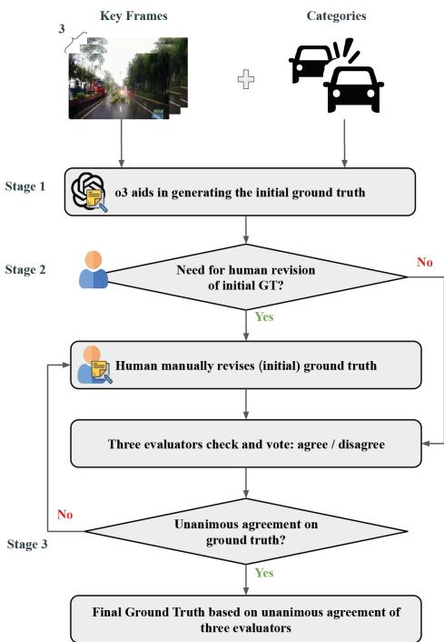  
Figure 10: Illustration of our complete pipeline for o3-assisted scene annotation as well as manual annotation review and validation for reliable ground truth descriptions.

## C Ground Truth Annotation

## C.1 Assisted Scene Annotation with o3

Since writing detailed scene descriptions for hundreds of clips is labour-intensive, we leverage OpenAI’s o3 model to generate detailed scene-level annotations. The process for generating initial ground truth annotations using o3’s assistance for real corner case scenarios involve these steps:

Keyframe extraction For each clip, we extract three critical keyframes representing the progression of the anomalous event. These frames correspond to: (1) the start of the video, (2) the corner case occurrence frame (when the scene reaches its most critical point), and (3) end of the video. This temporal breakdown allows the model to observe the evolution of each incident, though with a limited context.

Contextual prompting Along with the keyframes, we provide the corner-case category label as a concise answer to the model. This helps the model ground its scene-level annotation based on the given category answer, encouraging it to focus on relevant visual semantics and avoid generic captions.

Scene description generation Using these inputs, the o3 model generates descriptive captions as prompted. The detailed prompt can be seen in Figure 6. These captions capture both object-level details and event-level dynamics.

## C.2 Manual Annotation Review and Validation

However, even with passed keyframes and the descriptive hint from the corner case category for creating the ground truth annotation, o3 might fail to create a descriptive annotation based on what actually happened in the scene since its context is limited and it might misinterpret key details. To ensure accuracy and reliability of automatically generated annotations, we implement a multi-phase validation pipeline involving human annotators. This process verifies that all labels and descriptions reflect the visual evidence, align with intended semantics, and maintain consistency across the dataset.

Validation pipeline As shown in Figure 10, our annotation refinement pipeline follows a systematic approach:

1. Initial manual review All scene descriptions generated by o3 are first reviewed by a human annotator. The annotator checks for factual errors, hallucinations, inconsistencies, or ambiguities in the captions, by comparing them with the full list of frames for the specific sample. With the full context, minor phrasing issues or missing details are corrected at this stage to enhance clarity and precision.

2. Evaluator panel verification After initial manual revision, a panel of three evaluators examines the refined annotations and also compares with the full list of frames for the specific sample. Each evaluator independently assesses whether the caption accurately and adequately describes the visual content and evolving corner case situation in the specific scenario.

3. Unanimous agreement check We adopt a strict unanimity principle for final groundtruth acceptance. The revised ground truth annotation is approved only if all three evaluators independently agree on its validity. This high consensus bar ensures robustness and minimizes individual bias or interpretation errors.

4. Conflict resolution If full agreement is not reached, the sample is flagged as "in conflict." These cases are brought back to the initial human annotator for additional human revision and will pass through the evaluator panel again.

5. Final ground truth consolidation Once consensus is achieved through unanimous agreement, the validated ground truth annotation is finalized. These annotations form the basis of the benchmark’s evaluation targets, ensuring trustworthiness and reproducibility for future research. An example corner case scenario with the initial o3- generated initial annotation and the revised, final ground-truth annotation is shown in Figure 11.

## D LLM-as-a-Judge Evaluation

Reliable benchmarking needs an automatic judge whose decisions mirror human judgments. Following existing works using the LLM-as-judge setup, we try out several candidate LLMas-judges for our work, namely DeepSeekV3, Llama3.1(70B), and also a setup using multiple LLM-as-judges as an ensemble [48], named PoLL. Specifically, PoLL uses three relatively cost-efficient LLM-as-judges: Command-R, Claude 3 Haiku, and GPT-3.5 Turbo. This ensemble setup is designed to reduce intra-model bias as PoLL aggregates panel votes via max voting: the panel labels a response as correct if at least one judge deems it correct. For each candidate judge, we randomly sample 100 clips and run evaluation on five different models as shown in Table 2, obtain the judge’s decision, and compare it against human evaluation of whether the Video LLM’s response is aligned with the ground truth. To ensure the human reference is itself reliable, we follow a modified consensus-based validation pipeline:

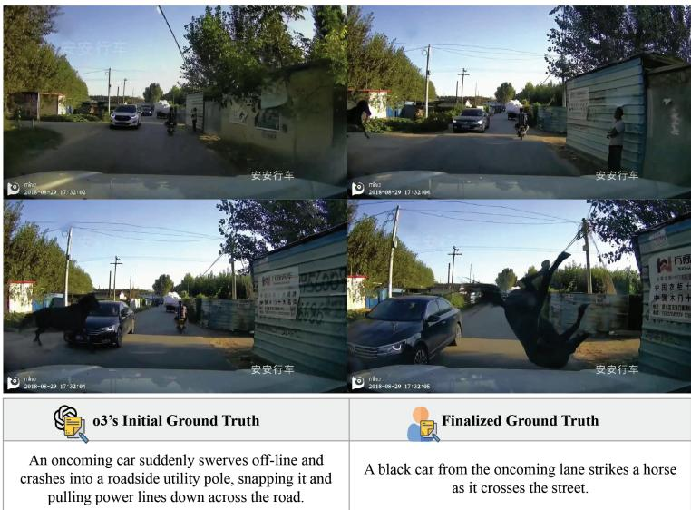  
Figure 11: An example corner case scenario where o3’s initial scene annotation is inaccurate and misses key details. Through our pipeline, we ensure that all samples in our dataset go through extensive manual revision where necessary to ensure annotation quality.

1. Candidate Judge Generates Initial Judgment. For each sample and Video LLM output, the candidate judge independently labels the response as correct or incorrect, based solely on the Video LLM’s response and the ground-truth annotation. The prompt used is shown in Figure 7.

2. Evaluator Panel Alignment Check A panel of three human evaluators reviews each sample, considering the same textual output from the Video LLM and the ground truth. Each evaluator independently decides whether the Video LLM’s answer is aligned with the ground truth.

3. Unanimous Agreement Check We requirefull consensus, meaning that all three evaluators must agree among themselves on the correct/incorrect label for whether or not the model response is aligned with the ground truth annotation. In all other cases, those samples are discussed among all three evaluators to reach a final decision. Only then do we compare this unanimous human consensus with the candidate judge’s label.

4. Final Agreement and Selection. Cohen’s κ is computed between each candidate judge and the unanimous human consensus. As shown in Table 2, DeepSeekV3 achieves the highest agreement (κ = 0.96), confirming it closely mirrors human judgement and can serve as a dependable LLM-as-judge for our benchmark.

## D.1 Judge Access Details

For each LLM-as-judge mentioned, we access the model via OpenRouter at https:// openrouter.ai/ and run judging with the judge prompt shown in Figure 7 with temper-$\mathrm { a t u r e } = 0 . 0$

## D.2 Judge Variance Across Runs

<table><tr><td>Model</td><td>Q1</td><td>Q2</td><td>Q3</td><td> $\mathbf { Q 4 _ { R } }$ </td><td>Q5</td><td>Avg Agree</td></tr><tr><td colspan="7">Closed-source</td></tr><tr><td> $\mathsf { G P T } \mathrm { - } 5$ </td><td> $2 0 . 3 2 _ { \pm 0 . 2 7 }$ </td><td> $3 6 . 7 5 _ { \pm 0 . 3 3 }$ </td><td> $3 0 . 9 1 { \scriptstyle \pm 0 . 3 0 }$ </td><td> $4 6 . 5 3 { \scriptstyle \pm 0 . 3 0 }$ </td><td> $3 9 . 8 2 _ { \pm 0 . 6 7 }$ </td><td> $\overline { { 3 4 . 8 6 _ { \pm 0 . 2 4 } } }$ </td></tr><tr><td> $\mathtt { G e m i n i - 3 - F 1 a s h }$ </td><td> $3 1 . 5 0 { \scriptstyle \pm 0 . 6 1 }$ </td><td> $3 4 . 8 2 _ { \pm 0 . 4 4 }$ </td><td> $2 9 . 0 3 _ { \pm 0 . 5 2 }$ </td><td> $3 9 . 1 6 { \scriptstyle \pm 0 . 5 5 }$ </td><td> $3 4 . 3 8 { \scriptstyle \pm 0 . 3 9 }$ </td><td> $\mathbf { 3 3 . 7 8 _ { \pm 0 . 3 9 } }$ </td></tr><tr><td colspan="7">Open-source</td></tr><tr><td>Qwen3-VL (8B)</td><td> $\overline { { 1 8 . 7 7 _ { \pm 0 . 2 3 } } }$ </td><td> $1 4 . 9 2 _ { \pm 0 . 3 8 }$ </td><td> $1 3 . 9 8 { \scriptstyle \pm 0 . 4 6 }$ </td><td> $2 2 . 1 2 _ { \pm 0 . 2 1 }$ </td><td> $2 1 . 5 2 _ { \pm 0 . 1 5 }$ </td><td> $\mathbf { 1 8 . 2 6 _ { \pm 0 . 1 9 } }$ </td></tr><tr><td>Ovis2.5(9B)</td><td> $1 8 . 6 6 _ { \pm 0 . 5 9 }$ </td><td> $1 4 . 5 7 { \scriptstyle \pm 0 . 5 7 }$ </td><td> $7 . 9 9 _ { \pm 0 . 2 2 }$ </td><td> $1 7 . 7 2 { \scriptstyle \pm 0 . 6 0 }$ </td><td> $1 9 . 7 1 { \scriptstyle \pm 0 . 7 0 }$ </td><td> $\mathbf { 1 5 . 6 4 _ { \pm 0 . 3 9 } }$ </td></tr><tr><td> $\mathrm { I n t e r n V L } 3 . 5$  (8B)</td><td> $4 . 2 9 _ { \pm 0 . 1 5 }$ </td><td> $9 . 4 9 _ { \pm 0 . 3 9 }$ </td><td> $8 . 3 9 _ { \pm 0 . 3 2 }$ </td><td> $1 6 . 1 3 _ { \pm 0 . 2 4 }$ </td><td> $1 5 . 9 2 _ { \pm 0 . 3 1 }$ </td><td> ${ \bf 1 0 . 8 4 _ { \pm 0 . 2 3 } }$ </td></tr></table>

Table 7: Judge variance across five independent judging runs. Mean accuracy $( \% ) \pm$ sample standard deviation (std) over five runs on identical inputs are reported. All std $\leq 0 . 7 0$ %, and model rankings are stable across every individual run.

To measure evaluation stability, we repeat the DeepSeekV3-as-a-judge evaluation pipeline across five independent runs on identical inputs. Table 7 reports the mean accuracy (%) and sample standard deviation across all five runs, broken down by question type (Q1–Q5) and model.

Variance is consistently low across all evaluated models and question types, with standard deviations never exceeding 0.70%. Across the five runs, model rankings remain entirely stable: closed-source models (GPT-5 and Gemini-3-Flash) consistently outperform all open-source counterparts, and the relative ordering within each group is preserved in every individual run. These results confirm that DeepSeekV3 produces deterministic and reproducible judgments at the scale of our benchmark, and that reported accuracy figures are not byproducts of stochastic sampling during inference.

## E Hallucination Mitigation Method Implementation

All methods are implemented on top of InternVL3.5 (8B) as the backbone, with 16 uniformly sampled frames resized to $4 4 8 \times 4 4 8$ via BICUBIC interpolation and normalized with ImageNet mean and standard deviation. Inference uses greedy decoding $( \mathsf { d o \_ s a m p l e { = } F a l s e } )$ across all methods, and all prompts are paired with the system prompt shared in Figure 9. Common settings are summarized in Table 8.

## E.1 Baseline

The baseline runs standard InternVL3.5 (8B) inference with no auxiliary branches or additional passes. The 16 frames are composed into a multi-image query in the format $\begin{array} { r l r l } { \mathtt { F r a m e { - } 1 : } } & { { } < \mathtt { i m a g e > } } & { \mathtt { . ~ . ~ . , F r a m e { - } 1 } 6 : } & { } & { { < \mathtt { i m a g e > } } } \end{array}$ and fed through a single greedy forward pass.

<table><tr><td>Setting</td><td>Value</td></tr><tr><td>Backbone model</td><td>OpenGVLab/InternVL3_5-8B</td></tr><tr><td>Conversation template</td><td>internvl2_5</td></tr><tr><td>Input frames per video</td><td>16</td></tr><tr><td>Frame resolution</td><td>448 × 448 (BICUBIC)</td></tr><tr><td>Image normalization</td><td>ImageNet mean / std</td></tr><tr><td>Data type</td><td>float16</td></tr><tr><td>Decoding strategy</td><td>Greedy (do_sample=False)</td></tr><tr><td>GPU parallelism</td><td>4 (CUDA 0–3, 1:1 shard-to-GPU)</td></tr><tr><td>Prompt types evaluated</td><td>Q1, Q2, Q3, Q4, Q5</td></tr></table>

Table 8: Common inference settings shared across all hallucination mitigation methods.

• max\_new\_tokens: 512

• Contrastive branch: none

• Additional passes: none

## E.2 VDGD (Visual Description-Grounded Decoding)

VDGD [20] uses description-prefixing, operating in two sequential passes over the same 16 frames. The first pass generates a free-text visual description of the clip, and the second pass prepends that description as explicit textual context before the actual question, guiding the model to ground its answer in the described visual content rather than relying on language priors. No contrastive branch is required.

• max\_new\_tokens (pass 2, answer): 512

• desc\_max\_new\_tokens (pass 1, description): 512

• Pass 1 prompt: "Describe this sequence of frames in detail."

• Pass 2 prompt format: "The video is described as: {description} \nNow answer the following question.\n{original\_question}"

• Number of passes: 2

## E.3 SECOND

SECOND [40] implements degraded-context contrast idea where the positive branch receives all 16 frames while the negative branch receives only the single middle frame, intentionally stripping temporal context. The same per-step contrastive formula $\ell _ { \mathrm { f i n a l } } = \ell _ { \mathrm { f u l l } } + \alpha \cdot ( \ell _ { \mathrm { f u l l } } -$ ℓpartial) is applied to upweight information that is only accessible from the full temporal sequence, suppressing responses that could be generated from a single static frame alone.

• max\_new\_tokens: 512

• alpha (contrastive weight): 0.5

• Positive branch: all 16 original frames

• Negative branch: single middle frame (paths[len(paths)//2])

• Number of branches: 2 (full / partial)

<table><tr><td>Model</td><td>Q1</td><td>Q2</td><td>Q3</td><td> $\mathbf { Q 4 _ { R } }$ </td><td>Q5</td><td>Avg Agree</td><td> $\mathbf { Q 4 } _ { \mathrm { T F } }$ </td></tr><tr><td colspan="8">Closed-source</td></tr><tr><td>GPT-5</td><td>20.90</td><td>36.09</td><td>29.28</td><td>47.39</td><td>38.40</td><td>34.41</td><td>96.96</td></tr><tr><td>+ CCW 16 frames</td><td> $1 9 . 6 8 _ { - 1 . 2 2 }$ </td><td> $4 2 . 4 1 _ { + 6 . 3 2 }$ </td><td> $3 4 . 5 1 _ { + 5 . 2 3 }$ </td><td> $5 1 . 4 0 _ { + 4 . 0 1 }$ </td><td> $4 3 . 0 1 _ { + 4 . 6 1 }$ </td><td> $3 8 . 2 0 _ { + 3 . 7 9 }$ </td><td> $9 7 . 8 1 _ { + 0 . 8 5 }$ </td></tr><tr><td>+ CCW 32 frames</td><td> $1 9 . 2 0 _ { - 1 . 7 0 }$ </td><td> $4 0 . 2 2 _ { + 4 . 1 3 }$ </td><td> $3 2 . 4 4 _ { + 3 . 1 6 }$ </td><td> $5 0 . 4 3 _ { + 3 . 0 4 }$ </td><td> $4 3 . 0 1 _ { + 4 . 6 1 }$ </td><td> $3 7 . 0 6 _ { + 2 . 6 5 }$ </td><td> $9 8 . 1 8 _ { + 1 . 2 2 }$ </td></tr><tr><td colspan="8">Open-source</td></tr><tr><td>Qwen3-VL(8B)</td><td>17.98</td><td>14.95</td><td>13.97</td><td>20.90</td><td>21.02</td><td>17.76</td><td>70.84</td></tr><tr><td>+ CCW 16 frames</td><td> $1 3 . 6 1 _ { - 4 . 3 7 }$ </td><td> $1 8 . 3 5 _ { + 3 . 4 0 }$ </td><td> $1 5 . 1 9 _ { + 1 . 2 2 }$ </td><td> $2 2 . 1 1 _ { + 1 . 2 1 }$ </td><td> $2 3 . 5 7 _ { + 2 . 5 5 }$ </td><td> $1 8 . 5 7 _ { + 0 . 8 1 }$ </td><td> $7 3 . 3 9 _ { + 2 . 5 5 }$ </td></tr><tr><td>+ CCW 32 frames</td><td> $1 4 . 5 8 _ { - 3 . 4 0 }$ </td><td> $2 0 . 6 6 _ { + 5 . 7 1 }$ </td><td> $1 3 . 8 5 _ { - 0 . 1 2 }$ </td><td> $2 3 . 4 5 _ { + 2 . 5 5 }$ </td><td> $2 2 . 7 2 _ { + 1 . 7 0 }$ </td><td> $1 9 . 0 5 _ { + 1 . 2 9 }$ </td><td> $6 9 . 5 0 _ { - 1 . 3 4 }$ </td></tr><tr><td>InternVL3.5 (8B)</td><td>3.65</td><td>8.02</td><td>6.68</td><td>10.57</td><td>12.15</td><td>8.21</td><td>74.48</td></tr><tr><td>+ CCW 16 frames</td><td> $4 . 7 4 _ { + 1 . 0 9 }$ </td><td> $9 . 1 1 _ { + 1 . 0 9 }$ </td><td> $7 . 6 5 _ { + 0 . 9 7 }$ </td><td> $1 4 . 2 2 _ { + 3 . 6 5 }$ </td><td> $1 5 . 1 9 _ { + 3 . 0 4 }$ </td><td> $1 0 . 1 8 _ { + 1 . 9 7 }$ </td><td> $8 5 . 0 5 _ { + 1 0 . 5 7 }$ </td></tr><tr><td>+ CCW 32 frames</td><td> $5 . 4 7 _ { + 1 . 8 2 }$ </td><td> $1 2 . 8 8 _ { + 4 . 8 6 }$ </td><td> $9 . 8 4 _ { + 3 . 1 6 }$ </td><td> $1 5 . 3 1 _ { + 4 . 7 4 }$ </td><td> $1 3 . 0 0 _ { + 0 . 8 5 }$ </td><td> $1 1 . 3 0 _ { + 3 . 0 9 }$ </td><td> $8 0 . 6 0 _ { + 6 . 1 2 }$ </td></tr></table>

Table 9: Accuracy (%) of selected models on the CCW subset. Each model’s full-video run is compared against its CCW runs using 16/32 frames sampled from the corner case window only. Subscripts show the change in score relative to the corresponding full-video run: improvement and regression are indicated by the respective signs.

## E.4 TriCD

TRiCD [54] employs two branches in parallel: a positive branch receiving the original frame sequence and a negative branch receiving a randomly shuffled copy (seed = 0), which destroys temporal ordering. At each decoding step, the next-token logits from both branches are combined as $\ell _ { \mathrm { f i n a l } } = \ell _ { \mathrm { p o s } } + \alpha \cdot ( \ell _ { \mathrm { p o s } } - \ell _ { \mathrm { n e g } } )$ , encouraging the model to rely on temporal context rather than frame-level statistics. Both branches maintain independent KV-caches synchronized at each step with the same selected token.

• max\_new\_tokens: 512

• alpha (contrastive weight): 0.5

• neg\_perturb: shuffle (fixed seed = 0; alternatives: blur, grayscale, noise, reverse)

• Number of branches: 2 (positive / negative)

## F Additional Results

In this section, we provide supplementary information and results for the experiments presented in the main paper. First, using Qwen3-VL 8B as a reference, we report category-wise accuracy in Table 6. The grouped results show an accuracy of 15.89% for collision categories and 21.29% for non-collision categories, while the MMAU and RoadSocial subsets achieve 18.78% and 17.13%, respectively. Additionally, in Table 9 we show the results of the cornercase window experiments when not only 16, but also 32 frames, are sampled uniformly only from the corner-case window.

## G Additional Qualitative Examples

## G.1 Failing to Identify Evident Corner Cases

Despite being evident in the sequence of frames, we show that Video LLMs regardless of proprietary status, size, and whether it was fine-tuned on driving data fails to identify obvious corner cases, instead focusing on other parts of the road, as shown by the response of CrashChat on Figure 12 and Gemini-3-Flash on Figure 16.

## G.2 Hallucinating On the Road

Figures 13 shows a case where Video LLMs hallucinate road agents or objects on the road, which are simply not there. For possible deployment as part of a vision-language-action framework enabler, Video LLMs need to overcome this glaring issue of hallucinating on the road.

## G.3 Collisions as Near-Misses

Genuine collisions on the road are important corner cases because they might affect subsequent actions that will be taken by the ADS based on the Video LLM’s observation ; treating them as near-misses due to failing to localize the exact moment where a collision occurs (possibly due to the large number of frames passed) presents a severe issue that should be addressed. Figure 14 shows this occurrence.

## G.4 Making Up Actions on the Road

Another concerning point for Video LLMs as future co-navigators and planners is if they invent or misinterpret the actions of other road agents (e.g., a swerving car when in reality the car is driving straight). Figure 15 shows a case where the Video LLMs’ hallucination of actions and behavior can lead to different crucial decisions made in that scenario.

## H License and Dataset Usage

DashBench is derived from two publicly available datasets and is intended strictly for noncommercial research use.

MM-AU [14] is released for non-commercial use only, covering educational and research purposes. MM-AU itself aggregates footage from publicly available ego-view accident datasets and video platforms (YouTube, Bilibili, Tencent), with all original rights remaining with their respective owners.

RoadSocial [39] is released under the Creative Commons Attribution–NonCommercial– ShareAlike 4.0 International (CC BY-NC-SA 4.0) license. The dataset authors do not claim ownership of the linked video content; all rights and copyright remain with the respective content creators and platform owners. Users are responsible for ensuring compliance with the terms of the hosting platforms.

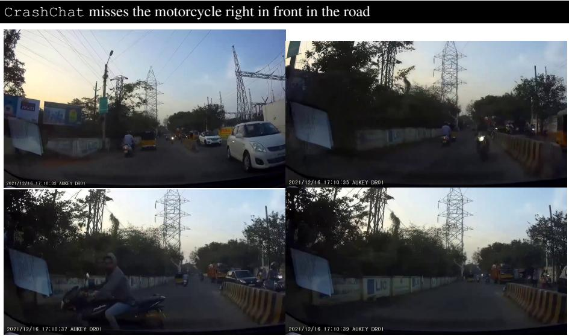

CrashChat: The video shows a busy street with various vehicles and people. The camera is mounted on a vehicle, possibly a motorcycle, and is moving forward. In the foreground, there is a yellow and black auto-rickshaw, followed by a white car. On the right side of the road, there are several people walking, including a man in a blue shirt and a woman in a white dress. There are also two motorcycles with riders wearing helmets. The background features tall electrical towers and power lines, as well as some trees and buildings. The sky is clear with a few clouds.

DeepSeekV3 (Judge): No The model response describes a general scene of a busy street but fails to mention the core dangerous event: a motorbike riding directly toward the dashcam vehicle in the wrong direction. Instead, it provides a vague overview of the surroundings without highlighting the unusual or dangerous action that defines the ground truth.

Figure 12: CrashChat fails to detect the motorcycle ahead which is driving against traffic.

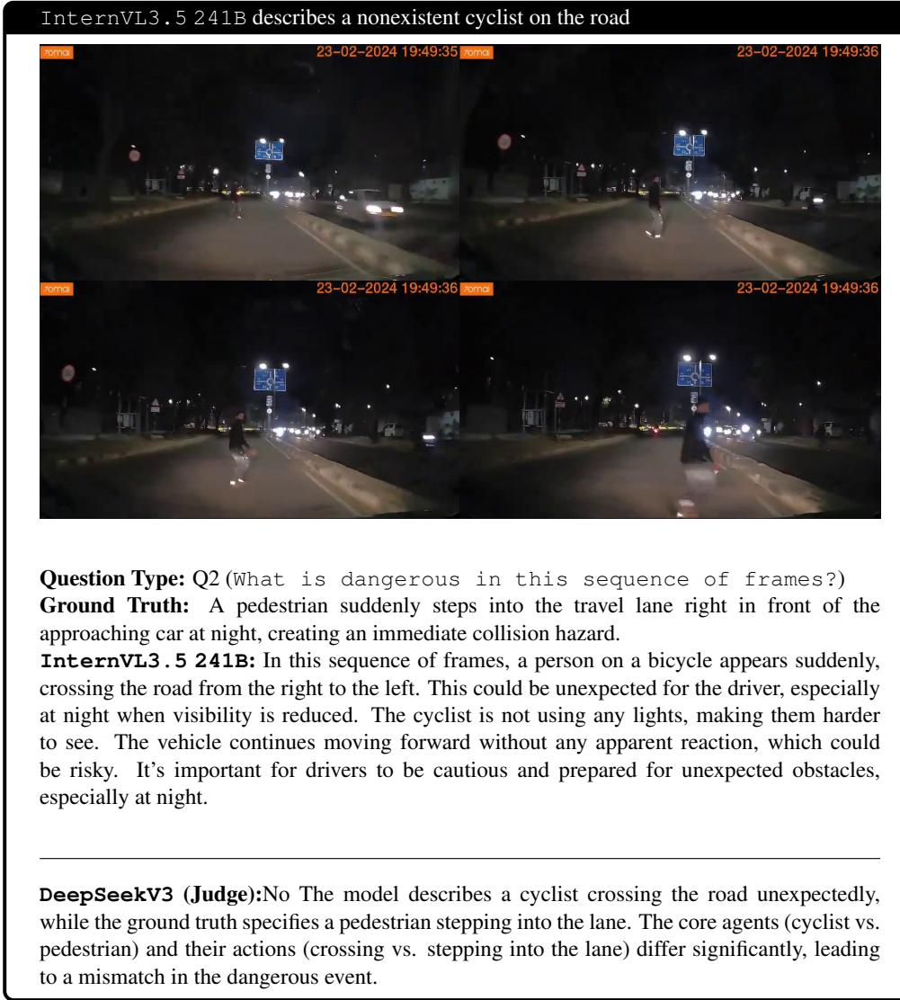  
Figure 13: InternVL3.5 241B hallucinates about a cyclist on the road when the real danger is a pedestrian hazard.

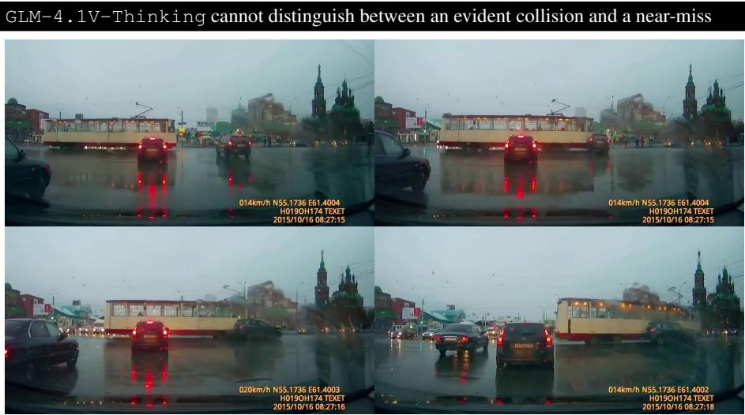

DeepSeekV3 (Judge): No The model response vaguely describes a ¨likely nearcollisionïnvolving multiple vehicles in rainy conditions but does not specify the core event: a car driving into the side of a tram. The ground truth clearly identifies the exact dangerous interaction (car hitting tram), while the model only infers a general risk scenario without pinpointing the specific cause or agents involved. The temporal and causal precision is missing.

Figure 14: GLM-4.1V-Thinking fails to confidently claim that a collision is occurring, demonstrating lack of visual prowess.

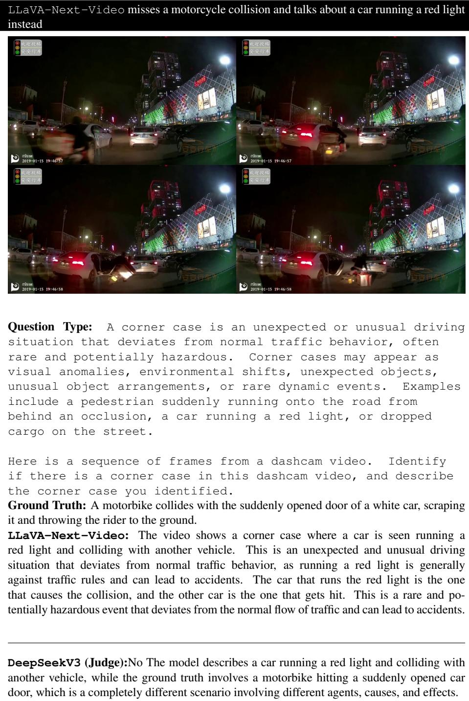  
Figure 15: LLaVA-Next-Video could not identify the motorcycle hitting the car and hallucinates a car running a red light.

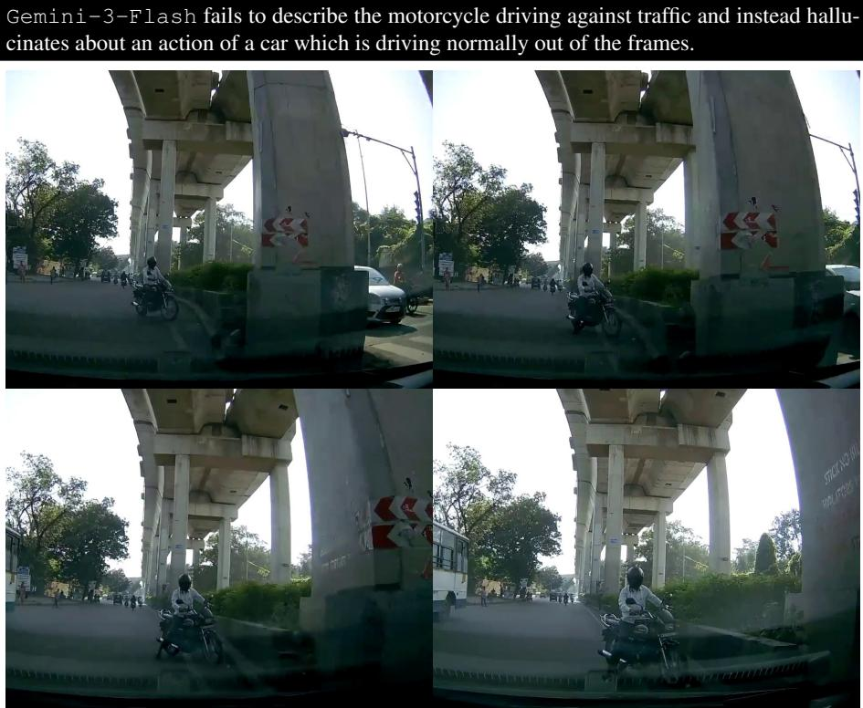  
Question Type: Q1 (What is unusual in this sequence of frames?) Ground Truth: A motorbike is riding the wrong way, heading straight against the flow of oncoming traffic.  
Gemini-3-Flash: The unusual occurrence in this sequence is a white car performing a illegal and dangerous U-turn across multiple lanes.

DeepSeekV3 (Judge):No. The model describes a white car performing an illegal U-turn and cutting across lanes. However, the ground truth states a motorbike is riding the wrong way against traffic flow. These are fundamentally different events — the model focuses on a car’s dangerous maneuver, while the ground truth centers on a motorbike’s unlawful direction. The core cause, agent, and danger are mismatched.

Figure 16: Gemini-3-Flash fails to identify the evident corner case and hallucinates actions of other road agents.