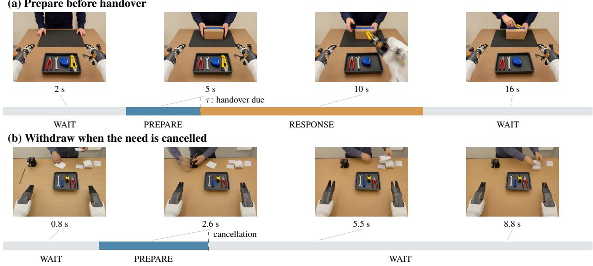
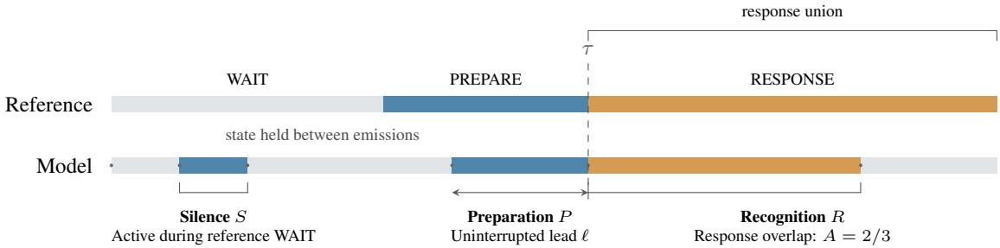
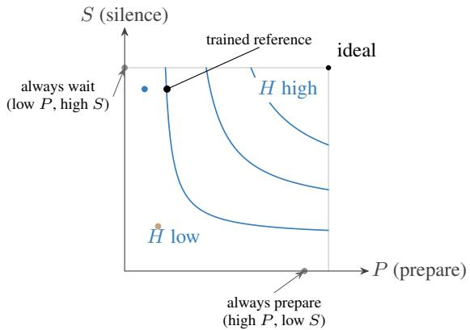
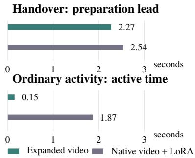
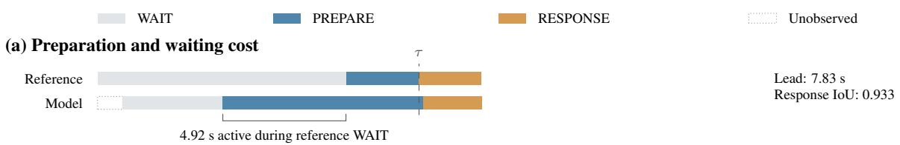
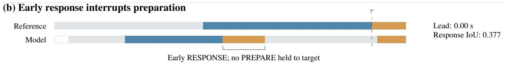
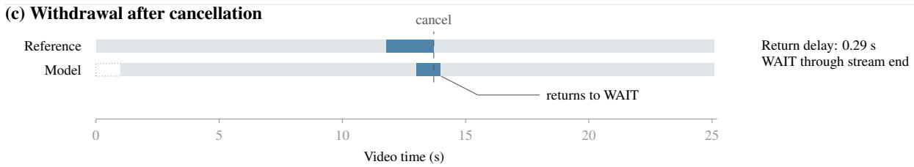

# FUGIBENCH: EVALUATING RELIABLE PREPARATION IN STREAMING VIDEO

PREPRINT

Changheng Cai1, Zhichao Huang1, Song Ren1, Zhichen Zhao2, Hongsen Liu1, Chaoyang Zheng1, Wenxi Wu1, Yuan Fang1, WangWei3, Yang Wang1, Yuchen Wang1

1JD.com (jd.com) 2The Hong Kong University of Science and Technology (ust.hk) 3Tsinghua University (tsinghua.edu.cn)

## ABSTRACT

An assistant watching a worker can prepare for an emerging need before the worker is ready to receive help. As the need evolves, the assistant must maintain preparation until a response is due, or withdraw it if the need disappears. Video anticipation and interactive response benchmarks leave this interval between early evidence and response largely unmeasured. We introduce FuGIBench (Future-Grounded Interaction), a streaming-video benchmark in which a model chooses among waiting, reversible preparation, and response given a causal video prefix and a task contract. The benchmark contains 19,893 synthetic tool-assistance videos across ten tool tasks, in handover, ordinary-activity, and cancelled-need tracks. One primary score credits sustained preparation, incorporates responseinterval alignment, and penalizes activity when the reference prescribes waiting. On a frozen set of 1,000 episodes, a reference system with a longer preparation lead has poorer response alignment, while similar handover leads accompany different levels of activity during ordinary work in matched scenarios. Together with cancellation analyses, these results show why evaluating preparation requires tracking decisions as needs develop, become actionable, or disappear.

## 1 Introduction

While a worker is occupied, an assistant can prepare the tool needed next, maintain that preparation until delivery is due, and withdraw it if the worker changes course. The same decision arises when preparing the next object or instruction in a physical procedure, a warning before a traffic or pedestrian conflict, or an intervention around an industrial vehicle, hoist, or suspended load. This paper measures the decision in tool assistance.

Video anticipation predicts forthcoming actions [1, 3, 8, 11, 13, 16, 25], and online grounding localizes queried events in an evolving prefix [34]. Interactive benchmarks judge whether and when a response is warranted [23, 24]; proactive systems choose when to respond or delegate [33]. World-model benchmarks add generated video, control, and memory [10]. Future-event accuracy and response timing leave the preceding interval unmeasured: a model may predict correctly early and then drop its preparation, or retain it after the need disappears.

We introduce FuGIBench to evaluate preparation grounded in early visual evidence. Given a causal video prefix and a task contract, a model chooses among WAIT, PREPARE, and RESPONSE, with an identifiable target and response condition. FuGIBench scores whether reversible preparation persists until the response is due and is withdrawn on cancellation. Figure 1 illustrates delivery and cancellation timelines. The dataset comprises 19,893 synthetic tool-assistance videos across ten tool tasks, with separate positive-handover, ordinary-activity, and cancelled-need tracks.

Preparation lead captures persistence; reliability also depends on response alignment and silence. We define preparation lead as the duration of the uninterrupted PREPARE state immediately before the target boundary. The primary score combines preparation lead with response alignment and inactivity during reference waiting. Separate diagnostics report preparation, response, and withdrawal behavior.

  
Figure 1: Prepare while a need develops; withdraw when it disappears. Frames from two tool-assistance videos are linked to their reference stages. (a) Preparation precedes the handover boundary τ. (b) Cancellation returns the reference to WAIT without a response. Each state strip spans its own video duration; frame timestamps are in seconds.

On the frozen evaluation set, the native video reference has a longer mean preparation lead than the expanded reference (3.67 vs. 2.08 seconds), yet its response interval aligns less closely with the reference (0.083 vs. 0.695 IoU). This contrast shows that a longer preparation lead alone does not establish more reliable preparation. Across 67 workplacematched pairs, the expanded and native references have similar mean handover leads (2.27 and 2.54 seconds) but are active for 0.15 and 1.87 seconds, respectively, during ordinary activity. Cancellation episodes further reveal whether preparation is withdrawn when the need disappears. Simple decision policies further separate preparation, response, and silence.

Our contributions are threefold:

• We formulate reliable preparation from early visual evidence as a streaming decision task with explicit target, cancellation, and response semantics.

• We instantiate it with 19,893 synthetic tool-assistance videos across ten tool tasks, with annotated stages for handover, ordinary activity, and cancellation.

• We evaluate sustained preparation, response alignment, and silence in one primary score, with separate diagnostics for withdrawal.

## 2 Related Work

Anticipating future activity. Video anticipation predicts a future representation [25], activity classes and durations [1], or the next object interaction. EPIC-KITCHENS supports egocentric action anticipation [8]; rolling-unrolling LSTMs predict actions at several lead times [11], and Anticipative Video Transformer models temporal progression through causal attention [13]. Ego4D forecasts object contact and action sequences [16]; V-JEPA 2 learns predictive representations for understanding, anticipation, and planning [3]. These prediction targets establish what may happen next. FuGIBench evaluates the intervening decision: how long preparation persists until a response is due, whether it is withdrawn on cancellation, and which tool is identified.

Streaming perception and interaction. Long Short-Term Transformer classifies ongoing activity from a causal history [32]; Hierarchical Event Memory retains events for online grounding and upcoming-boundary prediction [34]. VideoLLM-online aligns dialogue with arriving frames [6], while StreamingBench queries understanding at five moments per video [19]. Closer to our decision task, RIVER evaluates retrospective memory, live perception, and proactive response with explicit timing [23]. InteractionBench scores whether and when a streaming system should speak across queries, triggers, and ongoing updates [24]; JoyAI-VL-Interaction chooses silence, response, or delegation [33]. Our comparison concerns the scored decisions: response timing evaluates commitment, while FuGIBench additionally scores a reversible PREPARE state before commitment and its withdrawal when a need disappears. Tool identity, preparation persistence, response-interval overlap, and cancellation behavior are reported separately.

Physical assistance and procedural tasks. Activity anticipation can support reactive robot assistance [17]; HoloAssist records interventions during manipulation [27]. Assembly101 benchmarks anticipation in procedural activities [22]. DexH2R studies dynamic human-to-robot handover and grasping [28]. FuGIBench instead measures a video-based assistant’s sustained preparation and withdrawal before tool handover, without evaluating robot execution.

Preparation in other contracts. Dashcam models anticipate traffic accidents [5], pedestrian models estimate crossing intentions [21], and streaming crime anticipation reasons over developing incidents [30]. Those settings also motivate preparing a warning before it is due and withdrawing it when a conflict clears. The videos and measurements in this paper instantiate the decision in tool assistance.

World models and controlled comparisons. iWorld-Bench evaluates visual generation, trajectory following, and memory through an action-generation interface [10]; FuGIBench evaluates decisions from an observed video prefix. Shortcut learning and causal confusion motivate checking which cues support a prediction [9, 12]. CATER controls scene factors for temporal reasoning [14]. Our evaluation rescales generated stage durations, and its workplace-matched comparison holds recorded scene attributes fixed. The latter reports preparation and ordinary-activity activation on distinct videos, with their durations retained.

## 3 Reliable Preparation from Streaming Video

## 3.1 Causal Input and Prediction Interface

An evaluation episode consists of a video V of duration T, a task contract c, and temporal annotations. At observation time $t _ { k }$ , a model receives only frames with timestamps at or before $t _ { k }$ , together with the contract and its allowed history. The contract specifies the objective, admissible targets, and the condition for a response. It is fixed before the future portion of the video is observed. The numeric boundary τ is a scoring annotation and is not given to the model. Filenames, generation prompts, full-video summaries, and future annotations are excluded from the model input.

The prediction at each observation is

$$
\begin{array} { r } { \hat { y } _ { k } = ( \hat { s } _ { k } , \hat { z } _ { k } , \hat { \tau } _ { k } , \hat { e } _ { k } ) , } \end{array}\tag{1}
$$

where $\hat { s } _ { k }$ is the decision state, $\hat { z } _ { k }$ is the target identity, $\hat { \tau } _ { k }$ is an optional prediction of absolute target time in video seconds, and $\hat { e } _ { k }$ is an optional event-class prediction. The three decision states are:

• WAIT: continue observing without an active preparation or response.

• PREPARE: maintain a target-specific, reversible preparation while the observed evidence supports the forthcoming need.

• RESPONSE: the model commits to the response prescribed by the contract.

The benchmark scores these decisions against the reference stage labels. PREPARE and RESPONSE are both called active when measuring activity during reference WAIT; only PREPARE earns preparation lead. The held RESPONSE interval is evaluated against the annotated response interval.

## 3.2 Response Conditions and Event Outcomes

The contract distinguishes response readiness from the action that follows. In tool assistance, a worker may prepare a workpiece, receive a tool, and then use it. The target boundary τ is the annotated start of handover, when delivery becomes appropriate. The handover segment defines the reference RESPONSE interval, and tool use is a later substage that does not extend it. The videos, stage boundaries, and measurements in this paper use this tool-assistance contract. The other contracts described in the introduction use the same split between a response becoming due and the subsequent physical action. Ordinary and cancelled tool episodes follow WAIT→WAIT and WAIT→PREPARE→WAIT.

Each episode belongs to one of three event classes: target event, no event, or cancelled event. A cancelled event can contain a valid preparation interval followed by evidence that the original need has been abandoned. It has a cancellation boundary but no realized target boundary for that need. Unannotated intervals are unknown, and scored episodes require the contract’s temporal coverage.

Table 1: FuGIBench composition. Tool-assistance videos in the export inspected on November 6, 2026.
<table><tr><td>Source family</td><td>Videos</td></tr><tr><td>Tool handover with initial waiting</td><td>13,194</td></tr><tr><td>Tool ordinary activity Tool cancelled need</td><td>3,502</td></tr><tr><td>Total</td><td>3,197 19,893</td></tr></table>

## 3.3 State Persistence and Reset

Decisions are piecewise constant between observations. An explicit WAIT ends preparation; a declared no-update output retains the previous state and target. Before the first valid decision the state is unknown. Invalid state predictions after adaptation interrupt reliable preparation, while an invalid optional time field does not discard an otherwise valid state and target.

After satisfaction or cancellation, continued preparation is scored against the subsequent reference interval. Episodes are replayed in order, and model memory is reset between independent episodes. Adapters declare their silence semantics, history policy, and field parsing. Section 6 states the observation settings and model interfaces used for the reported comparisons.

## 4 Dataset Construction

## 4.1 Scenario Design and Seed Curation

We construct synthetic videos from human-designed scenarios and staged model generation. Templates specify the workplace, emerging need, response condition, and activity sequence. The scored annotations are the decoded cuts between generated stages, inherited from the template exemplar. A seed here is a scenario exemplar, distinct from a run’s random seed. Vision-language checks retain candidate exemplars as silver seeds; human reviewers select golden seeds to choose the templates. That selection operates at the template level; the scored boundaries remain the generated stage cuts. Variants preserve the task contract while varying the workshop description, clothing, and lighting, with three, four, and three options, respectively. Handover first-frame generation additionally varies the background wall acros three options. The generation pipeline automatically checks each stage and retries it when needed.

## 4.2 Dataset and Coverage

FuGIBench contains 19,893 synthetic tool-assistance videos in the tool export inspected on November 6, 2026 (Table 1). Figure 2 shows construction and evaluation-set sources. The ten categories are wrench, tape measure, pliers, tin snips, utility knife, paintbrush, drill, hand saw, hammer, and screwdriver. The first eight also include ordinary-activity and cancellation tracks.

The frozen 1,000-episode evaluation set uses 600 handover, 200 ordinary, and 200 cancelled episodes from this tool-video collection, with source videos distinct from the 14,002 training videos used by the video references. The positive evaluation videos share scenario titles with the source videos used to construct the timing policies. Sampling precedes scoring. The construction groups original clips with waiting supplements and filters recorded test-video hashes from the policy source set.

To vary stage positions, we independently rescale the durations of WAIT, PREPARE, and RESPONSE by log-uniform factors in [0.35, 2.5], with at least one below 0.8, one above 1.3, and a largest-to-smallest ratio of at least 2. We rescale an unlabeled tail by a factor within [0.65, 1.4]. The same piecewise-linear map transforms every boundary. Evaluation videos, contracts, boundaries, and scoring code will be released.

## 4.3 Tool Assistance Trajectories

Positive trajectories contain initial waiting, preparation, robot handover, and human tool use. Adjacent stages meet at a selected frame, defining the scored cuts. A waiting prefix shifts later timestamps by its recorded offset, keeping the original and extended clip in one episode. Handover start is the target boundary; handover and tool use remain distinct substages.

<table><tr><td>Evaluation episodes</td><td></td><td>Reference sequence</td><td></td><td>Decision tested</td><td></td></tr><tr><td rowspan="2">Handover</td><td>600</td><td></td><td></td><td></td><td rowspan="2">Sustain preparation and respond</td></tr><tr><td></td><td>WAIT</td><td>PREPARE</td><td>RESPONSE</td></tr><tr><td rowspan="2">Ordinary activity</td><td>200</td><td></td><td></td><td></td><td>Remain inactive</td></tr><tr><td></td><td></td><td>WAIT</td><td></td><td></td></tr><tr><td rowspan="2">Cancelled need</td><td></td><td></td><td></td><td></td><td></td></tr><tr><td>200</td><td>WAIT</td><td>PREPARE</td><td>WAIT</td><td>Withdraw preparation</td></tr></table>

Figure 2: Three episode types cover preparation, inactivity, and withdrawal. The 1,000 evaluation episodes are sampled from th 19,893-video tool collection, with stages rescaled and boundaries remapped. Sequences show stage order, not measured durations.

  
Figure 3: Three intervals determine the target-episode score. Preparation uses the uninterrupted PREPARE interval held to τ. Active time in reference WAIT lowers silence. Recognition combines event/tool correctness with response-interval IoU: the illustrated overlap covers two-thirds of the union. Dots mark model emissions; each state holds until the next emission or stream end. Tool identity is read at the first active observation before the target. This is a scoring illustration, not a measured result.

Ordinary activity runs from waiting to waiting while tools remain visible. Cancellation runs from waiting through preparation back to waiting as the worker switches activity. Tools and the robot stay in place as the activity changes, giving withdrawal its own boundary.

## 5 Evaluation Protocol

The protocol reports one primary score, the FuGIBench Overall, from three bounded per-episode components: responsealigned recognition, sustained preparation, and silence when no response is due. The composition follows Overall = $( \mathrm { A \bar { c } c + \cal H ( T \bar { A } , S C ) ) / 2 }$ of InteractionBench [24], with its behavioral term adapted to preparing before the response. The episode is the statistical unit. Figure 3 illustrates the components.

## 5.1 Trajectory and Scoring Window

A declared no-update retains the previous decision, and the last decision holds until the reference stream end. This defines a piecewise-constant held-state trajectory. The reference stages fix the scoring window; all durations are measured in video seconds, independently of the number of emissions. The same held behavior receives the same score across emission cadences.

## 5.2 Primary Score

Let episode i have reference class $c _ { i } \in$ {target, no event, cancelled}. For a target episode, $\tau _ { i }$ is the response onset, $\rho _ { i }$ its end, and $z _ { i }$ the correct tool. Let $\hat { s } _ { i } ( t )$ denote the held model state.

Response-aligned recognition $R _ { i } .$ . Content correctness on a target episode is ${ \cal { C } } _ { i } = { \bf 1 } [ \hat { c } _ { i } = \mathrm { t a r g e t }$ $\wedge \hat { z } _ { i } = z _ { i } ]$ Here $\hat { z } _ { i }$ is the tool named on the earliest active observation strictly before $\tau _ { i } ;$ an absent tool does not satisfy the tool contract. This identity check uses that observation, while response alignment evaluates the held RESPONSE state. Let $\mathcal { R } _ { i } = [ \tau _ { i } , \rho _ { i } )$ and let $\hat { \mathcal { R } } _ { i }$ be the union of all intervals in which the model holds RESPONSE, clipped to the reference stream. Response alignment is their temporal intersection over union:

$$
A _ { i } = \frac { | \hat { \mathcal { R } } _ { i } \cap \mathcal { R } _ { i } | } { | \hat { \mathcal { R } } _ { i } \cup \mathcal { R } _ { i } | } .\tag{2}
$$

No response gives $A _ { i } = 0$ . Recognition is

$$
R _ { i } = \left\{ \begin{array} { l l } { C _ { i } A _ { i } , } & { c _ { i } = \mathrm { t a r g e t } , } \\ { \mathbf { 1 } [ \hat { c } _ { i } = c _ { i } ] , } & { \mathrm { o t h e r w i s e } . } \end{array} \right.\tag{3}
$$

Early or overlong response adds time to the union without adding valid overlap; late response misses part of the reference interval. Response timing enters continuously through $A _ { i } ,$ , without a grace period. For a reference response of duration $D ,$ responding $\delta$ seconds early and ending on time gives $A _ { i } = D / ( D + \delta )$ .

The predicted class $\hat { c } _ { i }$ is read from the trajectory. Any RESPONSE predicts a target event. If the model prepares but never responds, the episode is a cancellation when its last recognized state is WAIT, and a target event otherwise. If it never prepares or responds, the last explicit event class is used, defaulting to no event. Class accuracy and macro-F1 are separate content diagnostics; $R _ { i }$ also includes response alignment.

Preparation $P _ { i }$ . Only observations strictly before $\tau _ { i }$ contribute. Starting from the last such observation, walk backward through the uninterrupted run of PREPARE; let $t _ { i } ^ { \mathrm { p r e p } }$ be its first timestamp. Then

$$
\ell _ { i } = \left\{ { \begin{array} { l l } { \tau _ { i } - t _ { i } ^ { \mathrm { p r e p } } , } & { { \mathrm { t h e ~ t r a i l i n g ~ r u n ~ e x i s t s } } , } \\ { 0 , } & { { \mathrm { o t h e r w i s e } } . } \end{array} } \right.\tag{4}
$$

A WAIT, RESPONSE, or invalid state interrupts the run. The lead measures state persistence, including any part of the run in reference WAIT; tool identity is evaluated separately in $C _ { i } . \mathrm { A }$ supplementary joint diagnostic requires the correct tool throughout the trailing PREPARE run. The bounded preparation component is

$$
P _ { i } = \mathrm { m i n } \bigl ( 1 , \ell _ { i } / \Lambda \bigr ) , \Lambda = 1 0 \mathrm { s } .\tag{5}
$$

One global scale uses video-time seconds across episodes. The reference preparation interval has median 4.25 s and 90th percentile 10.5 s on the 600 targets. The response factor is continuous in interval overlap; preparation has the distinct requirement of remaining in PREPARE at the last pre-target observation.

Silence $S _ { i }$ . Both PREPARE and RESPONSE count as active when the reference prescribes WAIT. With $f _ { i }$ the held active seconds inside reference WAIT intervals and $w _ { i }$ the reference WAIT duration,

$$
S _ { i } = \operatorname* { m a x } \bigl ( 0 , 1 - f _ { i } / w _ { i } \bigr ) ,\tag{6}
$$

and $S _ { i } = 1$ when $w _ { i } = 0$ . A cancelled episode’s valid preparation interval is not penalized; activity continued into the subsequent WAIT lowers $S _ { i }$

Overall. With $H ( a , b ) = 2 a b / ( a + b )$ and $H ( 0 , \cdot ) = 0$ , the per-episode score is

$$
O _ { i } = \left\{ \begin{array} { l l } { ( R _ { i } + H ( P _ { i } , S _ { i } ) ) / 2 , } & { c _ { i } = \mathrm { t a r g e t } , } \\ { ( R _ { i } + S _ { i } ) / 2 , } & { \mathrm { o t h e r w i s e } , } \end{array} \right.\tag{7}
$$

and FuGIBench Overall $\begin{array} { r l r } { \mathrm { ~ } } & { { } } & { = \frac { 1 } { N } \sum _ { i } O _ { i } } \end{array}$ . On target episodes, the harmonic mean requires both preparation and silence for a positive behavioral reward $\mathrm { ( F i g . 4 ) }$ . Evaluating $\bar { \boldsymbol { H } }$ at the plotted component means does not recover the per-episode behavioral reward. Overall combines sustained preparation lead with inactivity during reference WAIT. Preparation extending into reference WAIT can increase lead while lowering $S _ { i }$ through the false-activation cost. The reference trajectory defines the intervals for these measurements, while the model trajectory describes the decisions being evaluated. Together with response alignment, the score evaluates preparation as a streaming decision across these attributes; we report $P$ and S separately to show their trade-off. For target episodes, recognition combines event-class correctness and the correctness of the tool named at the first active observation before the target with response-interval alignment. Non-target episodes have no preparation obligation, so their behavioral term is silence alone. Recognition and behavior have equal weight; components combine per episode before averaging, without fitted mixture weights.

## 5.3 Diagnostic Measures

We report R and S over all episodes, and P, mean lead, and lead coverage over all target episodes, including zero leads. Lead coverage is the fraction of target episodes with positive lead. Preparation, response, and withdrawal are reported separately in the experiments and supplementary tables. Response diagnostics comprise mean $A _ { i } ,$ the fraction with positive response overlap, premature commitment, missing response, and error in the first response onset relative to $\tau _ { i } .$ Premature commitment means the first RESPONSE occurs before $\tau _ { i } ;$ response time outside the reference interval adds to the union without adding overlap. Withdrawal diagnostics comprise trajectory-derived cancellation-class recall and mean active seconds in the reference WAIT following cancellation, over all cancelled episodes. We additionally report how often a model prepares before cancellation. Among episodes in which the model still holds PREPARE immediately before cancellation, we report how often it subsequently returns to WAIT, how often it remains in WAIT through stream end, and its first-return delay. Delay uses observed returns; episodes without a return remain in the return-rate denominator. False activation is additionally reported over all scorable WAIT time. For optional absolute target-time predictions, TTE is the absolute error of the first such prediction made while active strictly before $\tau _ { i } ,$ reported with prediction coverage; absent predictions are N/A.

  
Figure 4: Preparation and silence operating points. Markers show mean $P$ over 600 targets and mean $S$ over all 1,000 episodes for the trained reference, Qwen2.5-Omni (•), Gemma-3n (•), and two constant policies. Contours illustrate the harmonic-mean geometry for individual target episodes. Evaluating H at a plotted aggregate point does not recover mean behavioral reward, which is computed per episode.

  
Figure 5: Preparation and activation in matched scenarios. Mean preparation lead on handovers and mean active time on ordinary activity are shown separately for the $^ { 6 7 }$ pairs with matched recorded workplace attributes. Both references receive video. Full descriptive results are supplementary.

Supplementary examples contrast sustained preparation with early or missing response. All reported results use fgi.metrics.episode.v4 on the same frozen 1,000-episode tool-assistance set. Each run records polling or native emission mode and frame period.

## 6 Experiments and Diagnostic Analysis

## 6.1 Experimental Setup

We evaluate preparation, response alignment, and withdrawal on 600 handovers, 200 ordinary activities, and 200 cancellations.

All learned systems receive video observations; no audio is supplied. Table 2 separates models without benchmarkspecific training from trained video references. Frames arrive every second, except VideoChat3 at 0.5 s; each episode resets the session. Task instructions request a state and tool from general-purpose models; native streaming systems retain their emission and no-update mechanisms.

Table 2: Tool-assistance results on 1,000 episodes (600 handovers, 200 ordinary activities, 200 cancellations). R, P, and S are response-aligned recognition, preparation, and silence. On targets, R combines event-class and tool correctness with response-interval overlap. The tool is named at the first active observation before the target. Lead and coverage use all targets. All learned systems receive video. Trained references use a fixed tool-vocabulary mapping. Adapted denotes an output adapter without ground truth; reference configurations are in Section 6.
<table><tr><td>Model</td><td>Mode</td><td>Overall ↑ [0, 1]</td><td>R↑ [0, 1]</td><td>P↑ [0,1]</td><td>S↑ [0, 1]</td><td>Lead ↑ seconds</td><td>Cov. ↑ fraction</td></tr><tr><td colspan="8">Evaluated without benchmark-specific training (zero-shot / prompt-adapted)</td></tr><tr><td>Qwen3-VL-8B-Instruct [4]</td><td>polled</td><td>0.298</td><td>0.213</td><td>0.004</td><td>0.916</td><td>0.04</td><td>0.06</td></tr><tr><td>Qwen2.5-Omni-7B [31]</td><td>polled</td><td>0.301</td><td>0.205</td><td>0.098</td><td>0.895</td><td>1.19</td><td>0.12</td></tr><tr><td>LLaVA-OneVision-2-8B-Instruct [2]</td><td>polled</td><td>0.300</td><td>0.200</td><td>0.005</td><td>0.995</td><td>0.05</td><td>0.01</td></tr><tr><td>JoyAI-VL-Interaction [33]</td><td>native</td><td>0.300</td><td>0.200</td><td>0.000</td><td>0.999</td><td>0.00</td><td>0.00</td></tr><tr><td>MMDuet2 [29]</td><td>native</td><td>0.299</td><td>0.200</td><td>0.000</td><td>0.999</td><td>0.00</td><td>0.00</td></tr><tr><td>LiveCC-7B-Instruct [7]</td><td>native, adapted</td><td>0.217</td><td>0.036</td><td>0.000</td><td>0.998</td><td>0.00</td><td>0.00</td></tr><tr><td>VideoChat3-4B [18]</td><td>native</td><td>0.200</td><td>0.000</td><td>0.000</td><td>1.000</td><td>0.00</td><td>0.00</td></tr><tr><td>MOSS-Video [26]</td><td>native, adapted</td><td>0.128</td><td>0.023</td><td>0.051</td><td>0.677</td><td>0.52</td><td>0.20</td></tr><tr><td>Gemma-3n-E4B-it [15]</td><td>polled</td><td>0.092</td><td>0.053</td><td>0.164</td><td>0.220</td><td>1.89</td><td>0.34</td></tr><tr><td>MiniCPM-o-2_6 [20]</td><td>polled, adapted</td><td>0.091</td><td>0.013</td><td>0.107</td><td>0.368</td><td>1.16</td><td>0.25</td></tr><tr><td colspan="8">References with task-specific training</td></tr><tr><td>Trained reference</td><td>polled</td><td>0.645</td><td>0.741</td><td>0.208</td><td>0.895</td><td>2.08</td><td>0.56</td></tr><tr><td>JoyAI + task head [33]</td><td>polled</td><td>0.363</td><td>0.324</td><td>0.514</td><td>0.577</td><td>5.36</td><td>0.93</td></tr><tr><td colspan="8">Short video references</td></tr><tr><td>Expanded video reference</td><td>polled</td><td>0.622</td><td>0.710</td><td>0.208</td><td>0.880</td><td>2.08</td><td>0.56</td></tr><tr><td>Native video + LoRA</td><td>polled</td><td>0.218</td><td>0.045</td><td>0.350</td><td>0.661</td><td>3.67</td><td>0.68</td></tr></table>

JoyAI + task head is a task-trained structured prediction head over frozen JoyAI visual and task-query features. The native video reference fine-tunes JoyAI’s decoder LoRA while retaining its visual path. The expanded reference adds frozen V-JEPA 2 features through a learned bridge. Both read eight recent frames at 1 fps; the expanded reference also receives up to eight older four-frame chunks. Their training set is a subset of the tool-video collection, comprising handover, ordinary-activity, and cancellation videos. They share 14,002 training videos and 547 joint updates with the same sampling schedule and seed. Expanded video first completes bridge alignment, then trains bridge and decoder LoRA; native video starts directly with LoRA. Their visual encoders stay frozen, and the comparison concerns the resulting systems. The separate trained reference uses the expanded architecture with 2,688 joint updates. The supplement details task instructions, history, decoding, and output adapters.

## 6.2 Main Results and Behavioral Analysis

Across the ten models without benchmark-specific training, Overall spans 0.091–0.301. Several score close to the always-wait policy’s 0.300, but exhibit different behaviors: Qwen2.5-Omni scores 0.301, with a 1.19 s mean lead, 0.253 response alignment, and 0.895 silence, whereas always-wait has zero lead and response alignment and silence of 1. Qwen3-VL-8B-Instruct reaches 0.298, with silence 0.916, a 0.04 s mean lead, and response alignment 0.239. Gemma-3n-E4B-it reaches 0.092, with silence 0.220, a 1.89 s mean lead, and alignment 0.253.

The video references illustrate why preparation lead must be read together with response alignment. The native video reference has a longer mean lead than the expanded reference (3.67 vs. 2.08 s), while their response alignments are 0.083 and 0.695, respectively. Their Overall scores are 0.218 and 0.622: alongside lead, the score accounts for response alignment and inactivity during reference waiting. JoyAI + task head combines a 5.36 s mean lead and 0.93 coverage with 0.536 response alignment and 0.577 silence, illustrating a different combination of preparation, response, and waiting behavior.

Figure 6 connects the evaluation components to three measured behaviors of the trained reference. In Figure 6(a), sustained preparation earns 7.83 s of lead, including 4.92 s inside reference WAIT; this additional lead comes with a silence cost. In (b), early RESPONSE interrupts preparation, yielding zero lead while retaining 0.377 response alignment.

Cancellation-class recall and post-cancellation activity describe complementary aspects of withdrawal. On all 200 cancellations, these are 0.890 and 1.33 s for the expanded reference, compared with 0.005 and 5.59 s for native video plus LoRA. Expanded video prepares before cancellation in 175 episodes and still holds PREPARE at the boundary in 100, defining the conditional withdrawal set. In 96 of those 100 episodes, the model returns to WAIT before stream end;

  
Figure 6: Three measured behaviors explain the evaluation components. Selected diagnostic episodes from the trained reference; model states are held between observations through stream end. (a) Sustained preparation earns lead, while activation during reference WAIT incurs a silence cost. (b) Early RESPONSE interrupts preparation, giving zero lead despite nonzero response overlap. (c) After cancellation, the model returns to WAIT and remains there. Dashed lines mark target time τ or cancellation; all panels share the same time scale.

in 95 it eventually returns to WAIT and remains there through stream end. The median first-return delay among these 96 returns is 1.79 s. Supplementary tables report conditional withdrawal, all-sample diagnostics, and the policy scores

In Figure 6(c), the trained reference returns to WAIT 0.29 s after cancellation and remains there through stream end.   
These selected episodes illustrate the diagnostics; aggregate results are reported in Table 2.

## 6.3 Scenario Comparisons, Policies, and Sensitivity

Matched scenarios. Sixty-seven pairs share the scenario title, tool, workshop description, clothing, lighting, and wall-bin category. Each pairs a handover with ordinary activity where tools remain visible. Every ordinary video is used once; the pairs cover the eight tools with an ordinary track. Durations are not matched, so we report the two raw behavioral quantities separately in Figure 5.

The matched scenarios distinguish preparation for handover from activation during ordinary activity. The expanded reference has a mean lead of 2.27 s on handovers and is active for 0.15 s on ordinary activity. The native video reference has a mean lead of 2.54 s on handovers and is active for 1.87 s on ordinary activity. The expanded and native references activate during ordinary activity in 8/67 and 37/67 videos, respectively. The supplementary material reports descriptive per-pair differences.

Deterministic policies. Six content-blind policies use the training-majority tool, a tape measure, whenever active. Timed responses start at the first observation at or after 9.634 s; the clock starts preparation at or after 4.459 s. These are median onsets from the positive source set after test-hash filtering. Immediate preparation starts at the first observation before that timed response; wait-then-response omits preparation. No policy receives a test tool, boundary, or event class.

Always preparing scores 0: P = 0.882, but S = 0 and response alignment is zero. Always responding earns no preparation and scores 0.012. Waiting until the fixed response time scores 0.174, and the clock-based policy scores 0.147. Always waiting scores 0.300 through non-target recognition and silence, with zero target preparation and response alignment.

Sensitivity to Λ. Rescoring stored trajectories at every integer Λ from 4 to 20 s changes only preparation. For the ten external rows, trained reference, and JoyAI + task head, the ranking throughout 9–20 s matches the ranking at Λ = 10 s; Kendall’s τ ranges from 0.879 to 1.000 over the full sweep. The ordering of the trained reference, JoyAI + task head, and the ten external rows remains unchanged across the sweep, as does the ordering of the two short video references.

## 7 Conclusion

FuGIBench brings sustained, reversible preparation between early evidence and response into the evaluation of streaming tool assistance. The reference systems show that longer preparation lead can accompany poorer response alignment, and similar handover leads can accompany different levels of activity during ordinary work. Together with cancellation analyses, these findings place the evolution of preparation, its persistence, transition to response, and withdrawal, at the center of evaluation.

## LLM Usage Statement

OpenAI Codex assisted with writing parts of the code, organizing references, and revising the text.

## References

[1] Yazan Abu Farha, Alexander Richard, and Juergen Gall. When Will You Do What? – Anticipating Temporal Occurrences of Activities. In Proceedings of the IEEE Conference on Computer Vision and Pattern Recognition, pages 5343–5352, 2018. URL https://openaccess.thecvf.com/content\_cvpr\_2018/html/Abu\_ Farha\_When\_Will\_You\_CVPR\_2018\_paper.html.

[2] Xiang An, Yin Xie, Feilong Tang, Yunyao Yan, Huajie Tan, Didi Zhu, Changrui Chen, Xiuwei Zhao, Bin Qin, Kaicheng Yang, Yifei Shen, Yuanhan Zhang, Kaichen Zhang, Wenkang Zhang, Zheng Cheng, Nansen Zhang, Chunsheng Wu, Chunjiang Ge, Zimin Ran, Dehua Song, Chunyuan Li, Shikun Feng, Ming Hu, Zhangquan Chen, Junbo Niu, Bo Li, Ziyong Feng, Ziwei Liu, Zongyuan Ge, and Jiankang Deng. LLaVA-OneVision-2: Towards Next-Generation Perceptual Intelligence. arXiv:2605.25979, 2026.

[3] Mahmoud Assran, Adrien Bardes, David Fan, Quentin Garrido, Russell Howes, Mojtaba Komeili, Matthew Muckley, Ammar Rizvi, Claire Roberts, Koustuv Sinha, Artem Zholus, Sergio Arnaud, Abha Gejji, Ada Martin, Francois Robert Hogan, Daniel Dugas, Piotr Bojanowski, Vasil Khalidov, Patrick Labatut, Francisco Massa, Marc Szafraniec, Kapil Krishnakumar, Yong Li, Xiaodong Ma, Sarath Chandar, Franziska Meier, Yann LeCun, Michael Rabbat, and Nicolas Ballas. V-JEPA 2: Self-Supervised Video Models Enable Understanding, Prediction and Planning. arXiv preprint arXiv:2506.09985, 2025. URL https://arxiv.org/abs/2506.09985.

[4] Shuai Bai, Yuxuan Cai, Ruizhe Chen, Keqin Chen, Xionghui Chen, Zesen Cheng, Lianghao Deng, Wei Ding, Chang Gao, Chunjiang Ge, Wenbin Ge, Zhifang Guo, Qidong Huang, Jie Huang, Fei Huang, Binyuan Hui, Shutong Jiang, Zhaohai Li, Mingsheng Li, Mei Li, Kaixin Li, Zicheng Lin, Junyang Lin, Xuejing Liu, Jiawei Liu, Chenglong Liu, Yang Liu, Dayiheng Liu, Shixuan Liu, Dunjie Lu, Ruilin Luo, Chenxu Lv, Rui Men, Lingchen Meng, Xuancheng Ren, Xingzhang Ren, Sibo Song, Yuchong Sun, Jun Tang, Jianhong Tu, Jianqiang Wan, Peng Wang, Pengfei Wang, Qiuyue Wang, Yuxuan Wang, Tianbao Xie, Yiheng Xu, Haiyang Xu, Jin Xu, Zhibo Yang, Mingkun Yang, Jianxin Yang, An Yang, Bowen Yu, Fei Zhang, Hang Zhang, Xi Zhang, Bo Zheng, Humen Zhong, Jingren Zhou, Fan Zhou, Jing Zhou, Yuanzhi Zhu, and Ke Zhu. Qwen3-VL Technical Report. arXiv:2511.21631, 2025.

[5] Fu-Hsiang Chan, Yu-Ting Chen, Yu Xiang, and Min Sun. Anticipating Accidents in Dashcam Videos. In Asian Conference on Computer Vision, pages 136–153, 2016. URL https://yuxng.github.io/Papers/2016/chan\_accv16.pdf.

[6] Joya Chen, Zhaoyang Lv, Shiwei Wu, Kevin Qinghong Lin, Chenan Song, Difei Gao, Jia-Wei Liu, Ziteng Gao, Dongxing Mao, and Mike Zheng Shou. VideoLLM-online: Online Video Large Language Model for Streaming Video. In Proceedings of the IEEE/CVF Conference on Computer Vision and Pattern Recognition, pages 18407–18418, 2024. URL https://openaccess.thecvf.com/content/CVPR2024/html/Chen\_VideoLLMonline\_Online\_Video\_Large\_Language\_Model\_for\_Streaming\_Video\_CVPR\_2024\_paper.html.

[7] Joya Chen, Ziyun Zeng, Yiqi Lin, Wei Li, Zejun Ma, and Mike Zheng Shou. LiveCC: Learning Video LLM with Streaming Speech Transcription at Scale. arXiv:2504.16030, 2025.

[8] Dima Damen, Hazel Doughty, Giovanni Maria Farinella, Sanja Fidler, Antonino Furnari, Evangelos Kazakos, Davide Moltisanti, Jonathan Munro, Toby Perrett, Will Price, and Michael Wray. Scaling Egocentric Vision: The EPIC-KITCHENS Dataset. In Proceedings of the European Conference on Computer Vision, pages 720–736, 2018. URL https://openaccess.thecvf.com/content\_ECCV\_2018/html/Dima\_Damen\_Scaling\_ Egocentric\_Vision\_ECCV\_2018\_paper.html.

[9] Pim de Haan, Dinesh Jayaraman, and Sergey Levine. Causal Confusion in Imitation Learning. In Advances in Neural Information Processing Systems, 2019. URL https://proceedings.neurips.cc/paper\_files/ paper/2019/file/947018640bf36a2bb609d3557a285329-Paper.pdf.

[10] Jianjie Fang, Yingshan Lei, Qin Wan, Ziyou Wang, Yuchao Huang, Yongyan Xu, Baining Zhao, Weichen Zhang, Chen Gao, Xinlei Chen, and Yong Li. iWorld-Bench: A Benchmark for Interactive World Models with a Unified Action Generation Framework. In Proceedings ofthe 43rd International Conference on Machine Learning, volume 306 of Proceedings ofMachine Learning Research, 2026. URL https://arxiv.org/abs/2605.03941.

[11] Antonino Furnari and Giovanni Maria Farinella. What Would You Expect? Anticipating Egocentric Actions With Rolling-Unrolling LSTMs and Modality Attention. In Proceedings ofthe IEEE/CVF International Conference on Computer Vision, pages 6252–6261, 2019. URL https://openaccess.thecvf.com/content\_ICCV\_2019/html/Furnari\_What\_Would\_You\_Expect\_ Anticipating\_Egocentric\_Actions\_With\_Rolling-Unrolling\_LSTMs\_ICCV\_2019\_paper.html.

[12] Robert Geirhos, Jörn-Henrik Jacobsen, Claudio Michaelis, Richard Zemel, Wieland Brendel, Matthias Bethge, and Felix A. Wichmann. Shortcut Learning in Deep Neural Networks. Nature Machine Intelligence, 2(11): 665–673, 2020. doi: 10.1038/s42256-020-00257-z. URL https://arxiv.org/abs/2004.07780v5.

[13] Rohit Girdhar and Kristen Grauman. Anticipative Video Transformer. In Proceedings ofthe IEEE/CVF International Conference on Computer Vision, pages 13505–13515, 2021. URL https://openaccess.thecvf.com/content/ICCV2021/html/Girdhar\_Anticipative\_Video\_ Transformer\_ICCV\_2021\_paper.html.

[14] Rohit Girdhar and Deva Ramanan. CATER: A Diagnostic Dataset for Compositional Actions and Temporal Reasoning. In International Conference on Learning Representations, 2020. URL https://arxiv.org/abs/1910.04744v2.

[15] Google DeepMind. Gemma 3n Model Overview. https://ai.google.dev/gemma/docs/gemma-3n, 2025.

[16] Kristen Grauman, Andrew Westbury, Eugene Byrne, Zachary Chavis, Antonino Furnari, Rohit Girdhar, Jackson Hamburger, Hao Jiang, Miao Liu, Xingyu Liu, Miguel Martin, Tushar Nagarajan, Ilija Radosavovic, Santhosh Kumar Ramakrishnan, Fiona Ryan, Jayant Sharma, Michael Wray, Mengmeng Xu, Eric Zhongcong Xu, Chen Zhao, Siddhant Bansal, Dhruv Batra, Vincent Cartillier, Sean Crane, Tien Do, Morrie Doulaty, Akshay Erapalli, Christoph Feichtenhofer, Adriano Fragomeni, Qichen Fu, Abrham Gebreselasie, Cristina González, James Hillis, Xuhua Huang, Yifei Huang, Wenqi Jia, Weslie Khoo, Jáchym Koláˇr, Satwik Kottur, Anurag Kumar, Federico Landini, Chao Li, Yanghao Li, Zhenqiang Li, Karttikeya Mangalam, Raghava Modhugu, Jonathan Munro, Tullie Murrell, Takumi Nishiyasu, Will Price, Paola Ruiz Puentes, Merey Ramazanova, Leda Sari, Kiran Somasundaram, Audrey Southerland, Yusuke Sugano, Ruijie Tao, Minh Vo, Yuchen Wang, Xindi Wu, Takuma Yagi, Ziwei Zhao, Yunyi Zhu, Pablo Arbeláez, David Crandall, Dima Damen, Giovanni Maria Farinella, Christian Fuegen, Bernard Ghanem, Vamsi Krishna Ithapu, C. V. Jawahar, Hanbyul Joo, Kris Kitani, Haizhou Li, Richard Newcombe, Aude Oliva, Hyun Soo Park, James M. Rehg, Yoichi Sato, Jianbo Shi, Mike Zheng Shou, Antonio Torralba, Lorenzo Torresani, Mingfei Yan, and Jitendra Malik. Ego4D: Around the World in 3,000 Hours of Egocentric Video. In Proceedings ofthe IEEE/CVF Conference on Computer Vision and Pattern Recognition, pages 18995–19012, 2022. URL https://openaccess.thecvf.com/content/CVPR2022/html/Grauman\_ Ego4D\_Around\_the\_World\_in\_3000\_Hours\_of\_Egocentric\_Video\_CVPR\_2022\_paper.html.

[17] Hema S. Koppula and Ashutosh Saxena. Anticipating human activities using object affordances for reactive robotic response. In Proceedings of Robotics: Science and Systems, 2013. doi: 10.15607/RSS.2013.IX.006. URL https://www.roboticsproceedings.org/rss09/p06.html.

[18] Xinhao Li, Yuhan Zhu, Xiangyu Zeng, Yuhao Dong, Haoning Wu, Zhiqiu Zhang, Yuandong Yang, Changlian Ma, Qingyu Zhang, Yansong Shi, Xinyu Chen, Haoran Chen, Zizheng Huang, Jun Zhang, Kun Ouyang, Lin Sui, Ziang Yan, Yicheng Xu, Chenting Wang, Yinan He, Hongjie Zhang, Yi Wang, Yu Qiao, Yali Wang, Ziwei Liu, Kai Chen, and Limin Wang. VideoChat3: Fully Open Video MLLM for Efficient and Generalist Video Understanding. arXiv:2607.14935, 2026.

[19] Junming Lin, Zheng Fang, Chi Chen, Zihao Wan, Fuwen Luo, Peng Li, Yang Liu, and Maosong Sun. StreamingBench: Assessing the Gap for MLLMs to Achieve Streaming Video Understanding. arXiv preprint arXiv:2411.03628, 2024. URL https://arxiv.org/abs/2411.03628v1.

[20] OpenBMB. MiniCPM-o 2.6. https://github.com/OpenBMB/MiniCPM-V/blob/main/docs/minicpm\_o2dot6\_en.md, 2025.

[21] Amir Rasouli, Iuliia Kotseruba, Toni Kunic, and John K. Tsotsos. PIE: A Large-Scale Dataset and Models for Pedestrian Intention Estimation and Trajectory Prediction. In Proceedings ofthe IEEE/CVF International

Conference on Computer Vision, pages 6262–6271, 2019. URL https://openaccess.thecvf.com/content\_ICCV\_2019/html/Rasouli\_PIE\_A\_Large-Scale\_Dataset\_and\_Models\_for\_Pedestrian\_Intention\_Estimation\_ICCV\_2019\_paper.html.

[22] Fadime Sener, Dibyadip Chatterjee, Daniel Shelepov, Kun He, Dipika Singhania, Robert Wang, and Angela Yao. Assembly101: A Large-Scale Multi-View Video Dataset for Understanding Procedural Activities. In Proceedings of the IEEE/CVF Conference on Computer Vision and Pattern Recognition, pages 21096–21106, 2022. URL https://openaccess.thecvf.com/content/CVPR2022/html/Sener\_Assembly101\_A\_Large-Scale\_Multi-View\_Video\_Dataset\_for\_Understanding\_Procedural\_Activities\_CVPR\_2022\_paper.html.

[23] Yansong Shi, Qingsong Zhao, Tianxiang Jiang, Xiangyu Zeng, Yi Wang, and Limin Wang. RIVER: A Real-Time Interaction Benchmark for Video LLMs. In International Conference on Learning Representations, 2026. URL https://arxiv.org/abs/2603.03985v1.

[24] Enxin Song, Suhao Yu, Yifei Xu, Barbara Su, Weili Xu, Wenhao Chai, Yao Tang, Jie Deng, Haiyang Xu, and Jiatao Gu. InteractionBench: A Real-Time Interaction Benchmark for Streaming Video Systems. arXiv preprint arXiv:2610.05775, 2026. URL https://arxiv.org/abs/2610.05775v1.

[25] Carl Vondrick, Hamed Pirsiavash, and Antonio Torralba. Anticipating Visual Representations from Unlabeled Video. In Proceedings ofthe IEEE Conference on Computer Vision and Pattern Recognition, pages 98–106, 2016. URL https://openaccess.thecvf.com/content\_cvpr\_2016/html/Vondrick\_Anticipating\_ Visual\_Representations\_CVPR\_2016\_paper.html.

[26] Pengyu Wang, Chenkun Tan, Shaojun Zhou, Wei Huang, Qirui Zhou, Zhan Huang, Zhen Ye, Jijun Cheng, Xiaomeng Qian, Yanxin Chen, Xingyang He, Huazheng Zeng, Chenghao Wang, Pengfei Wang, Hongkai Wang, Shanqing Gao, Yixian Tian, Chenghao Liu, Xinghao Wang, Botian Jiang, and Xipeng Qiu. MOSS-Video-Preview: Toward Real-Time Video Understanding via Cross-Attention. arXiv:2606.07639, 2026.

[27] Xin Wang, Taein Kwon, Mahdi Rad, Bowen Pan, Ishani Chakraborty, Sean Andrist, Dan Bohus, Ashley Feniello, Bugra Tekin, Felipe Vieira Frujeri, Neel Joshi, and Marc Pollefeys. HoloAssist: an Egocentric Human Interaction Dataset for Interactive AI Assistants in the Real World. In Proceedings ofthe IEEE/CVF International Conference on Computer Vision, pages 20270–20281, 2023. URL https://openaccess.thecvf.com/content/ICCV2023/html/Wang\_HoloAssist\_an\_Egocentric\_ Human\_Interaction\_Dataset\_for\_Interactive\_AI\_Assistants\_ICCV\_2023\_paper.html.

[28] Youzhuo Wang, Jiayi Ye, Chuyang Xiao, Yiming Zhong, Heng Tao, Hang Yu, Yumeng Liu, Jingyi Yu, and Yuexin Ma. DexH2R: A Benchmark for Dynamic Dexterous Grasping in Human-to-Robot Handover. In Proceedings of the IEEE/CVF International Conference on Computer Vision, pages 12702–12712, 2025. URL https://openaccess.thecvf.com/content/ICCV2025/html/Wang\_DexH2R\_A\_Benchmark\_for\_ Dynamic\_Dexterous\_Grasping\_in\_Human-to-Robot\_Handover\_ICCV\_2025\_paper.html.

[29] Yueqian Wang, Songxiang Liu, Disong Wang, Nuo Xu, Guanglu Wan, Huishuai Zhang, and Dongyan Zhao. MMDuet2: Enhancing Proactive Interaction of Video MLLMs with Multi-Turn Reinforcement Learning. arXiv:2512.06810, 2025.

[30] Yusong Wang, Zheyuan Gu, Keyu Mao, Minghao Shao, Mingkun Xu, Prayag Tiwari, Jiawei Shao, and Qingsong Zhao. Streaming Video Crime Anticipation with Spatio-Temporal Causal Reasoning. In Proceedings ofthe IEEE/CVF Conference on Computer Vision and Pattern Recognition, pages 16933–16943, 2026. URL https://openaccess.thecvf.com/content/CVPR2026/html/Wang\_Streaming\_Video\_Crime\_ Anticipation\_with\_Spatio-Temporal\_Causal\_Reasoning\_CVPR\_2026\_paper.html.

[31] Jin Xu, Zhifang Guo, Jinzheng He, Hangrui Hu, Ting He, Shuai Bai, Keqin Chen, Jialin Wang, Yang Fan, Kai Dang, Bin Zhang, Xiong Wang, Yunfei Chu, and Junyang Lin. Qwen2.5-Omni Technical Report. arXiv:2503.20215, 2025.

[32] Mingze Xu, Yuanjun Xiong, Hao Chen, Xinyu Li, Wei Xia, Zhuowen Tu, and Stefano Soatto. Long Short-Term Transformer for Online Action Detection. In Advances in Neural Information Processing Systems, 2021. URL https://proceedings.neurips.cc/paper\_files/paper/2021/file/ 08b255a5d42b89b0585260b6f2360bdd-Paper.pdf.

[33] Dingyu Yao, Junhao Zhou, Chenxu Yang, Chuanyu Qin, Haowen Hou, Zheming Liang, Congcong Wang, Yuhang Cao, Shenglong Ye, Shuai Xie, Shuhuan Gu, Haoyang Huang, Qingyi Si, Nan Duan, and Jiaqi Wang. JoyAI-VL-Interaction: Real-Time Vision-Language Interaction Intelligence. arXiv preprint arXiv:2606.14777, 2026. URL https://arxiv.org/abs/2606.14777v1.

[34] Minghang Zheng, Yuxin Peng, Benyuan Sun, Yi Yang, and Yang Liu. Hierarchical Event Memory for Accurate and Low-latency Online Video Temporal Grounding. In Proceedings ofthe IEEE/CVF International Conference

on Computer Vision, pages 21589–21599, 2025. URL https://openaccess.thecvf.com/content/ICCV2025/html/Zheng\_Hierarchical\_Event\_Memory\_ for\_Accurate\_and\_Low-latency\_Online\_Video\_Temporal\_ICCV\_2025\_paper.html.

## Supplementary Material

## S1 Model Inputs and Reference Configuration

Every learned system receives video frames. Audio is not supplied. The evaluation clock delivers a causal frame every second, except VideoChat3, which uses a 0.5 s period. The service resets its session between episodes. Polled systems return task decisions on those observations; native systems retain their original emission and no-update semantics. The held-state scorer uses the resulting decisions, not the number of messages emitted.

Reference architectures and observation history. The native video reference uses the original JoyAI visual path and decoder, with language attention q/v LoRA of rank 8 and alpha 16. The expanded video reference keeps that path and additionally encodes recent video and older observed chunks with the frozen V-JEPA 2 ViT-L encoder. Both use eight recent frame slots at 1 fps and 224-pixel JoyAI inputs, starting at 1 s. Repeated startup slots preserve their actual timestamps. The added encoder uses 256-pixel inputs. The learned bridge supplies 16 recent evidence tokens and four per historical chunk, with at most eight four-frame chunks. It inserts these features into the native decoder input; it does not use a future-video predictor.

Training data and objective. The two short references sample one causal prefix per training video using the same schedule and seed 20261027. The training pool and the positive source set used for timing policies are subsets of the tool-video collection; Table 4 gives their sizes and the actual joint-training exposure. Supervised token loss trains the JSON state/tool answer; teacher-QA answers provide the retention examples. Visual encoders stay frozen. The native arm trains decoder LoRA; the expanded arm trains the bridge and decoder LoRA after its own 547-update bridgealignment stage. The joint microbatch size is 32, with bridge and LoRA learning rates $1 0 ^ { - 4 }$ and $1 0 ^ { - 5 }$ , respectively, BF16 computation, and a 1,024-token context limit. The separate trained reference is the expanded architecture after the same alignment and a partial joint checkpoint. Thus the reported comparisons have explicitly different alignment or joint exposure.

Output and decoding. The trained references generate a JSON object with state in {WAIT,PREPARE,RESPONSE} and a tool ID, with a null tool for WAIT. Their system instructions define preparation as reversible, handover as response, and subsequent tool use as waiting. Replay uses deterministic decoding, at most 128 new tokens, a new session for each episode, and an unknown state before the configured first observation. A fixed ten-entry dictionary maps English tool IDs to the scorer’s Chinese names; it leaves state and timing unchanged and preserves original text. JoyAI + task head uses frozen visual and query features with a task-trained mapping and structured prediction heads, trained on tool-assistance trajectories. At each poll it forms eight causal slots at nominal 4 fps, repeating the latest available observation when needed. Table 5 summarizes history and output handling for the evaluated systems. Adapters use deterministic rules without access to ground truth. For LiveCC, an unparseable raw output is mapped to no-update and thus retains the prior state; a prediction that remains invalid after adaptation interrupts preparation as specified in the evaluation protocol.

Task instructions. Instructions ask models to infer the current WAIT, PREPARE, or RESPONSE state from observed frames and identify the tool when active; the general-purpose interface requests a JSON state, tool, and event class, while the trained references output state and tool.

## S2 Withdrawal After Preparation

Let $b _ { i }$ be the end of the reference preparation interval of a cancelled episode. We first report whether any PREPARE occurs strictly before $b _ { i }$ (Ever). The conditional risk set (Held) consists of episodes whose last observation strictly before $b _ { i }$ holds PREPARE. An observed return is an explicit WAIT at or after $b _ { i }$ and strictly before stream end. An episode that exits before cancellation is outside this risk set; a RESPONSE, unknown, or invalid state does not count as a return. Stable counts episodes with a return to WAIT followed by continuous WAIT through stream end; earlier returns may be followed by reactivation. Delay is the median time from $b _ { i }$ to the first return, computed over observed returns. Episodes with no observed return remain in the return-rate denominator; delay describes observed exits, not all eligible episodes. The definitions use the saved observation clock and reference boundaries, without an interpolated decision or a grace period.

The expanded reference has 175 episodes with preparation before cancellation, 100 still preparing at cancellation, 96 observed returns, and 95 stable returns. Its median observed return delay is 1.79 s. These counts accompany trajectory-derived cancellation-class recall and post-cancellation active seconds over all 200 episodes; the latter alone can be small for an inactive model. Conditional results retain each system’s preparation coverage and follow-up to stream end.

Table 3: Trained video references. All retain JoyAI’s native visual path. Expanded adds V-JEPA 2 recent/history features. Align and Joint are update counts; the two short references share their joint sampling schedule.
<table><tr><td>Reference</td><td>Trained parameters</td><td>Align</td><td>Joint</td></tr><tr><td>Native video + LoRA</td><td> $\operatorname { D e c o d e r } \operatorname { L o R A }$ </td><td>0</td><td>547</td></tr><tr><td>Expanded video</td><td> $\mathrm { { B r i d g e + d e c o d e r \ L o R A } }$ </td><td>547</td><td>547</td></tr><tr><td>Trained reference</td><td> $\mathrm { { B r i d g e + d e c o d e r \ L o R A } }$ </td><td>547</td><td>2,688</td></tr></table>

Table 4: Training data and joint exposure. Video counts refer to the tool-video collection. QA examples are teacher-generated retention examples.
<table><tr><td>Training pool</td><td>Videos</td></tr><tr><td>Handover / ordinary / cancellation Total</td><td>9,873 / 2,469 / 1,660 14,002</td></tr><tr><td>Positive source for timing policies</td><td>9,860</td></tr><tr><td>Joint schedule</td><td>Videos / prefixes / QA</td></tr><tr><td>Short references</td><td>14,002 / 14,002 / 3,488</td></tr><tr><td>Trained reference (partial)</td><td>4,224 / 68,832 / 17,184</td></tr></table>

## S3 Tool Identity During Sustained Preparation

The primary v4 preparation lead measures the last uninterrupted PREPARE run reaching the target boundary. Recognition separately checks the tool named on the first active observation before that boundary, together with event class and response-interval overlap. For an additional diagnostic, we walk backward from the final pre-target observation while both the state is PREPARE and the held tool matches the reference tool. The resulting correct-tool lead is zero if either condition fails at the final pre-target observation. Its mean and positive-lead coverage use all 600 targets, including zeros. Tool changes interrupt this run even if the preparation state remains unchanged. This calculation adds no identity gate to the primary score.

## S4 Matched Workplace Comparison

Each pair shares its scenario title, tool, workshop description, and categories of clothing, lighting, and wall bin. No ordinary episode is reused across pairs. Video duration is retained: the scorable streams span 11.13–26.46 s for handovers and 8.04–16.54 s for ordinary activity. We report mean preparation lead on handovers and mean active seconds on ordinary episodes as distinct measurements. Their per-pair difference is descriptive, without duration normalization or a causal interpretation.

## S5 Illustrative Preparation and Response Scores

Early RESPONSE earns no preparation lead. Missing response earns no response-aligned recognition even if the model prepared continuously to the target. Preparation persistence and tool identity remain separate components of the primary score.

Table 5: Model interfaces. Polled systems produce a decision on each observation; native systems use their own emission mechanisms. No-update retains the previous state, with an unknown initial state.
<table><tr><td>System</td><td>History / trigger</td><td>State parsing and no-update</td></tr><tr><td>Qwen, LLaVA, Gemma</td><td>Observed conversation; polled</td><td>Parse task JSON.</td></tr><tr><td>MiniCPM-o</td><td>Streaming KV; polled</td><td>Extract task JSON from marked output.</td></tr><tr><td>JoyAI native</td><td>Native streaming; emission</td><td>Parse response JSON; silence retains state.</td></tr><tr><td>MMDuet2</td><td>DTD/KV; two-frame turns</td><td>Parse task output; NO REPLY retains state.</td></tr><tr><td>VideoChat3</td><td>Streaming session; up to 16 rounds</td><td>Parse response JSON; silence or standby retains state.</td></tr><tr><td>LiveCC</td><td>Incremental KV; initial six frames, then pairs</td><td>Extract task JSON; silence or an unparseable state gives no-update.</td></tr><tr><td>MOSS-Video</td><td>Native frame and token stream</td><td>Repair event-class quotes; map no_event in the state field to WAIT; silence retains state.</td></tr><tr><td>JoyAI + task head</td><td>Causal frame window; polled</td><td>Map structured head predictions to state and tool.</td></tr><tr><td>Trained video references</td><td>Recent frames; expanded model adds history chunks; polled</td><td>Parse generated state/tool JSON.</td></tr></table>

Table 6: Deterministic policies on all 1,000 episodes. Active policies use the training-majority tool. Timed responses start at the training-median onset; the clock also waits for the training-median preparation onset. All follow the same observation schedule and held-state scoring as the video reference
<table><tr><td>Policy</td><td>Overall ↑</td><td>R↑</td><td>P↑</td><td>S ↑</td></tr><tr><td>Always WAIT</td><td>0.300</td><td>0.200</td><td>0.000</td><td>1.000</td></tr><tr><td>Always PREPARE</td><td>0.000</td><td>0.000</td><td>0.882</td><td>0.000</td></tr><tr><td>Always RESPONSE</td><td>0.012</td><td>0.023</td><td>0.000</td><td>0.000</td></tr><tr><td>Immediate PREPARE → timed RESPONSE</td><td>0.019</td><td>0.038</td><td>0.324</td><td>0.000</td></tr><tr><td>WAIT → timed RESPONSE</td><td>0.174</td><td>0.061</td><td>0.000</td><td>0.884</td></tr><tr><td>Training-median clock</td><td>0.147</td><td>0.038</td><td>0.107</td><td>0.669</td></tr></table>

Table 7: Preparation, response, and withdrawal. Lead (s), coverage (Cov.), response alignment (A), and premature-response rate (Early) use all 600 targets, including zeros. Trajectory-derived cancellation-class recall (Rec.) and mean active seconds after cancellation (Post) use all 200 cancellations.
<table><tr><td>System</td><td>Lead ↑</td><td>Cov. ↑</td><td>A ↑</td><td>Early ↓</td><td>Rec. ↑</td><td>Post ↓</td></tr><tr><td>Trained reference</td><td>2.08</td><td>0.56</td><td>0.701</td><td>0.27</td><td>0.86</td><td>0.64</td></tr><tr><td>Expanded video</td><td>2.08</td><td>0.56</td><td>0.695</td><td>0.16</td><td>0.89</td><td>1.33</td></tr><tr><td>JoyAI + task head</td><td>5.36</td><td>0.93</td><td>0.536</td><td>0.07</td><td>0.08</td><td>5.10</td></tr><tr><td>Native video + LoRA</td><td>3.67</td><td>0.68</td><td>0.083</td><td>0.00</td><td>0.01</td><td>5.59</td></tr><tr><td>Qwen3-VL-8B</td><td>0.04</td><td>0.06</td><td>0.239</td><td>0.50</td><td>0.00</td><td>0.70</td></tr><tr><td>Gemma-3n</td><td>1.89</td><td>0.34</td><td>0.253</td><td>0.80</td><td>0.01</td><td>1.96</td></tr></table>

Table 8: Conditional withdrawal for the full model panel. Ever, Held, Return, Stable, and Delay follow the definitions in the text. Each fraction retains its denominator. A dash indicates no eligible preparation at cancellation, or no observed return for the delay.
<table><tr><td>System</td><td>Ever</td><td>Held</td><td>Return</td><td>Stable</td><td>Median delay (s)</td></tr><tr><td>Qwen3-VL-8B</td><td>77/200</td><td>14/200</td><td>12/14</td><td>8/14</td><td>1.56</td></tr><tr><td>Qwen2.5-Omni-7B</td><td>39/200</td><td>11/200</td><td>1/11</td><td>0/11</td><td>1.96</td></tr><tr><td>LLaVA-OneVision-2-8B-Instruct</td><td>1/200</td><td>1/200</td><td>0/1</td><td>0/1</td><td>一</td></tr><tr><td>JoyAI-VL-Interaction</td><td>0/200</td><td>0/200</td><td></td><td></td><td>一</td></tr><tr><td>MMDuet2</td><td>0/200</td><td>0/200</td><td></td><td></td><td>一</td></tr><tr><td>LiveCC-7B-Instruct</td><td>0/200</td><td>0/200</td><td></td><td></td><td>一</td></tr><tr><td>VideoChat3-4B</td><td>0/200</td><td>0/200</td><td></td><td></td><td></td></tr><tr><td>MOSS-Video</td><td>180/200</td><td>53/200</td><td>40/53</td><td>24/53</td><td>3.42</td></tr><tr><td>Gemma-3n</td><td>200/200</td><td>48/200</td><td>17/48</td><td>13/48</td><td>1.25</td></tr><tr><td>MiniCPM-o-2_6</td><td>200/200</td><td>27/200</td><td>21/27</td><td>8/27</td><td>1.62</td></tr><tr><td>Trained reference</td><td>168/200</td><td>81/200</td><td>81/81</td><td>80/81</td><td>0.88</td></tr><tr><td>JoyAI + task head</td><td>187/200</td><td>157/200</td><td>24/157</td><td>6/157</td><td>2.21</td></tr><tr><td>Expanded video</td><td>175/200</td><td>100/200</td><td>96/100</td><td>95/100</td><td>1.79</td></tr><tr><td>Native video + LoRA</td><td>25/200</td><td>8/200</td><td>3/8</td><td>2/8</td><td>8.46</td></tr></table>

Table 9: Tool identity during preparation for the full panel. Means and coverage include all 600 targets. Correct-tool lead checks every observation in the trailing run; it does not multiply the state lead by the identity on the first active observation.
<table><tr><td>System</td><td>State lead (s)</td><td>Correct-tool lead (s)</td><td>Correct-tool coverage</td></tr><tr><td>Qwen3-VL-8B</td><td>0.04</td><td>0.03</td><td>0.035</td></tr><tr><td>Qwen2.5-Omni-7B</td><td>1.19</td><td>0.21</td><td>0.023</td></tr><tr><td>LLaVA-OneVision-2-8B-Instruct</td><td>0.05</td><td>0.04</td><td>0.003</td></tr><tr><td>JoyAI-VL-Interaction</td><td>0.00</td><td>0.00</td><td>0.000</td></tr><tr><td>MMDuet2</td><td>0.00</td><td>0.00</td><td>0.000</td></tr><tr><td>LiveCC-7B-Instruct</td><td>0.00</td><td>0.00</td><td>0.000</td></tr><tr><td>VideoChat3-4B</td><td>0.00</td><td>0.00</td><td>0.000</td></tr><tr><td>MOSS-Video</td><td>0.52</td><td>0.03</td><td>0.023</td></tr><tr><td>Gemma-3n</td><td>1.89</td><td>0.16</td><td>0.045</td></tr><tr><td>MiniCPM-o-2_6</td><td>1.16</td><td>0.00</td><td>0.000</td></tr><tr><td>Trained reference</td><td>2.08</td><td>1.87</td><td>0.528</td></tr><tr><td>JoyAI + task head</td><td>5.36</td><td>4.94</td><td>0.868</td></tr><tr><td>Expanded video</td><td>2.08</td><td>1.84</td><td>0.530</td></tr><tr><td>Native video + LoRA</td><td>3.67</td><td>0.93</td><td>0.242</td></tr></table>

Table 10: Workplace-matched pairs. Each of 67 pairs shares the scenario title, tool, workplace description, and clothing, lighting, and wall bin. Lead is the mean continuous PREPARE-only lead on positives; Ordinary is the mean active time on ordinary videos, in seconds. Durations differ. Diff. is the descriptive mean per-pair difference, not a normalized score or causal effect; Active counts ordinary videos with any activation. Both references receive video.
<table><tr><td>System</td><td>Lead ↑</td><td>Ordinary ↓</td><td>Diff.</td><td>Active ↓</td></tr><tr><td>Expanded video</td><td>2.27</td><td>0.15</td><td>2.12</td><td>8/67</td></tr><tr><td>Native video + LoRA</td><td>2.54</td><td>1.87</td><td>0.68</td><td>37/67</td></tr><tr><td>Qwen3-VL-8B-Instruct</td><td>0.08</td><td>0.63</td><td>-0.55</td><td>17/67</td></tr><tr><td>Gemma-3n-E4B-it</td><td>2.24</td><td>9.42</td><td>-7.18</td><td>61/67</td></tr></table>

Table 11: Preparation and response measure distinct behavior. The reference response is [4, 8) s. Rows show illustrative held states, with no response outside the stated interval. In R, response IoU A is multiplied by event-class and first pre-target active tool correctness.
<table><tr><td>Model trajectory</td><td>Lead (s)</td><td>A</td></tr><tr><td>PREPARE [1, 4); RESPONSE [4, 8)</td><td>3</td><td>1.00</td></tr><tr><td>PREPARE [1, 3); RESPONSE [3, 8)</td><td>0</td><td>0.80</td></tr><tr><td>RESPONSE [1, 8)</td><td>0</td><td>0.57</td></tr><tr><td>PREPARE [1, 4); no response</td><td>3</td><td>0.00</td></tr></table>