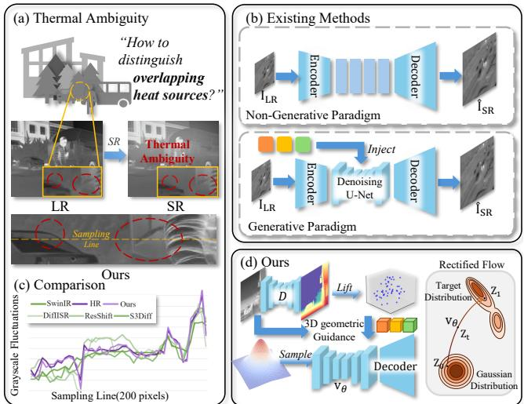
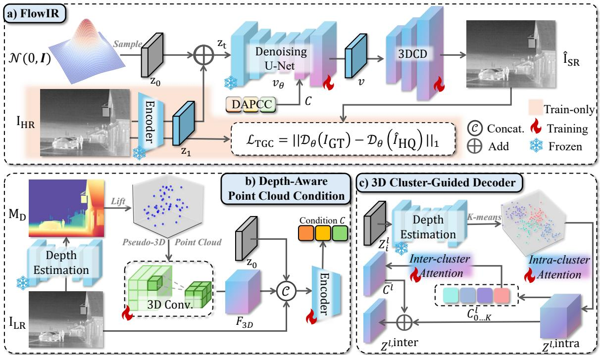
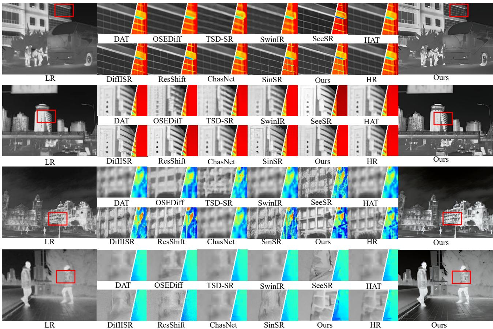
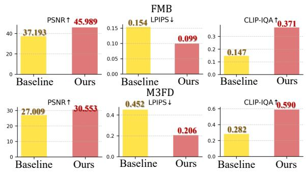
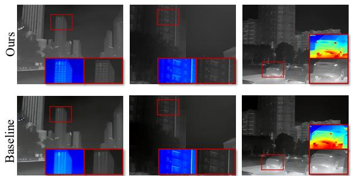
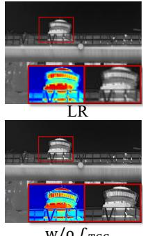
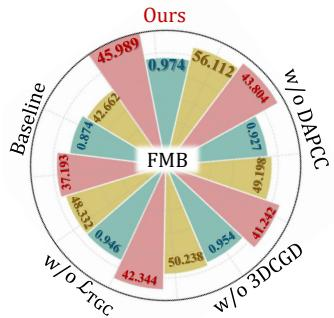
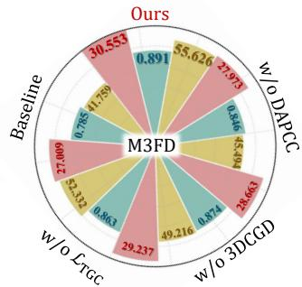
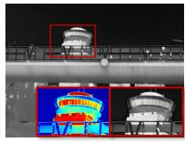

# FlowIR: Depth-driven Rectified Flow for Resolving Thermal Ambiguity in Infrared Super-Resolution

Xingyue Zhu1, Qinyun Mei1, Zhexi Min2, Yang Zou2, Xingyuan Li1, Zhiying Jiang3, and Jinyuan Liu∗1

1Dalian University of Technology, Dalian, China

2Northwestern Polytechnical University, Xi’an, China

3Dalian Maritime University, Dalian, China

Abstract—Distinguishing different heat sources in lowresolution infrared (IR) images is inherently difficult, as multiple thermal emitters often collapse into ambiguous and overlapping responses. Existing super-resolution methods hallucinate structures from such ambiguous 2D evidence, leading to thermal drift, boundary merging, and unreliable restoration under infrared degradations. We propose FlowIR, a depth-driven rectified flow framework that resolves thermal ambiguity by injecting 3D geometric cues into the generation process. Pseudo-3D depth lifting and depth-guided 3D convolutions disentangle overlapping foreground objects, while cluster-wise inter-attention suppresses cross-source feature contamination. A Thermal–Geometry Consistency Loss further enforces geometric alignment during refinement. Built upon a lightweight rectified flow backbone, FlowIR restores IR images in only a few steps, producing sharply separated, degradation-robust, and geometrically faithful highresolution results.

Index Terms—low-level vision, infrared image super-resolution, rectified flow

## I. INTRODUCTION

Infrared (IR) imaging, which captures thermal emissions independent of visible illumination, plays a critical role in safety-critical scenarios such as surveillance, autonomous driving, and perception in adverse weather or at night. However, due to longer wavelengths and expensive sensor materials, IR cameras typically exhibit low spatial resolution and limited photon efficiency. As a result, IR images are often degraded by noise, blur, stripe artifacts, and low contrast, significantly limiting their reliability in real-world applications [1], [2].

Deep learning has substantially advanced image superresolution (SR), from early CNN-based models with residual and dense designs [3], [4] to Transformer-based architectures exploiting long-range attention [5]–[8], and more recently, diffusion-based methods [9]–[11] leveraging strong generative priors for robust detail synthesis. Despite their success on visible images, these approaches generalize poorly to infrared data, whose low texture contrast, weak structural boundaries, and thermally dominated intensity distributions fundamentally differ from RGB imagery.

Recent infrared image super-resolution (IISR) methods have begun to exploit sensor–specific priors to alleviate the lack of high-frequency details. ChasNet [12] boosts informative responses by channel-split convolutions, while CoRPLE [2] and CRG [13] adopt contourlet-domain residual modeling with task-driven or prompt-based guidance. DifIISR [14] further integrates gradient-based alignment and perceptual priors into a diffusion framework to enhance reconstruction quality. Despite these advances, most IISR approaches are still built on purely 2D intensity cues and simplified degradations (e.g., bicubic downsampling), which limits their ability to handle complex real-world infrared degradations and severe structural ambiguity between overlapping heat sources [15], [16].

  
Fig. 1: (a) Overlapping heat sources introduce thermal ambiguity in SR. (b) Prior methods rely solely on 2D features. (c) Grayscale fluctuations show that FlowIR better preserves pixel fidelity in overlapping heat sources regions. (d) FlowIR mitigates thermal ambiguity by integrating 3D geometric guidance into a rectified flow framework.

The aforementioned methods, while advancing infrared image super-resolution (IISR), still face two fundamental challenges. First, they rely solely on 2D thermal intensities and lack geometric priors to disambiguate overlapping heat sources, making reconstruction inherently ill-posed when multiple emitters collapse into a single low-resolution projection, as shown in Fig. 1 (a). Second, existing architectures and pixel-wise losses offer no mechanism to suppress cross-object feature mixing, causing high-frequency details to leak across semantic regions—particularly under complex degradations such as blur, thermal noise, and stripe artifacts, as shown in Fig. 1 (b). Together, these limitations lead to unstable boundaries and inconsistent structures, severely hindering reliable IISR in real-world environments.

To this end, we propose FlowIR, a depth-driven rectified flow framework that explicitly addresses both limitations of existing IISR methods, as shown in Fig. 1 (d). To overcome the input-level thermal–geometric ambiguity, FlowIR introduces a Depth-Aware Point Cloud Condition that lifts depth into a pseudo-3D representation and injects explicit geometric priors into the flow trajectory, enabling reliable separation of overlapping heat sources that are indistinguishable in 2D. To mitigate model-level feature contamination, we design a 3D Cluster-Guided Decoder with intra–inter cluster attention, which enforces object-consistent representations while suppressing cross-object high-frequency leakage. In addition, a Thermal–Geometry Consistency Loss aligns the reconstructed IR image with scene geometry, ensuring physically coherent heat boundaries. These designs allow FlowIR to achieve structurally faithful and degradation-robust infrared image superresolution in complex environments, as shown in Fig. 1 (c).

Our main contributions are manifold: 1) We propose FlowIR, a depth-driven rectified flow framework that integrates depth-derived 3D cues into rectified flow to produce structurally faithful and degradation-robust reconstructions. 2) To overcome input-level thermal–geometric ambiguity, we introduce a Depth-Aware Point Cloud Condition that lifts depth into a pseudo-3D representation and supplies explicit geometry to separate overlapping heat sources. 3) To mitigate model-level feature contamination, we design a 3D Cluster-Guided Decoder with intra–inter cluster attention and a Thermal–Geometry Consistency Loss, enforcing object-consistent features and geometrically aligned heat boundaries.

## II. METHOD

## A. Overview

As shown in Fig. 2, the process begins by sampling a noisy image from a standard Gaussian distribution. In the Depth-Aware Point Cloud Condition (DAPCC) module, the degraded infrared image is utilized to generate a condition enriched with 3D geometric information at the input level. This condition then guides the estimation of the rectified flow. Subsequently, the noisy image is fed into a pre-trained U-Net, which iteratively samples under DAPCC guidance to estimate the rectified flow and derive the restored infrared image features. Finally, the 3D Cluster-Guided Decoder (3DCD) is employed to reconstruct a restored infrared image with thermal source consistency.

## B. Depth-Aware Point Cloud Condition

To tackle the thermal–geometric ambiguity in degraded infrared images, we propose the Depth-Aware Point Cloud Condition, which utilizes point clouds to infuse 3D geometric constraints into the estimation of the rectified flow trajectory. While previous image restoration methods based on rectified flow also utilize the original low-quality image as a condition, they rely solely on its 2D image features. Degraded infrared images often lack high-frequency details, and infrared images inherently suffer from blurred thermal boundaries. This can lead to incorrect restoration of thermal edges, further compromising downstream tasks such as detection and segmentation. Our Depth-Aware Point Cloud Condition addresses this by explicitly utilizing 3D geometric information to guide the reconstruction pathway, thereby enhancing the restoration reliability and improving the thermal consistency of the results.

During training, the condition C for time step t is constructed as follows. Initially, the low-quality infrared image $\mathrm { I } _ { \mathrm { L R } } \in \mathbb { R } ^ { H \times W }$ is passed through a pre-trained depth estimation network ${ \mathcal { D } } ,$ and the predicted depth map $M _ { D }$ is projected into a pseudo-3D point-cloud volume $\bar { V _ { p c } } \in \mathbb { R } ^ { H \times W \bar { \times } Z }$ . Subsequently, a 3D convolutional module is employed to extract 3D geometric features $F _ { 3 D } \in \mathbb { R } ^ { H \times W \times C ^ { \prime } }$ from the infrared scene. These features, together with ILR and the noisy image $z _ { t }$ at step t, are then concatenated and passed through a fully connected layer to generate the final condition. This process can be expressed as:

$$
M _ { D } = \mathcal { D } _ { \theta } ( \mathrm { I _ { L R } } ) , \quad V _ { p c } = \mathcal { P } ( M _ { d } , \mathrm { I _ { L R } } ) ,\tag{1}
$$

$$
F _ { 3 D } = \mathrm { C o n v } 3 \mathrm { D } ( V _ { p c } ) ,\tag{2}
$$

$$
C _ { t } = \mathrm { M L P } \big ( \mathrm { C o n c a t ( I _ { L R } , } ~ F _ { 3 D } , ~ z _ { t } \big ) \big ) ,\tag{3}
$$

where P represents the lifting process. The rectified flow $v _ { \theta }$ is then estimated with $C$ being injected into the decoder of the U-Net. Subsequently, the restored feature $z _ { 1 }$ can be computed and then serve as the input to the 3DCD.

## C. 3D Cluster-Guided Decoder

Infrared images often lack texture and structural information due to physical factors such as heat diffusion, thermal noise, and stripe artifacts. When further degraded by compressioninduced detail loss, direct reconstruction tends to produce unstable details and structurally inconsistent results, leading to the accumulation of errors at the feature level during decoding.

To address this issue, we propose the 3D Cluster-Guided Decoder. During feature reconstruction, it leverages depth information to maintain thermal consistency through intracluster self-attention, while promoting global information flow via inter-cluster cross-attention.

In real-world infrared scenes, objects of the same semantic category typically exhibit continuous depth and similar texture characteristics. Building on this observation, we propose the Intra-Inter Cluster Attention $( \mathrm { I } ^ { 2 } \mathrm { C A } )$ ) mechanism. By incorporating K-Means clustering, I2CA establishes a hierarchical attention framework that ensures feature consistency within clusters and contextual correlation across clusters, thereby mitigating thermal boundary instability during infrared image restoration.

Given the input $Z ^ { l }$ to the l-th upsample layer of the decoder, the features are first transformed into a pseudo-3D point cloud volume using the depth map obtained from a depth estimation network. Then, K-means clustering is applied to group points that share similar spatial and semantic characteristics into

  
Fig. 2: Overview of FlowIR. a) The overall pipeline, a depth-driven rectified flow framework that integrates depth-derived 3D cues into rectified flow to produce structurally faithful and degradation-robust reconstructions. b) The Depth-Aware Point Cloud Condition (DAPCC) module, which provides explicit geometric cues to mitigate overlapping heat sources by injecting depth-aware guidance into the flow trajectory. c) The 3D Cluster-Guided Decoder (3DCD) that enforces feature consistency within each semantic cluster while preventing high-frequency leakage across different objects.

K clusters. For each cluster $k ,$ an inter-cluster mask $M _ { k }$ is computed as $M _ { k } ^ { l } \ = \ \{ i \ \in \ [ 1 , N ] \ | \ L _ { i } ^ { l } \ = \ k \}$ . This mask is applied to $Z ^ { l }$ to extract the corresponding cluster-specific features $Z _ { k } ^ { l } = \{ Z _ { i } ^ { l } \mid i \in M _ { k } ^ { l } \} \in \mathbb { R } ^ { M _ { k } ^ { l } \times C }$ . Subsequently, intracluster self-attention is performed on these features to model internal dependencies, yielding the refined features after intracluster interaction $Z _ { k } ^ { l , \mathrm { i n t r a } } = \bar { \mathrm { S e l f A t t n } } ( Z _ { k } ^ { l } )$

After obtaining the features following inter-cluster interaction, we compute a comprehensive representation ${ \cal C } ^ { l } \ =$ $[ C _ { 0 } ^ { l } , C _ { 1 } ^ { l } , \dots , C _ { K - 1 } ^ { l } ] \ \in \ \mathbb { R } ^ { K \times \bar { C } }$ for each class via averaging, and then apply global inter-class attention to these aggregated representations.

$$
\begin{array} { c } { { C _ { k } ^ { l } = \displaystyle \frac { 1 } { M _ { k } ^ { l } } \sum _ { i \in M _ { k } ^ { l } } Z _ { i } ^ { l , \mathrm { i n t a } } , } } \\ { { Q ^ { l } = C ^ { l } W ^ { Q } , \quad K ^ { l } = C ^ { l } W ^ { K } , \quad V ^ { l } = C ^ { l } W ^ { V } } } \\ { { \bar { C } ^ { l } = \displaystyle \mathrm { s o f t m a x } \left( \frac { Q ^ { l } K ^ { l \top } } { \sqrt { d _ { h } } } \right) V ^ { l } , } } \\ { { Z ^ { l , \mathrm { i n t e r } } = Z ^ { l , \mathrm { i n t r a } } + \bar { C } ^ { l } . } } \end{array}\tag{4}
$$

(5)

(6)

Finally, for each Upsample block in the decoder, the features are updated as follows before upsampling:

$$
Z ^ { l + 1 } = \mathrm { L a y e r N o r m } ( Z ^ { l , \mathrm { i n t e r } } + \mathrm { F F N } ( Z ^ { l , \mathrm { i n t e r } } ) ) ,\tag{7}
$$

By incorporating 3D geometric priors at the feature level, the 3D Cluster-Guided Decoder facilitates interaction between depth-aware geometric information and infrared texture features, ultimately yielding a high-fidelity infrared image ˆISR that maintains fidelity in both thermal semantics and geometric structure.

## D. Optimization

During model training, we aim to leverage the rich priors of diffusion models while adapting them for infrared image super-resolution. To this end, we freeze the U-Net and Encoder, and train only the Depth-Aware Point Cloud Condition generator, the injection modules in the U-Net, and the 3D Cluster-Guided Decoder. While conventional super-resolution losses are constrained solely in the 2D image space (e.g., focusing on improving overall visual quality and pixel-level reconstruction), they lack explicit consideration of the 3D scene structure. To ensure that the super-resolution process preserves the 3D boundaries and spatial relationships of thermal objects, we introduce the Thermal-Geometry Consistency Loss as

$$
\mathcal { L } _ { \mathrm { T G C } } = \left. \mathcal { D } _ { \theta } ( \mathrm { I _ { G T } } ) - \mathcal { D } _ { \theta } ( \hat { \mathrm { I } } _ { \mathrm { S R } } ) \right. _ { 1 } .\tag{8}
$$

The Thermal-Geometry Consistency Loss enforces consistency between the restored HR image and the ground truth in the depth estimation space, thereby constraining the network to learn physically plausible super-resolution reconstructions.

To further enhance the supervision of thermal source segmentation and achieve sharper boundaries, we introduce a Thermal Boundary Loss as $\dot { \mathcal { L } _ { \mathrm { T B } } } = \left. \nabla \mathcal { D } _ { \theta } ( \mathrm { I } _ { \mathrm { G T } } ) - \nabla \mathcal { D } _ { \theta } ( \hat { \mathrm { I } } _ { \mathrm { S R } } ) \right. _ { 1 } ,$ where ∇(·) denotes the Laplacian operator. The overall training loss is formulated by combining the Thermal-Geometry Consistency Loss and the Thermal Boundary Loss with a pixel-wise L1 loss between $\mathrm { I _ { G T } }$ and $\hat { \mathrm { I } } _ { \mathrm { S R } }$

TABLE I: Quantitative comparison on FMB and $\mathrm { M ^ { 3 } F D }$ (×4). The best is in bold, while the second is underlined. For FMB, Set5/10/20 are randomly sampled subsets. For $\mathrm { M ^ { 3 } F D }$ , the three sets correspond to three degradation levels of increasing severity.
<table><tr><td>Datasets</td><td colspan="5">Set5</td><td colspan="5">Set10</td><td colspan="5">Set20</td></tr><tr><td>Methods</td><td>PSNR↑</td><td>SSIM↑</td><td>LPIPS↓ CLIP-IQA↑ MUSIQ↑</td><td></td><td></td><td>PSNR↑ SSIM↑</td><td></td><td>LPIPS↓ CLIP-IQA↑ MUSIQ↑</td><td></td><td></td><td>PSNR↑</td><td>SSIM↑</td><td>LPIPS↓ CLIP-IQA↑ MUSIQ↑</td><td></td></tr><tr><td></td><td>42.2995</td><td></td><td>0.1432</td><td>27.9576</td><td>42.0907</td><td>0.9429</td><td>FMB</td><td>0.1607</td><td>0.1436</td><td>28.3499</td><td>42.0137</td><td>0.9713</td><td>0.1612</td><td>0.1445</td><td>28.1572</td></tr><tr><td>ChasNet</td><td>42.4312</td><td>0.9732 0.9740</td><td>0.1587 0.1587</td><td>0.1462</td><td>30.3660</td><td>42.3480</td><td>0.9713</td><td>0.1566</td><td>0.1435</td><td>30.0319</td><td>42.4958</td><td>0.9777</td><td>0.1560</td><td>0.1508</td><td>30.3948</td></tr><tr><td>DAT</td><td>33.3211</td><td>0.9073</td><td>0.1780</td><td>0.3414</td><td>46.2157</td><td>33.0764</td><td>0.9462</td><td>0.1812</td><td>0.3463</td><td>46.4277</td><td>34.4098</td><td>0.9461</td><td>0.1761</td><td>0.3381</td><td>45.9119</td></tr><tr><td>DifIISR</td><td></td><td></td><td></td><td></td><td></td><td></td><td></td><td></td><td></td><td></td><td></td><td></td><td></td><td></td><td></td></tr><tr><td>HAT</td><td>42.4071</td><td>0.9741</td><td>0.1590</td><td>0.1490</td><td>29.6160</td><td>42.7815</td><td>0.9677</td><td>0.1569</td><td>0.1489</td><td>29.9870</td><td>42.0661</td><td>0.9428</td><td>0.1582</td><td>0.1527</td><td>29.9735</td></tr><tr><td>OSEDiff</td><td>29.8344</td><td>0.9142</td><td>0.1493</td><td>0.1255</td><td>26.7615</td><td>29.9214</td><td>0.9028</td><td>0.1462</td><td>0.1233</td><td>27.0928</td><td>28.8406</td><td>0.9403</td><td>0.1521</td><td>0.1229</td><td>26.8410</td></tr><tr><td>ResShift</td><td>30.9180</td><td>0.8606</td><td>0.2345</td><td>0.2569</td><td>41.8227</td><td>30.5916</td><td>0.8617</td><td>0.2348</td><td>0.2583</td><td>41.4749</td><td>30.9579</td><td>0.8843</td><td>0.2340</td><td>0.2579</td><td>41.8641</td></tr><tr><td>S3Diff</td><td>35.9839</td><td>0.9367</td><td>0.0987</td><td>0.1273</td><td>27.6296</td><td>36.1984</td><td>0.9003</td><td>0.0950</td><td>0.1238</td><td>27.4848</td><td>37.0308</td><td>0.9447</td><td>0.0973</td><td>0.1306</td><td>27.7889</td></tr><tr><td>SeeSR</td><td>32.1978</td><td>0.8918</td><td>0.2080</td><td>0.3662</td><td>54.0856</td><td>31.7994</td><td>0.8570</td><td>0.2112</td><td>0.3625</td><td>54.3989</td><td>32.5235</td><td>0.8907</td><td>0.2085</td><td>0.3649</td><td>54.1967</td></tr><tr><td>SinSR</td><td>33.3448</td><td>0.8996</td><td>0.1856</td><td>0.3598</td><td>46.7329</td><td>33.3051</td><td>0.9315</td><td>0.1873</td><td>0.3622</td><td>46.9874</td><td>34.4848</td><td>0.9044</td><td>0.1891</td><td>0.3612</td><td>46.8769</td></tr><tr><td>SwinIR</td><td>33.9122 33.4534</td><td>0.9340</td><td>0.1701</td><td>0.0800</td><td>27.8900</td><td>34.0223</td><td>0.9168</td><td>0.1662</td><td>0.0753</td><td>27.9453</td><td>33.7240</td><td>0.9499</td><td>0.1701</td><td>0.0827</td><td>28.2644</td></tr><tr><td>TSD-SR Ours</td><td>45.9893</td><td>0.9090</td><td>0.1409</td><td>0.1036</td><td>29.0244</td><td>33.0868 45.8921</td><td>0.9460</td><td>0.1426</td><td>0.1037</td><td>29.4242</td><td>32.1092</td><td>0.9409</td><td>0.1391</td><td>0.1017</td><td>28.6661</td></tr><tr><td></td><td></td><td>0.9743</td><td>0.0993</td><td>0.3711</td><td>56.1121</td><td></td><td>0.9783</td><td>0.0939</td><td>0.3820</td><td>55.5468</td><td>46.1166</td><td>0.9767</td><td>0.0961</td><td>0.3747</td><td>54.3354</td></tr><tr><td colspan="10">M3FD</td><td colspan="7"></td></tr><tr><td>ChasNet</td><td>26.4945 26.9818</td><td>0.6635</td><td>0.5922 0.5930</td><td>0.2740 0.3114</td><td>22.1305 24.2585</td><td>26.2028 26.1590</td><td>0.6531 0.6457</td><td>0.6067 0.6088</td><td>0.2607 0.3070</td><td>21.0788</td><td>25.4257</td><td>0.6366</td><td>0.6156</td><td>0.2410</td><td>20.9368</td></tr><tr><td>DAT</td><td>27.6127</td><td>0.6703</td><td></td><td></td><td></td><td></td><td></td><td></td><td></td><td>23.5410</td><td>25.2609</td><td>0.6285</td><td>0.6296</td><td>0.2877</td><td>21.6303</td></tr><tr><td>DifIISR</td><td></td><td>0.7071</td><td>0.4540</td><td>0.5486</td><td>38.8221</td><td>27.3071</td><td>0.6953</td><td>0.4635</td><td>0.5473</td><td>37.8671</td><td>26.7638</td><td>0.6659</td><td>0.4771</td><td>0.5384</td><td>37.0030</td></tr><tr><td>HAT</td><td>27.0783</td><td>0.6781</td><td>0.5903</td><td>0.3514</td><td>21.7532</td><td>26.7508</td><td>0.6758</td><td>0.6043</td><td>0.3337</td><td>21.6000</td><td>25.8480</td><td>0.6696</td><td>0.6129</td><td>0.3294</td><td>20.6502</td></tr><tr><td>OSEDiff</td><td>27.0964</td><td>0.8416</td><td>0.2699</td><td>0.1746</td><td>30.2667</td><td>26.4260</td><td>0.8392</td><td>0.2712</td><td>0.1603</td><td>29.3309</td><td>26.1743</td><td>0.8277</td><td>0.2906</td><td>0.1599</td><td>28.8840</td></tr><tr><td>ResShift</td><td>26.7873</td><td>0.6454</td><td>0.5536</td><td>0.3494</td><td>30.8375</td><td>25.7273</td><td>0.6439</td><td>0.5618</td><td>0.3477</td><td>29.1958</td><td>25.0640</td><td>0.6377</td><td>0.5753</td><td>0.3208</td><td>28.4651</td></tr><tr><td>S3Diff</td><td>29.0797</td><td>0.8433</td><td>0.2446</td><td>0.2035</td><td>32.6686</td><td>28.5746</td><td>0.8310</td><td>0.2501</td><td>0.2089</td><td>31.8038</td><td>28.2000</td><td>0.8177</td><td>0.2589</td><td>0.1900</td><td>31.0597</td></tr><tr><td>SeeSR</td><td>27.3091</td><td>0.7871</td><td>0.3529</td><td>0.4860</td><td>53.9075</td><td>27.0611</td><td>0.7713</td><td>0.3683</td><td>0.4752</td><td>51.8196</td><td>26.5842</td><td>0.7634</td><td>0.3813</td><td>0.4610</td><td>50.7902</td></tr><tr><td>SinSR</td><td>27.2619</td><td>0.6779</td><td>0.4785</td><td>0.5313</td><td>38.3171</td><td>26.3434</td><td>0.6703</td><td>0.4870</td><td>0.5196</td><td>37.4036</td><td>25.6494</td><td>0.6638</td><td>0.5043</td><td>0.4984</td><td>36.6088</td></tr><tr><td>SwinIR</td><td>26.9230</td><td>0.6769</td><td>0.5814</td><td>0.3236</td><td>27.7717</td><td>26.7383</td><td>0.6676</td><td>0.5923</td><td>0.3198</td><td>28.1318</td><td>26.2332</td><td>0.6627</td><td>0.5980</td><td>0.2992</td><td>25.5470</td></tr><tr><td>TSD-SR</td><td>28.4807</td><td>0.8285</td><td>0.2809</td><td>0.1505</td><td>28.9007</td><td>27.8437</td><td>0.8237</td><td>0.2913</td><td>0.1360</td><td>27.8249</td><td>26.4642</td><td>0.8150</td><td>0.3045</td><td>0.1162</td><td>26.8972</td></tr><tr><td>Ours</td><td>30.5532</td><td>0.8916</td><td>0.2060</td><td>0.5599</td><td>55.6257</td><td>28.3384</td><td>0.8274</td><td>0.2227</td><td>0.5498</td><td>53.0167</td><td>28.4713</td><td>0.8216</td><td>0.2379</td><td>0.5431</td><td>52.9505</td></tr></table>

## III. EXPERIMENTS

## A. Experimental Settings

Implementation Details. We initialize FlowIR with a pretrained Stable Diffusion model to leverage its strong generative prior. During training, the U-Net and encoder are frozen, while only the Depth-Aware Point Cloud Condition generator, the depth injection modules, and the 3D Cluster-Guided Decoder are optimized. For depth estimation, we used pre-trained Depth Anything 3 [17]. All experiments are conducted on an NVIDIA A100 GPU using the Adam optimizer, with 8 clusters and 5 sampling steps.

Datasets and Evaluation Metrics. To improve robustness, we adopt the real-world infrared degradation strategy from ControlFusion [18], which synthesizes both single and hybrid degradations. Degradations are applied to the FMB [19] dataset with random intensities and the M3FD [20] datasets at three severity levels, and both datasets then underwent ×4 downsampling. The degraded FMB dataset is split into 70% training and 30% testing, while evaluation is performed on both the FMB test set and the full degraded M3FD dataset. Performance is assessed using five standard metrics: PSNR, SSIM, LPIPS, CLIP-IQA, and MUSIQ, covering both reconstruction fidelity and perceptual quality.

Comparative Methods. We conduct a comprehensive comparison with 11 recent state-of-the-art image super-resolution methods, including those specifically designed for infrared images. The comparison methods encompass both non-generative paradigms like ChasNet [12], DAT [21], HAT [6], and generative paradigms like DifIISR [14], OSEDiff [22], ResShift [23], S3Diff [9], SeeSR [10], SinSR [24], and TSD-SR [25].

## B. Quantitative Comparison

Table I reports quantitative super-resolution results on the FMB and M3FD datasets. Results on FMB are averaged over multiple randomly sampled subsets, while M3FD is evaluated under three degradation levels of increasing severity. Our method consistently outperforms all generative baselines in PSNR and SSIM on both datasets. Moreover, it achieves the best performance on perception-oriented metrics across nearly all test settings, except for FMB. These results indicate that FlowIR delivers high-quality reconstructions in both human perception and deep feature space, validating the effectiveness of depth integration at multiple stages of the framework.

## C. Qualitative Results

Figure 3 visualizes super-resolution results of four infrared images from the FMB (top) and $\mathrm { M ^ { 3 } F D }$ (bottom) datasets. As shown, non-generative methods struggle to recover sharp and reliable thermal boundaries, as they rely solely on 2D infrared features. Their performance further degrades under stronger degradations, often failing to separate foreground and background objects with similar temperatures. Generative approaches produce perceptually sharper results, while the lack of explicit 3D geometric guidance leads to distorted boundaries and noticeable artifacts. In contrast, our method consistently reconstructs sharp, well-separated thermal structures that closely align with the ground truth.

## D. Ablation Studies

1) Depth Awareness: To evaluate the impact of depth information in IISR, we compare FlowIR with its baseline [26] variant. As shown in Fig. 4, incorporating depth cues yields consistent performance gains on both the FMB and FMBM3FD datasets. In particular, the CLIP-IQA score improves significantly, indicating a substantial enhancement in perceptual quality. The qualitative comparisons in Fig. 5 further corroborate these results.

Fig. 3: Qualitative results. The first and second rows are from the static scenes of the FMB dataset (×4), while the third and fourth rows are from the M3FD dataset (×4).  

Fig. 4: Quantitative ablation study on Depth Awareness.  
  
Fig. 5: Qualitative ablation study on Depth Awareness.

2) Individual Modules: To evaluate the contribution of each component, we perform ablation studies by individually removing the DAPCC, the 3DCGD, and the $( { \mathcal { L } } _ { \mathrm { T G C } } )$ , followed by separate training and evaluation. As shown in Fig. 6, removing DAPCC causes a pronounced drop in PSNR on both datasets, indicating that depth-guided flow prediction is critical for pixel-wise fidelity. In contrast, removing either 3DCGD or LTGC mainly degrades SSIM and MUSIQ. The qualitative results in Fig. 7 further confirm that the complete FlowIR model best suppresses thermal ambiguity and structural hallucination.

## IV. CONCLUSION

To address the thermal ambiguity in infrared image superresolution caused by the collapse of overlapping heat sources, we propose FlowIR, a depth-driven rectified flow framework that injects explicit 3D geometric cues into the generation process. By jointly leveraging pseudo-3D depth guidance and cluster-aware feature reconstruction, FlowIR effectively resolves overlapping heat sources and stabilizes thermal boundaries. Extensive experiments validate its superiority in reconstruction fidelity under complex degradations.

  
Fig. 6: Quantitative ablation study of individual modules on PSNR, SSIM, MUSIQ.  
w/o DAPCC

  
Fig. 7: Qualitative ablation study on individual modules. REFERENCES

[1] Yating Liu, Yang Zou, Xingyuan Li, Xingyue Zhu, Kaiqi Han, Zhiying Jiang, Long Ma, and Jinyuan Liu, “Toward a training-free plug-andplay refinement framework for infrared and visible image registration Ours Oursand fusion,” in Proceedings of the 33rd ACM International Conference on Multimedia, 2025, pp. 1268–1277.

0.974 0.891[2] Xingyuan Li, Jinyuan Liu, Zhixin Chen, Yang Zou, Long Ma, Xin Fan, and Risheng Liu, “Contourlet residual for prompt learning enhanced infrared image super-resolution,” in European Conference on Computer Vision. Springer, 2024, pp. 270–288.

[3] Jiwon Kim, Jung Kwon Lee, and Kyoung Mu Lee, “Accurate image super-resolution using very deep convolutional networks,” in Proceedings of the IEEE conference on computer vision and pattern recognition, 2016, pp. 1646–1654.

[4] Ying Tai, Jian Yang, and Xiaoming Liu, “Image super-resolution via deep recursive residual network,” in Proceedings of the IEEE conference on computer vision and pattern recognition, 2017, pp. 3147–3155.

[5] Jingyun Liang, Jiezhang Cao, Guolei Sun, Kai Zhang, Luc Van Gool, and Radu Timofte, “Swinir: Image restoration using swin transformer,” in Proceedings of the IEEE/CVF international conference on computer vision, 2021, pp. 1833–1844.

[6] Xiangyu Chen, Xintao Wang, Jiantao Zhou, Yu Qiao, and Chao Dong, “Activating more pixels in image super-resolution transformer,” in Proceedings of the IEEE/CVF conference on computer vision and pattern recognition, 2023, pp. 22367–22377.

[7] Yang Zou, Jun Ma, Zhidong Jiao, Xingyuan Li, Zhiying Jiang, and Jinyuan Liu, “Toward real-world infrared image super-resolution: A unified autoregressive framework and benchmark dataset,” arXiv preprint arXiv:2603.04745, 2026.

[8] Songcheng Du, Yang Zou, Zixu Wang, Xingyuan Li, Ying Li, Changjing Shang, and Qiang Shen, “Unsupervised hyperspectral image superresolution via self-supervised modality decoupling,” International Journal of Computer Vision, vol. 134, no. 4, pp. 152, 2026.

[9] Xianjie Zhang, Yusen Zhang, Yujie He, and Min Li, “S3diff: Semantic fusion and structure-guided global generation from a single image with diffusion models,” Journal ofArtificial Intelligence and Soft Computing Research, vol. 16, no. 1, pp. 39–53, 2026.

[10] Rongyuan Wu, Tao Yang, Lingchen Sun, Zhengqiang Zhang, Shuai Li, and Lei Zhang, “Seesr: Towards semantics-aware real-world image

37.193super-resolution,” in Proceedings of the IEEE/CVF conference on computer vision and pattern recognition, 2024, pp. 25456–25467.

0.147[11] Yang Zou, Xingyue Zhu, Kaiqi Han, Jun Ma, Xingyuan Li, Zhiying Jiang, and Jinyuan Liu, “Hatir: Heat-aware diffusion for turbulent infrared video super-resolution,” arXiv preprint arXiv:2601.04682, 2026.

[12] Kalpesh Prajapati, Vishal Chudasama, Heena Patel, Anjali Sarvaiya, Kishor P Upla, Kiran Raja, Raghavendra Ramachandra, and Christoph Busch, “Channel split convolutional neural network (chasnet) for 27.009 thermal image super-resolution,” in Proceedings of the IEEE/CVF Conference on Computer Vision and Pattern Recognition, 2021, pp. 4368–4377.

0.206 0.2816[13] Yang Zou, Zhixin Chen, Zhipeng Zhang, Xingyuan Li, Long Ma, Jinyuan Liu, Peng Wang, and Yanning Zhang, “Contourlet refinement gate framework for thermal spectrum distribution regularized infrared image super-resolution,” International Journal of Computer Vision, 2026.

[14] Xingyuan Li, Zirui Wang, Yang Zou, Zhixin Chen, Jun Ma, Zhiying Jiang, Long Ma, and Jinyuan Liu, “Difiisr: A diffusion model with gradient guidance for infrared image super-resolution,” in Proceedings urof the Computer Vision and Pattern Recognition Conference, 2025, pp. 7534–7544.

[15] Yang Zou, Zhaoshuai Qi, Yating Liu, Weiyi Liu, Zihao Xu, Weipeng Sun, Xingyuan Li, Jiaqi Yang, and Yanning Zhang, “Axispose: Modelfree matching-free single-shot 6d object pose estimation via axis generation,” IEEE Transactions on Circuits and Systems for Video Technology, 2026.

l[16] Yang Zou, Xingyuan Li, Zhiying Jiang, and Jinyuan Liu, “Enhancing aneural radiance fields with adaptive multi-exposure fusion: A bilevel optimization approach for novel view synthesis,” in Proceedings of the AAAI conference on artificial intelligence, 2024, vol. 38, pp. 7882–7890.

[17] Haotong Lin, Sili Chen, Jun Hao Liew, Donny Y. Chen, Zhenyu Li, Guang Shi, Jiashi Feng, and Bingyi Kang, “Depth anything 3: recovering the visual space from any views,” arXiv preprint arXiv:2511.10647, 2025.

[18] Linfeng Tang, Yeda Wang, Zhanchuan Cai, Junjun Jiang, and Jiayi Ma, “Controlfusion: A controllable image fusion network with languagevision degradation prompts,” in The Thirty-ninth Annual Conference 45.989 0.154on Neural Information Processing Systems, 2025.

[19] Jinyuan Liu, Zhu Liu, Guanyao Wu, Long Ma, Risheng Liu, Wei Zhong, Zhongxuan Luo, and Xin Fan, “Multi-interactive feature learning and a full-time multi-modality benchmark for image fusion and segmentation,” 0.147in Proceedings of the IEEE/CVF international conference on computer vision, 2023, pp. 8115–8124.

[20] Jinyuan Liu, Xin Fan, Zhanbo Huang, Guanyao Wu, Risheng Liu, Wei Zhong, and Zhongxuan Luo, “Target-aware dual adversarial learning and Baseline Ours Baseline Ours Baseline a multi-scenario multi-modality benchmark to fuse infrared and visible for object detection,” in Proceedings of the IEEE/CVF conference on 30.553 0.452computer vision and pattern recognition, 2022, pp. 5802–5811.

27.009[21] Zheng Chen, Yulun Zhang, Jinjin Gu, Linghe Kong, Xiaokang Yang, and Fisher Yu, “Dual aggregation transformer for image super-resolution,” in Proceedings of the IEEE/CVF international conference on computer vision, 2023, pp. 12312–12321.

[22] Rongyuan Wu, Lingchen Sun, Zhiyuan Ma, and Lei Zhang, “Onestep effective diffusion network for real-world image super-resolution,” Advances in Neural Information Processing Systems, vol. 37, pp. 92529– Baseline92553, 2024.

[23] Zongsheng Yue, Jianyi Wang, and Chen Change Loy, “Resshift: Efficient diffusion model for image super-resolution by residual shifting,” Advances in Neural Information Processing Systems, vol. 36, pp. 13294– 13307, 2023.

[24] Yufei Wang, Wenhan Yang, Xinyuan Chen, Yaohui Wang, Lanqing Guo, Lap-Pui Chau, Ziwei Liu, Yu Qiao, Alex C Kot, and Bihan Wen, “Sinsr: diffusion-based image super-resolution in a single step,” in Proceedings of the IEEE/CVF conference on computer vision and pattern recognition, 2024, pp. 25796–25805.

[25] Linwei Dong, Qingnan Fan, Yihong Guo, Zhonghao Wang, Qi Zhang, Jinwei Chen, Yawei Luo, and Changqing Zou, “Tsd-sr: One-step diffusion with target score distillation for real-world image superresolution,” in Proceedings of the Computer Vision and Pattern Recognition Conference, 2025, pp. 23174–23184.

[26] Yixuan Zhu, Wenliang Zhao, Ao Li, Yansong Tang, Jie Zhou, and Jiwen Lu, “Flowie: Efficient image enhancement via rectified flow,” in Proceedings of the IEEE/CVF Conference on Computer Vision and Pattern Recognition, 2024, pp. 13–22.

## REFERENCES

[1] Yating Liu, Yang Zou, Xingyuan Li, Xingyue Zhu, Kaiqi Han, Zhiying Jiang, Long Ma, and Jinyuan Liu, “Toward a training-free plug-andplay refinement framework for infrared and visible image registration and fusion,” in Proceedings of the 33rd ACM International Conference on Multimedia, 2025, pp. 1268–1277.

[2] Xingyuan Li, Jinyuan Liu, Zhixin Chen, Yang Zou, Long Ma, Xin Fan, and Risheng Liu, “Contourlet residual for prompt learning enhanced infrared image super-resolution,” in European Conference on Computer Vision. Springer, 2024, pp. 270–288.

[3] Jiwon Kim, Jung Kwon Lee, and Kyoung Mu Lee, “Accurate image super-resolution using very deep convolutional networks,” in Proceedings ofthe IEEE conference on computer vision and pattern recognition, 2016, pp. 1646–1654.

[4] Ying Tai, Jian Yang, and Xiaoming Liu, “Image super-resolution via deep recursive residual network,” in Proceedings of the IEEE conference on computer vision and pattern recognition, 2017, pp. 3147–3155.

[5] Jingyun Liang, Jiezhang Cao, Guolei Sun, Kai Zhang, Luc Van Gool, and Radu Timofte, “Swinir: Image restoration using swin transformer,” in Proceedings of the IEEE/CVF international conference on computer vision, 2021, pp. 1833–1844.

[6] Xiangyu Chen, Xintao Wang, Jiantao Zhou, Yu Qiao, and Chao Dong, “Activating more pixels in image super-resolution transformer,” in Proceedings of the IEEE/CVF conference on computer vision and pattern recognition, 2023, pp. 22367–22377.

[7] Yang Zou, Jun Ma, Zhidong Jiao, Xingyuan Li, Zhiying Jiang, and Jinyuan Liu, “Toward real-world infrared image super-resolution: A unified autoregressive framework and benchmark dataset,” arXiv preprint arXiv:2603.04745, 2026.

[8] Songcheng Du, Yang Zou, Zixu Wang, Xingyuan Li, Ying Li, Changjing Shang, and Qiang Shen, “Unsupervised hyperspectral image superresolution via self-supervised modality decoupling,” International Journal of Computer Vision, vol. 134, no. 4, pp. 152, 2026.

[9] Xianjie Zhang, Yusen Zhang, Yujie He, and Min Li, “S3diff: Semantic fusion and structure-guided global generation from a single image with diffusion models,” Journal ofArtificial Intelligence and Soft Computing Research, vol. 16, no. 1, pp. 39–53, 2026.

[10] Rongyuan Wu, Tao Yang, Lingchen Sun, Zhengqiang Zhang, Shuai Li, and Lei Zhang, “Seesr: Towards semantics-aware real-world image super-resolution,” in Proceedings of the IEEE/CVF conference on computer vision and pattern recognition, 2024, pp. 25456–25467.

[11] Yang Zou, Xingyue Zhu, Kaiqi Han, Jun Ma, Xingyuan Li, Zhiying Jiang, and Jinyuan Liu, “Hatir: Heat-aware diffusion for turbulent infrared video super-resolution,” arXiv preprint arXiv:2601.04682, 2026.

[12] Kalpesh Prajapati, Vishal Chudasama, Heena Patel, Anjali Sarvaiya, Kishor P Upla, Kiran Raja, Raghavendra Ramachandra, and Christoph Busch, “Channel split convolutional neural network (chasnet) for thermal image super-resolution,” in Proceedings of the IEEE/CVF Conference on Computer Vision and Pattern Recognition, 2021, pp. 4368–4377.

[13] Yang Zou, Zhixin Chen, Zhipeng Zhang, Xingyuan Li, Long Ma, Jinyuan Liu, Peng Wang, and Yanning Zhang, “Contourlet refinement gate framework for thermal spectrum distribution regularized infrared image super-resolution,” International Journal of Computer Vision, 2026.

[14] Xingyuan Li, Zirui Wang, Yang Zou, Zhixin Chen, Jun Ma, Zhiying Jiang, Long Ma, and Jinyuan Liu, “Difiisr: A diffusion model with gradient guidance for infrared image super-resolution,” in Proceedings of the Computer Vision and Pattern Recognition Conference, 2025, pp. 7534–7544.

[15] Yang Zou, Zhaoshuai Qi, Yating Liu, Weiyi Liu, Zihao Xu, Weipeng Sun, Xingyuan Li, Jiaqi Yang, and Yanning Zhang, “Axispose: Modelfree matching-free single-shot 6d object pose estimation via axis generation,” IEEE Transactions on Circuits and Systems for Video Technology, 2026.

[16] Yang Zou, Xingyuan Li, Zhiying Jiang, and Jinyuan Liu, “Enhancing neural radiance fields with adaptive multi-exposure fusion: A bilevel optimization approach for novel view synthesis,” in Proceedings of the AAAI conference on artificial intelligence, 2024, vol. 38, pp. 7882–7890.

[17] Haotong Lin, Sili Chen, Jun Hao Liew, Donny Y. Chen, Zhenyu Li, Guang Shi, Jiashi Feng, and Bingyi Kang, “Depth anything 3: recovering the visual space from any views,” arXiv preprint arXiv:2511.10647, 2025.

[18] Linfeng Tang, Yeda Wang, Zhanchuan Cai, Junjun Jiang, and Jiayi Ma, “Controlfusion: A controllable image fusion network with languagevision degradation prompts,” in The Thirty-ninth Annual Conference on Neural Information Processing Systems, 2025.

[19] Jinyuan Liu, Zhu Liu, Guanyao Wu, Long Ma, Risheng Liu, Wei Zhong, Zhongxuan Luo, and Xin Fan, “Multi-interactive feature learning and a full-time multi-modality benchmark for image fusion and segmentation,” in Proceedings of the IEEE/CVF international conference on computer vision, 2023, pp. 8115–8124.

[20] Jinyuan Liu, Xin Fan, Zhanbo Huang, Guanyao Wu, Risheng Liu, Wei Zhong, and Zhongxuan Luo, “Target-aware dual adversarial learning and a multi-scenario multi-modality benchmark to fuse infrared and visible for object detection,” in Proceedings of the IEEE/CVF conference on computer vision and pattern recognition, 2022, pp. 5802–5811.

[21] Zheng Chen, Yulun Zhang, Jinjin Gu, Linghe Kong, Xiaokang Yang, and Fisher Yu, “Dual aggregation transformer for image super-resolution,” in Proceedings of the IEEE/CVF international conference on computer vision, 2023, pp. 12312–12321.

[22] Rongyuan Wu, Lingchen Sun, Zhiyuan Ma, and Lei Zhang, “Onestep effective diffusion network for real-world image super-resolution,” Advances in Neural Information Processing Systems, vol. 37, pp. 92529– 92553, 2024.

[23] Zongsheng Yue, Jianyi Wang, and Chen Change Loy, “Resshift: Efficient diffusion model for image super-resolution by residual shifting,” Advances in Neural Information Processing Systems, vol. 36, pp. 13294– 13307, 2023.

[24] Yufei Wang, Wenhan Yang, Xinyuan Chen, Yaohui Wang, Lanqing Guo, Lap-Pui Chau, Ziwei Liu, Yu Qiao, Alex C Kot, and Bihan Wen, “Sinsr: diffusion-based image super-resolution in a single step,” in Proceedings of the IEEE/CVF conference on computer vision and pattern recognition, 2024, pp. 25796–25805.

[25] Linwei Dong, Qingnan Fan, Yihong Guo, Zhonghao Wang, Qi Zhang, Jinwei Chen, Yawei Luo, and Changqing Zou, “Tsd-sr: One-step diffusion with target score distillation for real-world image superresolution,” in Proceedings of the Computer Vision and Pattern Recognition Conference, 2025, pp. 23174–23184.

[26] Yixuan Zhu, Wenliang Zhao, Ao Li, Yansong Tang, Jie Zhou, and Jiwen Lu, “Flowie: Efficient image enhancement via rectified flow,” in Proceedings of the IEEE/CVF Conference on Computer Vision and Pattern Recognition, 2024, pp. 13–22.