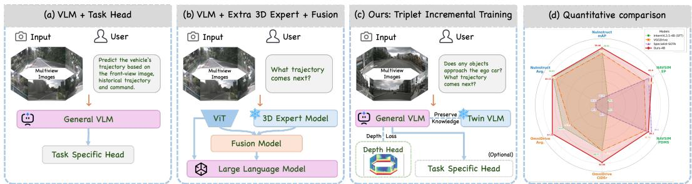
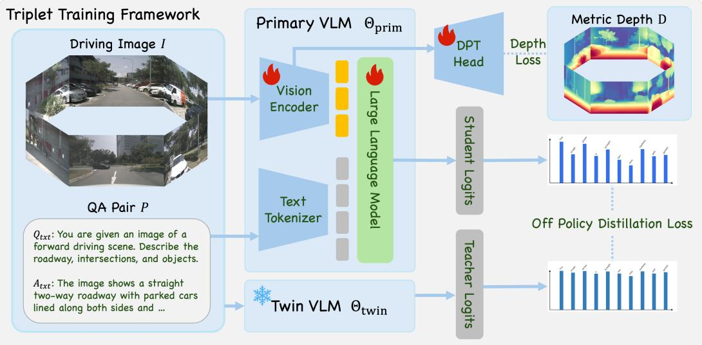
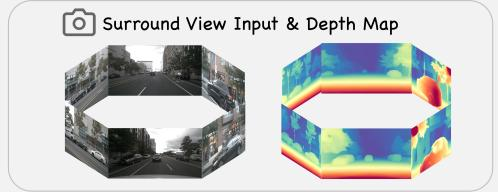
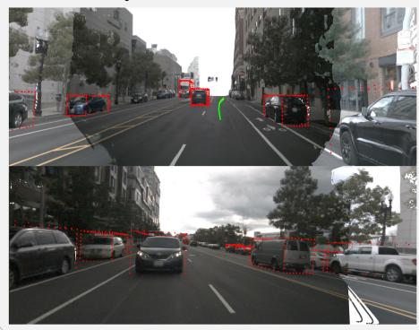
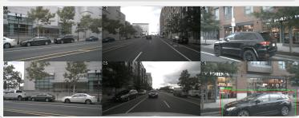

# From Foundation VLM to Versatile Driving VLM: A Triplet Incremental Training Approach

Shengtao Wu1\*, Zichao Dong2\*†, Weixuan Qiao1, Xiaolu Liu1, Xin Zhan2, Junbo Chen2, Jianke Zhu1‡ 1Zhejiang University 2Udeer.AI

  
Figure 1: Comparison of driving VLM paradigms. (a) Task-head tuning paradigms suffer from fragile spatial boundaries without explicit depth supervision. (b) External expert fusion approaches introduce heavy computational and inference overhead. (c) Our Triplet Incremental Training aligns geometric features via a deployment-discarded transient depth branch, while regularizing semantics with a twin VLM. (d) Quantitative comparison demonstrating our state-of-the-art performance.

Abstract: Adapting general Vision-Language Models (VLMs) to Autonomous Driving (AD) is thought to require heavy 3D spatial priors or intrusive architectural overhauls to compensate for a lack of spatial grounding. In this work, we present a counterintuitive pilot study: off-the-shelf general VLMs already exhibit remarkable adaptability across diverse driving tasks, while precise metric depth remains the primary missing link, a bottleneck readily addressable via onboard sensors and depth foundation models. This insight reveals that instead of complex over-engineering, general VLMs merely require a targeted geometric catalyst to bridge the spatial gap. To this end, we introduce the Triplet Incremental Training Framework, a non-intrusive paradigm that seamlessly instills 3D geometric awareness into a general VLM backbone while fully preserving its open-world capabilities. Driven by automatically constructed (image, depth, QA pair) triplets, our framework operates via a unified tri-stream training pipeline: an unfrozen primary VLM stream to adapt to driving tasks, an auxiliary depth stream that guides the visual backbone to implicitly imagine 3D scene geometry via explicit geometric constraints, and a frozen twin VLM stream employing logit-level KL distillation to prevent semantic drift. Crucially, the auxiliary depth branch is discarded during deployment, ensuring the enhanced geometric awareness comes with zero inference overhead. We evaluate our framework across four major benchmarks targeting four diverse capabilities spanning 3D spatial perception, driving-oriented language reasoning, end-to-end planning, and general multimodal understanding. Our approach outperforms state-of-the-art driving VLMs, rivals domain-specific expert models in 3D perception, and successfully retains its original general reasoning capabilities. This demonstrates that Triplet Incremental Training offers a unified, deployment-ready paradigm for transforming general foundation models into robust driving intelligences.

Keywords: Autonomous Driving, Vision Language Model

## 1 Introduction

General Vision-Language Models (VLMs) [1, 2, 3, 4, 5] have emerged as powerful backbones for autonomous driving (AD) [6, 7, 8], offering strong open-world semantic reasoning to overcome the brittleness of traditional task-specific pipelines [9, 10]. Our pilot study demonstrates that offthe-shelf general VLMs already deliver highly competitive driving capabilities, with dense depth perception and 3D geometric grounding remaining as the final pieces required for safe physical interaction within driving scenes [11, 12].

Current methodologies typically address this spatial frontier from two sub-optimal extremes. Textdriven alignment approaches [13, 14, 15] attempt to implicitly encode 3D spatial relations into text tokens via large-scale coordinate-based question-answering. However, without explicit geometric constraints, these models often struggle with fine-grained critical spatial boundaries. Conversely, structural approaches resort to intrusive modifications, integrating heavy 3D expert branches [16] or multimodal inputs. These introduce redundant computational overhead, disrupt end-to-end opti mization, and risk degrading the VLM’s general capabilities through domain overfitting.

In this work, we present an elegant alternative: general VLMs do not require complex structural overhauls to drive safely; rather, their already powerful visual representations simply require a targeted geometric catalyst. We identify dense metric depth as the ideal bridge to complete this spatial consciousness. Although dense absolute depth is absent from general VLM pretraining, it is readily available in AD environments—either from onboard sensors [17] or specialized depth foundation models [18, 19, 20, 21, 22]. Compared with sparse text-space supervision, depth offers dense, scalable geometric signals tightly coupled with the spatial structure of the driving scene.

Based on this insight, we introduce the Triplet Incremental Training Framework, an incrementa training paradigm built on structured (image, depth, QA pair) supervision. During training, the framework optimizes the primary network via three complementary objectives. First, the primary VLM undergoes standard supervised fine-tuning directly on downstream driving tasks to master domain-specific capabilities. Concurrently, on the perception side, an auxiliary depth stream employs a lightweight depth head [23] to enforce explicit geometric constraints, guiding the primary visual backbone to implicitly model 3D scene geometry. Meanwhile, on the semantic side, a frozen twin VLM acts as a distribution anchor, regularizing the primary VLM via off-policy logit-level KL distillation to mitigate the catastrophic forgetting of general-purpose capabilities. Crucially, the auxiliary depth branch is entirely discarded after training, ensuring this enhanced 3D awareness is instilled into the baseline representation with no additional architectural or inference overhead.

To summarize, our main contributions are:

• We introduce the Triplet Incremental Training framework, a simple yet effective paradigm driven by automated (image, depth, QA pair) structures, which co-aligns explicit geometric constraints with off-policy language distillation to inject 3D spatial consciousness.

• We present a non-intrusive network architecture featuring a transient depth branch and a frozen twin regularizer, which completes the visual backbone’s geometric alignment during training but introduces no additional architectural or inference overhead upon deployment.

• We conduct extensive evaluations across four distinct driving and reasoning paradigms, demonstrating state-of-the-art performance in 3D perception, language reasoning, and nonreactive trajectory planning while effectively mitigating catastrophic forgetting.

## 2 Related Work

## 2.1 Vision-Language Models for Autonomous Driving

Recent autonomous-driving VLMs explore how multimodal foundation models can support scene understanding, reasoning, and planning [8, 24, 25, 26, 27, 28, 29, 30]. Early systems such as DriveGPT4 [8] and DriveMLM [31] fine-tune multimodal models on driving-specific instruction data or behavioral planning states, enabling interpretable question answering and closed-loop decision making. More recent resources, such as OmniDrive [15], broaden the setting with holistic driving QA and counterfactual reasoning, while ReCogDrive [13] further couples VLM reasoning with planning-oriented optimization. Collectively, these works establish VLMs as a promising interface for autonomous driving, but their supervision remains largely language-centric, with limited explicit geometric grounding.

## 2.2 Geometry-Aware Adaptation and Capability Preservation

To inject explicit 3D geometric awareness, a conventional line of work introduces heavy spatial priors or structural modifications, building on early 3D perception networks [32, 33, 34, 35, 36, 37]. For instance, VGGDrive [16] integrates an external 3D foundation expert branch via cross-view geometric enablers. However, such intrusive over-engineering disrupts the structural elegance of end-to-end optimization, yields suboptimal guidance in complex scenes, and introduces massive computational overhead at inference time. In parallel, recent depth foundation models [18, 19, 20, 21, 22] suggest a significantly lighter alternative, demonstrating that sparse metric prompts can guide globally consistent dense depth generation as an effective geometric catalyst [22].

Beyond geometric adaptation, preserving the native, open-world capabilities of foundation models remains a critical challenge, as standard fine-tuning is highly prone to catastrophic forgetting [24, 13, 38]. While current approaches attempt to alleviate this via privileged teachers [39], truncated diffusion policies [40], or reinforcement learning [41], they often complicate deployment. Different from these methods, our Triplet Incremental Training framework seamlessly injects 3D geometric awareness via an auxiliary depth stream that is entirely discarded at deployment, while a frozen twin VLM regularizes the language distribution through off-policy knowledge distillation. This design effectively prevents semantic drift, transforming general foundation models into robust driving intelligences with zero inference overhead.

## 3 Method

This section details the Triplet Incremental Training framework, a non-intrusive paradigm designed to instill robust 3D geometric awareness into VLMs while preserving the model’s native open-world capabilities. Instead of relying on structural overhauls or text-only coordinate alignment, our approach introduces a targeted geometric catalyst during training that is completely discarded at inference. The framework is built upon three pillars: automated cross-modal triplet construction, a tri-stream training architecture, and a tri-objective joint optimization scheme.

## 3.1 Triplet Definition and Construction

To bridge the spatial gap without manual annotation, we reformulate downstream driving adaptation into an incremental training paradigm driven by automatically synthesized training triplets:

$$
\mathcal { T } = \{ ( I , D , P ) \}\tag{1}
$$

where $I \in \mathbb { R } ^ { H \times W \times 3 }$ denotes the driving image, $D \in \mathbb { R } ^ { H \times W }$ is the corresponding dense metric depth map, and $P = ( Q _ { t x t } , A _ { t x t } )$ represents a context-aware question-answering (QA) pair. The automated data synthesis pipeline operates as follows:

Dense Metric Depth Generation. To provide fine-grained spatial boundaries, we harness the powerful zero-shot estimation capability of Prompt Depth Anything [22]. Raw sparse LiDAR point clouds are directly projected onto the image plane to serve as a sparse metric prompt $D _ { s p a r s e }$ . Conditioned on $D _ { s p a r s e } .$ , the foundation model propagates the absolute scale across the dense pixel grid in a single forward pass, efficiently producing a pixel-aligned metric depth map $D \in \mathbb { R } ^ { H \times W }$

Spatial QA Pair Generation. Conventional driving tuning often restricts VLMs to rigid text patterns (e.g., coordinate bounding boxes or repetitive driving jargon), which warps their inherent language manifold and causes semantic collapse. To circumvent this, we leverage the original foundation VLM [1] to generate descriptive conversations $P = ( Q _ { t x t } , A _ { t x t } )$ regarding general driving scenes directly from image I. By ensuring these QA pairs inherently conform to the foundation VLM’s own expressive language distribution, they provide a pristine, self-aligned distribution anchor for the logit-level KL distillation. Consequently, the primary VLM successfully assimilates 3D geometric awareness while effectively preserving its native multimodal intelligence.

  
Figure 2: Overview of the Triplet Incremental Training pipeline. Specifically, the primary trainable VLM is optimized via dual constraints: a transient, deployment-discarded auxiliary depth branch for explicit geometric feature alignment, and a frozen twin VLM branch employing off-policy logitlevel KL distillation to prevent semantic drift.

## 3.2 Tri-Stream Architecture

To decouple spatial localization from open-world capability preservation, the framework routes the input data through three concurrent operational streams:

Primary VLM Stream $\Theta _ { \mathrm { p r i m } } \mathrm { : }$ : This stream constitutes the core trainable network, comprising an unfrozen visual encoder and a large language model (LLM). It directly absorbs task-specific language gradients and dense geometric signals to adapt to diverse autonomous driving scenarios.

Frozen Twin Stream $\Theta _ { \mathrm { t w i n } }$ : This stream acts as a frozen counterpart of the pretrained foundation VLM, remaining static throughout training. It acts as a permanent semantic anchor, regularizing the vocabulary distribution of the primary stream to prevent domain-specific text overfitting.

Auxiliary Depth Stream: This stream attaches a lightweight, DPT-style depth head directly to the visual encoder of $\Theta _ { \mathrm { p r i m } }$ rather than the LLM side. This design aligns with the slow-fast dual-system paradigm in autonomous driving [7], where real-time reactive perception operates independently of deliberative linguistic reasoning. Bypassing the heavy autoregressive language decoder ensures that dense geometric alignment directly carves the low-latency spatial representations required for reactive driving tasks. It projects, fuses, and upsamples multi-scale intermediate feature maps $\{ f _ { l } \} _ { l = 1 } ^ { 4 }$ to yield continuous dense metric depth maps $\hat { D } = D P T ( \{ f _ { l } \} _ { l = 1 } ^ { 4 } ) \in \mathbb { R } ^ { H \times W }$ , acting as a transient geometric catalyst that is completely discarded during deployment.

## 3.3 Tri-Objective Joint Optimization

The primary challenge of tuning general VLMs for autonomous driving tasks requires a delicate balance between aggressive geometric adaptation and strict prevention of semantic degradation. We resolve this trade-off via a tri-objective optimization scheme consisting of task adaptation, explicit geometric grounding, and distribution regularization.

## Driving Intelligence Unlocked

## Driving QA Bench

Q: Does Any objects approach the ego car? Pre: "<car>[c5,326,491,1558,900];' GT: "<car>[c5,356,464,1532,900];"

Q: What is the status for the ego car? Pre:"The ego no turn and keep speed" GT: "The ego no turn and keep speed"

3D Understanding  
  
Figure 3: Visual demonstration of our model across multiple modalities and benchmarks.

  
General VLM Bench  
Q: If it suddenly starts raining, where would people nearby most likely go first? Pre: In this scene, people nearby would probably go first to the closest covered area along the street, such as the store awning, doorway, or building entrance. GT: They would most likely head first toward the nearest storefront awning or building entrance on the sidewalk, ..

Off-Policy Logit-Level Knowledge Distillation. To retain native intelligence while adapting to driving semantics, the language output space of the primary VLM is constrained by its twin counterpart. We implement an off-policy distillation scheme directly utilizing the pre-constructed training triplets. Specifically, given a prompt $Q _ { t x t }$ and image I, let the target answer sequence from T be $A _ { t x t } = \left\{ t _ { 1 } , t _ { 2 } , \ldots , t _ { N } \right\}$ . We compute the token-level Kullback-Leibler (KL) divergence [42] strictly over the vocabulary distributions at each target token position:

$$
{ \mathcal { L } } _ { \mathrm { K D } } = { \frac { 1 } { N } } \sum _ { i = 1 } ^ { N } D _ { \mathrm { K L } } \left( P _ { \mathrm { t w i n } } ( \cdot \mid I , Q _ { \mathrm { t x t } } , t _ { < i } ) \parallel { \boldsymbol { P } } _ { \mathrm { p r i m } } ( \cdot \mid I , Q _ { \mathrm { t x t } } , t _ { < i } ) \right)\tag{2}
$$

where $P ( \cdot )$ represents the softmax probability distribution over the vocabulary space. Crucially, the prompt tokens $Q _ { t x t }$ are masked out, ensuring that the distillation gradient strictly anchors the generated response sequence to the foundation model’s original language manifold.

Supervised Fine-Tuning Task Loss. Concurrently, to ensure the model adapts to downstream autonomous driving tasks, we employ a standard autoregressive Cross-Entropy (CE) task loss on the target tokens of the downstream driving answers $\left\{ y _ { 1 } , y _ { 2 } , \ldots , y _ { M } \right\}$ . Given a task prompt $Q _ { \mathrm { t a s k } }$

$$
\mathcal { L } _ { \mathrm { C E } } = - \frac { 1 } { M } \sum _ { i = 1 } ^ { M } \log P _ { \mathrm { p r i m } } \left( y _ { i } \mid I , Q _ { \mathrm { t a s k } } , y _ { < i } \right)\tag{3}
$$

Geometric Feature Alignment. To guarantee that 3D geometric awareness is deeply embedded within the visual representations, the primary visual backbone’s intermediate representations are explicitly constrained via the Scale-Invariant Logarithmic (SiLog) loss [43] between the predicted depth $\hat { D }$ and the metric depth target D:

$$
\mathcal { L } _ { \mathrm { d e p t h } } = \sqrt { \frac { 1 } { | \Omega | } \sum _ { p \in \Omega } e _ { p } ^ { 2 } - \lambda \left( \frac { 1 } { | \Omega | } \sum _ { p \in \Omega } e _ { p } \right) ^ { 2 } } , \qquad e _ { p } = \log \hat { D } _ { p } - \log D _ { p } .\tag{4}
$$

Here, Ω denotes the set of valid depth pixels, $e _ { p }$ is the logarithmic depth error, and λ controls the correction for global log-scale bias. The loss encourages relative geometric consistency while retaining sensitivity to absolute scale when $\lambda < 1$

Table 1. Monocular depth estimation probing on nuScenes.
<table><tr><td>Metrics</td><td>Metric3Dv2 [18]</td><td>UniDepth [19]</td><td>UniDepthV2 [20]</td><td>VGGT [44]</td><td>InternViT</td><td>InternViT-ours</td></tr><tr><td> $\delta _ { 1 } \uparrow$ </td><td>84.1</td><td>84.6</td><td>87.6</td><td>60.0</td><td>77.2</td><td>80.6</td></tr><tr><td>Abs Rel ↓</td><td>23.6</td><td>12.7</td><td>14.3</td><td>28.9</td><td>19.1</td><td>16.7</td></tr></table>

Table 2. 3D object detection probing on nuScenes.
<table><tr><td>Metric PETR [32]</td><td>DETR3D [33] FCOS3D [34] PGD [35] OmniDrive [15] InternViT InternViT-ours</td></tr><tr><td>mAP↑ 37.8 34.9 34.3</td><td>36.9 35.4 34.7 38.1</td></tr></table>

Total Objective The complete optimization objective for the primary VLM and the attached depth head is formulated as a linear combination of the three distinct constraints:

$$
\mathcal { L } = \alpha \mathcal { L } _ { \mathrm { d e p t h } } + \beta \mathcal { L } _ { \mathrm { K D } } + \gamma \mathcal { L } _ { \mathrm { C E } }\tag{5}
$$

where $\alpha , \beta$ and $\gamma$ control the trade-off between geometric adaptation, foundation capability preservation, and task-specific fine-tuning.

Training Strategy. Training begins with initialization of the auxiliary depth head using ${ \mathcal { L } } _ { \mathrm { d e p t h } }$ , with the foundation VLM kept frozen. The primary VLM is then unfrozen and jointly optimized with the depth head under Eq. 5, allowing geometric supervision to refine the visual representations while the frozen twin preserves the foundation model’s language distribution. After joint adaptation, the auxiliary depth head and twin VLM are discarded. For downstream perception and planning, taskspecific heads are trained from scratch on the frozen adapted backbone, while language tasks use the adapted VLM directly.

## 4 Experimental Results

## 4.1 Implementation Details

We build our primary model on InternVL3.5-4B [1]. The twin VLM branch is initialized with the same weights and kept frozen throughout training. For depth supervision, we attach a lightweight DPT-style depth head [23] (30M parameters) to the InternViT visual encoder, and feed multi-scale features from stages 4, 8, 16, and 24 into the depth decoder. We optimize the unfrozen parameters of the primary backbone using the AdamW optimizer [56] with a base learning rate of $2 \times 1 0 ^ { - 5 }$ for the vision encoder and a cosine decay schedule. The overall multi-task loss is balanced via empirical scaling factors: $\alpha = 0 . 2 5$ for the depth reconstruction objective and $\beta = 0 . 2 0$ for the off-policy logit-level KL distillation objective, and $\gamma = 1 . 0$ for the driving SFT task loss. For the SiLog loss, we set $\lambda = 0 . 8 5$ and use valid metric depth targets within [0.5, 80] m.

We construct 170k triplets from the nuScenes training images used by OmniDrive and nuInstruct. After DPT head initialization, we jointly train the primary VLM and auxiliary depth head on these triplets and the official driving QA data for two epochs on 16 NVIDIA A100 GPUs (80 GB each). All evaluations share the final jointly adapted VLM checkpoint, with random seed 42 used throughout.

## 4.2 Datasets and Metrics

Our experiments are structured to evaluate whether our targeted geometric catalyst unlocks a generalized 3D awareness while strictly preserving the model’s foundational capabilities. We evaluate across four distinct paradigms spanning perception, language reasoning, non-reactive trajectory planning, and general multimodal understanding. Specifically, camera-only 3D perception is probed on nuScenes [17] using standard depth and detection (mAP) metrics. Driving-oriented language reasoning is verified on OmniDrive [15] and nuInstruct [45] via linguistic (BLEU [57], ROUGE [58], CIDEr [59]) and coordinate-space metrics. Trajectory planning is evaluated on the non-reactive,

Table 3. Driving language reasoning evaluation on OmniDrive and nuInstruct. ”Specialist Model” denotes domain-specific expert networks trained exclusively on target datasets [15, 45], ”Baseline” denotes InternVL3.5-4B optimized via standard SFT. \* indicates max((Accuracy + mAP + BLEU − MAE)/4, 0).
<table><tr><td rowspan="2">Dataset</td><td rowspan="2">Metric</td><td colspan="2">Zero-shot models</td><td colspan="4">Finetuned models</td></tr><tr><td></td><td>GPT-4o [5] InternVL3.5-4B [1] VGGDrive [16] Specialist Model Baseline Ours-4B</td><td></td><td></td><td></td><td></td></tr><tr><td rowspan="4">OmniDrive</td><td>BLEU↑</td><td>10.91</td><td>25.64</td><td>37.58</td><td>38.00</td><td>40.94</td><td>42.55</td></tr><tr><td>ROUGE↑</td><td>22.34</td><td>24.90</td><td>34.40</td><td>32.60</td><td>35.98</td><td>36.80</td></tr><tr><td>CIDEr ↑</td><td>24.42</td><td>24.73</td><td>86.57</td><td>68.60</td><td>86.51</td><td>92.09</td></tr><tr><td>Average ↑</td><td>19.22</td><td>25.09</td><td>52.85</td><td>46.40</td><td>54.47</td><td>57.15</td></tr><tr><td rowspan="5"></td><td>MAE↓</td><td>9.93</td><td>20.56</td><td>3.08</td><td>9.08</td><td>1.67</td><td>1.44</td></tr><tr><td>Accuracy ↑</td><td>10.64</td><td>0.34</td><td>56.37</td><td>32.48</td><td>59.22</td><td>58.29</td></tr><tr><td>NuInstruct mAP↑</td><td>0.00</td><td>0.00</td><td>37.49</td><td>21.93</td><td>38.83</td><td>39.46</td></tr><tr><td>BLEU↑</td><td>7.08</td><td>0.48</td><td>81.13</td><td>35.20</td><td>82.92</td><td>84.14</td></tr><tr><td>Average*↑</td><td>1.95</td><td>0.00</td><td>42.98</td><td>20.13</td><td>44.83</td><td>45.11</td></tr></table>

Table 4. Non-reactive trajectory planning evaluation on NAVSIM [46].
<table><tr><td>Method</td><td>Base Model</td><td>Image LiDAR</td><td></td><td>NC↑</td><td>DAC ↑</td><td>EP↑</td><td>TTC↑</td><td>Comf. ↑</td><td>PDMS ↑</td></tr><tr><td>TransFuser [9]</td><td>ResNet-34</td><td>√</td><td>√</td><td>97.78</td><td>92.63</td><td>78.88</td><td>92.89</td><td>99.98</td><td>83.88</td></tr><tr><td>PARA-Drive [10]</td><td>BEVFormer</td><td>√</td><td></td><td>97.90</td><td>92.40</td><td>79.30</td><td>93.00</td><td>99.80</td><td>84.00</td></tr><tr><td>DRAMA [47]</td><td>ResNet-34</td><td>√</td><td>√</td><td>98.19</td><td>95.18</td><td>81.33</td><td>94.17</td><td>100</td><td>86.87</td></tr><tr><td>Hydra-MDP [48]</td><td>ResNet-34</td><td>√</td><td>√</td><td>98.30</td><td>96.00</td><td>78.70</td><td>94.60</td><td>100</td><td>86.50</td></tr><tr><td>DiffusionDrive [40]</td><td>ResNet-34</td><td>√</td><td>V</td><td>98.20</td><td>96.20</td><td>82.20</td><td>94.70</td><td>100</td><td>88.10</td></tr><tr><td>WoTE [49]</td><td>ResNet-34</td><td>√</td><td>√</td><td>98.50</td><td>96.80</td><td>81.90</td><td>94.90</td><td>99.90</td><td>88.30</td></tr><tr><td>VGGDrive [16]</td><td>Qwen2.5-VL-7B</td><td>√</td><td></td><td>98.55</td><td>96.30</td><td>82.92</td><td>95.59</td><td>99.98</td><td>88.76</td></tr><tr><td>ReCogDrive [13]</td><td>InternVL3-8B</td><td>√</td><td></td><td>98.20</td><td>97.80</td><td>83.50</td><td>95.20</td><td>99.80</td><td>89.60</td></tr><tr><td>AdaThinkDrive [50]</td><td>InternVL3-8B</td><td>√</td><td></td><td>98.50</td><td>94.40</td><td>79.90</td><td>94.90</td><td>100</td><td>86.20</td></tr><tr><td>Baseline</td><td>InternVL3.5-4B</td><td>√</td><td></td><td>97.80</td><td>92.10</td><td>78.30</td><td>92.80</td><td>100</td><td>83.30</td></tr><tr><td>Ours-4B</td><td>InternVL3.5-4B</td><td>√</td><td></td><td>98.70</td><td>96.80</td><td>83.90</td><td>95.80</td><td>100</td><td>89.10</td></tr></table>

offline NAVSIM benchmark [46] using the Predictive Driver Model Score (PDMS). Finally, general open-world capabilities are benchmarked across MMMU, MMStar, POPE, OCRBench, and ScienceQA [51, 52, 53, 54, 55] to monitor catastrophic forgetting.

## 4.3 Main Results

Spatial Representation Probing on nuScenes. To verify whether 3D geometric awareness is natively embedded within the visual representations rather than superficially memorized in the text token space, we freeze the optimized visual backbone and evaluate it under strict probing conditions on nuScenes [17]. We train separate depth and PETR detection heads, following UniDepth [19] and the frozen-backbone probing design of DEIMv2 [60], respectively. As shown in Table 1 and Table 2, our framework significantly elevates the baseline’s latent spatial capacity, driving $\delta _ { 1 }$ depth accuracy from 77.2% to 80.6% and 3D detection from 34.7% to 38.1% mAP. These results surpass textbased alignment methods (OmniDrive: 35.4%) and fully fine-tuned domain-specific experts (PETR: 37.8%), suggesting that implicit depth modeling can produce more transferable 3D features.

Driving-Oriented Language Reasoning. To evaluate how enhanced spatial awareness translates into multimodal language comprehension, we evaluate our framework on OmniDrive [15] and nuInstruct [45]. These benchmarks challenge models to perform multi-view scene description, spatial topology analysis, and hazard perception. As reported in Table 3, our model consistently sets new state-of-the-art performance across both benchmarks, outperforming the structurally complex competitor VGGDrive [16]. This joint success demonstrates that our implicit geometric grounding successfully empowers the language model to construct precise spatial arguments, effectively overcoming the fragile boundary hallucinations typical of text-only coordinate alignment methods.

Table 5. General multimodal capability preservation after driving adaptation.
<table><tr><td rowspan="2">Dataset</td><td colspan="3">InternVL3-8B → ReCogDrive [13]</td><td colspan="3">InternVL3.5-4B → Ours-4B</td></tr><tr><td>Backbone Adapted</td><td></td><td>Diff.</td><td>Backbone Adapted</td><td></td><td>Diff.</td></tr><tr><td>MMMU [51]</td><td>61.2</td><td>7.6</td><td>-53.6</td><td>60.8</td><td>59.1</td><td>-1.7</td></tr><tr><td>MMStar [52]</td><td>60.3</td><td>21.2</td><td>-39.1</td><td>60.6</td><td>61.7</td><td>+1.1</td></tr><tr><td>POPE [53]</td><td>79.0</td><td>83.0</td><td>+4.0</td><td>81.2</td><td>80.9</td><td>-0.3</td></tr><tr><td>OCRBench [54]</td><td>82.9</td><td>61.5</td><td>-21.4</td><td>77.6</td><td>77.4</td><td>-0.2</td></tr><tr><td>ScienceQA [55]</td><td>87.9</td><td>24.2</td><td>-63.7</td><td>87.6</td><td>87.1</td><td>-0.5</td></tr><tr><td>Avg.</td><td>74.3</td><td>39.5</td><td>-34.8</td><td>73.6</td><td>73.2</td><td>-0.3</td></tr></table>

Table 6. Ablation of geometric supervision and semantic regularization on InternVL3.5-4B. All variants retain driving SFT; checkmarks indicate active auxiliary objectives. The last row is the full framework.
<table><tr><td colspan="2">Objectives</td><td colspan="2">Perception</td><td colspan="2">Driving Language</td><td>Planning</td><td></td><td>General VQA</td></tr><tr><td> ${ \mathcal { L } } _ { \mathrm { d e p t h } }$ </td><td> ${ \mathcal { L } } _ { \mathrm { K D } }$ </td><td>Depth  $\delta _ { 1 } \uparrow$ </td><td>AbsRel↓</td><td>3D Detection mAP↑</td><td>OmniDrive Avg.↑</td><td>nuInstruct Avg.↑</td><td>NAVSIM PDMS↑</td><td>Avg.↑</td></tr><tr><td>一</td><td>一</td><td>77.2</td><td>19.1</td><td>34.7</td><td>54.47</td><td>44.83</td><td>83.30</td><td>21.5</td></tr><tr><td>√</td><td>一</td><td>80.8</td><td>16.3</td><td>38.2</td><td>56.79</td><td>44.90</td><td>86.42</td><td>21.8</td></tr><tr><td>一</td><td>V</td><td>77.3</td><td>18.9</td><td>34.9</td><td>56.27</td><td>44.83</td><td>84.56</td><td>71.0</td></tr><tr><td>√</td><td>√</td><td>80.6</td><td>16.7</td><td>38.1</td><td>57.15</td><td>45.11</td><td>89.10</td><td>73.2</td></tr></table>

Non-Reactive Trajectory Planning. To examine whether geometric adaptation also benefits trajectory planning, we train a lightweight planning head on the frozen backbone and evaluate it on NAVSIM [46], following the iPad [61] experimental setup. As revealed in Table 4, our model achieves a highly competitive PDMS score of 89.10%. Crucially, despite operating entirely visiononly at inference, our model closely approaches the performance of the twice-as-large 8B parameter model ReCogDrive (89.60%), while significantly outperforming heavily engineered, LiDAR-reliant expert models such as TransFuser (83.88%) and WoTE (88.30%). Furthermore, our model achieves superior safety profiles, including a Non-Collision (NC) score of 98.70% and a Time-to-Collision (TTC) score of 95.80%. These results indicate that the learned spatial representations benefit visiononly trajectory planning under non-reactive evaluation.

General Capability Preservation. Standard driving adaptation often triggers catastrophic forgetting due to text-space overfitting on rigid driving terms. We expose this issue by testing models on general VLM benchmarks. As shown in Table 5, traditional frameworks like ReCogDrive cause a catastrophic degradation in general open-world performance, with its MMMU score plummeting to a near-random 7.6%, and an average degradation of 34.8 points across benchmarks. In contrast, our model experiences negligible degradation, maintaining competitive scores that closely align with the untuned InternVL3.5-4B baseline. This demonstrates that our tri-stream framework successfully decouples geometric adaptation from semantic preservation, allowing the VLM to remain generalpurpose while mastering autonomous driving.

## 4.4 Ablation Studies

We examine the complementary roles of geometric supervision and semantic regularization by ablating ${ \mathcal { L } } _ { \mathrm { d e p t h } }$ and ${ \mathcal { L } } _ { \mathrm { K D } }$ under the same training setup, with driving SFT as the baseline (Table 6).

Effectiveness of Geometric Supervision. Depth supervision improves geometric probing and planning both with and without KL distillation. In particular, adding depth to SFT + KL increases 3D detection mAP by 3.2 points and NAVSIM PDMS by 4.54 points. These gains support the role of dense depth as a geometric catalyst for downstream perception and planning.

Effectiveness of Semantic Regularization. Depth supervision alone leaves the general-benchmark average at 21.8, whereas adding KL distillation restores it to 73.2 (Table 7). The full framework also

Table 7. Ablation study on the off-policy logit-level KL distillation constraint. ∆ reports gains over w/o KL.
<table><tr><td>Method</td><td>MMMU</td><td>MMStar</td><td>POPE</td><td>OCRBench</td><td>ScienceQA</td><td>Avg.</td></tr><tr><td>InternVL3.5-4B</td><td>60.8</td><td>60.6</td><td>81.2</td><td>77.6</td><td>87.6</td><td>73.6</td></tr><tr><td>Ours-4B w/o KL</td><td>7.0</td><td>4.5</td><td>67.1</td><td>21.0</td><td>9.5</td><td>21.8</td></tr><tr><td>Ours-4B w/ KL</td><td>59.1</td><td>61.7</td><td>80.9</td><td>77.4</td><td>87.1</td><td>73.2</td></tr><tr><td>∆ w/ KL</td><td>+52.1</td><td>+57.2</td><td>+13.8</td><td>+56.4</td><td>+77.6</td><td>+51.4</td></tr></table>

improves planning over SFT + Depth, despite small reductions in depth and detection performance. The two objectives thus play complementary roles: geometric supervision strengthens spatial representations, while the frozen twin preserves the foundation model’s open-world capabilities.

## 5 Conclusion and Limitations

In this paper, we introduce Triplet Incremental Training, a novel and non-intrusive paradigm designed to bridge the gap between general vision-language capabilities and spatial awareness in au tonomous driving. By leveraging automatically generated (image, depth, text) triplets, our tri-stream architecture enforces explicit geometric constraints via a deployment-discarded transient depth head to ensure zero inference overhead, while simultaneously utilizing a frozen twin VLM as a semantic anchor to prevent catastrophic forgetting. Extensive benchmarks across diverse driving tasks confirm that our approach not only achieves state-of-the-art performance but also largely preserves the open-ended reasoning capabilities of the base foundation model.

Limitations. Despite its competitive performance across multiple benchmarks, a primary limitation of our current validation is its reliance on offline real-world datasets, leaving the framework largely untested in fully interactive, closed-loop simulation environments. In the context of robotic learning, simulation offers an invaluable testing ground characterized by flawless metric depth ground truth, the capacity to synthetically generate vast, diverse, and safety-critical edge cases, and the mechanism for end-to-end closed-loop execution. Such environments are crucial for conducting granular behavioral assessments and isolating specific failure modes under dynamic vehicle-environment interactions. Transitioning our framework into active simulators to evaluate its closed-loop decisionmaking and robustness represents a vital and immediate avenue for our future research.

## References

[1] W. Wang, Z. Gao, L. Gu, H. Pu, L. Cui, X. Wei, Z. Liu, L. Jing, S. Ye, J. Shao, et al. Internvl3. 5: Advancing open-source multimodal models in versatility, reasoning, and efficiency. arXiv preprint arXiv:2508.18265, 2025.

[2] J. Zhu, W. Wang, Z. Chen, Z. Liu, S. Ye, L. Gu, H. Tian, Y. Duan, W. Su, J. Shao, et al. Internvl3: Exploring advanced training and test-time recipes for open-source multimodal models. arXiv preprint arXiv:2504.10479, 2025.

[3] S. Bai, Y. Cai, R. Chen, K. Chen, X. Chen, Z. Cheng, L. Deng, W. Ding, C. Gao, C. Ge, et al. Qwen3-vl technical report. arXiv preprint arXiv:2511.21631, 2025.

[4] H. Liu, C. Li, Q. Wu, and Y. J. Lee. Visual instruction tuning. Advances in neural information processing systems, 36:34892–34916, 2023.

[5] A. Hurst, A. Lerer, A. P. Goucher, A. Perelman, A. Ramesh, A. Clark, A. Ostrow, A. Welihinda, A. Hayes, A. Radford, et al. Gpt-4o system card. arXiv preprint arXiv:2410.21276, 2024.

[6] Z. Yang, X. Jia, H. Li, and J. Yan. Llm4drive: A survey of large language models for autonomous driving. ArXiv, abs/2311.01043, 2023. URL https://api.semanticscholar. org/CorpusID:264935408.

[7] X. Tian, J. Gu, B. Li, Y. Liu, Y. Wang, Z. Zhao, K. Zhan, P. Jia, X. Lang, and H. Zhao. Drivevlm: The convergence of autonomous driving and large vision-language models. arXiv preprint arXiv:2402.12289, 2024.

[8] Z. Xu, Y. Zhang, E. Xie, Z. Zhao, Y. Guo, K.-Y. K. Wong, Z. Li, and H. Zhao. Drivegpt4: Interpretable end-to-end autonomous driving via large language model. IEEE Robotics and Automation Letters, 9(10):8186–8193, 2024.

[9] K. Chitta, A. Prakash, B. Jaeger, Z. Yu, K. Renz, and A. Geiger. Transfuser: Imitation with transformer-based sensor fusion for autonomous driving. IEEE transactions on pattern analysis and machine intelligence, 45(11):12878–12895, 2022.

[10] X. Weng, B. Ivanovic, Y. Wang, Y. Wang, and M. Pavone. Para-drive: Parallelized architecture for real-time autonomous driving. In Proceedings ofthe IEEE/CVF Conference on Computer Vision and Pattern Recognition, pages 15449–15458, 2024.

[11] A.-C. Cheng, H. Yin, Y. Fu, Q. Guo, R. Yang, J. Kautz, X. Wang, and S. Liu. Spatialrgpt: Grounded spatial reasoning in vision-language models. Advances in Neural Information Processing Systems, 37:135062–135093, 2024.

[12] B. Chen, Z. Xu, S. Kirmani, B. Ichter, D. Sadigh, L. Guibas, and F. Xia. Spatialvlm: Endowing vision-language models with spatial reasoning capabilities. In Proceedings of the IEEE/CVF Conference on Computer Vision and Pattern Recognition, pages 14455–14465, 2024.

[13] Y. Li, K. Xiong, X. Guo, F. Li, S. Yan, G. Xu, L. Zhou, L. Chen, H. Sun, B. Wang, et al. Recogdrive: A reinforced cognitive framework for end-to-end autonomous driving. arXiv preprint arXiv:2506.08052, 2025.

[14] X. Jia, Y. Gao, L. Chen, J. Yan, P. L. Liu, and H. Li. Driveadapter: Breaking the coupling barrier of perception and planning in end-to-end autonomous driving. In Proceedings of the IEEE/CVF International Conference on Computer Vision, pages 7953–7963, 2023.

[15] S. Wang, Z. Yu, X. Jiang, S. Lan, M. Shi, N. Chang, J. Kautz, Y. Li, and J. M. Alvarez. Omnidrive: A holistic vision-language dataset for autonomous driving with counterfactual reasoning. In Proceedings of the computer vision and pattern recognition conference, pages 22442–22452, 2025.

[16] J. Wang, G. Li, Z. Huang, C. Dang, H. Ye, Y. Han, and L. Chen. Vggdrive: Empowering vision-language models with cross-view geometric grounding for autonomous driving. arXiv preprint arXiv:2602.20794, 2026.

[17] H. Caesar, V. Bankiti, A. H. Lang, S. Vora, V. E. Liong, Q. Xu, A. Krishnan, Y. Pan, G. Baldan, and O. Beijbom. nuscenes: A multimodal dataset for autonomous driving. In Proceedings of the IEEE/CVF conference on computer vision and pattern recognition, pages 11621–11631, 2020.

[18] M. Hu, W. Yin, C. Zhang, Z. Cai, X. Long, H. Chen, K. Wang, G. Yu, C. Shen, and S. Shen. Metric3d v2: A versatile monocular geometric foundation model for zero-shot metric depth and surface normal estimation. IEEE Transactions on Pattern Analysis and Machine Intelli gence, 46(12):10579–10596, 2024.

[19] L. Piccinelli, Y.-H. Yang, C. Sakaridis, M. Segu, S. Li, L. Van Gool, and F. Yu. Unidepth: Universal monocular metric depth estimation. In Proceedings ofthe IEEE/CVF Conference on Computer Vision and Pattern Recognition, pages 10106–10116, 2024.

[20] L. Piccinelli, C. Sakaridis, Y.-H. Yang, M. Segu, S. Li, W. Abbeloos, and L. Van Gool. Unidepthv2: Universal monocular metric depth estimation made simpler. IEEE Transactions on Pattern Analysis and Machine Intelligence, 2025.

[21] L. Yang, B. Kang, Z. Huang, Z. Zhao, X. Xu, J. Feng, and H. Zhao. Depth anything v2. Advances in Neural Information Processing Systems, 37:21875–21911, 2024.

[22] H. Lin, S. Peng, J. Chen, S. Peng, J. Sun, M. Liu, H. Bao, J. Feng, X. Zhou, and B. Kang. Prompting depth anything for 4k resolution accurate metric depth estimation. In Proceedings of the Computer Vision and Pattern Recognition Conference, pages 17070–17080, 2025.

[23] R. Ranftl, A. Bochkovskiy, and V. Koltun. Vision transformers for dense prediction. In Proceedings of the IEEE/CVF international conference on computer vision, pages 12179–12188, 2021.

[24] C. Sima, K. Renz, K. Chitta, L. Chen, H. Zhang, C. Xie, J. Beißwenger, P. Luo, A. Geiger, and H. Li. Drivelm: Driving with graph visual question answering. In European conference on computer vision, pages 256–274. Springer, 2024.

[25] H. Shao, Y. Hu, L. Wang, G. Song, S. L. Waslander, Y. Liu, and H. Li. Lmdrive: Closed-loop end-to-end driving with large language models. In Proceedings of the IEEE/CVF conference on computer vision and pattern recognition, pages 15120–15130, 2024.

[26] J.-J. Hwang, R. Xu, H. Lin, W.-C. Hung, J. Ji, K. Choi, D. Huang, T. He, P. Covington, B. Sapp, et al. Emma: End-to-end multimodal model for autonomous driving. arXiv preprint arXiv:2410.23262, 2024.

[27] Z. Huang, C. Feng, F. Yan, B. Xiao, Z. Jie, Y. Zhong, X. Liang, and L. Ma. Robotron-drive: All-in-one large multimodal model for autonomous driving. In Proceedings of the IEEE/CVF International Conference on Computer Vision, pages 8011–8021, 2025.

[28] Y. Ma, Y. Cao, J. Sun, M. Pavone, and C. Xiao. Dolphins: Multimodal language model for driving. In European Conference on Computer Vision, pages 403–420. Springer, 2024.

[29] R. Zhao, Q. Yuan, J. Li, H. Hu, Y. Li, Z. Gao, and F. Gao. Sce2drivex: A generalized mllm framework for scene-to-drive learning. IEEE Robotics and Automation Letters, 2025.

[30] S. Zhang, W. Huang, Z. Gao, H. Chen, and C. Lv. Wisead: Knowledge augmented end-to-end autonomous driving with vision-language model. arXiv preprint arXiv:2412.09951, 2024.

[31] W. Wang, J. Xie, C. Hu, H. Zou, J. Fan, W. Tong, Y. Wen, S. Wu, H. Deng, Z. Li, et al. Drivemlm: Aligning multi-modal large language models with behavioral planning states for autonomous driving. arXiv preprint arXiv:2312.09245, 2023.

[32] Y. Liu, T. Wang, X. Zhang, and J. Sun. Petr: Position embedding transformation for multi-view 3d object detection. In European conference on computer vision, pages 531–548. Springer, 2022.

[33] Y. Wang, V. C. Guizilini, T. Zhang, Y. Wang, H. Zhao, and J. Solomon. Detr3d: 3d object detection from multi-view images via 3d-to-2d queries. In Conference on robot learning, pages 180–191. PMLR, 2022.

[34] T. Wang, X. Zhu, J. Pang, and D. Lin. Fcos3d: Fully convolutional one-stage monocular 3d object detection. In Proceedings of the IEEE/CVF international conference on computer vision, pages 913–922, 2021.

[35] T. Wang, Z. Xinge, J. Pang, and D. Lin. Probabilistic and geometric depth: Detecting objects in perspective. In Conference on robot learning, pages 1475–1485. PMLR, 2022.

[36] Z. Liu, H. Tang, A. Amini, X. Yang, H. Mao, D. L. Rus, and S. Han. Bevfusion: Multi-task multi-sensor fusion with unified bird’s-eye view representation. In 2023 IEEE international conference on robotics and automation (ICRA), pages 2774–2781. ieee, 2023.

[37] Z. Li, W. Wang, H. Li, E. Xie, C. Sima, T. Lu, Q. Yu, and J. Dai. Bevformer: learning bird’seye-view representation from lidar-camera via spatiotemporal transformers. IEEE Transactions on Pattern Analysis and Machine Intelligence, 47(3):2020–2036, 2024.

[38] Z. Li and D. Hoiem. Learning without forgetting. IEEE transactions on pattern analysis and machine intelligence, 40(12):2935–2947, 2017.

[39] Y. Xu, Y. Hu, Z. Zhang, G. P. Meyer, S. K. Mustikovela, S. Srinivasa, E. M. Wolff, and X. Huang. Vlm-ad: End-to-end autonomous driving through vision-language model supervision. arXiv preprint arXiv:2412.14446, 2024.

[40] B. Liao, S. Chen, H. Yin, B. Jiang, C. Wang, S. Yan, X. Zhang, X. Li, Y. Zhang, Q. Zhang, et al. Diffusiondrive: Truncated diffusion model for end-to-end autonomous driving. In Proceedings ofthe Computer Vision and Pattern Recognition Conference, pages 12037–12047, 2025.

[41] B. Jiang, S. Chen, Q. Zhang, W. Liu, and X. Wang. Alphadrive: Unleashing the power of vlms in autonomous driving via reinforcement learning and reasoning. arXiv preprint arXiv:2503.07608, 2025.

[42] G. Hinton, O. Vinyals, and J. Dean. Distilling the knowledge in a neural network. arXiv preprint arXiv:1503.02531, 2015.

[43] D. Eigen, C. Puhrsch, and R. Fergus. Depth map prediction from a single image using a multi-scale deep network. Advances in neural information processing systems, 27, 2014.

[44] J. Wang, M. Chen, N. Karaev, A. Vedaldi, C. Rupprecht, and D. Novotny. Vggt: Visual geometry grounded transformer. In Proceedings ofthe Computer Vision and Pattern Recognition Conference, pages 5294–5306, 2025.

[45] X. Ding, J. Han, H. Xu, X. Liang, W. Zhang, and X. Li. Holistic autonomous driving understanding by bird’s-eye-view injected multi-modal large models. In Proceedings of the IEEE/CVF Conference on Computer Vision and Pattern Recognition, pages 13668–13677, 2024.

[46] D. Dauner, M. Hallgarten, T. Li, X. Weng, Z. Huang, Z. Yang, H. Li, I. Gilitschenski, B. Ivanovic, M. Pavone, et al. Navsim: Data-driven non-reactive autonomous vehicle simulation and benchmarking. Advances in Neural Information Processing Systems, 37:28706– 28719, 2024.

[47] C. Yuan, Z. Zhang, J. Sun, S. Sun, Z. Huang, C. D. W. Lee, D. Li, Y. Han, A. Wong, K. P. Tee, et al. Drama: An efficient end-to-end motion planner for autonomous driving with mamba. arXiv preprint arXiv:2408.03601, 2024.

[48] Z. Li, K. Li, S. Wang, S. Lan, Z. Yu, Y. Ji, Z. Li, Z. Zhu, J. Kautz, Z. Wu, et al. Hydramdp: End-to-end multimodal planning with multi-target hydra-distillation. arXiv preprint arXiv:2406.06978, 2024.

[49] Y. Li, Y. Wang, Y. Liu, J. He, L. Fan, and Z. Zhang. End-to-end driving with online trajectory evaluation via bev world model. In Proceedings of the IEEE/CVF International Conference on Computer Vision, pages 27137–27146, 2025.

[50] Y. Luo, F. Li, S. Xu, Z. Lai, L. Yang, Q. Chen, Z. Luo, Z. Xie, S. Jiang, J. Liu, et al. Adathinkdrive: Adaptive thinking via reinforcement learning for autonomous driving. arXiv preprint arXiv:2509.13769, 2025.

[51] X. Yue, Y. Ni, K. Zhang, T. Zheng, R. Liu, G. Zhang, S. Stevens, D. Jiang, W. Ren, Y. Sun, et al. Mmmu: A massive multi-discipline multimodal understanding and reasoning benchmark for expert agi. In Proceedings of the IEEE/CVF conference on computer vision and pattern recognition, pages 9556–9567, 2024.

[52] L. Chen, J. Li, X. Dong, P. Zhang, Y. Zang, Z. Chen, H. Duan, J. Wang, Y. Qiao, D. Lin, et al. Are we on the right way for evaluating large vision-language models? Advances in Neural Information Processing Systems, 37:27056–27087, 2024.

[53] Y. Li, Y. Du, K. Zhou, J. Wang, X. Zhao, and J.-R. Wen. Evaluating object hallucination in large vision-language models. In Proceedings of the 2023 conference on empirical methods in natural language processing, pages 292–305, 2023.

[54] Y. Liu, Z. Li, M. Huang, B. Yang, W. Yu, C. Li, X.-C. Yin, C.-L. Liu, L. Jin, and X. Bai. Ocrbench: on the hidden mystery of ocr in large multimodal models. Science China Information Sciences, 67(12):220102, 2024.

[55] P. Lu, S. Mishra, T. Xia, L. Qiu, K.-W. Chang, S.-C. Zhu, O. Tafjord, P. Clark, and A. Kalyan. Learn to explain: Multimodal reasoning via thought chains for science question answering. Advances in neural information processing systems, 35:2507–2521, 2022.

[56] I. Loshchilov and F. Hutter. Decoupled weight decay regularization. arXiv preprint arXiv:1711.05101, 2017.

[57] K. Papineni, S. Roukos, T. Ward, and W.-J. Zhu. Bleu: a method for automatic evaluation of machine translation. In Proceedings of the 40th annual meeting of the Association for Computational Linguistics, pages 311–318, 2002.

[58] C.-Y. Lin. Rouge: A package for automatic evaluation of summaries. In Text summarization branches out, pages 74–81, 2004.

[59] R. Vedantam, C. Lawrence Zitnick, and D. Parikh. Cider: Consensus-based image description evaluation. In Proceedings of the IEEE conference on computer vision and pattern recognition, pages 4566–4575, 2015.

[60] S. Huang, Y. Hou, L. Liu, X. Yu, and X. Shen. Real-time object detection meets dinov3. arXiv preprint arXiv:2509.20787, 2025.

[61] K. Guo, H. Liu, X. Wu, J. Pan, and C. Lv. ipad: Iterative proposal-centric end-to-end autonomous driving. arXiv preprint arXiv:2505.15111, 2025.