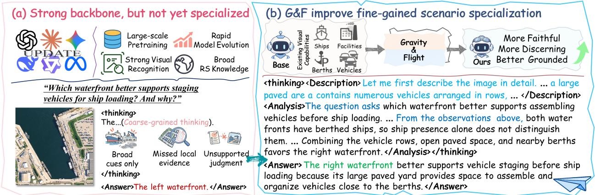
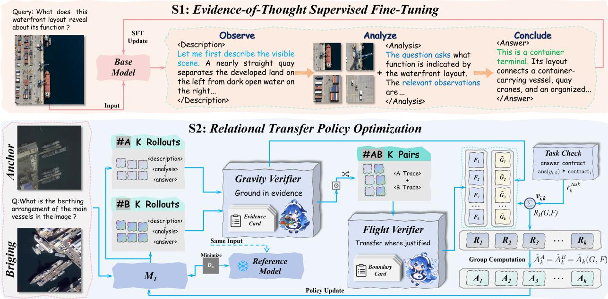
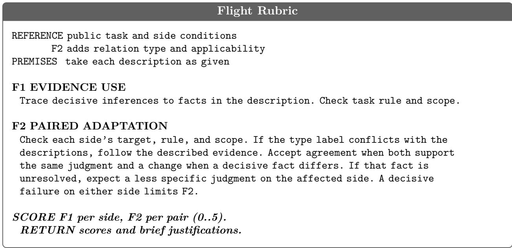
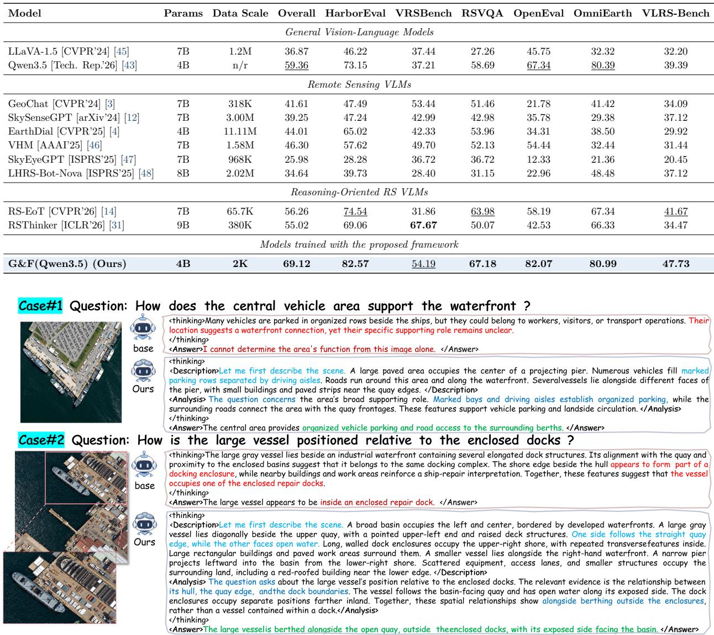
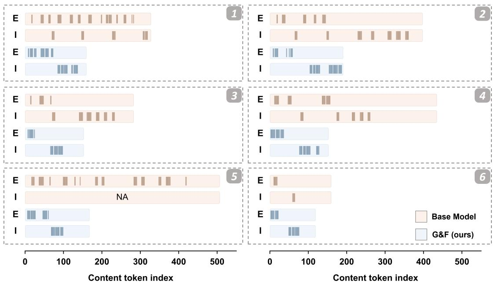

# Gravity and Flight: Learning to Navigate Fine-Grained Remote Sensing Scenes

Yuheng Zong1, Minghua Wang1, Xin Zhao1 Xiaobin Liu2, Yongjian Deng3, Chanho Eom4

1The Institute of Robotics and Automatic Information System (IRAIS), the Tianjin Key Laboratory of Intelligent Robotics (tjKLIR), Nankai University, Tianjin, 300071, China

2The College of Artificial Intelligence, Nankai University, Tianjin, 300071, China

3The Tianjin Key Laboratory of Intelligent Robotics, the Academy for Advanced Interdisciplinary Studies, and the College of Artificial Intelligence, Nankai University, Tianjin, 300071, China

4The Department of Imaging Science and Arts & Metaverse Convergence, Chung-Ang University, South Korea cheom@cau.ac.kr

## Abstract

Vision-language models are becoming increasingly capable, yet their reasoning over complex remote sensing scenes can remain coarse-grained and insuficiently grounded in task-relevant visual evidence. To improve remote sensing scene specialization with limited supervision, we propose Gravity and Flight (G&F), a framework that separates visual and reasoning verification while coupling policy updates to support faithful reasoning based on fine-grained visual observation. We realize G&F through two-stage post-training comprising Evidence-of-Thought supervised fine-tuning (EoT-SFT) and Relational Transfer Policy Optimization (RTPO). EoT-SFT teaches the model to describe visual details, analyze task-relevant evidence, and draw supported conclusions. RTPO then refines reasoning on scene-matched image pairs with finegrained visual diferences under a shared task, generating responses independently for each image. In its rubric-based verification, Gravity checks visual fidelity and description coverage, while Flight takes the descriptions as premises to assess evidence use and relations between paired judgments. Verification and task-correctness scores yield a shared pair-level advantage for policy updates from both responses. Using 1,008 demonstrations and 500 training pairs for harbor specialization, G&F achieves a mean score of 69.12 across six evaluation sets, exceeding the backbone and supervised initialization by 9.76 and 4.56 points, respectively. Matched controls show gains over single-image and joint-input RL, while removing either verification view reduces performance. To assess applicability across scene domains, we apply G&F to urban specialization, obtaining gains over both the base model and supervised initialization across three evaluation subsets. For a more detailed project overview and ongoing updates, please visit https://github.com/Z0ngL1ng/Gravity-and-Flight.

## 1 Introduction

Vision-language models (VLMs) have developed strong recognition and instruction-following capabilities [1, 2], with growing applications to remote sensing [3, 4]. Beyond identifying objects and scene categories, understanding complex remote sensing scenes requires jointly interpreting local attributes, spatial relationships, and task-specific conditions [5, 6]. However, VLMs can still produce coarse-grained analyses that overlook task-critical details or draw conclusions beyond what the observed evidence supports [7].

  
Figure 1. Motivation for G&F. A harbor example contrasts recognizing scene objects with using taskrelevant local evidence to judge vehicle-staging suitability.

As shown in Fig. 1, the backbone recognizes vessels and industrial buildings in the harbor scene, but these coarse-grained observations alone cannot establish which waterfront better supports vehicle staging before ship loading. The judgment requires inspecting vehicle rows, usable paved space, and access to nearby berths, then explaining how their arrangement supports vehicle assembly.

Learning such evidence-grounded judgments is particularly challenging when high-quality annotated examples for scene specialization are scarce. Separate assessments of visual fidelity and evidence use complement final-answer scoring with feedback on the observations and reasoning behind each answer. We use explicit rubrics to turn these assessments into training scores and make fuller use of each example [8].

To improve remote sensing scene specialization through fine-grained visual observation and faithful reasoning, we propose Gravity and Flight (G&F), a two-stage post-training framework. Evidence-of-Thought supervised fine-tuning (EoT-SFT) initializes the model to distinguish observed scene facts from their task-dependent interpretation. Its demonstrations record local details and visibility limits in the description, then use relevant observations in the analysis to support the conclusion.

Relational Transfer Policy Optimization (RTPO) organizes training around scene-matched image pairs with fine-grained visual diferences under a shared task. Responses are sampled independently for each image and matched into candidate pairs. Gravity checks visual claims and description coverage against image evidence, while Flight assesses evidence use and the relation between paired judgments conditional on the generated descriptions. Their rubric scores and task correctness form a reward for each candidate pair. Normalizing pair rewards within each training unit yields shared pair-level advantages that couple the policy updates for the two responses in each pair.

Across six harbor evaluation sets, G&F achieves a higher mean score than the backbone, supervised initialization, and matched RL controls. Removing either verification mechanism reduces performance. Token-level analysis of six sampled cases further shows more complete coverage of required visual facts and better-supported judgments in shorter responses.

To assess applicability beyond harbors, we apply both stages to urban specialization with the same rubric dimensions and reward weights, obtaining gains over both the base model and supervised initialization across three evaluation subsets.

Our contributions are summarized as follows:

• We introduce G&F, a two-stage post-training framework for remote sensing scene specialization

through fine-grained visual observation and faithful reasoning.

• We develop RTPO, which combines decoupled rubric-based verification with a shared pairlevel advantage to couple policy updates from independently generated responses.

• We demonstrate gains over both the base model and supervised initialization in harbor and urban specialization, with ablations, matched controls, and token-level evidence from the harbor setting.

## 2 Related Work

Remote Sensing Vision-Language Models. Vision-language pretraining produces transferable visual representations [9, 10], which remote sensing VLMs adapt through domain-specific instruction tuning for grounded interaction and multi-source understanding [3, 4, 11], as well as detailed object and relation descriptions [12]. FBA develops prerequisite remote-sensing and crossdomain capabilities before evidence-grounded scene tuning [13]. Complementary approaches improve access to local evidence through iterative inspection [14] and active cropping or search [15, 16]. However, even when a crop resolves an object’s identity, its function may remain uncertain. G&F checks the description against the image and assesses whether those observations support the model’s conclusion under the stated task conditions.

Relational Supervision for Fine-Grained Reasoning. Image relations can make subtle visual distinctions explicit through comparison [17, 18]. EqSim links semantic changes to image-text similarity [19], while Fine-R1 uses within-category and cross-category relations to improve finegrained recognition [20]. MiCo builds triplets from two augmented views of one image and a similar third image, rewarding same/diferent judgments on joint inputs [21]. Visually distinct scenes, however, can support the same answer to a shared question. G&F assesses whether the paired descriptions warrant agreement or change in the independently generated judgments.

Visual Faithfulness and Reasoning Rewards. Visual faithfulness studies diagnose unsupported object claims and image-conditioned reasoning errors [22, 23], while fine-grained correctional feedback improves alignment [24]. These concerns also motivate rewards for perceptual consistency [25] and intermediate visual faithfulness [26]. Vision-SR1 tests whether generated descriptions support subsequent text-only reasoning [27]. RAPID optimizes query-relevant captions using downstream answer correctness from an external text reasoner [28]. LLaVA-Critic and Prometheus-Vision evaluate multimodal response quality [29, 30]. Rubrics as Rewards uses instance-specific criteria as policy feedback [8], while remote sensing models also optimize answer rewards [31, 32]. G&F evaluates relations across task-matched scenes and uses a shared pair advantage to couple the policy updates.

## 3 Method

## 3.1 Overview

We adapt a pretrained VLM parameterized by θ, denoted as $\pi _ { \theta } ( y \mid x , q )$ , where x is the input image, q is the public task instruction, and y is the generated response comprising a scene description, task analysis, and final answer. As illustrated in Fig. 2, G&F follows a two-stage framework. EoT-SFT

  
Figure 2. Overview of G&F. EoT-SFT provides supervised initialization. RTPO jointly evaluates independently generated responses with Gravity and Flight, then updates the policy using a shared pair-level advantage.

establishes an observation-to-judgment process, while RTPO further refines it through relational feedback from task-matched scenes.

## 3.2 EoT Supervised Initialization

EoT-SFT uses supervised reasoning traces [33, 34] to establish detailed observations before taskspecific analysis. The supervised targets distinguish what the image shows from how those observations support an answer.

We construct the demonstrations through three steps of EoT distillation, comprising scene observation, task interpretation, and consistency review. In remote sensing scenes, numerous objects and facilities coexist within complex spatial layouts. Scene observation first builds an Evidence Card, a structured image-level record (Section 3.3), covering principal subjects, salient secondary objects, local attributes, counts, spatial relations, and visibility limits. Each entry includes a tex tual region reference, visibility, confidence, and coverage priority. This image-level record supplies evidence for diferent tasks. In spatially complex remote sensing scenes, linking observations to their corresponding objects or regions helps determine which entities exhibit a given attribute, participate in a spatial relation, or qualify for inclusion in a count. For counting questions, these associations identify objects within the requested spatial scope. For functional questions, they link facilities to nearby access routes and visible activity. Visibility limits further distinguish unresolved attributes from observed absences, ensuring that task-specific judgments remain grounded in visible evidence without overstating uncertain details. Task interpretation then identifies the target and spatial scope in the public instruction q, selects relevant observations, and applies its conditions or rules. Alternative interpretations are examined through the visible details that distinguish them. For the vehicle-staging task in Fig. 1, the analysis considers vehicle rows, usable paved space, and proximity to berths. Ships are present at both waterfronts, so suitability depends on whether the local arrangement provides space for vehicle assembly and access to ships for loading.

Finally, consistency review checks the demonstrations for visual support [35], evidence use in the analysis, and agreement of the answer with the question and preceding reasoning. When a taskcritical detail is obscured or unresolved, the target response records that uncertainty and retains a broader conclusion whenever the remaining visible evidence supports one. The corpus contains 1,008 demonstrations over 888 images, with 7,745 observation annotations, 1,411 uncertainty annotations, and 1,698 assessments of alternative interpretations. The demonstrations cover local attributes, counting, spatial and connection reasoning, functional interpretation, and judgments governed by public conditions. Construction and review details are in Section A.

Each example pairs an image x and public instruction q with a target response $y ^ { \ast }$ . The description presents scene observations, the analysis selects and applies task-relevant evidence, and the answer states the resulting judgment. Questions about the same image share a description, while their analyses and answers follow the task. The target response is structured as

$$
y ^ { * } = \underbrace { \mathrm { d e s c r i p t i o n } \to \mathrm { a n a l y s i s } } _ { \mathrm { E o T ~ t r a c e } } \oplus \underbrace { \mathrm { a n s w e r } } _ { \mathrm { f i n a l } } .\tag{1}
$$

Here, ⊕ appends the final answer to the EoT trace.

Response Template   
INPUT image x and public instruction q   
<think>   
<description>   
Scene overview and salient objects.   
Attributes, ownership, spatial relations.   
Visibility, occlusion, and crop limits.   
</description>   
<analysis>   
Identify target, scope, and conditions.   
Select relevant description facts.   
Apply task rules within evidence limits.   
</analysis>   
</think>   
<answer>Supported final answer.</answer>

We train the policy on the supervised dataset $\mathcal { D } _ { \mathrm { S F T } }$ of image–instruction–target response triples $( x , q , y ^ { * } )$ , jointly supervising the description, analysis, and answer. For target token ${ \boldsymbol y } _ { t } ^ { * }$ with prefix $y _ { < t } ^ { * } ,$ , the binary mask $m _ { t }$ selects completion tokens, assigning zero weight to the input, padding, and fixed assistant prefix. We minimize the EoT-SFT loss ${ \mathcal { L } } _ { \mathrm { S F T } } ( \theta )$ , the masked, token-averaged negative log-likelihood given by

$$
\begin{array} { r l } & { \mathcal { L } _ { \mathrm { S F T } } ( \boldsymbol { \theta } ) = - \mathbb { E } _ { ( \boldsymbol { x } , \boldsymbol { q } , \boldsymbol { y } ^ { * } ) \sim \mathcal { D } _ { \mathrm { S F T } } } } \\ & { \qquad \left[ \frac { \sum _ { t } m _ { t } \log \pi _ { \boldsymbol { \theta } } ( \boldsymbol { y } _ { t } ^ { * } \mid \boldsymbol { x } , \boldsymbol { q } , \boldsymbol { y } _ { < t } ^ { * } ) } { \sum _ { t } m _ { t } } \right] . } \end{array}\tag{2}
$$

The resulting policy πS1, also denoted $M _ { 1 }$ , initializes RTPO and serves as its frozen KL reference.

## 3.3 Anchor–Bridging Supervision

Remote sensing scenes may share similar prominent objects while difering in local configurations that are decisive for task-specific judgments. Stage 2 refines the Stage 1 process with task-matched scenes for which the same question and conditions apply to each image on its own. Changes in local attributes, connections, group membership, or visible boundaries may alter supported judgments, while task-irrelevant diferences leave the task-specific judgment unchanged.

During pair construction, the Anchor image $x _ { A }$ establishes a scene configuration, and the Bridging image $x _ { B }$ provides a comparable configuration with a meaningful contrast in the evidence. Both sides receive symmetric supervision. The shared instruction $q$ specifies the question, target, scope, and public conditions for both images. Pair review checks task applicability, the relevant evidence on each side, and the judgment relation that evidence supports.

Each image $x _ { i } , i \in \{ A , B \}$ , has an Evidence Card $\mathcal { E } _ { i } .$ , and the pair shares a Boundary Card $B _ { A B }$ . Together, these components form the training unit

$$
\mathcal { P } _ { A B } = ( x _ { A } , x _ { B } , q , \mathcal { E } _ { A } , \mathcal { E } _ { B } , \mathcal { B } _ { A B } ) .\tag{3}
$$

Evidence Cards. Each $\mathcal { E } _ { i }$ records visible objects, local attributes, spatial relations, coverage priorities, and visibility limits, associating observations with their objects or regions. Gravity uses the image and its card to assess visual fidelity and description coverage.

Boundary Cards. The shared $B _ { A B }$ links observations to the task through public conditions, supported inferences, inference limits, side-specific answer contracts, and comparison annotations. Flight checks reasoning from the generated descriptions and analyses using the public task, with permitted comparison metadata for paired evaluation, while Task Check evaluates the final answer using the contract assigned to its image.

The set contains 500 pairs of distinct CPRS harbor images [13], with 1,000 images, 1,000 Evidence Cards, and 500 Boundary Cards. The pairs include 372 decisive-change cases, 77 invariance cases, and 51 visibility-scope cases. They cover changed judgments, consistency supported by each image’s own evidence, and narrower claims when the task depends on obscured details. Tasks cover local attributes, spatial layout, connections, counting, functional interpretation, evidence suficiency, comparison, and visible activity.

Construction details appear in Sections A and B.

## 3.4 Gravity and Flight Verification

Given a training unit $\mathcal { P } _ { A B }$ , the policy generates response $y _ { i }$ from image $x _ { i }$ and the shared instruction q. The joint response distribution is

$$
p _ { \theta } ( y _ { A } , y _ { B } \mid x _ { A } , x _ { B } , q ) = \prod _ { i \in \{ A , B \} } \pi _ { \theta } ( y _ { i } \mid x _ { i } , q ) .\tag{4}
$$

Verification separates visual reliability from conditional reasoning (Fig. 2). Both verifiers use the same fixed DeepSeek-V4.1-Flash judge through separate calls with mechanism-specific prompts. Each call receives only the permitted information, although judging errors may remain correlated through the shared model. The judge returns integer scores and brief justifications using the criteria summarized in the boxes. View-specific anchors appear in Section C, and the verifier implementation in Section B.1.

Gravity. Gravity checks visual fidelity throughout the response and coverage only in the initial description, separating the accuracy of visual claims from which scene content is addressed. Visual fidelity uses the image as the reference and accepts clearly visible facts beyond the card’s entries. The card guides coverage priorities. An unresolved material conflict between the image and card makes the afected judgment unverifiable.

We index G1 and G2 by $\mathcal { D } _ { G } = \{ \mathrm { f i d e l i t y } , \mathrm { c o v e r a g e } \}$ , respectively. The projection $\mathsf { P } _ { d } ( y _ { i } )$ selects visual claims throughout the response for fidelity and the initial description for coverage. The rubric verifier $\mathsf { V } _ { d } ^ { G }$ returns an integer in {0, 1, 2, 3} for each view against $( x _ { i } , \mathcal { E } _ { i } )$ . Nonnegative view weights $w _ { d } ^ { G }$ sum to one. The normalized Gravity score $G _ { i } \in [ 0 , 1 ]$ for response $y _ { i }$ is defined as

$$
G _ { i } = \sum _ { d \in \mathcal { D } _ { G } } w _ { d } ^ { G } \frac { \mathsf { V } _ { d } ^ { G } ( x _ { i } , \mathcal { E } _ { i } ; \mathsf { P } _ { d } ( y _ { i } ) ) } { 3 } .\tag{5}
$$

Gravity Rubric   
REFERENCE image x and Evidence Card E   
CANDIDATE initial description and all visual claims in the response   
G1 FIDELITY   
Use the image to check entities, attributes, counts, ownership, and   
spatial relations. Match certainty to visibility. Accept clear   
observations beyond the card.   
G2 COVERAGE   
Use the card’s priorities to assess coverage of subjects, regions, attributes, and   
relations in the initial description only.   
SCORE G1 and G2 per response $( \boldsymbol { 0 } . . \boldsymbol { \mathcal { 3 } } )$   
RETURN scores and evidence-based reasons.  
Flight. Flight evaluates reasoning conditional on the described visual facts. Gravity checks those facts against the image. F1 assesses evidence use within each analysis, while F2 examines task execution on both sides and the relationship between their judgments.

For Flight, we use $u _ { i }$ to represent the description and analysis of response $y _ { i }$ . We index F1 and F2 by $\mathcal { D } _ { F } = \{ \mathrm { u s e }$ , adaptation}, respectively. The corresponding candidate inputs are $\mathcal { Z } _ { i } ^ { \mathrm { u s e } } = u _ { i }$ and $\mathcal { Z } _ { i } ^ { \mathrm { a d a p t a t i o n } } = ( u _ { A } , u _ { B } )$ . The projection $\Pi _ { d } ( B _ { A B } )$ supplies the public task conditions stated in $q ,$ with permitted comparison applicability and type added for F2. The comparison type identifies the intended check, while the described premises under the public task determine the supported relation. Flight’s complete input comprises the selected candidate content, the public task, and the permitted comparison fields. Images and Evidence Cards support Gravity, while answer contracts and reference judgments support Task Check. The verifier $\vee _ { d } ^ { F }$ returns an integer in {0, 1, 2, 3, 4, 5}. Applicability follows the task and comparison annotations. Nonnegative weights $\boldsymbol { w _ { d } ^ { F } }$ are normalized over applicable views and set to zero otherwise. The normalized Flight score $F _ { i } \in [ 0 , 1 ]$ for side i is defined as

$$
F _ { i } = \sum _ { d \in \mathcal { D } _ { F } } w _ { d } ^ { F } \frac { \mathsf { V } _ { d } ^ { F } \left( q , \mathsf { \Pi } _ { d } ( \mathcal { B } _ { A B } ) ; \mathcal { Z } _ { i } ^ { d } \right) } { 5 } .\tag{6}
$$

F1 is scored per response, while F2 is scored jointly for the pair, with a decisive contextual failure on either side limiting the score. Flight accepts reasoning that is valid conditional on a described premise, including a premise that Gravity identifies as visually false. A visually false claim introduced only in analysis can fail Gravity for inaccuracy. If the analysis relies on that claim to reach its conclusion, Flight can also penalize the missing descriptive support.

## 3.5 Relational Transfer Policy Optimization

RTPO updates the single-image policy initialized by $M _ { 1 }$ using relational feedback from the A–B units in Eq. (3).

Sampling and Matching. A training unit contains an annotated image pair under a shared task, within which sampled responses are matched into candidate pairs. For each unit $\mathcal { P } _ { A B }$ , the rollout policy $\pi _ { \theta _ { \mathrm { o l d } } }$ independently samples K responses from each image $x _ { i }$ and the shared instruction $q .$ Random one-to-one matching uses each response exactly once to form K candidate pairs, with $y _ { i , k }$ denoting side $i \in \{ A , B \}$ of pair $k \in \{ 1 , \ldots , K \}$ . G1, G2, and F1 are scored per response, while F2 is scored once per matched pair and shared by both sides. The resulting $G _ { i , k }$ and $F _ { i , k }$ follow Eqs. (5) and (6).

Pair Reward. Task Check evaluates each final answer against its side-specific contract in $\boldsymbol { B } _ { A B }$ giving normalized correctness $C _ { i , k } \in [ 0 , 1 ]$ . The binary indicator $v _ { i , k }$ records whether the response contains text in all three phases, ordered as description, analysis, and answer. The task-correctness contribution is $\begin{array} { r } { r _ { k } ^ { \mathrm { t a s k } } = \frac { \lambda _ { C } } { 2 } \sum _ { i \in \{ A , B \} } v _ { i , k } C _ { i , k } } \end{array}$ , with fixed $\lambda _ { C } = 0 . 5 0$ . A protocol violation removes that side’s reward contribution while preserving the valid contribution from the other side.

With reward weights $\lambda _ { G }$ and $\lambda _ { F }$ for Gravity and Flight, the total reward $R _ { k } ( G , F )$ for candidate pair k is defined as

$$
R _ { k } ( G , F ) = r _ { k } ^ { \mathrm { t a s k } } + \frac { 1 } { 2 } \sum _ { i \in \{ A , B \} } v _ { i , k } [ \lambda _ { G } G _ { i , k } + \lambda _ { F } F _ { i , k } ] .\tag{7}
$$

Shared Advantage. Within each A–B unit, let V index candidate pairs with valid verifier outputs, whose rewards have mean $\mu \nu$ and standard deviation $\sigma _ { \mathcal { V } }$ . For each $k \in \mathcal V$ and stabilizing constant $\epsilon _ { A } > 0$ , the advantage is

$$
\hat { A } _ { k } ( G , F ) = \frac { R _ { k } ( G , F ) - \mu \nu } { \sigma \nu + \epsilon _ { A } } .\tag{8}
$$

Both responses of pair k receive the same group-normalized advantage. Flight adaptation supplies the cross-scene assessment in the pair reward.

Policy Update. The update follows GRPO [36] with a clipped policy loss [37] and importance ratios against $\pi _ { \theta _ { \mathrm { o l d } } }$ . For each valid pair k, $\mathcal { L } _ { i , k } ( \hat { A } _ { k } ( G , F ) )$ denotes the clipped policy loss for response $y _ { i , k }$ using the shared advantage. It sums losses over the $T _ { i , k }$ retained completion tokens and divides by $\begin{array} { r } { \bar { T } _ { i } = K ^ { - 1 } \sum _ { i \in \mathcal { V } } T _ { i , j } } \end{array}$ . Consequently, $K ^ { - 1 } \sum _ { k } \mathcal { L } _ { i , k }$ gives one retained-token mean on side i. Unverifiable pairs contribute zero to both the policy and KL losses. Let Ω denote sampling of training units, responses, and their matching. A coeficient $\beta$ controls KL regularization toward the frozen Stage-1 policy $\pi _ { \mathrm { S 1 } }$ . We minimize the RTPO objective ${ \mathcal { I } } _ { \mathrm { R T P O } } ( \theta )$ defined by

$$
\begin{array} { r l } {  { \mathcal { I } _ { \mathrm { R T P O } } ( \theta ) = \mathbb { E } _ { \Omega } [ \frac { 1 } { 2 K } \sum _ { k = 1 } ^ { K } \sum _ { i \in \{ A , B \} } \mathcal { L } _ { i , k } ( \hat { A } _ { k } ( G , F ) ) ] } } \\ & { + \beta \mathbb { E } _ { \Omega } [ D _ { \mathrm { K L } } ( \pi _ { \theta } \parallel \pi _ { \mathrm { S 1 } } ) ] . } \end{array}\tag{9}
$$

The outer factor weights the two sides equally after token averaging. The reference remains fixed while the policy is updated. Loss details, the sampled KL estimator, and group-validity handling appear in Section D.

## 4 Experiments

## 4.1 Experimental Setup

Data and evaluation. Harbor training uses 1,008 EoT demonstrations and 500 task-matched pairs from CPRS [13]. We evaluate on HarborEval and OpenEval [13], together with single-image harbor subsets of VRSBench [38], RSVQA [39], OmniEarth [40], and VLRS-Bench [41]. Comparisons use the same fixed evaluation items, and each benchmark retains its scoring protocol. Overall averages the six scores on a 0–100 scale, assigning equal weight to each benchmark. FBA specifies blinded expert review for OpenEval and a fixed image-grounded judge for HarborEval reports [13, 42]. OpenEval ratings cover grounding, object coverage, functional zones, spatial relations, uncertainty handling, and concision. Data and evaluation details appear in Section E.

Models and comparisons. We adapt Qwen3.5-4B [43] with LoRA [44], freezing the vision encoder and sampling K = 6 candidates per image for RTPO. All harbor RL ablations and matched controls start from the same supervised checkpoint $M _ { 1 }$ , with matched image–question exposure, generation limits, and optimization settings. Removing a reward term leaves the other coeficients fixed. All training variants are evaluated with single-image inputs. Training and control details appear in Sections D.1 and D.2.

## 4.2 Comparison with Existing Models

HarborEval tests harbor expertise, while VRSBench and RSVQA probe fine visual detail and relational question answering. OpenEval assesses open-ended reporting, OmniEarth geospatial understanding, and VLRS-Bench scene reasoning and decisions. G&F improves over its backbone on all six sets and leads five (Table 1). Its mean of 69.12 exceeds the backbone by 9.76 points and RS-EoT, the strongest remote sensing baseline, by 12.86. RSThinker leads on VRSBench (67.67), where G&F makes its largest gain over the backbone (+16.98).

Figure 3 illustrates how the responses connect visible observations to the requested judgments. In Case 1, the base recognizes vehicle rows and leaves the area’s supporting role unresolved, whereas G&F connects marked bays, driving aisles, and quay access to organized parking and landside circulation, answering the functional question at the level supported by the layout. In Case 2, the base infers dock enclosure from nearby repair facilities. G&F instead uses the hull–quay alignment, exposed open water, and separate dock boundaries to place the vessel alongside the open quay, outside the enclosures.

Table 1. Comparison on six harbor evaluation sets. Overall is their unweighted mean. Data Scale follows source-reported adaptation counts, with $\mathrm { n } / \mathrm { r }$ marking unreported values. G&F uses 1,008 demonstrations and 500 pairs. Bold and underlining indicate the best and second-best scores.
<table><tr><td>Model</td><td></td><td>Params Data Scale</td><td></td><td>Overall HarborEval VRSBench</td><td></td><td>RSVQA</td><td>OpenEval</td><td>OmniEarth</td><td>VLRS-Bench</td></tr><tr><td colspan="10">General Vision-Language Models</td></tr><tr><td>LLaVA-1.5 [CVPR’24] [45]</td><td>7B</td><td>1.2M</td><td>36.87</td><td>46.22</td><td>37.44</td><td>27.26</td><td>45.75</td><td>32.32</td><td>32.20</td></tr><tr><td>Qwen3.5 [Tech. Rep.&#x27;26] [43]</td><td>4B</td><td>n/r</td><td>59.36</td><td>73.15</td><td>37.21</td><td>58.69</td><td>67.34</td><td>80.39</td><td>39.39</td></tr><tr><td colspan="10">Remote Sensing VLMs</td></tr><tr><td>GeoChat [CVPR’24] [3] SkySenseGPT [arXiv’24] [12]</td><td>7B</td><td>318K</td><td>41.61</td><td>47.49</td><td>53.44</td><td>51.46</td><td>21.78</td><td>41.42</td><td>34.09</td></tr><tr><td></td><td>7B</td><td>3.00M</td><td>39.25</td><td>47.24</td><td>42.99</td><td>42.98</td><td>35.78</td><td>29.38</td><td>37.12</td></tr><tr><td>EarthDial [CVPR’25] [4] VHM [AAAI&#x27;25] [46]</td><td>4B</td><td>11.11M 1.58M</td><td>44.01 46.30</td><td>65.02 57.62</td><td>42.33</td><td>53.96</td><td>34.31</td><td>38.50</td><td>29.92</td></tr><tr><td>SkyEyeGPT [ISPRS’25] [47]</td><td>7B 7B</td><td>968K</td><td>25.98</td><td>28.28</td><td>49.70</td><td>52.13</td><td>54.44 12.33</td><td>32.44</td><td>31.44</td></tr><tr><td>LHRS-Bot-Nova [ISPRS&#x27;25] [48]</td><td>8B</td><td>2.02M</td><td>34.64</td><td>39.73</td><td>36.72 28.40</td><td>36.72 31.15</td><td>22.96</td><td>21.36</td><td>20.45</td></tr><tr><td></td><td></td><td></td><td></td><td></td><td></td><td></td><td></td><td>48.48</td><td>37.12</td></tr><tr><td colspan="10">Reasoning-Oriented RS VLMs</td></tr><tr><td>RS-EoT [CVPR’26] [14]</td><td>7B</td><td>65.7K</td><td>56.26</td><td>74.54</td><td>31.86</td><td>63.98</td><td>58.19</td><td>67.34</td><td>41.67</td></tr><tr><td>RSThinker [ICLR&#x27;26] [31]</td><td>9B</td><td>380K</td><td>55.02</td><td>69.06</td><td>67.67</td><td>50.07</td><td>42.53</td><td>66.33</td><td>34.47</td></tr><tr><td colspan="10">Models trained with the proposed framework</td></tr><tr><td></td><td>4B</td><td>2K</td><td>69.12</td><td>82.57</td><td>54.19</td><td>67.18</td><td>82.07</td><td>80.99</td><td>47.73</td></tr></table>

  
Figure 3. Qualitative comparison on held-out harbor images using the same image–question inputs. The cases illustrate functional inference and vessel–dock spatial reasoning, with relevant evidence highlighted.

## 4.3 Component and Training Ablations

Table 2 shows a 5.20-point gain from EoT-SFT and a further 4.56 points from RTPO.

Reward components. Task-only RL scores 63.34, below $M _ { 1 }$ (64.56). Removing Flight or Gravity from full RTPO costs 4.01 or 2.80 points, respectively.

Table 2. Harbor training comparisons. RL starts from $M _ { 1 }$ . Cost is the measured training wall time, including Stage 1 and verifier waiting, normalized to $M _ { 1 }$ under the optimized implementation. Measurement details in Section G.
<table><tr><td>Setting</td><td>Overall</td><td>∆ vs  $M _ { 0 }$ </td><td>Rel. cost (×)</td></tr><tr><td>M0 (base)</td><td>59.36</td><td>0.00</td><td> $\mathrm { n / a }$ </td></tr><tr><td>M1(+EoT-SFT)</td><td>64.56</td><td>+5.20</td><td>1.00</td></tr><tr><td colspan="4">Paired reward ablations</td></tr><tr><td>w/o G and F</td><td>63.34</td><td>+3.98</td><td>8.15</td></tr><tr><td>w/o Flight</td><td>65.11</td><td>+5.75</td><td>10.13</td></tr><tr><td>w/o Gravity</td><td>66.32</td><td>+6.96</td><td>15.83</td></tr><tr><td colspan="4">Matched training controls</td></tr><tr><td>Single-image RL</td><td>65.12</td><td>+5.76</td><td>13.38</td></tr><tr><td>Paired RL w/o F2</td><td>66.79</td><td>+7.43</td><td>13.57</td></tr><tr><td>Shuffled F2 feedback</td><td>64.71</td><td>+5.35</td><td>17.20</td></tr><tr><td>Joint-input RL</td><td>66.49</td><td>+7.13</td><td>16.86</td></tr><tr><td>G&amp;F</td><td>69.12</td><td>+9.76</td><td>16.69</td></tr></table>

Flight-guided relational feedback. Paired RL without F2 combines local rewards, shares the advantage, and checks validity jointly. It gains 1.67 points over single-image RL at similar cost. Adding F2 within this setup yields another 2.33 points.

Relational feedback alignment. Shufled F2 feedback retains image pairs and local scoring but permutes F2 scores among each unit’s six candidate pairs before forming rewards and shared advantages. It reaches 64.71 at 17.20×, 4.41 points below G&F, 2.08 below Paired RL w/o F2, and 0.15 above $M _ { 1 }$ , favoring aligned F2 feedback.

Generation context. Joint-input RL uses the same image pairs, verification criteria, and reward weights as G&F. Given both images, it generates a description, analysis, and answer for each in a single sequence. The second response can then draw on observations from the first as well as the visual evidence in either scene. Under single-image evaluation it reaches 66.49, 2.63 points below G&F at slightly higher training wall time (16.86× versus 16.69×). The joint context may mix scenespecific evidence across responses, weakening the supervision signal for fine-grained distinctions. Control definitions appear in Sections D.1 and F.1.

## 4.4 Token-Level Evidence Organization

Figure 4 compares one Base and one G&F response per case on six randomly sampled image– question inputs, each with two required visual facts and a reference judgment. Evidence phrases and valid inference clauses are annotated with parent sentences; identical sentences share labels across styles. Densities exclude formatting tokens, include supported repetitions, and weight cases equally.

G&F states visible facts in the description and uses them in analysis. The Base model distributes them across unstructured prose with partial reuse in reasoning. Evidence density is 21.53% for Base and 38.48% for G&F. On the five cases with analytical spans in both responses, inference density is 24.82% and 46.61%, respectively. Mean task-related content density is 39.91% for G&F and 22.35% for Base, with mean full-response lengths of 179.50 and 355.50 tokens, respectively. Final answers agree with the reference judgment in three of six Base responses and all six G&F responses. Required-fact coverage, counting each task’s visual facts once, is 91.67% for Base and 100.00% for G&F. Section I details the annotation and metrics.

  
Figure 4. Token-level organization of six randomly sampled response pairs. Peach (Base) and blue (G&F) tracks share a content-token axis that excludes format-only tokens. Dark marks show evidence (E) or inference (I) phrase membership, not attention. NA marks a response with no analytical tokens.

## 4.5 Evaluation on Urban Scenes

Urban specialization uses 320 EarthVL-GLOBAL images (1024×1024) from EarthVLSet [49], with 160 demonstrations, 60 training pairs, and 20 held-out development pairs. A separate urban model undergoes Stage 1 and RTPO from the same base checkpoint, retaining the harbor rubric dimensions and reward weights. Evaluation uses fixed urban subsets of EarthVQA [50], VRSBench [38], and RSVQA HR [39]; data preparation and protocols are in Section H.

Table 3 shows that +EoT-SFT improves all three subsets over the base; +RTPO adds 1.93, 2.08, and 4.67 points, respectively, supporting reuse beyond harbors.

Table 3. Urban specialization on fixed evaluation subsets.
<table><tr><td>Stage</td><td>EarthVQA Urban</td><td>VRSBench Urban</td><td>RSVQA HR</td></tr><tr><td>Base</td><td>11.00</td><td>23.33</td><td>15.00</td></tr><tr><td>+EoT-SFT</td><td>29.50</td><td>54.17</td><td>39.00</td></tr><tr><td>+RTPO</td><td>31.43</td><td>56.25</td><td>43.67</td></tr></table>

## 5 Conclusion

We presented Gravity and Flight for fine-grained remote sensing specialization with limited supervision. EoT-SFT initializes observation and analysis, and RTPO refines the policy on task-matched pairs using Gravity’s visual checks, Flight’s conditional reasoning checks, and task correctness. A shared pair-level advantage updates the single-image policy. Harbor experiments show gains beyond supervised initialization and favor aligned relational feedback. Separate urban training also yields gains on all three subsets with the same rubric dimensions and reward weights, supporting framework reuse.

## Declaration of competing interest

The authors declare that they have no known competing financial interests or personal relationships that could have appeared to influence the work reported in this paper.

## Acknowledgments

This work is supported by the National Natural Science Foundation of China under grants 62571271 and 62201552, the Natural Science Foundation of Tianjin under Grant No. 24JCQNJC01890, and the Fundamental Research Funds for the Central Universities.

## References

[1] Haotian Liu, Chunyuan Li, Qingyang Wu, and Yong Jae Lee. Visual Instruction Tuning. In Advances in Neural Information Processing Systems, volume 36, 2023. URL https://proceedings.neurips. cc/paper/2023/hash/6dcf277ea32ce3288914faf369fe6de0-Abstract-Conference.html.

[2] Shengbang Tong, Ellis Brown, Penghao Wu, Sanghyun Woo, Manoj Middepogu, Sai Charitha Akula, Jihan Yang, Shusheng Yang, Adithya Iyer, Xichen Pan, Austin Wang, Rob Fergus, Yann LeCun, and Saining Xie. Cambrian-1: A Fully Open, Vision-Centric Exploration of Multimodal LLMs. In Advances in Neural Information Processing Systems, volume 37, 2024. URL https://proceedings.neurips. cc/paper\_files/paper/2024/hash/9ee3a664ccfeabc0da16ac6f1f1cfe59-Abstract-Conference. html.

[3] Kartik Kuckreja, Muhammad Sohail Danish, Muzammal Naseer, Abhijit Das, Salman Khan, and Fahad Shahbaz Khan. GeoChat: Grounded Large Vision-Language Model for Remote Sensing. In Proceedings of the IEEE/CVF Conference on Computer Vision and Pattern Recognition, pages 27831– 27840, 2024. URL https://openaccess.thecvf.com/content/CVPR2024/html/Kuckreja\_GeoChat\_ Grounded\_Large\_Vision-Language\_Model\_for\_Remote\_Sensing\_CVPR\_2024\_paper.html.

[4] Sagar Soni, Akshay Dudhane, Hiyam Debary, Mustansar Fiaz, Muhammad Akhtar Munir, Muhammad Sohail Danish, Paolo Fraccaro, Campbell D. Watson, Levente J. Klein, Fahad Shahbaz Khan, and Salman Khan. EarthDial: Turning Multi-sensory Earth Observations to Interactive Dialogues. In Proceedings of the IEEE/CVF Conference on Computer Vision and Pattern Recognition, pages 14303– 14313, 2025. URL https://openaccess.thecvf.com/content/CVPR2025/html/Soni\_EarthDial\_ Turning\_Multi- sensory\_Earth\_Observations\_to\_Interactive\_Dialogues\_CVPR\_2025\_paper. html.

[5] Hulingxiao He, Geng Li, Zijun Geng, Jinglin Xu, and Yuxin Peng. Analyzing and Boosting the Power of Fine-Grained Visual Recognition for Multi-modal Large Language Models. In International Conference on Learning Representations, 2025. URL https://proceedings.iclr.cc/paper\_files/paper/2025/ hash/dfa2f1555d46b553827af4e1557f3c9a-Abstract-Conference.html.

[6] Fengxiang Wang, Hongzhen Wang, Zonghao Guo, Di Wang, Yulin Wang, Mingshuo Chen, Qiang Ma, Long Lan, Wenjing Yang, Jing Zhang, Zhiyuan Liu, and Maosong Sun. XLRS-Bench: Could Your Multimodal LLMs Understand Extremely Large Ultra-High-Resolution Remote Sensing Imagery? In Proceedings of the IEEE/CVF Conference on Computer Vision and Pattern Recognition, pages 14325–14336, 2025. URL https://openaccess.thecvf.com/content/CVPR2025/html/Wang\_XLRS-Bench\_Could\_Your\_Multimodal\_LLMs\_Understand\_Extremely\_Large\_Ultra- High- Resolution\_ Remote\_CVPR\_2025\_paper.html.

[7] Zhenhailong Wang, Xuehang Guo, Sofia Stoica, Haiyang Xu, Hongru Wang, Hyeonjeong Ha, Xiusi Chen, Yangyi Chen, Ming Yan, Fei Huang, and Heng Ji. Perception-Aware Policy Optimization for Multimodal Reasoning. In International Conference on Learning Representations, 2026. URL https: //proceedings.iclr.cc/paper\_files/paper/2026/hash/82846e19e6d42ebfd4ace4361def29ae-Abstract-Conference.html.

[8] Anisha Gunjal, Anthony Wang, Elaine Lau, Vaskar Nath, Yunzhong He, Bing Liu, and Sean Hendryx. Rubrics as Rewards: Reinforcement Learning Beyond Verifiable Domains. arXiv preprint arXiv:2507.17746, 2025. URL https://arxiv.org/abs/2507.17746.

[9] Alec Radford, Jong Wook Kim, Chris Hallacy, Aditya Ramesh, Gabriel Goh, Sandhini Agarwal, Girish Sastry, Amanda Askell, Pamela Mishkin, Jack Clark, Gretchen Krueger, and Ilya Sutskever. Learning Transferable Visual Models From Natural Language Supervision. In Proceedings of the International Conference on Machine Learning, volume 139 of Proceedings of Machine Learning Research, pages 8748–8763, 2021. URL https://proceedings.mlr.press/v139/radford21a.html.

[10] Fan Liu, Delong Chen, Zhangqingyun Guan, Xiaocong Zhou, Jiale Zhu, Qiaolin Ye, Liyong Fu, and Jun Zhou. RemoteCLIP: A Vision Language Foundation Model for Remote Sensing. IEEE Transactions on Geoscience and Remote Sensing, 62:5622216, 2024. doi: 10.1109/TGRS.2024.3390838. URL https: //ieeexplore.ieee.org/document/10504785.

[11] Dilxat Muhtar, Zhenshi Li, Feng Gu, Xueliang Zhang, and Pengfeng Xiao. LHRS-Bot: Empowering Remote Sensing with VGI-Enhanced Large Multimodal Language Model. In European Conference on Computer Vision, pages 440–457, 2024. doi: 10.1007/978-3-031-72904-1\_26. URL https://www.ecva. net/papers/eccv\_2024/papers\_ECCV/html/9511\_ECCV\_2024\_paper.php.

[12] Junwei Luo, Zhen Pang, Yongjun Zhang, Tingzhu Wang, Linlin Wang, Bo Dang, Jiangwei Lao, Jian Wang, Jingdong Chen, Yihua Tan, and Yansheng Li. SkySenseGPT: A Fine-Grained Instruction Tuning Dataset and Model for Remote Sensing Vision-Language Understanding. arXiv preprint arXiv:2406.10100, 2024. URL https://arxiv.org/abs/2406.10100.

[13] Yuheng Zong, Minghua Wang, Xin Zhao, Zhi-Hui Zhan, Antonio Plaza, and Jon Atli Benediktsson. Filling Before Advancing: Capability-Gap-Driven Post-Training for Scenario-Specialized Remote Sensing MLLMs. arXiv preprint arXiv:2607.22205, 2026. URL https://arxiv.org/abs/2607.22205.

[14] Run Shao, Ziyu Li, Zhaoyang Zhang, Linrui Xu, Xinran He, Hongyuan Yuan, Bolei He, Yongxing Dai, Yiming Yan, Yijun Chen, Wang Guo, and Haifeng Li. Asking like Socrates: Socrates helps VLMs understand remote sensing images. In Proceedings of the IEEE/CVF Conference on Computer Vision and Pattern Recognition, pages 26465–26475, 2026. URL https://openaccess.thecvf. com/content/CVPR2026/html/Shao\_Asking\_like\_Socrates\_Socrates\_helps\_VLMs\_understand\_ remote\_sensing\_images\_CVPR\_2026\_paper.html.

[15] Ruixun Liu, Bowen Fu, Jiayi Song, Kaiyu Li, Wanchen Li, Lanxuan Xue, Hui Qiao, Weizhan Zhang, Deyu Meng, and Xiangyong Cao. ZoomEarth: Active Perception for Ultra-High-Resolution Geospatial Vision-Language Tasks. In Proceedings of the IEEE/CVF Conference on Computer Vision and Pattern Recognition, pages 34877–34888, 2026. URL https://openaccess.thecvf.com/content/ CVPR2026/html/Liu\_ZoomEarth\_Active\_Perception\_for\_Ultra-High-Resolution\_Geospatial\_ Vision-Language\_Tasks\_CVPR\_2026\_paper.html.

[16] Peirong Zhang, Yidan Zhang, Luxiao Xu, Jinliang Lin, Zonghao Guo, Fengxiang Wang, Xue Yang, Kaiwen Wei, and Lei Wang. GeoViS: Geospatially Rewarded Visual Search for Remote Sensing Visual Grounding. In Proceedings of the IEEE/CVF Conference on Computer Vision and Pattern Recognition,

pages 14335–14345, 2026. URL https://openaccess.thecvf.com/content/CVPR2026/html/Zhang\_ GeoViS\_Geospatially\_Rewarded\_Visual\_Search\_for\_Remote\_Sensing\_Visual\_Grounding\_CVPR\_ 2026\_paper.html.

[17] Tristan Thrush, Ryan Jiang, Max Bartolo, Amanpreet Singh, Adina Williams, Douwe Kiela, and Candace Ross. Winoground: Probing Vision and Language Models for Visio-Linguistic Compositionality. In Proceedings of the IEEE/CVF Conference on Computer Vision and Pattern Recognition, pages 5238– 5248, 2022. URL https://openaccess.thecvf.com/content/CVPR2022/html/Thrush\_Winoground\_ Probing\_Vision\_and\_Language\_Models\_for\_Visio-Linguistic\_Compositionality\_CVPR\_2022\_ paper.html.

[18] Qirui Jiao, Daoyuan Chen, Yilun Huang, Bolin Ding, Yaliang Li, and Ying Shen. Img-Dif: Contrastive Data Synthesis for Multimodal Large Language Models. In Proceedings of the IEEE/CVF Conference on Computer Vision and Pattern Recognition, pages 9296–9307, 2025. URL https:// openaccess.thecvf.com/content/CVPR2025/html/Jiao\_Img-Diff\_Contrastive\_Data\_Synthesis\_ for\_Multimodal\_Large\_Language\_Models\_CVPR\_2025\_paper.html.

[19] Tan Wang, Kevin Lin, Linjie Li, Chung-Ching Lin, Zhengyuan Yang, Hanwang Zhang, Zicheng Liu, and Lijuan Wang. Equivariant Similarity for Vision-Language Foundation Models. In Proceedings of the IEEE/CVF International Conference on Computer Vision, pages 11998–12008, 2023. URL https: //openaccess.thecvf.com/content/ICCV2023/html/Wang\_Equivariant\_Similarity\_for\_Vision-Language\_Foundation\_Models\_ICCV\_2023\_paper.html.

[20] Hulingxiao He, Zijun Geng, and Yuxin Peng. Fine-R1: Make Multi-modal LLMs Excel in Fine-Grained Visual Recognition by Chain-of-Thought Reasoning. In International Conference on Learning Representations, 2026. URL https://proceedings.iclr.cc/paper\_files/paper/2026/hash/ 6f6dd92b03ff9be7468a6104611c9187-Abstract-Conference.html.

[21] Xi Chen, Mingkang Zhu, Shaoteng Liu, Xiaoyang Wu, Xiaogang Xu, Yu Liu, Xiang Bai, and Hengshuang Zhao. MiCo: Multi-image Contrast for Reinforcement Visual Reasoning. arXiv preprint arXiv:2506.22434, 2025. URL https://arxiv.org/abs/2506.22434.

[22] Yifan Li, Yifan Du, Kun Zhou, Jinpeng Wang, Wayne Xin Zhao, and Ji-Rong Wen. Evaluating Object Hallucination in Large Vision-Language Models. In Proceedings of the Conference on Empirical Methods in Natural Language Processing, pages 292–305, 2023. doi: 10.18653/v1/2023.emnlp-main.20. URL https://aclanthology.org/2023.emnlp-main.20/.

[23] Tianrui Guan, Fuxiao Liu, Xiyang Wu, Ruiqi Xian, Zongxia Li, Xiaoyu Liu, Xijun Wang, Lichang Chen, Furong Huang, Yaser Yacoob, Dinesh Manocha, and Tianyi Zhou. HallusionBench: An Advanced Diagnostic Suite for Entangled Language Hallucination and Visual Illusion in Large Vision-Language Models. In Proceedings of the IEEE/CVF Conference on Computer Vision and Pattern Recognition, pages 14375–14385, 2024. URL https://openaccess.thecvf.com/content/CVPR2024/html/Guan\_ HallusionBench\_An\_Advanced\_Diagnostic\_Suite\_for\_Entangled\_Language\_Hallucination\_and\_ CVPR\_2024\_paper.html.

[24] Tianyu Yu, Yuan Yao, Haoye Zhang, Taiwen He, Yifeng Han, Ganqu Cui, Jinyi Hu, Zhiyuan Liu, Hai-Tao Zheng, Maosong Sun, and Tat-Seng Chua. RLHF-V: Towards Trustworthy MLLMs via Behavior Alignment from Fine-grained Correctional Human Feedback. In Proceedings of the IEEE/CVF Conference on Computer Vision and Pattern Recognition, pages 13807–13816, 2024. URL https: //openaccess.thecvf.com/content/CVPR2024/html/Yu\_RLHF-V\_Towards\_Trustworthy\_MLLMs\_ via\_Behavior\_Alignment\_from\_Fine-grained\_Correctional\_CVPR\_2024\_paper.html.

[25] Tong Xiao, Xin Xu, Zhenya Huang, Hongyu Gao, Quan Liu, Qi Liu, and Enhong Chen. Perception-R1: Advancing Multimodal Reasoning Capabilities of MLLMs via Visual Perception Reward. In International Conference on Learning Representations, 2026. URL https://proceedings.iclr.cc/paper\_ files/paper/2026/hash/2cf153951b5e9b39564fc4a0ef6adc1a-Abstract-Conference.html.

[26] Lang Sun, Ronghao Fu, Zhuoran Duan, Haoran Liu, Xueyan Liu, and Bo Yang. GeoSolver: Scaling Test-Time Reasoning in Remote Sensing with Fine-Grained Process Supervision. arXiv preprint arXiv:2603.09551, 2026. URL https://arxiv.org/abs/2603.09551.

[27] Zongxia Li, Wenhao Yu, Chengsong Huang, Zhenwen Liang, Rui Liu, Fuxiao Liu, Jingxi Chen, Dian Yu, Jordan Boyd-Graber, Haitao Mi, and Dong Yu. Vision-SR1: Self-Rewarding Vision-Language Model via Reasoning Decomposition and Multi-Reward Policy Optimization. In International Conference on Learning Representations, 2026. URL https://iclr.cc/virtual/2026/poster/10010894.

[28] Yunhao Gou, Kai Chen, Zhili Liu, Lanqing Hong, Xin Jin, Zhenguo Li, James Kwok, and Yu Zhang. Reasoning-Aligned Perception Decoupling for Scalable Multi-modal Reasoning. In International Conference on Learning Representations, 2026. URL https://proceedings.iclr.cc/paper\_files/paper/ 2026/hash/e36b276fdade9ed7f8e680cb2f1658ba-Abstract-Conference.html.

[29] Tianyi Xiong, Xiyao Wang, Dong Guo, Qinghao Ye, Haoqi Fan, Quanquan Gu, Heng Huang, and Chunyuan Li. LLaVA-Critic: Learning to Evaluate Multimodal Models. In Proceedings of the IEEE/CVF Conference on Computer Vision and Pattern Recognition, pages 13618–13628, 2025. URL https://openaccess.thecvf.com/content/CVPR2025/html/Xiong\_LLaVA-Critic\_Learning\_to\_ Evaluate\_Multimodal\_Models\_CVPR\_2025\_paper.html.

[30] Seongyun Lee, Seungone Kim, Sue Park, Geewook Kim, and Minjoon Seo. Prometheus-Vision: Vision-Language Model as a Judge for Fine-Grained Evaluation. In Findings of the Association for Computational Linguistics: ACL, pages 11286–11315, 2024. doi: 10.18653/v1/2024.findings-acl.672. URL https://aclanthology.org/2024.findings-acl.672/.

[31] Jiaqi Liu, Lang Sun, Ronghao Fu, and Bo Yang. Towards Faithful Reasoning in Remote Sensing: A Perceptually-Grounded GeoSpatial Chain-of-Thought for Vision-Language Models. In International Conference on Learning Representations, 2026. URL https://openreview.net/forum?id= lJ7zecny2e.

[32] Di Wang, Shunyu Liu, Wentao Jiang, Fengxiang Wang, Yi Liu, Xiaolei Qin, Zhiming Luo, Chaoyang Zhou, Haonan Guo, Jing Zhang, Bo Du, Dacheng Tao, and Liangpei Zhang. GeoZero: Incentivizing Reasoning from Scratch on Geospatial Scenes. arXiv preprint arXiv:2511.22645, 2025. URL https: //arxiv.org/abs/2511.22645.

[33] Cheng-Yu Hsieh, Chun-Liang Li, Chih-kuan Yeh, Hootan Nakhost, Yasuhisa Fujii, Alex Ratner, Ranjay Krishna, Chen-Yu Lee, and Tomas Pfister. Distilling Step-by-Step! Outperforming Larger Language Models with Less Training Data and Smaller Model Sizes. In Findings of the Association for Computational Linguistics: ACL, pages 8003–8017, 2023. doi: 10.18653/v1/2023.findings-acl.507. URL https://aclanthology.org/2023.findings-acl.507/.

[34] Zhuosheng Zhang, Aston Zhang, Mu Li, Hai Zhao, George Karypis, and Alex Smola. Multimodal Chain-of-Thought Reasoning in Language Models. Transactions on Machine Learning Research, 2024. URL https://arxiv.org/abs/2302.00923.

[35] Qifan Yu, Juncheng Li, Longhui Wei, Liang Pang, Wentao Ye, Bosheng Qin, Siliang Tang, Qi Tian, and Yueting Zhuang. HalluciDoctor: Mitigating Hallucinatory Toxicity in Visual Instruction Data. In Proceedings of the IEEE/CVF Conference on Computer Vision and Pattern Recognition, pages 12944– 12953, 2024. URL https://openaccess.thecvf.com/content/CVPR2024/html/Yu\_HalluciDoctor\_ Mitigating\_Hallucinatory\_Toxicity\_in\_Visual\_Instruction\_Data\_CVPR\_2024\_paper.html.

[36] Zhihong Shao, Peiyi Wang, Qihao Zhu, Runxin Xu, Junxiao Song, Xiao Bi, Haowei Zhang, Mingchuan Zhang, Y. K. Li, Y. Wu, and Daya Guo. DeepSeekMath: Pushing the Limits of Mathematical Reasoning in Open Language Models. arXiv preprint arXiv:2402.03300, 2024. URL https://arxiv.org/abs/ 2402.03300.

[37] John Schulman, Filip Wolski, Prafulla Dhariwal, Alec Radford, and Oleg Klimov. Proximal Policy Optimization Algorithms. arXiv preprint arXiv:1707.06347, 2017. URL https://arxiv.org/abs/ 1707.06347.

[38] Xiang Li, Jian Ding, and Mohamed Elhoseiny. VRSBench: A Versatile Vision-Language Benchmark Dataset for Remote Sensing Image Understanding. In Advances in Neural Information Processing Systems, volume 37, 2024. URL https://proceedings.nips.cc/paper\_files/paper/2024/hash/ 05b7f821234f66b78f99e7803fffa78a-Abstract-Datasets\_and\_Benchmarks\_Track.html.

[39] Sylvain Lobry, Diego Marcos, Jesse Murray, and Devis Tuia. RSVQA: Visual Question Answering for Remote Sensing Data. IEEE Transactions on Geoscience and Remote Sensing, 58(12):8555–8566, 2020. doi: 10.1109/TGRS.2020.2988782. URL https://arxiv.org/abs/2003.07333.

[40] Ronghao Fu, Haoran Liu, Weijie Zhang, Zhiwen Lin, Xiao Yang, Peng Zhang, and Bo Yang. OmniEarth: A Benchmark for Evaluating Vision-Language Models in Geospatial Tasks. arXiv preprint arXiv:2603.09471, 2026. URL https://arxiv.org/abs/2603.09471.

[41] Zhiming Luo, Di Wang, Haonan Guo, Jing Zhang, and Bo Du. VLRS-Bench: A Vision-Language Reasoning Benchmark for Remote Sensing. arXiv preprint arXiv:2602.07045, 2026. URL https: //arxiv.org/abs/2602.07045.

[42] Lianmin Zheng, Wei-Lin Chiang, Ying Sheng, Siyuan Zhuang, Zhanghao Wu, Yonghao Zhuang, Zi Lin, Zhuohan Li, Dacheng Li, Eric P. Xing, Hao Zhang, Joseph E. Gonzalez, and Ion Stoica. Judging LLM-as-a-Judge with MT-Bench and Chatbot Arena. In Advances in Neural Information Processing Systems, volume 36, 2023. URL https://proceedings.neurips.cc/paper\_files/paper/2023/hash/ 91f18a1287b398d378ef22505bf41832-Abstract-Datasets\_and\_Benchmarks.html.

[43] Qwen Team. Qwen3.5-4B Model Card. Hugging Face, 2026. URL https://huggingface.co/Qwen/ Qwen3.5-4B.

[44] Edward J. Hu, Yelong Shen, Phillip Wallis, Zeyuan Allen-Zhu, Yuanzhi Li, Shean Wang, Lu Wang, and Weizhu Chen. LoRA: Low-Rank Adaptation of Large Language Models. In International Conference on Learning Representations, 2022. URL https://openreview.net/forum?id=nZeVKeeFYf9.

[45] Haotian Liu, Chunyuan Li, Yuheng Li, and Yong Jae Lee. Improved Baselines with Visual Instruction Tuning. In Proceedings of the IEEE/CVF Conference on Computer Vision and Pattern Recognition, pages 26296–26306, 2024. URL https://openaccess.thecvf.com/content/CVPR2024/html/Liu\_ Improved\_Baselines\_with\_Visual\_Instruction\_Tuning\_CVPR\_2024\_paper.html.

[46] Chao Pang, Xingxing Weng, Jiang Wu, Jiayu Li, Yi Liu, Jiaxing Sun, Weijia Li, Shuai Wang, Litong Feng, Gui-Song Xia, and Conghui He. VHM: Versatile and Honest Vision Language Model for Remote Sensing Image Analysis. Proceedings of the AAAI Conference on Artificial Intelligence, 39(6):6381– 6388, 2025. doi: 10.1609/aaai.v39i6.32683. URL https://ojs.aaai.org/index.php/AAAI/article/ view/32683.

[47] Yang Zhan, Zhitong Xiong, and Yuan Yuan. SkyEyeGPT: Unifying Remote Sensing Vision-Language Tasks via Instruction Tuning with Large Language Model. ISPRS Journal of Photogrammetry and Remote Sensing, 221:64–77, 2025. doi: 10.1016/j.isprsjprs.2025.01.020. URL https://www. sciencedirect.com/science/article/pii/S0924271625000206.

[48] Zhenshi Li, Dilxat Muhtar, Feng Gu, Yanglangxing He, Xueliang Zhang, Pengfeng Xiao, Guangjun He, and Xiaoxiang Zhu. LHRS-Bot-Nova: Improved Multimodal Large Language Model for Remote Sensing Vision-Language Interpretation. ISPRS Journal of Photogrammetry and Remote Sensing, 227: 539–550, 2025. doi: 10.1016/j.isprsjprs.2025.06.003. URL https://www.sciencedirect.com/science/ article/pii/S0924271625002230.

[49] Junjue Wang, Yanfei Zhong, Zihang Chen, Zhuo Zheng, Ailong Ma, and Liangpei Zhang. EarthVL: A Progressive Earth Vision-Language Understanding and Generation Framework. arXiv preprint arXiv:2601.02783, 2026. URL https://arxiv.org/abs/2601.02783.

[50] Junjue Wang, Zhuo Zheng, Zihang Chen, Ailong Ma, and Yanfei Zhong. EarthVQA: Towards Queryable Earth via Relational Reasoning-Based Remote Sensing Visual Question Answering. Proceedings of the AAAI Conference on Artificial Intelligence, 38(6):5481–5489, 2024. doi: 10.1609/aaai.v38i6.28357. URL https://ojs.aaai.org/index.php/AAAI/article/view/28357.

## Supplementary Material

This supplement details the supervision data, verifier inputs and scoring criteria, policy optimization, and evaluation protocols using the notation of the main paper. A training unit is an annotated Anchor–Bridging image pair, and a candidate pair consists of two responses sampled and matched within that unit.

## A Data Construction and Supervision

## A.1 Evidence-of-Thought Demonstrations

The harbor corpus contains 1,008 demonstrations over 888 images, carrying 7,745 observation annotations, 1,411 uncertainty annotations, and 1,698 alternative-interpretation assessments. Curation proceeds through the three steps below to produce the description, analysis, and answer phases of Eq. (1). Stage 2 adds 500 pairs over 1,000 images, each side with an Evidence Card and each pair with a Boundary Card.

Scene observation first establishes an image-level record of principal subjects, salient secondary objects, local attributes, counts, spatial relations, and visibility limits. Observations are associated with their objects or regions and include textual region references, visibility, confidence, and coverage priorities. This record supplies the visual premises from which task-specific targets are constructed.

Task interpretation then identifies the target, spatial scope, and public conditions of the question. It selects relevant observations, applies the requested operation, and states a judgment at the supported level of specificity. Alternative interpretations are examined using the details that distinguish them. Questions about the same image share their initial description, while their analyses and answers reflect diferent evidence selections and task conditions.

Finally, consistency review checks visual support for the observations, the connection between the description and analysis, and agreement of the answer with the question and the preceding reasoning. Uncertainty is retained when a necessary detail is obscured or unresolved, while broader conclusions are accepted when supported by the remaining visible evidence.

## A.2 Anchor–Bridging Construction

The harbor pairs use CPRS imagery introduced by FBA [13]. Each unit contains two distinct images to which the same question and public conditions apply separately, and both sides receive symmetric supervision. Pair review checks that the task is applicable to both images and identifies which diferences matter for the requested judgment. Task coverage includes local attributes, layout, connections, counting and grouping, functional interpretation, evidence suficiency, candidate comparison, and visible activity, with the largest groups being objects and attributes (143 pairs) and spatial layout (131). The 500 units partition by evidence relation in Table S1.

## A.3 Evidence Relations

A decisive-change unit alters evidence that determines the supported judgment. An invariance unit changes other scene content while preserving the relevant support. Each response establishes its judgment from its own image. A visibility-scope unit changes the availability of evidence needed for a claim, so the supported answer may become less specific. Missing evidence is distinguished from observed absence. These relations concern the semantic judgment supported by the task, allowing varied wording for equivalent answers.

Table S1. Composition of the 500 harbor training pairs. Relations specify task-relevant comparisons, allowing varied wording for semantically equivalent judgments.
<table><tr><td>Relation</td><td>Pairs</td><td>Share</td></tr><tr><td>Decisive change</td><td>372</td><td>74.4%</td></tr><tr><td>Invariance</td><td>77</td><td>15.4%</td></tr><tr><td>Visibility scope</td><td>51</td><td>10.2%</td></tr><tr><td>Total</td><td>500</td><td>100.0%</td></tr></table>

## A.4 Identity Screening and Review Records

The preparation bundle contains 1,000 original image records. File-content, decoded-RGB, and rotation/reflection checks confirm unique identities within Stage 2 and distinct identities across Stage 1 and Stage 2. Harbor admission requires identifiable port-related support, such as berthing, cargo handling, dock or shipyard access, or sheltered small-craft service facilities. Observations are checked against the original image and then reviewed together with the task, cards, and evidence contrast; corrections address task-relevant distinctions such as complete-hull counting, crossing structures versus channels, object ownership, and crop-dependent scope. The records document model-assisted annotation review, and all 500 units are assigned to training, with evaluation supplied by the benchmarks of Section E.

## A.5 Data Splits and Leakage Audit

For harbor specialization, each example is defined by its source image and task question. No image– question pair in the six harbor evaluation sets (Table S8) appears in a Stage 1 demonstration or on either side of a Stage 2 training pair.

For urban specialization, adaptation and evaluation use disjoint source images, with related views assigned to the same partition (Section H). Geographic overlap and exposure during backbone pretraining are outside the scope of this audit.

## B Card Contents and Verifier Views

Annotation records. An Evidence Card $\mathcal { E } _ { i }$ organizes observations about image $x _ { i } ,$ with entity and region associations preserving which object owns an attribute, participates in a relation, or contributes to a count. The shared Boundary Card $\boldsymbol { B } _ { A B }$ supplies the public task and conditions, side-specific evidence licenses and inference limits, answer contracts, and comparison annotations; the schema below lists the fields of both. Each verification view selects only its permitted fields, and all conditions needed to solve the task appear in the public instruction.

Table S2. Information supplied to generation and verification. Public conditions are included in the policy instruction. Each scoring call receives its own prescribed view.
<table><tr><td>View</td><td>Generated or assessed content Available reference inputs</td><td></td></tr><tr><td>Policy</td><td>for one image</td><td>Response generated independently Own image and shared question with public condi- tions</td></tr><tr><td>Gravity G1</td><td>Visual assertions across descrip- Own image and Evidence Card tion, analysis, and answer</td><td></td></tr><tr><td>Gravity G2</td><td>Initial description only</td><td>Own image and the card&#x27;s coverage anchors</td></tr><tr><td>Flight F1</td><td>Own description and analysis</td><td>Shared question and public task conditions</td></tr><tr><td>Flight F2</td><td>Both descriptions and analyses</td><td>Shared question, public conditions, comparison ap- plicability and type</td></tr><tr><td>Task Check</td><td>Extracted final answer</td><td>Question and side-specific answer contract</td></tr></table>

Annotation Card Contents   
EvidenceCard[i]:   
observations:   
entities, attributes, counts, relations   
object / region associations   
textual region references   
visibility, confidence, coverage priority   
coverage:   
main subjects, salient details, relations   
uncertainty:   
occlusion, crop limits, unresolved identity   
BoundaryCard[AB]:   
task: shared question and public conditions   
sides[i]:   
evidence\_licenses   
inference\_boundaries   
answer\_contract   
context\_comparison:   
applicability, change\_type   
paired expectations and supported scope

Input separation. The policy receives only its own image xi and the shared instruction q; cards and comparison annotations enter verification only after response generation. Flight’s candidate inputs are the description and analysis ui, with the public task and, for F2, comparison metadata as reference, while Task Check scores the extracted answer against its side-specific contract. Table S2 lists the inputs of each view.

Comparison metadata and conditional premises. The F2 metadata specifies comparison applicability and a change\_type of decisive change, invariance, or visibility scope. The type identifies the intended comparison, while the descriptions supply its evidential premises. When the type conflicts with the relation supported by those premises under the public task, the described premises take priority. Private paired expectations, evidence licenses, inference boundaries, and answer contracts remain outside the Flight view.

This separation permits distinct diagnoses. A false fact already established in the description is a Gravity error; an inference can still be valid conditional on that fact. For Flight, decisive visual details used in analysis require support in the preceding description, including details that are true of the image. An image-false claim introduced only in analysis and used decisively can fail both visual fidelity and evidence use.

Image support and card coverage. The image is the reference for visual truth, and the Evidence Card anchors observations and coverage priorities. Fidelity accepts a clearly visible fact even when it falls outside the card’s entries. A material image–card conflict that remains unresolved from the supplied inputs makes the afected judgment unverifiable. Coverage follows the card’s priorities, while fidelity checks the response’s visual assertions against the image.

## B.1 Verifier Implementation

Gravity and Flight use the same fixed DeepSeek-V4.1-Flash judge, as specified in Section 3.4, through separate calls with view-specific criteria. Each call receives its prescribed inputs, with scores and explanations kept separate across calls. The views difer in information access and rubric; judging errors may remain correlated through the shared model.

Response phases are selected deterministically from the structured output. Gravity receives the response sections needed to inspect visual assertions directly. Flight receives only the selected description and analysis fields. The projections $\mathsf { P } _ { d }$ and $\Pi _ { d }$ in the main paper specify candidate content and permitted reference fields, respectively. Brief reasons accompany integer scores and connect the assessment to supplied observations, public conditions, or missing support. Candidate response text is supplied as evaluation data.

Scores are validated against the scale of their dimension before normalization. Gravity scores are divided by three, Flight scores by five, and task correctness uses its own normalization. A raw score therefore has meaning only within its corresponding rubric. Protocol validity and an unverifiable scorer output are handled separately, as described in Sections C and D.

## C Rubric Criteria and Score Anchors

## C.1 Scoring Criteria and Validity

The following anchors summarize the scoring criteria used in the method. G1 and G2 use integers in {0, 1, 2, 3}; F1 and F2 use integers in {0, 1, 2, 3, 4, 5}. Scores reflect how a visual or reasoning defect afects the task. The anchors apply across response lengths, wording choices, and numbers of reasoning steps.

G1 Visual fidelity. A score of 3 denotes accurate visual claims with certainty appropriate to visibility. 2 denotes a minor local inaccuracy while the principal scene facts remain reliable. 1 denotes a material error in an entity, attribute, count, ownership, extent, or spatial relation. 0 denotes predominantly incorrect or fabricated scene facts. The inspected claims may occur in any response phase. Each claim requires visual support commensurate with its specificity and certainty.

G2 Description coverage. A score of 3 denotes coverage of the main subjects, salient local details, and key relations identified by the Evidence Card. 2 denotes useful coverage with an important omission. 1 denotes a narrow account missing much of the scene structure or salient local evidence. 0 denotes an empty or entirely nonsubstantive visual description. Coverage records which priority aspects are addressed, while G1 evaluates their accuracy. Concise descriptions can satisfy the coverage priorities using their own wording.

Table S3. Summary of Flight score anchors. Both dimensions accept described observations conditionally. A missing decisive premise difers from an explicitly wrong task operation.
<table><tr><td></td><td>Score F1: within-response evidence use</td><td>F2: paired task execution and adapta- tion</td></tr><tr><td>5</td><td>Sufficient prior evidence is correctly selected Both sides execute their applicable conditions, and applied; the supported judgment has no and the relation between judgments follows task-use defect.</td><td>their described evidence.</td></tr><tr><td>4</td><td>All required links are supported, with only a Both sides satisfy the decisive and requested soning.</td><td>minor, nondecisive overstatement in the rea- conditions, with only a minor supporting over- statement.</td></tr><tr><td>3</td><td>The decisive chain is supported, but a re- Decisive conditions are met, but a secondary quested secondary aspect is unfinished or an contextual requirement is incomplete. ancillary operation is wrong.</td><td></td></tr><tr><td>2</td><td>or decisive operation is missing, including sup- tive witness is missing on either side. port first supplied in analysis.</td><td>A necessary prior observation, primary scope, A decisive applicable condition or its descrip-</td></tr><tr><td>1</td><td>The analysis performs a definite wrong core Either side violates a decisive public condition ment, or eligibility decision.</td><td>operation, target selection, ownership assign- or uses an inapplicable target, rule, owner, or scope; or the judgment relation contradicts the described premises.</td></tr><tr><td>0</td><td>There is no usable task-directed analysis.</td><td>There is no usable paired task execution.</td></tr></table>

F1 Evidence use. Equivalent wording, cross-sentence links, grouping, arithmetic, and ordinary supported inferences are accepted, and missing support is distinguished from a definite contradiction or an incorrect task operation. A decisive visual claim used in analysis requires support in the preceding description. Table S3 gives the six levels.

F2 Paired adaptation and task execution. Both equal and diferent conclusions are valid when their described evidence supports them, as are evidence-limited judgments when a necessary detail is unavailable. One F2 score is assigned to each candidate pair, and a decisive failure on either side limits it even when the other side executes its task correctly.

Task correctness. The answer contract specifies acceptable semantics, required elements, and task-specific score anchors. Exact-answer tasks use raw scores of 0 or 3; graded tasks use integers in {0, 1, 2, 3}. Division by three gives $C _ { i , k } \in [ 0 , 1 ]$ . Equivalent concise answers are accepted. For label and counting tasks, Task Check scores the extracted answer; when an explanation is requested, its necessary content forms part of the contract. This component assesses the actual answer, whereas Flight assesses reasoning in the description–analysis view.

Applicability and validity. Dimension applicability follows the public task and comparison annotations. A required observation omitted from a response is scored as a deficiency within the applicable dimension. Inapplicable dimensions receive zero weight, and the remaining weights are normalized within their verifier. Controlled ablations set the removed term’s coeficient to zero and retain all other coeficients at their full-setting values.

Scoring distinguishes response quality, protocol compliance, and assessability. A wrong inference or missing decisive premise can receive a valid low integer score and remain in the reward statistics.

Table S4. Verifier reliability on 24 training units. G1, G2, and F1 cover 48 side responses; F2 covers 24 candidate pairs. Agreement counts a judge score as matching when it is within one point of the adjudicated reference, whereas the repeat-change rate counts any diference between two identical calls.
<table><tr><td>Dimension Items</td><td></td><td>Within one point Repeat-change of humans (%)</td><td>rate (%)</td></tr><tr><td>G1</td><td>48</td><td>91.67</td><td>22.92</td></tr><tr><td>G2</td><td>48</td><td>100.00</td><td>12.50</td></tr><tr><td>F1</td><td>48</td><td>89.58</td><td>27.08</td></tr><tr><td>F2</td><td>24</td><td>83.33</td><td>29.17</td></tr></table>

The response protocol requires nonempty description, analysis, and answer phases in that order. Its binary indicator $v _ { i , k }$ multiplies the side’s composed reward before pair averaging. A protocol violation therefore removes that side’s reward contribution while preserving the other side’s contribution when scoring remains verifiable. A required assessment is unverifiable when the permitted inputs or returned scoring record leave the score unresolved. Its candidate pair is excluded from reward statistics and assigned zero weight in both losses. Likelihood evaluation uses the original generated tokens.

## C.2 Verifier Reliability Study

Protocol. The audit draws 24 training units uniformly at random from the 500 pairs under a fixed seed and keeps one stored candidate pair per unit. G1, G2, and F1 are scored on the 48 side responses, and F2 on the 24 candidate pairs. Two annotators score each item independently, using the rubric anchors of Section C and only the inputs that the view is permitted to see (Table S2). They see neither the judge scores nor the model identity. Disagreements are adjudicated to one integer reference score per item. Each item also receives two judge calls with identical inputs, prompts, and decoding settings.

Metrics. Agreement is the fraction of first-call judge scores within one point of the adjudicated reference. Rates are reported separately on the Gravity (0–3) and Flight (0–5) rubric scales. The repeat-change rate counts any score diference between two calls with identical inputs and settings, measuring scoring repeatability on fixed inputs. Items whose required assessment is unscorable under the permitted inputs are excluded from both rates and counted separately.

Interpretation. Agreement describes correspondence with the adjudicated reference, while repeat changes indicate variability for an unchanged response. Such variability can perturb the relative rewards used to compute the advantage. In this sample, agreement is highest for description coverage, which is checked against explicit anchors inside a single response, is lower for fidelity and evidence use (89.58–91.67%), and is lowest for paired adaptation (83.33%), which requires a relational judgment across two responses. The two rates order the four dimensions consistently: the dimension with the highest agreement also repeats most stably, and the lowest-agreement dimension changes most often. Neither rate validates the rubric itself, and 24 units support an indication of reliability rather than a precise estimate.

Table S5. Realized matches in the 100-unit training trace. A full-credit side has Task Check $C _ { i , k } = 1$ Reward and advantage are medians with the 25th and 75th percentiles in brackets.
<table><tr><td>Full-credit sides</td><td>Pairs (%) Reward</td><td>Advantage  $\hat { A } _ { k }$ </td></tr><tr><td>2</td><td>167 (27.8) 0.90 [0.85, 0.94]</td><td>0.66 [0.22, 1.09]</td></tr><tr><td>1</td><td>190 (31.7) 0.60 [0.55, 0.70]</td><td>−0.15 [–0.72, 0.51]</td></tr><tr><td>0</td><td>243 (40.5) 0.53 [0.41, 0.61]</td><td>−0.41 [−1.10, 0.53]</td></tr></table>

## D Optimization Details

Supervised completion loss. EoT-SFT supervises the assistant completion containing the description, analysis, and answer. The mask $m _ { t }$ in Eq. (2) assigns zero weight to input tokens, padding, and the fixed assistant prefix. The completion-token sum is divided by the number of selected tokens for that example. The resulting policy $M _ { 1 }$ initializes RTPO and provides its frozen KL reference.

Random matching and pair-level credit. The two images and their shared task are fixed before rollout. RTPO samples K = 6 responses per image and draws a random one-to-one match between the two sets. Each response enters one pair with its own G1, G2, F1, and Task Check scores. F2 is scored on the six realized pairs out of the 36 possible combinations. Both members receive the same advantage, so a response with full task credit can receive a negative advantage when its pair reward falls below the unit mean.

Validity and normalization. Scorable errors enter the reward statistics. A format violation sets the afected side’s reward contribution to zero through $v _ { i , k }$ . An unverifiable required assessment excludes the pair from normalization and from both the policy and KL losses.

Let V contain pairs for which all applicable scoring outputs are valid. Reward mean and standard deviation are computed over this set within the training unit. For a retained group with $m = | \nu | \geq 2$ , the implementation uses population statistics,

$$
\begin{array} { l } { \displaystyle \mu \nu = \frac { 1 } { m } \sum _ { k \in \mathcal { V } } R _ { k } , } \\ { \displaystyle \sigma _ { \mathcal { V } } ^ { 2 } = \frac { 1 } { m } \sum _ { k \in \mathcal { V } } ( R _ { k } - \mu \nu ) ^ { 2 } . } \end{array}\tag{S1}
$$

Groups with fewer than two verifiable pairs or degenerate reward variation are skipped. Each retained pair uses the scalar advantage in Eq. (8).

Observed credit assignment. We examined an archived 100-unit harbor RTPO training run initialized from M1, using the recorded match indices and the advantages applied in the updates. All 600 candidate pairs were retained, with no unverifiable pairs or skipped units. Of the 200 image sides, 65, 27, 13, 12, 23, 17, and 43 had zero through six full-credit responses, respectively. In a separate check on eight units before any RTPO update, the frozen $M _ { 1 }$ produced at least one full-credit response on 10 of 16 image sides.

Pairs with two full-credit responses had the highest median reward and advantage (Table S5). Among the 190 pairs with just one full-credit response, 110 (57.9%) received a negative shared advantage. Estimating how often a diferent partner would reverse that sign would require scoring alternative matches.

Clipped policy surrogate. At token t of response $y _ { i , k }$ , the policy likelihood ratio is

$$
\rho _ { i , k , t } = \frac { \pi _ { \theta } ( y _ { i , k , t } \mid x _ { i } , q , y _ { i , k , < t } ) } { \pi _ { \theta _ { \mathrm { o l d } } } ( y _ { i , k , t } \mid x _ { i } , q , y _ { i , k , < t } ) } .\tag{S2}
$$

With clipping threshold $\epsilon _ { c } > 0$ and $\hat { A } _ { k } = \hat { A } _ { k } ( G , F )$ , the token loss is the minimization-form clipped surrogate $\ell _ { i , k , t } = - \operatorname* { m i n } \{ \rho _ { i , k , t } \hat { A } _ { k }$ , $\mathrm { c l i p } ( \rho _ { i , k , t } , 1 - \epsilon _ { c } , 1 + \epsilon _ { c } ) \hat { A } _ { k } \}$ applied to the retained tokens of Eq. (9). Let $T _ { i , k }$ count those tokens and $\begin{array} { r } { \bar { T } _ { i } = \dot { K } ^ { - 1 } \sum _ { j \in \mathcal { V } } T _ { i , j } } \end{array}$ . The response mean then reduces to the ratio of the summed token losses to the summed retained-token counts over $\nu ,$ so the nominal factor $1 / K$ cancels and each retained token carries equal weight within its side. The outer factor $1 / ( 2 K )$ in the main objective therefore averages retained tokens per side and gives the two sides equal weight. RTPO keeps the clipped update and group-relative baseline of GRPO [36]; its supervision is organized through the pair reward and the shared advantage.

Sampled KL penalty. For each retained token, let

$$
\begin{array} { r l } & { \delta _ { i , k , t } = \log \pi _ { \mathrm { S 1 } } ( y _ { i , k , t } \mid x _ { i } , q , y _ { i , k , < t } ) } \\ & { ~ - \log \pi _ { \theta } ( y _ { i , k , t } \mid x _ { i } , q , y _ { i , k , < t } ) . } \end{array}\tag{S3}
$$

The nonnegative sampled penalty is $\exp ( \delta _ { i , k , t } ) - \delta _ { i , k , t } - 1$ . It uses the same retained token and candidate-pair masks as the policy loss, averages tokens separately on each side, and then weights the sides equally. The Stage-1 reference remains fixed throughout RTPO.

## D.1 Matched Single-Image and Paired Controls

The controls share $M _ { 1 }$ , the image–question exposure, local rubric criteria, task-correctness contracts, generation limits, and optimization settings. Reward ablations set the removed mechanism’s coeficient to zero, leaving the remaining coeficients fixed. Removing Flight removes both F1 and $\mathrm { F 2 } ;$ the task-only setting removes both Gravity and Flight while retaining task correctness.

Let $U _ { i , k }$ be normalized F1 and $H _ { k }$ normalized F2. With $\gamma _ { U } = \lambda _ { F } w _ { \mathrm { u s e } } ^ { F }$ and $\gamma _ { H } = \lambda _ { F } w _ { \mathrm { a c } } ^ { F }$ aptation the local reward is

$$
r _ { i , k } ^ { \mathrm { l o c } } = v _ { i , k } \left[ 0 . 5 0 C _ { i , k } + \lambda _ { G } G _ { i , k } + \gamma _ { U } U _ { i , k } \right] .\tag{S4}
$$

These coeficients follow the applicability weights of full RTPO. The F1 coeficient stays fixed when paired adaptation is removed.

With both protocols valid, F2 is shared by both responses but counted once after pair averaging, so a value constant across retained candidates adds a common ofset and cancels in the centered advantage; only diferences among candidates within a unit afect the update. Table S6 lists the terms used when both Flight dimensions apply and the response protocol is valid.

Single-image RL computes group-relative advantages separately from $\{ r _ { A , k } ^ { \mathrm { l o c } } \} _ { k = 1 } ^ { K }$ and $\{ r _ { B , k } ^ { \mathrm { l o c } } \} _ { k = 1 } ^ { K } .$ Both images remain in the training exposure, and each response’s reward and advantage depend on its own image’s candidates. Validity filtering and reward normalization also operate independently, using separate retained sets $\nu _ { A }$ and $\gamma _ { B }$

Paired RL $\mathrm { w / o }$ F2 keeps the shared pair-level advantage but sets $\gamma _ { H } = 0$ , so the two responses of a unit still share one advantage while the paired-adaptation score is removed. Paired settings retain or exclude candidate pairs jointly. The diference between Single-image RL (65.12) and this paired formulation (66.79) includes the paired reward, shared advantage, and joint validity handling. Full G&F (69.12) adds F2 within the paired formulation, with all applicable scoring outputs entering its validity check.

Table S6. Matched reward definitions. C, G, and U are local scores; H is shared paired adaptation. Coeficients are expressed using the notation of the main method. Shufled F2 feedback permutes the association of F2 scores with candidate pairs.
<table><tr><td>Setting</td><td>C G U</td><td>H</td><td>Advantage</td></tr><tr><td>Single-image RL</td><td>.50 λG GγU</td><td>0</td><td>Per image</td></tr><tr><td>Paired RL w/o F2</td><td>.50 λG γU</td><td>0</td><td>Shared pair</td></tr><tr><td>Shuffled F2 feedback .50 λG γU γH</td><td></td><td></td><td>Shared pair</td></tr><tr><td>Joint-input RL</td><td></td><td></td><td>.50 λG γU γH Joint group</td></tr><tr><td>G&amp;F (RTPO)</td><td></td><td></td><td>.50 λG γU γH Shared pair</td></tr></table>

Shufled F2 feedback uses the constructed image–question inputs and the rollout-matching procedure of full RTPO. Gravity, F1, and Task Check scores retain their original response associations. F2 scores are computed from the paired views, and their assignment among the six candidate pairs within the same training unit is permuted before reward composition and advantage calculation. The reward coeficients and optimization settings follow full RTPO.

Joint-input RL retains the full verification criteria and coeficients but generates both responses in one context. After generation, side-specific fields are selected for the same scoring views. Section F.1 details the generation-context comparison. All settings use single-image inputs at evaluation.

Reading the controls together. The controls form a staged comparison. The independent local formulation scores 65.12, the paired formulation without F2 scores 66.79, and full RTPO scores 69.12. The successive gains are 1.67 and 2.33 points under the corresponding reward and validity protocols. The experiment with F2 uses the shared pair-level advantage. Shufled F2 feedback scores 4.41 points below full RTPO and 2.08 below Paired RL w/o F2, while remaining 0.15 above $M _ { 1 }$ . Under this protocol, misaligned relational feedback performs worse than omitting F2. A joint generation context scores 2.63 points below full RTPO.

## D.2 Hyperparameters and Training Configuration

Table S7 reports the recorded harbor training settings and reward hyperparameters. Both stages adapt the language layers of Qwen3.5-4B with LoRA while freezing the vision encoder. The adapters cover self-attention projections q\_proj, k\_proj, v\_proj, and o\_proj; linear-attention projections in\_proj\_qkv, in\_proj\_z, and out\_proj; and MLP projections gate\_proj, up\_proj, and down\_proj. The LoRA rank, scaling parameter, and dropout are 16, 32, and 0.05 in both stages.

The two data columns correspond exactly to the supervision counts of Section A: three passes over the 1,008 demonstrations at an efective batch of 16 give the recorded 189 updates, and one pass over the 500 pairs at two pairs per update gives the recorded 250 updates.

These values make the pair reward of Eq. (7) bounded by one: task correctness contributes at most 0.5, and the Gravity and Flight terms contribute at most 0.5 in total. Within each verifier the applicable dimension weights are normalized to one, so $G _ { i }$ and $F _ { i }$ share a common [0, 1] scale regardless of which dimensions apply. Removing a term in the ablations sets its coeficient to zero and leaves the remaining coeficients at the values reported here.

The recorded Stage-2 continuation processes the first 100 pairs at $1 0 ^ { - 6 }$ and the remaining 400 at $2 \times 1 0 ^ { - 6 }$ , for 250 global updates in total. Each update processes two annotated pairs, each with six candidate pairs, so one pass covers the 500 training pairs and 3,000 candidate pairs. When all dimensions apply, each candidate pair requires nine dimension scores (G1, G2, F1, and Task Check on each side, and F2 per pair), giving 27,000 dimension assessments per pass. Following the walltime accounting in Section G, the measured cumulative EoT-SFT plus RTPO time is 16.69 times the Stage-1 reference. For a Stage-1 reference of approximately 0.80 hours, this ratio corresponds to approximately 13.35 hours and 26.70 reserved GPU-hours on two GPUs, including online-verifier waiting.

Table S7. Recorded harbor training configuration (top) and reward and optimization hyperparameters (bottom). The Stage-2 batch unit is an annotated image pair; each image contributes six rollouts. Withinview weights refer to the setting where both dimensions apply.
<table><tr><td colspan="2">Setting</td><td>EoT-SFT</td><td>RTPO</td></tr><tr><td colspan="2">Training data</td><td>1,008 demonstrations</td><td>500 image pairs</td></tr><tr><td colspan="2">Initialization</td><td>Base checkpoint</td><td>Stage-1 checkpoint</td></tr><tr><td colspan="2">Optimizer</td><td>Fused AdamW</td><td>AdamW</td></tr><tr><td colspan="2">Learning rate</td><td> $1 0 ^ { - 4 }$ </td><td> $2 \times 1 0 ^ { - 6 }$ </td></tr><tr><td colspan="2">Schedule / warmup</td><td>Cosine / 5%</td><td>Constant  $/ \ : 0$ </td></tr><tr><td colspan="2">Training passes / updates</td><td>3 epochs / 189</td><td>1 pass / 250</td></tr><tr><td colspan="2">Batch per  $\mathrm { G P U }$ </td><td>1 demonstration</td><td>1 image pair</td></tr><tr><td colspan="2">Gradient accumulation</td><td>8</td><td>1</td></tr><tr><td colspan="2">Effective global batch</td><td>16 demonstrations</td><td>2 image pairs</td></tr><tr><td colspan="2">Updates per rollout batch</td><td>Not applicable</td><td>1</td></tr><tr><td colspan="2">Weight decay / gradient norm cap</td><td>0.01 / 1.0</td><td>0.01 / 1.0</td></tr><tr><td colspan="2">Maximum sequence length</td><td>4,096 tokens</td><td>4,096 tokens</td></tr><tr><td colspan="2">Completion limit per response</td><td>Not applicable</td><td>768 tokens</td></tr><tr><td colspan="2">Candidates per image</td><td>Not applicable</td><td>6</td></tr><tr><td colspan="2">Temperature / top-p</td><td>Not applicable</td><td>0.6 / 0.9</td></tr><tr><td colspan="2">Precision / attention</td><td>BF16 / SDPA</td><td>BF16 / SDPA</td></tr><tr><td colspan="2">Gradient checkpointing</td><td>Enabled</td><td>Enabled</td></tr><tr><td colspan="2">Hardware Random seed</td><td>2× RTX A6000 42</td><td>2× RTX A6000</td></tr><tr><td colspan="2"></td><td></td><td></td></tr><tr><td rowspan="9">Task weight Gravity weight</td><td rowspan="9">Hyperparameter</td><td rowspan="9"></td><td>42</td></tr><tr><td></td></tr><tr><td rowspan="9"></td></tr><tr><td></td></tr><tr><td>Value</td></tr><tr><td rowspan="5">0.50</td></tr><tr><td rowspan="5">0.35</td></tr><tr><td>0.15</td></tr><tr><td>0.75 / 0.25</td></tr><tr><td>0.40 / 0.60</td></tr><tr><td>KL coefficient</td><td colspan="2">0.04</td></tr><tr><td colspan="2">Advantage stabilizer €A</td><td colspan="2"> $1 0 ^ { - 6 }$ </td></tr><tr><td colspan="2">Policy clipping threshold</td><td colspan="2">0.20</td></tr></table>

The controls of Section D.1 share the candidate count, generation budget, and optimization settings. Their reward terms, advantage organization, assignment of F2 scores, and generation context follow the control definitions. Removing a scoring term reduces its verifier calls while keeping the other coeficients fixed.

## E Evaluation Protocols

Coverage and task scope. The main comparison uses HarborEval and OpenEval from FBA [13], together with harbor subsets of VRSBench [38], RSVQA [39], OmniEarth [40], and VLRS-Bench [41]. Table S8 lists the archived evaluation inputs for both scene domains. The accompanying evaluation\_items.tsv records the item IDs and source image filenames. Each two-date VLRS-Bench prompt presents both acquisitions in order on a single image canvas.

Table S8. Evaluation input lists. Images count distinct source image file paths within each list. Items count prompts, including report and caption prompts. Sensor counts below are counts of images.
<table><tr><td>Evaluation list</td><td></td><td></td><td>Images Items Input and task coverage</td></tr><tr><td>Harbor specialization</td><td></td><td></td><td></td></tr><tr><td>HarborEval-lite v1.2.1</td><td>288</td><td>1,245</td><td>Eight tracks over 184 RGB, 55 SAR, 32 panchromatic, and 17 near-infrared images.</td></tr><tr><td>VRSBench harbor</td><td>200</td><td>580</td><td>RGB imagery with 430 scored VQA prompts and 150 aux- iliary caption prompts.</td></tr><tr><td>RSVQA harbor v3</td><td>78</td><td>719</td><td>USGS test imagery with counting, presence, and spatial questions.</td></tr><tr><td>OpenEval harbor</td><td>100</td><td>100</td><td>One open-ended prompt per image across 55 RGB, 25 SAR, 10 panchromatic, and 10 near-infrared images.</td></tr><tr><td>OmniEarth harbor</td><td>240</td><td>240</td><td>Nine tasks covering perception, reasoning, and robustness, with segmentation tasks excluded.</td></tr><tr><td>VLRS-Bench harbor</td><td>176</td><td>132</td><td>88 single-view questions and 44 questions using two acqui- sition dates.</td></tr><tr><td>Urban specialization</td><td></td><td></td><td></td></tr><tr><td>EarthVQA urban validation VRSBench urban VQA</td><td>150</td><td>600</td><td>Six question types on urban scenes.</td></tr><tr><td></td><td>290</td><td></td><td>300 Ten visual question types.</td></tr><tr><td>RSVQA-HR urban test</td><td>60</td><td></td><td>240 120 presence and 120 comparison questions.</td></tr></table>

Source-specific scoring. HarborEval’s structured tasks cover recognition, functional zones, relations, grid localization, observability, evidence judgment, and scene rejection. Its source protocol uses accuracy for closed choices, set F1 for multi-label answers, and soft grid F1 for localization [13]. In FBA, HarborEval’s reporting track and OpenEval share the six reporting criteria given below.

The public-source harbor protocol distinguishes VQA from detailed captioning [13, 38, 39]. Yes/no and numerical answers use exact matching; other textual VQA answers use the source’s semantic-matching rules, while captioning compares generated and reference descriptions for semantic consistency. A caption score and a question-answering accuracy consequently retain diferent interpretations even when expressed on the same reporting scale.

Closed and open-ended responses. Closed-ended tasks are scored against the answer key and accepted variants for their question type, and model outputs are interpreted according to the requested answer. Open-ended evaluation follows each source protocol. HarborEval’s reporting track uses a fixed image-grounded judge separate from the training verifier [13, 42].

OpenEval expert-review protocol. Under FBA’s OpenEval protocol [13], domain experts review each report with the model identity and training route concealed. They rate visual grounding, object coverage, functional-zone understanding, spatial relations, uncertainty and rejection, and concision on a 0–5 scale. They flag forbidden claims separately and revisit borderline or inconsistent ratings.1

Benchmark aggregation. Let $s _ { b }$ denote the score on evaluation set b, expressed on the 0–100 reporting scale. The main summary is

$$
\mathrm { O v e r a l l } = \frac { 1 } { 6 } \sum _ { b = 1 } ^ { 6 } s _ { b } .\tag{S5}
$$

Each set receives equal weight regardless of its sample count. Overall is a study-specific summary of the six reported metrics; the individual scores retain their task-specific meaning. The sets ofer complementary assessments, with potential dependence through shared capabilities or source imagery. Per-set results provide the task-level context for interpreting the aggregate gain.

Supervision-scale interpretation. Data Scale in the main model comparison follows the adaptation counts reported by each source. For G&F, the annotation budget is 1,008 demonstrations and 500 image pairs, with the image and card counts of both stages given in Section A. These incremental annotations have a diferent accounting scope from another model’s full pretraining or instruction-tuning collection. Limited supervision refers to annotation scale; the training-time estimates are defined separately in Section G.

## F Experimental Settings

Adaptation and inference. Harbor specialization uses Qwen3.5-4B [43] with LoRA [44] and a frozen vision encoder; Stage 1 supplies the common initialization for all harbor RL variants. Every evaluation input contains one image and its question, and models use the input formatting of their backbone.

## F.1 Joint-Input Generation Control

The joint-input control changes the context in which responses are generated. One context contains both images and requests a description, analysis, and answer for each side. In G&F, each response instead conditions only on its own image and the shared question. Side-specific content extracted from the joint response is evaluated with the same Gravity, Flight, and Task Check criteria. Later text in the joint context may depend on earlier text and on either image; this dependence is part of the generation-context comparison.

The comparison retains the source images, per-image preprocessing, candidate-pair count, and verification weights. A complete image pair is the accounting unit for generation. G&F uses two single-image calls, whereas joint-input generation includes both sides in one context. The combined completion allowance covers both responses. Under matched image–question exposure and generation limits, attention cost, realized sequence length, and elapsed time may still difer. The main table therefore reports measured training wall time alongside performance, with its definition in Section G.

All checkpoints are evaluated with the same single-image input setting as G&F.

## G Training-Time and Verification Cost

Reported cost. The relative costs in Table 2 report the training wall time measured for each run under the optimized implementation, including Stage 1 and online-verifier waiting. These times include the request concurrency and synchronization of the optimized runtime and are normalized to the Stage-1 SFT cost, $M _ { 1 } = 1 . 0 0 \times$ . Each RL entry covers both initialization and subsequent training. The accounting measures elapsed time; policy GPU-hours and API expenditure are separate quantities.

Measurement. Each cost is the wall-clock time of the run that produced the corresponding checkpoint, recorded end to end on the same two-GPU machine. The record includes rollout generation, verifier requests, and policy updates, and therefore reflects the concurrency and interrank synchronization of each setting. Independent evaluation and manual pauses fall outside the measured interval. One run is reported per setting, so diferences below a few percent should be read as run-to-run variation rather than as systematic cost diferences.

For each training unit, policy-gradient computation starts after its valid scores and shared advantage are available. Generated tokens, matching indices, and detached rollout-policy log probabilities are retained through scoring and replay, so importance ratios use the policy probabilities recorded for those responses.

Verification workload. Removing a scoring mechanism removes its calls while leaving the other coeficients fixed. Random one-to-one matching requires K paired-adaptation assessments per training unit, whereas an exhaustive cross-product would require $K ^ { 2 }$ ; at K = 6 this is six of 36 combinations. Total training time also includes generation, local scoring, and policy updates.

## H Urban Data and Evaluation

Data preparation. The urban instantiation uses 320 images at $1 0 2 4 \times 1 0 2 4$ from EarthVL-GLOBAL in EarthVLSet [49], with 160 demonstrations, 60 training pairs, and 20 further pairs held out for development. Related views remain within the same split, and adaptation and evaluation use distinct image sets. Urban annotations follow the same observation, analysis, and answer organization and retain the harbor rubric dimensions and reward weights, while the scene content and annotations are specific to urban data.

Training and evaluation. A separate urban Stage-1 model starts from the same base backbone and initializes urban RTPO, and the comparison includes the base model, urban EoT-SFT, and urban RTPO. The three checkpoints are evaluated on fixed urban subsets of EarthVQA [50], VRS-Bench [38], and RSVQA HR [39], each retaining its task-specific scoring protocol under identica image–question inputs and subset definitions. Inference remains single-image throughout.

## I Token-Level Annotation and Statistics

Example construction. The analysis in Section 4.4 uses six image–question cases randomly sampled from the evaluation set, each with two required visual facts and a reference judgment. One response from the Base checkpoint and one from G&F are taken for the same input, giving twelve responses; G&F responses follow the description–analysis–answer format, whereas Base responses use unstructured prose.

Annotation and metrics. Task-bearing evidence phrases (E) and valid inference clauses (I) are annotated with their parent sentence, and identical sentences receive identical annotations across the two styles. Let $n _ { E }$ and $n _ { I }$ count selected evidence and inference tokens, $n _ { D }$ and $n _ { A }$ count descriptive and analytical content tokens, and $n _ { C }$ count all content tokens. We report evidence density $n _ { E } / n _ { D }$ , inference density $n _ { I } / n _ { A }$ , and task-related density $( n _ { E } + n _ { I } ) / n _ { C }$ , averaged over cases with equal weights. Supported repetitions count toward density, while required-fact coverage counts each fact once.

Statistics. Across the six cases, mean response length is 355.50 tokens for the Base responses and 179.50 for G&F (49.51% shorter), with content lengths of 350.83 and 156.33. Evidence density is 21.53% versus 38.48% and task-related density 22.35% versus 39.91%. Inference density, computed on the five cases with analytical spans in both responses, is 24.82% versus 46.61%. Required-fact coverage is 91.67% versus 100.00%, and final answers agree with the reference judgment in 50.00% of Base responses and 100.00% of G&F responses. The G&F responses state evidence early and use it in the analysis, whereas the Base responses distribute the same content across longer prose.