# HAND IN SILHOUETTE: SYNTHETIC-TO-REAL MULTI-VIEW HAND RECONSTRUCTION VIA BINARY MASKS

Leiyao Cui, Lecheng Ruan\*, Zihang Zhao

Future Lab, HEC Group

https://silhand26.github.io

## ABSTRACT

Calibrated multi-view hand reconstruction has advanced rapidly, yet the effectiveness of existing methods depends strongly on real captured data, which is costly to acquire, limited in hand-geometry diversity, and often affected by imperfect annotations. Synthetic data offers a scalable alternative with accurate supervision, but a substantial synthetic-to-real appearance gap hinders its use. To address this, we introduce Hand in Silhouette (SilHand), a calibrated multi-view hand reconstruction framework that operates on binary hand masks—obtainable at low cost either automatically or manually—to reduce the synthetic-to-real observation gap. Rather than relying on RGB features for 3D lifting, SilHand projects metric 3D hypotheses into each view to query and fuse mask-ray evidence for hand reconstruction. This mask-centric formulation enables training on a large-scale synthetic dataset comprising 46.8k grasping poses and 60k free-hand samples, providing broad coverage of hand geometry while directly transferring to real captured hand geometry. Across five real-world benchmarks, SilHand improves relative reconstruction accuracy from 49.2 % to 63.4 % using masks rendered from reference hands. Moreover, reconstruction accuracy improves consistently as the synthetic training set grows, indicating that broader geometric coverage translates into better real-world performance. While achieving such diversity is difficult with real captured data, it becomes practical under our mask-centric formulation. Finally, SilHand remains robust under mask corruption, with reconstruction error increasing by at most 1.63 mm. Together, these results support binary masks as an effective interface for learning hand reconstruction from synthetic geometry.

## 1 INTRODUCTION

Accurate 3D hand reconstruction is essential for understanding human–object interaction and sensorimotor control, with broad applications in motion capture (Han et al., 2018; Zhang et al., 2025), immersive interaction (Han et al., 2020; Wang et al., 2025b), and embodied intelligence (Zhao et al., 2025b; Cui et al., 2026; Luo et al., 2026). Calibrated multi-view observations are particularly attractive for this task, as they provide complementary cues that help alleviate ambiguity and occlusion inherent in monocular views (Wehrbein et al., 2021; Zhao et al., 2025c; Wang et al., 2026). Accordingly, recent methods have increasingly exploited cross-view information to improve reconstruction accu-

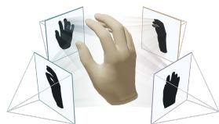  
Figure 1: Multi-view masks contain hand geometry cues.

racy (Chen et al., 2021; Han et al., 2022; Yang et al., 2023; 2024; 2025; Kuang et al., 2026). Nevertheless, achieving robust reconstruction across varied hand geometries remains challenging.

A key bottleneck is training-data diversity and supervision quality. Real multi-camera datasets provide realistic observations (Zimmermann et al., 2019; Hampali et al., 2020; Moon et al., 2020; Chao et al., 2021; Yang et al., 2022; Fan et al., 2023), but are expensive to acquire, limited in handgeometry diversity, and hard to annotate accurately due to the complex manifold spanned by the hand configurations. Synthetic data, by contrast, provides exact ground-truth annotations and can offer substantially greater diversity, enabled by advances in human modeling (Loper et al., 2023;

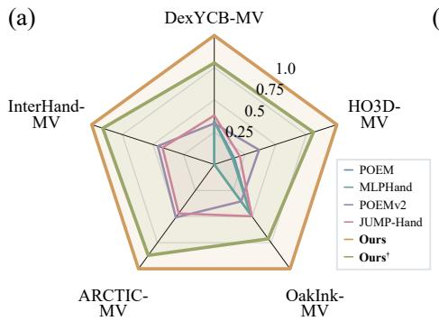  
(b)

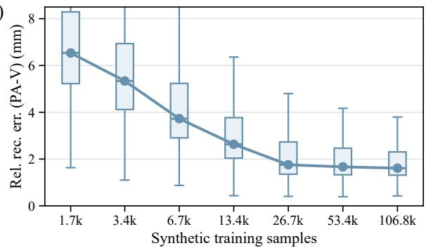  
Figure 2: Overview of SilHand. (a) Reconstruction result across five real-world multi-view hand benchmarks using reconstruction error (MPVPE). Despite being trained on the synthetic dataset, SilHand demonstrates strong reconstruction capabilities on real-world geometry. † uses corrupted input masks calibrated to match SAM3 segmentation performance (Carion et al., 2026), demonstrating robustness to segmentation noise. (b) Relative reconstruction error (PA-V) as a function of the number of synthetic training samples across the same five datasets.

Romero et al., 2017; Li et al., 2022; Ferguson et al., 2025) and grasp synthesis (Feix et al., 2015; Chen et al., 2025). Yet generating photorealistic appearance remains difficult, leaving a persistent domain gap between synthetic renderings and real observations (Zhao et al., 2025a; Si et al., 2026).

In this work, we take a different approach. Rather than making synthetic RGB images increasingly realistic, we remove texture information from the reconstruction input. Specifically, each view is represented by a binary mask (Fig. 1), which can be obtained inexpensively and with high accuracy through automatic segmentation or manual annotation (Carion et al., 2026). The mask-centric representation discards color, texture, illumination, and background while retaining the projected geometry of the hand (Laurentini, 1994). Under known cameras, multiple masks provide complementary constraints on the same 3D hand geometry (Fig. 1), making them a natural interface between synthetically generated hand geometry and real RGB observations.

Based on this idea, we introduce SilHand, a calibrated multi-view hand reconstruction framework operating exclusively on binary hand masks. Without relying on multi-view RGB features for lifting, SilHand treats points on a metric 3D grid as hypotheses, projects them into all calibrated views, and queries the corresponding mask-ray features. These view-specific cues are fused with crossview attention into a shared 3D representation, from which the model estimates global hand pose, canonicalizes the representation, and decodes hand articulation and shape.

This mask-centric formulation enables SilHand to be trained on a diverse synthetic dataset of hand geometries, comprising 46.8k grasping poses and 60k free-hand samples. When evaluated directly on five real-world benchmarks—HO3D (Hampali et al., 2020), InterHand2.6M (Moon et al., 2020), DexYCB (Chao et al., 2021), OakInk (Yang et al., 2022), and ARCTIC (Fan et al., 2023)—SilHand improves reconstruction accuracy from 49.2 % to 63.4 % using masks rendered from reference hands (Fig. 2(a)). Moreover, performance improves consistently with the scale of synthetic training data (Fig. 2(b)), indicating that broader geometric training coverage translates into better real-world reconstruction performance. While achieving comparable diversity with real-world hands is challenging, it becomes practical under our mask-centric formulation. The method also remains robust to mask corruption, with reconstruction error increasing by at most 1.63 mm (Fig. 2(a)).

Our contributions are threefold:

• A mask-centric synthetic-to-real interface. We use binary hand masks as an inexpensive, appearance-free interface between synthetic hand geometry and real multi-view observations, avoiding the need for photorealistic synthesis.

• A multi-view mask-centric reconstruction architecture. SilHand projects metric 3D points into calibrated views to query and fuse mask-ray evidence, followed by global-tocanonical decoding, enabling full 3D hand reconstruction from textureless mask alone.

• Scalable synthetic geometric supervision. By varying hand pose, shape, interaction, viewpoint, and mask quality independently, SilHand enables large-scale synthetic training that transfers to real datasets and improves as geometric training coverage grows.

## 2 RELATED WORK

Multi-View Hand Reconstruction. Multi-view hand reconstruction exploits complementary observations to alleviate the depth, pose, and occlusion ambiguities of monocular estimation. Recent learning-based methods have therefore developed increasingly effective strategies for cross-view information aggregation. MVHM (Chen et al., 2021) fuses per-view hand estimates through a learned graph representation, while POEM (Yang et al., 2023) lifts multi-view features into a 3D representation using keypoints acquired from RGB images. MLPHand (Yang et al., 2024) further introduces an efficient architecture for real-time multi-view estimation. Other directions include col laborative self-supervised learning (Zheng et al., 2023), training across heterogeneous datasets and camera configurations (Yang et al., 2025), and uncertainty-aware fusion under unreliable observations (Kuang et al., 2026). Collectively, these approaches improve how 3D information is extracted and integrated from multi-view RGB images. In contrast, we reconsider the observation itself and reconstruct hands from textureless binary masks alone. Rather than relying on RGB features for lifting, we project metric 3D hypotheses into each view to query mask and ray evidence, reducing the synthetic-to-real observation gap and enabling scalable geometric diversity in training.

Real and Synthetic Data for Hand Reconstruction. Advances in hand reconstruction have been supported by increasingly large and diverse real-world datasets. FreiHAND (Zimmermann et al., 2019) provides supervision for hand pose and shape, while InterHand2.6M (Moon et al., 2020) expands coverage of interacting hands. HO3D (Hampali et al., 2020), DexYCB (Chao et al., 2021), OakInk (Yang et al., 2022), and ARCTIC (Fan et al., 2023) further capture hand-object interactions with diverse objects, viewpoints, and occlusion patterns, with recent datasets continuing to broaden activities and capture settings (Banerjee et al., 2025; Fu et al., 2025; Rim et al., 2026). Despite this progress, obtaining accurate 3D hand annotations remains costly, making it difficult to densely sample the combinatorial variation in hand shape, articulation, viewpoint, interaction, and visibility.

Synthetic data provides a complementary means of increasing data diversity while offering accurate ground-truth supervision. They have been widely used for hand pose estimation (Zimmermann & Brox, 2017; Mueller et al., 2018), hand-object and interacting-hand reconstruction (Hasson et al., 2019; Li et al., 2023), and multi-view estimation (Chen et al., 2021; Tse et al., 2023). Recent studies have further investigated how models trained on synthetic data transfer to real hand imagery (Zhao et al., 2025a; Si et al., 2026). Nevertheless, a domain gap persists between synthetic and real RGB observations. Our mask-centric formulation sidesteps this issue: synthetic observations need only reproduce projected hand geometry rather than appearance. This enables diverse synthetic hand configurations to transfer to real observations without photorealistic rendering.

Mask-Based 3D Reconstruction. Binary masks, traditionally interpreted as object silhouettes, provide a classical representation of multi-view geometric constraints. Shape-from-silhouette and visual-hull methods recover 3D structure by intersecting the viewing cones induced by calibrated foreground masks (Laurentini, 1994; Scharr et al., 2017), demonstrating that object geometry can be constrained without relying on texture or image correspondences. This principle has also been explored for 3D hand reconstruction. Early model-based approaches estimate hand poses from mul tiple masks (Ueda et al., 2001), while subsequent learning-based methods show that they can support hand reconstruction (Lee et al., 2019; Chang et al., 2023). Building on this geometric principle, we use binary masks as an appearance-invariant interface between synthetic hand geometry and real multi-view observations, enabling large-scale synthetic training with direct transfer to real captured hand geometry.

## 3 SILHAND

## 3.1 PRELIMINARIES

Following the parametric hand model convention, MANO hand (Romero et al., 2017), we parameterize the 3D hand geometry by a structured state

$$
\begin{array} { r } { \mathcal { H } = ( \cal { T } , \pmb { \theta } , \beta ) , } \end{array}\tag{1}
$$

where $T \in \mathrm { S E } ( 3 )$ denotes the global hand pose, $\pmb \theta \in \mathbb { R } ^ { N _ { \theta } }$ the hand pose parameters, and $\beta \in \mathbb { R } ^ { N _ { \beta } }$ 3 the hand shape parameters.

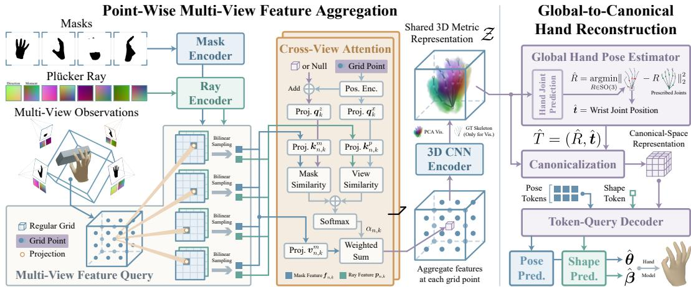  
Figure 3: Framework of SilHand. Given calibrated multi-view binary masks, SilHand projects points from a shared metric 3D grid into each view to query mask and Plucker-ray features, which¨ are fused by cross-view attention and a 3D CNN into a shared 3D representation. From this representation, SilHand first estimates the global hand pose, canonicalizes the 3D evidence, and then uses a token-query decoder to predict the hand pose and shape parameters.

We define the canonical hand space $\{ c \}$ as a wrist-centered coordinate frame in which the global rigid transformation is removed. A MANO-based hand model h deterministically maps the intrinsic hand state to the posed geometry in this canonical space

$$
( \mathcal V ^ { \mathrm { c } } , \mathcal T ^ { \mathrm { c } } ) = h ( \theta , \beta ) ,\tag{2}
$$

where $\mathcal { V } ^ { \mathrm { c } } = \{ \pmb { v } _ { i } ^ { \mathrm { c } } \in \mathbb { R } ^ { 3 } \} _ { i = 1 } ^ { N _ { \mathscr { V } } }$ and $\mathcal { I } ^ { \mathrm { c } } = \{ j _ { i } ^ { \mathrm { c } } \in \mathbb { R } ^ { 3 } \} _ { i = 1 } ^ { N _ { \mathcal { I } } }$ denote the canonical-space mesh vertices and hand joints. The global hand pose T transforms this geometry into the world coordinate frame {w}:

$$
\mathcal V ^ { \mathrm { w } } = T ( \mathcal V ^ { \mathrm { c } } ) , \quad \mathcal T ^ { \mathrm { w } } = T ( \mathcal T ^ { \mathrm { c } } ) .\tag{3}
$$

The MANO hand prescribes the triangular face connectivity F, yielding the world-space hand mesh $\mathcal { M } = ( \mathcal { V } ^ { \mathrm { w } } , \mathcal { F } )$ . Unless otherwise stated, we omit the world-space superscript w for brevity.

## 3.2 PROBLEM FORMULATION

Given N synchronized binary hand masks $\{ B _ { n } \in \{ 0 , 1 \} ^ { H \times W } \} _ { n = 1 } ^ { N }$ and the corresponding known camera rig $\{ \mathcal { C } _ { n } = ( K _ { n } , E _ { n } ) \} _ { n = 1 } ^ { N }$ , where $K _ { n } \in \mathbb { R } ^ { 3 \times 3 }$ and $E _ { n } \in \mathrm { S E } ( 3 )$ denote the camera intrinsics and extrinsics, respectively, we denote the calibrated multi-view input as

$$
\mathcal { O } = \{ ( B _ { n } , \mathcal { C } _ { n } ) \} _ { n = 1 } ^ { N } .\tag{4}
$$

A binary hand mask is determined jointly by the underlying 3D hand state and its view-dependent visibility. Let Q denote an unknown occlusion configuration. The observed binary mask is determined by a visibility-aware rendering operator g:

$$
B _ { n } = g ( \mathcal { H } ; \mathcal { Q } , \mathcal { C } _ { n } ) ,\tag{5}
$$

Generally, a single mask does not uniquely determine H, as distinct 3D hand configurations can induce identical or similar silhouettes, particularly under occlusion. With calibrated multi-view observations, however, each view imposes an additional geometric constraint on the same underlying hand state. The set of hand states consistent with the multi-view observations is

$$
\mathbb { H } _ { \mathcal { O } } = \bigcap _ { n = 1 } ^ { N } \{ \mathcal { H } \in \mathbb { H } \mid g ( \mathcal { H } ; \mathcal { Q } , \mathcal { C } _ { n } ) = B _ { n } \} ,\tag{6}
$$

where H denotes the space of valid hand states. While each individual mask admits substantial ambiguity, intersecting the constraints from multiple calibrated views progressively narrows the feasible set, with H restricting this set to be anatomically and kinematically valid.

We therefore formulate multi-view hand reconstruction as estimating a structured hand state that is consistent with the available geometric evidence:

$$
\begin{array} { r } { \hat { \mathcal { H } } = f _ { \phi } ( \mathcal { O } ) , \quad \hat { \mathcal { H } } \in \mathbb { H } _ { \mathcal { O } } , } \end{array}\tag{7}
$$

where $f _ { \phi }$ denotes the reconstruction function implemented by SilHand. To exploit the geometric structure of the multi-view observations (Eq. (6)), we factor the reconstruction into two stages:

$$
\mathcal { Z } = \mathcal { G } _ { \phi } ( \mathcal { O } ) , \quad \hat { \mathcal { H } } = \mathcal { R } _ { \phi } ( \mathcal { Z } ) ,\tag{8}
$$

where $\mathcal { G } _ { \phi }$ uses camera geometry to fuse multi-view mask evidence into a shared metric 3D representation ${ \mathcal { Z } } ,$ which encodes the features of the feasible set $\mathbb { H } _ { O }$ . From this representation, $\mathcal { R } _ { \phi }$ infers the structured hand state $\mathcal { \hat { H } } .$ . The overall framework is illustrated in Fig. 3 and detailed as follows.

## 3.3 POINT-WISE MULTI-VIEW FEATURE AGGREGATION

We first encode each binary mask and its corresponding Plucker-ray representation using shared¨ mask and ray encoders (Liu et al., 2022; Woo et al., 2023; Zhang et al., 2024), producing feature maps $M _ { n }$ and $P _ { n }$ , respectively. To remove dependence on the world coordinate choice, the Plucker¨ rays are computed in a mask-centric coordinate system (Sec. A.2.1).

We then discretize the mask-centric workspace into a regular metric grid $\{ \pmb { x } _ { k } \} _ { k = 1 } ^ { K }$ . Each grid point is projected into every calibrated view to query the corresponding mask and ray features:

$$
\begin{array} { r } { { \pmb u } _ { n , k } = \pi _ { n } ( { \pmb x } _ { k } ; \mathcal { C } _ { n } ) , \quad m _ { n , k } = M _ { n } [ { \pmb u } _ { n , k } ] , \quad { \pmb p } _ { n , k } = P _ { n } [ { \pmb u } _ { n , k } ] , } \end{array}\tag{9}
$$

where $\pi _ { n } ( \cdot )$ represents the camera projection, and [·] denotes bilinear sampling. This associates observations across views, without requiring RGB-based correspondences. For clarity, we omit the query, key, and value projections in the following formulation and refer readers to the full computation graph in Fig. 3 for details.

At each grid point, we fuse the queried features using cross-view attention:

$$
\alpha _ { n , k } = \mathrm { s o f t m a x } \left( \frac { \overbrace { \left. q _ { k } ^ { z } , k _ { n , k } ^ { m } \right. } ^ { \mathrm { m a s k \ s i m i l a r i t y } } + \overbrace { \left. q _ { k } ^ { x } , k _ { n , k } ^ { p } \right. } ^ { \mathrm { v i e w \ s i m i l a r i t y } } } { \sqrt { 2 d } } \right) , \quad z _ { k } = \sum _ { n = 1 } ^ { N } \alpha _ { n , k } v _ { n , k } ^ { m } .\tag{10}
$$

The attention weights jointly capture mask consistency and view geometry, while the aggregated feature remains mask-centric. Repeated attention blocks refine the point-wise features, which are finally processed by a 3D CNN to model spatial interactions and produce the shared 3D representation Z defined in Eq. (8).

## 3.4 GLOBAL-TO-CANONICAL HAND RECONSTRUCTION

Global Hand Pose Estimation. To decode intrinsic hand pose and shape in a canonical frame, we first recover the global hand transformation from Z. Instead of relying on an unstructured global feature, we use auxiliary world-space joints as geometric anchors: the rigid palm indicates orientation, the wrist determines translation, and joint supervision encourages $\mathcal { Z }$ to preserve hand structure.

We therefore predict auxiliary world-space joints $\tilde { \mathcal { I } } = \left\{ \tilde { j } _ { i } \right\} _ { i = 1 } ^ { N _ { J } }$ from $\mathcal { Z } .$ Each joint is computed as a weighted average over the metric grid:

$$
\tilde { \pmb { j } } _ { i } = \sum _ { k = 1 } ^ { K } ( \pmb { w } _ { i , k } \pmb { x } _ { k } + b _ { i , k } ) .\tag{11}
$$

We form $\tilde { \mathcal { I } } _ { \mathrm { p a l m } }$ from the wrist, the thumb carpometacarpal (CMC) joint, and the metacarpophalangeal (MCP) joints of the remaining four fingers (see Sec. A.2.2 for details). The global rotation is recovered by aligning this predicted palm with the corresponding canonical MANO palm through orthogonal Procrustes (Umeyama, 1991; Zhao et al., 2026):

$$
\hat { R } = \underset { R \in \mathrm { S O } ( 3 ) } { \arg \operatorname* { m i n } } \left\| \overline { { \tilde { \mathcal { I } } _ { \mathrm { p a l m } } } } - R ( \overline { { \mathcal { I } _ { \mathrm { p a l m } } ^ { \mathrm { c } } } } ) \right\| _ { 2 } ^ { 2 } ,\tag{12}
$$

where $\overline { { ( \cdot ) } }$ represents centroid centered joint coordinates. Since the canonical frame is wrist-centered, the predicted wrist gives the translation $\hat { \pmb { t } } ,$ yielding $\hat { T } = ( \hat { R } , \hat { \pmb t } )$

Free-Hand Samples

Canonical Hand State Decoding. We then express the spatial support of $\mathcal { Z }$ in the estimated canonical frame to decode global-transformation-invariant hand articulation and shape:

$$
\pmb { x } _ { k } ^ { \mathrm { c } } = \hat { T } ^ { - 1 } ( \pmb { x } _ { k } ) , \quad \pmb { z } _ { k } ^ { \mathrm { c } } = W _ { z } \pmb { z } _ { k } + \gamma _ { c } ( \pmb { x } _ { k } ^ { \mathrm { c } } ) ,\tag{13}
$$

where $W _ { z }$ projects the aggregated feature and $\gamma _ { c } ( \cdot )$ encodes its canonical coordinate.

A token-query decoder predicts the intrinsic hand articulation $\hat { \pmb { \theta } }$ and neutral canonical geometry $\hat { \mathcal { V } } ^ { 0 }$ following (Kulon et al., 2020; Wang et al., 2023; Yu et al., 2023). We constrain $\hat { \pmb { \theta } }$ to prescribed anatomical ranges (Yang et al., 2021) and project $\hat { \mathcal { V } } ^ { 0 }$ onto the fixed MANO shape basis to obtain ${ \hat { \boldsymbol { \beta } } } .$ This fixed projection introduces no additional learned shape parameters and is detailed in Sec. A.2.3. The resulting hand state $\hat { \mathcal { H } } = ( \hat { T } , \hat { \pmb { \theta } } , \hat { \boldsymbol { \beta } } )$ reconstructs the final geometry via Eqs. (2) and (3).

## 3.5 TRAINING OBJECTIVES

Synthetic data provides ground-truth global pose $T ^ { * } = ( R ^ { * } , t ^ { * } )$ , hand articulation $\pmb { \theta } ^ { * }$ , world-space joint positions ${ \bar { \mathcal { I } } } ^ { * }$ , and neutral canonical hand geometry $V ^ { 0 , * }$ . We supervise:

$$
\begin{array} { r l } & { \mathcal { L } _ { \mathrm { p o s e } } = \mathrm { s m o o t h - } \ell _ { 1 } \left( \hat { \pmb { \theta } } , \pmb { \theta } ^ { * } \right) , \quad \mathcal { L } _ { \mathrm { s h a p e } } = \mathrm { s m o o t h - } \ell _ { 1 } \left( \tilde { \mathcal { V } } ^ { 0 } , \mathcal { V } ^ { 0 , * } \right) , } \\ & { \mathcal { L } _ { \mathrm { j o i n t } } = \mathrm { s m o o t h - } \ell _ { 1 } \left( \tilde { \mathcal { I } } , \mathcal { I } ^ { * } \right) , \quad \mathcal { L } _ { \mathrm { r o t } } = \left\| \hat { R } - R ^ { * } \right\| _ { \mathrm { F } } ^ { 2 } . } \end{array}\tag{14}
$$

The total objective is

$$
\mathcal { L } = \lambda _ { \mathrm { p o s e } } \mathcal { L } _ { \mathrm { p o s e } } + \lambda _ { \mathrm { s h a p e } } \mathcal { L } _ { \mathrm { s h a p e } } + \lambda _ { \mathrm { j o i n t } } \mathcal { L } _ { \mathrm { j o i n t } } + \lambda _ { \mathrm { r o t } } \mathcal { L } _ { \mathrm { r o t } } .\tag{15}
$$

Loss weights and other details are reported in Sec. A.3.

## 3.6 SCALABLE SYNTHETIC GEOMETRIC SUPERVISION

We train with synthetic hand geometry, comprising free-hand and grasping configurations, to capture collision effects. We initially sample free-hand and grasping configurations in a 1:1 ratio. For free-hand configurations, we sample the MANO pose PCA space (Romero et al., 2017) and reject samples that violate prescribed anatomical joint ranges or exhibit hand self-collision. For grasping configurations, we adapt Dexonomy (Chen et al., 2025) to our MANO-based hand-state parameterization. In addition to filtering out hand self-collisions, we perform hand-object collision checking to ensure the geometric validity of the grasps.

Grasping Samples  
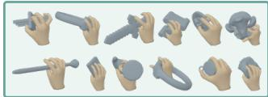

In the absence of an established hand-shape distribution (Kulon et al., 2020; Wang et al., 2023; Yu et al., 2023), we sample shape parameters from an empirical distribution fitted to eight datasets (Chao et al., 2021; Han et al., 2022; Moon et al., 2023; Fan

Figure 4: Examples from our synthetic dataset.

et al., 2023; Wang et al., 2025a; Banerjee et al., 2025; Fan et al., 2026). After applying the anatomical and collision-based filtering, the final dataset comprises 60k free-hand configurations and 46.8k grasping configurations, with representative examples shown in Fig. 4.

Following the calibrated multi-view setting with known camera geometry, we train using randomized camera parameters sampled from the datasets: HO3D (Hampali et al., 2020), Inter-Hand2.6M (Moon et al., 2020), DexYCB (Chao et al., 2021), OakInk (Yang et al., 2022), and ARCTIC (Fan et al., 2023), like POEMv2 (Yang et al., 2025). We perturb the camera parameters to broaden the viewing distribution, then sample global hand poses and render the masks.

To improve robustness to imperfect observations, we perturb the rendered masks by varying handregion visibility and forearm extent, applying morphological and boundary perturbations, and introducing localized boundary artifacts. We further apply random view dropout for augmentation. All perturbations modify only the observations, while keeping the underlying target unchanged.

Table 1: Quantitative results of SilHand. ↓ indicates lower is better. Best results are bold, and the best baseline results are underlined. Green values indicate the absolute improvement over the best baseline result. C1, C2, C3, and C4 indicate progressively stronger synthetic mask corruption.
<table><tr><td>Dataset</td><td>Method</td><td>MPVPE↓</td><td>RR-V↓</td><td>PA-V↓</td><td>MPJPE↓</td><td>RR-J↓</td><td>PA-J↓</td></tr><tr><td rowspan="7">DexYCB- MV</td><td>POEM</td><td>6.13</td><td>7.21</td><td>4.00</td><td>6.06</td><td>7.30</td><td>3.93</td></tr><tr><td>MLPHand</td><td>6.20</td><td>7.30</td><td>4.15</td><td>6.23</td><td>7.41</td><td>4.11</td></tr><tr><td>POEMv2</td><td>6.50</td><td>7.50</td><td>3.84</td><td>6.33</td><td>7.54</td><td>3.68</td></tr><tr><td>JUMP-Hand</td><td>5.45</td><td>6.41</td><td>3.77</td><td>5.31</td><td>6.41</td><td>3.61</td></tr><tr><td>Visual Hull</td><td></td><td></td><td>12.95</td><td></td><td></td><td>12.42</td></tr><tr><td>Ours</td><td>2.07↓3.38</td><td>1.63↓4.78</td><td>1.12↓2.65</td><td>2.12↓3.19</td><td>1.69↓4.72</td><td>1.16↓2.45</td></tr><tr><td>Ours c1 Ours C2</td><td>2.18↓3.27</td><td>1.82↓4.59</td><td>1.23↓2.54</td><td>2.233.08</td><td>1.89↓4.52</td><td>1.27↓2.34</td></tr><tr><td></td><td>2.41↓3.04 2.63↓2.82</td><td>2.01↓4.40</td><td>1.37↓2.40</td><td>2.46↓2.85</td><td>2.08↓4.33</td><td>1.42↓2.19</td></tr><tr><td rowspan="10"></td><td>Ours c3</td><td></td><td>2.15↓4.26</td><td>1.49↓2.28</td><td>2.68↓2.63</td><td>2.23↓4.18</td><td>1.55↓2.06</td></tr><tr><td>Ours c4</td><td>2.98↓2.47</td><td>2.38↓4.03</td><td>1.63↓2.14</td><td>3.04↓2.27</td><td>2.47↓3.94</td><td>1.69↓1.92</td></tr><tr><td>POEM</td><td>17.20</td><td>21.45</td><td>9.97</td><td>17.28</td><td>21.94</td><td>9.60</td></tr><tr><td>MLPHand</td><td>18.69</td><td>23.28</td><td>10.54</td><td>18.70</td><td>23.76</td><td>10.11</td></tr><tr><td>POEMv2</td><td>7.63</td><td>10.58</td><td>4.59</td><td>7.18</td><td>10.58</td><td>4.13</td></tr><tr><td>JUMP-Hand</td><td>13.39</td><td>16.96</td><td>8.78</td><td>13.10</td><td>17.07</td><td>8.30</td></tr><tr><td></td><td></td><td></td><td>10.56</td><td></td><td></td><td>10.22</td></tr><tr><td>Visual Hull Ours</td><td>2.79↓4.84</td><td>2.70↓7.88</td><td>1.83↓2.76</td><td>2.76↓4.42</td><td>2.67↓7.91</td><td>1.76↓2.37</td></tr><tr><td>Ours c1</td><td>3.03↓4.60</td><td>2.95↓7.63</td><td>1.892.70</td><td>3.01↓4.17</td><td>2.92↓7.66</td><td>1.83↓2.30</td></tr><tr><td>Ours C2 Ours c3</td><td>3.31↓4.32</td><td>3.16↓7.42</td><td>1.99↓2.60</td><td>3.28↓3.90</td><td>3.15↓7.43</td><td>1.93↓2.20</td></tr><tr><td rowspan="8">OakInk- MV</td><td></td><td>3.45↓4.18</td><td>3.31↓7.27</td><td>2.07↓2.52</td><td>3.42↓3.76</td><td>3.30↓7.28</td><td>2.01↓2.12</td></tr><tr><td>Ours c4</td><td>3.55↓4.08</td><td>3.47↓7.11</td><td>2.16↓2.43</td><td>3.52↓3.66</td><td>3.47↓7.11</td><td>2.10↓2.03</td></tr><tr><td>POEM</td><td>6.20</td><td>7.63</td><td>4.21</td><td>6.01</td><td>7.46</td><td>4.00</td></tr><tr><td>MLPHand</td><td>6.17</td><td>7.49</td><td>4.26</td><td>6.00</td><td>7.52</td><td>4.09</td></tr><tr><td>POEMv2</td><td>8.33</td><td>8.47</td><td>4.49</td><td>8.09</td><td>8.47</td><td>4.24</td></tr><tr><td>JUMP-Hand</td><td>5.94</td><td>6.99</td><td>4.13</td><td>5.72</td><td>6.94</td><td>3.86</td></tr><tr><td>Visual Hull</td><td>2.952.99</td><td>2.90↓4.09</td><td>13.06</td><td></td><td></td><td>12.78</td></tr><tr><td>Ours Ours c1</td><td>3.31↓2.63</td><td>3.25↓3.74</td><td>2.25↓1.88 2.48↓1.65</td><td>3.002.72 3.37↓2.35</td><td>2.953.99 3.31↓3.63</td><td>2.25↓1.61 2.49↓1.37</td></tr><tr><td rowspan="7"></td><td>Ours C2</td><td>3.77↓2.17</td><td>3.66↓3.33</td><td>2.76↓1.37</td><td>3.83↓1.89</td><td>3.74↓3.20</td><td>2.78↓1.08</td></tr><tr><td>Ours c3</td><td>4.14↓1.80</td><td></td><td></td><td>4.21↓1.51</td><td>4.10↓2.84</td><td></td></tr><tr><td>Ours c4</td><td></td><td>4.01↓2.98</td><td>2.97↓1.16</td><td></td><td></td><td>3.01↓0.85</td></tr><tr><td></td><td>4.58↓1.36</td><td>4.40↓2.59</td><td>3.21↓0.92</td><td>4.66↓1.06</td><td>4.52↓2.42</td><td>3.26↓0.60</td></tr><tr><td>POEMv2</td><td>5.89</td><td>7.13</td><td>4.43</td><td>5.42</td><td>6.80</td><td>3.91</td></tr><tr><td>JUMP-Hand</td><td>6.37</td><td></td><td></td><td></td><td></td><td></td></tr><tr><td>Visual Hull</td><td></td><td>一</td><td>15.78</td><td></td><td>一</td><td>15.15</td></tr><tr><td rowspan="8">MV</td><td>Ours</td><td>2.992.90</td><td>2.97↓4.16</td><td>2.20↓2.23</td><td>3.00↓2.42</td><td>2.99↓3.81</td><td>2.181.73</td></tr><tr><td>Ours c1</td><td>3.07↓2.82</td><td>3.04↓4.09</td><td>2.26↓2.17</td><td>3.09↓2.33</td><td>3.06↓3.74</td><td>2.25↓1.66</td></tr><tr><td>Ours c2</td><td>3.22↓2.67</td><td>3.15↓3.98</td><td>2.33↓2.10</td><td>3.24↓2.18</td><td>3.18↓3.62</td><td>2.32↓1.59</td></tr><tr><td>Ours c3</td><td>3.43↓2.46</td><td>3.31↓3.82</td><td>2.41↓2.02</td><td>3.45↓1.97</td><td>3.34↓3.46</td><td>2.41↓1.50</td></tr><tr><td>Ours c4</td><td>3.76↓2.13</td><td>3.56↓3.57</td><td>2.55↓1.88</td><td>3.77↓1.65</td><td>3.61↓3.19</td><td>2.55↓1.36</td></tr><tr><td>POEMv2</td><td>7.64</td><td>9.04</td><td>5.23</td><td>7.19</td><td>8.82</td><td>4.72</td></tr><tr><td>JUMP-Hand</td><td>8.34</td><td>1</td><td>1</td><td>1</td><td>1</td><td></td></tr><tr><td></td><td></td><td></td><td></td><td></td><td></td><td></td></tr><tr><td rowspan="7">InterHand- MV</td><td>Visual Hull</td><td></td><td></td><td>20.51</td><td>1</td><td>一</td><td>19.89</td></tr><tr><td>Ours</td><td>3.52↓4.12</td><td>3.395.65</td><td>2.18↓3.05</td><td>3.59↓3.60</td><td>3.45↓5.37</td><td>2.17↓2.55</td></tr><tr><td>Ours c1</td><td>3.67↓3.97</td><td>3.51↓5.53</td><td>2.24↓2.99</td><td>3.75↓3.44</td><td>3.58↓5.24</td><td>2.23↓2.49</td></tr><tr><td>Ours C2</td><td>3.79↓3.85</td><td>3.51↓5.53</td><td>2.29↓2.94</td><td>3.86↓3.33</td><td>3.58↓5.24</td><td>2.29↓2.43</td></tr><tr><td>Ours c3</td><td>3.87↓3.77</td><td>3.53↓5.51</td><td>2.352.88</td><td>3.94↓3.25</td><td>3.60↓5.22</td><td>2.36↓2.36</td></tr><tr><td></td><td></td><td></td><td></td><td></td><td></td><td></td></tr><tr><td>Ours C4</td><td>4.00↓3.64</td><td>3.595.45</td><td>2.44↓2.79</td><td>4.06↓3.13</td><td>3.66↓5.16</td><td>2.45↓2.27</td></tr></table>

## 4 EXPERIMENTS AND RESULTS

We evaluate SilHand on five real-world datasets: HO3D-MV (Hampali et al., 2020), InterHand-MV (Moon et al., 2020), DexYCB-MV (Chao et al., 2021), OakInk-MV (Yang et al., 2022), and ARCTIC-MV (Fan et al., 2023). We compare against four learning-based multi-view reconstruction methods, including POEM (Yang et al., 2023), MLPHand (Yang et al., 2024), POEMv2 (Yang et al., 2025), and JUMP-Hand (Kuang et al., 2026), as well as a mask-based visual hull baseline (Scharr et al., 2017). For the learning-based baselines, we follow the dataset-specific training and test splits established by POEM and POEMv2. In contrast, SilHand is trained exclusively on synthetic data and directly evaluated on the corresponding held-out test splits, without any fine-tuning on real-world data. Details are provided in Sec. A.1.1.

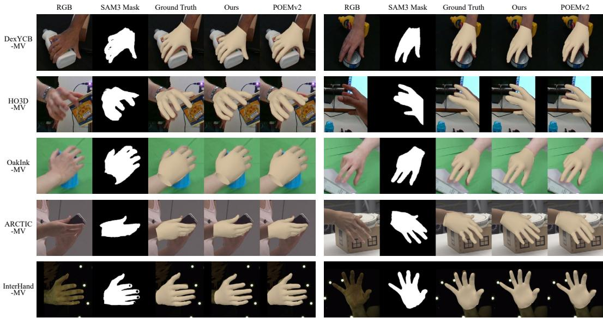  
Figure 5: Qualitative results of SilHand. Using the SAM3 mask, SilHand exhibits better image plane alignment than the provided 3D annotations, highlighting the annotation issue in real data.

## 4.1 SYNTHETIC-TO-REAL QUALITATIVE RESULTS

We first present the qualitative comparison of SilHand against the open-source POEM series (Yang et al., 2023; 2025) and the dataset ground-truth annotations in Fig. 5. The required hand segmentation masks are obtained using SAM3 (Carion et al., 2026) with the text prompt “right hand”. We project the reconstructed hands from SilHand and POEMv2, as well as the dataset-annotated hand, onto the image plane using the corresponding camera geometry. The visual accuracy can then be assessed by examining the alignment between the projected hand regions and the actual right-hand regions in the RGB images. As shown in Fig. 5, SilHand can achieve more accurate alignment than the annotations. This observation reveals the inherent challenges in hand annotations due to the highly complex manifold of human hands. More results using SAM3 masks are in Sec. A.10.

## 4.2 SYNTHETIC-TO-REAL RESULTS

The annotation discrepancies identified in Sec. 4.1 can create a mismatch between real-image observations and the annotated hand geometry. Consequently, a reconstruction that agrees with the captured images may still be against the annotations. Such annotation biases and errors are not captured by SilHand, as it is trained on aligned synthetic data. To distinguish geometric reconstruction accuracy from agreement with real observations, we adopt two complementary evaluation protocols: annotation-oriented evaluation, which measures reconstruction accuracy using annotationconsistent inputs, and observation-oriented evaluation, which assesses consistency with independent image evidence without relying on the hand annotations.

Annotation-oriented evaluation. We render input masks from the annotated hand geometry while preserving object-induced occlusions. This removes the mismatch between the input masks and the reference geometry, allowing us to assess SilHand’s reconstruction performance from multi-view masks using the conventional evaluation protocol established by Yang et al. (2023; 2025). Across all five datasets, we report mean per-vertex position error (MPVPE) and mean per-joint position error (MPJPE), together with their root-relative (RR-V/RR-J) and Procrustes-aligned (PA-V/PA-J) variants. Metric details are provided in Sec. A.1.2.

Table 1 compares SilHand with state-of-the-art RGBbased calibrated multi-view methods—POEM (Yang et al., 2023), MLPHand (Yang et al., 2024), PO-EMv2 (Yang et al., 2025), and JUMP-Hand (Kuang et al., 2026)—and a mask-based visual-hull baseline (Scharr et al., 2017) (detailed in Sec. A.5). Under this annotationoriented protocol, SilHand reduces MPVPE by 49.2 % to

Table 2: Held-out-view mask IoU↑.
<table><tr><td>Dataset</td><td>POEMv2</td><td>GT</td><td>Ours</td></tr><tr><td>ARCTIC-MV</td><td>79.0</td><td>80.1</td><td>81.9</td></tr><tr><td>InterHand-MV</td><td>81.8</td><td>83.9</td><td>83.1</td></tr></table>

63.4 % across five datasets. Gains persist under root-relative and Procrustes alignment, indicating improved articulation beyond global hand placement.

Observation-oriented evaluation. To assess SilHand’s reconstruction fidelity on real observations independently of dataset-provided 3D hand annotations, we evaluate its agreement with hand masks from a held-out camera view on ARCTIC-MV and InterHand-MV. These are the only two datasets with enough viewpoints to reserve an additional camera exclusively for evaluation. In both experiments, SilHand takes as input masks extracted from real images rather than masks rendered from annotated geometry. The full evaluation protocol is described in Sec. A.6.

We report held-out view Intersection over Union (IoU) between the projected and reference hand masks, excluding visible object pixels to avoid penalizing object-occluded hand regions. As shown in Tab. 2, SilHand outperforms the baseline on both datasets, exceeding annotation IoU on ARCTIC-MV and approaching it on InterHand-MV. This advantage

Table 3: Synthetic mask corruption levels.
<table><tr><td rowspan="2">Metric</td><td colspan="4">Synthetic Corruption Preset</td><td rowspan="2">SAM3</td></tr><tr><td>C1</td><td>C2</td><td>C3</td><td>C4</td></tr><tr><td>IoU ↑</td><td>0.97</td><td>0.93</td><td>0.89</td><td>0.86</td><td>0.90</td></tr><tr><td>Boundary F1 ↑</td><td>0.90</td><td>0.86</td><td>0.81</td><td>0.76</td><td>0.84</td></tr></table>

provides complementary evidence of its transfer to real-image observations. Additional comparisons based on 3D reconstruction metrics are provided in Sec. A.7, while ablation studies investigating the effective use of mask information are presented in Sec. A.4.

## 4.3 SCALING SYNTHETIC GEOMETRY SUPERVISION

SilHand benefits from scalable synthetic supervision. Figure 6 visualizes the generated hand geometries in the space of the first two principal components. Increasing the training set from 1.7k to 106.8k samples progressively broadens its coverage, primarily through the inclusion of more diverse hand poses. Meanwhile, reconstruction error steadily decreases as the training set grows (Fig. 2(b)). Together, these results highlight the benefits of scaling synthetic supervision in both geometric coverage and reconstruction accuracy, without the acquisition and annotation burden of expanding real-capture datasets.

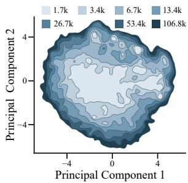  
Figure 6: Geometry diversity as training size grows.

## 4.4 ROBUSTNESS TO IMPERFECT MASKS

While clean masks can be readily obtained through manual annotation (Lin et al., 2014; He et al., 2017; Carion et al., 2026), we further investigate the robustness of SilHand to imperfect annotations. To ensure that the simulated annotation noise remains within a reasonable range, we use the performance of the state-of-the-art SAM3 as a calibration target. Specifically, we calibrate five mask-corruption operators to reproduce different levels of mask quality. The calibration results are reported in Tab. 3, with the corresponding evaluation protocol detailed in Sec. A.8. Based on these results, we define four corruption severity levels, C1–C4, with increasing degrees of mask degradation, where C3 most closely matches the performance of SAM3 (Tab. 3). Representative examples of the resulting corrupted masks are shown in Fig. 7.

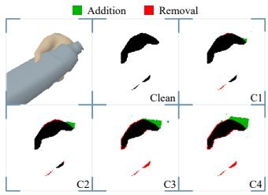  
Figure 7: Illustration of mask corruption levels.

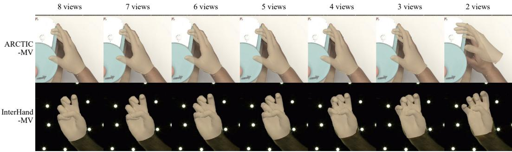  
Figure 8: Qualitative ablation of the number of input views. SilHand performance is shown with the number of input views decreasing from eight to two. All input masks are predicted by SAM3.

The robustness results are presented in Tab. 1. SilHand remains robust across all corruption levels and consistently retains the hand reconstruction accuracy. Even under the most severe corruption, the reconstruction metric degrades by at most 1.63 mm. These results demonstrate that SilHand is robust to segmentation noise and does not rely on highly accurate mask annotations to maintain its reconstruction performance.

## 5 DISCUSSION AND LIMITATIONS

Reconstruction accuracy naturally degrades as input views are removed (Fig. 8 and Sec. A.9), since fewer observations provide weaker geometric constraints on the underlying hand configuration (Eq. (6)). We include this ablation to characterize the operating range of SilHand as the number of available views decreases. Moreover, since SilHand relies on projecting 3D grid points into 2D views to query and aggregate mask and ray features, it depends on accurate camera parameters. Errors in camera calibration can lead to inaccurate projections and misaligned cross-view evidence and degrade reconstruction accuracy (Sec. A.9). Improving robustness to calibration uncertainty would therefore be an important direction for extending the method to less controlled capture settings.

Beyond limited-view conditions, an inherent limitation also arises from the ambiguity of binary masks. Although masks preserve important geometric information, they discard appearance cues such as color, texture, and local visual patterns that could help distinguish different hand configurations. Consequently, distinct 3D hand geometries may produce similar 2D masks, particularly in regions affected by self-occlusion or hand-object occlusion. While calibrated observations from multiple viewpoints help reduce this ambiguity (Eq. (6)), they cannot always uniquely determine the underlying geometry, especially when informative contours are missing across views (Sec. A.7).

A promising direction for future work is to incorporate complementary appearance cues into the reconstruction framework. For example, combining mask-based geometric evidence with RGB features or local appearance descriptors could provide additional information for resolving ambiguous hand configurations, while retaining binary masks as a robust geometric representation. An important challenge, however, is to leverage such appearance information without reintroducing the substantial synthetic-to-real domain gap that our mask-centric formulation is designed to avoid. Improving robustness under limited-view conditions, resolving mask-induced ambiguities, and exploring the optimal composition of synthetic geometric supervision would further extend the capabilities of SilHand.

## 6 CONCLUSION

We introduced SilHand, a calibrated multi-view hand reconstruction framework that investigates bi nary masks as an effective interface for bridging synthetic geometry and real observations. Results across five real-world benchmarks demonstrate the effectiveness of this mask-centric representation for synthetic-to-real transfer without photorealistic rendering or real-data fine-tuning. Further experiments highlight the benefits of scaling synthetic geometric diversity and the robustness of the approach to imperfect masks, suggesting a promising direction for scalable hand reconstruction.

## AI USE STATEMENT

In this work, we used generative AI tools for language polishing and code review.

## REFERENCES

Prithviraj Banerjee, Sindi Shkodrani, Pierre Moulon, Shreyas Hampali, Shangchen Han, Fan Zhang, Linguang Zhang, Jade Fountain, Edward Miller, Selen Basol, Richard Newcombe, and Robert Wang. HOT3D: Hand and Object Tracking in 3D from Egocentric Multi-View Videos. In Proceedings of the IEEE/CVF Conference on Computer Vision and Pattern Recognition (CVPR), pp. 7061–7071. IEEE, 2025.

Alexey Bokhovkin and Evgeny Burnaev. Boundary Loss for Remote Sensing Imagery Semantic Segmentation. In International Symposium on Neural Networks, pp. 388–401. Springer, 2019.

Berk Calli, Arjun Singh, Aaron Walsman, Siddhartha Srinivasa, Pieter Abbeel, and Aaron M Dollar. The YCB object and Model set: Towards common benchmarks for manipulation research. In International Conference on Advanced Robotics (ICAR), pp. 510–517. IEEE, 2015.

Nicolas Carion, Laura Gustafson, Yuan-Ting Hu, Shoubhik Debnath, Ronghang Hu, Didac Suris Coll-Vinent, Chaitanya Ryali, Kalyan Vasudev Alwala, Haitham Khedr, Andrew Huang, Jie Lei, Tengyu Ma, Baishan Guo, Arpit Kalla, Markus Marks, Joseph Greer, Meng Wang, Peize Sun, Roman Radle, Triantafyllos Afouras, Effrosyni Mavroudi, Katherine Xu, Tsung-Han Wu, Yu Zhou,¨ Liliane Momeni, RISHI HAZRA, Shuangrui Ding, Sagar Vaze, Francois Porcher, Feng Li, Siyuan Li, Aishwarya Kamath, Ho Kei Cheng, Piotr Dollar, Nikhila Ravi, Kate Saenko, Pengchuan Zhang, and Christoph Feichtenhofer. SAM 3: Segment Anything with Concepts. In International Conference on Learning Representations (ICLR), volume 2026, pp. 138846–138923, 2026.

Li-Jen Chang, Yu-Cheng Liao, Chia-Hui Lin, Shih-Fang Yang-Mao, and Hwann-Tzong Chen. Mask2hand: Learning to predict the 3d hand pose and shape from shadow. In Asia Pacific Signal and Information Processing Association Annual Summit and Conference (APSIPA ASC), pp. 591–598. IEEE, 2023.

Yu-Wei Chao, Wei Yang, Yu Xiang, Pavlo Molchanov, Ankur Handa, Jonathan Tremblay, Yashraj S. Narang, Karl Van Wyk, Umar Iqbal, Stan Birchfield, Jan Kautz, and Dieter Fox. DexYCB: A Benchmark for Capturing Hand Grasping of Objects. In Proceedings of the IEEE/CVF Conference on Computer Vision and Pattern Recognition (CVPR), pp. 9044–9053. IEEE, 2021.

Jiayi Chen, Yubin Ke, Lin Peng, and He Wang. Dexonomy: Synthesizing All Dexterous Grasp Types in a Grasp Taxonomy. In Proceedings of Robotics: Science and Systems (RSS), 2025.

Liangjian Chen, Shih-Yao Lin, Yusheng Xie, Yen-Yu Lin, and Xiaohui Xie. MVHM: A Large-Scale Multi-View Hand Mesh Benchmark for Accurate 3D Hand Pose Estimation. In Proceedings of the IEEE/CVF Conference on Computer Vision and Pattern Recognition (CVPR), pp. 836–845. IEEE, 2021.

Leiyao Cui, Zihang Zhao, Sirui Xie, Wenhuan Zhang, Zhi Han, and Yixin Zhu. Vi-TacMan: Articulated Object Manipulation via Vision and Touch. In IEEE International Conference on Robotics and Automation (ICRA), pp. 13756–13763. IEEE, 2026.

Jia Deng, Wei Dong, Richard Socher, Li-Jia Li, Kai Li, and Li Fei-Fei. ImageNet: A large-scale hierarchical image database. In Proceedings of the IEEE/CVF Conference on Computer Vision and Pattern Recognition (CVPR), pp. 248–255. IEEE, 2009.

Zicong Fan, Omid Taheri, Dimitrios Tzionas, Muhammed Kocabas, Manuel Kaufmann, Michael J Black, and Otmar Hilliges. ARCTIC: A Dataset for Dexterous Bimanual Hand-Object Manipulation. In Proceedings of the IEEE/CVF Conference on Computer Vision and Pattern Recognition (CVPR), pp. 12943–12954. IEEE, 2023.

Zicong Fan, Edoardo Remelli, David Dimond, Fadime Sener, Liuhao Ge, Bugra Tekin, Cem Keskin, and Shreyas Hampali. PALM: A Dataset and Baseline for Learning Multi-Subject Hand Prior. In International Conference on 3D Vision (3DV), pp. 693–703. IEEE, 2026.

Thomas Feix, Javier Romero, Heinz-Bodo Schmiedmayer, Aaron M Dollar, and Danica Kragic. The GRASP Taxonomy of Human Grasp Types. IEEE Transactions on Human-Machine Systems, 46 (1):66–77, 2015.

Aaron Ferguson, Ahmed A. A. Osman, Berta Bescos, Carsten Stoll, Chris Twigg, Christoph Lassner, David Otte, Eric Vignola, Fabian Prada, Federica Bogo, Igor Santesteban, Javier Romero, Jenna Zarate, Jeongseok Lee, Jinhyung Park, Jinlong Yang, John Doublestein, Kishore Venkateshan, Kris Kitani, Ladislav Kavan, Marco Dal Farra, Matthew Hu, Matthew Cioffi, Michael Fabris, Michael Ranieri, Mohammad Modarres, Petr Kadlecek, Rawal Khirodkar, Rinat Abdrashitov, Romain Prevost, Roman Rajbhandari, Ronald Mallet, Russell Pearsall, Sandy Kao, Sanjeev Kumar,´ Scott Parrish, Shoou-I Yu, Shunsuke Saito, Takaaki Shiratori, Te-Li Wang, Tony Tung, Yichen Xu, Yuan Dong, Yuhua Chen, Yuanlu Xu, Yuting Ye, and Zhongshi Jiang. MHR: Momentum Human Rig. arXiv preprint arXiv:2511.15586, 2025.

Rao Fu, Dingxi Zhang, Alex Jiang, Wanjia Fu, Austin Funk, Daniel Ritchie, and Srinath Sridhar. GigaHands: A Massive Annotated Dataset of Bimanual Hand Activities. In Proceedings of the IEEE/CVF Conference on Computer Vision and Pattern Recognition (CVPR), pp. 17461–17474. IEEE, 2025.

Daiheng Gao, Yuliang Xiu, Kailin Li, Lixin Yang, Feng Wang, Peng Zhang, Bang Zhang, Cewu Lu, and Ping Tan. Dart: Articulated hand model with diverse accessories and rich textures. Advances in Neural Information Processing Systems (NeurIPS), 35:37055–37067, 2022.

Shreyas Hampali, Mahdi Rad, Markus Oberweger, and Vincent Lepetit. HOnnotate: A Method for 3D Annotation of Hand and Object Poses. In Proceedings of the IEEE/CVF Conference on Computer Vision and Pattern Recognition (CVPR), pp. 3193–3203. IEEE, 2020.

Shangchen Han, Beibei Liu, Robert Wang, Yuting Ye, Christopher D Twigg, and Kenrick Kin. Online optical marker-based hand tracking with deep labels. ACM Transactions on Graphics (TOG), 37(4):1–10, 2018.

Shangchen Han, Beibei Liu, Randi Cabezas, Christopher D. Twigg, Peizhao Zhang, Jeff Petkau, Tsz-Ho Yu, Chun-Jung Tai, Muzaffer Akbay, Zheng Wang, Asaf Nitzan, Gang Dong, Yuting Ye, Lingling Tao, Chengde Wan, and Robert Wang. MEgATrack: monochrome egocentric articulated hand-tracking for virtual reality. ACM Transactions on Graphics (TOG), 39(4):87–1, 2020.

Shangchen Han, Po-Chen Wu, Yubo Zhang, Beibei Liu, Linguang Zhang, Zheng Wang, Weiguang Si, Peizhao Zhang, Yujun Cai, Tomas Hodan, Randi Cabezas, Luan Tran, Muzaffer Akbay, Tsz-Ho Yu, Cem Keskin, and Robert Wang. UmeTrack: Unified multi-view end-to-end hand tracking for VR. In Proceedings ofSIGGRAPH Asia (SIGGRAPH Asia), pp. 1–9. ACM, 2022.

Yana Hasson, Gul Varol, Dimitrios Tzionas, Igor Kalevatykh, Michael J Black, Ivan Laptev, and Cordelia Schmid. Learning joint reconstruction of hands and manipulated objects. In Proceedings of the IEEE/CVF Conference on Computer Vision and Pattern Recognition (CVPR), pp. 11807– 11816. IEEE, 2019.

Kaiming He, Georgia Gkioxari, Piotr Dollar, and Ross Girshick. Mask R-CNN. In ´ Proceedings of the IEEE/CVF Conference on Computer Vision and Pattern Recognition (CVPR), pp. 2961–2969. IEEE, 2017.

Haohong Kuang, Yang Xiao, Changlong Jiang, Jinghong Zheng, Hang Xu, Ran Wang, Zhiguo Cao, and Joey Tianyi Zhou. JUMP-Hand: Learning Joint-wise Uncertainty to Gate Mixture of View Experts for Multi-View 3D Hand Reconstruction. In Proceedings of the IEEE/CVF Conference on Computer Vision and Pattern Recognition (CVPR), pp. 28348–28357. IEEE, 2026.

Dominik Kulon, Riza Alp Guler, Iasonas Kokkinos, Michael M Bronstein, and Stefanos Zafeiriou. Weakly-Supervised Mesh-Convolutional Hand Reconstruction in the Wild. In Proceedings ofthe IEEE/CVF Conference on Computer Vision and Pattern Recognition (CVPR), pp. 4990–5000. IEEE, 2020.

Aldo Laurentini. The visual hull concept for silhouette-based image understanding. IEEE Transactions on Pattern Analysis and Machine Intelligence (TPAMI), 16(2):150–162, 1994.

Kuo-Wei Lee, Shih-Hung Liu, Hwann-Tzong Chen, and Koichi Ito. Silhouette-Net: 3D Hand Pose Estimation from Silhouettes. arXiv preprint arXiv:1912.12436, 2019.

Lijun Li, Linrui Tian, Xindi Zhang, Qi Wang, Bang Zhang, Liefeng Bo, Mengyuan Liu, and Chen Chen. RenderIH: A Large-Scale Synthetic Dataset for 3D Interacting Hand Pose Estimation. In Proceedings of the IEEE/CVF International Conference on Computer Vision (ICCV), pp. 20395– 20405. IEEE, 2023.

Yuwei Li, Longwen Zhang, Zesong Qiu, Yingwenqi Jiang, Nianyi Li, Yuexin Ma, Yuyao Zhang, Lan Xu, and Jingyi Yu. NIMBLE: a non-rigid hand model with bones and muscles. ACM Transactions on Graphics (TOG), 41(4):1–16, 2022.

Tsung-Yi Lin, Michael Maire, Serge Belongie, James Hays, Pietro Perona, Deva Ramanan, Piotr Dollar, and C Lawrence Zitnick. Microsoft COCO: Common Objects in Context. In ´ European Conference on Computer Vision (ECCV), pp. 740–755. Springer, 2014.

Zhuang Liu, Hanzi Mao, Chao-Yuan Wu, Christoph Feichtenhofer, Trevor Darrell, and Saining Xie. A ConvNet for the 2020s. In Proceedings of the IEEE/CVF Conference on Computer Vision and Pattern Recognition (CVPR), pp. 11976–11986. IEEE, 2022.

Matthew Loper, Naureen Mahmood, Javier Romero, Gerard Pons-Moll, and Michael J Black. SMPL: A skinned multi-person linear model. ACM Transactions on Graphics (TOG), 34(6): 851–866, 2023.

Haoyang Luo, Zihang Zhao, Leiyao Cui, Saiyao Zhang, Liu Yang, Zhi Han, Xiyuan Tang, and Yixin Zhu. T-800: An 800 Hz Data Glove for Precise Hand Gesture Tracking. SmartBot, 2(3):e70045, 2026.

Gyeongsik Moon, Shoou-I Yu, He Wen, Takaaki Shiratori, and Kyoung Mu Lee. InterHand2.6M: A Dataset and Baseline for 3D Interacting Hand Pose Estimation from a Single RGB Image. In European Conference on Computer Vision (ECCV), pp. 548–564. Springer, 2020.

Gyeongsik Moon, Shunsuke Saito, Weipeng Xu, Rohan Joshi, Julia Buffalini, Harley Bellan, Nicholas Rosen, Jesse Richardson, Mallorie Mize, Philippe De Bree, Tomas Simon, Bo Peng, Shubham Garg, Kevyn McPhail, and Takaaki Shiratori. A Dataset of Relighted 3D Interacting Hands. In Advances in Neural Information Processing Systems (NeurIPS), volume 36, pp. 17689–17701. Curran Associates, Inc., 2023.

Franziska Mueller, Florian Bernard, Oleksandr Sotnychenko, Dushyant Mehta, Srinath Sridhar, Dan Casas, and Christian Theobalt. GANerated Hands for Real-Time 3D Hand Tracking from Monocular RGB. In Proceedings ofthe IEEE/CVF Conference on Computer Vision and Pattern Recognition (CVPR), pp. 49–59. IEEE, 2018.

Karthik S Narayan, James Sha, Arjun Singh, and Pieter Abbeel. Range sensor and silhouette fusion for high-quality 3D Scanning. In IEEE International Conference on Robotics and Automation (ICRA), pp. 3617–3624. IEEE, 2015.

Julius Plucker.¨ Analytisch-geometrische Entwicklungen. GD Baedeker, 1828.

Patrick Rim, Kevin Harris, Braden Copple, Shangchen Han, Xu Xie, Ivan Shugurov, Sizhe An, He Wen, Alex Wong, Tomas Hodan, and Kun He. SHOW3D: Capturing Scenes of 3D Hands and Objects in the Wild. In Proceedings of the IEEE/CVF Conference on Computer Vision and Pattern Recognition (CVPR), pp. 7111–7120. IEEE, 2026.

Javier Romero, Dimitrios Tzionas, and Michael J Black. Embodied hands: modeling and capturing hands and bodies together. ACM Transactions on Graphics (TOG), 36(6):1–17, 2017.

Hanno Scharr, Christoph Briese, Patrick Embgenbroich, Andreas Fischbach, Fabio Fiorani, and Mark Muller-Linow. Fast High Resolution Volume Carving for 3D Plant Shoot Reconstruction.¨ Frontiers in Plant Science, 8:1680, 2017.

Chen Si, Yulin Liu, Bo Ai, Jianwen Xie, Rolandos Alexandros Potamias, Chuanxia Zheng, and Hao Su. AnyHand: A Large-Scale Synthetic Dataset for RGB(-D) Hand Pose Estimation. arXiv preprint arXiv:2603.25726, 2026.

Tze Ho Elden Tse, Franziska Mueller, Zhengyang Shen, Danhang Tang, Thabo Beeler, Mingsong Dou, Yinda Zhang, Sasa Petrovic, Hyung Jin Chang, Jonathan Taylor, and Bardia Doosti. Spectral Graphormer: Spectral Graph-Based Transformer for Egocentric Two-Hand Reconstruction using Multi-View Color Images. In Proceedings of the IEEE/CVF International Conference on Computer Vision (ICCV), pp. 14666–14677. IEEE, 2023.

Etsuko Ueda, Yoshio Matsumoto, Masakazu Imai, and Tsukasa Ogasawara. Hand pose estimation using multi-viewpoint silhouette images. In IEEE/RSJ International Conference on Intelligent Robots and Systems (IROS), volume 4, pp. 1989–1996. IEEE, 2001.

Shinji Umeyama. Least-squares estimation of transformation parameters between two point patterns. IEEE Transactions on Pattern Analysis and Machine Intelligence (TPAMI), 13(4):376–380, 1991.

Congyi Wang, Feida Zhu, and Shilei Wen. MeMaHand: Exploiting Mesh-Mano Interaction for Single Image Two-Hand Reconstruction. In Proceedings of the IEEE/CVF Conference on Computer Vision and Pattern Recognition (CVPR), pp. 564–573. IEEE, 2023.

Jikai Wang, Qifan Zhang, Yu-Wei Chao, Bowen Wen, Xiaohu Guo, and Yu Xiang. HO-Cap: A Capture System and Dataset for 3D Reconstruction and Pose Tracking of Hand-Object Interaction. In Advances in Neural Information Processing Systems (NeurIPS), volume 38. Curran Associates, Inc., 2025a.

Ti Wang, Xiaohang Yu, and Mackenzie Weygandt Mathis. FMPose3D: monocular 3D pose estimation via flow matching. In Proceedings of the IEEE/CVF Conference on Computer Vision and Pattern Recognition (CVPR), pp. 14669–14679. IEEE, 2026.

Zhi-Min Wang, Mao-Hang Rao, Shang-Hua Ye, Wei-Tao Song, and Feng Lu. Towards spatial computing: recent advances in multimodal natural interaction for Extended Reality headsets. Frontiers ofComputer Science, 19(12):1912708, 2025b.

Tom Wehrbein, Marco Rudolph, Bodo Rosenhahn, and Bastian Wandt. Probabilistic monocular 3d human pose estimation with normalizing flows. In Proceedings of the IEEE/CVF International Conference on Computer Vision (ICCV), pp. 11179–11188. IEEE, 2021.

Sanghyun Woo, Shoubhik Debnath, Ronghang Hu, Xinlei Chen, Zhuang Liu, In So Kweon, and Saining Xie. ConvNeXt V2: Co-Designing and Scaling ConvNets With Masked Autoencoders. In Proceedings of the IEEE/CVF Conference on Computer Vision and Pattern Recognition (CVPR), pp. 16133–16142. IEEE, 2023.

Jian Yang, Jiakun Li, Guoming Li, Huai-Yu Wu, Zhen Shen, and Zhaoxin Fan. MLPHand: Real Time Multi-view 3D Hand Reconstruction via MLP Modeling. In European Conference on Computer Vision (ECCV), pp. 407–424. Springer, 2024.

Lixin Yang, Xinyu Zhan, Kailin Li, Wenqiang Xu, Jiefeng Li, and Cewu Lu. CPF: Learning a Contact Potential Field To Model the Hand-Object Interaction. In Proceedings of the IEEE/CVF International Conference on Computer Vision (ICCV), pp. 11097–11106. IEEE, 2021.

Lixin Yang, Kailin Li, Xinyu Zhan, Fei Wu, Anran Xu, Liu Liu, and Cewu Lu. OakInk: A Large-Scale Knowledge Repository for Understanding Hand-Object Interaction. In Proceedings of the IEEE/CVF Conference on Computer Vision and Pattern Recognition (CVPR), pp. 20953–20962. IEEE, 2022.

Lixin Yang, Jian Xu, Licheng Zhong, Xinyu Zhan, Zhicheng Wang, Kejian Wu, and Cewu Lu. POEM: Reconstructing Hand in a Point Embedded Multi-View Stereo. In Proceedings of the IEEE/CVF Conference on Computer Vision and Pattern Recognition (CVPR), pp. 21108–21117. IEEE, 2023.

Lixin Yang, Licheng Zhong, Pengxiang Zhu, Xinyu Zhan, Junxiao Kong, Jian Xu, and Cewu Lu. Multi-view Hand Reconstruction with a Point-Embedded Transformer. IEEE Transactions on Pattern Analysis and Machine Intelligence (TPAMI), 47(11):10680–10695, 2025.

Ziwei Yu, Chen Li, Linlin Yang, Xiaoxu Zheng, Michael Bi Mi, Gim Hee Lee, and Angela Yao. Overcoming the Trade-off Between Accuracy and Plausibility in 3D Hand Shape Reconstruction. In Proceedings of the IEEE/CVF Conference on Computer Vision and Pattern Recognition (CVPR), pp. 544–553. IEEE, 2023.

Jason Zhang, Amy Lin, Moneish Kumar, Tzu-Hsuan Yang, Deva Ramanan, and Shubham Tulsiani. Cameras as Rays: Pose Estimation via Ray Diffusion. In International Conference on Learning Representations (ICLR), volume 2024, pp. 23345–23366, 2024.

Jinglei Zhang, Jiankang Deng, Chao Ma, and Rolandos Alexandros Potamias. HaWoR: World-Space Hand Motion Reconstruction from Egocentric Videos. In Proceedings of the IEEE/CVF Conference on Computer Vision and Pattern Recognition (CVPR), pp. 1805–1815. IEEE, 2025.

Zhuoran Zhao, Linlin Yang, Pengzhan Sun, Pan Hui, and Angela Yao. Analyzing the Synthetic-to-Real Domain Gap in 3D Hand Pose Estimation. In Proceedings of the IEEE/CVF Conference on Computer Vision and Pattern Recognition (CVPR), pp. 12255–12265. IEEE, 2025a.

Zihang Zhao, Wanlin Li, Yuyang Li, Tengyu Liu, Boren Li, Meng Wang, Kai Du, Hangxin Liu, Yixin Zhu, Qining Wang, Kaspar Althoefer, and Song-Chun Zhu. Embedding high-resolution touch across robotic hands enables adaptive human-like grasping. Nature Machine Intelligence, 7(6):889–900, 2025b.

Zihang Zhao, Yuyang Li, Wanlin Li, Zhenghao Qi, Lecheng Ruan, Yixin Zhu, and Kaspar Althoefer. Tac-Man: Tactile-informed prior-free manipulation of articulated objects. IEEE Transactions on Robotics, 41:538–557, 2025c.

Zihang Zhao, Zhenghao Qi, Yuyang Li, Leiyao Cui, Zhi Han, Lecheng Ruan, and Yixin Zhu. TacMan-Turbo: Proactive Tactile Control for Robust and Efficient Articulated Object Manipulation. IEEE Transactions on Automation Science and Engineering (T-ASE), 23:8296–8317, 2026.

Xiaozheng Zheng, Chao Wen, Zhou Xue, Pengfei Ren, and Jingyu Wang. HaMuCo: Hand Pose Estimation via Multiview Collaborative Self-Supervised Learning. In Proceedings ofthe IEEE/CVF International Conference on Computer Vision (ICCV), pp. 20763–20773. IEEE, 2023.

Christian Zimmermann and Thomas Brox. Learning to Estimate 3D Hand Pose from Single RGB Images. In Proceedings of the IEEE/CVF International Conference on Computer Vision (ICCV), pp. 4913–4921. IEEE, 2017.

Christian Zimmermann, Duygu Ceylan, Jimei Yang, Bryan Russell, Max Argus, and Thomas Brox. FreiHAND: A Dataset for Markerless Capture of Hand Pose and Shape from Single RGB Images. In Proceedings ofthe IEEE/CVF International Conference on Computer Vision (ICCV), pp. 813– 822. IEEE, 2019.

## A APPENDIX

A.1 EVALUATION PROTOCOL

## A.1.1 DATASETS

We evaluate SilHand on five real-world benchmarks spanning single-hand motion, interacting-hand motion, and hand-object manipulation. We follow the calibrated multi-view protocols of POEM and POEMv2 (Yang et al., 2023; 2025), with right hands as reconstruction targets.

HO3D-MV. HO3D (Hampali et al., 2020) captures hand-object interactions with substantial occlusion. POEM constructs HO3D-MV from sequences in HO3D v3 with complete observations from five synchronized cameras. We evaluate on the designated test sequences, GPMF1 and SB1.

InterHand-MV. InterHand2.6M (Moon et al., 2020) captures both single-hand and interactinghand motions using a dense calibrated camera array. POEMv2 organizes the synchronized observations into groups of eight views to construct InterHand-MV. We evaluate on the resulting multi-view subset of the official InterHand2.6M validation set, following POEMv2.

DexYCB-MV. DexYCB (Chao et al., 2021) records ten participants grasping YCB (Calli et al., 2015) objects. POEM constructs DexYCB-MV by grouping synchronized right-hand observations from eight cameras while retaining the official S0 split. We evaluate on the corresponding test subset.

OakInk-MV. OakInk (Yang et al., 2022) captures hand-object manipulation and interpersonal object handovers. POEM constructs four-view samples for each target hand, treating the hands in handover scenes separately. We evaluate on the test subset of the SP2 split with one-in-four sampling, following POEM.

ARCTIC-MV. ARCTIC (Fan et al., 2023) captures bimanual manipulation of articulated objects with eight static cameras and one egocentric camera. POEMv2 constructs ARCTIC-MV from synchronized observations of the right hand across the static cameras. We evaluate on the P1 validation subsets, following POEMv2.

Held-out-view evaluation subsets. We construct held-out-view subsets of ARCTIC-MV and InterHand-MV for observation-oriented evaluation (Sec. 4.2). On ARCTIC-MV, the eight static cameras provide inputs, while the egocentric view is reserved for evaluation. On InterHand-MV, we randomly select four existing eight-view groups per timestamp and uniformly sample an additional camera outside each group’s inputs for evaluation.

## A.1.2 METRICS

We evaluate the vertices $\hat { \mathcal { V } }$ and joints $\hat { \mathcal { I } }$ reconstructed from $\hat { \mathcal { H } }$ against the reference geometry $\nu ^ { * }$ and $\mathcal { T } ^ { * }$ using mean per-vertex position error (MPVPE) and mean per-joint position error (MPJPE), respectively. With world-space coordinates in meters, these errors are computed in millimeters as

$$
\begin{array} { r l } & { \displaystyle \mathrm { M P V P E } = \frac { 1 0 0 0 } { N \nu } \sum _ { i = 1 } ^ { N \nu } \| \hat { \pmb { v } } _ { i } - \pmb { v } _ { i } ^ { * } \| _ { 2 } , } \\ & { \displaystyle \mathrm { M P J P E } = \frac { 1 0 0 0 } { N \mathcal { T } } \sum _ { i = 1 } ^ { N _ { \mathcal { T } } } \| \hat { \pmb { j } } _ { i } - \pmb { j } _ { i } ^ { * } \| _ { 2 } . } \end{array}\tag{16}
$$

Root-relative errors, RR-V and RR-J, subtract the corresponding wrist position from each point set. Procrustes-aligned errors, PA-V and PA-J, additionally remove global scale and rigid transformation through a similarity transformation.

The comparison in Fig. 2(a) summarizes performance using the ratio of the lowest MPVPE among the compared methods to each method’s MPVPE on the same dataset. Higher scores indicate better performance, with a score of one denoting the best.

Table 4: Workspace extent ablation. Each pair reports coverage under clean masks and $C _ { 4 }$ corruption, respectively. ↑ indicates higher is better.
<table><tr><td>L (m)</td><td>Grid spacing (mm)</td><td>Vertex coverage (%) ↑</td><td>Whole-hand coverage  $( \% ) \uparrow$ </td></tr><tr><td>0.150</td><td>9.3750</td><td>88.5755 / 83.4799</td><td>10.98 / 5.22</td></tr><tr><td>0.200</td><td>12.5000</td><td>99.1255 / 98.1773</td><td>78.78 / 65.72</td></tr><tr><td>0.225</td><td>14.0625</td><td>99.8931 / 99.7016</td><td>94.28 / 89.36</td></tr><tr><td>0.250</td><td>15.6250</td><td>99.9962 / 99.9822</td><td>99.78 / 98.92</td></tr><tr><td>0.275</td><td>17.1875</td><td>99.9996 / 99.9986</td><td>99.98 / 99.94</td></tr><tr><td>0.300</td><td>18.7500</td><td>100.0000 / 99.9999</td><td>100.00 / 99.98</td></tr></table>

## A.2 IMPLEMENTATION DETAILS OF SILHAND

## A.2.1 ROBUST MASK-CENTRIC WORKSPACE ESTIMATION

The mask-centric workspace provides a shared metric domain for aggregating multi-view observations. We construct it by estimating its center c from the observed binary masks and discretizing the surrounding region at a fixed extent and resolution. Since occlusion and segmentation errors can shift individual binary mask centroids, we estimate the center from a consensus of rays originating at the camera centers and passing through the corresponding mask centroids in the image planes.

Let $E _ { n } = ( R _ { n } , t _ { n } )$ , where $R _ { n } \in \mathrm { S O } ( 3 )$ and $t _ { n } \in \mathbb { R } ^ { 3 }$ , map world-space coordinates to camera space, and let $\bar { \boldsymbol { { \mathbf { u } } } } _ { n }$ be the homogeneous foreground centroid of the n-th nonempty mask. The camera center and the corresponding unit ray direction are

$$
\pmb { o } _ { n } = - R _ { n } ^ { \top } \pmb { t } _ { n } , \quad \pmb { d } _ { n } = \frac { R _ { n } ^ { \top } K _ { n } ^ { - 1 } \bar { \pmb { u } } _ { n } } { \left\| R _ { n } ^ { \top } K _ { n } ^ { - 1 } \bar { \pmb { u } } _ { n } \right\| _ { 2 } } .\tag{17}
$$

Each nonparallel ray pair whose closest points lie in front of both cameras proposes the midpoint of those closest points. We select the proposal $c _ { 0 }$ with the smallest median Euclidean distance to the rays. Its inlier set I includes the proposing pair and rays whose distance to $c _ { 0 }$ does not exceed the inlier tolerance.

We refine $c _ { 0 }$ by minimizing the squared perpendicular distances to the inlier lines. Denoting $A _ { n } =$ $I - d _ { n } d _ { n } ^ { \mathsf { T } }$ , the objective is

$$
c = \underset { c \in \mathbb { R } ^ { 3 } } { \arg \operatorname* { m i n } } \sum _ { n \in \mathcal { T } } \left\| A _ { n } \left( c - o _ { n } \right) \right\| _ { 2 } ^ { 2 } + \epsilon \left\| c - c _ { 0 } \right\| _ { 2 } ^ { 2 } ,\tag{18}
$$

where $\epsilon = 1 0 ^ { - 6 }$ regularizes the estimate toward $c _ { 0 }$ . The closed-form solution is

$$
\pmb { c } = \left[ \sum _ { n \in \mathbb { Z } } A _ { n } + \epsilon I \right] ^ { - 1 } \left[ \sum _ { n \in \mathbb { Z } } A _ { n } \pmb { o } _ { n } + \epsilon c _ { 0 } \right] .\tag{19}
$$

The mask-centric frame is centered at c and shares the axis orientation of the world frame. The Plucker coordinates (Pl¨ ucker, 1828) of a pixel ray in this frame are¨

$$
\pmb { r } _ { n } ( \pmb { u } ) = \left[ \pmb { d } _ { n } ( \pmb { u } ) ^ { \top } , \left( \left( \pmb { o } _ { n } - \pmb { c } \right) \times \pmb { d } _ { n } ( \pmb { u } ) \right) ^ { \top } \right] ^ { \top } ,\tag{20}
$$

where $\pmb { d } _ { n } ( \pmb { u } )$ is the unit direction through pixel u. This representation removes dependence on the choice of world origin.

Mask-centric workspace discretization. We discretize the mask-centric workspace $\mathcal { W } ( c , L ) =$ $\{ \pmb { x } \in \mathbb { R } ^ { 3 } \mid \| \pmb { x } - \pmb { c } \| _ { \infty } \leq L / 2 \}$ into a regular metric grid of resolution $G \times G \times G$ , with spacing $\Delta =$ $\dot { L } / G$ . Its grid points are

$$
\begin{array} { l } { { \displaystyle { \pmb g } _ { i , j , k } = \left[ \frac { i + 0 . 5 } { G } - 0 . 5 , \frac { j + 0 . 5 } { G } - 0 . 5 , \frac { k + 0 . 5 } { G } - 0 . 5 , \right] ^ { \mathrm { T } } } , } \\ { { \displaystyle { \pmb x } _ { i , j , k } = { \pmb c } + L { \pmb g } _ { i , j , k } , \quad i , j , k \in \{ 0 , \dots , G - 1 \} } . } \end{array}\tag{21}
$$

Table 5: Global rotation error with mean-shape and reference palm templates. Errors (degrees) are averaged over 5,000 samples per mask condition.
<table><tr><td>Mask condition</td><td>Mean-shape template</td><td>Reference template</td></tr><tr><td>Clean</td><td>1.64</td><td>1.54</td></tr><tr><td> $C _ { 1 }$ </td><td>1.79</td><td>1.70</td></tr><tr><td> $C _ { 2 }$ </td><td>1.95</td><td>1.86</td></tr><tr><td> $C _ { 3 }$ </td><td>2.13</td><td>2.05</td></tr><tr><td> $C _ { 4 }$ </td><td>2.41</td><td>2.33</td></tr></table>

Each grid point is projected into the calibrated camera views to query mask and ray features. The fused features form a shared metric 3D representation over $K = G ^ { \bar { 3 } }$ grid points. We use a workspace extent of $L = 0 . 2 5$ m and a grid resolution of $G = 1 6$ along each axis to balance geometric coverage and spatial resolution.

Workspace coverage ablation. We evaluate whether the chosen extent accommodates both hand geometry and errors in the mask-derived center. We randomly sample 1,000 hand configurations from each of HO3D-MV, InterHand-MV, DexYCB-MV, OakInk-MV, and ARCTIC-MV, yielding 5,000 samples in total. Each sample is evaluated under both clean masks and the strongest corruption level $C _ { 4 }$ . Masks are rendered with scene-object occlusion, and the center is re-estimated for each corruption condition. We vary L while fixing $\dot { G } = 1 6$ . Vertex coverage measures the fraction of hand mesh vertices contained in $\dot { \mathcal W } ( \boldsymbol c , L )$ , including occluded vertices. Whole-hand coverage measures the fraction of configurations whose vertices are all contained.

Table 4 shows that the $L = 0 . 2 5$ m workspace retains 99.9822 % vertex coverage and 98.92 % wholehand coverage under $C _ { 4 }$ , compared with 99.9962 % and 99.78 % for clean masks. Reducing L to 0.225 m lowers whole-hand coverage under $C _ { 4 }$ to 89.36 %, while larger extents increase the grid spacing at fixed resolution. These results support 0.25 m as a practical balance between hand coverage and spatial resolution geometry, including under severe mask corruption.

## A.2.2 GLOBAL HAND POSE ESTIMATION FROM PALM JOINTS

We predict auxiliary world-space hand joints $\tilde { \mathcal { I } }$ from the shared metric 3D representation $\mathcal { Z }$ as geometric anchors for global hand pose estimation. In the MANO hand model, the canonical positions of the wrist and five finger-base joints are independent of the articulation parameters $\pmb { \theta }$ for a fixed hand shape, providing a rigid configuration for palm alignment; see Fig. 9. For the alignment in Eq. (12), we approximate individual palm geometry with a fixed mean-shape MANO template $\mathcal { T } _ { \mathrm { p a l n } } ^ { c }$ obtained from $h ( \mathbf { 0 } , \mathbf { 0 } )$ . The template determines the estimated rotation; translation is given directly by the predicted wrist. This permits global pose estimation before articulation and shape decoding.

Effect of palm-shape variation. We evaluate the effect of neglecting individual palm-shape variation on global hand rotation estimation by comparing the fixed mean-shape template with a reference template obtained from $h ( 0 , \beta ^ { * } )$ . We randomly draw 1,000 samples from each of HO3D-MV, InterHand-MV, DexYCB-MV, OakInk-MV, and ARCTIC-MV. Each sample is evaluated under clean masks and the four corruption levels $C _ { 1 } { - } C _ { 4 } ,$ with sceneobject occlusion retained. Both templates are aligned to the same predicted palm joints. We measure global rotation error as the angular distance between the predicted and ground-truth rotations, expressed in degrees and averaged over the 5,000 samples for each mask condition. Table 5 shows that the fixed mean-shape template increases mean rotation error by at most $0 . 1 ^ { \circ }$ relative to the reference template across all five mask conditions. These results support using a fixed-mean-shape palm template for global rotation estimation under both clean and corrupted masks.

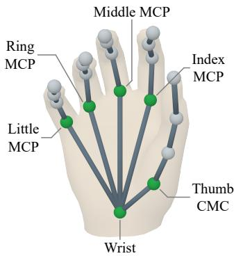  
Figure 9: MANO palm joints.

Table 6: Neutral-geometry accuracy before and after shape projection. MPVPE is measured against the reference neutral geometry and averaged over 5,000 samples per mask condition. $\Delta$ denotes the change after projection (after minus before).
<table><tr><td>Mask condition</td><td>Before projection</td><td>After projection</td><td> $\Delta$ </td></tr><tr><td>Clean</td><td>1.0250</td><td>1.0251</td><td>+0.000099</td></tr><tr><td> $C _ { 1 }$ </td><td>1.0955</td><td>1.0956</td><td>+0.000064</td></tr><tr><td> $C _ { 2 }$ </td><td>1.1473</td><td>1.1474</td><td>+0.000093</td></tr><tr><td> $C _ { 3 }$ </td><td>1.2008</td><td>1.2010</td><td>+0.000127</td></tr><tr><td> $C _ { 4 }$ </td><td>1.2781</td><td>1.2782</td><td>+0.000155</td></tr></table>

## A.2.3 HAND SHAPE PARAMETER RECOVERY BY PROJECTION

Shape projection converts the predicted neutral canonical hand geometry into valid MANO shape parameters without a learned parameter-regression head. Let $\bar { \mathcal { V } } ^ { 0 } ( \beta )$ denote the vertex output of $\bar { h } ( \mathbf { 0 } , \beta )$ in Eq. (2), with articulation fixed to zero. The shape token predicts displacements from the mean-shape geometry $\gamma ^ { 0 } ( \mathbf { 0 } )$ , yielding the neutral canonical geometry $\hat { \mathcal { V } } ^ { 0 }$

At zero articulation, the hand model depends affinely on $\beta$ (Romero et al., 2017), and vertex displacements relative to $\mathcal { V } ^ { 0 } ( \mathbf { 0 } )$ therefore lie in a fixed linear shape subspace. To make shape parameter recovery insensitive to translation errors in the predicted geometry, we subtract the vertex centroid. For the hand mesh vertices $\nu ,$ its centered vertices are

$$
\overline { { \pmb { v } } } _ { i } = \pmb { v } _ { i } - \frac { 1 } { N _ { \mathscr { V } } } \sum _ { j = 1 } ^ { N _ { \mathscr { V } } } \pmb { v } _ { j } , \quad \overline { { \mathscr { V } } } = \{ \overline { { \pmb { v } } } _ { i } \} _ { i = 1 } ^ { N _ { \mathscr { V } } } .\tag{22}
$$

The fixed shape basis $S \in \mathbb R ^ { 3 N \nu \times N _ { \beta } }$ has columns vec $\left( \overline { { \mathcal { V } ^ { 0 } } } ( e _ { r } ) - \overline { { \mathcal { V } ^ { 0 } } } ( \mathbf { 0 } ) \right)$ , where vec(·) denotes the matrix vectorization and $e _ { r }$ is the r-th unit vector. Since the predicted displacements are not constrained to the shape subspace, we recover the shape parameters through least-squares projection onto this subspace:

$$
\begin{array} { r l } & { \hat { \boldsymbol \beta } = \underset { \boldsymbol \beta \in \mathbb { R } ^ { N _ { \beta } } } { \arg \operatorname* { m i n } } \left\| \boldsymbol S \boldsymbol \beta - \mathrm { v e c } \left( \hat { \mathcal { V } } ^ { 0 } - \overline { { \mathcal { V } ^ { 0 } } } ( \mathbf { 0 } ) \right) \right\| _ { 2 } ^ { 2 } } \\ & { \quad \mathbf \beta = \boldsymbol S ^ { + } \mathrm { v e c } \left( \overline { { \hat { \mathcal { V } } ^ { 0 } } } - \overline { { \mathcal { V } ^ { 0 } } } ( \mathbf { 0 } ) \right) , } \end{array}\tag{23}
$$

where $S ^ { + }$ is the Moore-Penrose pseudoinverse of S. Both S and $S ^ { + }$ are fixed by the hand model and can be precomputed. Projection retains the component of the predicted displacements within the MANO shape subspace, combining geometric prediction with a compact parametric output.

Reconstruction accuracy. We evaluate whether projection degrades reconstruction accuracy using 1,000 samples from each of HO3D-MV, InterHand-MV, DexYCB-MV, OakInk-MV, and ARCTIC-MV. Each sample is evaluated under clean masks and the four corruption levels $C _ { 1 } { - } C _ { 4 }$ with scene-object occlusion retained. MPVPE before and after projection is measured against the same reference neutral geometry $\mathcal { V } ^ { 0 , * } = \mathcal { V } ^ { 0 } ( \beta ^ { * } )$ ). Table 6 shows that the projection increases mean MPVPE by at most 0.000155 mm across all five conditions, indicating that shape parameters can be recovered with negligible loss of reconstruction accuracy.

## A.2.4 NETWORK ARCHITECTURE

SilHand aggregates multi-view masks into a shared metric 3D representation for global hand pose estimation and canonical hand state decoding. We detail the network architecture in Tab. 7.

## A.3 TRAINING DETAILS

Optimization. We train SilHand from scratch for 1,000,000 steps using AdamW with batch size 32, peak learning rate 0.001, weight decay 0.01, and moment coefficients (0.9, 0.95). The learning rate increases to its peak over the first 5,000 steps (0.5 % of training) and then follows a cosine decay schedule. We compute the vertex and joint smooth- ${ \boldsymbol { \mathbf { \ell } } } _ { \mathbf { \ell } } - { \boldsymbol { \ell } } _ { 1 }$ losses with residuals expressed in centimeters and set the loss weights in Eq. (15) to $( \lambda _ { \mathrm { p o s e } } , \lambda _ { \mathrm { s h a p e } } , \lambda _ { \mathrm { j o i n t } } , \lambda _ { \mathrm { r o t } } ) = ( 1 , 1 , 1 , 0 . 0 1 )$ . All experiments are trained on a single NVIDIA RTX 5090 and evaluated using the final checkpoint. The experiments in Fig. 2(b) all use the same training budget of 1,000,000 optimization steps.

Table 7: Network architecture of SilHand.
<table><tr><td>Component</td><td>Configuration</td></tr><tr><td>Input masks</td><td>Resolution of 224 × 224 pixels per view.</td></tr><tr><td>Mask encoder</td><td>Four-stage ConvNeXt-V2-style feature pyramid (Woo et al., 2023) with stage widths (24, 48, 96, 192), depths (1, 1, 2, 2), and FFN expansion ratio 4. The stem and inter-stage downsampling use strides 4 and 2, respectively.</td></tr><tr><td>Ray encoder</td><td>A 4 × 4 convolution with stride 4, followed by a residual block with  $3 \times 3$  depthwise and  $1 \times 1$  convolutions.</td></tr><tr><td>Metric grid</td><td>16 × 16 × 16 grid points discretizing a workspace of extent 0.25 m. Coordinates concatenated with Fourier features at frequencies</td></tr><tr><td>Positional encoders</td><td>(1, 2, 4, 8), followed by two-layer MLPs of width 64 for cross-view aggregation and 128 for canonical hand state decoding.</td></tr><tr><td>Cross-view attention</td><td>Two attention blocks with feature width 64, 4 heads, and FFN expansion ratio 4. Three residual blocks with feature width 64,  $3 \times 3 \times 3$ </td></tr><tr><td>3D CNN</td><td>depthwise convolutions, layer normalization, global response normalization, and FFN expansion ratio 2.</td></tr><tr><td>Joint head</td><td>Two  $1 \times 1 \times 1$  convolutions predicting  $N _ { \mathcal { I } }$  spatial logits and  $3 N _ { \mathcal { I } }$  offset components at each grid point.  $N _ { \pmb { \theta } }$  pose tokens and one shape token processed by three decoder</td></tr><tr><td>Token-query decoder</td><td>blocks, each comprising self-attention, cross-attention, and an FFN. Feature width 128, 8 attention heads, and FFN expansion ratio 4.</td></tr><tr><td>Articulation head</td><td>A shared two-layer MLP with layer normalization, GELU activation, and hidden width 128, producing one scalar per pose token.</td></tr><tr><td>Shape head</td><td>A two-layer MLP with layer normalization, GELU activation, and hidden width 128, producing  $3 N _ { \nu }$  vertex displacements.</td></tr><tr><td>Trainable parameters</td><td>Approximately 2.31 million.</td></tr></table>

Table 8: Training observation augmentations. $p _ { s }$ and $p _ { v }$ denote the per-sample and conditional per-view probabilities, respectively.
<table><tr><td>Augmentation</td><td> $p _ { s }$   $p _ { v }$ </td><td>Description</td><td></td></tr><tr><td>Hand-region visibility</td><td>0.5</td><td>1.0</td><td>Occlusion by non-target geometry and partial hand-region removal.</td></tr><tr><td>Forearm extent</td><td>0.5</td><td>0.8</td><td>Extending the forearm with length scale [0, 0.6].</td></tr><tr><td>Morphological perturbations</td><td>0.5</td><td>0.8</td><td>Filling small gaps in the mask using a diamond-shaped kernel with radius  $[ 1 , 4 ]$  pixels.</td></tr><tr><td>Boundary perturbations</td><td>0.5</td><td>0.8</td><td>Smoothly displacing the mask boundary with amplitude in [0.55, max(0.55, 0.0025 min(H, W))] pixels.</td></tr><tr><td>Localized boundary artifacts</td><td>0.5</td><td>0.8</td><td>Adding [1, 4] square artifacts near the boundary, with side lengths [1, 3] pixels.</td></tr><tr><td>Random view dropout</td><td>0.5</td><td>0.2</td><td>Randomly dropping input views while retaining at least three.</td></tr></table>

Table 9: Effect of cross-view attention, joint-based global pose estimation, and canonicalization. Each experiment reports MPVPE / PA-V, with the lowest errors highlighted in bold.
<table><tr><td>Variant</td><td>Clean</td><td> $C _ { 1 }$ </td><td> $C _ { 2 }$ </td><td> $C _ { 3 }$ </td><td> $C _ { 4 }$ </td></tr><tr><td>SilHand</td><td>2.86 / 1.92</td><td>3.05 / 2.02</td><td>3.30 / 2.15</td><td>3.50 / 2.26</td><td>3.77 / 2.39</td></tr><tr><td>Direct global pose regression</td><td>3.39 / 2.60</td><td>3.64 / 2.72</td><td>3.85 / 2.85</td><td>4.08 / 2.97</td><td>4.34 / 3.12</td></tr><tr><td>Without canonicalization</td><td>3.18 / 2.24</td><td>3.37 / 2.36</td><td>3.56 / 2.50</td><td>3.80 / 2.63</td><td>4.10 / 2.79</td></tr><tr><td>Mean pooling</td><td>3.01 / 2.06</td><td>3.22 / 2.16</td><td>3.48 / 2.29</td><td>3.71 / 2.41</td><td>4.03 / 2.55</td></tr></table>

Augmentation. Table 8 specifies the training augmentations. Here $p _ { s }$ is the probability of enabling an augmentation for a multi-view sample, and $p _ { v }$ is its conditional probability for each view. These operations alter the observations while retaining the same target hand geometry. Random view dropout retains at least three input views. The training probabilities are distinct from the fixed severity presets used for robustness evaluation in Sec. A.8.

## A.4 ABLATION STUDIES

We evaluate the contributions of cross-view attention, joint-based global-pose estimation, and canonicalization to reconstruction accuracy. The full model constructs a metric 3D representation through cross-view attention, estimates global pose from auxiliary palm joints, and decodes articulation and shape using canonical coordinates. We compare it with three variants that modify the corresponding stages.

Direct global-pose regression. This variant predicts global rotation and translation directly from the shared metric 3D representation, replacing auxiliary joint prediction and palm alignment. It replaces the auxiliary joint loss with a smooth- ${ \bf \nabla } \cdot \ell _ { 1 }$ translation loss computed in centimeters and assigns unit weights to translation and rotation losses. The comparison evaluates the benefit of estimating global pose through explicit joint geometry.

Without canonicalization. This variant retains auxiliary joint prediction and palm alignment but conditions the token-query decoder on mask-centric coordinates instead of coordinates transformed by $\hat { T } ^ { - 1 }$ . This comparison evaluates the contribution of canonical coordinates to articulation and shape decoding.

Mean Pooling. This variant replaces the cross-view attention with uniform aggregation of perview features. At each 3D grid point, a shared MLP jointly encodes the queried mask and Plucker¨ ray features from each view. The resulting features are mean-pooled across views before posi tional encoding and residual feed-forward blocks are applied. The remaining reconstruction stages and losses are unchanged. This comparison evaluates the proposed fusion module against a meanpooling alternative that retains both input modalities.

All variants use the full synthetic training set and the optimization settings in Sec. A.3, with the loss modifications described above for direct global-pose regression. As shown in Tab. 9, all three variants increase MPVPE and PA-V across all five mask conditions. These results support the proposed cross-view fusion, joint-based global-pose estimation, and canonical decoding under the evaluated mask conditions.

## A.5 VISUAL HULL BASELINE

We evaluate a mask-based geometric baseline that reconstructs a visual hull and fits the MANObased hand model in Eq. (2). The baseline receives the same calibrated 224 ×224 clean masks as SilHand, with scene-object occlusion retained. To favor this baseline, we provide ground-truth global hand pose $T ^ { * }$ and shape parameter $\beta ^ { * }$ , leaving only the $N _ { \pmb { \theta } }$ articulation parameters θ to be estimated.

Visual hull reconstruction. We reconstruct the hull using torchhull, a GPU implementation of the volume-carving approach of Scharr et al. (2017). Reconstruction is performed within a 0.25 m cube centered using the mask-based estimate in Sec. A.2.1, at approximately 1.95 mm resolution. To accommodate missing foreground evidence under occlusion, we relax the all-view intersection, inspired by the soft visual-hull formulation of Narayan et al. (2015). We use a support threshold of $\dot { k } = \operatorname* { m a x } ( 2 , \lceil 0 . 7 5 N \rceil )$ , where N is the number of nonempty valid masks, and retain the standard intersection when $k = N$ . The support fraction is fixed at 0.75 across datasets.

Articulation parameter fitting. We fit the hand articulation to the reconstructed hull using a robust bidirectional geometric objective. We sample 2,048 points uniformly by surface area from the hull and transform them into the canonical hand frame using $( T ^ { * } ) ^ { - 1 }$ . The resulting point set $\mathcal { P }$ remains fixed throughout optimization. Let $\mathcal { M } _ { \theta } ^ { c }$ and $\mathcal { V } _ { \theta } ^ { c }$ denote the mesh and mesh vertices of the hand model $h ( \pmb \theta , \beta ^ { * } )$ , respectively. We minimize

$$
\mathcal { L } _ { \mathrm { f i t } } = \frac { 1 } { \left| \mathcal { P } \right| } \sum _ { p \in \mathcal { P } } \rho _ { \delta } \left( d ( p , \mathcal { M } _ { \theta } ^ { c } ) \right) + \frac { 0 . 2 5 } { \left| \mathcal { V } _ { \theta } ^ { c } \right| } \sum _ { v \in \mathcal { V } _ { \theta } ^ { c } } \rho _ { \delta } \left( d ( v , \mathcal { P } ) \right) + \frac { 1 0 ^ { - 3 } } { N _ { \theta } } \| \theta \| _ { 2 } ^ { 2 } .\tag{24}
$$

The hull-to-hand term measures point-to-triangle distances to the hand mesh, while the hand-to-hull term measures nearest-point distances to the sampled hull. We express distances in centimeters and use the Huber loss as the robust penalty

$$
\rho _ { \delta } ( d ) = { \binom { d ^ { 2 } } { 2 \delta d - \delta ^ { 2 } } } \quad d \leq \delta ,\tag{25}
$$

with $\delta = 1$ , corresponding to 10 mm. This penalty limits the influence of large geometric discrepancies. The lower weight on the hand-to-hull term reduces the penalty on hand regions absent from the reconstruction due to occlusion, while the final term regularizes the articulation parameters toward zero.

Optimization and evaluation. We optimize articulation subject to anatomical joint limits, keeping global pose and shape fixed. We use three generic initializations: one with zero articulation offsets and two with increasing finger flexion. Each receives 50 Adam updates at a learning rate of 0.01. We empirically verified that convergence is reached well within this optimization budget. We select the iterate with the lowest fitting objective across all runs. Ground-truth articulation is not used for initialization, optimization, or solution selection. Across the evaluation samples in Sec. A.1.1, 44 yield empty hulls and are excluded; reported errors are averaged over successful reconstructions. Results on the five real-world datasets are reported in Tab. 1. We report only PA-V and PA-J, as the baseline estimates articulation with global pose and shape fixed to ground truth.

## A.6 HELD-OUT EVALUATION

We evaluate cross-view mask agreement on ARCTIC-MV and InterHand-MV using the subsets described in Sec. A.1.1. SilHand takes SAM3 masks from eight static cameras as input, whereas POEMv2 receives RGB images from the same views. We reserve the egocentric view on ARCTIC-MV and one additional camera view outside each input group on InterHand-MV exclusively for evaluation, withholding these views from both models.

We render both predicted hand geometries and the original dataset MANO annotations using the calibrated heldout cameras, accounting for occlusion by annotated nontarget geometry. We compare the resulting visible hand masks against SAM3 reference masks from the held-out views. We retain only samples with non-empty held-out reference masks, yielding 15,565 samples for ARCTIC-MV and 19,758 samples for InterHand-MV. For each sample, we compute the IoU between the rendered visible hand mask and the held-out reference SAM3 mask, and report the median IoU in Tab. 2.

Table 10: Comparison on the PALM dataset.
<table><tr><td>Method</td><td>Surface distance ↓</td><td>IoU↑</td></tr><tr><td>SilHand</td><td>3.109</td><td>83.1</td></tr><tr><td>POEMv2</td><td>3.498</td><td>80.6</td></tr></table>

## A.7 EVALUATION ON THE PALM DATASET

We evaluate SilHand on the PALM dataset (Fan et al., 2026), which provides high-precision 3D scans of hand surfaces. SilHand takes SAM3-generated masks as input, whereas POEMv2 operates on RGB images captured by the same cameras. We quantify reconstruction accuracy using the mean point-to-surface distance, in millimeters, from the predicted hand meshes to the ground-truth scans. By directly evaluating against the scanned surfaces, this protocol avoids potential errors introduced by fitting the MANO model to the reference geometry. As shown in Tab. 10, SilHand achieves a mean surface distance of 3.109 mm, outperforming POEMv2 by 0.389 mm, with consistent IoU improvement by 2.5 percentage point.

Table 11: Relative fingertip displacement-vector error e under different mask conditions. Lower value indicates a better result.
<table><tr><td>Metric</td><td>Nearly identical masks</td><td>Distinguishable masks</td></tr><tr><td>e before PA (%)</td><td>29.70</td><td>7.18</td></tr><tr><td>e after PA (%)</td><td>25.65</td><td>5.27</td></tr></table>

Table 12: Mask corruption levels $C _ { 1 } { - } C _ { 4 }$
<table><tr><td>Parameter</td><td> $C _ { 1 }$ </td><td> $C _ { 2 }$ </td><td> $C _ { 3 }$ </td><td> $C _ { 4 }$ </td></tr><tr><td>Forearm length scale</td><td>0.125</td><td>0.250</td><td>0.375</td><td>0.500</td></tr><tr><td>Fragment-dropout probability</td><td>0.05</td><td>0.10</td><td>0.25</td><td>0.50</td></tr><tr><td>Morphological perturbations (pixels)</td><td>1</td><td>2</td><td>3</td><td>4</td></tr><tr><td>Boundary perturbation coefficient η</td><td>0</td><td>1/3</td><td>2/3</td><td>1</td></tr><tr><td>Number of localized boundary artifacts</td><td>1</td><td>2</td><td>3</td><td>4</td></tr></table>

Articulation disambiguation under similar masks. To better understand how the distinguisha bility of input masks affects SilHand’s ability to recover articulation changes, we conduct a controlled experiment using randomly sampled hand articulations from the synthetic test set under PALM’s camera configuration. For each articulation, we perturb one finger’s joint parameter in a randomly selected positive or negative direction, while keeping hand shape, global pose, other joints, and camera parameters fixed.

We consider two groups: (i) Nearly identical masks: small articulation perturbations of $5 ^ { \circ } - 1 0 ^ { \circ }$ , with mask IoU $\geq 0 . 9 9$ in every camera view before and after perturbation. These cases represent highly ambiguous observations, where articulation changes introduce almost no distinguishable mask information. (ii) Distinguishable masks: larger articulation perturbations of $3 0 ^ { \circ } - 4 5 ^ { \circ }$ , with mask IoU ≤ 0.90 in at least one camera view. These cases represent scenarios where at least one view provides additional geometric evidence of the articulation change. All configurations satisfy anatomical joint limits and self-collision constraints. We randomly select 5,000 valid perturbed instances (1,000 perturbations per finger) for each group and evaluate fingertip position errors before and after Procrustes alignment (PA).

To directly measure articulation discrimination, we evaluate whether the predicted fingertip displacement between the original and perturbed poses agrees with the ground-truth displacement. Let $\mathbf { p } _ { 0 } , \mathbf { p } _ { 1 }$ denote the ground-truth fingertip positions before and after perturbation, and $\hat { \bf p } _ { 0 } , \hat { \bf p } _ { 1 }$ their corresponding predictions. We define the relative displacement-vector error as

$$
e = \frac { \| ( \hat { \bf p } _ { 1 } - \hat { \bf p } _ { 0 } ) - ( { \bf p } _ { 1 } - { \bf p } _ { 0 } ) \| _ { 2 } } { \| { \bf p } _ { 1 } - { \bf p } _ { 0 } \| _ { 2 } } \times 1 0 0 \% .\tag{26}
$$

As shown in Tab. 11, for nearly identical masks, SilHand exhibits a relative fingertip displacement error of 29.70 % (25.65 % after PA), indicating difficulty in recovering articulation changes when the input masks provide insufficient discriminative information. In contrast, when at least one camera view captures distinguishable mask changes, the relative error decreases substantially to 7.18 % (5.27 % after PA), demonstrating that SilHand can effectively respond to informative mask variations and recover the corresponding fingertip motion. These findings highlight both SilHand’s sensitivity to observable articulation changes and the inherent ambiguity of mask-only reconstruction when different articulations produce nearly identical masks.

Table 13: Sensitivity to the number of input views. We report MPVPE in millimeters on the five real-world datasets.
<table><tr><td>Dataset</td><td>2 views</td><td>3 views</td><td>4 views</td><td>5 views</td><td>6 views</td><td>7 views</td><td>8 views</td></tr><tr><td>DexYCB-MV</td><td>34.47</td><td>8.23</td><td>4.51</td><td>2.78</td><td>2.44</td><td>2.21</td><td>2.07</td></tr><tr><td>HO3D-MV</td><td>11.23</td><td>4.44</td><td>3.49</td><td>2.79</td><td>一</td><td>一</td><td></td></tr><tr><td>OakInk-MV</td><td>12.50</td><td>3.91</td><td>2.95</td><td></td><td></td><td></td><td></td></tr><tr><td>ARCTIC-MV</td><td>74.94</td><td>32.13</td><td>10.00</td><td>5.81</td><td>3.54</td><td>3.14</td><td>2.99</td></tr><tr><td>InterHand-MV</td><td>11.11</td><td>5.96</td><td>4.62</td><td>4.22</td><td>3.95</td><td>3.71</td><td>3.52</td></tr></table>

## A.8 MASK-CORRUPTION CALIBRATION

## A.8.1 MASK-CORRUPTION OPERATORS

We evaluate reconstruction robustness by applying controlled perturbations to annotation-consistent masks. The four presets $C _ { 1 } { - } C _ { 4 }$ in Tab. 12 combine five operators in a fixed order: forearm extent, fragment dropout, morphological perturbations, boundary perturbations, and localized boundary artifacts. The reference hand geometry is held fixed across all corruption levels.

Forearm extension adds a forearm region at the wrist according to the prescribed length scale. Fragment dropout removes small disconnected foreground regions. For masks with multiple components, a component of area $A \leq 6 4$ pixels is removed with probability min $\left( 1 , p / \sqrt { A / A _ { \mathrm { m a x } } } \right)$ where $A _ { \mathrm { m a x } }$ is the largest component area and $p$ is the dropout probability. Morphological perturbations and localized artifacts use the operations described in Tab. 8, with the severity parameters in Tab. 12. Boundary perturbations use displacement amplitude $0 . 5 5 + \eta ( a _ { \mathrm { m a x } } - 0 . 5 5 )$ pixels, where $a _ { \mathrm { m a x } } = \operatorname* { m a x } ( 0 . 5 5 , 0 . 0 0 2 \operatorname* { m i n } ( H , W ) )$ at the source image resolution $H \times W$

## A.8.2 CALIBRATION PROTOCOL

To provide a segmentation-based reference for corruption severity, we evaluate SAM3 on 4,000 synthetic RGB images rendered using camera parameters from each of the five datasets, yielding 20,000 images in total. Following Sec. 3.6, we generate hand geometries by sampling articulations in the MANO pose PCA space and selecting shape parameters from the empirical distribution. $\mathsf { A p - }$ pearance varies through DART skin textures (Gao et al., 2022), sampled lighting, and an extended forearm. Backgrounds are drawn from ImageNet (Deng et al., 2009).

We evaluate SAM3 segmentations against the rendered visible binary hand masks. To compare segmentation errors with the prescribed corruption levels, we also perturb each reference mask three times at each level and evaluate the corrupted masks against the same reference.

Mask quality is measured by median IoU and median boundary F1 (Bokhovkin & Burnaev, 2019). For a reference mask B and its segmented or corrupted counterpart ${ \hat { B } } ,$ $\mathrm { I o U } = | \hat { B } \cap B | / | \hat { B } \cup B |$ Boundary F1 is defined as the harmonic mean of boundary precision and recall. We extract inner boundaries using 3×3 erosion and match boundary pixels within a Euclidean distance of $\tau = \operatorname* { m a x } ( 1 , \operatorname { r o u n d } ( 0 . 0 1 \sqrt { | B | } ) )$ pixels at the source image resolution. The comparisons are provided in Tab. 3.

## A.9 SENSITIVITY TO CAMERA CONFIGURATIONS

Sensitivity to the number of input views. We evaluate the sensitivity of SilHand to the number of input views on nested subsets of available cameras using rendered masks. As shown in Tab. 13, reconstruction accuracy generally improves with increasing view count, suggesting that additional cameras provide increasingly geometric constraints. These results highlight the importance of sufficient multi-view coverage for accurate reconstruction.

Sensitivity to calibration errors. We further assess the robustness of SilHand to camera calibration errors by jointly perturbing camera translation, rotation, focal length, and principal point while keeping the input masks and reference hand geometry fixed. We consider four perturbation levels (L1–L4) with progressively increasing magnitudes, as specified in Tab. 14, where L0 denotes the original, unperturbed calibration. The corresponding reconstruction errors are reported in Tab. 15. SilHand exhibits relatively small performance variations under mild calibration perturbations (L1– L2), while larger perturbations lead to more accuracy degradation. These results reflect the reliance of SilHand on accurate camera parameters, as calibration errors introduce inconsistencies in 3D-to-2D projections and cross-view geometric alignment.

Table 14: Camera calibration perturbation levels.
<table><tr><td>Perturbation</td><td>L1</td><td>L2</td><td>L3</td><td>L4</td></tr><tr><td>Translation (mm) Rotation (°)</td><td>0.10 0.025</td><td>0.25 0.05</td><td>0.50 0.10</td><td>1.00 0.25</td></tr></table>

Table 15: Sensitivity to camera calibration errors. We report MPVPE in millimeters under different perturbation levels, where L0 denotes unperturbed calibration.
<table><tr><td>Dataset</td><td>L0</td><td>L1</td><td>L2</td><td>L3</td><td>L4</td></tr><tr><td>DexYCB-MV</td><td>2.07</td><td>2.09</td><td>2.05</td><td>2.31</td><td>3.62</td></tr><tr><td>HO3D-MV</td><td>2.79</td><td>2.79</td><td>2.82</td><td>2.90</td><td>3.19</td></tr><tr><td>OakInk-MV</td><td>2.95</td><td>3.09</td><td>3.20</td><td>3.58</td><td>5.42</td></tr><tr><td>ARCTIC-MV</td><td>2.99</td><td>3.06</td><td>3.23</td><td>4.20</td><td>8.05</td></tr><tr><td>InterHand-MV</td><td>3.52</td><td>3.55</td><td>3.62</td><td>3.69</td><td>4.54</td></tr></table>

## A.10 ADDITIONAL QUALITATIVE RESULTS

In this section, we present additional qualitative results to further illustrate the effectiveness of SilHand. All reconstructions are obtained using SAM3 masks as the model input.

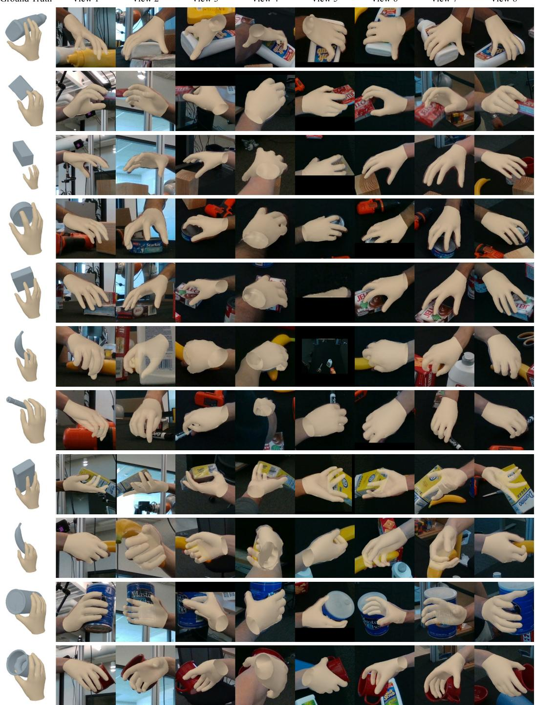  
Figure 10: Qualitative results on DexYCB-MV with SAM3-predicted masks as input.

View 5  
View 2  
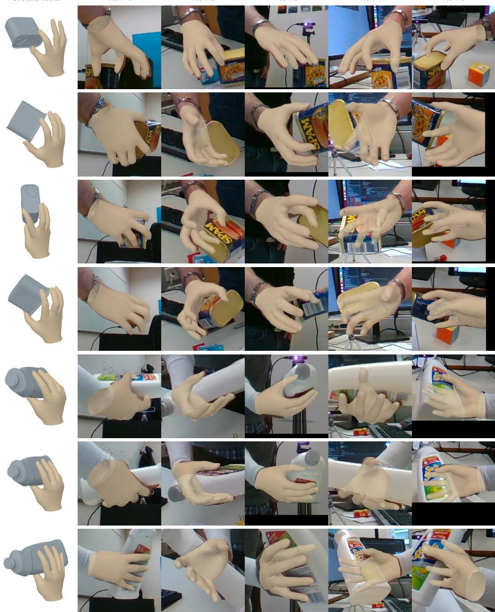  
Figure 11: Qualitative results on HO3D-MV with SAM3-predicted masks as input.

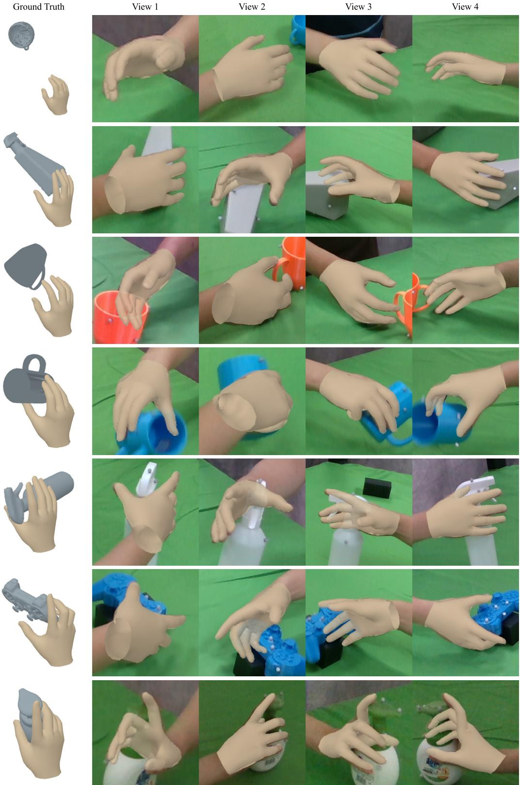  
Figure 12: Qualitative results on OakInk-MV with SAM3-predicted masks as input.

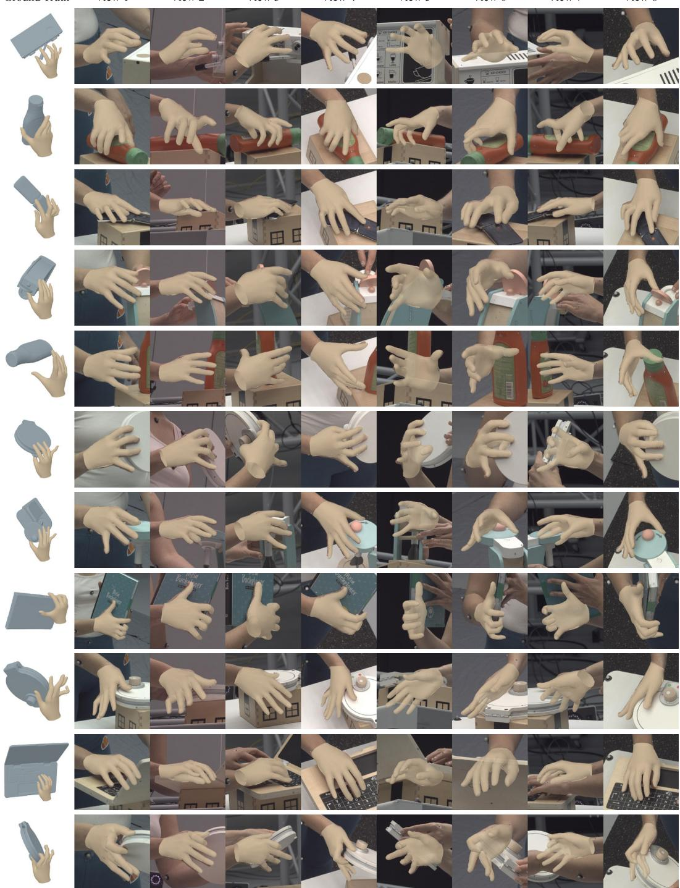  
Figure 13: Qualitative results on ARCTIC-MV with SAM3-predicted masks as input.

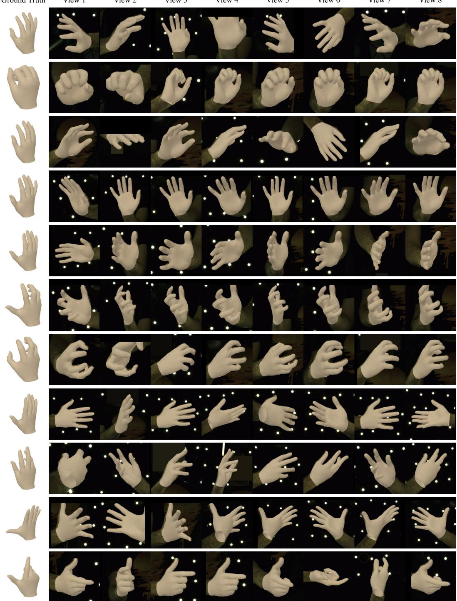  
Figure 14: Qualitative results on InterHand-MV with SAM3-predicted masks as input.