# HIFC-IQA: Train-Free Cross-Domain Image Quality Assessment via Dual-Process Cognition

Yu Li1,2∗† Zhengran Shen1∗ Puchao Zhou1∗ Yukang Ding2 Yachun Mi1 Boyuan Yang1 Xi Zhai1 Shaohui Liu1‡

1Harbin Institute of Technology 2Taobao & Tmall Group

## Abstract

The gap between controlled synthetic distortions and complex real-world degradations introduces a critical domain shift challenge for No-Reference Image Quality Assessment. Although Unsupervised Domain Adaptation (UDA) approaches attempt to address this issue, they remain constrained by substantial retraining overhead and cumulative error propagation inherent in iterative pseudo-labeling. Inspired by the dual-process theory of human cognition for remarkable generalization ability, we propose Hierarchical Intuitive and Fuzzy Consensus (HIFC), a completely train-free Cross-Domain IQA framework. HIFC employs asymmetric perceptual decomposition to disentangle semantic content from distortion-sensitive representations. The final quality score is fused through the synergy of two complementary branches: a memory consensus branch that retrieves a stable Fuzzy Quality Centroid from a synthetic reference gallery, and an intuitive branch that captures aesthetic polarization via zero-shot vision-language alignment. Extensive experiments show that HIFC achieves state-of-the-art performance across multiple benchmarks, attaining the highest average SRCC and PLCC among competing UDA methods. Most notably, in the challenging synthetic-to-authentic crossdomain setting, HIFC achieves a substantial performance margin over competing methods, demonstrating remarkable robustness and generalization. Core codes will be released in https://github.com/Hitly3015/HIFC-IQA.

## 1 Introduction

With the explosive growth of visual content across online platforms, images inevitably suffer from complex degradations during acquisition, compression, and transmission. Traditional Full-Reference Image Quality Assessment [52, 58, 56, 5, 7] methods, which rely on pristine reference images, are impractical in real-world scenarios such as User-Generated Content (UGC). Consequently, No-Reference Image Quality Assessment (NR-IQA) [59, 47, 23, 55, 54, 30, 31, 28, 6] has become the dominant research paradigm.

Despite recent progress, high-performing deep NR-IQA [47, 23, 54, 20] models are typically data hungry, requiring large-scale datasets with reliable Mean Opinion Scores (MOS). To mitigate data scarcity, many works leverage synthetically generated distortion datasets for model training [27, 29, 26, 8, 34]. However, this introduces a fundamental challenge: controlled synthetic distortions (e.g., Gaussian blur, JPEG compression) differ substantially from the complex, content-dependent, and composite degradations observed in real-world images. This discrepancy leads to severe domain shift, and models trained on synthetic data often exhibit dramatic performance degradation when directly applied to authentic distortions [46, 51].

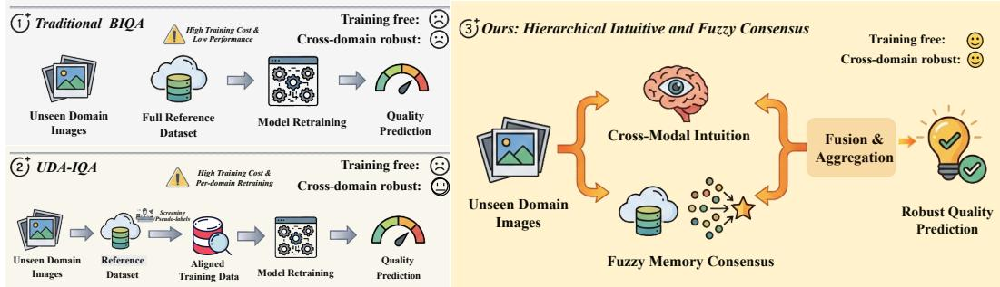  
Figure 1: Comparison between previous methods and our HIFC. Unlike conventional Blind Image Quality Assessment (BIQA) and UDA-based methods requiring costly retraining or domain alignment, HIFC mimics the dual-process mechanism of the HVS by fusing zero-shot intuition with fuzzy memory consensus.

To bridge the synthetic-to-authentic gap, Cross-Domain Image Quality Assessment (CD-IQA) [34, 27, 26, 62] has recently attracted increasing attention. The prevailing solutions largely rely on Unsupervised Domain Adaptation (UDA) [1, 57]. Some approaches attempt to align feature distributions between source and target domains via adversarial learning, while others adopt pseudolabeling strategies [26] to generate soft supervisory signals for iterative fine-tuning on the target domain. Although UDA-based methods have demonstrated improvements on specific benchmarks, they present notable limitations in large-scale or dynamic deployment scenarios. First, they incur substantial retraining overhead. Existing UDA frameworks are typically domain-specific: when encountering a new, unseen target domain, the model must undergo a costly adaptation cycle involving interdependent components such as data filtering or pseudo-label generation to facilitate iterative finetuning. This requirement essentially undermines plug-and-play applicability. More fundamentally, this "adaptation-per-domain" paradigm deviates from the way humans assess visual quality. Inspired by dual-process theory [22] of Human Visual System(HVS), we revisit a fundamental question: Does evaluating an unseen distorted image truly require updating model parametersfor every new domain? Humans exhibit remarkable generalization ability without explicit retraining. When encountering unfamiliar distortions, perception integrates rapid intuitive judgments with comparisons to previously experienced distortion prototypes [36] stored in memory, forming a fuzzy conceptual prototype (i.e., a centroid) [41] rather than seeking exact point-to-point alignments.

Motivated by this observation, as shown in Fig. 1, we propose a fully train-free cross-domain IQA framework termed HIFC (Hierarchical Intuitive and Fuzzy Consensus). HIFC eliminates the need for domain adaptation or target-domain fine-tuning. Specifically, we first perform an asymmetric perceptual decomposition to disentangle semantic and distortion-related representations.

In the memory consensus branch, distortion features are leveraged to perform hierarchical retrieval within a pre-constructed synthetic reference gallery. By aligning topological consistency and aggregating retrieved prototypes, we compute a Fuzzy Quality Centroid (FQC) that provides robust objective calibration.

In parallel, the intuitive perception branch exploits zero-shot alignment capabilities in a visionlanguage space to obtain a subjective aesthetic polarization score. The final quality prediction is obtained through a linear consensus of the memory-based calibration and intuitive assessment, forming a closed-loop evaluation mechanism that integrates experience and intuition.

Our main contributions are summarized as follows:

• We propose an efficient Train-free paradigm for Cross-Domain IQA. The proposed method eliminates the need for complex parameter fine-tuning or pseudo-label generation for a specific target domain, and provides a more practical option for quality assessment in dynamic environments.

• Inspired by the dual-process mechanism of the human visual system, we propose a dualbranch framework that disentangles distortion and semantic representations. Combined with structured memory retrieval, the design mitigates domain shift and improves cross-domain image quality assessment.

• Extensive experiments across multiple cross-domain settings demonstrate that HIFC, without any parameter updates or target-domain adaptation, achieves superior performance over state-of-the-art adaptation-based methods. As a fully train-free framework, HIFC offers plug-and-play deployability across diverse domains.

## 2 Related Works

No Reference Image Quality Assessment: Deep learning has significantly advanced Blind Image Quality Assessment (BIQA) by achieving superior accuracy through complex architectural innovations [59, 15, 9, 55]. Various paradigms have been explored to enhance performance: Zhu et al. [61] and Su et al. [47] utilized meta-learning and self-adaptive hyper-networks, respectively, to handle diverse distortions. Meanwhile, transformer-based architectures like MUSIQ [23] and local feature injected ViTs [55] have been developed to capture multi-scale or fine-grained degradation. Other works have focused on representation learning, such as Re-IQA [43], which employs unsupervised mixture-of-experts, and QCN [45], which utilizes comparison transformers to improve generalization. However, a fundamental limitation persists: these high-performing models are inherently data-hungry and training-dependent. More importantly, even methods targeting generalization still operate under a "weight-tuning" paradigm. This heavy reliance on supervised domain-specific fine-tuning motivates a shift toward a more efficient, train-free approach that mimics the human visual system’s ability to assess quality through rapid intuition and prior experience without the need for constant parameter updates.

Unsupervised Domain Adaptation Image Quality Assessment: Due to the significant domain differences between synthetic distortions and real-world distortions, models trained on synthetic data often perform poorly when facing real-world images. To bridge this gap, several studies have explored Unsupervised Domain Adaptation (UDA) techniques. Chen et al. [8] proposed a curriculum-style UDA approach for video quality assessment, adapting models progressively. Lu et al. [34] introduced StyleAM, aligning source and target domains in the feature style space. Li et al. [29] developed FreqAlign to excavate transferability from a frequency perspective, while [27] proposed DGQA, a distortion-guided UDA framework that matches data distributions via adaptive multi-domain selection. Recently, more advanced paradigms have emerged to tackle the complexities of domain shift. Meanwhile, SynDR-IQA [26] attempts to enhance the syn-to-real generalization by reshaping the distribution of synthetic data to better align with authentic environments. However, a common limitation persists: previous UDA-based methods are fundamentally rooted in an adaptation-perdomain paradigm. These requirements introduce substantial retraining overhead and limit their utility in dynamic scenarios. Motivated by the remarkable generalization capacity of the Human Visual System (HVS) in perceptual quality judgment, we propose a completely train-free framework to the challenges outlined above.

## 3 Methodology

## 3.1 Overview

The overall pipeline of the proposed HIFC (Hierarchical Intuitive and Fuzzy Consensus) framework is illustrated in Fig. 2. The framework follows a paradigm of asymmetric perceptual decomposition, hierarchical memory retrieval, and dual-process consensus fusion. Its core idea is to leverage frozen multimodal priors to decouple semantic content from distortion, enabling quality prediction through the integration of memory-based calibration and prototype-based alignment.

Given an input image $I \in \mathbb { R } ^ { H \times W \times 3 }$ , two asymmetric pre-processing strategies are applied to separately emphasize semantic and distortion information. The resulting inputs are encoded by a shared frozen visual encoder $\Phi _ { \mathrm { v i s } } .$ , producing semantic-aware feature $f _ { \mathrm { s e m } }$ and distortion-aware feature $f _ { \mathrm { d i s } }$ . In the memory consensus path, distortion alignment is first performed to filter the global reference gallery G and construct a distortion-consistent sub-gallery $G ^ { * }$ . A hierarchical retrieval strategy is then applied: semantic coarse filtering selects the Top-N candidates in the $F _ { \mathrm { s e m } }$ space, followed by distortion-aware re-ranking in the $\bar { F _ { \mathrm { d i s } } } ^ { - }$ space. The Fuzzy Quality Centroid (FQC) score $S _ { \mathrm { m e m } }$ is computed by aggregating the MOS of the Top-K neighbors, providing a memory-grounded quality estimate.

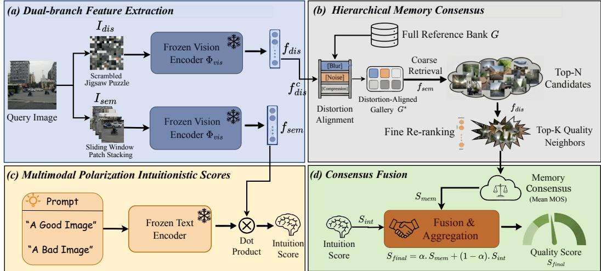  
Figure 2: The illustration of the HIFC-IQA framework. The proposed architecture employs an asymmetric perceptual decomposition to decouple semantic and distortion-related features, enabling a dual-branch synergy between intuitive score and memory-based fuzzy consensus.

In parallel, the intuition path projects $f _ { \mathrm { s e m } }$ into a vision-language space to compute a Binary Polarization score $S _ { \mathrm { i n t } }$ with respect to quality prototypes. Finally, a weighted fusion integrates the intuition and memory scores to produce the final prediction. By mimicking the dual-process mechanism of human cognition, HIFC achieves robust cross-domain performance without additional training overhead.

## 3.2 Asymmetric Dual-Branch Feature Extraction

The perceptual quality of an image is inherently characterized by the coupling of global semantic context and local distortion artifacts. To comprehensively capture quality-related information while disentangling these two components, we propose an asymmetric dual-branch feature extraction scheme using a shared frozen encoder $\phi ,$ as illustrated in Fig. 2(a).

The distortion-aware branch aims to extract content-agnostic quality representations $f _ { \mathrm { d i s } }$ . Inspired by grid-based sampling strategies in VQA [53] for capturing local details, we employ a Stochastic Jigsaw preprocessing method to achieve semantic deconstruction.

Given a grid size $G _ { \mathrm { s i z e } }$ , the original image I is first partitioned into a set of localized patches $\{ p _ { i , j } \}$ Considering that synthetic distortions in large-scale databases (e.g., KADID-10k) are typically spatially homogeneous, we apply a grid-based shuffling operator S to disrupt the spatial topology and remove global semantic structure. The process is formulated as:

$$
I _ { \mathrm { d i s } } = S \left( \{ p _ { i , j } \mid p _ { i , j } = \mathrm { C r o p } ( I , \mathrm { p o s } _ { i , j } , G _ { \mathrm { s i z e } } ) \} \right) .\tag{1}
$$

The scrambled image $I _ { \mathrm { d i s } }$ is then fed into the frozen encoder ϕ to extract the distortion-aware feature:

$$
f _ { \mathrm { d i s } } = \mathrm { N o r m } \big ( \phi ( I _ { \mathrm { d i s } } ) \big ) .\tag{2}
$$

The semantic-aware branch focuses on capturing category information and contextual background, as human sensitivity to the same distortion varies significantly across different semantic carriers.

To preserve semantic integrity while avoiding distortions introduced by disproportionate scaling or information loss from center cropping, we adopt a non-overlapping sliding-window stacking strategy. Let W denote the sliding window operator that extracts M non-overlapping patches $\left\{ w _ { 1 } , w _ { 2 } , \dots , w _ { M } \right\}$ from the original image. The stacked semantic input $I _ { \mathrm { s e m } }$ is defined as:

$$
I _ { \mathrm { s e m } } = \mathrm { S t a c k } ( \mathcal { W } ( I ) ) = \mathrm { C o n c a t } ( w _ { 1 } , w _ { 2 } , \dots , w _ { M } ) .\tag{3}
$$

The semantic feature $f _ { \mathrm { s e m } }$ is then obtained by feeding $I _ { \mathrm { s e m } }$ into the encoder $\phi ,$ followed by a global average pooling (GAP) operation to aggregate contextual information:

$$
f _ { \mathrm { s e m } } = \mathbf { G } \mathbf { A } \mathbf { P } \big ( \phi ( I _ { \mathrm { s e m } } ) \big ) .\tag{4}
$$

Through the above asymmetric processing, the original input image is projected into two spaces with independent physical meaning. We are able to find semantically similar samples by $f _ { s e m }$ and distortively similar neighbors by $f _ { d i s }$

## 3.3 Hierarchical Memory Consensus

To simulate the fuzzy memory search process humans employ when encountering images from an unknown domain, we formulate this mechanism as a calibration task using a structured synthetic distortion memory bank. This process involves two stages: Distortion Alignment and Memory Consensus Retrieval.

Distortion Alignment: In traditional UDA-based IQA, synthetic datasets typically contain a much broader spectrum of distortion types than real-world scenarios. Aligning distortion distributions between the reference gallery and the target domain is therefore essential for cross-domain perceptual consistency. Unlike prior UDA approaches that train dedicated distortion classifiers on the reference bank, our distortion features $\mathbf { f } _ { \mathrm { d i s } }$ , extracted via stochastic jigsaw preprocessing, inherently encode distortion-aware characteristics.

We perform domain-level alignment by matching the centroid of the target domain, $\mathbf { f } _ { \mathrm { d i s } } ^ { c }$ , with the prototypical centroids $\mathbf { f } _ { \mathrm { d i s } , i } ^ { r c }$ of each distortion category i in the reference gallery. The ${ \mathrm { T o p } } { \cdot } n _ { \mathrm { d i s t } }$ most relevant distortion types are selected to construct a task-aligned sub-gallery $\mathcal { G } ^ { * }$

$$
\mathcal { G } ^ { * } = \bigcup _ { i \in \mathcal { I } ^ { * } } \mathcal { G } _ { i } , \quad \mathcal { I } ^ { * } = \arg \mathrm { t o p } \cdot n _ { \mathrm { d i s t } } \left( \cos ( \mathbf { f } _ { \mathrm { d i s } } ^ { c } , \mathbf { f } _ { \mathrm { d i s } , i } ^ { r c } ) \right) ,\tag{5}
$$

where ${ \mathcal { T } } ^ { * }$ denotes the index set of the selected distortion categories. By leveraging the zero-shot priors of the frozen visual encoder, we obtain a domain-aligned memory space $\breve { g } ^ { \ast }$ without any parameter updates.

Hierarchical Semantic-Distortion Retrieval: Within the aligned sub-gallery $\mathcal { G } ^ { * }$ , we adopt a hierarchical retrieval strategy consisting of semantic coarse filtering followed by distortion-based fine re-ranking. Given the semantic feature $\mathbf { f } _ { \mathrm { s e m } } ^ { Q }$ of a query image, we first retrieve a candidate set $\mathcal { N } _ { \mathrm { s e m } }$ containing the Top-N semantically similar samples:

$$
\begin{array} { r } { \mathcal { N } _ { \mathrm { s e m } } = \left\{ g \in \mathcal { G } ^ { * } \ : \left| \ : \mathrm { r a n k } \big ( \cos ( \mathbf { f } _ { \mathrm { s e m } } ^ { Q } , \mathbf { f } _ { \mathrm { s e m } } ^ { g } ) \big ) \leq N \right. \right\} . } \end{array}\tag{6}
$$

This step ensures content consistency between the query and the references, mitigating quality biases introduced by semantic sensitivity. However, semantic clustering alone may lead to “semantic obsession,” where content similarity dominates quality perception. Inspired by re-ranking mechanisms in Retrieval-Augmented Generation (RAG), we conduct a second-stage ranking within $\mathcal { N } _ { \mathrm { s e m } }$ using distortion features $\mathbf { f } _ { \mathrm { d i s } }$ . The Top-K neighbors are selected as:

$$
\mathrm { F Q C } = \left\{ k \in \mathcal { N } _ { \mathrm { s e m } } \bigg | \mathrm { r a n k } \big ( \mathrm { c o s } ( \mathbf { f } _ { \mathrm { d i s } } ^ { Q } , \mathbf { f } _ { \mathrm { d i s } } ^ { k } ) \big ) \leq K \right\} .\tag{7}
$$

Finally, we define the Fuzzy Quality Cluster as the set of Top-K retrieved anchors. The memory consensus score $S _ { \mathrm { m e m } }$ is computed as the centroid of their subjective scores in label space:

$$
S _ { \mathrm { m e m } } = { \frac { 1 } { K } } \sum _ { k \in \mathrm { F Q C } } s _ { k } ,\tag{8}
$$

where $s _ { k }$ denotes the subjective quality score of the k-th reference sample.

This hierarchical calibration process provides an objective quality benchmark grounded in the local topology of the memory manifold, effectively bridging the synthetic-to-authentic domain gap through stable topological consensus.

## 3.4 Polarization Intuition and Final Fusion

Inspired by the System 1 mechanism of the HVS [22], humans often form an instantaneous and affective binary judgment of image quality before engaging in deliberate reasoning. In HIFC, we model this behavior as a Polarization Process, where image features gravitate toward two semantic poles "good" and "bad" within a multimodal embedding space.

We define a set of textual prompts $p _ { c } .$ , where $c \in \{ \mathrm { p o s } , \mathrm { n e g } \}$ corresponds to “high-quality image” and “low-quality image,” respectively. Using a frozen text encoder $\Psi _ { \mathrm { t x t } }$ , these prompts are projected onto the unit hypersphere as textual anchors:

$$
\begin{array} { r } { \mathbf { w } _ { c } = \mathrm { N o r m } \big ( \Psi _ { \mathrm { t x t } } ( p _ { c } ) \big ) , \quad c \in \{ \mathrm { p o s } , \mathrm { n e g } \} . } \end{array}\tag{9}
$$

Given the query semantic feature $\mathbf { f } _ { \mathrm { s e m } } ^ { Q }$ , intuitive quality estimation is formulated as perceptual alignment with these two prototypes rather than direct regression. A temperature-scaled Softmax operator is adopted to model the binary intuition probability:

$$
S _ { \mathrm { i n t } } = \frac { \exp \Big ( \tau \cdot \cos ( \mathbf { f } _ { \mathrm { s e m } } ^ { Q } , \mathbf { w } _ { \mathrm { p o s } } ) \Big ) } { \sum _ { c \in \{ \mathrm { p o s } , \mathrm { n e g } \} } \exp \Big ( \tau \cdot \cos ( \mathbf { f } _ { \mathrm { s e m } } ^ { Q } , \mathbf { w } _ { c } ) \Big ) } ,\tag{10}
$$

where $\tau$ denotes the temperature scaling factor. The score $S _ { \mathrm { i n t } }$ reflects the zero-shot confidence that the image gravitates toward the positive semantic pole. This polarization mechanism captures macro-aesthetic perception and complements the fine-grained degradation assessment provided by the memory path.

HIFC integrates intuition and rational memory through a linear consensus operator, simulating the cognitive progression from an initial first-glance impression to experience-based calibration. The final quality prediction $S _ { \mathrm { f i n a l } }$ is defined as:

$$
S _ { \mathrm { f i n a l } } = \alpha \cdot S _ { \mathrm { m e m } } + ( 1 - \alpha ) \cdot S _ { \mathrm { i n t } } ,\tag{11}
$$

where α balances the contributions of the two pathways. Through this dual-process mechanism, HIFC preserves its training-free nature while simultaneously modeling micro-level technical degradations via $S _ { \mathrm { m e m } }$ and macro-level perceptual preferences via $\dot { S } _ { \mathrm { i n } }$ t.

## 4 Experiments

## 4.1 Experimental Setups

Datasets and Protocols: We conduct experiments on several IQA datasets: four traditional synthetic distortion datasets LIVE [44], CSIQ [24], TID2013 [38], KADID-10k [32], four authentic distortion datasets LIVEC [14], KonIQ-10k [18], BID [10], and the dataset PIPAL [17] with both synthetic and algorithmic distortions. Model performance is assessed using Spearman’s Rank Correlation Coefficient(SRCC) and Pearson’s Linear Correlation Coefficient(PLCC). Both coefficients range from -1 to 1, with values closer to 1 indicating better performance.

Implementation Details: HIFC utilizes the frozen CLIP (ViT-B/32) [39] as the unified backbone. For asymmetric preprocessing, the semantic branch extracts non-overlapping $2 2 4 \times 2 2 4$ windows with a stride of 224, while the distortion branch adopts a Scrambled Jigsaw strategy with grid size $G _ { \mathrm { s i z e } } = 1 6$ . During hierarchical retrieval, the coarse candidate set size is fixed to $N = 1 0 0 0$ . Instead of using a predefined Top-K, we employ an adaptive thresholding strategy, where the FQC is formed by selecting samples whose similarity exceeds the mean similarity within the candidate set. The final fusion weight \alpha is set to 0.8. More implementation details and reasons for parameter selection can be found in the Appendix Sec. B.

## 4.2 Performance Comparison of SOTA Methods

Performance on the Synthetic-to-Authentic Setting: We first evaluate the generalization capability of HIFC when transferring from synthetic to authentic distortions. The results of the comparison between HIFC-IQA and state-of-the-art(SOTA) methods are summarized in Table 1. HIFC achieves superior performance on the majority of benchmarks, obtaining the highest average SRCC and PLCC among all competing methods. Compared to UDA-based methods (e.g., DGQA, SynDR-IQA), which require costly adaptation cycles, HIFC delivers superior accuracy through a purely train-free paradigm. This plug-and-play capability highlights the efficiency of our hierarchical retrieval mechanism in bridging the domain gap without retraining overhead. Furthermore, HIFC significantly surpasses VLM-based models like Q-Align and CLIPIQA+. This performance gap demonstrates that our success is not merely a byproduct of powerful pre-trained backbones, but a result of the effective synergy between affective intuition and fuzzy memory calibration. While standard VLMs rely on global semantic encoding, our asymmetric decoupling effectively captures fine-grained authentic degradations by simulating the dual-process mechanism of HVS. These findings validate that HIFC enables highly accurate cross-domain quality prediction without any parameter updates. Moreover, analogous to Retrieval-based frameworks, HIFC can further enhance its performance by fine-tuning specific hyperparameters such as $n _ { d i s t }$ and K for target datasets. More extensive experimental results are provided in the Sec. E and Sec. G in Appendix.

Table 1: Performance comparison on the synthetic-to-authentic setting (KADID-10k→LIVEC, KonIQ-10k, and BID). Train indicates whether IQA-specific parameter training is required.
<table><tr><td rowspan="2">Methods</td><td rowspan="2">Train</td><td colspan="2">LIVEC [14]</td><td colspan="2">KonIQ-10k [18]</td><td colspan="2">BID [10]</td><td colspan="2">Average</td></tr><tr><td>SRCC</td><td>PLCC</td><td>SRCC</td><td>PLCC</td><td>SRCC</td><td>PLCC</td><td>SRCC</td><td>PLCC</td></tr><tr><td>RankIQA [33]</td><td>Yes</td><td>0.491</td><td>0.495</td><td>0.603</td><td>0.551</td><td>0.510</td><td>0.367</td><td>0.535</td><td>0.471</td></tr><tr><td>DBCNN [59]</td><td>Yes</td><td>0.572</td><td>0.589</td><td>0.639</td><td>0.618</td><td>0.620</td><td>0.609</td><td>0.613</td><td>0.606</td></tr><tr><td>HyperIQA [47]</td><td>Yes</td><td>0.490</td><td>0.487</td><td>0.545</td><td>0.556</td><td>0.379</td><td>0.282</td><td>0.472</td><td>0.442</td></tr><tr><td>MÚSIQ [23]</td><td>Yes</td><td>0.517</td><td>0.524</td><td>0.554</td><td>0.573</td><td>0.575</td><td>0.600</td><td>0.549</td><td>0.566</td></tr><tr><td>VCRNet [37]</td><td>Yes</td><td>0.561</td><td>0.548</td><td>0.517</td><td>0.525</td><td>0.542</td><td>0.545</td><td>0.540</td><td>0.540</td></tr><tr><td>KGANet [60]</td><td>Yes</td><td>0.575</td><td></td><td>0.528</td><td></td><td></td><td></td><td></td><td></td></tr><tr><td>CLIPIQA+ [49]</td><td>Yes</td><td>0.512</td><td>0.543</td><td>0.511</td><td>0.515</td><td>0.474</td><td>0.442</td><td>0.499</td><td>0.500</td></tr><tr><td>Q-Align [54]</td><td>Yes</td><td>0.702</td><td>0.744</td><td>0.668</td><td>0.665</td><td>0.576</td><td>0.651</td><td>0.649</td><td>0.678</td></tr><tr><td>DANN [1]</td><td>Yes</td><td>0.499</td><td>0.484</td><td>0.638</td><td>0.636</td><td>0.586</td><td>0.510</td><td>0.574</td><td>0.543</td></tr><tr><td>UCDA [8]</td><td>Yes</td><td>0.382</td><td>0.358</td><td>0.496</td><td>0.501</td><td>0.348</td><td>0.391</td><td>0.408</td><td>0.417</td></tr><tr><td>RankDA [4]</td><td>Yes</td><td>0.451</td><td>0.455</td><td>0.638</td><td>0.623</td><td>0.535</td><td>0.582</td><td>0.542</td><td>0.553</td></tr><tr><td>StyleAM [34]</td><td>Yes</td><td>0.584</td><td>0.561</td><td>0.700</td><td>0.673</td><td>0.637</td><td>0.567</td><td>0.640</td><td>0.600</td></tr><tr><td>FreqAlign [29]</td><td>Yes</td><td>0.618</td><td>0.588</td><td>0.748</td><td>0.721</td><td>0.674</td><td>0.708</td><td>0.680</td><td>0.673</td></tr><tr><td>DGQA [27]</td><td>Yes</td><td>0.696</td><td>0.690</td><td>0.681</td><td>0.687</td><td>0.770</td><td>0.753</td><td>0.716</td><td>0.710</td></tr><tr><td>SynDR-IQA [26]</td><td>Yes</td><td>0.713</td><td>0.714</td><td>0.727</td><td>0.735</td><td>0.788</td><td>0.764</td><td>0.743</td><td>0.737</td></tr><tr><td>GDCIQA [62]</td><td>Yes</td><td>0.753</td><td>0.756</td><td>0.721</td><td>0.738</td><td>0.787</td><td>0.781</td><td>0.754</td><td>0.757</td></tr><tr><td>Ours</td><td>No</td><td>0.778</td><td>0.780</td><td>0.765</td><td>0.759</td><td>0.744</td><td>0.749</td><td>0.762</td><td>0.763</td></tr></table>

Table 2: Performance comparison of different distortions between DGQA and Ours on PIPAL [17].
<table><tr><td rowspan="2">Distortion Type</td><td colspan="2">DGQA [27]</td><td colspan="2">Ours</td></tr><tr><td>SRCC</td><td>PLCC</td><td>SRCC</td><td>PLCC</td></tr><tr><td>Traditional SR</td><td>0.4897</td><td>0.4567</td><td>0.4981</td><td>0.4939</td></tr><tr><td>PSNR-originated SR</td><td>0.5419</td><td>0.5404</td><td>0.5627</td><td>0.5639</td></tr><tr><td>SR with kernel mismatch</td><td>0.5810</td><td>0.5956</td><td>0.5892</td><td>0.5981</td></tr><tr><td>GAN-based SR</td><td>0.1629</td><td>0.1353</td><td>0.3020</td><td>0.3010</td></tr><tr><td>Denoising</td><td>0.5393</td><td>0.5279</td><td>0.6172</td><td>0.5912</td></tr><tr><td>SR and Denoising Joint</td><td>0.5588</td><td>0.5193</td><td>0.5594</td><td>0.5205</td></tr><tr><td>ALL</td><td>0.4789</td><td>0.4625</td><td>0.5071</td><td>0.5114</td></tr></table>

Performance on the Synthetic-to-Algorithmic Setting: We further assess the generalization ability of HIFC in the synthetic-to-algorithmic setting. Table 2 compares our approach with DGQA across multiple categories of algorithmic distortions. HIFC consistently surpasses DGQA in all evaluated scenarios, demonstrating stronger robustness to complex artifacts introduced by modern image processing pipelines. The performance improvement is particularly pronounced in challenging cases. For example, on GAN-based super-resolution, HIFC achieves an approximately 14% gain in SRCC, and nearly an 8% improvement on Denoising tasks. These distortions often exhibit non-natural structural artifacts that are difficult for conventional UDA methods to align effectively. These results suggest that the integration of affective intuition with hierarchical memory calibration enables HIFC to better model the perceptual characteristics of algorithmically generated artifacts, confirming its robustness across diverse and previously unseen distortion manifolds.

Performance on the Synthetic-to-Synthetic Setting: We also evaluate HIFC on the synthetic-tosynthetic setting. The SRCC and PLCC results are summarized in Table 3. Compared to the trainingfree baseline CLIP-IQA, HIFC demonstrates significant improvements across all evaluated datasets. Notably, on the CSIQ dataset, our method achieves an SRCC of 0.8113, outperforming even the fully supervised SOTA method SynDR-IQA. While maintaining highly competitive performance on LIVE and TID2013, HIFC significantly narrows the gap with training-based approaches. These results confirm that our Hierarchical dual-process mechanism effectively extracts robust and generalized quality representations without requiring any parameter fine-tuning.

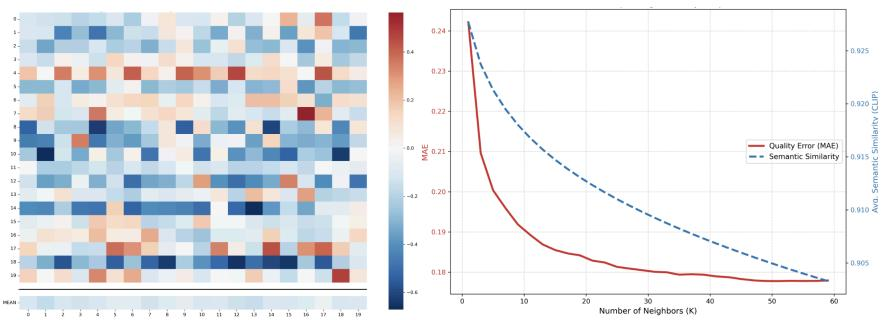

Table 3: Performance comparison on the synthetic-to-synthetic setting(KADID-10k→LIVE, CSIQ, and TID2013).
<table><tr><td rowspan="2">Methods</td><td rowspan="2">Training</td><td colspan="2">LIVE</td><td colspan="2">CSIQ</td><td colspan="2">TID2013</td></tr><tr><td>SRCC</td><td>PLCC</td><td>SRCC</td><td>PLCC</td><td>SRCC</td><td>PLCC</td></tr><tr><td>DGQA</td><td>√</td><td>0.9173</td><td>0.8988</td><td>0.7965</td><td>0.8017</td><td>0.7077</td><td>0.7220</td></tr><tr><td>SynDR-IQA</td><td>√</td><td>0.9258</td><td>0.9014</td><td>0.8069</td><td>0.8092</td><td>0.7147</td><td>0.7328</td></tr><tr><td>CLIP-IQA</td><td>×</td><td>0.8769</td><td>0.8703</td><td>0.7664</td><td>0.8027</td><td>0.6688</td><td>0.6873</td></tr><tr><td>Ours</td><td>X</td><td>0.9036</td><td>0.8913</td><td>0.8113</td><td>0.8359</td><td>0.7041</td><td>0.6794</td></tr></table>

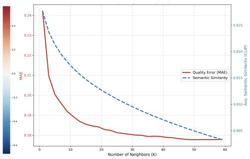  
Figure 3: Visualization of retrieval consistency and the "Resonance" phenomenon.

## 4.3 Qualitative Analysis

To justify the transition from single-neighbor retrieval to Fuzzy Quality Consensus, we visualize the consistency of retrieved neighbors in Fig. 3. In Fig. 3 (left), each row corresponds to a query image, and each column denotes the deviation between the k-th neighbor and the ground truth score. The nearest neighbors often exhibit noticeable noise, indicating that the highest semantic similarity does not necessarily guarantee precise quality estimation. As the retrieval depth increases, however, the mean deviation steadily converges toward zero. This suggests that although individual memory anchors are noisy, their collective centroid provides a more stable calibration. Fig. 3 (right) reveals a counter-intuitive “Resonance” effect. As the number of neighbors K increases, semantic similarity gradually declines, yet the quality error (MAE) continues to decrease and eventually stabilizes. This indicates that large-scale neighbor aggregation acts as a perceptual filter, suppressing content-driven noise and yielding a more consistent distortion representation. These observations support our central claim that fuzzy consensus over a broad cluster is more reliable than relying on a single highly similar but potentially biased neighbor. More qualitative experiments can be found in Sec. E of the Appendix.

## 4.4 Experiments on Robustness and Generalization

We conducted a series of experiments to demonstrate the robustness and generalization ability of HIFC. More experiments can be found in Sec. F of the Appendix.

Performance on Scale of Reference Datasets: To analyze the impact of reference scale and diversity on cross-domain generalization, we replace the KADID gallery with smaller synthetic datasets. Results on three authentic benchmarks are summarized in Table 4. Introducing even a small reference gallery (e.g., LIVE) consistently improves performance over the baseline without memory, demonstrating the effectiveness of fuzzy memory consensus. Moreover, performance increases progressively with the scale and diversity of the gallery. The largest gallery (KADID) achieves the best results, indicating that richer semantic contents and distortion types provide a denser and more representative anchor space for hierarchical retrieval, thereby enhancing robustness and accuracy.

Table 4: Impact of reference gallery scale on cross-domain performance. “NONE” denotes inference without a memory bank.
<table><tr><td rowspan="2">Reference</td><td colspan="2">KONIQ</td><td colspan="2">LIVEC</td><td colspan="2">BID</td></tr><tr><td>SRCC</td><td>PLCC</td><td>SRCC</td><td>PLCC</td><td>SRCC</td><td>PLCC</td></tr><tr><td>NONE</td><td>0.616</td><td>0.653</td><td>0.650</td><td>0.670</td><td>0.689</td><td>0.711</td></tr><tr><td>LIVE</td><td>0.696</td><td>0.707</td><td>0.707</td><td>0.742</td><td>0.731</td><td>0.747</td></tr><tr><td>CSIQ</td><td>0.693</td><td>0.714</td><td>0.723</td><td>0.748</td><td>0.735</td><td>0.745</td></tr><tr><td>TID2013</td><td>0.699</td><td>0.701</td><td>0.728</td><td>0.751</td><td>0.735</td><td>0.745</td></tr><tr><td>KADID</td><td>0.765</td><td>0.759</td><td>0.778</td><td>0.780</td><td>0.744</td><td>0.749</td></tr></table>

Table 5: Performance from synthetic to authentic datasets. Baselines are trained with GT-MOS supervision.
<table><tr><td rowspan="2">Method</td><td colspan="2">KONIQ</td><td colspan="2">LIVEC</td><td colspan="2">BID</td></tr><tr><td>SRCC</td><td>PLCC</td><td>SRCC</td><td>PLCC</td><td>SRCC</td><td>PLCC</td></tr><tr><td>StyleAM</td><td>0.700</td><td>0.673</td><td>0.584</td><td>0.561</td><td>0.637</td><td>0.567</td></tr><tr><td>FreqAlign</td><td>0.748</td><td>0.721</td><td>0.618</td><td>0.588</td><td>0.674</td><td>0.708</td></tr><tr><td>DGQA</td><td>0.681</td><td>0.687</td><td>0.696</td><td>0.690</td><td>0.770</td><td>0.753</td></tr><tr><td>Ours</td><td>0.745</td><td>0.734</td><td>0.760</td><td>0.751</td><td>0.734</td><td>0.733</td></tr></table>

Table 6: Ablation study on different component combinations on the synthetic-to-authentic setting.
<table><tr><td>Index</td><td>SDR</td><td>IS</td><td>DA</td><td>LIVEC</td><td>KonIQ</td><td>BID</td><td>Avg</td></tr><tr><td>a)</td><td>√</td><td></td><td></td><td>0.722</td><td>0.702</td><td>0.698</td><td>0.707</td></tr><tr><td>b)</td><td></td><td>√</td><td></td><td>0.649</td><td>0.616</td><td>0.689</td><td>0.651</td></tr><tr><td>c)</td><td>√</td><td>√</td><td></td><td>0.759</td><td>0.747</td><td>0.734</td><td>0.747</td></tr><tr><td>d)</td><td>√</td><td></td><td>√</td><td>0.757</td><td>0.722</td><td>0.731</td><td>0.737</td></tr><tr><td>e)</td><td>√</td><td>√</td><td>√</td><td>0.778</td><td>0.765</td><td>0.744</td><td>0.762</td></tr></table>

Table 7: Ablation study on different feature space combinations of SDR. ⇒ denotes coarse-to-fine retrieval.
<table><tr><td rowspan="2">Space</td><td colspan="2">LIVEC</td><td colspan="2">KonIQ</td><td colspan="2">BID</td></tr><tr><td>SRCC</td><td>PLCC</td><td>SRCC</td><td>PLCC</td><td>SRCC</td><td>PLCC</td></tr><tr><td> $f _ { s e m }$ </td><td>0.733</td><td>0.731</td><td>0.667</td><td>0.688</td><td>0.730</td><td>0.736</td></tr><tr><td> $f _ { d i s }$ </td><td>0.713</td><td>0.721</td><td>0.714</td><td>0.704</td><td>0.627</td><td>0.632</td></tr><tr><td> $f _ { d i s } \Rightarrow f _ { s e m }$ </td><td>0.770</td><td>0.772</td><td>0.757</td><td>0.750</td><td>0.727</td><td>0.729</td></tr><tr><td> $f _ { s e m } \Rightarrow f _ { d i s }$ </td><td>0.778</td><td>0.780</td><td>0.765</td><td>0.759</td><td>0.744</td><td>0.749</td></tr></table>

Experiments on Synthetic-to-Authentic without GT-MOS: To assess the dependency on human annotations, we further evaluate a challenging variant in which the reference ground-truth MOS values are replaced by zero-shot intuition scores $S _ { \mathrm { i n t } }$ as pseudo-labels. As shown in Table 5, this annotation-free version still achieves highly competitive performance, reaching an SRCC of 0.760 on LIVEC, significantly outperforming UDA-based methods such as DGQA and StyleAM. Although a performance gap remains compared to the oracle version using ground-truth MOS, the overall robustness indicates that the proposed fuzzy memory consensus effectively mitigates individual label noise through cluster-based aggregation. These results confirm that HIFC can maintain accurate quality calibration even in the absence of precise human supervision.

## 4.5 Ablation Studies

Ablation Studies on Components: We analyze the contributions of Intuition Score (IS), Distortion Alignment (DA), and Semantic-Distortion Retrieval (SDR) in Table 6. As shown in rows (a), (b), and (e), neither SDR nor IS alone achieves optimal performance, while their combination (row e) yields the best average SRCC of 0.762, highlighting the importance of integrating intuition and memory. The performance gain also verifies the role of DA, which aligns distortion manifolds between synthetic and authentic domains, enabling more reliable neighbor retrieval. Furthermore, row (d) shows that removing IS from the full memory pipeline (SDR+DA) degrades performance, indicating that IS provides a crucial zero-shot baseline that stabilizes overall quality prediction.

Ablation Study on Component of Semantic-Distortion Retrieval: We analyze the design of the Semantic-Distortion Retrieval (SDR) module by comparing different retrieval strategies. As shown in Table 7, using a single feature space, either semantic $( f _ { \mathrm { s e m } } )$ or distortion-aware $( \mathrm { \Delta } f _ { \mathrm { d i s } } ) .$ —leads to suboptimal results, as neither alone ensures both content relevance and distortion consistency. In contrast, the proposed semantic-first, distortion-second strategy $( f _ { \mathrm { s e m } } \Rightarrow f _ { \mathrm { d i s } } )$ consistently achieves the best performance, outperforming the reverse order. This indicates that semantic filtering provides a stable context, enabling more precise distortion-based re-ranking. Such hierarchical design improves retrieval reliability and leads to more accurate quality estimation. Additional ablation results and analyses are provided in the Appendix D.

Contribution beyond the CLIP backbone: To further evaluate the effectiveness of HIFC-IQA, we retrain DGQA and SynDR-IQA using the same ViT-B/32 backbone and KADID-10k source dataset. As shown in Table 8, HIFC-IQA achieves the best performance on LIVEC and KonIQ-10k, reaching SRCC/PLCC values of 0.778/0.780 and 0.765/0.759, respectively, while maintaining comparable performance on BID. Notably, HIFC-IQA achieves these results without IQA-specific training, demonstrating the effectiveness of its hierarchical retrieval and fuzzy quality consensus mechanisms in leveraging frozen visual representations.

Table 8: Comparison with DGQA and SynDR-IQA retrained using the same ViT-B/32 backbone. The source dataset/reference gallery is KADID-10k.
<table><tr><td>Method</td><td>IQA train</td><td>LIVEC</td><td>KonIQ-10k</td><td>BID</td></tr><tr><td>DGQA (ViT-B/32)</td><td>Yes</td><td>0.712/0.721</td><td>0.697/0.701</td><td>0.723/0.731</td></tr><tr><td>SynDR-IQA (ViT-B/32)</td><td>Yes</td><td>0.732/0.736</td><td>0.752/0.748</td><td>0.745/0.754</td></tr><tr><td>HIFC-IQA</td><td>No</td><td>0.778/0.780</td><td>0.765/0.759</td><td>0.744/0.749</td></tr></table>

Gallery size and distortion diversity: We investigate the influence of reference gallery size by varying the proportion of KADID-10k samples from 10% to 100%. As shown in Table 9, increasing the gallery size consistently improves prediction performance across both target datasets. Specifically, the SRCC increases from 0.734 to 0.778 on LIVEC and from 0.729 to 0.765 on KonIQ-10k. These results indicate that a larger reference gallery provides richer quality exemplars, facilitating more reliable neighbor retrieval and fuzzy quality consensus estimation.

Table 9: Effect of KADID-10k gallery size on transfer to LIVEC and KonIQ-10k.
<table><tr><td>KADID-10k subset</td><td>LIVEC</td><td>KonIQ-10k</td></tr><tr><td>10%</td><td>0.734/0.746</td><td>0.729/0.727</td></tr><tr><td>25%</td><td>0.741/0.752</td><td>0.752/0.750</td></tr><tr><td>50%</td><td>0.756/0.766</td><td>0.755/0.755</td></tr><tr><td>100%</td><td>0.778/0.780</td><td>0.765/0.759</td></tr></table>

Effect of Distortion Diversity. We further investigate the impact of distortion diversity by fixing the gallery size at 2,000 images while varying the number of distortion types. As shown in Table 10, the best performance on both datasets is achieved with 10 distortion types, while further increasing diversity leads to performance degradation. This observation suggests a trade-off between distortion coverage and the density of quality exemplars within each distortion category. Under a fixed gallery capacity, a balanced distortion distribution enables more effective local quality matching and consensus estimation.

Table 10: Effect of distortion diversity at a fixed gallery size of 2,000 images.
<table><tr><td>Distortion diversity</td><td>LIVEC</td><td>KonIQ-10k</td></tr><tr><td>5 types</td><td>0.745/0.739</td><td>0.604/0.644</td></tr><tr><td>10 types</td><td>0.767/0.764</td><td>0.612/0.647</td></tr><tr><td>20 types</td><td>0.735/0.746</td><td>0.602/0.642</td></tr><tr><td>Full diversity</td><td>0.735/0.745</td><td>0.602/0.642</td></tr></table>

## 5 Conclusion

In this paper, we propose HIFC, a train-free framework that fundamentally rethinks Cross-Domain Image Quality Assessment (CD-IQA). Inspired by the dual-process mechanism of the human visual system, HIFC synergizes zero-shot intuitive perception with a structured fuzzy memory consensus. By decoupling physical distortions from semantic interference, our framework establishes robust perceptual anchors across diverse manifolds. Extensive experiments confirm that without relying on target-domain pseudo-labeling or costly parameter updates, HIFC achieves highly competitive generalization, particularly in the challenging synthetic-to-authentic setting, rivaling state-of-the-art domain adaptation methods. Ultimately, HIFC highlights the immense potential of biologicallyinspired, plug-and-play paradigms for robust real-world visual quality evaluation.

## References

[1] Hana Ajakan, Pascal Germain, Hugo Larochelle, François Laviolette, and Mario Marchand. Domainadversarial neural networks. arXiv preprint arXiv:1412.4446, 2014.

[2] Akari Asai, Zeqiu Wu, Yizhong Wang, Avirup Sil, and Hannaneh Hajishirzi. Self-rag: Learning to retrieve, generate, and critique through self-reflection. In The Twelfth International Conference on Learning Representations, 2023.

[3] Linhan Cao, Wei Sun, Weixia Zhang, Xiangyang Zhu, Kaiwei Zhang, Jun Jia, Dandan Zhu, Guangtao Zhai, and Xiongkuo Min. QualiRAG: Retrieval-augmented generation for visual quality understanding. arXiv preprint arXiv:2601.18195, 2026. URL https://arxiv.org/abs/2601.18195.

[4] Baoliang Chen, Haoliang Li, Hongfei Fan, and Shiqi Wang. No-reference screen content image quality assessment with unsupervised domain adaptation. arXiv preprint arXiv:2008.08561, 2020.

[5] Chaofeng Chen, Jiadi Mo, Jingwen Hou, Haoning Wu, Liang Liao, Wenxiu Sun, Qiong Yan, and Weisi Lin. Topiq: A top-down approach from semantics to distortions for image quality assessment. IEEE Transactions on Image Processing, 33:2404–2418, 2024.

[6] Chaofeng Chen, Sensen Yang, Haoning Wu, Liang Liao, Zicheng Zhang, Annan Wang, Wenxiu Sun, Qiong Yan, and Weisi Lin. Q-ground: Image quality grounding with large multi-modality models. In Proceedings ofthe 32nd ACM International Conference on Multimedia, pages 486–495, 2024.

[7] Du Chen, Tianhe Wu, Kede Ma, and Lei Zhang. Toward generalized image quality assessment: Relaxing the perfect reference quality assumption. In Proceedings of the Computer Vision and Pattern Recognition Conference, pages 12742–12752, 2025.

[8] Pengfei Chen, Leida Li, Jinjian Wu, Weisheng Dong, and Guangming Shi. Unsupervised curriculum domain adaptation for no-reference video quality assessment. In Proceedings of the IEEE/CVF International Conference on Computer Vision, pages 5178–5187, 2021.

[9] Zewen Chen, Haina Qin, Juan Wang, Chunfeng Yuan, Bing Li, Weiming Hu, and Liang Wang. Promptiqa: Boosting the performance and generalization for no-reference image quality assessment via prompts. In European conference on computer vision, pages 247–264. Springer, 2024.

[10] Alexandre Ciancio, Eduardo AB Da Silva, Amir Said, Ramin Samadani, Pere Obrador, et al. No-reference blur assessment of digital pictures based on multifeature classifiers. IEEE Transactions on image processing, 20(1):64–75, 2010.

[11] Darren Edge, Ha Trinh, Joshua Bradley Newman Cheng, Alex Chao, Apurva Mody, Steven Truitt, Dasha Metropolitansky, Robert Osazuwa Ness, and Jonathan Larson. From local to global: A graph rag approach to query-focused summarization, 2025. URL https://arxiv. org/abs/2404.16130.

[12] Yuming Fang, Hanwei Zhu, Yan Zeng, Kede Ma, and Zhou Wang. Perceptual quality assessment of smartphone photography. In Proceedings of the IEEE/CVF conference on computer vision and pattern recognition, pages 3677–3686, 2020.

[13] Kang Fu, Huiyu Duan, Zicheng Zhang, Yucheng Zhu, Jun Zhao, Xiongkuo Min, Jia Wang, and Guangtao Zhai. Enhancing image quality assessment ability of LMMs via retrieval-augmented generation. arXiv preprint arXiv:2601.08311, 2026. URL https://arxiv.org/abs/2601.08311.

[14] Deepti Ghadiyaram and Alan C Bovik. Massive online crowdsourced study of subjective and objective picture quality. IEEE transactions on image processing, 25(1):372–387, 2015.

[15] S Alireza Golestaneh, Saba Dadsetan, and Kris M Kitani. No-reference image quality assessment via transformers, relative ranking, and self-consistency. In 2022 IEEE/CVF Winter Conference on Applications of Computer Vision (WACV), pages 3989–3999. IEEE, 2022.

[16] Fabian Gröger, Shuo Wen, and Maria Brbic. Revisiting the platonic representation hypothesis: An ´ aristotelian view. arXiv preprint arXiv:2602.14486, 2026.

[17] Jinjin Gu, Haoming Cai, Hantao Chen, Xiaoxing Ye, Jimmy S. Ren, and Chao Dong. Pipal: a large-scale image quality assessment dataset for perceptual image restoration. In European Conference on Computer Vision, pages 633–651. Springer, 2020.

[18] Vlad Hosu, Hanhe Lin, Tamas Sziranyi, and Dietmar Saupe. Koniq-10k: An ecologically valid database for deep learning of blind image quality assessment. IEEE Transactions on Image Processing, 29:4041–4056, 2020.

[19] Minyoung Huh, Brian Cheung, Tongzhou Wang, and Phillip Isola. Position: The platonic representation hypothesis. In Forty-first International Conference on Machine Learning, 2024.

[20] Ziheng Jia, Jiaying Qian, Zicheng Zhang, Zijian Chen, and Xiongkuo Min. Refine-iqa: Multi-stage reinforcement finetuning for perceptual image quality assessment. arXiv preprint arXiv:2508.03763, 2025.

[21] Jeff Johnson, Matthijs Douze, and Hervé Jégou. Billion-scale similarity search with gpus. IEEE transactions on big data, 7(3):535–547, 2019.

[22] Daniel Kahneman. Thinking,fast and slow. macmillan, 2011.

[23] Junjie Ke, Qifei Wang, Yilin Wang, Peyman Milanfar, and Feng Yang. Musiq: Multi-scale image quality transformer. In Proceedings of the IEEE/CVF international conference on computer vision, pages 5148–5157, 2021.

[24] Eric C Larson and Damon M Chandler. Most apparent distortion: full-reference image quality assessment and the role of strategy. Journal ofelectronic imaging, 19(1):011006–011006, 2010.

[25] Patrick Lewis, Ethan Perez, Aleksandra Piktus, Fabio Petroni, Vladimir Karpukhin, Naman Goyal, Heinrich Küttler, Mike Lewis, Wen-tau Yih, Tim Rocktäschel, et al. Retrieval-augmented generation for knowledge intensive nlp tasks. Advances in neural information processing systems, 33:9459–9474, 2020.

[26] Aobo Li, Jinjian Wu, Yongxu Liu, Leida Li, and Weisheng Dong. Towards syn-to-real iqa: A novel perspective on reshaping synthetic data distributions. In The Thirty-ninth Annual Conference on Neural Information Processing Systems.

[27] Aobo Li, Jinjian Wu, Yongxu Liu, and Leida Li. Bridging the synthetic-to-authentic gap: Distortion-guided unsupervised domain adaptation for blind image quality assessment. In Proceedings of the IEEE/CVF Conference on Computer Vision and Pattern Recognition, pages 28422–28431, 2024.

[28] Chunyi Li, Yuan Tian, Xiaoyue Ling, Zicheng Zhang, Haodong Duan, Haoning Wu, Ziheng Jia, Xiaohong Liu, Xiongkuo Min, Guo Lu, et al. Image quality assessment: From human to machine preference. In Proceedings ofthe Computer Vision and Pattern Recognition Conference, pages 7570–7581, 2025.

[29] Xin Li, Yiting Lu, and Zhibo Chen. Freqalign: Excavating perception-oriented transferability for blind image quality assessment from a frequency perspective. IEEE Transactions on Multimedia, 26:4652–4666, 2023.

[30] Xudong Li, Timin Gao, Runze Hu, Yan Zhang, Shengchuan Zhang, Xiawu Zheng, Jingyuan Zheng, Yunhang Shen, Ke Li, Yutao Liu, et al. Adaptive feature selection for no-reference image quality assessment by mitigating semantic noise sensitivity. In International Conference on Machine Learning, pages 27808– 27821. PMLR, 2024.

[31] Xudong Li, Zihao Huang, Yan Zhang, Yunhang Shen, Ke Li, Xiawu Zheng, Liujuan Cao, and Rongrong Ji. Few-shot image quality assessment via adaptation of vision-language models. In Proceedings ofthe IEEE/CVF International Conference on Computer Vision, pages 10442–10452, 2025.

[32] Hanhe Lin, Vlad Hosu, and Dietmar Saupe. Kadid-10k: A large-scale artificially distorted iqa database. In 2019 Eleventh International Conference on Quality ofMultimedia Experience (QoMEX), pages 1–3. IEEE, 2019.

[33] Xialei Liu, Joost Van De Weijer, and Andrew D Bagdanov. Rankiqa: Learning from rankings for noreference image quality assessment. In Proceedings of the IEEE international conference on computer vision, pages 1040–1049, 2017.

[34] Yiting Lu, Xin Li, Jianzhao Liu, and Zhibo Chen. Styleam: Perception-oriented unsupervised domain adaption for no-reference image quality assessment. IEEE Transactions on Multimedia, 27:2043–2058, 2024.

[35] Kede Ma, Zhengfang Duanmu, Zhou Wang, Qingbo Wu, Wentao Liu, Hongwei Yong, Hongliang Li, and Lei Zhang. Group maximum differentiation competition: Model comparison with few samples. IEEE Transactions on pattern analysis and machine intelligence, 42(4):851–864, 2018.

[36] Robert M Nosofsky. Attention, similarity, and the identification–categorization relationship. Journal of experimental psychology: General, 115(1):39, 1986.

[37] Zhaoqing Pan, Feng Yuan, Jianjun Lei, Yuming Fang, Xiao Shao, and Sam Kwong. Vcrnet: Visual compensation restoration network for no-reference image quality assessment. IEEE Transactions on Image Processing, 31:1613–1627, 2022.

[38] Nikolay Ponomarenko, Lina Jin, Oleg Ieremeiev, Vladimir Lukin, Karen Egiazarian, Jaakko Astola, Benoit Vozel, Kacem Chehdi, Marco Carli, Federica Battisti, et al. Image database tid2013: Peculiarities, results and perspectives. Signal processing: Image communication, 30:57–77, 2015.

[39] Alec Radford, Jong Wook Kim, Chris Hallacy, Aditya Ramesh, Gabriel Goh, Sandhini Agarwal, Girish Sastry, Amanda Askell, Pamela Mishkin, Jack Clark, Gretchen Krueger, and Ilya Sutskever. Learning transferable visual models from natural language supervision. In International Conference on Machine Learning, pages 8748–8763. PMLR, 2021.

[40] Ryan Ramos, Vladan Stojnic, Giorgos Kordopatis-Zilos, Yuta Nakashima, Giorgos Tolias, and Noa Garcia.´ Processing and acquisition traces in visual encoders: What does clip know about your camera? In Proceedings of the IEEE/CVF International Conference on Computer Vision, pages 17056–17066, 2025.

[41] Eleanor Rosch. Cognitive representations of semantic categories. Journal of experimental psychology: General, 104(3):192, 1975.

[42] Eleanor Rosch. Principles of categorization. In Cognition and categorization, pages 27–48. Routledge, 2024.

[43] Avinab Saha, Sandeep Mishra, and Alan C Bovik. Re-iqa: Unsupervised learning for image quality assessment in the wild. In Proceedings of the IEEE/CVF conference on computer vision and pattern recognition, pages 5846–5855, 2023.

[44] Hamid R Sheikh, Muhammad F Sabir, Alan C Bovik, et al. A statistical evaluation of recent full reference image quality assessment algorithms. IEEE Trans. Image Process., 15(11):3440–3451, 2006.

[45] Nyeong-Ho Shin, Seon-Ho Lee, and Chang-Su Kim. Blind image quality assessment based on geometric order learning. In Proceedings ofthe IEEE/CVF Conference on Computer Vision and Pattern Recognition, pages 12799–12808, 2024.

[46] Tianshu Song, Leida Li, Hancheng Zhu, and Jiansheng Qian. Ie-iqa: Intelligibility enriched generalizable no-reference image quality assessment. Frontiers in Neuroscience, 15:739138, 2021.

[47] Shaolin Su, Qingsen Yan, Yu Zhu, Cheng Zhang, Xin Ge, Jinqiu Sun, and Yanning Zhang. Blindly assess image quality in the wild guided by a self-adaptive hyper network. In Proceedings of the IEEE/CVF Conference on Computer Vision and Pattern Recognition, pages 4352–4361, 2020.

[48] Laurens Van der Maaten and Geoffrey Hinton. Visualizing data using t-sne. Journal of machine learning research, 9(11), 2008.

[49] Jianyi Wang, Kelvin CK Chan, and Chen Change Loy. Exploring clip for assessing the look and feel of images. In Proceedings ofthe AAAI conference on artificial intelligence, volume 37, pages 2555–2563, 2023.

[50] Xiaoqi Wang, Jian Xiong, Hao Gao, and Weisi Lin. Regression-free blind image quality assessment with content-distortion consistency. arXiv preprint arXiv:2307.09279, 2023. URL https://arxiv.org/abs/ 2307.09279.

[51] Zhihua Wang, Zhi-Ri Tang, Jianguo Zhang, and Yuming Fang. Learning from synthetic data for opinionfree blind image quality assessment in the wild. arXiv preprint arXiv:2106.14076, 2021.

[52] Zhou Wang, Alan C Bovik, Hamid R Sheikh, and Eero P Simoncelli. Image quality assessment: from error visibility to structural similarity. IEEE transactions on image processing, 13(4):600–612, 2004.

[53] Haoning Wu, Chaofeng Chen, Jingwen Hou, Liang Liao, Annan Wang, Wenxiu Sun, Qiong Yan, and Weisi Lin. Fast-vqa: Efficient end-to-end video quality assessment with fragment sampling. In European conference on computer vision, pages 538–554. Springer, 2022.

[54] Haoning Wu, Zicheng Zhang, Weixia Zhang, Chaofeng Chen, Liang Liao, Chunyi Li, Yixuan Gao, Annan Wang, Erli Zhang, Wenxiu Sun, et al. Q-align: teaching lmms for visual scoring via discrete text-defined levels. In Proceedings of the 41st International Conference on Machine Learning, pages 54015–54029, 2024.

[55] Kangmin Xu, Liang Liao, Jing Xiao, Chaofeng Chen, Haoning Wu, Qiong Yan, and Weisi Lin. Boosting image quality assessment through efficient transformer adaptation with local feature enhancement. In Proceedings of the IEEE/CVF Conference on Computer Vision and Pattern Recognition, pages 2662–2672, 2024.

[56] Wufeng Xue, Lei Zhang, Xuanqin Mou, and Alan C Bovik. Gradient magnitude similarity deviation: A highly efficient perceptual image quality index. IEEE transactions on image processing, 23(2):684–695, 2013.

[57] Hongliang Yan, Yukang Ding, Peihua Li, Qilong Wang, Yong Xu, and Wangmeng Zuo. Mind the class weight bias: Weighted maximum mean discrepancy for unsupervised domain adaptation. In Proceedings ofthe IEEE Conference on Computer Vision and Pattern Recognition (CVPR), July 2017.

[58] Lin Zhang, Lei Zhang, Xuanqin Mou, and David Zhang. Fsim: A feature similarity index for image quality assessment. IEEE transactions on Image Processing, 20(8):2378–2386, 2011.

[59] Weixia Zhang, Kede Ma, Jia Yan, Dexiang Deng, and Zhou Wang. Blind image quality assessment using a deep bilinear convolutional neural network. IEEE Transactions on Circuits and Systems for Video Technology, 30(1):36–47, 2018.

[60] Tianwei Zhou, Songbai Tan, Baoquan Zhao, and Guanghui Yue. Multitask deep neural network with knowledge-guided attention for blind image quality assessment. IEEE Transactions on Circuits and Systems for Video Technology, 34(8):7577–7588, 2024.

[61] Hancheng Zhu, Leida Li, Jinjian Wu, Weisheng Dong, and Guangming Shi. Metaiqa: Deep meta-learning for no-reference image quality assessment. In Proceedings of the IEEE/CVF conference on computer vision and pattern recognition, pages 14143–14152, 2020.

[62] Shun Zhu, Xichen Yang, Yan Zhang, Tianshu Wang, Zhongyuan Mao, Tianyin Li, Zhuoyan Sun, and Xiaobo Shen. Graph-driven domain co-adaptation for cross-domain image quality assessment. In Proceedings ofthe AAAI Conference on Artificial Intelligence, volume 40, pages 13970–13978, 2026.

## A Introduction to the Appendix

This appendix provides additional technical details, theoretical analysis, and extended experimental results to further substantiate the findings of the main paper. We aim to enhance reproducibility, deepen theoretical understanding, and present broader empirical evidence of the effectiveness and robustness of the proposed HIFC framework. Specifically, this Appendix includes:

• Additional Experimental Setups. Detailed implementation specifications of HIFC, including backbone configurations, hyperparameter settings, and dataset-specific evaluation protocols.

• Theoretical Analysis of Memory Quality Consensus. A rigorous mathematical formulation of the Memory Quality Consensus mechanism, clarifying how fuzzy aggregation suppresses individual anchor bias and stabilizes memory-based calibration.

• Extended Ablation Studies. Further investigations into critical design choices, such as patch granularity in the Stochastic Jigsaw module and additional hyper-parameter analysis of the framework.

• Additional Qualitative Analysis. Supplementary visualizations, including extended gMAD comparison pairs and retrieval visualization examples, to better illustrate perceptual alignment.

• Robustness and Generalization Experiments. Additional stress tests under extreme degradation conditions.

• Additional Cross-Domain and Few-Shot Generalization Experiments. Further crossdomain evaluations on non-traditional distortions and aesthetic benchmarks, along with a few-shot style comparison by varying the reference gallery source.

• Failure Case Analysis. Representative examples where HIFC underperforms, along with diagnostic discussions on the limitations of the current hierarchical retrieval mechanism.

• Limitations and Future Directions. A discussion of the boundaries of the training-free paradigm and potential future extensions, including enriching the rational memory path with more diverse modalities.

## B Additional Experimental Setups

## B.1 Additional Implementation Details

Computational Environment. To ensure reproducible and efficient inference, the structured reference gallery is indexed using the FAISS library [21]. All experiments are conducted on an NVIDIA RTX 4090 GPU. The proposed HIFC framework achieves an average inference latency of 14 ms per image, meeting the requirements for real-time industrial deployment. To eliminate the random seed bias, we conducted ten experiments with different seeds and took the final median as the experimental result.

Preprocessing Rationales. The stride of the semantic branch is set to 224 to match the encoder input resolution and avoid redundant feature extraction. For the Scrambled Jigsaw, the grid size is chosen as $G _ { \mathrm { s i z e } } = 3 2 / 2 = 1 6 .$ , which maximizes semantic disruption while preserving fine-grained pixel-level degradation characteristics.

Hyperparameters. The temperature scaling factor in the polarization path is set to $\tau = 1 0 0$ . The reference gallery G is constructed from the KADID-10k [32] dataset. All features are ℓ -normalized prior to indexing to ensure consistency with cosine similarity during retrieval.

## B.2 Evaluation Metrics

In image quality assessment (IQA), correlation-based metrics are widely used to evaluate the relationship between predicted quality scores and human-perceived scores. Two commonly used metrics in this context are the Spearman Rank Correlation Coefficient (SRCC) and the Pearson Linear Correlation Coefficient (PLCC). These metrics are employed to assess the monotonicity and linearity of the relationship between predicted and ground truth quality scores, respectively.

Spearman’s Rank Correlation Coefficient (SRCC) : Spearman’s Rank Correlation Coefficient (SRCC) measures the monotonic relationship between two variables, assessing how well the relationship between two variables can be described using a monotonic function. Unlike Pearson’s correlation, SRCC does not require the variables to be linearly related and is thus more robust to outliers. Given a set of ground truth quality scores $y = \{ y _ { 1 } , y _ { 2 } , \dots , y _ { n } \}$ and predicted quality scores $\hat { y } = \{ \hat { y } _ { 1 } , \hat { y } _ { 2 } , \dots , \hat { y } _ { n } \}$ , the SRCC is computed as follows:

$$
S R C C = 1 - \frac { 6 \sum _ { i = 1 } ^ { n } d _ { i } ^ { 2 } } { n ( n ^ { 2 } - 1 ) }\tag{12}
$$

where:

$d _ { i } = { \hat { r } } _ { i } - r _ { i }$ is the difference between the rank of the predicted score $\hat { y } _ { i }$ and the rank of the ground truth score $y _ { i }$

• $r _ { i }$ is the rank of the ground truth score $y _ { i }$

• $\boldsymbol { { \hat { r } } } _ { i }$ is the rank of the predicted score $\hat { y } _ { i }$

• n is the number of data points.

Pearson Linear Correlation Coefficient (PLCC) : The Pearson Linear Correlation Coefficient (PLCC) is used to assess the linear relationship between two variables. It quantifies how well the predicted scores and the ground truth scores are linearly related, assuming that the relationship between the two variables is linear.

For the ground truth scores $y = \{ y _ { 1 } , y _ { 2 } , \dots , y _ { n } \}$ and predicted scores $\hat { y } = \{ \hat { y } _ { 1 } , \hat { y } _ { 2 } , . . . , \hat { y } _ { n } \}$ , PLCC is computed as follows:

$$
\operatorname { P L C C } ( y , \hat { y } ) = \frac { \sum _ { i = 1 } ^ { n } \bigl ( y _ { i } - \bar { y } \bigr ) \bigl ( \hat { y } _ { i } - \bar { \hat { y } } \bigr ) } { \sqrt { \sum _ { i = 1 } ^ { n } ( y _ { i } - \bar { y } ) ^ { 2 } \sum _ { i = 1 } ^ { n } ( \hat { y } _ { i } - \bar { \hat { y } } ) ^ { 2 } } }\tag{13}
$$

where:

• $\bar { y }$ and $\bar { \hat { y } }$ are the mean values of the ground truth scores and predicted scores, respectively:

$$
{ \bar { y } } = { \frac { 1 } { n } } \sum _ { i = 1 } ^ { n } y _ { i } , \quad { \bar { \hat { y } } } = { \frac { 1 } { n } } \sum _ { i = 1 } ^ { n } { \hat { y } } _ { i } ,
$$

• n is the number of data points.

## C Theoretical Analysis of Memory Quality Consensus

Conventional Retrieval-Augmented Generation (RAG) paradigms in Image Quality Assessment (IQA) typically follow a point-wise precise matching strategy. However, human memory of image quality is inherently fuzzy and prototype-based. To bridge the gap between feature space representations and human subjective perception, we propose a HIFC framework. By integrating the trace-retention property of visual encoders with the Aristotelian Representation Hypothesis [16], we theoretically justify the optimality and robustness of the large-neighborhood retrieval centroid as a fuzzy memory representation.

## C.1 Underlying Support of the Quality Manifold: Processing Traces in Visual Encoders

Traditional perspectives assume that pre-trained visual models (e.g., CLIP) primarily encode highlevel semantic information and are insensitive to low-level distortions such as blur, noise, or compression artifacts. However, recent findings by Ramos et al. [40] reveal that the latent space of visual encoders systematically preserves Processing Traces and Acquisition Traces.

Within the feature space ${ \mathcal { Z } } ,$ any image representation $z _ { i }$ can be viewed as an entangled composition of semantic content features $z _ { \mathrm { c o n t e n t } }$ and quality-related degradation traces $z _ { \mathrm { t r a c e } } .$ . Because common distortions (e.g., Gaussian blur or JPEG compression) exhibit strong statistical regularities at low levels, these traces are not randomly scattered in latent space. Instead, they spontaneously cluster into distinct local quality sub-manifolds.

This phenomenon provides both physical and representational justification for capturing image quality through clustering or neighborhood retrieval. Quality attributes do not correspond to isolated points, but rather to structured regions with well-defined topology in latent space.

## C.2 Local Consistency Guarantee: The Aristotelian Representation Hypothesis

Although degradation traces form sub-manifolds, global coordinate systems across different models (or even different scales of the same model) exhibit significant scale bias. Gröger et al. [16] propose the Aristotelian Representation Hypothesis, which states that neural network representations do not converge toward a single global Platonic ideal space [19], but instead converge toward shared local neighborhood relationships.

Let $\textstyle { \mathcal { N } } _ { k } ( z _ { q } )$ denote the k-nearest neighbors of a query feature $z _ { q }$ in latent space. According to the Aristotelian hypothesis, although global distance distributions may differ across models $\mathcal { M } _ { A }$ and $\mathcal { M } _ { B }$ , their local geometric relationships remain approximately isomorphic:

$$
\mathrm { R a n k } _ { \mathcal { M } _ { A } } ( \mathcal { N } _ { k } ( z _ { q } ) ) \approx \mathrm { R a n k } _ { \mathcal { M } _ { B } } ( \mathcal { N } _ { k } ( z _ { q } ) ) .
$$

This implies that large-neighborhood retrieval yields a quality-consistent sample set with strong cross-model and cross-scale robustness. Rather than relying on unstable global coordinates, we anchor quality estimation on locally agreed manifold structures.

## C.3 Centroid Consensus Convergence under Fuzzy Memory Mechanism

Prototype Theory in cognitive psychology [42] suggests that humans rely on category prototypes, the central statistical tendencies when making judgments under uncertain or fuzzy memory conditions.

Within the hierarchical memory framework, the retrieved k-nearest samples are interpreted as the set of recalled experiences activated in fuzzy memory. Individual samples inevitably contain semantic noise and idiosyncratic bias. Directly relying on Top-1 retrieval or discrete Top-k aggregation (as in traditional RAG [25, 2]) leads to high-variance estimations.

To address this issue, we compute the centroid over the large neighborhood $\textstyle { \mathcal { N } } _ { k } ( z _ { q } )$ to extract a quality consensus vector $c _ { q } .$

$$
c _ { q } = \mathbb { E } _ { z \sim \mathcal { N } _ { k } \left( z _ { q } \right) } [ z ] \approx \frac { 1 } { k } \sum _ { i = 1 } ^ { k } z _ { i } .
$$

From the perspective of statistical learning theory, the centroid $c _ { q }$ is the optimal estimator minimizing the total mean squared error within the neighborhood:

$$
c _ { q } = \arg \operatorname* { m i n } _ { c } \sum _ { z _ { i } \in \mathcal { N } _ { k } ( z _ { q } ) } \| z _ { i } - c \| ^ { 2 } .
$$

Theoretical Implications. 1) Denoising Effect. The large-neighborhood centroid operation acts as a low-pass filter over the quality sub-manifold. It suppresses semantic variance among neighboring samples and purifies the homogeneous processing traces identified by Ramos et al. [40].

2) Representation Alignment. Combined with the Aristotelian hypothesis [16], the stability of local neighborhoods ensures that the centroid corresponds to a robust Aristotelian quality prototype at a given degradation level. This mechanism closely simulates human perception, where detailed content is abstracted away and overall visual quality is judged through stable consensus.

In summary, unlike traditional RAG frameworks that pursue information completion, our largeneighborhood centroid retrieval extracts a purified quality-trace prototype from structured local manifolds. Theoretically, this mechanism exhibits stronger cognitive plausibility and superior crossdomain robustness.

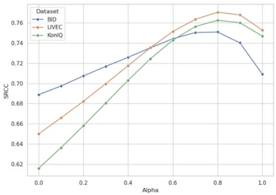

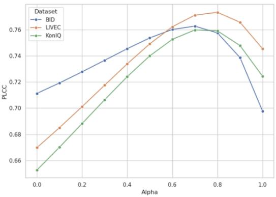  
Figure 4: Sensitivity analysis of the fusion factor α on three authentic datasets. The results show a consistent concave trend with an optimal peak around $\alpha = 0 . 8 \mathrm { . }$ , demonstrating that the rational memory consensus serves as the primary calibration source while affective intuition provides essential perceptual regularization. The performance degradation at both extremes validates that the synergy between intuition and memory is superior to relying on either component in isolation.

## D More Ablation Experiments

## D.1 Ablation Study on Scale of Pre-trained Models

We examine the sensitivity of HIFC to different pre-trained CLIP backbones, including convolutional architectures (RN50) and Vision Transformers of varying scales (ViT-B/32, ViT-B/16, and ViT-L/14). The comparative results are reported in Table 11. HIFC maintains strong and stable performance across all tested backbones, demonstrating its robustness without requiring architecture-specific adjustments. Notably, the performance does not increase monotonically with model capacity. Although ViT-B/32 achieves the best overall results, the substantially larger ViT-L/14 shows a clear performance drop. We attribute this trend to the trade-off between semantic abstraction and distortion sensitivity. Larger models offer stronger semantic representation ability but tend to overemphasize high-level content semantics, potentially suppressing subtle low-level artifacts that are critical for image quality assessment. These findings suggest that, within our hierarchical retrieval framework, a medium-scale backbone such as ViT-B/32 strikes the most effective balance, preserving distortion-relevant details while maintaining a reliable semantic prior for memory consensus.

Table 11: Performance comparison of backbones at different scales.
<table><tr><td rowspan="2">Models</td><td colspan="2">LIVEC</td><td colspan="2">KONIQ</td></tr><tr><td>SRCC</td><td>PLCC</td><td>SRCC</td><td>PLCC</td></tr><tr><td>RN50</td><td>0.700</td><td>0.705</td><td>0.693</td><td>0.707</td></tr><tr><td>B-32</td><td>0.778</td><td>0.780</td><td>0.765</td><td>0.759</td></tr><tr><td>B-16</td><td>0.718</td><td>0.750</td><td>0.770</td><td>0.756</td></tr><tr><td>L-14</td><td>0.710</td><td>0.722</td><td>0.731</td><td>0.750</td></tr></table>

## D.2 Ablation Studies on Integration Coefficient α

We perform a sensitivity analysis on the fusion factor α, which controls the balance between the affective intuition score $( S _ { \mathrm { i n t } } )$ and the rational memory consensus $( S _ { \mathrm { m e m } } )$ . The SRCC and PLCC results on three authentic datasets are presented in Fig. 4.

As shown in the figure, all datasets exhibit a consistent concave performance trend, with the optimal point located around $\alpha = 0 . 8 .$ . This observation provides two important insights. The peak occurring at a relatively high α indicates that the hierarchical retrieval and fuzzy consensus mechanism $( S _ { \mathrm { m e m } } )$ serves as the primary and most reliable source of quality calibration for unseen authentic distortions.

The noticeable performance drop at $\alpha = 1 . 0 { \it \Omega } _ { \mathrm { { i } } }$ , where only $S _ { \mathrm { m e m } }$ is used, reveals that zero-shot affective intuition plays a crucial regularization role. It acts as a perceptual anchor that mitigates potential bias introduced by outlier memory neighbors.

The significant degradation at both extremes (α = 0 and $\alpha = 1 )$ further validates the central philosophy of HIFC: robust blind quality assessment emerges from the synergy between rapid intuition and deliberative memory, rather than relying exclusively on either component.

## D.3 Additional Hyper-parameter Analysis

Analogous to Retrieval-Augmented Generation (RAG) frameworks [25, 2, 11], HIFC demonstrates strong adaptability to diverse tasks through lightweight hyperparameter calibration. While the main paper reports results under a unified parameter setting, we further explore task-specific optimization of $N _ { \mathrm { d i s t } }$ (number of distortion prototypes) and k (Top-k retrieval depth). The refined results are summarized in Table 12. After tuning hyperparameters for individual datasets, HIFC achieves further performance improvements. For example, the SRCC on LIVEC and BID increases to 0.785 and 0.764, respectively. This plug-and-play flexibility suggests that HIFC can function as a foundation model for IQA, where the internal memory consensus can be adaptively aligned with the distortion distribution of a target domain.

We also analyze the relationship between these hyperparameters and the statistical properties of the distortion-aware cosine similarity manifold. As shown in the Mean and Std columns of Table 12, two consistent trends emerge:

Diversity Scaling $( N _ { \mathrm { d i s t } } ~ \propto ~ \mathrm { S t d } )$ : The standard deviation of the distortion-centroid similarity is positively correlated with $N _ { \mathrm { d i s t } }$ . Increasing the number of distortion prototypes enlarges the diversity of the alignment space, enabling more fine-grained discrimination of complex artifacts.

Confidence Scaling (k ∝ Mean): The retrieval depth k shows a positive correlation with the mean similarity score. A larger retrieval pool forms a denser consensus manifold within the memory bank, improving the stability and confidence of the final quality estimation.

These observations indicate that the effectiveness of HIFC is not merely the result of empirical parameter selection, but is rooted in its ability to preserve a statistically stable and interpretable alignment manifold across unseen domains.

Table 12: Hyperparameter analysis and statistical correlation. The results reveal that $N _ { d i s t }$ scales with similarity variance to enhance distortion diversity, while k correlates with mean similarity to improve consensus confidence.
<table><tr><td>Dataset</td><td> $N _ { d i s t }$ </td><td>TOPK</td><td>Mean</td><td>Std</td><td>PLCC</td><td>SRCC</td></tr><tr><td>KONIQ</td><td>4</td><td>400</td><td>0.893</td><td>0.006</td><td>0.783</td><td>0.774</td></tr><tr><td>LIVEC</td><td>12</td><td>400</td><td>0.892</td><td>0.008</td><td>0.784</td><td>0.785</td></tr><tr><td>BID</td><td>16</td><td>700</td><td>0.903</td><td>0.009</td><td>0.758</td><td>0.764</td></tr><tr><td>PIPAL</td><td>4</td><td>500</td><td>0.900</td><td>0.006</td><td>0.508</td><td>0.513</td></tr></table>

## E Additional Qualitative Analysis

## E.1 Additional gMAD experiment with CLIP-IQA

To intuitively evaluate the perceptual alignment and robustness of our proposed framework, we conduct a group Maximum Differentiation (gMAD) competition [35] between HIFC and CLIP-IQA [49]. Fig. 5 illustrates the gMAD pairs generated by the competition. In the right column, where HIFC acts as the defender and CLIP-IQA as the attacker, the paired images exhibit highly similar visual quality levels despite containing different content and degradation types. This indicates that HIFC successfully resists the attack from CLIP-IQA, maintaining stable and accurate predictions. Conversely, when the roles are reversed and CLIP-IQA acts as the defender, HIFC consistently identifies the severe failure cases of CLIP-IQA. The gMAD experiment provides an intuitive proof that the capabilities of HIFC do not merely stem from the powerful visual language Encoder. This

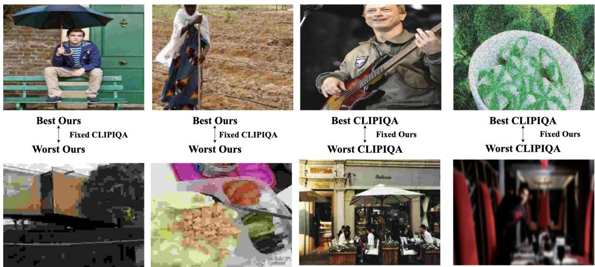  
Figure 5: Representative gMAD pairs between HIFC and CLIP-IQA on synthetic distortions.

## E.2 Additional gMAD experiment with DGQA

To intuitively evaluate the perceptual alignment and robustness of our proposed framework, we conduct a group Maximum Differentiation (gMAD) competition [35] between HIFC and DGQA. Fig. 6 illustrates the gMAD pairs generated by the competition. In the right column, where HIFC acts as the defender and DGQA as the attacker, the paired images exhibit highly similar visual quality levels despite containing different content and degradation types. This indicates that HIFC successfully resists the attack from DGQA, maintaining stable and accurate predictions. Conversely, when the roles are reversed and DGQA acts as the defender (left column), HIFC consistently identifies the severe failure cases of DGQA which display substantial differences in quality according to human perception, pairing relatively clear, high-quality scenes with heavily distorted, blocky artifacts, yet DGQA incorrectly rates them as having the same quality. These qualitative findings strongly align with our quantitative results, suggesting that by leveraging the synergy of affective intuition and memory consensus, HIFC generalizes significantly better to complex, unseen distortions and aligns more closely with the human visual system than heavily optimized training-based models.

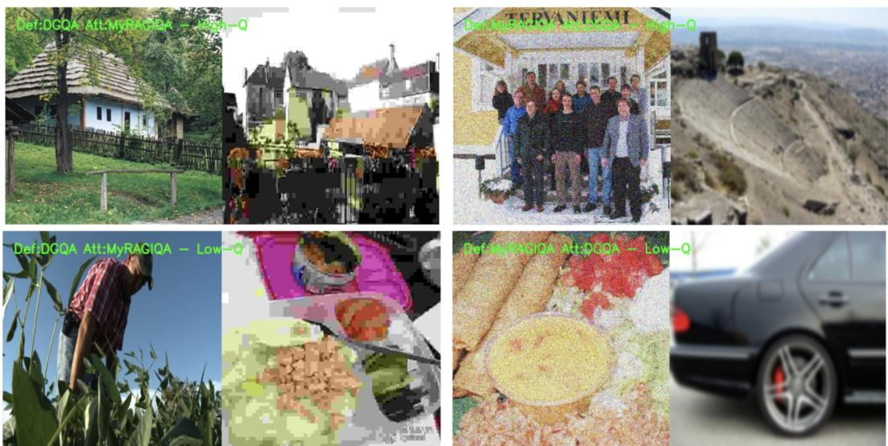  
Figure 6: Representative gMAD pairs between HIFC and DGQA.

## E.3 Additional TSNE Analysis

To provide a deeper insight into the structure of the learned representation and the reliability of our retrieval mechanism, we visualize the feature manifold of the reference bank and query images using t-SNE [48] in Fig. 7.

Distortion-Discriminative Embedding (Left). In the left panel, the reference bank is colored by distortion types, while query images (represented by stars) are projected into the same space. The clear, localized clustering of different colors demonstrates that our feature space refined by Distortion Alignment (DA) effectively suppresses semantic interference and organizes images based on their underlying degradation characteristics. The query stars are correctly embedded within the clusters of relevant reference degradations, providing a solid foundation for subsequent hierarchical retrieval.

Quality-Consistent Manifold (Right). The right panel colors the reference bank by ground-truth MOS and the query images by their Consensus Predictions. We observe a globally continuous color gradient across the manifold, transitioning smoothly from low-quality (warm colors) to high-quality (cool colors) regions. Crucially, the predicted scores of the query stars are highly consistent with the colors of their immediate reference neighbors. This visual evidence validates the efficacy of the Quality-Centroid Consensus (QCC): the "fuzzy" consensus is not a simple average of random samples, but a localized calibration within a perceptually structured manifold. By retrieving and aggregating from this consistent space, HIFC effectively neutralizes idiosyncratic noise and achieves robust alignment with human perception.

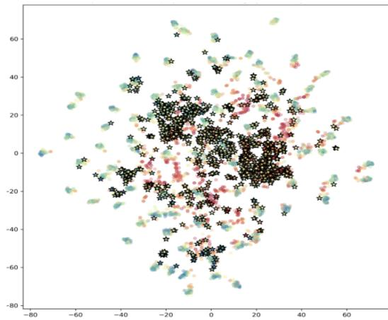

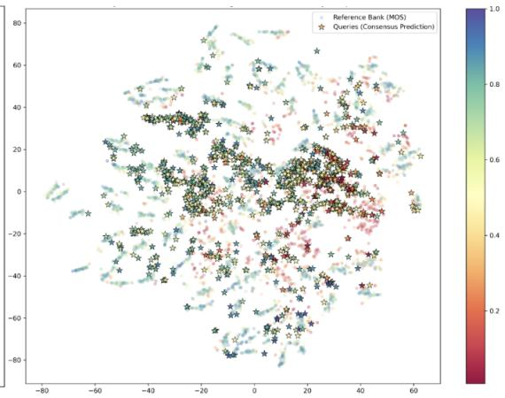  
Figure 7: t-SNE visualization of the feature manifold for the reference bank and query images. The left panel shows that the distortion-aware feature space effectively suppresses semantic interference to form distinct degradation clusters, where query images (stars) are accurately embedded among relevant prototypes. The right panel displays a globally continuous quality gradient, confirming that the Quality-Centroid Consensus achieves robust perceptual alignment by performing localized calibration within a structured and consistent manifold.

## E.4 Additional Visualization Analysis

To further illustrate the stability of the Fuzzy Quality Consensus, we visualize the top-5 neighbors that most strongly support the retrieved quality centroid for three representative queries in Fig. 8. These neighbors are selected based on their proximity to the final aggregated quality score within the memory manifold. Across all three examples, the retrieved neighbors demonstrate strong perceptual consistency with their corresponding queries. In the left-most group, although the semantic categories range from ships to urban parks, the neighbors share highly similar authentic degradation patterns, such as subtle motion blur and lighting artifacts. This observation confirms that the proposed Semantic-Distortion Retrieval (SDR) mechanism effectively emphasizes distortion characteristics, while leveraging semantic similarity as a stable initialization prior. The visualization further shows that the quality centroid is not a simple statistical average of arbitrary samples, but a perceptual anchor supported by a coherent cluster of neighbors. Even when noticeable semantic gaps exist—for example, the baby query in the middle group being matched with animal or architectural scenes—the overall quality manifold remains well aligned.

These qualitative results reinforce the central philosophy of HIFC: by forming consensus over a retrieved cluster rather than relying on a single nearest neighbor, the framework mitigates contentspecific bias and more reliably captures the underlying distortion essence of the image.

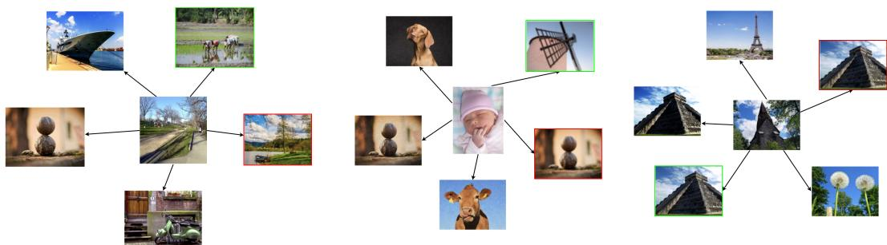  
Figure 8: Qualitative visualization of the top-5 neighbors supporting the Fuzzy Quality Consensus.

## E.5 Visualization Analysis of Scrambled Jigsaw Puzzle

We present both qualitative and quantitative comparisons of different preprocessing strategies—Resize, Grid-based Sampling (GMS) [53], and the proposed Scrambled Jigsaw Puzzle (SJP)—to evaluate their effectiveness in isolating distortion-related features. As shown in the left panel of Fig. 9, both Resize and GMS largely preserve the recognizable global structure of the scene (e.g., a woman or a tower). In contrast, SJP breaks the semantic layout into a stochastic arrangement of local patches, effectively disrupting high-level contextual cues. This scrambling mechanism prevents the backbone from relying on object recognition or scene semantics, thereby encouraging the model to concentrate on low-level textural patterns. Despite removing global structure, SJP maintains local degradation characteristics within each patch. Blurriness, noise, and compression artifacts remain clearly observable at the patch level. This behavior is quantitatively supported by the Sensitivity Ratio analysis shown on the right: SJP achieves a substantially higher distortion-to-semantic sensitivity ratio (1.10) compared to Resize and GMS (0.92–0.95), indicating stronger emphasis on degradation features. The raw CLIP response further demonstrates that SJP suppresses semantic similarity (blue bars) while preserving or enhancing distortion-related responses (orange bars), resulting in a cleaner distortion-aware embedding.

These results confirm that SJP functions as an effective semantic filter, enabling the Hierarchical Memory Consensus to retrieve neighbors based primarily on perceptual quality rather than semantic content bias.

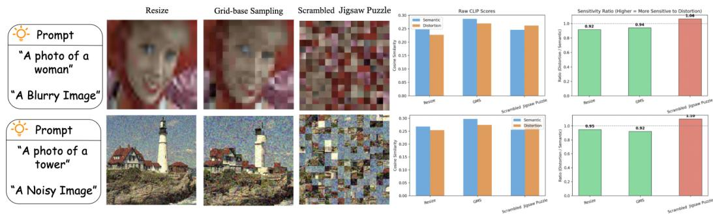  
Figure 9: Qualitative and quantitative comparison of different preprocessing strategies.

## F Additional Experiments on Robustness

## F.1 Experiments on Effectiveness Analysis

To evaluate the practical utility of our training-free framework, we compare the inference time of HIFC against several representative IQA methods, including both training-based [59, 47, 34] and training-free models [49]. The results, measured on a single NVIDIA RTX 4090 GPU, are summarized in Table 13 and 14. Despite incorporating a hierarchical memory retrieval path, HIFC maintains a high inference speed of 14 ms per image. This is significantly faster than complex training-based models like StyleAM (128.6 ms) and comparable to the lightweight CLIP-IQA (13 ms). Such efficiency demonstrates that our dual-path architecture, combining rapid intuition with structured memory retrieval, does not introduce significant computational overhead. While some training-based methods achieve similar speeds, their performance lags far behind our train-free results. HIFC achieves the best balance in the efficiency-accuracy manifold, proving that a well-designed training-free paradigm can outperform traditional supervised models in both robustness and practical latency.

Table 13: Comparison of Inference/Training costs and performance.
<table><tr><td>Method</td><td>Train</td><td>Inference Time(ms)</td><td>SRCC</td><td>PLCC</td></tr><tr><td>HyperIQA</td><td>√</td><td> $1 6 \pm 3$ </td><td>0.490</td><td>0.487</td></tr><tr><td>DBCNN</td><td>√</td><td> $2 5 \pm 3$ </td><td>0.572</td><td>0.589</td></tr><tr><td>CLIP-IQA</td><td>X</td><td> $1 3 \pm 2$ </td><td>0.612</td><td>0.594</td></tr><tr><td>StyleAM</td><td>√</td><td> $1 2 8 . 6 \pm 3 $ </td><td>0.584</td><td>0.561</td></tr><tr><td>Ours</td><td>X</td><td> $1 4 \pm 4$ </td><td>0.778</td><td>0.780</td></tr></table>

Table 14: Efficiency and complexity analysis of our method.
<table><tr><td>Metric</td><td>Value</td><td>Description</td></tr><tr><td>Backbone</td><td>CLIP (ViT-B/32)</td><td>Frozen, no training required</td></tr><tr><td>Parameters</td><td>88 MB</td><td>Same as CLIP</td></tr><tr><td>FLOPs</td><td>~32.1G ×2</td><td>Dual-branch (parallel)</td></tr><tr><td>GPU Memory</td><td>1118 MB</td><td>During inference</td></tr><tr><td>Gallery Size</td><td>10,125</td><td>KADID-10k</td></tr><tr><td>Gallery Memory</td><td>39 MB</td><td>Stored features (linear in N)</td></tr><tr><td>Build Time</td><td>~3 min</td><td>27 it/s (offline, linear in N)</td></tr><tr><td>Inference Time</td><td>~14 ms</td><td>Comparable to CLIP</td></tr><tr><td>Retrieval Time</td><td>0.407 ms</td><td>&lt;3% of total runtime</td></tr><tr><td>Complexity (Retrieval) Scalability</td><td>O(N·D) Linear in N</td><td>FAISS inner-product search Negligible overhead in practice</td></tr></table>

## F.2 Performance on the Authentic-to-Authentic Setting

We further evaluate HIFC in a purely authentic Authentic-to-Authentic cross-domain setting, where the memory bank is built from one authentic dataset (e.g., LIVEC) and tested on another (e.g., KONIQ), without synthetic distortion labels or explicit distortion alignment. As shown in Table 15 , even under this constraint, HIFC achieves a strong SRCC of 0.755, outperforming existing SOTA BIQA methods and demonstrating that hierarchical retrieval with fuzzy consensus can capture shared perceptual regularities across authentic domains. Although a gap remains compared to fully supervised models such as TReS [15] in certain scenarios, this is mainly due to their domain-specific optimization via back-propagation and the residual semantic–distortion entanglement that arises when no explicit distortion supervision is available. Overall, the results confirm the robustness and practicality of the proposed training-free paradigm in real-world environments.

Table 15: Performance evaluation of HIFC in the Authentic-to-Authentic cross-domain setting. The results demonstrate that HIFC achieves competitive performance compared with existing training methods by achieving high SRCC without any domain-specific training or synthetic supervision.
<table><tr><td rowspan="2">Reference</td><td rowspan="2">Method</td><td colspan="2">LIVEC</td><td colspan="2">KONIQ</td></tr><tr><td>SRCC</td><td>PLCC</td><td>SRCC</td><td>PLCC</td></tr><tr><td>NONE</td><td>CLIP-IQA</td><td>0.612</td><td>0.594</td><td>0.695</td><td>0.717</td></tr><tr><td rowspan="3">LIVEC</td><td>TReS</td><td>=</td><td>一</td><td>0.733</td><td>0.739</td></tr><tr><td>DBCNN</td><td>一</td><td>一</td><td>0.754</td><td>0.759</td></tr><tr><td>Ours</td><td>-</td><td>一</td><td>0.755</td><td>0.765</td></tr><tr><td rowspan="3">KONIQ</td><td>TReS</td><td>0.768</td><td>0.775</td><td>-</td><td>一</td></tr><tr><td>DBCNN</td><td>0.755</td><td>0.769</td><td></td><td></td></tr><tr><td>Ours</td><td>0.739</td><td>0.765</td><td></td><td></td></tr></table>

## F.3 Performance on In-domain Setting

We further evaluate HIFC in an In-domain setting, where the reference bank and query images are sampled from the same dataset with varying ratios. As shown in Table 16, HIFC demonstrates exceptional stability across different datasets (KADID, KONIQ, and SPAQ [12]). Specifically, we observe that for synthetic datasets like KADID, a higher proportion of reference images (e.g., 9:1 ratio) yields the best performance (0.841 SRCC), as it provides a denser sampling of specific distortion levels. Conversely, for authentic datasets like KONIQ and SPAQ, the performance remains high and even improves as the query set. This suggests that HIFC effectively leverages the internal consistency of authentic distributions even with a relatively sparse reference bank. These results confirm that while HIFC is designed for zero-shot generalization, it can also serve as a highly effective in-domain quality estimator, accurately capturing the perceptual manifold of a specific target domain.

Table 16: Performance evaluation of HIFC in the In-domain setting across various sampling ratios.
<table><tr><td rowspan="2">Ratio</td><td colspan="2">KADID</td><td colspan="2">KONIQ</td><td colspan="2">SPAQ</td></tr><tr><td>SRCC</td><td>PLCC</td><td>SRCC</td><td>PLCC</td><td>SRCC</td><td>PLCC</td></tr><tr><td>9:1</td><td>0.841</td><td>0.852</td><td>0.822</td><td>0.836</td><td>0.880</td><td>0.882</td></tr><tr><td>8:2</td><td>0.831</td><td>0.836</td><td>0.826</td><td>0.839</td><td>0.882</td><td>0.883</td></tr><tr><td>5:5</td><td>0.809</td><td>0.813</td><td>0.825</td><td>0.829</td><td>0.873</td><td>0.873</td></tr><tr><td>2:8</td><td>0.778</td><td>0.786</td><td>0.809</td><td>0.815</td><td>0.860</td><td>0.861</td></tr><tr><td>1:9</td><td>0.743</td><td>0.758</td><td>0.801</td><td>0.803</td><td>0.847</td><td>0.843</td></tr></table>

## F.4 Analysis of the Accuracy of the Top-5 Distortion

The Top-5 retrieved distortion types (Table 17) provide strong evidence for the perceptual reliability of the Distortion Alignment (DA) module across diverse authentic datasets. For LIVEC and KONIQ, which contain images captured by various mobile devices, the frequent appearance of JPEG 2000, Motion Blur, and Gaussian Blur among the top-ranked distortions aligns well with common artifacts in consumer photography, such as compression effects and camera shake. In the BID dataset, which primarily focuses on blur, the DA module accurately identifies Motion Blur and Lens Blur as dominant factors. For PIPAL, which contains complex GAN-based and traditional distortions, the frequent retrieval of Motion Blur and JPEG 2000 indicates that the module effectively decomposes complex artifacts into perceptually similar fundamental degradation types. The substantial overlap of top-ranked distortion types across datasets (e.g., Motion Blur consistently appearing within the Top-2) confirms that the distorted-memory bank captures shared perceptual structures of authentic degradations. Even without ground-truth distortion labels for real images, the DA module successfully projects them onto a structured synthetic distortion manifold, ensuring that subsequent hierarchical retrieval is grounded in objective degradation characteristics rather than semantic bias.

Table 17: Analysis of Top-5 retrieved distortion types across diverse datasets. The alignment results demonstrate that the DA module accurately maps complex unknown degradations to perceptually similar synthetic prototypes.
<table><tr><td>Dataset</td><td>Top-1</td><td>Top-2</td><td>Top-3</td><td>Top-4</td><td>Top-5</td></tr><tr><td>LIVEC KONIQ BID PIPAL</td><td>JPEG 2000 Motion Blur Denoise</td><td>Motion Blur Gaussian Blur Motion Blur</td><td>JPEG JPEG 2000 Gaussian Blur</td><td>Darken Denoise Lens Blur</td><td>Pixelate Color Diffusion JPEG 2000</td></tr></table>

## G Additional Cross-Domain and Few-Shot Generalization Experiments

We further evaluate the generalization capability of HIFC in several challenging cross-domain scenarios that go beyond the settings covered in the main paper. In the first experiment, we assess performance on datasets exhibiting diverse and non-traditional distortion characteristics, including AI-generated content, underwater and high-resolution datasets. As summarized in Table 18, HIFC, using only KADID-10k as the reference gallery, is compared against several training-based methods that were fully supervised on KADID-10k. Despite being entirely training-free, HIFC achieves the best PLCC on AGIQA-3K, AGIQA-20K and SPAQ, and competitive performance on SAUD. These results demonstrate the strong zero-shot transferability of the quality-trace prototypes extracted by the hierarchical memory consensus, even when the target domain contains distortions significantly different from those in the reference set.

A second experiment extends the evaluation to aesthetic quality assessment, where the notion of quality is heavily influenced by subjective and cultural factors. Table 19 reports the SRCC and PLCC on the AVA and PARA datasets, again using the same KADID-10k reference bank. HIFC surpasses dedicated aesthetic assessment methods such as NIMA and DeQA-Score on the PARA benchmark, while maintaining reasonable performance on AVA. The pronounced advantage on PARA suggests that the fuzzy consensus mechanism can, to a certain extent, capture the low-level perceptual regularities that generalize across both quality and aesthetic domains, despite the absence of artistic priors in the reference bank.

Finally, we examine the few-shot adaptability of HIFC by varying the source dataset used to build the reference bank, and compare it with the training-based PromptIQA method [9] evaluated on KonIQ 10k. As shown in Table 20, when LIVE, CSIQ, or KADID-10k serve as the sole reference source, HIFC consistently outperforms PromptIQA, which requires end-to-end training on the corresponding source domain. These results highlight that the proposed framework can function as a robust few-shot quality estimator: by simply substituting the reference gallery with a small set of annotated examples from a related domain, HIFC achieves strong alignment with target perception without any gradient updates, offering a practical plug-and-play solution for real-world IQA deployment.

Table 18: Cross-domain generalization performance (PLCC). Other models are trained on KADID and evaluated on underwater/AIGC/high-resolution datasets.
<table><tr><td>Method</td><td>AGIQA-3K</td><td>AGIQA-20K</td><td>SAUD</td><td>SPAQ</td></tr><tr><td>BRISQUE</td><td>0.178</td><td>0.118</td><td>0.216</td><td>0.314</td></tr><tr><td>DBCNN</td><td>0.324</td><td>0.284</td><td>0.418</td><td>0.559</td></tr><tr><td>HyperIQA</td><td>0.748</td><td>0.516</td><td>0.497</td><td>0.688</td></tr><tr><td>MetaIQA</td><td>0.468</td><td>0.348</td><td>0.586</td><td>0.646</td></tr><tr><td>UCDA</td><td>0.681</td><td>0.255</td><td>0.627</td><td>0.699</td></tr><tr><td>DGQA</td><td>0.577</td><td>0.498</td><td>0.651</td><td>0.705</td></tr><tr><td>Ours(Ref on KADID-10k)</td><td>0.759</td><td>0.671</td><td>0.539</td><td>0.830</td></tr></table>

## G.1 Why Stacking for the Semantic Branch?

The semantic branch is designed to retain content and scene context, complementing the distortion branch, which deliberately disrupts global spatial topology. Direct resizing can alter aspect ratios and attenuate local details, while center cropping can omit peripheral objects and contextual information.

Table 19: Cross-domain generalization performance (SRCC/PLCC). Models are trained on KADID and evaluated on aesthetic datasets.
<table><tr><td>Method</td><td>AVA</td><td>PARA</td></tr><tr><td>NIMA</td><td>0.612/0.636</td><td>0.571/0.587</td></tr><tr><td>BRISQUE</td><td>0.031/0.036</td><td>0.078/0.129</td></tr><tr><td>Q-Align</td><td>0.521/0.541</td><td>0.626/0.618</td></tr><tr><td>DeQA-Score</td><td>0.572/0.589</td><td>0.680/0.703</td></tr><tr><td>DGQA</td><td>-1-</td><td>0.322/0.351</td></tr><tr><td>CLIP-IQA</td><td>0.320/0.317</td><td>0.535/0.566</td></tr><tr><td>Ours(Ref on KADID-10k)</td><td>0.457/0.468</td><td>0.684/0.713</td></tr></table>

Table 20: Performance comparison on the KonIQ-10k dataset when training/referencing on three different datasets from synthetic to real. The best results are highlighted in bold.
<table><tr><td rowspan="2">Train/Reference</td><td rowspan="2">Method</td><td rowspan="2">Train</td><td colspan="2">KonIQ-10k</td></tr><tr><td>SRCC</td><td>PLCC</td></tr><tr><td rowspan="2">LIVE</td><td>PromptIQA</td><td>√</td><td>0.660</td><td>0.698</td></tr><tr><td>Ours</td><td>X</td><td>0.696</td><td>0.707</td></tr><tr><td rowspan="2">CSIQ</td><td>PromptIQA</td><td>√</td><td>0.619</td><td>0.629</td></tr><tr><td>Ours</td><td>X</td><td>0.693</td><td>0.714</td></tr><tr><td rowspan="2">KADID-10k</td><td>PromptIQA</td><td>√</td><td>0.577</td><td>0.595</td></tr><tr><td>Ours</td><td>X</td><td>0.765</td><td>0.759</td></tr></table>

Sliding-window stacking aggregates content sampled across the image and reduces reliance on a single crop.

The controlled comparison in Table 21 fixes the backbone, gallery, distortion branch, retrieval, and fusion. Stacking achieves the highest prediction correlations among the evaluated alternatives. Its measured preprocessing latency is approximately 1.09 ms for $5 1 2 \times 5 1 2$ inputs on an RTX 4090, the lowest among the tested configurations. This timing concerns preprocessing only, rather than total inference latency.

Table 21: Controlled semantic preprocessing comparison. Prediction results are SRCC/PLCC. Latency measures sampling/preprocessing for $\bar { 5 } 1 2 \times \bar { 5 } 1 2$ images on an RTX 4090. Multiple patches are batched for inference. Stacking is implemented with torch.unfold; the other alternatives use transform-library implementations.
<table><tr><td>Semantic input</td><td>LIVEC</td><td>KonIQ-10k</td><td>Preprocessing (ms)</td></tr><tr><td>Direct resize</td><td>0.692/0.720</td><td>0.682/0.687</td><td>3.439</td></tr><tr><td>Letterbox resize</td><td>0.712/0.733</td><td>0.671/0.675</td><td>3.483</td></tr><tr><td>Center crop</td><td>0.728/0.745</td><td>0.707/0.717</td><td>3.488</td></tr><tr><td>Five random crops, averaged</td><td>0.726/0.742</td><td>0.716/0.719</td><td>2.026</td></tr><tr><td>Five-crop average</td><td>0.773/0.778</td><td>0.751/0.752</td><td>1.786</td></tr><tr><td>Proposed stacking</td><td>0.778/0.780</td><td>0.765/0.759</td><td>1.086</td></tr></table>

## H Analysis on Failure Case

While the HIFC framework demonstrates strong robustness across diverse benchmarks, its performance depends critically on the reliability of the retrieved memory manifold. In certain edge cases, the retrieval process may be influenced by dominant visual attributes that are weakly correlated with actual degradation. Fig. 10 presents three representative failure examples.

Case 1: Global Color and Illumination Bias (Top Row). In the first example (GT: 0.844, Pred: 0.413), the query is a high-quality indoor image. However, the retrieved references exhibit highly similar global color tones and illumination patterns, such as bright white backgrounds and strong contrast lighting. When global color statistics become overly dominant, they can overshadow subtle textural degradation cues. As a result, the model retrieves a cluster of images with comparable lighting conditions but substantially lower perceptual quality (MOS ≈ 0.425), leading to an underestimated consensus score.

Case 2 & 3: Semantic and Compositional Override (Middle and Bottom Rows). The second and third examples illustrate the issue of semantic override. In the middle row (a macro photograph of a rose), the retrieval favors images with similar composition, such as centrally framed subjects with shallow depth-of-field backgrounds. In the bottom row, a toy frog query retrieves another toy frog as its nearest neighbor. Despite the semantic-distortion decoupling introduced by the DA and SDR modules, extreme semantic or compositional similarities can still dominate the feature distance metric. Consequently, the memory bank prioritizes object category or photographic style over degradation characteristics, resulting in a biased quality centroid.

Insights. These cases highlight an important limitation: although the training-free, zero-shot paradigm generally aligns well with human perception, it may struggle when highly salient semantics or extreme color distributions dominate the embedding space, especially if such patterns are sparsely represented in the reference bank. Mitigating this residual semantic entanglement in a fully unsupervised setting remains an open research challenge.

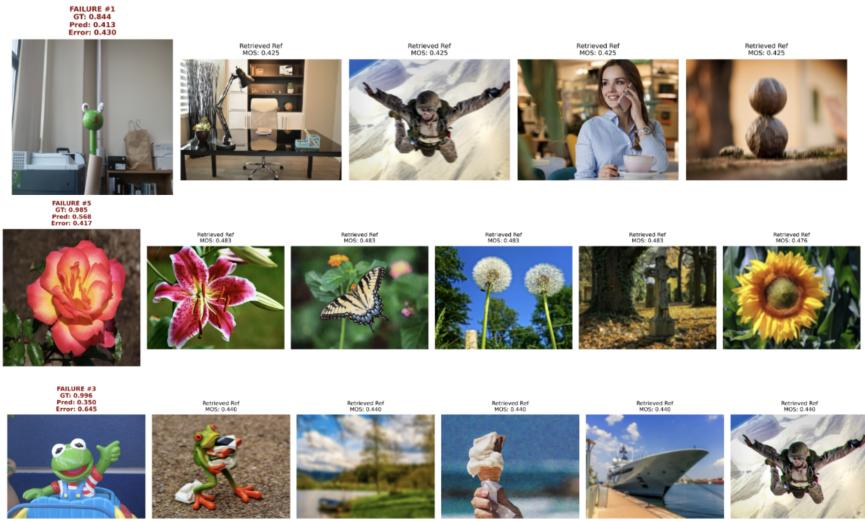  
Figure 10: Visual analysis of failure cases. The HIFC framework occasionally produces biased estimations when encountering images with dominant semantic aesthetics (e.g., artistic bokeh) or extreme lighting conditions, which the distortion-related features fail to fully decouple from physical degradations.

## I Limitations and Future Work

While HIFC achieves competitive train-free cross-domain IQA performance, several limitations remain. As revealed in the failure analysis, extreme semantic structures or dominant color and illumination patterns can occasionally bias retrieval. Scrambled jigsaw preprocessing disrupts global spatial topology but does not fully eliminate these cues. As shown in Table 22, grayscale and luminance-only preprocessing modestly improve SRCC on the color/illumination subset of TID2013, but reduce overall prediction performance. This suggests that suppressing chromatic information can alleviate certain biases while also discarding genuine quality cues, such as color casts, chromatic noise, and saturation artifacts. We therefore retain RGB preprocessing and identify adaptive RGB– luminance representations, together with more principled content–distortion decoupling, as promising directions for strengthening distortion-focused retrieval.

Table 22: Effect of distortion-branch preprocessing on TID2013. SJP denotes scrambled jigsaw puzzle preprocessing.
<table><tr><td>Distortion input</td><td>Overall SRCC</td><td>Overall PLCC</td><td>Color/illumination SRCC</td></tr><tr><td>RGB SJP</td><td>0.6499</td><td>0.6569</td><td>0.3759</td></tr><tr><td>Grayscale SJP</td><td>0.6405</td><td>0.6442</td><td>0.3932</td></tr><tr><td>Luminance-only SJP</td><td>0.6432</td><td>0.6483</td><td>0.3997</td></tr></table>

Although the main experiments use a unified hyperparameter configuration across target domains, parameters such as $N _ { \mathrm { d i s t } }$ and k are still manually specified. Developing a self-adaptive mechanism that responds to the statistical properties of the distortion manifold could further enhance the plug-and-play capability of the framework and reduce human intervention.

We also plan to investigate advanced representation learning strategies, such as contrastive learning with quality-preserving augmentations, to further refine the embedding space. Such approaches could improve the separation between semantic content and degradation characteristics, strengthening the alignment between memory retrieval and perceptual quality cues.

Algorithm 1: HIFC Inference   
Input: Query image $I _ { q } ,$ reference bank G, CLIP model Φ   
Output: Final quality score $\hat { Q }$   
# Hyperparameters N , K, α   
def HIFC\_Inference(Iq, G, Φ):   
# 1. Feature Extraction & Decoupling   
q\_sem = Φ.encode\_image(extract\_patches(Iq)).mean(0)   
q\_dis = Φ.encode\_image(SJP\_transform(Iq))   
# 2. Level-1: Distortion Alignment (DA)   
dist\_centroids = G.groupby(′dist\_type′).f\_dis.mean()   
sim\_dist = cosine\_similarity(q\_dis, dist\_centroids)   
top\_dist = sim\_dist.topk(N ).indices   
G∗ = G[G.dist\_type ∈ top\_dist]   
# 3. Level-2: Semantic-Guided Retrieval (SGR)   
candidates = search\_index(q\_sem, G∗.f\_sem, top\_n = 1000)   
# 4. Level-3: Memory Quality-Centroid Consensus (QCC)   
local\_sim = cosine\_similarity(q\_dis, G∗[candidates].f\_dis)   
neighbors = local\_sim.topk(K).indices   
score\_mem = G∗[neighbors].MOS.mean()   
# 5. Zero-Shot Intuition (ZSI)   
score\_int = Φ.compute\_text\_alignment(q\_sem, [”good”, ”bad”])   
# 6. Final Fusion   
Qˆ = α · score\_mem + (1 − α) · score\_int   
return Qˆ

## K Comparison with Additional VLM-based Methods.

We extend the comparison to recent VLM-based IQA methods, including CLIP-IQA, MACLIP, LIQE, Q-Align, DeQA-Score, Qwen2.5-VL-7B, and Q-insight. As shown in Table 23, HIFC-IQA achieves the highest SRCC of 0.778 on LIVEC and maintains competitive performance on KonIQ-10k and BID. Q-insight achieves the best correlations on KonIQ-10k and BID, while HIFC-IQA offers a lightweight alternative without IQA-specific parameter training. We further evaluate these methods on four additional datasets covering AI-generated image quality, aesthetic assessment, and image restoration. HIFC-IQA achieves the highest SRCC on AGIQA-3K (0.759), PARA (0.684), and PIPAL (0.507), while DeQA-Score achieves the best result on AVA. These results demonstrate the generalization capability of HIFC-IQA across diverse perceptual quality domains, highlighting the effectiveness of combining reference-based quality consensus with zero-shot perceptual priors.

Table 23: Comparison with additional VLM-based IQA methods across diverse perceptual quality datasets. KADID-10k serves as the IQA training source or reference gallery. Train indicates whether IQA-specific parameter training is required. SRCC and PLCC are reported for LIVEC, KonIQ-10k, and BID, while SRCC is reported for the remaining datasets.
<table><tr><td rowspan="2">Methods</td><td rowspan="2">Train</td><td colspan="2">LIVEC</td><td colspan="2">KonIQ-10k</td><td colspan="2">BID</td><td colspan="4">Additional Domains (SRCC)</td></tr><tr><td>SRCC</td><td>PLCC</td><td>SRCC</td><td>PLCC</td><td>SRCC</td><td>PLCC</td><td>AGIQA-3K</td><td>AVA</td><td>PARA</td><td>PIPAL</td></tr><tr><td>MACLIP</td><td>No</td><td>0.679</td><td>0.703</td><td>0.738</td><td>0.738</td><td>0.592</td><td>0.547</td><td>0.753</td><td>0.298</td><td>0.504</td><td>0.379</td></tr><tr><td>LIQE</td><td>Yes</td><td>0.677</td><td>0.680</td><td>0.719</td><td>0.726</td><td>0.684</td><td>0.652</td><td>0.653</td><td>0.429</td><td>0.483</td><td>0.480</td></tr><tr><td>Q-Align [54]</td><td>Yes</td><td>0.702</td><td>0.744</td><td>0.668</td><td>0.665</td><td>0.576</td><td>0.651</td><td>0.733</td><td>0.521</td><td>0.626</td><td>0.403</td></tr><tr><td>DeQA-Score</td><td>Yes</td><td>0.743</td><td>0.775</td><td>0.677</td><td>0.703</td><td>0.702</td><td>0.743</td><td>0.745</td><td>0.572</td><td>0.680</td><td>0.472</td></tr><tr><td>Qwen2.5-VL-7B</td><td>Yes</td><td>0.761</td><td>0.760</td><td>0.754</td><td>0.810</td><td>0.711</td><td>0.725</td><td>一</td><td>一</td><td>一</td><td>一</td></tr><tr><td>Q-insight</td><td>Yes</td><td>0.761</td><td>0.795</td><td>0.806</td><td>0.829</td><td>0.784</td><td>0.796</td><td>一</td><td>一</td><td>一</td><td>一</td></tr><tr><td>HIFC-IQA</td><td>No</td><td>0.778</td><td>0.780</td><td>0.765</td><td>0.759</td><td>0.744</td><td>0.749</td><td>0.759</td><td>0.457</td><td>0.684</td><td>0.507</td></tr></table>

## L Relation to Retrieval-Based IQA

Retrieval-based IQA encompasses several distinct paradigms. IQARAG [13] retrieves reference images and their MOSs as visual anchors for LMM score generation. QualiRAG [3] retrieves dynamically generated auxiliary knowledge for visual quality understanding. Wang et al. [50] construct hierarchical retrieval through separate semantic and distortion classification modules and aggregate retrieved subjective scores. Table 24 summarizes these differences.

HIFC-IQA constructs asymmetric semantic and distortion representations using a frozen CLIP backbone. It combines target-to-source distortion alignment, semantic candidate filtering, distortion aware reranking, and adaptive fuzzy quality consensus (FQC). The memory score is then fused with an independent zero-shot intuition score. Its contribution therefore extends beyond introducing a memory bank or averaging the labels of nearest neighbors.

Table 24: Comparison of retrieval-based IQA paradigms. MOS denotes mean opinion score; LMM denotes large multimodal model.
<table><tr><td>Method</td><td>Retrieved information</td><td>Prediction</td><td>Distinguishing mechanism</td></tr><tr><td>IQARAG [13]</td><td>Reference images and MOSs</td><td>LMM score generation</td><td>Visual in-context quality an- chors</td></tr><tr><td>QualiRAG [3]</td><td>Metadata, localization, and quality descriptions</td><td>Evidence-grounded LMM response</td><td>Retrieval of auxiliary quality knowledge</td></tr><tr><td>Wang et al. [50]</td><td>Subjectively scored images</td><td>Hierarchical kNN and MOS aggregation</td><td>Separate semantic and distor- tion classification modules</td></tr><tr><td>HIFC-IQA</td><td>Synthetic images and MOSs</td><td>FQC and zero-shot intu- ition</td><td>Frozen dual-space alignment and adaptive fuzzy consensus</td></tr></table>

## NeurIPS Paper Checklist

## 1. Claims

Question: Do the main claims made in the abstract and introduction accurately reflect the paper’s contributions and scope?

Answer: [Yes]

Justification: The abstract and introduction present the contributions.

Guidelines:

• The answer [N/A] means that the abstract and introduction do not include the claims made in the paper.

• The abstract and/or introduction should clearly state the claims made, including the contributions made in the paper and important assumptions and limitations. A [No] or [N/A] answer to this question will not be perceived well by the reviewers.

• The claims made should match theoretical and experimental results, and reflect how much the results can be expected to generalize to other settings.

• It is fine to include aspirational goals as motivation as long as it is clear that these goals are not attained by the paper.

## 2. Limitations

Question: Does the paper discuss the limitations of the work performed by the authors?

Answer: [Yes]

Justification: In Appendix Sec.H and Sec.I.

Guidelines:

• The answer [N/A] means that the paper has no limitation while the answer [No] means that the paper has limitations, but those are not discussed in the paper.

• The authors are encouraged to create a separate “Limitations” section in their paper.

• The paper should point out any strong assumptions and how robust the results are to violations of these assumptions (e.g., independence assumptions, noiseless settings, model well-specification, asymptotic approximations only holding locally). The authors should reflect on how these assumptions might be violated in practice and what the implications would be.

• The authors should reflect on the scope of the claims made, e.g., if the approach was only tested on a few datasets or with a few runs. In general, empirical results often depend on implicit assumptions, which should be articulated.

• The authors should reflect on the factors that influence the performance of the approach. For example, a facial recognition algorithm may perform poorly when image resolution is low or images are taken in low lighting. Or a speech-to-text system might not be used reliably to provide closed captions for online lectures because it fails to handle technical jargon.

• The authors should discuss the computational efficiency of the proposed algorithms and how they scale with dataset size.

• If applicable, the authors should discuss possible limitations of their approach to address problems of privacy and fairness.

• While the authors might fear that complete honesty about limitations might be used by reviewers as grounds for rejection, a worse outcome might be that reviewers discover limitations that aren’t acknowledged in the paper. The authors should use their best judgment and recognize that individual actions in favor of transparency play an important role in developing norms that preserve the integrity of the community. Reviewers will be specifically instructed to not penalize honesty concerning limitations.

## 3. Theory assumptions and proofs

Question: For each theoretical result, does the paper provide the full set of assumptions and a complete (and correct) proof?

Answer: [Yes]

Justification: In Appendix Sec.C. Non-rigorous mathematical proof, simple description and motivation rationality of the conclusion through the phenomenon found in other articles.

## Guidelines:

• The answer [N/A] means that the paper does not include theoretical results.

• All the theorems, formulas, and proofs in the paper should be numbered and crossreferenced.

• All assumptions should be clearly stated or referenced in the statement of any theorems.

• The proofs can either appear in the main paper or the supplemental material, but if they appear in the supplemental material, the authors are encouraged to provide a short proof sketch to provide intuition.

• Inversely, any informal proof provided in the core of the paper should be complemented by formal proofs provided in appendix or supplemental material.

• Theorems and Lemmas that the proof relies upon should be properly referenced.

## 4. Experimental result reproducibility

Question: Does the paper fully disclose all the information needed to reproduce the main experimental results of the paper to the extent that it affects the main claims and/or conclusions of the paper (regardless of whether the code and data are provided or not)?

Answer: [Yes]

Justification: In Section 4, we detail the experimental setup, along with pytorch-like pseudocode.

Guidelines:

• The answer [N/A] means that the paper does not include experiments.

• If the paper includes experiments, a [No] answer to this question will not be perceived well by the reviewers: Making the paper reproducible is important, regardless of whether the code and data are provided or not.

• If the contribution is a dataset and/or model, the authors should describe the steps taken to make their results reproducible or verifiable.

• Depending on the contribution, reproducibility can be accomplished in various ways. For example, if the contribution is a novel architecture, describing the architecture fully might suffice, or if the contribution is a specific model and empirical evaluation, it may be necessary to either make it possible for others to replicate the model with the same dataset, or provide access to the model. In general. releasing code and data is often one good way to accomplish this, but reproducibility can also be provided via detailed instructions for how to replicate the results, access to a hosted model (e.g., in the case of a large language model), releasing of a model checkpoint, or other means that are appropriate to the research performed.

• While NeurIPS does not require releasing code, the conference does require all submissions to provide some reasonable avenue for reproducibility, which may depend on the nature of the contribution. For example

(a) If the contribution is primarily a new algorithm, the paper should make it clear how to reproduce that algorithm.

(b) If the contribution is primarily a new model architecture, the paper should describe the architecture clearly and fully.

(c) If the contribution is a new model (e.g., a large language model), then there should either be a way to access this model for reproducing the results or a way to reproduce the model (e.g., with an open-source dataset or instructions for how to construct the dataset).

(d) We recognize that reproducibility may be tricky in some cases, in which case authors are welcome to describe the particular way they provide for reproducibility. In the case of closed-source models, it may be that access to the model is limited in some way (e.g., to registered users), but it should be possible for other researchers to have some path to reproducing or verifying the results.

## 5. Open access to data and code

Question: Does the paper provide open access to the data and code, with sufficient instructions to faithfully reproduce the main experimental results, as described in supplemental material?

Answer: [Yes]

Justification: The code will be available upon acceptance.

Guidelines:

• The answer [N/A] means that paper does not include experiments requiring code.

• Please see the NeurIPS code and data submission guidelines (https://neurips.cc/ public/guides/CodeSubmissionPolicy) for more details.

• While we encourage the release of code and data, we understand that this might not be possible, so [No] is an acceptable answer. Papers cannot be rejected simply for not including code, unless this is central to the contribution (e.g., for a new open-source benchmark).

• The instructions should contain the exact command and environment needed to run to reproduce the results. See the NeurIPS code and data submission guidelines (https: //neurips.cc/public/guides/CodeSubmissionPolicy) for more details.

• The authors should provide instructions on data access and preparation, including how to access the raw data, preprocessed data, intermediate data, and generated data, etc.

• The authors should provide scripts to reproduce all experimental results for the new proposed method and baselines. If only a subset of experiments are reproducible, they should state which ones are omitted from the script and why.

• At submission time, to preserve anonymity, the authors should release anonymized versions (if applicable).

• Providing as much information as possible in supplemental material (appended to the paper) is recommended, but including URLs to data and code is permitted.

## 6. Experimental setting/details

Question: Does the paper specify all the training and test details (e.g., data splits, hyperparameters, how they were chosen, type of optimizer) necessary to understand the results?

Answer: [Yes]

Justification: In Section 4 and Appendix B

Guidelines:

• The answer [N/A] means that the paper does not include experiments.

• The experimental setting should be presented in the core of the paper to a level of detail that is necessary to appreciate the results and make sense of them.

• The full details can be provided either with the code, in appendix, or as supplemental material.

## 7. Experiment statistical significance

Question: Does the paper report error bars suitably and correctly defined or other appropriate information about the statistical significance of the experiments?

Answer: [Yes]

Justification: In Section 4

Guidelines:

• The answer [N/A] means that the paper does not include experiments.

• The authors should answer [Yes] if the results are accompanied by error bars, confidence intervals, or statistical significance tests, at least for the experiments that support the main claims of the paper.

• The factors of variability that the error bars are capturing should be clearly stated (for example, train/test split, initialization, random drawing of some parameter, or overall run with given experimental conditions).

• The method for calculating the error bars should be explained (closed form formula, call to a library function, bootstrap, etc.)

• The assumptions made should be given (e.g., Normally distributed errors).

• It should be clear whether the error bar is the standard deviation or the standard error of the mean.

• It is OK to report 1-sigma error bars, but one should state it. The authors should preferably report a 2-sigma error bar than state that they have a 96% CI, if the hypothesis of Normality of errors is not verified.

• For asymmetric distributions, the authors should be careful not to show in tables or figures symmetric error bars that would yield results that are out of range (e.g., negative error rates).

• If error bars are reported in tables or plots, the authors should explain in the text how they were calculated and reference the corresponding figures or tables in the text.

## 8. Experiments compute resources

Question: For each experiment, does the paper provide sufficient information on the computer resources (type of compute workers, memory, time of execution) needed to reproduce the experiments?

Answer: [Yes]

Justification: In Section 4 and Appendix B.

Guidelines:

• The answer [N/A] means that the paper does not include experiments.

• The paper should indicate the type of compute workers CPU or GPU, internal cluster, or cloud provider, including relevant memory and storage.

• The paper should provide the amount of compute required for each of the individual experimental runs as well as estimate the total compute.

• The paper should disclose whether the full research project required more compute than the experiments reported in the paper (e.g., preliminary or failed experiments that didn’t make it into the paper).

## 9. Code of ethics

Question: Does the research conducted in the paper conform, in every respect, with the NeurIPS Code of Ethics https://neurips.cc/public/EthicsGuidelines?

Answer: [Yes]

Justification: The research conforms to the NeurIPS Code of Ethics

Guidelines:

• The answer [N/A] means that the authors have not reviewed the NeurIPS Code of Ethics.

• If the authors answer [No], they should explain the special circumstances that require a deviation from the Code of Ethics.

• The authors should make sure to preserve anonymity (e.g., if there is a special consideration due to laws or regulations in their jurisdiction).

## 10. Broader impacts

Question: Does the paper discuss both potential positive societal impacts and negative societal impacts of the work performed?

Answer: [N/A]

Justification: There is no societal impact of the work performed.

Guidelines:

• The answer [N/A] means that there is no societal impact of the work performed.

• If the authors answer [N/A] or [No], they should explain why their work has no societal impact or why the paper does not address societal impact.

• Examples of negative societal impacts include potential malicious or unintended uses (e.g., disinformation, generating fake profiles, surveillance), fairness considerations (e.g., deployment of technologies that could make decisions that unfairly impact specific groups), privacy considerations, and security considerations.

• The conference expects that many papers will be foundational research and not tied to particular applications, let alone deployments. However, if there is a direct path to any negative applications, the authors should point it out. For example, it is legitimate to point out that an improvement in the quality of generative models could be used to generate Deepfakes for disinformation. On the other hand, it is not needed to point out that a generic algorithm for optimizing neural networks could enable people to train models that generate Deepfakes faster.

• The authors should consider possible harms that could arise when the technology is being used as intended and functioning correctly, harms that could arise when the technology is being used as intended but gives incorrect results, and harms following from (intentional or unintentional) misuse of the technology.

• If there are negative societal impacts, the authors could also discuss possible mitigation strategies (e.g., gated release of models, providing defenses in addition to attacks, mechanisms for monitoring misuse, mechanisms to monitor how a system learns from feedback over time, improving the efficiency and accessibility of ML).

## 11. Safeguards

Question: Does the paper describe safeguards that have been put in place for responsible release of data or models that have a high risk for misuse (e.g., pre-trained language models, image generators, or scraped datasets)?

Answer: [N/A]

Justification: The paper poses no such risks

Guidelines:

• The answer [N/A] means that the paper poses no such risks.

• Released models that have a high risk for misuse or dual-use should be released with necessary safeguards to allow for controlled use of the model, for example by requiring that users adhere to usage guidelines or restrictions to access the model or implementing safety filters.

• Datasets that have been scraped from the Internet could pose safety risks. The authors should describe how they avoided releasing unsafe images.

• We recognize that providing effective safeguards is challenging, and many papers do not require this, but we encourage authors to take this into account and make a best faith effort.

## 12. Licenses for existing assets

Question: Are the creators or original owners of assets (e.g., code, data, models), used in the paper, properly credited and are the license and terms of use explicitly mentioned and properly respected?

Answer: [Yes]

Justification: Properly cited and stated

Guidelines:

• The answer [N/A] means that the paper does not use existing assets.

• The authors should cite the original paper that produced the code package or dataset.

• The authors should state which version of the asset is used and, if possible, include a URL.

• The name of the license (e.g., CC-BY 4.0) should be included for each asset.

• For scraped data from a particular source (e.g., website), the copyright and terms of service of that source should be provided.

• If assets are released, the license, copyright information, and terms of use in the package should be provided. For popular datasets, paperswithcode.com/datasets has curated licenses for some datasets. Their licensing guide can help determine the license of a dataset.

• For existing datasets that are re-packaged, both the original license and the license of the derived asset (if it has changed) should be provided.

• If this information is not available online, the authors are encouraged to reach out to the asset’s creators.

## 13. New assets

Question: Are new assets introduced in the paper well documented and is the documentation provided alongside the assets?

Answer: [Yes]

Justification: In Section 4 and Appendix B

Guidelines:

• The answer [N/A] means that the paper does not release new assets.

• Researchers should communicate the details of the dataset/code/model as part of their submissions via structured templates. This includes details about training, license, limitations, etc.

• The paper should discuss whether and how consent was obtained from people whose asset is used.

• At submission time, remember to anonymize your assets (if applicable). You can either create an anonymized URL or include an anonymized zip file.

## 14. Crowdsourcing and research with human subjects

Question: For crowdsourcing experiments and research with human subjects, does the paper include the full text of instructions given to participants and screenshots, if applicable, as well as details about compensation (if any)?

Answer: [N/A]

Justification: Not related

Guidelines:

• The answer [N/A] means that the paper does not involve crowdsourcing nor research with human subjects.

• Including this information in the supplemental material is fine, but if the main contribution of the paper involves human subjects, then as much detail as possible should be included in the main paper.

• According to the NeurIPS Code of Ethics, workers involved in data collection, curation, or other labor should be paid at least the minimum wage in the country of the data collector.

## 15. Institutional review board (IRB) approvals or equivalent for research with human subjects

Question: Does the paper describe potential risks incurred by study participants, whether such risks were disclosed to the subjects, and whether Institutional Review Board (IRB) approvals (or an equivalent approval/review based on the requirements of your country or institution) were obtained?

Answer: [N/A]

Justification: Not related

Guidelines:

• The answer [N/A] means that the paper does not involve crowdsourcing nor research with human subjects.

• Depending on the country in which research is conducted, IRB approval (or equivalent) may be required for any human subjects research. If you obtained IRB approval, you should clearly state this in the paper.

• We recognize that the procedures for this may vary significantly between institutions and locations, and we expect authors to adhere to the NeurIPS Code of Ethics and the guidelines for their institution.

• For initial submissions, do not include any information that would break anonymity (if applicable), such as the institution conducting the review.

## 16. Declaration of LLM usage

Question: Does the paper describe the usage of LLMs if it is an important, original, or non-standard component of the core methods in this research? Note that if the LLM is used only for writing, editing, or formatting purposes and does not impact the core methodology, scientific rigor, or originality of the research, declaration is not required.

Answer: [N/A]

Justification: Not related

Guidelines:

• The answer [N/A] means that the core method development in this research does not involve LLMs as any important, original, or non-standard components.

• Please refer to our LLM policy in the NeurIPS handbook for what should or should not be described.