# I See What You Want: Decoding Hierarchical Operator Intent from Visual Teleoperation History

Xiangyi Jia1 Kaixian Qu1 Shengzhi Wang1,2 Chenyu Yang1 Robert Katzschmann1 Marco Hutter1 1ETH Zurich 2Chinese University of Hong Kong

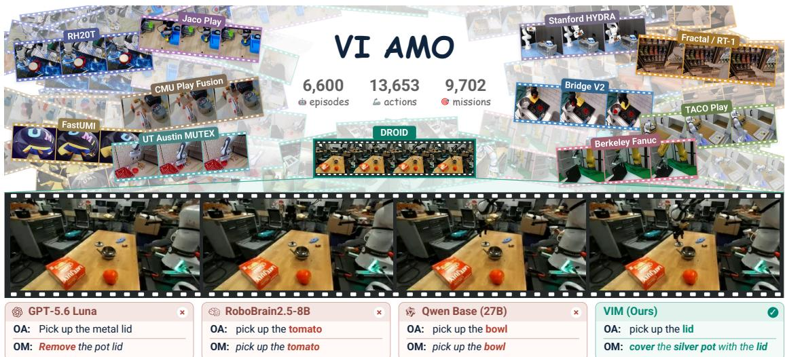  
OM: Remove the pot lid OM: pick up the tomato OM: pick up the bowl OM: cover the silver potwith the lidwith the lidFig. 1. VI AMO and hierarchical intent prediction from VIM. Fine-tuned on VI AMO, our proposed dataset for hierarchical intent prediction, VIM combines temporally ordered observations to jointly generate the ongoing action (OA) and the mission (OM) it serves in a single autoregressive pass. Each box shows the predicted OA on top and OM below in italics. In this example, VIM correctly predicts both intents, while the state-of-the-art frontier models fail to do so.

Abstract— Vision-language models (VLMs) have become a powerful foundation for robotic scene understanding, task planning, and language-conditioned control. A natural question follows: can these models also decode what a human operator intends while teleoperating a robot, without any explicit instruction? We formulate this as hierarchical intent prediction, jointly inferring the ongoing atomic action and the broader mission it serves from a short visual teleoperation history. To study this, we introduce VI AMO (Vision Intention Action and Mission Ongoing), a dataset of 6,600 episodes from eleven robot sources with 13,653 temporally aligned action annotations and 9,702 mission annotations. Large proprietary models struggle with this problem: on held-out episodes, GPT-4o reaches Sentence-BERT similarities of only 0.563 and 0.470 for action and mission, and GPT-5.6 Luna achieves only 0.581 and 0.554. Fine-tuning a VLM on VI AMO yields our Vision-Intention Model (VIM), which raises these scores to 0.825 and 0.821 and still reaches 0.726 and 0.717 on the 35.4% of test actions with both labels absent from training. Finally, as a downstream application, VIM’s predicted mission enables a vision-languageaction (VLA) policy to take over from the operator mid-task in a real-world environment unseen during VIM fine-tuning, reducing human teleoperation time by 34.6% relative to GPT-4o and 39.8% relative to GPT-5.6 Luna, while cutting intentprediction latency by roughly 70% on average.

## I. INTRODUCTION

Vision-language models (VLMs) have emerged as a key backbone for robotic perception and reasoning. SayCan [1] grounds language plans in learned affordances, Code as Policies [2] generates executable robot programs from language, and Inner Monologue [3] closes the loop with textual feedback. PragmaBot [4] uses visual feedback and lessons from real-world experience to refine robot task plans. On the execution side, vision-language-action (VLA) policies map a language instruction and visual observations directly to motor commands [5], [6], [7], [8]. All of these translate human language into robot behavior. We ask the inverse question: given only the partial visual history of a teleoperated robot, can a VLM decode what the human operator intends, without an instruction ever being provided?

Recent work has begun to explore this direction. VOSA [9] identifies candidate target objects through detection and segmentation, and CASPER [10] uses VLM reasoning over teleoperation history to select a skill–object pair from a predefined library and then executes that skill. Both represent intent at the level of the current step, as a target object or position, or as a skill drawn from a predefined library. However, these methods do not explicitly infer the broader mission behind the current action, yet it is what a robot needs in order to continue: grasping an apple does not by itself reveal whether the apple should go on a plate, to a person, or into a basket. Progress is further limited by data: existing demonstration corpora [11], [12], [13] mainly provide episode-level instructions, while existing intermediate supervision is either synthetically generated from task instructions [14], or annotated at the primitive-skill level [15], rather than providing temporally aligned action– mission supervision for instruction-free intent inference.

We therefore model operator intent as a hierarchy. The ongoing action (OA) is the atomic manipulation step currently being performed, such as “pick up the apple,” and the ongoing mission (OM) is the immediate goal it serves, such as “put the apple on the plate.” Both are expressed as open-vocabulary natural language, so the predicted mission can serve as the instruction of a language-conditioned policy without a fixed skill library. The difficulty is that a useful prediction must arrive early: at handoff time only part of the action has been observed, so the model must commit from a few frames and a short record of what has already been completed.

To study this problem, we introduce VI AMO (Vision Intention Action and Mission Ongoing), a dataset of 6,600 episodes from eleven robot source families with 13,653 temporally aligned action annotations and 9,702 mission annotations. Without task-specific training, even strong proprietary models fall short in predicting the ongoing mission: GPT-4o and GPT-5.6 Luna reach mission Sentence-BERT (SBERT) similarities of only 0.470 and 0.554. Fine-tuning an open-source VLM on VI AMO yields the Vision-Intention Model (VIM), which outperforms the two proprietary VLMs, two robotics-specialized foundation models, and its untuned backbone across different evaluation metrics, achieving a mission SBERT similarity of 0.821 compared with at most 0.564 for the baselines. On the 35.4% of test actions whose action and mission labels are both unseen during training, VIM achieves 27.2% higher action SBERT and 27.1% higher mission SBERT than the strongest baseline for both action and mission prediction.

Finally, we test the utility of the inferred mission in shared autonomy, where a robot continues a task that the operator began [16], [17]. VIM’s predicted mission conditions a VLA policy that takes over mid-task and completes the remaining manipulation in real-world scenarios unseen during VIM fine-tuning. With five trials per task for each VLM condition, VIM reduces human teleoperation time by 34.6% relative to GPT-4o and 39.8% relative to GPT-5.6 Luna. Each intent prediction takes approximately 0.7 s on a consumer GPU, compared with 1.9–3.5 s for the API-based baselines.

Our main contributions are as follows:

• We formulate hierarchical intent prediction from visual teleoperation history, jointly predicting the ongoing action and the mission it serves as open-vocabulary language, and introduce VI AMO, a dataset of 6,600 episodes with aligned action–mission annotations to train and evaluate it.

• We present VIM, a VLM fine-tuned on VI AMO that outperforms GPT-4o, GPT-5.6 Luna, two embodied foundation models, and its untuned backbone on different metrics, reaching 0.825 and 0.821 Sentence-BERT similarity for action and mission on the VI AMO test set versus at most 0.581 and 0.564 for the best baseline.

• We evaluate VIM as the intent module of a sharedautonomy system across five real-world tasks in scenarios unseen during VIM fine-tuning. Its predicted

missions serve as language instructions for a VLA policy, reducing human teleoperation time by 34.6% relative to GPT-4o and 39.8% relative to GPT-5.6 Luna. VI AMO, the annotation pipeline, and the VIM weights will be released at https://see-want.github.io/.

## II. RELATED WORK

## A. Operator Intent Inference

Early shared-autonomy methods [18], [19], [20], [21], [22] estimate user goals from control inputs or gaze to guide assistance. Recent approaches use different observations and intent representations. VOSA [9] constructs objectgoal candidates from visual perception, while AHEAD [23] predicts grasp objects and placement targets from tracked hand and head motion with scene context. CASPER [10] infers a skill–object pair from visual teleoperation history for user-confirmed skill execution. Adaptor [24] learns latent intention representations from teleoperation trajectories to condition action generation. These representations support target selection, skill execution, or action generation, but these functions do not by themselves require separate descriptions of the current manipulation and its mission. That distinction matters for continuation because the same action can serve different goals. We therefore study joint prediction of the ongoing atomic action and the immediate mission it serves, making action recognition and goal inference separately evaluable.

## B. Hierarchical Intent Supervision and Benchmarks

Supervision for hierarchical intent prediction links observed actions to the goals they serve. In human activity understanding, Ego4D Goal-Step [25] annotates goals, steps, and substeps, while AntGPT [26] infers goals from recognized action histories to anticipate future actions. For robots, BridgeData V2 [11], DROID [12], and Open X-Embodiment [13] provide diverse manipulation demonstrations. RH20T-P [15] adds manually segmented primitive skills, and RoboVQA [27] supports multi-horizon video reasoning. Embodied chain-of-thought reasoning (ECoT) [14] uses intermediate reasoning supervision for instructionconditioned control, while IntentVLA [28] uses visual history for instruction-conditioned action generation and introduces AliasBench to evaluate ambiguous continuations. Building on these resources, we ask whether an ongoing robot action and its mission can be jointly inferred before action completion, without the task instruction. Answering this question requires paired semantic targets aligned with the observations available at each prediction time. VI AMO therefore associates temporally bounded atomic actions with their immediate missions and evaluates both predictions on episode-disjoint data at multiple stages of action progress.

## III. PROBLEM FORMULATION

## A. Hierarchical Intent Prediction

An atomic action is an individual manipulation step, such as “pick up the apple” or “place the apple in the basket”. A mission is a sequence of consecutive atomic actions serving a single goal, such as “put the apple in the basket”; the two form a hierarchy of goals and steps. Whether consecutive actions belong to the same mission is a commonsense judgment based on the scene: picking up an apple next to an empty basket naturally continues into placing it there, whereas an action without an evident continuation forms a mission on its own. At decision time t, the ongoing action OAt and ongoing mission ${ \mathrm { O M } } _ { t }$ denote the action and mission the operator is currently executing.

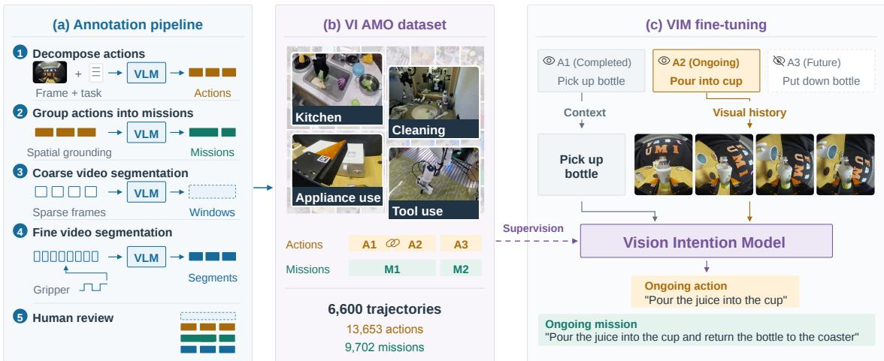  
Fig. 2. From robot demonstrations to hierarchical intent. (a) Annotation pipeline. A VLM decomposes each episode instruction into ordered atomic actions and groups consecutive actions into the mission they serve; coarse-to-fine video segmentation localizes every action in time, with gripper signals guiding fine boundaries where available, followed by human review. (b) Overview of our proposed VI AMO dataset. VI AMO pairs each atomic action with its mission across 6,600 episodes from eleven robot sources (13,653 actions, 9,702 missions), providing hierarchical supervision for intent prediction (c) VIM is fine-tuned on VI AMO to generate the ongoing action and the ongoing mission from a short visual history and the completed-action context.

Given these definitions, let $\mathbf { H } _ { t }$ denote n time-ordered visual observations collected up to time $t ,$ and $\mathbf { C } _ { t }$ an execution context summarizing behavior completed before t. An intention model $f _ { \phi }$ predicts

$$
\widehat { ( \mathrm { O A } _ { t } , \mathrm { O M } _ { t } ) } = f _ { \phi } ( \mathbf { H } _ { t } , \mathbf { C } _ { t } ) ,\tag{1}
$$

where both outputs are free-form natural-language descriptions generated without a predefined set of candidates. Both levels are needed because the same action can serve different missions: grasping an apple may precede placing it in a basket or handing it to a person.

## B. Application: Shared Autonomy

In shared autonomy, a robot autonomously continues a task initiated through teleoperation. We realize this with a language-conditioned VLA policy

$$
\mathbf { a } _ { t } = \pi ( \mathbf { o } _ { t } , \mathbf { s } _ { t } , \ell ) ,\tag{2}
$$

with action chunk $\mathbf { a } _ { t }$ , observations $\mathbf { o } _ { t }$ , robot state $\mathbf { s } _ { t } .$ , and language instruction ℓ. Since the operator provides no instruction, the intention model supplies it: at the switch time $t _ { h }$ , the robot executes

$$
\mathbf { a } _ { t } = \pi \big ( \mathbf { o } _ { t } , \mathbf { s } _ { t } , \widehat { \mathrm { O M } } _ { t _ { h } } \big ) , \quad ( \cdot , \widehat { \mathrm { O M } } _ { t _ { h } } ) = f _ { \phi } ( \mathbf { H } _ { t _ { h } } , \mathbf { C } _ { t _ { h } } ) ,\tag{3}
$$

for all $t \geq t _ { h }$ , i.e., the predicted mission from (1) serves as the instruction in (2). We assume a single switch and use only the teleoperation history up to $t _ { h } ;$ the repeated switches in our real-world experiments apply the same procedure at each switch.

## IV. METHOD

Our method centers on learning hierarchical intent from partial visual observations. We first introduce VI AMO, which pairs temporally localized atomic actions with the missions they serve. These annotations support both supervised learning and a benchmark for predicting ongoing action (OA) and ongoing mission (OM). We then train the Vision-Intention Model (VIM) to generate both descriptions from visual history and the completed-action context (Fig. 2). Finally, we use the predicted mission as a language interface to a VLA policy, demonstrating shared autonomy as a downstream application.

## A. VI AMO: Hierarchical Action–Mission Annotations

Learning to infer intent requires supervision that distinguishes the observed manipulation from the goal it serves. VI AMO organizes robot demonstrations into temporally bounded atomic actions and their associated missions. Each atomic interval is paired with an OA description and an OM target.

As illustrated in Fig. 2(a), our annotation pipeline consists of five stages. (1) Action decomposition. Given its strong spatial reasoning capabilities, we use GPT-5.6 Sol to identify task-relevant objects and propose ordered atomicaction descriptions from the episode instruction and firstframe images. (2) Mission grouping. We then prompt GPT-5.6 Sol with the task instruction, first-frame images, and ordered atomic actions to assess adjacent action pairs. Actions with an unambiguous continuation toward a shared goal are grouped into a mission; otherwise, we retain a mission boundary. Ungrouped actions then form single-action missions. (3) Coarse temporal localization. For episodes with multiple candidate atomic actions, Qwen3.7-Plus estimates a coarse temporal window for each atomic action from sparse frames spanning the video. (4) Fine boundary refinement. We select consecutive frames around each coarse boundary and nearby gripper closing or opening events, when available.

TABLE I  
VI AMO SOURCE COMPOSITION WITH ANNOTATION SUMMARY.
<table><tr><td>Source</td><td>Train</td><td>Val</td><td>Test</td><td>Actions</td><td>Missions</td></tr><tr><td>Berkeley Fanuc [29]</td><td>23</td><td>2</td><td>2</td><td>48</td><td>32</td></tr><tr><td>Bridge V2 [11]</td><td>2,574</td><td>259</td><td>258</td><td>4,950</td><td>3,445</td></tr><tr><td>CMU Play Fusion [30]</td><td>186</td><td>19</td><td>19</td><td>725</td><td>448</td></tr><tr><td>DROID [12]</td><td>1,702</td><td>169</td><td>170</td><td>6,372</td><td>4,452</td></tr><tr><td>FastUMI-100K [31]</td><td>22</td><td>2</td><td>2</td><td>100</td><td>52</td></tr><tr><td>Fractal (RT-1) [32]</td><td>483</td><td>48</td><td>48</td><td>656</td><td>579</td></tr><tr><td>Jaco Play [33]</td><td>56</td><td>6</td><td>6</td><td>68</td><td>68</td></tr><tr><td>RH20T cfg 5 [34]</td><td>79</td><td>8</td><td>8</td><td>224</td><td>143</td></tr><tr><td>HYDRA [35]</td><td>3</td><td>0</td><td>0</td><td>19</td><td>9</td></tr><tr><td>TACO Play [36]</td><td>336</td><td>34</td><td>33</td><td>403</td><td>403</td></tr><tr><td>UT Austin MUTEX [37]</td><td>36</td><td>3</td><td>4</td><td>88</td><td>71</td></tr><tr><td>Total</td><td>5,500</td><td>550</td><td>550</td><td>13,653</td><td>9,702</td></tr></table>

Episodes per split and annotated actions and missions per source.

Qwen3.7-Plus examines these frames to determine when the action is completed and refine the boundary. Each mission spans from the start of its first constituent action to the end of its last. (5) Human review. Human reviewers check and correct action descriptions, mission groupings, and temporal boundaries in around 50% of the total episodes.

In total, this annotation pipeline yields 13,653 atomicaction segments and 9,702 mission segments across 6,600 episodes, as summarized in Table I.

## B. Hierarchical Intent Learning

To train VIM to recognize intent from visual history at different stages of an action, we construct six observation sequences for each atomic interval. Four use sampling windows beginning at action onset, with different lengths up to the full action duration. Within each partial window, we divide time into n bins and randomly select one frame per bin. A fifth sequence samples a shorter local window at a random position within the action; and the sixth uses randomly spaced frames to provide additional variation in observation timing. We construct the visual history $\mathbf { H } _ { t }$ from one or more available camera views, sampling n observations per view in chronological order as input to the VLM.

Execution context $\mathbf { C } _ { t }$ summarizes completed behavior in text form. In our training configuration, it lists completed actions within the active mission in chronological order. If the list is empty, the context is set to “Robot has no previous actions.”

We instantiate VIM with Qwen3.5-27B [38] for its strong vision–language understanding capabilities and mature training ecosystem. The prompt defines the two intent levels and requests a structured response:

$$
\begin{array} { l } { { \mathrm { O n g o i n g ~ a c t i o n } \colon \mathsf { < a t o m i c ~ a c t i o n } \setminus } } \\ { { \mathrm { O n g o i n g ~ m i s s i o n } \colon \mathsf { < m i s s i o n } > } } \end{array}
$$

Both descriptions are generated in a single autoregressive pass. This exposes the model’s interpretation of the current manipulation alongside the goal proposed for continuation. The output is free-form language, with no candidate-label bank supplied during generation.

We adapt the backbone using low-rank adaptation (LoRA) [39] in the vision and language attention and MLP modules due to memory efficiency. For a minibatch of B examples, let $y _ { i } \ = \ ( y _ { i , 1 } , \ldots , y _ { i , T _ { i } } )$ denote the supervised tokens of the formatted OA–OM response. We minimize the response-only autoregressive cross-entropy

$$
\mathcal { L } _ { \mathrm { V I M } } ( \phi ) = - \frac { \displaystyle \sum _ { i = 1 } ^ { B } \sum _ { j = 1 } ^ { T _ { i } } \log p _ { \phi } ( y _ { i , j } \mid \mathbf { H } _ { i } , \mathbf { C } _ { i } , y _ { i , : j } ) } { \displaystyle \sum _ { i = 1 } ^ { B } T _ { i } } .\tag{4}
$$

Here $y _ { i , : j }$ contains the preceding ground-truth response tokens. Template tokens are excluded from the loss, so supervision applies only to the predicted OA and OM. Only the low-rank parameters are updated; the pretrained weights remain frozen. Detailed optimization settings are provided in Sec. V-A.

## C. VLA Fine-Tuning for Shared Autonomy

In our downstream task, we integrate VIM with a VLA policy to autonomously continue manipulation initiated through teleoperation. We fine-tune a $\pi _ { 0 . 5 }$ policy [8] on instruction-conditioned robot demonstrations using conditional flow-matching objective [40]. The policy predicts action chunks conditioned on current images, robot state, and a language instruction, $\mathbf { c } _ { t } = ( \mathbf { o } _ { t } , \mathbf { s } _ { t } , \boldsymbol { \ell } )$ . For a demonstration action chunk $\mathbf { A } _ { t } ,$ , we construct $\mathbf { A } _ { t } ^ { \tau } = ( 1 - \tau ) \mathbf { A } _ { t } + \tau \mathbf { \epsilon }$ , where $\mathbf { \epsilon } \gets \mathcal { N } ( \mathbf { 0 } , \mathbf { I } )$ and the noise level τ follows OpenPI’s sampling distribution. The training objective is

$$
\mathcal { L } _ { \mathrm { V L A } } ( \theta ) = \mathbb { E } \Big [ \| v _ { \theta } \big ( \mathbf { A } _ { t } ^ { \tau } , \tau , \mathbf { c } _ { t } \big ) - \big ( \epsilon - \mathbf { A } _ { t } \big ) \| _ { F } ^ { 2 } \Big ] ,\tag{5}
$$

where $v _ { \theta }$ is the vector field predicted by the action expert and ℓ is the demonstration instruction during training.

At deployment, VIM predicts the ongoing action and mission from the teleoperation history. The operator reviews the predicted OM and, if it matches their goal, approves it as the VLA’s language instruction for autonomous continuation.

## V. EXPERIMENTS

We first evaluate OA and OM prediction on the VI AMO test set, evaluating both token-level accuracy and cosine similarity between predicted and ground-truth text embeddings. We then conduct ablation studies to examine the effects of camera views, textual context, visual history. Finally, to demonstrate VIM’s utility for downstream intent prediction tasks, we evaluate VIM on a physical Franka Emika Panda robot arm in five shared-autonomy manipulation tasks and measure the amount of manual teleoperation required during task execution.

## A. VI AMO Experimental Setup

We fine-tune Qwen3.5-27B for one epoch in BF16 on 11,481 training actions, with $n = 4$ observations per available camera and six temporal sampling plans per action (Sec. IV-B), yielding 68,886 training examples. We use LoRA with rank $r ~ = ~ 1 6 , ~ \alpha ~ = ~ 1 6$ , and zero dropout. The effective batch size is 16 (four examples and four accumulation steps), and the sequence limit is 2,048 tokens. The learning rate is $1 0 ^ { - 4 }$ , with 3% warm-up and weight decay 0.001. Training takes approximately 13.44 GPU-hours on a single NVIDIA A100 80GB GPU.

TABLE II  
OA AND OM PREDICTION ON THE VI AMO TEST SET.
<table><tr><td></td><td></td><td colspan="4">Ongoing action</td><td colspan="4">Ongoing mission</td></tr><tr><td>Dataset</td><td>Model</td><td>F1↑</td><td>SBERT↑</td><td>SigLIP↑</td><td>Top-10↑</td><td>F1↑</td><td>SBERT↑</td><td>SigLIP↑</td><td>Top-10↑</td></tr><tr><td>VI AMO test</td><td>GPT-5.6 Luna</td><td>0.484</td><td>0.581</td><td>0.741</td><td>39.14</td><td>0.399</td><td>0.554</td><td>0.716</td><td>39.33</td></tr><tr><td>VI AMO test</td><td>GPT-40</td><td>0.463</td><td>0.563</td><td>0.733</td><td>35.32</td><td>0.330</td><td>0.470</td><td>0.685</td><td>29.91</td></tr><tr><td>VI AMO test</td><td>Qwen Base (27B)</td><td>0.493</td><td>0.581</td><td>0.744</td><td>36.20</td><td>0.424</td><td>0.564</td><td>0.722</td><td>37.27</td></tr><tr><td>VI AMO test</td><td>Qwen Base (9B)</td><td>0.464</td><td>0.529</td><td>0.718</td><td>31.43</td><td>0.368</td><td>0.496</td><td>0.684</td><td>28.32</td></tr><tr><td>VI AMO test</td><td>RynnBrain 1.1-9B</td><td>0.365</td><td>0.505</td><td>0.721</td><td>34.80</td><td>0.381</td><td>0.499</td><td>0.712</td><td>35.49</td></tr><tr><td>VI AMO test</td><td>RoboBrain 2.5-8B</td><td>0.236</td><td>0.316</td><td>0.631</td><td>18.87</td><td>0.205</td><td>0.315</td><td>0.577</td><td>19.29</td></tr><tr><td>VI AMO test</td><td>VIM (Ours)</td><td>0.784</td><td>0.825</td><td>0.879</td><td>76.59</td><td>0.756</td><td>0.821</td><td>0.872</td><td>78.77</td></tr></table>

↑: higher is better; Top-10 is in %. Bold/underlined: best/second-best within each dataset.

We evaluate VIM on the VI AMO test set. Its 550 episodes are disjoint from training and contain 1,091 atomic actions and 781 mission instances. Table I summarizes the dataset composition. To assess intent prediction at different stages of manipulation, we evaluate at nine relative times: 0%, 5%, 15%, 25%, 40%, 55%, 70%, 85%, and 95% of each atomic action’s duration. These evaluation times cover the action from its onset to near completion; for example, 25% means that one quarter of the action has elapsed. At each time, four frames are sampled uniformly from action onset to that time. At 0%, the initial frame is padded four times.

We compare VIM with six baselines: the untuned Qwen3.5-27B backbone and the smaller Qwen3.5-9B [38]; two proprietary models, GPT-5.6 Luna (gpt-5.6-luna) and GPT-4o (gpt-4o-2024-11-20); and two open embodied foundation models post-trained for robot reasoning, RynnBrain 1.1-9B [41] and RoboBrain 2.5-8B [42]. Front and wrist image pairs are used where available, with singleview fallback otherwise. Qwen uses deterministic decoding with thinking disabled and at most 80 new tokens.

## B. Evaluation Metrics

To comprehensively evaluate intent predictions, we measure both token-level agreement and embedding-level semantic similarity. We evaluate OA and OM separately because correctly identifying the immediate action does not necessarily imply understanding the broader mission it serves. Token F1 measures F1 score between the prediction and ground truth intent tokens, allowing partial matches. Sentence-BERT (SBERT) measures semantic similarity through the cosine of their frozen all-mpnet-base-v2 sentence embeddings [43]. The SigLIP score likewise compares the two texts using cosine similarity from the frozen SigLIP text encoder [44], motivated by its image-text alignment and relevance to downstream robot control. For text-to-label retrieval, we rank the unique reference labels of the VI AMO test set (726 action labels and 539 mission labels) by their SigLIP similarity to the prediction. Top-10 measures how often the correct label appears among the first 10 candidates. We use Top-10 because semantically similar candidate labels may rank above the ground-truth label even when the prediction captures the intended action or mission. For example, “pick up the pot lid” and “pick up the silver pot lid” may describe the same action in a given scene.

## C. VI AMO Intent Prediction

Overall intent prediction accuracy. Averaged over the nine shared evaluation times, VIM outperforms all six baselines on every reported OA and OM metric (Table II). Relative to the strongest baseline on each metric, OA/OM SBERT increases from 0.581/0.564 to 0.825/0.821, SigLIP cosine from 0.744/0.722 to 0.879/0.872, and OA/OM Top-10 retrieval accuracy from 39.14%/39.33% to 76.59%/78.77%. Despite fine-tuning for robotic perception, RynnBrain and RoboBrain do not outperform general-purpose VLMs on hierarchical intent prediction, suggesting that inferring operator intent from motion remains a distinct challenge.

Intent recognition across action progress. Fig. 3 shows that VIM achieves higher OA and OM similarity than all six baselines at all nine evaluation times under both SBERT and SigLIP. Its OA/OM SBERT rises from 0.776/0.776 at 0% progress to 0.855/0.849 at 95%, with smaller gains after 70% progress. The baselines also improve with longer observation histories but remain below VIM near action completion. The consistent trends across both SBERT and SigLIP text encoders support recognizing the ongoing action and its mission from partial action observations and execution context, without waiting for the action to finish.

Seen and unseen labels. To evaluate the performance on previously observed and unseen labels, we split the 1,091 test actions by whether their normalized OA and OM label strings occur in the training annotations: 621 actions have both labels seen, 386 (35.4%) have both labels unseen, and the remaining 84 are mixed (62 with only the OM label unseen and 22 with only the OA label unseen). Fig. 4 compares all seven models on the two pure slices. On seen labels, VIM reaches OA/OM SBERT of 0.902/0.903, compared with 0.587/0.566 for the strongest baseline. On labels that never occur in training, VIM decreases to 0.726/0.717 SBERT but remains well above every baseline (at best 0.570/0.564).

## D. Ablation Study

We compare three variants of VIM: (1) front-only removes wrist images; (2) no context removes history text and samples from the current mission’s onset to the action cutoff as the image-level context; and (3) single @ 0% replaces the fourframe observation history with a single initial image pair, removing temporal motion cues from the input. Table III summarizes the intent inference results for these variants. Removing the wrist view reduces OA/OM SBERT from 0.825/0.821 to 0.798/0.798, indicating that visual cues of gripper–object interaction provide complementary information for resolving fine-grained intent. Removing the textual context reduces OA/OM SBERT to 0.767/0.788, and removing the visual history (a single observation at 0%) reduces it to 0.793/0.792. The consistent decline in both OA and OM performance across the ablated variants supports the use of multi-view visual histories and completed-action context for hierarchical intent prediction.

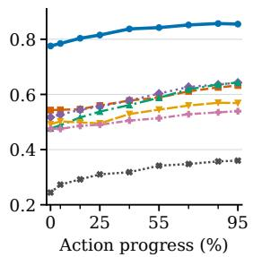  
(a) OA · SBERT

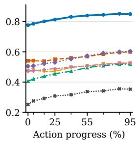  
(b) OM · SBERT

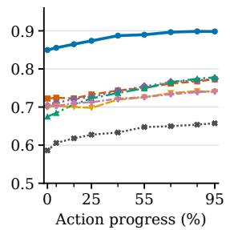  
(c) OA · SigLIP

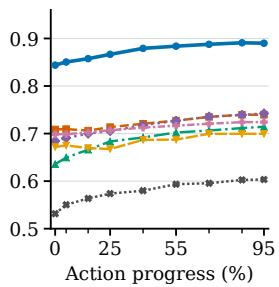  
(d) OM · SigLIP

Fig. 3. OA and OM prediction across action progress. We evaluate ongoing action (OA) and ongoing mission (OM) predictions on the VI AMO test set at nine observation cutoffs spanning 0–95% of the current atomic action. Panels (a,b) report cosine similarity between predicted and ground-truth texts using SBERT embeddings, while panels (c,d) use SigLIP text embeddings. Higher values indicate closer semantic agreement with the ground-truth intent. Curves connect the mean score at each observation cutoff, and all seven models use the same test examples, observation cutoffs, prompts, and execution context.  
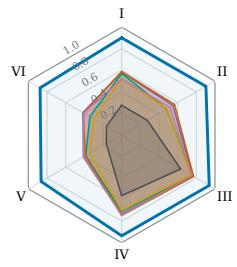

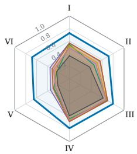  
(a) Both seen  
(b) Both unseen  
Fig. 4. Seen versus unseen labels on the VI AMO test set. (a) Both OA and OM labels are seen during training; (b) both are unseen. Each polygon represents one model; the blue outline denotes VIM. Axes run clockwise from the top: I: OA SBERT; II: OM SBERT; III: OA SigLIP; IV: OM SigLIP; V: OA Top-10; VI: OM Top-10.

## E. Real-World Experimental Setup

We evaluate VIM as the intent module in downstream shared-autonomy tasks. Our platform comprises a Franka arm with a parallel-jaw gripper, front/wrist OAK-D cameras, and a Rokoko Smartglove with Coil Pro tracking [45] for teleoperation. Relative hand motion controls the end effector, and thumb–index pinch distance controls gripper opening.

VIM receives four uniformly sampled synchronized image pairs from the history starting from the latest user teleoperation takeover. The operator transfers control by confirming the inferred mission. The VLA then uses current observations and robot state to continue the approved task, issuing action commands at a nominal rate of 15 Hz. When the operator resumes teleoperation, the glove mapping is re-anchored and robot commands again follow the operator. We deploy the VIM on an RTX 5090 GPU with TensorRT-Edge-LLM, quantized to NVFP4 to fit the available memory.

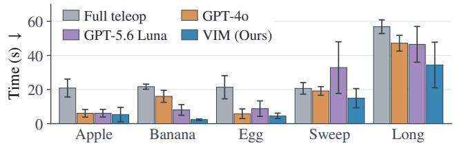

(a) Human teleoperation time  
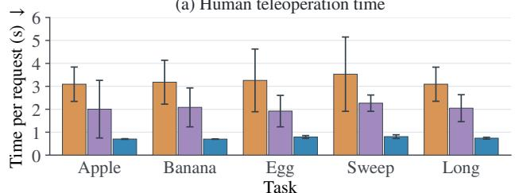  
(b) VLM inference latency  
Fig. 5. Real-world task quantitative results. Bars show mean ± SD for (a) teleoperation time and (b) VLM latency.

The five evaluation tasks, conducted in scenarios unseen during VIM fine-tuning, fall into four families, each probing a different aspect of intent understanding: (1) apple placement and banana placement share a scene and differ only in the target fruit, so the mission hinges on which object the operator approaches; (2) egg placement requires the commonsense object–receptacle association (egg → tray); (3) trash sweeping is mediated by a tool, so the goal must be read from the implement the robot reaches for rather than from direct manipulation of the target; and (4) all fruits placement demands repeated inference and continuation across successive manipulations toward a compound goal.

To fine-tune the VLA policy, we collect 130 teleoperated demonstrations for the all fruits placement task and 100 for each of the other tasks. We jointly fine-tune the policy on these demonstrations for 10,000 steps using four NVIDIA A100 GPUs with 80 GB of memory each.

We compare VIM-based shared autonomy with three baselines: GPT-4o and GPT-5.6 Luna as alternative intention models, and full teleoperation. We report total human teleoperation time and VLM latency. The results are based on five trials on each task, with mean ± sample standard deviation (SD) across trials.

TABLE III  
ABLATIONS ON THE VI AMO TEST SET.
<table><tr><td></td><td colspan="4">Ongoing action</td><td colspan="4">Ongoing mission</td></tr><tr><td>Method</td><td>F1↑</td><td>SBERT↑</td><td>SigLIP↑</td><td>Top-10↑</td><td>F1↑</td><td>SBERT↑</td><td>SigLIP↑</td><td>Top-10↑</td></tr><tr><td>Front-only</td><td>0.753</td><td>0.798</td><td>0.861</td><td>70.13</td><td>0.730</td><td>0.798</td><td>0.855</td><td>73.75</td></tr><tr><td>No context</td><td>0.704</td><td>0.767</td><td>0.840</td><td>66.46</td><td>0.719</td><td>0.788</td><td>0.851</td><td>73.63</td></tr><tr><td>Single @ 0%</td><td>0.750</td><td>0.793</td><td>0.858</td><td>70.39</td><td>0.724</td><td>0.792</td><td>0.850</td><td>72.87</td></tr><tr><td>VIM (Ours)</td><td>0.784</td><td>0.825</td><td>0.879</td><td>76.59</td><td>0.756</td><td>0.821</td><td>0.872</td><td>78.77</td></tr></table>

↑: higher is better; Top-10 is in %. Bold/underlined: largest/second-largest displayed values per metric.

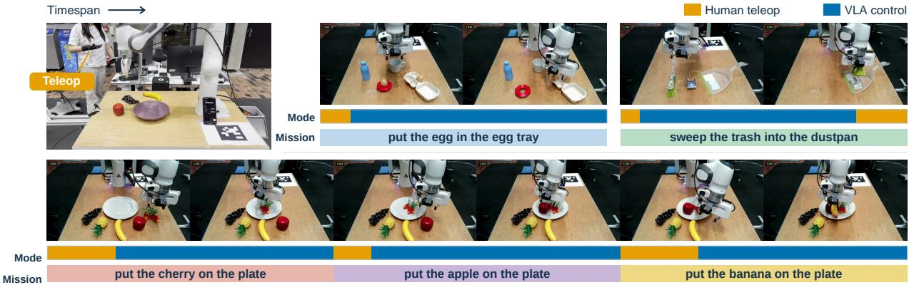  
Fig. 6. VIM-guided control handoffs across real-world tasks. The top row shows, from left to right, the visualization of our shared autonomy setup, egg placement, and trash sweeping task. The bottom row presents front-view keyframes of three successive missions in a multi-mission rollout: placing the cherry, apple, and banana on the plate. Mode bars indicate intervals of human teleoperation and VLA control, while mission bars identify the active mission. These examples illustrate the handoff process: VIM infers the ongoing mission from partial teleoperation, the operator confirms it, and the VLA continues execution.

## F. Real-World Experimental Results

The quantitative comparison among VIM, full teleoperation, and two baseline GPT models is illustrated in Fig. 5. Fig. 6 provides qualitative examples of human-to-VLA handoffs across the egg-placement, sweeping, and longhorizon fruit-placement tasks. Fig. 5(a) compares teleoperation time across the five task conditions. VIM requires less teleoperation than either GPT-based setup on every task, reducing the mean by 34.6% relative to GPT-4o and 39.8% relative to Luna. Notably, in the trash-sweeping task, neither GPT model predicts a usable intent and the task therefore remains fully teleoperated. Fig. 5(b) reports per-request mean and SD latency. SD describes variation among requests. VIM’s mean latency ranges from 0.70 to 0.81 s across tasks, compared with 3.09–3.53 s for GPT-4o and 1.92–2.27 s for Luna, achieving 76.9% and 63.8% latency reduction. Since many manipulation actions are completed over only a few seconds and involve relatively short motions, delays above two seconds can cause the inferred intent to lag behind the robot’s current state, making timely handoff difficult.

## VI. CONCLUSION AND LIMITATIONS

We asked whether a VLM can decode an operator’s intent from visual teleoperation history alone, and argued that intent should be represented hierarchically as the ongoing action and the mission it serves. To this end we introduced

VI AMO, a dataset of 6,600 episodes with temporally aligned action–mission annotations, and VIM, a VLM fine-tuned on it. On VI AMO, VIM outperforms GPT-4o, GPT-5.6 Luna, two embodied foundation models, and its untuned backbone on every action and mission metric and at every stage of action progress (0.825/0.821 versus at most 0.581/0.564 SBERT for action/mission), with a smaller but consistent margin on label strings absent from training (0.726/0.717 versus 0.570/0.564), and it transfers to a real-world environment outside the dataset. In a five-task real-world study, its predicted mission let a VLA policy continue the task and reduced the operator’s teleoperation time by over onethird compared with either GPT-based baseline, at 0.7 s per prediction on a consumer GPU.

Although our framework improves hierarchical intent prediction and reduces manual teleoperation in downstream tasks, it still makes prediction errors and lacks calibrated confidence estimates. Reliably determining when its predictions can be trusted therefore remains an open challenge. Future work will expand VI AMO with more diverse demonstrations, potentially including synthetic data, to improve prediction accuracy and generalization ability. In addition, evaluation on the VI AMO dataset assumes predefined action boundaries and does not assess online boundary detection during live teleoperation. In our downstream real-world experiments, the VLA policy executes actions more slowly than a skilled operator, so reducing manual control does not always correspond to shorter task completion times. Future work will explore more lightweight action-generation architectures to reduce computational overhead [46] and extend the framework to navigation and mobile manipulation.

## ACKNOWLEDGEMENTS

This research was supported by the Swiss National Science Foundation through the National Centre of Competence in Automation (NCCR automation), by an ETH RobotX research grant, and by grants from NVIDIA and utilized NVIDIA Jetson Thor.

## REFERENCES

[1] B. Ichter et al., “Do as I can, not as I say: Grounding language in robotic affordances,” in Proc. 6th Conf. Robot Learn. (CoRL), vol. 205, 2023, pp. 287–318.

[2] J. Liang et al., “Code as policies: Language model programs for embodied control,” in Proc. IEEE Int. Conf. Robot. Automat. (ICRA), 2023, pp. 9493–9500, doi: 10.1109/ICRA48891.2023.10160591.

[3] W. Huang et al., “Inner monologue: Embodied reasoning through planning with language models,” in Proc. 6th Conf. Robot Learn. (CoRL), vol. 205, 2023, pp. 1769–1782.

[4] K. Qu et al., “A pragmatist robot: Learning to plan tasks by experiencing the real world,” IEEE Robotics and Automation Letters, vol. 11, no. 5, pp. 5606–5613, 2026. [Online]. Available: https: //arxiv.org/abs/2507.16713

[5] B. Zitkovich et al., “RT-2: Vision-language-action models transfer web knowledge to robotic control,” in Proc. 7th Conf. Robot Learn. (CoRL), vol. 229, 2023, pp. 2165–2183.

[6] M. J. Kim et al., “OpenVLA: An open-source vision-language-action model,” in Proc. 8th Conf. Robot Learn. (CoRL), vol. 270, 2025, pp. 2679–2713.

[7] K. Black et al., “π0: A vision-language-action flow model for general robot control,” in Proc. Robot.: Sci. Syst. (RSS), 2025, doi: 10.15607/ RSS.2025.XXI.010.

[8] K. Black et al., “π0.5: A vision-language-action model with openworld generalization,” in Proc. 9th Conf. Robot Learn. (CoRL), vol. 305, 2025, pp. 17–40.

[9] A. Belsare, Z. Karimi, C. Mattson, and D. S. Brown, “Toward zeroshot user intent recognition in shared autonomy,” in Proc. ACM/IEEE Int. Conf. Human-Robot Interact. (HRI), 2025, pp. 222–231, doi: 10. 1109/HRI61500.2025.10973985.

[10] H. Liu et al., “CASPER: Inferring diverse intents for assistive teleoperation with vision language models,” in Proc. 9th Conf. Robot Learn. (CoRL), vol. 305, 2025, pp. 2462–2483.

[11] H. R. Walke et al., “BridgeData V2: A dataset for robot learning at scale,” in Proc. 7th Conf. Robot Learn. (CoRL), vol. 229, 2023, pp. 1723–1736.

[12] A. Khazatsky et al., “DROID: A large-scale in-the-wild robot manipulation dataset,” in Proc. Robot.: Sci. Syst. (RSS), 2024, doi: 10.15607/RSS.2024.XX.120.

[13] Open X-Embodiment Collaboration et al., “Open X-Embodiment: Robotic learning datasets and RT-X models,” in Proc. IEEE Int. Conf. Robot. Automat. (ICRA), 2024, pp. 6892–6903, doi: 10.1109/ ICRA57147.2024.10611477.

[14] M. Zawalski, W. Chen, K. Pertsch, O. Mees, C. Finn, and S. Levine, “Robotic control via embodied chain-of-thought reasoning,” in Proc. 8th Conf. Robot Learn. (CoRL), vol. 270, 2025, pp. 3157–3181.

[15] Z. Chen et al., “RH20T-P: A primitive-level robotic dataset towards composable generalization agents,” 2024, arXiv:2403.19622.

[16] M. Selvaggio, M. Cognetti, S. Nikolaidis, S. Ivaldi, and B. Siciliano, “Autonomy in physical human-robot interaction: A brief survey,” IEEE Robot. Autom. Lett., vol. 6, no. 4, pp. 7989–7996, 2021, doi: 10.1109/ LRA.2021.3100603.

[17] D. P. Losey et al., “Learning latent actions to control assistive robots,” Auton. Robots, vol. 46, no. 1, pp. 115–147, 2022, doi: 10.1007/ s10514-021-10005-w.

[18] A. D. Dragan and S. S. Srinivasa, “Formalizing assistive teleoperation,” in Proc. Robot.: Sci. Syst. (RSS), 2012, doi: 10.15607/RSS. 2012.VIII.010.

[19] A. D. Dragan and S. S. Srinivasa, “A policy-blending formalism for shared control,” Int. J. Robot. Res., vol. 32, no. 7, pp. 790–805, 2013, doi: 10.1177/0278364913490324.

[20] S. Javdani, S. S. Srinivasa, and J. A. Bagnell, “Shared autonomy via hindsight optimization,” in Proc. Robot.: Sci. Syst. (RSS), 2015, doi: 10.15607/RSS.2015.XI.032.

[21] S. Jain and B. Argall, “Probabilistic human intent recognition for shared autonomy in assistive robotics,” ACM Trans. Human-Robot Interact., vol. 9, no. 1, 2019, Art. no. 2, doi: 10.1145/3359614.

[22] H. Admoni and S. S. Srinivasa, “Predicting user intent through eye gaze for shared autonomy,” in Proc. AAAI Fall Symp. Shared Autonomy Res. Pract., 2016, pp. 298–303.

[23] S. J. Kim, J. Lee, F. Spinola, T. Kwon, and M. Moghaddam, “AHEAD: Anticipatory hand-driven teleoperation via human intent prediction,” 2026, arXiv:2607.15172.

[24] Y. Liu et al., “Adaptor: Advancing assistive teleoperation with few-shot learning and cross-operator generalization,” 2026, arXiv:2604.09462.

[25] Y. Song, E. Byrne, T. Nagarajan, H. Wang, M. Martin, and L. Torresani, “Ego4D Goal-Step: Toward hierarchical understanding of procedural activities,” in Adv. Neural Inf. Process. Syst., vol. 36, 2023, doi: 10.52202/075280-1688.

[26] Q. Zhao et al., “AntGPT: Can large language models help long-term action anticipation from videos?” in Proc. Int. Conf. Learn. Represent. (ICLR), 2024. [Online]. Available: https://arxiv.org/abs/2307.16368

[27] P. Sermanet et al., “RoboVQA: Multimodal long-horizon reasoning for robotics,” in Proc. IEEE Int. Conf. Robot. Automat. (ICRA), 2024, pp. 645–652, doi: 10.1109/ICRA57147.2024.10610216.

[28] S. Lian et al., “IntentVLA: Short-horizon intent modeling for aliased robot manipulation,” 2026, arXiv:2605.14712.

[29] X. Zhu et al., “Fanuc manipulation: A dataset for learning-based manipulation with FANUC Mate 200iD robot,” [Dataset], 2023. [Online]. Available: https://sites.google.com/berkeley.edu/fanuc-manipulation

[30] L. Chen, S. Bahl, and D. Pathak, “PlayFusion: Skill acquisition via diffusion from language-annotated play,” in Proc. 7th Conf. Robot Learn. (CoRL), vol. 229, 2023, pp. 2012–2029.

[31] K. Liu et al., “FastUMI-100K: Advancing data-driven robotic manipulation with a large-scale UMI-style dataset,” 2025, arXiv:2510.08022.

[32] A. Brohan et al., “RT-1: Robotics transformer for real-world control at scale,” in Proc. Robot.: Sci. Syst. (RSS), 2023, doi: 10.15607/RSS. 2023.XIX.025.

[33] S. Dass et al., “CLVR Jaco Play dataset,” [Dataset], 2023. [Online]. Available: https://github.com/clvrai/clvr\_jaco\_play\_dataset

[34] H.-S. Fang et al., “RH20T: A comprehensive robotic dataset for learning diverse skills in one-shot,” in Proc. IEEE Int. Conf. Robot. Automat. (ICRA), 2024, pp. 653–660.

[35] S. Belkhale, Y. Cui, and D. Sadigh, “HYDRA: Hybrid robot actions for imitation learning,” in Proc. 7th Conf. Robot Learn. (CoRL), vol. 229, 2023, pp. 2113–2133.

[36] E. Rosete-Beas, O. Mees, G. Kalweit, J. Boedecker, and W. Burgard, “Latent plans for task-agnostic offline reinforcement learning,” in Proc. 6th Conf. Robot Learn. (CoRL), vol. 205, 2023, pp. 1838–1849.

[37] R. Shah, R. Martín-Martín, and Y. Zhu, “MUTEX: Learning unified policies from multimodal task specifications,” in Proc. 7th Conf. Robot Learn. (CoRL), vol. 229, 2023, pp. 2663–2682.

[38] Qwen Team, “Qwen3.5: Towards native multimodal agents,” Qwen Blog, Feb. 2026. [Online]. Available: https://qwen.ai/blog?id=qwen3.5

[39] E. J. Hu et al., “LoRA: Low-rank adaptation of large language models,” in Proc. Int. Conf. Learn. Represent. (ICLR), 2022. [Online]. Available: https://openreview.net/forum?id=nZeVKeeFYf9

[40] Physical Intelligence. “OpenPI: Open-source models and packages for robotics.” GitHub. Accessed: Sep. 12, 2026. [Online]. Available: https://github.com/Physical-Intelligence/openpi

[41] K. Li et al., “RynnBrain 1.1: Towards more capable and generalizable embodied foundation model,” 2026, arXiv:2607.17977.

[42] H. Tan et al., “RoboBrain 2.5: Depth in sight, time in mind,” 2026, arXiv:2601.14352.

[43] N. Reimers and I. Gurevych, “Sentence-BERT: Sentence embeddings using Siamese BERT-networks,” in Proc. Conf. Empirical Methods Natural Lang. Process. 9th Int. Joint Conf. Natural Lang. Process. (EMNLP-IJCNLP), 2019, pp. 3982–3992, doi: 10.18653/v1/ D19-1410.

[44] X. Zhai, B. Mustafa, A. Kolesnikov, and L. Beyer, “Sigmoid loss for language image pre-training,” in Proc. IEEE/CVF Int. Conf. Comput. Vis. (ICCV), 2023, pp. 11 975–11 986.

[45] Rokoko. “Rokoko Studio 2.4.3.” Rokoko Support. Accessed: Sep. 8, 2026. [Online]. Available: https://support.rokoko.com/hc/en-us/ articles/21445198239761-Rokoko-Studio-2-4-3

[46] H. Xie et al., “TurboVLA: Real-time vision-language-action model at 32 Hz on an RTX 4090 with <1 GB VRAM,” 2026, arXiv:2607.27205.