# Kosmo-GFM: A Production-Ready Geometry Foundation Model

Kosmo Research

## Abstract

We present Kosmo-GFM, a scene reconstruction system that integrates a geometry foundation model (GFM), a pose optimization engine (PoseEngine), and reconstruction-derived supervision from KosmoWorld. GFM predicts camera parameters, depth, cross-view correspondences, and dynamic 3D points from images and videos. PoseEngine combines these predictions with geometric optimization to recover scene-level camera poses and geometry for downstream 3D and 4D Gaussian Splatting. KosmoWorld generates images and geometric supervision from reconstructed real-world scenes to improve GFM’s geometric predictions. On the Sparse and Medium subsets of SpatialBench, GFM achieves the lowest absolute relative depth error and the highest relative-pose AUC at 5◦ among the compared methods. It also achieves the lowest mean endpoint errors for dynamic points and scene flow across the five evaluated datasets. Across 34 scenes completed by all compared reconstruction systems, PoseEngine achieves the highest scene-averaged pose AUC at thresholds of 1◦, 3◦, and 5◦, with a cumulative runtime of 14.07 hours, approximately 20% of GLUEMAP’s 69.67 hours. PoseEngine Flash provides a further accuracy–eficiency trade-of, with a measured mixed-precision runtime of 2.62 hours, approximately 4% of GLUEMAP’s runtime. Separate scaling experiments show generally favorable trends with increased data, model computation, and training budgets. These results support the use of learned geometric priors within a scene-level reconstruction pipeline.

Project page: https://kosmoresearch.github.io/Kosmo-GFM/

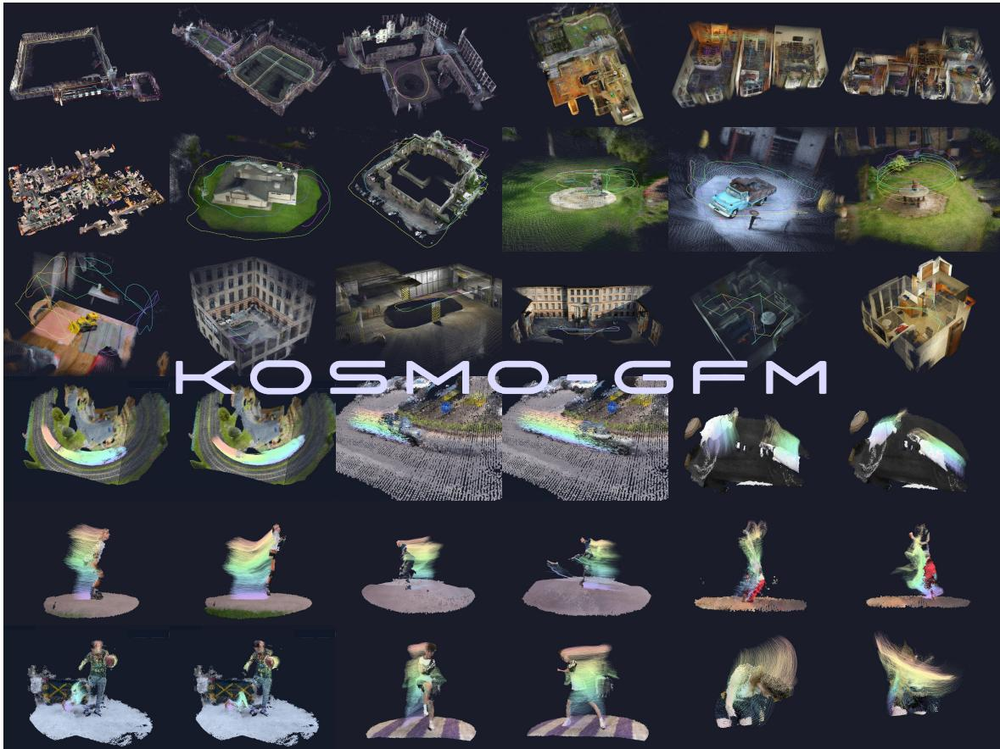  
Figure 1. Kosmo-GFM. Top: static scene reconstructions with camera trajectories. Bottom: dynamic 3D points and motion trajectories.

## Contents

Introduction   
2 Related Work   
2.1 3D Reconstruction   
2.2 4D Reconstruction   
2.3 Matching   
Pose Estimation Systems   
3 Kosmo-GFM   
3.1 GFM   
3.1.1 Decoder Architecture   
3.1.2 Training Loss   
3.1.3 Scene Scale   
3.1.4 View Sampling   
3.1.5 Camera-conditioned GFM   
3.1.6 AnyCamera   
3.2 PoseEngine   
3.3 KosmoWorld 14   
3.3.1 Data Generation Pipeline   
3.3.2 Generated Data and Supervision   
3.3.3 Efect of KosmoWorld Data 17   
Benchmark 18   
GFM 18   
4.1.1 3D Reconstruction 18   
4.1.2 4D Reconstruction   
PoseEngin   
4.2.1 Eficiency and Metric   
4.2.2 Matching   
4.2.3 3DGS   
5 Scaling 26   
5.1 Encoder Selection 27   
5.2 Data Scale 27   
5.3 Model Scale 28   
5.4 Training Compute 28   
Qualitative Results 30   
Camera Pose and Sparse Geometry 30   
6.2 Camera-Conditioned Dense Points 31   
Feed-Forward 3DGS 32   
6.4 3DGS 33   
6.5 Dynamic Points 34   
6.6 4DGS 34   
Discussion and Limitations 35   
7.1 Static 3D Reconstruction 35   
7.2 Dynamic 4D Reconstruction 36   
7.2.1 Applications of 3D Point Tracking   
References 37   
Acknowledgments 45

## 1 Introduction

Recovering real-world geometry and motion from images and videos is a central problem in computer vision. Traditiona reconstruction systems recover scenes through feature matching, camera pose estimation, and geometric optimization. While these methods benefit from explicit geometric constraints, they depend on reliable visual correspondences and suficient overlap between views. Textureless regions, repetitive structures, wide baselines, and scene dynamics introduce uncertainty that can compromise both camera estimation and geometry recovery. As the number of input views increases, maintaining scene consistency can also incur substantial computational cost. Balancing reconstruction quality, eficiency, and robustness to complex scenes therefore remains an important challenge.

Geometry foundation models ofer a new approach to these challenges. Through large-scale pretraining, they learn transferable spatial priors and directly predict cameras, depth, cross-view correspondences, and dynamic geometry from visual observations. These predictions provide information where conventional geometric constraints are insuficient. However, model predictions do not inherently satisfy cross-view and temporal consistency across an entire scene, particularly for long sequences, large environments, and dynamic observations. Spatial priors and geometric optimization are therefore complementary: the former provide useful predictions and initialization, while the latter integrate them into coherent scene structure. The objective is not to eliminate optimization altogether, but to exploit model capabilities to reduce the optimization required for reliable reconstruction. Following this principle, we build Kosmo-GFM, a scene reconstruction system that combines a geometry foundation model, GFM, with a pose optimization engine, PoseEngine. GFM estimates camera parameters, depth, cross-view correspondences, and dynamic 3D points from images and videos, providing spatial priors for both static geometry recovery and dynamic scene understanding. PoseEngine leverages these outputs to eficiently recover scene-level camera poses and geometry, supporting the subsequent construction of 3D Gaussian Splatting (3DGS) [Kerbl et al., 2023] representations for static scenes and 4D Gaussian Splatting (4DGS) [Wu et al., 2024] representations for dynamic scenes. The system thus connects geometric predictions from visual observations to scene-level reconstruction and renderable 3D and 4D representations.

Beyond integrating the model and optimization engine, Kosmo-GFM emphasizes the continued improvement of spatial priors. We use high-quality real-world reconstruction data from KosmoWorld to train and improve GFM’s understanding of scene geometry. As GFM improves, more reliable predictions can reduce uncertainty in subsequent geometry recovery and lessen the reliance on explicit optimization, providing a basis for simpler pose optimization and higher system eficiency. We therefore evaluate not only the accuracy of GFM’s predictions, but also their practical role in the complete reconstruction system.

We evaluate GFM on static and dynamic geometry, and evaluate PoseEngine by pose accuracy, runtime, and the quality of the resulting 3DGS reconstructions. We also conduct a separate scaling study using models developed specifically for those experiments. Our main contributions and findings are:

• GFM, a geometry foundation model with task-specific decoders. From images and videos, GFM predicts cameras, depth, cross-view matches, and dynamic 3D points, and can optionally take camera parameters as input. It achieves strong relative-pose accuracy on both SpatialBench subsets and reduces average endpoint error for dynamic points and scene flow.

• KosmoWorld, real-world reconstruction data for geometric priors. Adding KosmoWorld improves depth and relative pose estimation on both SpatialBench subsets, demonstrating the value of real-world supervision.

• PoseEngine, a prior-driven reconstruction engine. Across scenes completed by all compared methods, PoseEngine improves mean pose accuracy over GLUEMAP with substantially lower runtime. PoseEngine Flash ofers a further accuracy–eficiency trade-of.

• Scaling behavior of geometric reconstruction. Scaling experiments vary data volume, model scale, and training compute. Depth and camera accuracy generally improve with more training data, larger models, and increased training compute.

## 2 Related Work

Learned geometric prediction, cross-view matching, and scene-level optimization address complementary requirements of 3D and dynamic reconstruction. Learned models provide geometry and motion priors, matching connects observations across views, and scene-level optimization strengthens geometric consistency. This section reviews 3D reconstruction, 4D reconstruction, matching, and pose estimation systems from this perspective. Kosmo-GFM combines a shared geometry model with PoseEngine and reconstruction-derived training supervision from KosmoWorld, bringing learned prediction and geometric constraints together within a single reconstruction system.

## 2.1 3D Reconstruction

Static reconstruction recovers scene geometry and camera parameters from images or videos. Beyond prediction accuracy, its practical scope depends on how observations are processed and which camera models are supported.

End-to-end reconstruction. DUSt3R formulates reconstruction from uncalibrated image pairs as point-map regression [Wang et al., 2024b], and MASt3R couples this geometry with local descriptors for matching [Leroy et al., 2024]. Fast3R and MUSt3R extend pairwise prediction to multiple views in a common coordinate frame, reducing the need to align separate pairwise reconstructions [Yang et al., 2025, Cabon et al., 2025]. VGGT predicts multiple geometric attributes jointly [Wang et al., 2025a], whereas π3 removes dependence on a designated reference view through a permutation-equivariant architecture [Wang et al., 2026b]. SAIL-Recon scales scene regression by localizing additional images against an anchor-based neural scene representation [Deng et al., 2026b], while FastVGGT reduces inference cost through training-free token merging [Shen et al., 2026].

Another direction broadens the available inputs: Depth Anything 3 supports geometry recovery with or without known camera poses [Lin et al., 2026b], while MapAnything and WorldMirror incorporate optional geometric observations or priors into feed-forward reconstruction [Keetha et al., 2026, Liu et al., 2026b]. OmniVGGT further studies the injection and fusion of auxiliary geometric modalities [Peng et al., 2026b]. AMB3R uses a compact volumetric backend for metric-scale geometric reasoning [Wang and Agapito, 2026], and VGGT-Ω examines scaling model capacity and training data for static and dynamic reconstruction [Wang et al., 2026a]. These approaches extend direct prediction through richer conditioning, scene representations, and training scale, rather than treating image count as the only dimension of scalability.

Online reconstruction. Streaming methods update a scene as observations arrive, balancing the retention of historical geometry against memory use and latency. Spann3R maintains external spatial memory [Wang and Agapito, 2025], while CUT3R carries a persistent recurrent state across observations [Wang et al., 2025c]. Point3R associates explicit spatial pointers with scene locations [Wu et al., 2025]. StreamVGGT uses causal attention and cached features [Zhuo et al., 2026], and STream3R formulates sequential point-map prediction with a causal decoder-only transformer [Lan et al., 2026b]. WinT3R combines windowed inference with a global camera-token pool [Li et al., 2026d].

Extending inference beyond the training sequence length also requires controlling drift and forgetting. TTT3R reinterprets memory updates as online learning [Chen et al., 2026d], LoGeR combines parametric memory with sliding-window context [Zhang et al., 2026b], and LingBot-Map combines an anchor context, a pose-reference window, and a trajectory memory [Chen et al., 2026b]. InfiniteVGGT uses a bounded rolling cache [Yuan et al., 2026]. LongStream combines keyframe-relative pose prediction with scale modeling and cache management [Cheng et al., 2026], whereas ABot-Recon instead emphasizes local temporal context and adjacent-frame relative predictions [Han et al., 2026]. Test-time training ofers another memory mechanism: VGG-T3 distills scene information into a fixed-size network for scalable ofline reconstruction [Elflein et al., 2026], while Scal3R adapts a neura global-context representation at test time for long sequences [Xie et al., 2026]. VGG-T3 is related to streaming methods through its memory formulation, but does not require strictly causal inference.

Video reconstruction must also account for scene dynamics. MonST3R adapts point-map prediction to recover geometry at individual timesteps [Zhang et al., 2025b], while PAGE-4D separates the treatment of dynamic information for camera estimation and geometry reconstruction [Zhou et al., 2026b], and VGGT4D mines motion cues from a pretrained geometry transformer’s attention to suppress dynamic interference in camera and geometry estimation without additional training [Hu et al., 2026b]. These methods predict cameras and geometry rather than scene motion. They address motion-induced inconsistency, complementing the memory and sequence-length concerns of streaming reconstruction.

Panoramic reconstruction. Panoramas ofer wide spatial coverage, but spherical distortion and projection discontinuities limit direct transfer from perspective-image models. PanoSplatt3R adapts perspective pretraining to unposed, wide-baseline panoramas [Ren et al., 2025]. PanoVGGT instead incorporates modeling that accounts for spherical geometry to jointly predict cameras and dense geometry from panoramic inputs [Guo et al., 2026]. PaGeR adapts a perspective-pretrained geometry transformer using mixed perspective and panoramic training, jointly estimating depth, surface normals, and sky masks [Bozic et al., 2026]. Data coverage is also important: Holo360D provides real-world continuous panoramic trajectories with aligned geometry and camera poses, supporting both training and evaluation [Ou et al., 2026].

Argus targets metric indoor reconstruction, using learned co-visibility to choose a reference view and geometric constraints to couple prediction branches [Li et al., 2026b]. CasaMaestro reconstructs house-scale geometry and camera poses from sparse multi-view panoramas [Ji et al., 2026]. Together, these works extend panoramic reconstruction from adapting perspective priors to collecting suitable supervision and maintaining metric consistency across large indoor spaces.

AnyCamera reconstruction. General camera models extend reconstruction beyond a fixed pinhole assumption. Wid3R conditions reconstruction on the camera model [Jung et al., 2026]. CAM3R predicts ray directions and scene geometry for uncalibrated wide-angle images [Guruprasad et al., 2026], whereas X-Lens estimates metric depth from calibrated, heterogeneous fisheye and pinhole views [Zhou et al., 2026a]. Fisheye3R adapts pretrained multi-view models to fisheye projection while retaining perspective-image capability [Duan et al., 2026]. RayTun3R instead adapts lightweight position- and camera-related components on a short segment of the test sequence, leaving the pretrained backbone fixed [Sinitsyn et al., 2026].

Other approaches address camera heterogeneity through training data or ray-based representations. MEOW learns mixed-camera reconstruction from procedurally rendered training tuples without requiring camera-type labels or calibration at inference [Li et al., 2026a]. G-ray parameterizes rotary position encodings using camera-local ray angles [Zhang et al., 2026c]. Any3R uses a supplied dense ray field to condition angular positional encoding and solid-angle-weighted supervision, supporting heterogeneous central cameras in one reconstruction [Chen et al., 2026a]. At the single-image level, OmniPoint decouples ray direction from distance to predict metric point clouds across pinhole, fisheye, and panoramic projections, with optional geometric priors [Ye et al., 2026]. These methods difer in whether calibration is supplied or inferred, whether adaptation is required, and whether they predict single-view geometry or jointly recover cameras and structure from multiple views.

## 2.2 4D Reconstruction

Dynamic reconstruction must recover time-varying geometry while separating scene motion from camera motion. Occlusion, reappearance, and long-range association make independently predicted depth maps insuficient for describing how scene point move. We therefore use 4D reconstruction for methods that explicitly model scene flow, dynamic points, or point trajectories over time. Methods that estimate only cameras and per-frame geometry in dynamic scenes are discussed under 3D reconstruction. Dynamic Point Maps extend point-map regression to spatial and temporal references, supporting geometry, scene flow, and correspondence prediction from image pairs [Sucar et al., 2025]. St4RTrack jointly reconstructs and tracks dynamic content through paired point maps in a world coordinate frame [Feng et al., 2025]. SpatialTrackerV2 (SpaTrackerV2) combines geometry, camera motion, and point motion in a feed-forward tracker [Xiao et al., 2025]. Any4D jointly predicts metric geometry and motion across multiple frames [Karhade et al., 2026], while V-DPM extends dynamic point maps to video to represent scene structure and per-point 3D motion [Sucar et al., 2026]. Flow4R uses relative scene flow to connect geometry and motion in two-view prediction [Qian et al., 2026]. Track4World uses a shared video representation and 3D correlation to estimate dense flow between selected frame pairs and recover world-centric trajectories [Lu et al., 2026a].

Trajectory representations make temporal continuity explicit. Shape of Motion fits shared motion bases per scene using depth and long-range 2D tracks as priors [Wang et al., 2025b]. Trace Anything predicts continuous per-pixel 3D trajectories parameterized by control points [Liu et al., 2026a]. OmniX represents dense motion with trajectory fields [Jiang et al., 2026b]. SM4RT uses structured motion bases to model coordinated point motion [Lin et al., 2026c], while Point4D extends query-based trajectory prediction to long video sequences [Jeon et al., 2026]. MoVieS links geometry and motion to rendering through moving, pixel-aligned Gaussian primitives, supporting dynamic view synthesis and point tracking [Lin et al., 2026a].

Query-based models ofer a complementary way to access dynamic geometry without decoding every point at every time. D4RT exposes point-level spatiotemporal queries [Zhang et al., 2026a]. 4RC conditionally decodes geometry and motion from an encoded clip [Luo et al., 2026]. UniQuery4R selects the source view, target view, and a continuous source-pixel coordinate at decoding time [Chen et al., 2026c]. Fast Spatial Tracking combines global and frame-level query features to predict trajectories from geometry-grounded video features [Huang et al., 2026]. L4P shares a video encoder across depth, optical flow, and point tracking, while retaining lightweight task-specific heads [Badki et al., 2026].

ARROW broadens the input setting from a single ordered video to arbitrary image sets, using order-invariant queries to associate observations across viewpoints and capture times [Fradlin et al., 2026]. Across these methods, the main distinctions concern whether motion is represented by pairwise displacement, continuous trajectories, structured motion, or conditional queries, and how each representation handles visibility and temporal extent.

## 2.3 Matching

Visual correspondences connect image observations to geometric constraints. Dense matching emphasizes coverage, sparse matching limits computational cost, and multi-view matching or tracking seeks consistency across more than two observations.

Dense matching. RoMa combines frozen DINOv2 [Oquab et al., 2024] coarse features with fine convolutional features and a transformer match decoder for robust dense matching [Edstedt et al., 2024]. RoMa v2 further studies architecture, training distribution, and eficient refinement for dificult image pairs [Edstedt et al., 2026]. UFM unifies optical flow and wide-baseline matching as dense displacement prediction [Zhang et al., 2025c]. These methods provide constraints across a broader image area than sparse keypoints, although their use in reconstruction still requires handling visibility and unreliable correspondences.

Sparse matching. Sparse pipelines separate the selection and description of keypoints from their association across images. DISK learns local features through a matching-oriented reinforcement-learning objective [Tyszkiewicz et al., 2020]. ALIKED uses sparse deformable descriptors for eficient extraction [Zhao et al., 2023], while DaD studies descriptor-free keypoint learning and detector distillation [Edstedt et al., 2025]. At the matching stage, LightGlue adapts computation to the dificulty of an image pair [Lindenberger et al., 2023], and LoMa revisits local matching through model and data scaling [Nordström et al., 2026]. Detector quality, descriptor discriminability, and assignment accuracy thus contribute separately to the reliability and cost of sparse geometric constraints.

Multi-view matching and tracking. Reliable pairwise matches do not automatically form consistent multi-view tracks. VGGSfM uses point tracks in a diferentiable SfM pipeline [Wang et al., 2024a]. CoTracker3 learns 2D tracking from realvideo pseudo-labels [Karaev et al., 2025], while SpatialTrackerV2 jointly models scene geometry, camera motion, and 3D point motion [Xiao et al., 2025]. MV-RoMa jointly matches a source image to multiple targets and constructs tracks for reconstruction [Lee et al., 2026]. MVLoMa instead combines features from geometry foundation models with sparse center– neighbor matching on a star graph [Lu et al., 2026b]. These approaches difer in whether they associate dense pixels, sparse keypoints, or tracked points, while sharing the aim of using information from multiple observations jointly.

Geometry-assisted trackers explicitly use external geometric estimates. The earlier SpatialTracker, the predecessor of SpatialTrack erV2, lifts pixels to 3D with monocular depth and represents each frame with a triplane [Xiao et al., 2024]. DELTA combines global–local attention with trajectory upsampling for dense 3D tracking [Ngo et al., 2025b], whereas DELTAv2 reduces its cost through coarse-to-fine trajectory expansion and more eficient correlation computation [Ngo et al., 2025a]. TAPIP3D uses depth and camera motion to construct stabilized 3D feature clouds, in which local attention refines point trajectories [Zhang et al. 2025a].

With synchronized, calibrated cameras, MVTracker fuses multi-view features and depth into a common 3D cloud [Rajič et al., 2025]. MV-TAP uses camera geometry and cross-view attention to track 2D points across video streams [Koo et al., 2026], whereas LAPA combines appearance and geometric constraints through attention to recover multi-camera 3D trajectories [Galoaa et al., 2026]. These methods exploit complementary views to reduce ambiguity and occlusion. They assume supplied camera calibration, whereas joint reconstruction and tracking from unposed RGB also require estimating camera parameters.

## 2.4 Pose Estimation Systems

Pose estimation systems recover cameras in a shared coordinate frame and usually estimate scene structure alongside them. These systems fall into three families according to whether they use no learned geometric or pose priors, geometric priors only, or both geometric and camera-pose priors.

Traditional SfM. Classical SfM combines visual correspondences with multi-view geometry to estimate cameras and sparse structure. COLMAP provides an incremental reconstruction pipeline [Schönberger and Frahm, 2016], while GLOMAP revisits global SfM: after rotation averaging, it jointly estimates camera positions and 3D points in a single global positioning step instead of separate translation averaging and triangulation, bringing global SfM close to incremental accuracy and robustness [Pan et al., 2024]. Their explicit geometric constraints remain valuable for scene-level consistency, although reliable correspondences and adequate observation geometry are important for successful reconstruction.

Systems with geometric priors. This family retains geometric estimation while introducing learned depth or surface information. MP-SfM combines monocular depth and normal priors with multi-view constraints [Pataki et al., 2025]. MegaSaM targets camera and depth recovery from casual dynamic videos [Li et al., 2025], while ViPE estimates intrinsics, camera motion, and dense depth across diverse video and camera settings [Huang et al., 2025]. VidMap exploits video temporal structure and depth priors [Pataki et al., 2026]. Marginalized bundle adjustment mitigates the high error variance of dense monocular depth when estimating multi-view cameras [Zhu et al., 2026]. Their common motivation is to strengthen geometric evidence when appearance-based constraints alone are unreliable, rather than replace scene-level estimation with independent predictions.

Systems with geometric and pose priors. Foundation models can also provide initial cameras together with local geometry. MASt3R-SfM integrates model-derived reconstruction and matching [Duisterhof et al., 2025]. VGGT-SLAM and VGGT-Long combine local predictions across longer sequences [Maggio et al., 2025, Deng et al., 2026c]. VGGT-SLAM++ adds DEM-based submap association and frequent local bundle adjustment for large-scale mapping with bounded memory [Mandal et al., 2026]. GLUEMAP runs feed-forward inference on local star graphs filtered by Doppelgangers++ [Xiangli et al., 2025] and fuses multiple track types in bundle adjustment, gaining robustness to symmetry, appearance change, and low overlap [Pan et al., 2026]. Glob3R also integrates feed-forward predictions into global reconstruction [Deng et al., 2026a], while GeoWeaver studies hierarchical assembly and refinement of geometric priors [Jiang et al., 2026a]. HiP3R first aligns local reconstructions with a chunk-level Sim(3) pose graph, then refines a shared SE(3) camera for each frame under the fixed global layout. This hierarchy reconciles overlapping predictions without retraining the underlying reconstruction model [Xu et al., 2026]. These systems combine learned initialization with cross-view constraints to improve consistency beyond individual prediction windows, with diferent choices for organizing observations and controlling optimization cost.

## 3 Kosmo-GFM

This section introduces the three complementary components of Kosmo-GFM and how they work together (Figure 2). GFM uses shared multi-view features to predict cameras, depth, cross-view correspondences, and dynamic points, with optional camera conditioning. PoseEngine combines these priors with cross-view constraints to recover scene cameras for dense geometry prediction and subsequent rendering. KosmoWorld converts real-world reconstructions into training supervision; the reported ablation shows improvements in depth and relative-pose prediction. Together, these components connect multi-task geometric prediction, scene-level camera recovery, and training-data construction, supporting a range of static and dynamic reconstruction outputs.

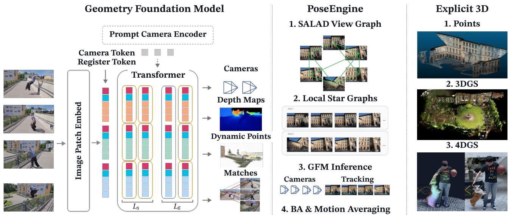  
Figure 2. Overview of Kosmo-GFM. GFM supplies geometric priors, and PoseEngine organizes cross-view constraints and refines scene cameras. The resulting cameras and geometry support point-cloud, 3DGS, and 4DGS reconstruction.

## 3.1 GFM

Given images $\mathcal { T } = \{ I _ { i } \} _ { i = 1 } ^ { V }$ , GFM learns a shared multi-view representation from which task-specific decoders recover geometry and motion. The encoder follows the Depth Anything 3 [Lin et al., 2026b] design: within-view attention captures image structure, while cross-view attention establishes geometric context across observations. Camera tokens and four register tokens complement the image tokens. The backbone is ViT-Giant with 14 × 14 patches. Features from blocks 19, 27, 33, and 39 are combined into 3,072-dimensional representations for depth decoding. Static geometry, motion, and matching are trained under task-specific objectives, as described below. Besides RGB-only inference, GFM can also take known camera parameters as an input prompt (Section 3.1.5). Section 4.1.1 compares the two modes.

## 3.1.1 Decoder Architecture

The decoders address complementary aspects of reconstruction (Figure 3). Camera and depth prediction establish a common geometric frame. Cross-view matching links observations of the same scene point, and spatiotemporal queries extend this representation to moving points.

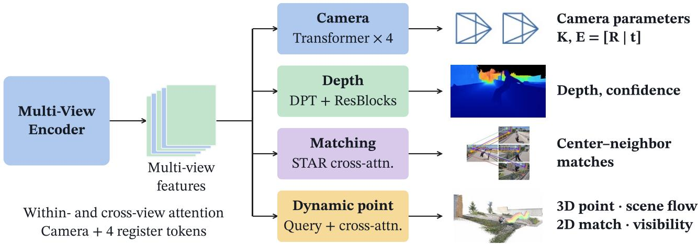  
Figure 3. Task-specific decoding from shared multi-view features. Camera and depth decoding recover static geometry, STAR matching establishes cross-view correspondences, and source–target queries predict geometry and motion at a selected time.

Camera decoder. A four-block transformer decodes each camera token into translation, quaternion rotation, and horizontal and vertical fields of view. The nine-dimensional estimate is refined over four iterations, with the previous estimate detached before conditioning the next update. Supervision at each iteration guides the progressive refinement of the intrinsic matrix $K _ { i }$ and the extrinsics $E _ { i } = \left[ R _ { i } \mid t _ { i } \right]$ . GFM uses the camera coordinate system of the first frame as the world coordinate system and predicts extrinsics in the world-to-camera convention: $E _ { i }$ maps a world point $P$ to the camera frame of view i as $R _ { i } P + t _ { i }$

Depth decoder. The depth decoder follows a DPT-style coarse-to-fine design [Ranftl et al., 2021]. Four feature levels are projected to 256 channels, reshaped into spatial maps, and fused through successive upsampling and skip connections. After each upsampling stage of the DPT head, we add residual (ResNet) blocks [He et al., 2016], which reduce spurious 3D points near depth discontinuities. The final prediction contains depth and confidence, with an exponential activation ensuring positive depth For a pinhole camera, the pixe $\bar { \boldsymbol { x } } = ( u , v , 1 ) ^ { \top }$ is mapped to the common coordinate frame by

$$
\hat { P } _ { i } ^ { \mathrm { l o c a l } } = \hat { z } _ { i } K _ { i } ^ { - 1 } \bar { x } , \qquad \hat { P } _ { i } ^ { \mathrm { w o r l d } } = R _ { i } ^ { \top } ( \hat { P } _ { i } ^ { \mathrm { l o c a l } } - t _ { i } ) .\tag{1}
$$

Dynamic-point decoder. Following UniQuery4R [Chen et al., 2026c], a query $\boldsymbol { q } = ( u , v , s , t )$ identifies a pixel $( u , v )$ in source frame s and asks for its state at target frame t. Multi-scale features sampled at the source pixel are combined by gated fusion and attend to target-view features. The resulting representation predicts the target-time 3D point, scene flow, 2D correspondence, and visibility. A source-only path predicts local depth. All points are expressed in the first-view reference frame. Encoding a clip once allows its features to be reused across source pixels and target times, supporting both sparse tracking and dense prediction.

Matching decoder. The matching decoder adopts the STAR organization of MVLoMa [Lu et al., 2026b], connecting one center view to several neighboring views. For each view, descriptors are sampled from GFM feature maps at the keypoint locations. Cross-attention between the center and neighboring views then updates these descriptors using cross-view evidence. The resulting descriptors yield matching assignments for each center–neighbor pair, providing correspondences for multi-view track construction.

## 3.1.2 Training Loss

Training combines geometric regression, confidence estimation, visibility classification, and correspondence learning. For each task, angle brackets denote averaging over the valid samples. Task-specific masks exclude invalid geometric labels.

Camera loss. Camera supervision constrains relative pose across views and field of view within each image. For world-to-camera transformations $E _ { i }$ and $E _ { j }$ , the relative transformation is

$$
T _ { i \to j } = E _ { j } E _ { i } ^ { - 1 } .\tag{2}
$$

At refinement iteration $k ,$ we average translation errors and rotation errors measured using quaternions over view pairs:

$$
\mathcal { L } _ { \mathrm { p o s e } } ^ { ( k ) } =  \lambda _ { T } \mathcal { L } _ { T , i  j } ^ { ( k ) } + \lambda _ { R } \mathcal { L } _ { R , i  j } ^ { ( k ) }  _ { i , j } .\tag{3}
$$

The overall camera objective accumulates pose and field-of-view supervision over the refinement iterations:

$$
\mathcal { L } _ { \mathrm { c a m e r a } } = \sum _ { k } \alpha _ { k } \left[ \mathcal { L } _ { \mathrm { p o s e } } ^ { ( k ) } + \lambda _ { \mathrm { F o V } } \left. \mathcal { L } _ { \mathrm { F o V } , j } ^ { ( k ) } \right. _ { j } \right] .\tag{4}
$$

We use L1 pose errors, with separate weights for translation, rotation, and field of view. Iteration weights discount earlier refinement steps, and dataset-level weights balance supervision across training sources.

Depth loss. Depth supervision compares predicted and reference local 3D points, $\hat { P }$ and P. Let $r = \left\| \hat { P } - P \right\| _ { \mathbf { \hat { \Pi } } }$ and let z be reference depth. Normalizing the geometric residual by depth reduces its dependence on scene scale. With predicted confidence $c ,$ the depth-normalized objective is

$$
\mathcal { L } _ { \mathrm { d e p t h } } = \lambda _ { \mathrm { g e o m } } \left. \frac { r } { \vert z \vert + \epsilon } \right. + \lambda _ { \mathrm { c o n f } } \left. c r - \beta \log c \right. .\tag{5}
$$

Here ϵ stabilizes the geometric normalization, $c = 1 + \exp ( a )$ , and $\beta$ controls the penalty on trivial confidence reduction. Only the geometric term is divided by reference depth, whereas the confidence term uses the absolute 3D residual r. Validity mask and robust residual filtering suppress unreliable supervision.

Dynamic-point and visibility loss. Dynamic-point supervision follows the UniQuery4R formulation [Chen et al., 2026c, Sec. 3 and Appendix $\mathbf { A l } .$ . Training geometry is normalized by the mean distance from the clip’s points to the reference origin. For a target-time prediction $\hat { P } _ { i }$ and reference point $P _ { i }$ , let $z _ { i }$ denote the reference depth and $\nu _ { P }$ the valid-label set. Define

$$
\begin{array} { r } { e _ { i } = \Big \| \hat { P } _ { i } - P _ { i } \Big \| _ { 1 } , \qquad r _ { i } = \frac { e _ { i } } { | z _ { i } | + \epsilon } , \qquad c _ { i } = 1 + \exp ( a _ { i } ^ { P } ) , \qquad \mathcal { R } _ { P } = \{ i \in \mathcal { V } _ { P } : r _ { i } < \tau _ { P } \} . } \end{array}\tag{6}
$$

Here $\tau _ { P }$ is the geometric residual threshold. With per-query weights $w _ { i } ,$ point supervision combines a filtered geometric residual with confidence-weighted regression:

$$
\mathcal { L } _ { \mathrm { d y n a m i c } } = \lambda _ { \mathrm { g e o m } } \langle w _ { i } r _ { i } \rangle _ { \mathcal { R } _ { P } } + \lambda _ { \mathrm { c o n f } } \langle w _ { i } ( c _ { i } e _ { i } - \beta \log c _ { i } ) \rangle _ { \mathcal { V } _ { P } } .\tag{7}
$$

The confidence term uses the unnormalized position error $e _ { i } ,$ whereas residual rejection applies only to the geometric term. Alongside 3D position regression, the dynamic-point objective supervises visibility for queries visible in the source view. Let yt indicate target-view visibility, $a _ { i } ^ { v }$ be its predicted logit, and $\gamma _ { s }$ be the source-visible query set. The visibility component is binary cross-entropy:

$$
\mathcal { L } _ { \mathrm { v i s i b i l i t y } } = - \left. y _ { i } ^ { t } \log \sigma ( a _ { i } ^ { v } ) + ( 1 - y _ { i } ^ { t } ) \log ( 1 - \sigma ( a _ { i } ^ { v } ) ) \right. _ { \mathcal { V } _ { s } } .\tag{8}
$$

Target-occluded points remain negative examples, so the model learns both visibility and occlusion. Empty valid sets contribute zero. This term is weighted separately from the correspondence-related auxiliary visibility terms. Auxiliary 2D correspondence supervision uses a robust residual and retains occluded target tracks with reduced weight. Scene-flow supervision separates direction and magnitude and balances moving and static points

Matching loss. Following MVLoMa [Lu et al., 2026b, Sec. 3.3–3.4], an N-view STAR comprises one center and $N - 1$ neighbors. Supervision at each of the L matcher layers combines positive assignment, matchability, and geometric-negative terms:

$$
\mathcal { L } _ { \mathrm { m a t c h e s } } = \frac { 1 } { L } \sum _ { \ell = 1 } ^ { L } \left[ \mathcal { L } _ { \mathrm { g l u e } } ^ { \ell } + \mathcal { L } _ { \mathrm { m a t c h a b i l i t y } } ^ { \ell } + \frac { 1 } { N - 1 } \sum _ { j = 1 } ^ { N - 1 } \mathcal { L } _ { \mathrm { n e g } } ^ { j , \ell } \right] .\tag{9}
$$

For center and neighbor descriptors $d _ { p } ^ { c }$ and $d _ { q } ^ { j } .$ , dual-softmax normalization produces an assignment confidence for each edge:

$$
S _ { p q } ^ { j } = \langle d _ { p } ^ { c } , d _ { q } ^ { j } \rangle , \qquad P _ { p q } ^ { j , \ell } = \mathrm { s o f t m a x } _ { p } ( S ^ { j , \ell } / \tau ) _ { p q } \mathrm { s o f t m a x } _ { q } ( S ^ { j , \ell } / \tau ) _ { p q } .\tag{10}
$$

Positive correspondences are obtained by depth-and-pose reprojection, subject to valid depth, image bounds, and target-depth and occlusion consistency. The matchability term predicts whether a valid counterpart exists. Geometric negatives are identified from high-confidence assignments that violate the ground-truth epipolar relation:

$$
\begin{array} { r l r l r l r } & { } & { F _ { j } = K _ { j } ^ { - \top } [ t _ { j } ] _ { \times } R _ { j } K _ { c } ^ { - 1 } , \quad } & { e _ { p q } ^ { j } = \frac { | \left( \bar { x } _ { q } ^ { j } \right) ^ { \top } F _ { j } \bar { x } _ { p } ^ { c } | } { \left\| \left( F _ { j } \bar { x } _ { p } ^ { c } \right) \mathrm { 1 : 2 } \right\| _ { 2 } } , } & & { \mathcal { N } _ { j } = \{ \left( p , q \right) \in \mathcal { M } _ { j } : e _ { p q } ^ { j } > \tau _ { \mathrm { e p i } } \} . } \end{array}\tag{11}
$$

Here $\tau _ { \mathrm { e p i } }$ is the epipolar-error threshold in pixels, $( R _ { j } , t _ { j } )$ is the relative pose, $K _ { c } , K _ { j }$ are intrinsics, and x¯ denotes homogeneous pixel coordinates. The candidate set $\mathcal { M } _ { j }$ contains final-layer mutual maxima above threshold $\mu .$ Coordinates and intrinsics are expressed at the prediction resolution. The same negative set supervises every layer:

$$
\mathcal { L } _ { \mathrm { n e g } } ^ { j , \ell } = - \frac { 1 } { | \mathcal { N } _ { j } | } \sum _ { ( p , q ) \in \mathcal { N } _ { j } } \log ( 1 - P _ { p q } ^ { j , \ell } ) .\tag{12}
$$

Empty negative sets contribute zero. Matching supervision trains the cross-view attention and assignment layers while keeping the GFM feature encoder frozen.

## 3.1.3 Scene Scale

We distinguish three scale conventions: a global geometry scale for RGB-only supervision, a camera-pose scale for cameraconditioned prediction, and an internal scene scale for the 3DGS decoder.

Global geometry scale. Scene extent and observation distance vary substantially across scenes. For the RGB-only model, we define a global scale as the mean distance of all valid 3D points across the input views to the first camera center. Depth, 3D points, and camera translations are divided by this shared scale. This preserves relative geometry within each scene while bringing supervision across scenes into comparable numerical ranges.

Camera-pose scale. For camera-conditioned models, predicted geometry should follow the input camera poses, and predictions from diferent chunks should be mapped back to a common scale. We therefore define the pose scale using the maximum distance from an input camera center to the first camera center:

$$
s _ { \mathrm { p o s e } } = \operatorname* { m a x } _ { i } \| C _ { i } - C _ { 1 } \| _ { 2 } .\tag{13}
$$

Here $C _ { i }$ denotes an input camera center. The implementation applies a lower-bound safeguard to very small normalization factors.   
With this scale as a shared reference, we trained two models, each using one of the following schemes.

Scheme 1: direct pose-scale normalization. Camera translations, depth, and 3D points are divided by $s _ { \mathrm { p o s e } } ,$ and the model directly predicts geometry in pose-normalized units. Each chunk may use a diferent normalization factor. As long as the input poses share the same coordinate units, reversing each chunk’s normalization and reference-frame transform restores its geometry to the common input-pose coordinate system. This provides a consistent scale reference for cross-chunk reconstruction.

Scheme 2: decoupled pose and per-frame geometry scales. When camera motion is small relative to scene distance, dividing depth directly by the pose scale can produce large values, widening the prediction range and making optimization harder. We retain the pose scale as the shared reference, but normalize each frame’s geometry by its own scale $s _ { i } ,$ the mean distance of valid local 3D points to that frame’s camera center. A separate scale branch predicts the ratio

$$
r _ { i } = { \frac { s _ { i } } { s _ { \mathrm { p o s e } } } } .\tag{14}
$$

Depth is supervised in units normalized by the per-frame geometry scale, camera translation remains normalized by the shared pose scale, and the scale ratio receives separate supervision. At inference, the predicted ratio converts normalized per-frame depth back to pose-normalized units:

$$
\hat { d } _ { i } ^ { \mathrm { p o s e } } = \hat { \tilde { d } } _ { i } \hat { r } _ { i } .\tag{15}
$$

This keeps depth targets in a more suitable numerical range for learning while retaining the means to align them with the input poses and other chunks. Per-frame depth regression is thus decoupled from the magnitude of camera motion without losing the shared pose-scale reference.

3DGS scale. As an experimental extension, we build a 3DGS decoder. When training this feed-forward 3DGS model, we recompute the scene scale from the predicted geometry and apply a shared normalization. This gives 3DGS parameters a more consistent relative spatial meaning and keeps properties such as Gaussian positions and spatial sizes in more stable numerical ranges.

Specifically, we back-project predicted depths into the shared reference frame, compute the 95th percentile of the distances of valid 3D points to the origin, and scale that radius to a fixed reference value of 2.0:

$$
a _ { \mathrm { G S } } = \frac { 2 . 0 } { Q _ { 0 . 9 5 } \Big ( \{ \| \hat { X } _ { i , p } ^ { \mathrm { p o s e } } \| _ { 2 } \} _ { \mathrm { v a l i d } } \Big ) } .\tag{16}
$$

Here $\hat { X } _ { i , p } ^ { \mathrm { p o s e } }$ is the back-projected point for pixel $p$ in view i, expressed in the shared pose-normalized reference frame. One factor $a _ { \mathrm { G S } }$ uniformly scales geometry and camera translation across all input views, so the 3DGS decoder operates at a consistent relative scene scale.

## 3.1.4 View Sampling

We sample training clips with deliberately low inter-frame co-visibility, reducing redundant observations of the same scene content. Low-overlap observations encourage the model to learn more precise features for establishing correspondences across viewpoints. To select the temporal interval, we examine how the co-visibility distribution changes with frame separation and choose a step where its lower bound approaches zero. Figure 4 illustrates this sampling criterion on ScanNet [Dai et al., 2017]. For V input views, we form a temporal window of V × step frames and resample V views within it. The interval is chosen separately for each data source, and it is not a requirement that every sampled view pair have zero overlap.

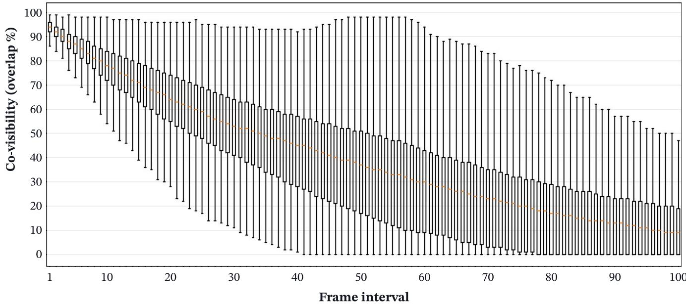  
Figure 4. Co-visibility versus temporal separation. A sampling step near the lower-bound zero crossing favors low-overlap training clips.

## 3.1.5 Camera-conditioned GFM

We obtain Camera-conditioned GFM by further training the RGB-only GFM. It takes images or video frames with known per-frame camera intrinsics and extrinsics and predicts a dense point cloud for each frame. A prompt camera encoder maps each frame’s camera parameters to a prompt camera token.

Unlike Depth Anything 3 [Lin et al., 2026b], we replace the first register token with the prompt token instead of replacing the camera token. Directly replacing the camera token lets prompt information flow directly to the camera head. This can substantially improve camera accuracy, but risks an information shortcut: the camera head can reproduce the supplied parameters while patch tokens make limited use of them. Our design encourages both camera and patch tokens to integrate the prompt information for dense geometry prediction.

We also construct training samples with no inter-frame co-visibility, encouraging both token types to use camera prompts without visual correspondences. Table 4 in Section 4.1.1 reports the results.

## 3.1.6 AnyCamera

To extend GFM beyond pinhole imagery, we incorporate fisheye and panoramic observations during training. Compared with conventional pinhole cameras, fisheye and panoramic cameras ofer a wider field of view. This broader coverage can provide more multi-view constraints in latent space, enabling more accurate camera poses and more eficient reconstruction. Figure 5 compares camera-token attention under pinhole-only and pinhole-plus-fisheye training. It provides a qualitative view of the change in cross-view feature aggregation. Figure 6 shows reconstruction with mixed pinhole and fisheye cameras, and Figure 7 shows reconstruction with panoramic cameras.

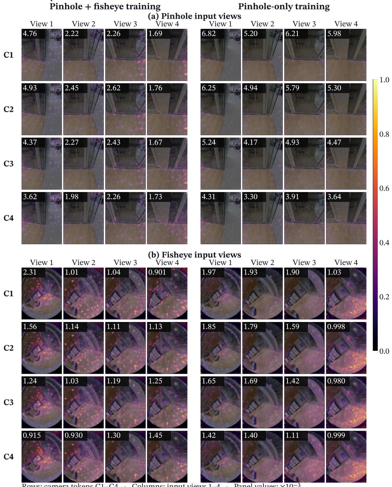  
Rows: camera tokens C1–C4 · Columns: input views 1–4 · Panel values: ×10⁻³

Figure 5. Camera-token attention across views under mixed-camera and pinhole-only training. Each panel overlays the attention of every camera token (rows) on the input views (columns). Top: four pinhole input views. Bottom: four fisheye input views. Both models use the same image sequence in each example.

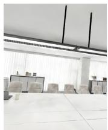  
View 1 · Pinhole

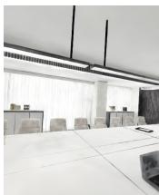  
View 2 · Pinhole

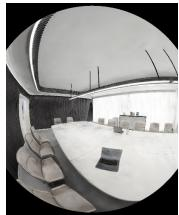  
View 3 · Fisheye

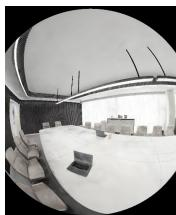  
View 4 · Fisheye

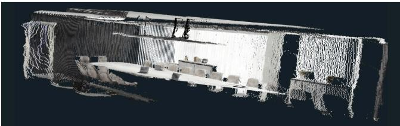  
Predicted 3D points

Figure 6. Mixed pinhole–fisheye reconstruction. Left: two pinhole and two fisheye input views. Right: 3D points predicted by GFM from the four views.  
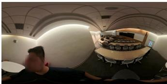  
View 1

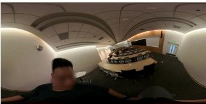

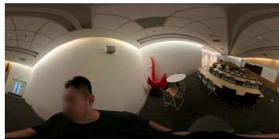  
View 3

View 2  
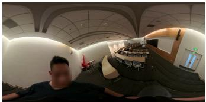  
View 4

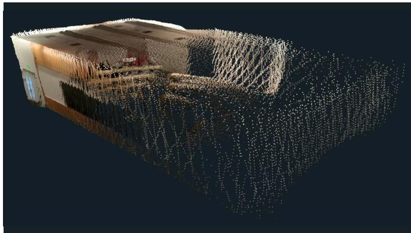  
Predicted 3D points  
Figure 7. Panoramic reconstruction. Left: four equirectangular input views. Right: 3D points predicted by GFM from the four panoramas.

## 3.2 PoseEngine

Feed-forward predictions provide a strong geometric initialization, but scene reconstruction also requires consistency across many observations. Inspired by GLUEMAP [Pan et al., 2026], PoseEngine combines GFM priors with optimization and organizes reconstruction around STARs, each consisting of one center image and its neighbors. It provides two STAR construction scheme for diferent input types.

STAR construction. For unordered image collections, PoseEngine follows the STAR construction scheme of GLUEMAP [Pan et al., 2026]: it retrieves candidate neighbors with SALAD [Izquierdo and Civera, 2024] global descriptors and verifies them with Doppelgangers++ [Xiangli et al., 2025], forming STARs of 26 images. For ordered sequences, each STAR is built mainly from temporally adjacent frames, supplemented by a small number of SALAD-retrieved frames, again totaling 26 images. We compare both STAR policies in the matching study, while the main reconstruction benchmark uses the ordered policy, labeled PoseEngine.

Matching. Within each STAR, PoseEngine matches the center image to every neighbor in a single pass using the MVLoMa decoder of GFM. For STAR inputs, a single GFM forward pass therefore provides both geometric priors and correspondences without requiring additional images or new image pairings. The evaluated implementation uses a LoMa Large fallback for inputs of at most 26 images.

Design principle. The stronger GFM becomes, the simpler PoseEngine can be: more accurate camera and geometry prior require fewer bundle-adjustment rounds, which substantially reduces system runtime. Section 4.2 supports this view, as PoseEngine achieves higher mean pose accuracy than GLUEMAP with substantially lower cumulative runtime.

PoseEngine Flash. For large-scale scenes, we further provide PoseEngine Flash, which combines FP8/FP16 mixed-precision inference, a simple bundle-adjustment scheme, and system-level optimization of the overall pipeline to substantially reduce runtime and enable fast reconstruction of large scenes.

The refined cameras condition dense geometry prediction and initialize 3DGS and 4DGS reconstruction. During 3DGS and 4DGS fitting, joint optimization of camera poses and Gaussian parameters can compensate for part of the pose error introduced by faster reconstruction. This enables PoseEngine Flash to support high-quality 3DGS and 4DGS reconstruction while reducing pose-estimation cost.

## 3.3 KosmoWorld

KosmoWorld provides high-quality real-world reconstruction data for learning geometric priors. Its pipeline reconstructs real scenes, selects locations with reliable geometry and rendering quality, and generates images with corresponding depth and camera poses along configurable trajectories. The resulting data support diverse viewpoints and camera models while preserving the appearance and geometry of real scenes (Figure 8).

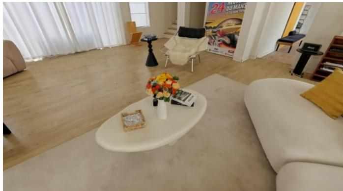  
(a) High-resolution images

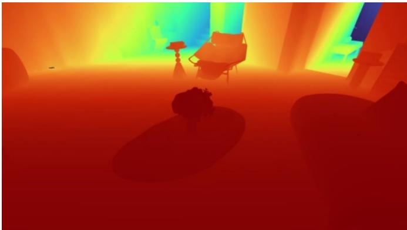  
(b) High-quality depth

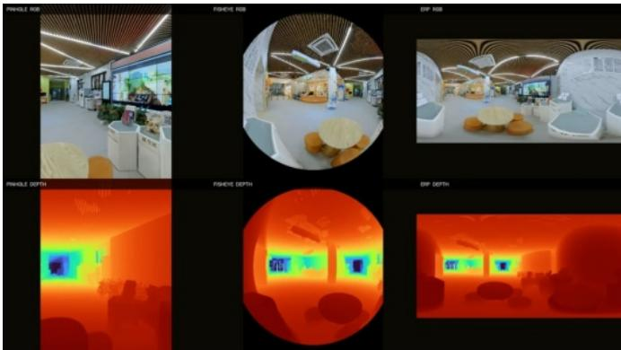  
(c) Multi-camera formats

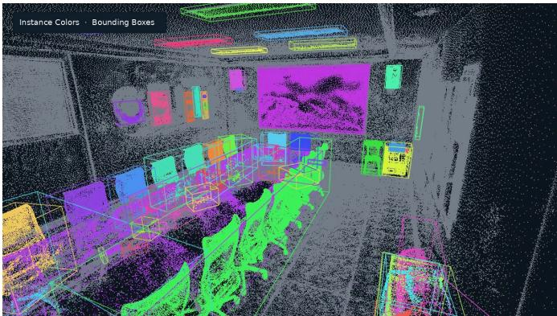  
(d) Semantic / instance labels  
Figure 8. KosmoWorld training data and supervision. The four panels show high-resolution images, depth, multi-camera formats, and semantic and instance annotations. Video panels show representative recorded frames.

## 3.3.1 Data Generation Pipeline

KosmoWorld builds on WorldNav, the trajectory-planning module introduced in Tencent Hunyuan’s HY-World 2.0 [Team HY-World, 2026]. Our data-generation pipeline applies this planning framework to reconstructed real-world scenes, combining camera-location screening, trajectory planning, and RGB and depth rendering under configurable camera models. Reconstruction quality varies spatially, so the pipeline combines geometric feasibility with observation quality before generating data.

Geometric feasibility and location selection. Our pipeline first aligns the scene mesh, 3D Gaussians, and capture poses in a shared coordinate frame. A heightfield and navigation mesh built with Recast [Recast Navigation Contributors, 2026] identify candidate regions using slope, step height, vertical clearance, and connectivity. When capture poses are available, probing starts near the captured area and expands to unevaluated locations. An optional constraint limits expansion to the local convex hull of capture positions at compatible heights.

Panoramic observation confidence. At each probe position, six cube faces cover the viewing sphere and provide RGB, alpha, and depth. Sharpness and local image structure characterize appearance quality, alpha measures rendering coverage, and the fraction of pixels with valid depth measures geometric completeness. Local checks examine the spatial distribution of blur and missing depth to distinguish low-texture surfaces from reconstruction defects. A clarity score combines normalized sharpness $s _ { n } .$

Laplacian variance $l _ { n }$ , mean alpha $a _ { n } .$ , and depth completeness $h _ { n }$

$$
q _ { \mathrm { c l a r i t y } } = 0 . 4 s _ { n } + 0 . 2 l _ { n } + 0 . 2 a _ { n } + 0 . 2 h _ { n } .\tag{17}
$$

When both mesh quality and 3DGS rendering quality are evaluated, the joint score is $q _ { \mathrm { j o i n t } } = \operatorname* { m i n } ( q _ { \mathrm { m e s h } } , q _ { \mathrm { G S } } )$ . This prevents a strong result in one representation from compensating for a weak result in the other. Under the strict panoramic policy, every required direction must be sampled and pass the quality checks. These scores assess observation quality rather than calibrated probabilities. The usable region contains locations passing both geometric and panoramic checks, with capture support enforced when enabled. Unevaluated locations are excluded from planning.

Region partitioning and route selection. The trajectory planner connects usable locations by reachability and plan disconnected components independently. In the mode that prioritizes coverage, a distance transform of free space identifies cores with high clearance, and graph-geodesic assignment partitions the remaining nodes along boundaries such as walls and passages. The planner selects representative targets, adds targets where coverage is sparse, and connects them through graph search. When quality weighting is enabled, an edge cost balances travel distance, clearance, and observation quality:

$$
w _ { i j } = d _ { i j } \phi _ { \mathrm { c l e a r a n c e } } ( i , j ) \left[ 1 + \lambda _ { q } \left( 1 - \frac { q _ { i } + q _ { j } } { 2 } \right) \right] .\tag{18}
$$

Here $d _ { i j }$ is the distance between adjacent nodes, $\phi _ { \mathrm { c l e a r a n c e } }$ accounts for boundaries and narrow passages, $q _ { i }$ and $q _ { j }$ are node-quality scores, and $\lambda _ { q }$ controls the quality weight. All route nodes remain in the usable region. Multiple routes are selected to extend spatial coverage while reducing repeated edges and overlapping segments.

Trajectory diversity and validation. Four motion profiles provide complementary viewpoint changes. Regular traversal connects the origin to geodesically distant targets in diferent angular sectors, producing continuous translational parallax. Wandering connects successive goals while favoring unvisited locations and uncovered directions. Landmark orbit connect reachable positions around a supplied 3D target while keeping the camera directed toward it, producing a full orbit or partial arc as space permits. Elevated and variable-height trajectories introduce vertical ofsets or connect validated positions at diferent heights, with geometry and panoramic quality checked again at the new positions.

B-spline smoothing adjusts camera positions, and interpolation along the shortest quaternion arc smooths orientations subject to turn and angular-speed limits. Because smoothing changes the visited positions, the pipeline rechecks geometric sweeps and region constraints along each segment and reassesses panoramic quality at the final sample positions. Failed samples split a route into valid continuous segments. Rendering uses only the trajectories that pass this final validation.

Camera configuration and rendering. Camera projection is configured separately from trajectory motion, allowing the same scene to produce diferent viewpoints, resolutions, and camera models. Pinhole cameras use output resolution, focal lengths, and principal point, with intrinsics optionally derived from physical focal length and sensor aperture. Fisheye cameras use calibrated intrinsics, OpenCV-fisheye / KB4 distortion coeficients, and an efective angular range. For incident angle θ, the distorted angle used in radial projection is

$$
\theta _ { d } = \theta \left( 1 + k _ { 1 } \theta ^ { 2 } + k _ { 2 } \theta ^ { 4 } + k _ { 3 } \theta ^ { 6 } + k _ { 4 } \theta ^ { 8 } \right) .\tag{19}
$$

The coeficients $k _ { 1 } { - } k _ { 4 }$ , calibration range, image canvas, and rendering backend constrain the efective field of view. Equirectangular cameras use cube-face reprojection to produce a $3 6 0 ^ { \circ } \times 1 8 0 ^ { \circ }$ spherical view at the chosen resolution and orientation. Intrinsics are transformed consistently when output resolution changes. Camera height, motion speed, and sample spacing determine positions and timestamps along the trajectory.

## 3.3.2 Generated Data and Supervision

Each RGB frame and its depth supervision share the corresponding camera pose and projection settings. The pipeline records coordinate systems, depth conventions, and valid-image masks so that image content and geometric supervision remain aligned. Depth is derived from the reconstructed scene, making region screening and trajectory validation integral to data quality.

Outputs are organized into sequences containing images, depth, camera intrinsics and extrinsics, and timestamps. Validation records retain the source scene, trajectory, and sample positions, allowing each training sample to be traced to its generation settings. These image, depth, and camera-pose sequences supplement GFM training.

Figure 9 shows three views of a KosmoWorld scene, pairing RGB images with point-cloud visualizations. The examples illustrate the appearance and geometric structure of the statue, vegetation, and building facade from diferent viewpoints.

RGB  
Point cloud  
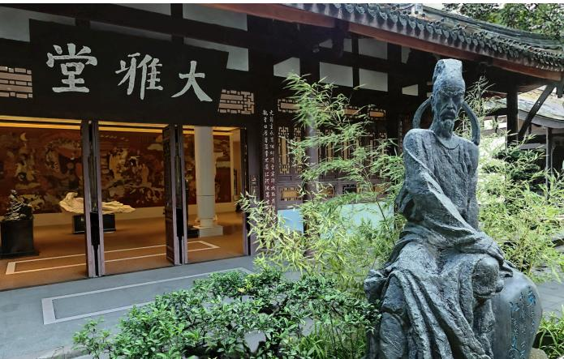

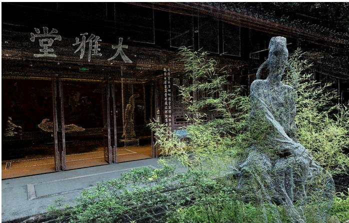

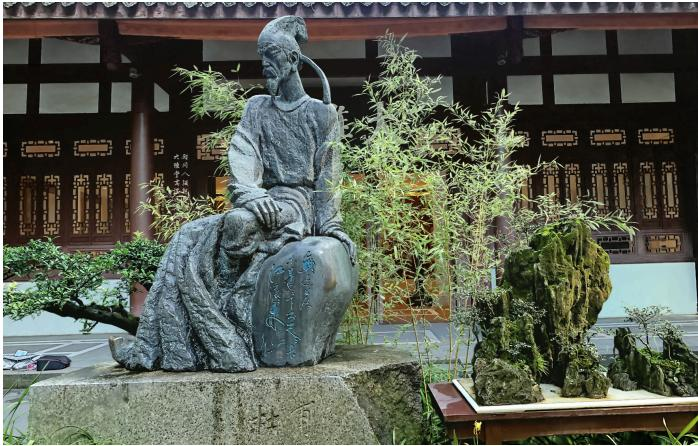

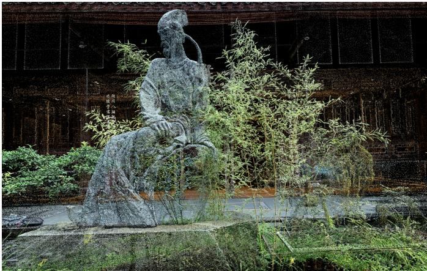

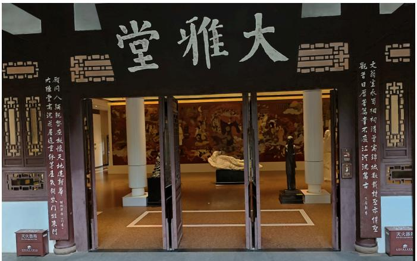

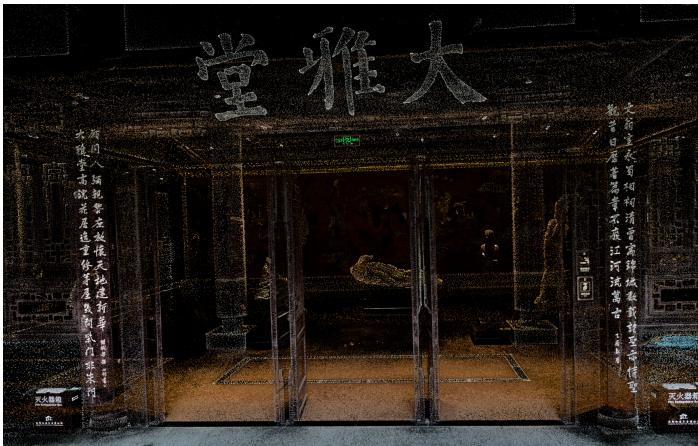  
Figure 9. KosmoWorld examples from three viewpoints of the same scene. Each row pairs an RGB image (left) with a point-cloud visualization (right).

## 3.3.3 Efect of KosmoWorld Data

We assess the contribution of KosmoWorld on the Sparse and Medium subsets of SpatialBench [Peng et al., 2026a], comparing GFM trained with and without KosmoWorld. Adding KosmoWorld consistently improves depth and relative-pose estimation in both settings (Figure 10 and Table 1). These results support the value of real-world reconstruction supervision for learning geometric priors.

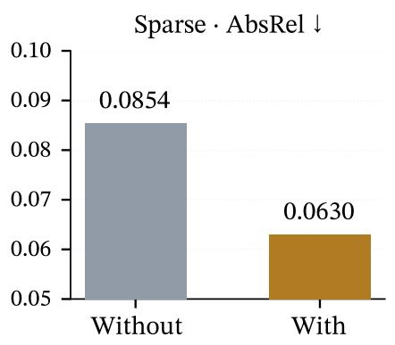

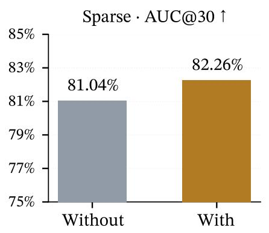

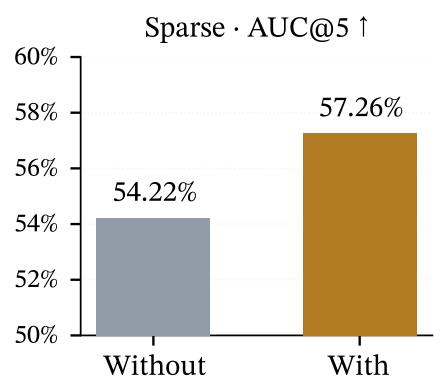

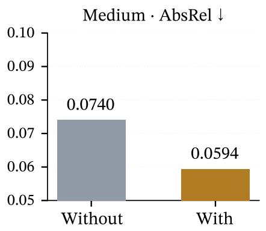

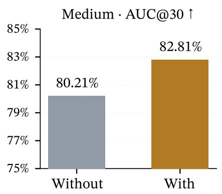

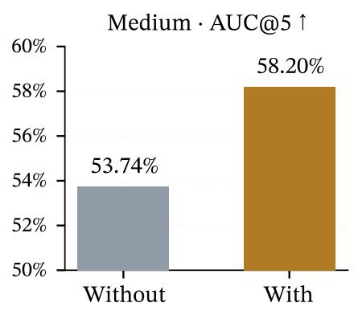  
Figure 10. Efect of KosmoWorld data on SpatialBench Sparse (top) and Medium (bottom). Each setting compares GFM trained with and without KosmoWorld using depth error and camera AUC. Full data-ablation metrics appear in Table 1.

Table 1. KosmoWorld data ablation on SpatialBench. For each of the Sparse and Medium subsets, we compare models trained with and without KosmoWorld data. Accuracies are fractions, and lower errors are better. Bold indicates the better value within each subset.
<table><tr><td></td><td colspan="7">Depth</td><td colspan="7">Camera pose</td></tr><tr><td>Setting / data</td><td>AbsRel ↓</td><td>SqRel RMSE ↓</td><td></td><td>δ1.03</td><td>δ1.05</td><td> $\delta _ { 1 . 1 0 }$ </td><td></td><td>RAcc3 RAcc5</td><td></td><td>TAcc3</td><td></td><td></td><td>TAcc5 AUC@5 AUC@15 AUC@30</td><td></td></tr><tr><td>Sparse / Without</td><td>0.08540.1209</td><td></td><td>0.6328</td><td>↓</td><td>↑ 0.7515</td><td>↑</td><td>↑</td><td>↑ 0.8872</td><td>↑</td><td>↑</td><td>↑</td><td>↑</td><td>↑</td><td>↑</td></tr><tr><td>Sparse / With</td><td>0.0630 0.1093 0.6207 0.6696 0.7810 0.8816</td><td></td><td></td><td>0.6396</td><td></td><td></td><td>0.8642</td><td>0.8169 0.8358 0.9055 0.6457 0.7394</td><td></td><td></td><td>0.6294 0.7121</td><td>0.5422 0.5726</td><td>0.7197 0.7412</td><td>0.8104 0.8226</td></tr><tr><td>Medium / Without</td><td>0.0740 0.09560.5939 0.6417 0.7689 0.8815</td><td></td><td></td><td></td><td></td><td></td><td></td><td>0.79070.8672 0.6070 0.6984</td><td></td><td></td><td></td><td>0.5374</td><td>0.7107</td><td>0.8021</td></tr><tr><td>Medium / With</td><td>0.0594 0.0884 0.5822 0.6895 0.8077 0.9025</td><td></td><td></td><td></td><td></td><td></td><td></td><td>0.8310 0.8938 0.6468 0.7322</td><td></td><td></td><td></td><td>0.5820</td><td>0.7450</td><td>0.8281</td></tr><tr><td></td><td></td><td></td><td></td><td></td><td></td><td></td><td></td><td></td><td></td><td></td><td></td><td></td><td></td><td></td></tr></table>

## 4 Benchmark

This section evaluates Kosmo-GFM at two levels: GFM’s geometric and motion prediction before scene-level optimization, and PoseEngine’s camera reconstruction accuracy, eficiency, and 3DGS rendering quality. Among the compared methods, GFM achieves the lowest absolute relative depth error and leading relative-pose results on both SpatialBench Sparse and Medium, together with the lowest average endpoint errors for dynamic points and scene flow. On the 34 scenes completed by all evaluated systems, PoseEngine achieves the highest mean pose accuracy with lower reconstruction time than GLUEMAP. PoseEngine Flash delivers the fastest reconstruction among the compared systems while retaining complete image registration. These results demonstrate strong geometric prediction and ofer complementary choices for reconstruction accuracy and eficiency.

## 4.1 GFM

## 4.1.1 3D Reconstruction

Evaluation setup. We evaluate depth, relative camera pose, and camera trajectories on the Sparse and Medium subsets of SpatialBench [Peng et al., 2026a]. Depth alignment and scale follow the benchmark protocol. For valid reference depths z and predictions $\hat { z } ,$ the error metrics are

$$
{ \mathrm { A b s R e l } } = \left. { \frac { | { \hat { z } } - z | } { z } } \right. , \quad { \mathrm { S q R e l } } = \left. { \frac { ( { \hat { z } } - z ) ^ { 2 } } { z } } \right. , \quad { \mathrm { R M S E } } = { \sqrt { \langle ( { \hat { z } } - z ) ^ { 2 } \rangle } } .\tag{20}
$$

Table 2. SpatialBench Sparse full results. Baseline metrics are taken from the oficial SpatialBench release. Depth and camera-pose metrics are grouped by column. Accuracy values are fractions, and parameter counts describe model size. Best, second-best, and third-best values are red, blue, and green, with ties sharing a rank. Ranks use unrounded values. Baseline reference for $\pi ^ { 3 }  – \mathbf { X } \colon$ Wang et al., 2026b, Pi3 Contributors, 2025.
<table><tr><td rowspan="2">Method</td><td rowspan="2"></td><td colspan="6">Depth</td><td colspan="6">Camera pose</td></tr><tr><td>Params AbsRel SqRel RMSE (M) ↓</td><td>↓</td><td>↓</td><td> $\delta _ { 1 . 0 3 }$  ↑</td><td>δ1.05 ↑</td><td> $\delta _ { 1 . 1 0 }$  ↑</td><td>RAcc3 RAcc5 TAcc3 TAcc5 ↑</td><td>↑</td><td>↑ ↑</td><td>↑</td><td>AUC@5 AUC@15 AUC@30 ↑</td><td>↑</td></tr><tr><td>VGGT</td><td>1256.54</td><td>0.105</td><td>0.105</td><td>0.6730.498</td><td></td><td>0.627 0.778</td><td>0.734</td><td>0.833</td><td>0.454</td><td>0.550</td><td>0.405</td><td>0.585</td><td>0.700</td></tr><tr><td>Fast3R</td><td>647.55</td><td>0.260</td><td>0.760</td><td>1.576</td><td>0.228</td><td>0.3400.508</td><td>0.347</td><td>0.486</td><td>0.156</td><td>0.235</td><td>0.109</td><td>0.264</td><td>0.392</td></tr><tr><td>FastVGGT</td><td>1157.94</td><td>0.113</td><td>0.098</td><td>0.6660.457</td><td></td><td>0.5900.752</td><td>0.642</td><td>0.773</td><td>0.384</td><td>0.472</td><td>0.314</td><td>0.503</td><td>0.631</td></tr><tr><td>MUSt3R</td><td>423.43</td><td>0.165</td><td>0.276</td><td>0.999 0.366</td><td></td><td>0.502 0.686</td><td>0.622</td><td>0.726</td><td>0.343</td><td>0.435</td><td>0.273</td><td>0.482</td><td>0.614</td></tr><tr><td>MapAnything</td><td>1228.49</td><td>0.153</td><td>1.079</td><td>1.3370.361</td><td></td><td>0.512 0.701</td><td></td><td>0.608 0.762</td><td>0.300</td><td>0.423</td><td>0.244</td><td>0.446</td><td>0.579</td></tr><tr><td>OmniVGGT</td><td>1217.49</td><td>0.117</td><td>0.119</td><td>0.6690.534</td><td></td><td>0.6710.810</td><td></td><td>0.620 0.746</td><td>0.416</td><td>0.507</td><td>0.332</td><td>0.537</td><td>0.665</td></tr><tr><td> $\pi ^ { 3 }$ </td><td>958.70</td><td>0.092</td><td>0.258</td><td>0.855 0.547</td><td></td><td>0.686 0.826</td><td></td><td>0.769 0.854</td><td>0.474</td><td>0.586</td><td>0.412</td><td>0.619</td><td>0.742</td></tr><tr><td> $\pi ^ { 3 } \mathrm { - } X$ </td><td>1360.03</td><td>0.084</td><td>0.084</td><td>0.599</td><td>0.576</td><td>0.710 0.833</td><td></td><td>0.756 0.837</td><td>0.491</td><td>0.595</td><td>0.427</td><td>0.627</td><td>0.741</td></tr><tr><td>AMB3R</td><td>1563.12</td><td>0.088</td><td>0.083</td><td>0.617 0.534 0.6680.812</td><td></td><td></td><td></td><td>0.743 0.844</td><td>0.475</td><td>0.591</td><td>0.412</td><td>0.619</td><td>0.739</td></tr><tr><td>DA3-Small</td><td>34.30</td><td>0.191</td><td>0.270</td><td>1.057 0.308</td><td></td><td>0.4400.633</td><td></td><td>0.392 0.568</td><td>0.172</td><td>0.300</td><td>0.127</td><td>0.336</td><td>0.476</td></tr><tr><td>DA3-Base</td><td>135.37</td><td>0.159</td><td>0.210</td><td>0.937 0.386</td><td></td><td>0.5200.690</td><td></td><td>0.528 0.678</td><td>0.292</td><td>0.399</td><td>0.222</td><td>0.427</td><td>0.566</td></tr><tr><td>DA3-Large</td><td>410.94</td><td>0.128</td><td>0.198</td><td>0.8390.470</td><td></td><td>0.601 0.753</td><td></td><td>0.662 0.776</td><td>0.443</td><td>0.528</td><td>0.361</td><td>0.559</td><td>0.688</td></tr><tr><td>DA3-Giant</td><td>1355.67</td><td>0.095</td><td>0.107</td><td>0.608</td><td>0.563</td><td>0.689</td><td>0.821</td><td>0.792 0.871</td><td>0.586</td><td>0.682</td><td>0.525</td><td>0.699</td><td>0.785</td></tr><tr><td>DA3-Nested</td><td>1689.85</td><td>0.106</td><td>0.199</td><td>0.805</td><td>0.564</td><td>0.692</td><td>0.814</td><td>0.784 0.855</td><td>0.577</td><td>0.682</td><td>0.519</td><td>0.691</td><td>0.779</td></tr><tr><td>WorldMirror</td><td>1263.34</td><td>0.139</td><td>0.162</td><td>0.7980.440</td><td></td><td>0.583</td><td>0.748</td><td>0.697 0.793</td><td>0.394</td><td>0.506</td><td>0.320</td><td>0.532</td><td>0.660</td></tr><tr><td>VGGT-Ω</td><td>1143.81</td><td>0.077</td><td>0.362</td><td>1.089</td><td>0.556</td><td>0.702</td><td>0.843</td><td>0.808 0.892</td><td>0.585</td><td>0.678</td><td>0.504</td><td>0.695</td><td>0.803</td></tr><tr><td>Kosmo-GFM 1655.29</td><td></td><td>0.063</td><td>0.109</td><td>0.621</td><td>0.670</td><td>0.781</td><td>0.882</td><td>0.836</td><td>0.906 0.646</td><td>0.739</td><td>0.573</td><td>0.741</td><td>0.823</td></tr></table>

We also report threshold accuracy $\delta _ { \tau } = \langle \mathbf { 1 } [ \mathrm { m a x } ( \hat { z } / z , z / \hat { z } ) < \tau ] \rangle$ , with $\tau \in \{ 1 . 0 3 , 1 . 0 5 , 1 . 1 0 \}$ . For relative pose, RAcc@τ and TAcc@τ are the fractions of image pairs whose relative rotation and translation-direction errors fall below τ degrees, and AUC@τ is the normalized area under the recall curve of the pairwise pose error, taken as the larger of the two angular errors, up $\mathbf { t o } \tau \in \{ 5 , 1 5 , 3 0 \}$ degrees. All are reported as fractions. For trajectories, ATE is the root-mean-square error of camera centers after aligning the predicted trajectory to the reference, and RPE and RPE are the translational and rotational errors of relative motions between consecutive frames. Alignment and units follow the SpatialBench protocol.

Depth and camera accuracy. Tables 2 and 3 compare depth and camera accuracy for Sparse and Medium. GFM achieves the lowest absolute relative depth error and the highest relative-pose accuracy among the listed methods in both settings, demonstrating strong geometric prediction with both sparse and denser view inputs.

Table 3. SpatialBench Medium full results. Baseline metrics are taken from the oficial SpatialBench release. Depth, camera-pose, and trajectory metrics are grouped by column. ATE and RPE follow the benchmark alignment and units. Accuracy values are fractions, and parameter counts describe model size. Best, second-best, and third-best values are red, blue, and green, with ties sharing a rank. Ranks use unrounded values.
<table><tr><td></td><td></td><td colspan="6">Depth</td><td colspan="6">Camera pose</td><td colspan="3">Trajectory</td></tr><tr><td>Method</td><td>Params (M)</td><td>AbsRel ↓</td><td>SqRel V</td><td>RMSE ↓</td><td> $\delta _ { 1 . 0 3 }$  ↑</td><td>δ1.05</td><td> $\delta _ { 1 . 1 0 }$  RAcc3 ↑</td><td>RAcc5 ↑</td><td>TAcc3 ↑</td><td>TAcc5 ↑ ↑</td><td>AUC@5 ↑</td><td>AUC@15</td><td>AUC@30</td><td>↑</td><td>ATE RPEt</td><td>RPEr</td></tr><tr><td>VGGT</td><td>1256.54</td><td>0.125</td><td>0.602</td><td>0.688</td><td>0.499 0.613</td><td>0.747</td><td>0.695</td><td>0.782</td><td>0.484</td><td>0.562</td><td>0.432</td><td>0.586</td><td>0.687</td><td>0.727 0.216</td><td></td><td>2.202</td></tr><tr><td>Fast3R</td><td>647.55</td><td>0.255</td><td>0.567</td><td>1.539</td><td>0.241</td><td>0.344 0.496</td><td>0.296</td><td>0.422</td><td>0.164</td><td>0.248</td><td>0.117</td><td>0.272</td><td>0.386</td><td>6.582</td><td>2.055</td><td>13.650</td></tr><tr><td>FastVGGT</td><td>1157.94</td><td>0.105</td><td>0.086</td><td>0.611</td><td>0.479</td><td>0.597 0.737</td><td>0.678</td><td>0.771</td><td>0.448</td><td>0.542</td><td>0.379</td><td>0.554</td><td>0.662</td><td>0.7380.259</td><td></td><td>3.260</td></tr><tr><td>MUSt3R</td><td>423.43</td><td>0.162</td><td>0.327</td><td>0.966</td><td>0.388 0.522</td><td>0.696</td><td>0.618</td><td>0.734</td><td>0.361</td><td>0.475</td><td>0.296</td><td>0.507</td><td>0.643</td><td>3.097 0.613</td><td></td><td>2.686</td></tr><tr><td>MapAnything</td><td>1228.49</td><td>0.146</td><td>0.490</td><td>1.052</td><td>0.347 0.491</td><td>0.681</td><td>0.563</td><td>0.702</td><td>0.312</td><td>0.419</td><td>0.254</td><td>0.451</td><td>0.579</td><td>1.7370.533</td><td></td><td>2.852</td></tr><tr><td>OmniVGGT</td><td>1217.49</td><td>0.111</td><td>0.096</td><td>0.649</td><td>0.518 0.645</td><td>0.780</td><td>0.609</td><td>0.726</td><td>0.426</td><td>0.527</td><td>0.340</td><td>0.542</td><td>0.665</td><td>1.4910.355</td><td></td><td>2.768</td></tr><tr><td> $\pi ^ { 3 }$ </td><td>958.70</td><td>0.082</td><td>0.229</td><td>0.822 0.563</td><td>0.689</td><td>0.814</td><td>0.742</td><td>0.830</td><td>0.501</td><td>0.613</td><td>0.433</td><td>0.636</td><td>0.749</td><td>0.565 0.128</td><td></td><td>1.240</td></tr><tr><td>π3-X</td><td>1360.03</td><td>0.078</td><td>0.061</td><td>0.538 0.582</td><td>0.712</td><td>0.831</td><td>0.741</td><td>0.827</td><td>0.536</td><td>0.628</td><td>0.463</td><td>0.644</td><td>0.744</td><td>0.369</td><td>0.108</td><td>1.459</td></tr><tr><td>AMB3R</td><td>1563.12</td><td>0.085</td><td>0.074</td><td>0.580 0.539</td><td>0.661</td><td>0.795</td><td>0.704</td><td>0.799</td><td>0.496</td><td>0.588</td><td>0.429</td><td>0.613</td><td>0.727</td><td>0.6450.223</td><td></td><td>1.881</td></tr><tr><td>DA3-Small</td><td>34.30</td><td>0.176</td><td>0.226</td><td>1.008 0.312</td><td>0.435</td><td>0.617</td><td>0.370</td><td>0.535</td><td>0.192</td><td>0.301</td><td>0.136</td><td>0.338</td><td>0.479</td><td>4.8501.356</td><td></td><td>5.534</td></tr><tr><td>DA3-Base</td><td>135.37</td><td>0.142</td><td>0.171</td><td>0.884 0.395</td><td>0.521</td><td>0.683</td><td>0.494</td><td>0.626</td><td>0.289</td><td>0.407</td><td>0.227</td><td>0.430</td><td>0.562</td><td>3.865 0.976</td><td></td><td>3.928</td></tr><tr><td>DA3-Large</td><td>410.94</td><td>0.105</td><td>0.155</td><td>0.779 0.498</td><td>0.618</td><td>0.767</td><td>0.655</td><td>0.758</td><td>0.487</td><td>0.575</td><td>0.411</td><td>0.588</td><td>0.701</td><td>2.7220.460</td><td></td><td>2.800</td></tr><tr><td>DA3-Giant</td><td>1355.67</td><td>0.086</td><td>0.088</td><td>0.578 0.572</td><td></td><td>0.6860.812</td><td>0.749</td><td>0.834</td><td>0.587</td><td>0.663</td><td>0.532</td><td>0.684</td><td>0.776</td><td>1.161 0.285</td><td></td><td>2.253</td></tr><tr><td>DA3-Nested</td><td>1689.85</td><td>0.086</td><td>0.182</td><td>0.801 0.577</td><td></td><td>0.690 0.810</td><td>0.742</td><td>0.833</td><td>0.569</td><td>0.658</td><td>0.510</td><td>0.676</td><td>0.770</td><td>1.9800.394</td><td></td><td>2.708</td></tr><tr><td>WorldMirror</td><td>1263.34</td><td>0.118</td><td>0.126</td><td>0.741 0.445</td><td>0.573</td><td>0.721</td><td>0.674</td><td>0.775</td><td>0.417</td><td>0.533</td><td>0.352</td><td>0.556</td><td>0.674</td><td>1.3570.347</td><td></td><td>2.056</td></tr><tr><td>VGGT-Ω</td><td>1143.81</td><td>0.067</td><td>0.304</td><td>1.049 0.589</td><td>0.721</td><td>0.845</td><td>0.787</td><td>0.870</td><td>0.589</td><td>0.692</td><td>0.512</td><td>0.700</td><td>0.795</td><td>0.6590.160</td><td></td><td>1.369</td></tr><tr><td>Kosmo-GFM 1655.29</td><td></td><td>0.059</td><td>0.088</td><td>0.582 0.690</td><td>0.808</td><td>0.903</td><td>0.831</td><td>0.894</td><td>0.647</td><td>0.732</td><td>0.582</td><td>0.745</td><td>0.828</td><td>0.5080.145</td><td></td><td>1.088</td></tr></table>

Camera-conditioned reconstruction. The results above use RGB-only input. Within Kosmo-GFM, refined PoseEngine cameras also condition dense geometry prediction (Section 3.2) and the feed-forward 3DGS decoder (Section 6). Table 4 compares RGB-only GFM with Camera-conditioned GFM (Section 3.1.5), with and without per-frame scale prediction, on Sparse. The results show that camera conditioning efectively incorporates the input pose information. Predicting a per-frame scale alleviates the degradation in depth quality associated with direct normalization by the camera-pose scale. As described in Section 3.1.3, this design decouples the numerical range of per-frame depth from the camera-pose scale while preserving the input poses as a shared scale reference.

Table 4. Kosmo-GFM on SpatialBench Sparse: RGB-only GFM and Camera-conditioned GFM, with and without per-frame scale prediction. Columns and precision follow Table 2. Camera inputs provide additional information, so the pose scores are not directly comparable to uncalibrated pose estimation.
<table><tr><td></td><td></td><td colspan="4">Depth</td><td colspan="6">Camera pose</td></tr><tr><td>Model setting</td><td></td><td>Params AbsRel SqRel RMSE</td><td></td><td> $\delta _ { 1 . 0 3 }$   $\delta _ { 1 }$  .05  $\delta _ { 1 . 1 0 }$  ↑</td><td>RAcc3 RAcc5 TAcc3 TAcc5 AUC@5 AUC@15 AUC@30</td><td></td><td></td><td></td><td></td><td></td><td></td></tr><tr><td>RGB-only</td><td>(M) 1655.29</td><td>↓</td><td>→</td><td>↓ ↑ ↑</td><td>↑</td><td>↑</td><td>↑</td><td>↑</td><td>↑</td><td>↑</td><td>↑</td></tr><tr><td>Camera-conditioned 1769.82</td><td></td><td>0.063 0.082</td><td>0.109 0.167</td><td>0.621 0.670 0.781 0.882 0.757 0.577 0.707 0.842</td><td>0.836 1.000</td><td>0.906 1.000</td><td>0.646 0.997</td><td>0.739 0.998</td><td>0.573 0.996</td><td>0.741 0.998</td><td>0.823 0.999</td></tr><tr><td>Camera-conditioned</td><td></td><td></td><td></td><td></td><td></td><td></td><td></td><td></td><td></td><td></td><td></td></tr><tr><td>+ per-frame scale</td><td>1788.74</td><td>0.067</td><td>0.131</td><td>0.689 0.630 0.753 0.870</td><td>1.000</td><td>1.000</td><td>0.996</td><td>0.998</td><td>0.995</td><td>0.998</td><td>0.999</td></tr></table>

Performance across datasets. Tables 5 and 6 report per-dataset results following the SpatialBench scene-selection and preprocessing protocol. GFM achieves strong results on robotic data and data with challenging viewpoints, with gains in both depth estimation and camera-pose prediction across diverse scene types.

Table 5. Sparse per-dataset breakdown. Each metric group is ordered DA3-Giant / VGGT-Ω / Kosmo-GFM. DA3-Giant and VGGT-Ω results are from our local evaluations, separate from the oficial SpatialBench results in Table 2.
<table><tr><td rowspan="2">Dataset</td><td colspan="3">AbsRel ↓</td><td colspan="3">AUC@30↑</td></tr><tr><td>DA3-Giant</td><td>VGGT-Ω</td><td>Kosmo-GFM</td><td>DA3-Giant</td><td>VGGT-Ω</td><td>Kosmo-GFM</td></tr><tr><td>7-Scenes [Shotton et al., 2013]</td><td>0.0656</td><td>0.0557</td><td>0.0637</td><td>0.7848</td><td>0.8067</td><td>0.7638</td></tr><tr><td>ADT [Pan et al., 2023]</td><td>0.0627</td><td>0.0638</td><td>0.0408</td><td>0.7551</td><td>0.8506</td><td>0.9574</td></tr><tr><td>DROID [Khazatsky et al., 2024]</td><td>0.1249</td><td>0.0907</td><td>0.0709</td><td>0.6510</td><td>0.6194</td><td>0.7046</td></tr><tr><td>DTU [Jensen et al., 2014]</td><td>0.0142</td><td>0.0135</td><td>0.0126</td><td>0.9828</td><td>0.9885</td><td>0.9836</td></tr><tr><td>ETH3D [Schops et al., 2017]</td><td>0.0346</td><td>0.0231</td><td>0.0349</td><td>0.7858</td><td>0.8646</td><td>0.7992</td></tr><tr><td>HiRoom [Lin et al., 2026b]</td><td>0.0117</td><td>0.0134</td><td>0.0086</td><td>0.9167</td><td>0.9787</td><td>0.9731</td></tr><tr><td>NRGBD [Azinović et al., 2022]</td><td>0.0092</td><td>0.0101</td><td>0.0099</td><td>0.9451</td><td>0.9353</td><td>0.9404</td></tr><tr><td>OmniWorld [Zhou et al., 2025]</td><td>0.0505</td><td>0.0501</td><td>0.0473</td><td>0.9843</td><td>0.9696</td><td>0.9825</td></tr><tr><td>RLBench [James et al., 2020, Pumacay et al., 2024]</td><td>0.2755</td><td>0.2055</td><td>0.1439</td><td>0.5757</td><td>0.5787</td><td>0.6507</td></tr><tr><td>RoboLab [Yang et al., 2026]</td><td>0.1712</td><td>0.1469</td><td>0.0996</td><td>0.7114</td><td>0.7356</td><td>0.8116</td></tr><tr><td>RoboTwin [Chen et al., 2025]</td><td>0.3247</td><td>0.2202</td><td>0.1995</td><td>0.4429</td><td>0.5371</td><td>0.5483</td></tr><tr><td>Ropedia [Ropedia, 2026]</td><td>0.0494</td><td>0.0395</td><td>0.0451</td><td>0.2959</td><td>0.4797</td><td>0.3396</td></tr><tr><td>ScanNet++ [Yeshwanth et al., 2023]</td><td>0.0316</td><td>0.0418</td><td>0.0259</td><td>0.9623</td><td>0.9463</td><td>0.9665</td></tr><tr><td>Tanks &amp; Temples [Knapitsch et al., 2017]</td><td>0.0405</td><td>0.0414</td><td>0.0273</td><td>0.6203</td><td>0.5954</td><td>0.6992</td></tr><tr><td>TUM [Sturm et al., 2012]</td><td>0.0879</td><td>0.0419</td><td>0.0460</td><td>0.7689</td><td>0.8067</td><td>0.7928</td></tr><tr><td>vKITTI [Cabon et al., 2020]</td><td>0.0635</td><td>0.0996</td><td>0.0627</td><td>0.7833</td><td>0.7934</td><td>0.8320</td></tr><tr><td>Waymo [Sun et al., 2020]</td><td>0.0778</td><td>0.0881</td><td>0.0838</td><td>0.9832</td><td>0.9711</td><td>0.9746</td></tr><tr><td>Average</td><td>0.0958</td><td>0.0777</td><td>0.0630</td><td>0.7831</td><td>0.8002</td><td>0.8226</td></tr></table>

Table 6. Medium per-dataset breakdown. Each metric group is ordered DA3-Giant / VGGT-Ω / Kosmo-GFM. DA3-Giant and VGGT-Ω results are from our local evaluations, separate from the oficial SpatialBench results in Table 3.
<table><tr><td rowspan="2">Dataset</td><td colspan="3">AbsRel ↓</td><td colspan="3">AUC@30↑</td></tr><tr><td>DA3-Giant</td><td>VGGT-Ω</td><td>Kosmo-GFM</td><td>DA3-Giant</td><td>VGGT-Ω</td><td>Kosmo-GFM</td></tr><tr><td>7-Scenes</td><td>0.0577</td><td>0.0491</td><td>0.0586</td><td>0.7878</td><td>0.8585</td><td>0.8130</td></tr><tr><td>ADT</td><td>0.0564</td><td>0.0423</td><td>0.0304</td><td>0.8473</td><td>0.9365</td><td>0.9746</td></tr><tr><td>DROID</td><td>0.0915</td><td>0.0584</td><td>0.0506</td><td>0.5952</td><td>0.5324</td><td>0.6064</td></tr><tr><td>DTU</td><td>0.0108</td><td>0.0108</td><td>0.0148</td><td>0.9844</td><td>0.9730</td><td>0.9602</td></tr><tr><td>ETH3D</td><td>0.0282</td><td>0.0209</td><td>0.0263</td><td>0.8723</td><td>0.9008</td><td>0.8857</td></tr><tr><td>HiRoom</td><td>0.0056</td><td>0.0089</td><td>0.0056</td><td>0.9974</td><td>0.9795</td><td>0.9957</td></tr><tr><td>NRGBD</td><td>0.0088</td><td>0.0069</td><td>0.0088</td><td>0.9711</td><td>0.9609</td><td>0.9695</td></tr><tr><td>OmniWorld</td><td>0.0463</td><td>0.0468</td><td>0.0395</td><td>0.9791</td><td>0.9604</td><td>0.9795</td></tr><tr><td>RLBench</td><td>0.2435</td><td>0.1821</td><td>0.1236</td><td>0.4719</td><td>0.5952</td><td>0.6489</td></tr><tr><td>RoboLab</td><td>0.1704</td><td>0.1486</td><td>0.0725</td><td>0.6424</td><td>0.8115</td><td>0.8953</td></tr><tr><td>RoboTwin</td><td>0.3124</td><td>0.1929</td><td>0.2810</td><td>0.2593</td><td>0.3845</td><td>0.4538</td></tr><tr><td>Ropedia</td><td>0.0568</td><td>0.0691</td><td>0.0824</td><td>0.2298</td><td>0.2687</td><td>0.3079</td></tr><tr><td>ScanNet++</td><td>0.0309</td><td>0.0408</td><td>0.0260</td><td>0.9787</td><td>0.9697</td><td>0.9737</td></tr><tr><td>Tanks &amp; Temples</td><td>0.0341</td><td>0.0370</td><td>0.0246</td><td>0.7468</td><td>0.6365</td><td>0.7486</td></tr><tr><td>TUM</td><td>0.0795</td><td>0.0396</td><td>0.0448</td><td>0.8327</td><td>0.9016</td><td>0.8868</td></tr><tr><td>vKITTI</td><td>0.0612</td><td>0.0933</td><td>0.0504</td><td>0.7566</td><td>0.7875</td><td>0.9223</td></tr><tr><td>Waymo</td><td>0.0666</td><td>0.0731</td><td>0.0606</td><td>0.9761</td><td>0.9499</td><td>0.9748</td></tr><tr><td>Average</td><td>0.0853</td><td>0.0672</td><td>0.0594</td><td>0.7720</td><td>0.7962</td><td>0.8281</td></tr></table>

## 4.1.2 4D Reconstruction

Evaluation setup. Dynamic geometry is evaluated on Panoptic Studio [Joo et al., 2015], PointOdyssey [Zheng et al., 2023], Dynamic Replica [Karaev et al., 2023], Aria Digital Twin [Pan et al., 2023], and SynthVerse [Zhao et al., 2026]. The first four datasets follow the WorldTrack evaluation [Feng et al., 2025] used by UniQuery4R [Chen et al., 2026c]. The reported average additionally includes SynthVerse. OpenD4RT is an unoficial implementation of D4RT [Zhang et al., 2026a, OpenD4RT Contributors, 2026], and the reported dynamic results use its 32CLIP variant. We measure dynamic-point APD (Average Percentage of Points within Delta), scene-flow accuracy, and 3D endpoint error (EPE), measured in meters. APD measures the percentage of evaluated dynamic points whose predicted 3D positions lie within a distance threshold of the reference positions, averaged over the evaluation thresholds. It is reported as a percentage, with higher values indicating more accurate point reconstruction. Point EPE measures position error, while flow EPE measures displacement error. Threshold-based accuracy and mean endpoint error capture diferent aspects of prediction quality. We report scene-flow accuracy (Acc.) as the percentage of predictions with a 3D Euclidean displacement error of at most 0.1 m.

Dynamic-point and scene-flow accuracy. Compared with UniQuery4R, GFM reduces average endpoint error for both dynamic points and scene flow while retaining competitive threshold-based accuracy. Figure 11 and Table 7 summarize these complementary aspects of motion prediction.

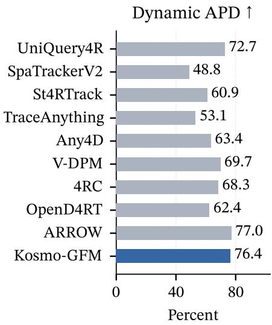

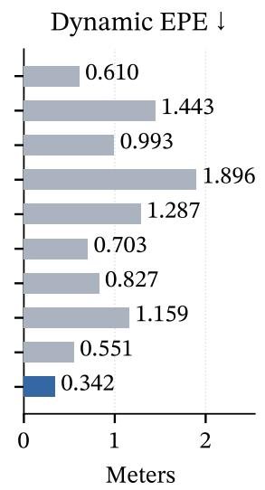

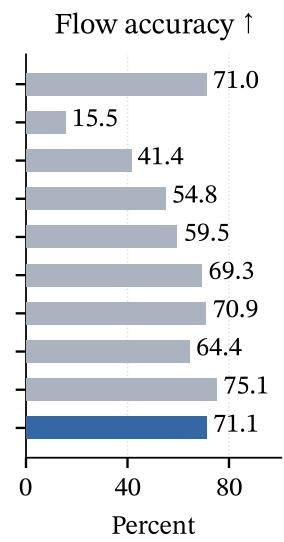

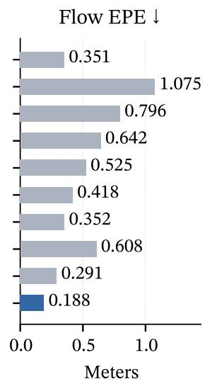  
Figure 11. Average dynamic-point and scene-flow performance. GFM achieves the lowest mean EPE for both tasks among the compared methods. Threshold-based accuracy and EPE characterize complementary aspects of motion prediction.

Table 7. Dynamic-point and scene-flow averages over Panoptic Studio, PointOdyssey, Dynamic Replica, Aria Digital Twin, and SynthVerse. APD and flow accuracy are percentages, and EPE is in meters. Best, second-best, and third-best values are red, blue, and green, with ties sharing a rank. Means are recomputed from Tables 8 and 9, with rounding applied only for display. Ranks use unrounded means.
<table><tr><td>Method</td><td>Point APD ↑</td><td>Point EPE ↓</td><td>Flow acc. ↑</td><td>Flow EPE ↓</td></tr><tr><td>UniQuery4R</td><td>72.7</td><td>0.610</td><td>71.0</td><td>0.351</td></tr><tr><td>SpaTrackerV2</td><td>48.8</td><td>1.443</td><td>15.5</td><td>1.075</td></tr><tr><td>St4RTrack</td><td>60.9</td><td>0.993</td><td>41.4</td><td>0.796</td></tr><tr><td>TraceAnything</td><td>53.1</td><td>1.896</td><td>54.8</td><td>0.642</td></tr><tr><td>Any4D</td><td>63.4</td><td>1.287</td><td>59.5</td><td>0.525</td></tr><tr><td>V-DPM</td><td>69.7</td><td>0.703</td><td>69.3</td><td>0.418</td></tr><tr><td>4RC</td><td>68.3</td><td>0.827</td><td>70.9</td><td>0.352</td></tr><tr><td>OpenD4RT</td><td>62.4</td><td>1.159</td><td>64.4</td><td>0.608</td></tr><tr><td>ARROW</td><td>77.0</td><td>0.551</td><td>75.1</td><td>0.291</td></tr><tr><td>Kosmo-GFM</td><td>76.4</td><td>0.342</td><td>71.1</td><td>0.188</td></tr></table>

GFM achieves the lowest average endpoint error for both dynamic points and scene flow. Tables 8 and 9 further show its strengths

in dynamic geometry and motion prediction, including leading point reconstruction on PointOdyssey and SynthVerse and leading scene-flow accuracy and endpoint error on Aria Digital Twin and SynthVerse.

Table 8. Dynamic-point APD (percent) and EPE (meters). All ten methods are shown on all five datasets. Mean is recomputed as the arithmetic mean of the five displayed dataset values. Best, second-best, and third-best values are red, blue, and green, with ties sharing a rank.
<table><tr><td></td><td colspan="2">Panoptic Studio</td><td colspan="2">PointOdyssey</td><td colspan="2">Dynamic Replica</td><td colspan="2">Aria Digital Twin</td><td colspan="2">SynthVerse</td><td colspan="2">Mean</td></tr><tr><td>Method</td><td>APD↑</td><td>EPE↓</td><td>APD↑</td><td>EPE↓</td><td>APD↑</td><td>EPE↓</td><td>APD↑</td><td>EPE↓</td><td>APD↑</td><td>EPE↓</td><td>APD↑</td><td>EPE↓</td></tr><tr><td>SpaTrackerV2</td><td>49.93</td><td>0.4639</td><td>53.45</td><td>0.5173</td><td>54.34</td><td>0.4368</td><td>69.39</td><td>0.2764</td><td>16.67</td><td>5.5187</td><td>48.76</td><td>1.4426</td></tr><tr><td>St4RTrack</td><td>70.80</td><td>0.2479</td><td>67.38</td><td>0.3140</td><td>74.24</td><td>0.2594</td><td>72.90</td><td>0.2958</td><td>19.24</td><td>3.8485</td><td>60.91</td><td>0.9931</td></tr><tr><td>TraceAnything</td><td>70.86</td><td>0.2780</td><td>39.37</td><td>1.0462</td><td>60.89</td><td>0.5642</td><td>75.69</td><td>0.2515</td><td>18.78</td><td>7.3385</td><td>53.12</td><td>1.8957</td></tr><tr><td>Any4D</td><td>74.72</td><td>0.2361</td><td>65.99</td><td>0.3783</td><td>76.72</td><td>0.3463</td><td>78.09</td><td>0.2378</td><td>21.67</td><td>5.2362</td><td>63.44</td><td>1.2869</td></tr><tr><td>V-DPM</td><td>78.95</td><td>0.1757</td><td>80.82</td><td>0.1857</td><td>75.29</td><td>0.2438</td><td>85.47</td><td>0.1725</td><td>28.01</td><td>2.7367</td><td>69.71</td><td>0.7029</td></tr><tr><td>4RC</td><td>69.08</td><td>0.2590</td><td>79.81</td><td>0.2353</td><td>84.65</td><td>0.1667</td><td>84.16</td><td>0.1770</td><td>24.04</td><td>3.2957</td><td>68.35</td><td>0.8267</td></tr><tr><td>OpenD4RT</td><td>78.63</td><td>0.1811</td><td>66.03</td><td>0.3398</td><td>76.78</td><td>0.2407</td><td>69.91</td><td>0.2966</td><td>20.86</td><td>4.7392</td><td></td><td>62.441.1595</td></tr><tr><td>UniQuery4R</td><td>84.64</td><td>0.1333</td><td>83.74</td><td>0.1604</td><td>80.00</td><td>0.2078</td><td>87.17</td><td>0.1387</td><td>27.74</td><td>2.4105</td><td>72.66</td><td>0.6101</td></tr><tr><td>ARROW</td><td>85.70</td><td>0.1343</td><td>84.87</td><td>0.1544</td><td>87.91</td><td>0.1433</td><td>93.57</td><td>0.0823</td><td>32.73</td><td>2.2402</td><td>76.96</td><td>0.5509</td></tr><tr><td>Kosmo-GFM</td><td>83.41</td><td>0.1411</td><td>85.73</td><td>0.1474</td><td>80.76</td><td>0.2017</td><td>89.78</td><td>0.1102</td><td>42.49</td><td>1.1105</td><td>76.43</td><td>0.3422</td></tr></table>

Table 9. Scene-flow accuracy (percent) and EPE (meters). All ten methods are shown on all five datasets. Mean is recomputed as the arithmetic mean of the five displayed dataset values. Best, second-best, and third-best values are red, blue, and green, with ties sharing a rank.
<table><tr><td></td><td colspan="2">Panoptic Studio</td><td colspan="2">PointOdyssey</td><td colspan="2">Dynamic Replica</td><td colspan="2">Aria Digital Twin</td><td colspan="2">SynthVerse</td><td colspan="2">Mean</td></tr><tr><td>Method</td><td>Acc. ↑</td><td>EPE↓</td><td>Acc. ↑</td><td>EPE↓</td><td>Acc. ↑</td><td>EPE↓</td><td>Acc. ↑</td><td>EPE↓</td><td>Acc. ↑</td><td>EPE↓</td><td>Acc. ↑</td><td>EPE↓</td></tr><tr><td>SpaTrackerV2</td><td>8.78</td><td>0.4095</td><td>15.08</td><td>0.3089</td><td>13.09</td><td>0.2707</td><td>34.40</td><td>0.2054</td><td>6.10</td><td>4.1792</td><td>15.49</td><td>1.0747</td></tr><tr><td>St4RTrack</td><td>27.45</td><td>0.2259</td><td>37.24</td><td>0.2190</td><td>75.69</td><td>0.0858</td><td>55.76</td><td>0.1481</td><td>10.77</td><td>3.3004</td><td>41.38</td><td>0.7958</td></tr><tr><td>TraceAnything</td><td>23.94</td><td>0.2456</td><td>64.33</td><td>0.1173</td><td>83.83</td><td>0.0495</td><td>79.98</td><td>0.0839</td><td>22.16</td><td>2.7136</td><td>54.85</td><td>0.6420</td></tr><tr><td>Any4D</td><td>25.08</td><td>0.2406</td><td>70.43</td><td>0.0940</td><td>85.94</td><td>0.0451</td><td>88.25</td><td>0.0562</td><td>27.93</td><td>2.1907</td><td>59.53</td><td>0.5253</td></tr><tr><td>V-DPM</td><td>58.99</td><td>0.1152</td><td>82.91</td><td>0.0563</td><td>88.98</td><td>0.0381</td><td>88.75</td><td>0.0559</td><td>27.09</td><td>1.8237</td><td></td><td>69.340.4178</td></tr><tr><td>4RC</td><td>53.88</td><td>0.1255</td><td>86.66</td><td>0.0466</td><td>94.13</td><td>0.0213</td><td>88.14</td><td>0.0633</td><td>31.59</td><td>1.5045</td><td></td><td>70.880.3522</td></tr><tr><td>OpenD4RT</td><td>38.25</td><td>0.1772</td><td>76.62</td><td>0.0784</td><td>90.45</td><td>0.0289</td><td>88.23</td><td>0.0627</td><td>28.36</td><td>2.6931</td><td></td><td>64.380.6081</td></tr><tr><td>UniQuery4R</td><td>56.75</td><td>0.1137</td><td>82.52</td><td>0.0541</td><td>91.54</td><td>0.0275</td><td>95.10</td><td>0.0167</td><td>29.25</td><td>1.5411</td><td>71.03</td><td>0.3506</td></tr><tr><td>ARROW</td><td>72.89</td><td>0.0814</td><td>84.85</td><td>0.0628</td><td>93.37</td><td>0.0319</td><td>96.01</td><td>0.0174</td><td>28.36</td><td>1.2604</td><td>75.10</td><td>0.2908</td></tr><tr><td>Kosmo-GFM</td><td>50.15</td><td>0.1257</td><td>83.02</td><td>0.0521</td><td>91.31</td><td>0.0279</td><td>96.34</td><td>0.0134</td><td>34.56</td><td>0.7213</td><td>71.08</td><td>0.1881</td></tr></table>

## 4.2 PoseEngine

We select 25 ETH3D [Schops et al., 2017], nine MipNeRF360 [Barron et al., 2022], six Tanks & Temples [Knapitsch et al., 2017], and four SMERF [Duckworth et al., 2024] scenes for scene-level reconstruction and compare COLMAP [Schönberger and Frahm, 2016], GLUEMAP [Pan et al., 2026], VidMap [Pataki et al., 2026], PoseEngine, and PoseEngine Flash. In this evaluation, VidMap fails on ten ETH3D scenes because its evaluated implementation cannot handle inconsistent image resolutions within a scene. The common comparison therefore uses the 34 scenes completed by all methods: 15 ETH3D, nine MipNeRF360, six Tanks & Temples, and four SMERF scenes, with 11,336 input images in total.

Scene selection. The common-scene evaluation uses the following scenes. Names follow the dataset directories. The additiona ETH3D scenes listed below were selected initially but are excluded from the common-scene aggregates because VidMap failed on their inconsistent image resolutions.

<table><tr><td>Dataset</td><td>Scenes in the common-scene evaluation</td></tr><tr><td>ETH3D (15)</td><td>botanical_garden, boulders, bridge, door, exhibition_hall, kicker, lecture_room, living_room, lounge, meadow, office, old_computer, pipes, statue, terrace_2.</td></tr><tr><td>MipNeRF360 (9)</td><td>bicycle, bonsai, counter, flowers, garden, kitchen, room, stump, treehill.</td></tr><tr><td>Tanks &amp; Temples (6)</td><td>Barn, Caterpillar, Courthouse, Ignatius, Meetingroom, Truck.</td></tr><tr><td>SMERF (4)</td><td>alameda, berlin, london, nyc. These are the Zip-NeRF scenes released through SMERF [Barron et al., 2023, Duckworth et al., 2024].</td></tr></table>

Additional selected ETH3D scenes (10), excluded from the common-scene aggregates: courtyard, delivery\_area, electro, facade, observatory, playground, relief, relief\_2, terrace, terrains.

## 4.2.1 Eficiency and Metrics

Pose and trajectory metrics. For each image pair, pose error is the maximum of rotation error and translation-direction error. AUC@a integrates the recall curve up to a degrees and normalizes by $^ { a , }$ and we report AUC@1/3/5 as percentages. R@a and T@a threshold the angular components separately. Evaluation uses all ordered pairs, including self pairs, among each method’s registered frames with ground truth, followed by equal-weight scene averaging. Registration coverage is reported because the evaluated frame sets can difer across methods.

Focal-length AbsRel is computed after rescaling predictions to the reference image resolution, averaging horizontal and vertical errors over valid cameras. Trajectory error uses camera centers aligned by Sim(3):

$$
\mathrm { A T E _ { n R M S E } } = \frac { \sqrt { \frac { 1 } { N } \sum _ { i } \| \tilde { C } _ { i } - C _ { i } \| _ { 2 } ^ { 2 } } } { \sqrt { \frac { 1 } { N } \sum _ { i } \| C _ { i } - \bar { C } \| _ { 2 } ^ { 2 } } } .\tag{21}
$$

Here ${ \tilde { C } } _ { i }$ and $C _ { i }$ are aligned predicted and reference centers, and $\bar { C }$ is the reference centroid. This normalized ATE is dimensionless and difers from the unnormalized ATE reported by SpatialBench.

Timing protocol. Runtime is the sum of per-scene reconstruction durations. COLMAP uses SIFT [Lowe, 2004] with exhaustive matching and shared PINHOLE intrinsics. GLUEMAP uses $\pi ^ { 3 }$ [Wang et al., 2026b] with shared SIMPLE\_PINHOLE intrinsics. VidMap uses its uncalibrated base setting with RoMa [Edstedt et al., 2024] matching and DA3 [Lin et al., 2026b] depth. All three use twelve CPU threads, and GLUEMAP and VidMap use four data-loading workers. VidMap timing includes model loading and compilation from a fresh cache.

PoseEngine Flash runtime is measured using FP8/FP16 mixed-precision inference under the same timing protocol.

Reconstruction accuracy and eficiency. Table 10 summarizes reconstruction quality and coverage, and Figure 12 breaks down cumulative runtime by dataset. PoseEngine achieves the highest mean pose accuracy among the compared methods while reducing reconstruction time relative to GLUEMAP. It also obtains the lowest focal-length and normalized trajectory errors. PoseEngine Flash delivers the fastest reconstruction while retaining complete image registration and low trajectory error.

Table 10. Reconstruction, camera calibration, and trajectory consistency on 34 completed scenes with 11,336 images. Metrics are averaged equally across scenes. AUC, R@1, and T@1 are percentages. ATE is Sim(3)-aligned camera-center nRMSE, normalized by the GT center RMS radius. Runtime is cumulative hours. Bold indicates the best value.
<table><tr><td colspan="8"></td></tr><tr><td>Method</td><td>AUC@1↑ AUC@3↑ AUC@5↑ R@1↑ T@1↑</td><td></td><td></td><td></td><td></td><td>Focal AbsRel↓</td><td>ATE nRMSE ↓ Registered Time (h) ↓</td><td></td><td></td></tr><tr><td>COLMAP</td><td>75.73</td><td>86.33</td><td>89.28</td><td>93.58</td><td>88.45</td><td>0.00389</td><td>0.05805</td><td>11,315</td><td>47.08</td></tr><tr><td>GLUEMAP</td><td>69.13</td><td>86.18</td><td>90.66</td><td>96.24</td><td>89.61</td><td>0.00230</td><td>0.03176</td><td>11,336</td><td>69.67</td></tr><tr><td>VidMap</td><td>57.23</td><td>71.10</td><td>74.29</td><td>78.23</td><td>76.61</td><td>0.00328</td><td>0.33359</td><td>9,017</td><td>20.32</td></tr><tr><td>PoseEngine</td><td>78.45</td><td>91.28</td><td>94.26</td><td>98.74</td><td>96.00</td><td>0.00158</td><td>0.02640</td><td>11,336</td><td>14.07</td></tr><tr><td>PoseEngine Flash</td><td>62.50</td><td>83.64</td><td>89.28</td><td>95.95</td><td>89.87</td><td>0.00316</td><td>0.02823</td><td>11,336</td><td>2.62</td></tr></table>

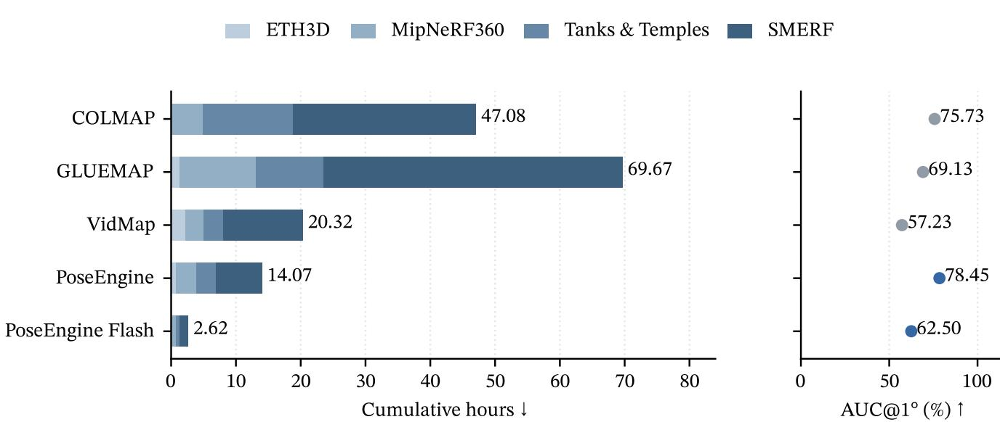  
Figure 12. Cumulative reconstruction time and pose accuracy on 34 scenes. Time is decomposed by dataset. Flash uses measured mixedprecision runtime. Pose accuracy is evaluated on registered frames.

## 4.2.2 Matching

Evaluation setup. We compare MVLoMa, which shares GFM features, with LoMa Large [Nordström et al., 2026] under unordered and ordered STAR construction (Table 11). This study uses all 44 scenes selected from ETH3D, MipNeRF360, Tanks & Temples, and SMERF, and adds four Oxford Spires [Tao et al., 2024] sequences, bringing the total to 48. The additional sequences are Keble College (2024-03-12, sequence 04), Observatory Quarter (2024-03-13, sequence 01), Blenheim Palace (2024-03-14, sequence 05), and Christ Church (2024-03-18, sequence 02).

Higher pose accuracy across datasets. MVLoMa improves strict-threshold pose accuracy over LoMa Large on every evaluated dataset under both STAR policies. The larger average gain with ordered STARs highlights the benefit of using shared multi-view features for matching in sequential reconstruction.

More consistent camera trajectories. MVLoMa also reduces the mean trajectory error after Sim(3) alignment on every evaluated dataset under both policies. Together, these results show that its matching improves both relative-pose accuracy and scene-level trajectory consistency.

## 4.2.3 3DGS

Rendering protocol. We evaluate 3DGS reconstruction on nine MipNeRF360 and six Tanks & Temples scenes using LiteGS [Liao et al., 2026]. Each model is trained for 30,000 iterations, with every eighth image in filename order held out for evaluation. The reference-pose baseline keeps cameras fixed, whereas other initializations jointly optimize training poses and Gaussians. Before evaluation, each non-reference test pose is refined against its test image for twenty steps with Gaussians and intrinsics fixed. PSNR (dB) and SSIM [Wang et al., 2004] measure image fidelity, and VGG LPIPS [Zhang et al., 2018] measures perceptual distance. These scores evaluate rendering after image-conditioned pose refinement, not fixed-pose generalization. Tanks & Temples uses trajectory-aligned PoseEngine initialization, while MipNeRF360 uses initialization from sparse camera chunks. Comparisons are made within each dataset.

Table 11. MVLoMa versus LoMa Large on 48 scenes for each STAR policy. AUC@1 is a percentage, and ∆ is MVLoMa minus LoMa Large: AUC@1 diferences are percentage points, and ATE diferences use the displayed means in GT coordinate units. ATE is raw Sim(3)-aligned camera-position RMSE in GT coordinate units, averaged equally over scenes within each dataset. Raw ATE is not aggregated across datasets; dashes mark omitted Overall ATE and ∆ATE. Bold marks the better result in each method pair.
<table><tr><td rowspan="2">Dataset</td><td rowspan="2">N</td><td colspan="2">MVLoMa</td><td colspan="2">LoMa Large</td><td colspan="2">∆</td></tr><tr><td>AUC@1↑</td><td>ATE↓</td><td>AUC@1↑</td><td>ATE↓</td><td>AUC@1↑</td><td>ATE↓</td></tr><tr><td colspan="7">Unordered STAR</td></tr><tr><td>ETH3D</td><td>25</td><td>80.29</td><td>0.00879</td><td>78.00</td><td>0.01996</td><td>+2.30</td><td>-0.01117</td></tr><tr><td>MipNeRF360</td><td>9</td><td>78.81</td><td>0.00903</td><td>74.35</td><td>0.01433</td><td>+4.46</td><td>-0.00530</td></tr><tr><td>Tanks &amp; Temples</td><td>6</td><td>84.13</td><td>0.43660</td><td>81.41</td><td>0.43793</td><td>+2.72</td><td>-0.00133</td></tr><tr><td>Oxford Spires</td><td>4</td><td>11.39</td><td>2.57710</td><td>6.71</td><td>2.68618</td><td>+4.69</td><td>-0.10908</td></tr><tr><td>SMERF</td><td>4</td><td>88.09</td><td>0.00363</td><td>81.92</td><td>0.00809</td><td>+6.17</td><td>-0.00446</td></tr><tr><td>Overall</td><td>48</td><td>75.40</td><td></td><td>72.12</td><td></td><td>+3.28</td><td></td></tr><tr><td>Ordered STAR</td><td></td><td></td><td></td><td></td><td></td><td></td><td></td></tr><tr><td>ETH3D</td><td>25</td><td>78.89</td><td>0.01094</td><td>75.82</td><td>0.01811</td><td>+3.08</td><td>-0.00717</td></tr><tr><td>MipNeRF360</td><td>9</td><td>71.58</td><td>0.05099</td><td>66.33</td><td>0.05711</td><td>+5.25</td><td>-0.00612</td></tr><tr><td>Tanks &amp; Temples</td><td>6</td><td>85.25</td><td>0.43623</td><td>78.41</td><td>0.56239</td><td>+6.84</td><td>-0.12616</td></tr><tr><td>Oxford Spires</td><td>4</td><td>16.47</td><td>2.28675</td><td>9.37</td><td>3.30433</td><td>+7.10</td><td>-1.01758</td></tr><tr><td>SMERF</td><td>4</td><td>83.31</td><td>0.00595</td><td>76.50</td><td>0.01234</td><td>+6.81</td><td>-0.00639</td></tr><tr><td>Overall</td><td>48</td><td>73.48</td><td></td><td>68.88</td><td>一</td><td>+4.60</td><td>一</td></tr></table>

Table 12. 3DGS rendering after camera refinement. All runs use LiteGS, 30,000 iterations and the same image split. Non-reference methods optimize training cameras and refine each test pose against its test image for 20 steps. The fixed-reference baseline uses neither training-pose optimization nor test-pose refinement. Dataset means weight scenes equally.
<table><tr><td>Dataset</td><td>Initialization</td><td>N</td><td>PSNR (dB) ↑</td><td>SSIM↑</td><td>LPIPS↓</td></tr><tr><td>MipNeRF360</td><td>Reference poses</td><td>9</td><td>28.19</td><td>0.8224</td><td>0.2570</td></tr><tr><td></td><td>GLUEMAP</td><td>9</td><td>28.40</td><td>0.8306</td><td>0.2510</td></tr><tr><td></td><td>PoseEngine</td><td>9</td><td>26.69</td><td>0.7714</td><td>0.2739</td></tr><tr><td></td><td>PoseEngine Flash</td><td>9</td><td>26.34</td><td>0.7439</td><td>0.2802</td></tr><tr><td>Tanks &amp; Temples</td><td>Reference poses</td><td>6</td><td>25.90</td><td>0.8472</td><td>0.2543</td></tr><tr><td></td><td>GLUEMAP</td><td>6</td><td>25.80</td><td>0.8486</td><td>0.2525</td></tr><tr><td></td><td>PoseEngine</td><td>6</td><td>25.53</td><td>0.8392</td><td>0.2605</td></tr><tr><td></td><td>PoseEngine Flash</td><td>6</td><td>24.18</td><td>0.7923</td><td>0.2774</td></tr></table>

Higher PSNR/SSIM and lower VGG LPIPS are better. This is image-conditioned pose-refined evaluation, not a fixed-pose held-out test.

Rendering quality. PoseEngine cameras provide an efective initialization for downstream 3DGS reconstruction (Table 12). On Tanks & Temples, joint camera and Gaussian optimization yields rendering quality close to the reference-pose baseline. The selected image comparisons also show similar overall scene appearance.

Figure 13 compares three examples each from MipNeRF360 and Tanks & Temples using the same test image within each row. Vegetation and thin structures reveal appearance diferences that are not fully captured by aggregate pose metrics. Quantitative rendering results aggregated over all fifteen scenes appear in Table 12.

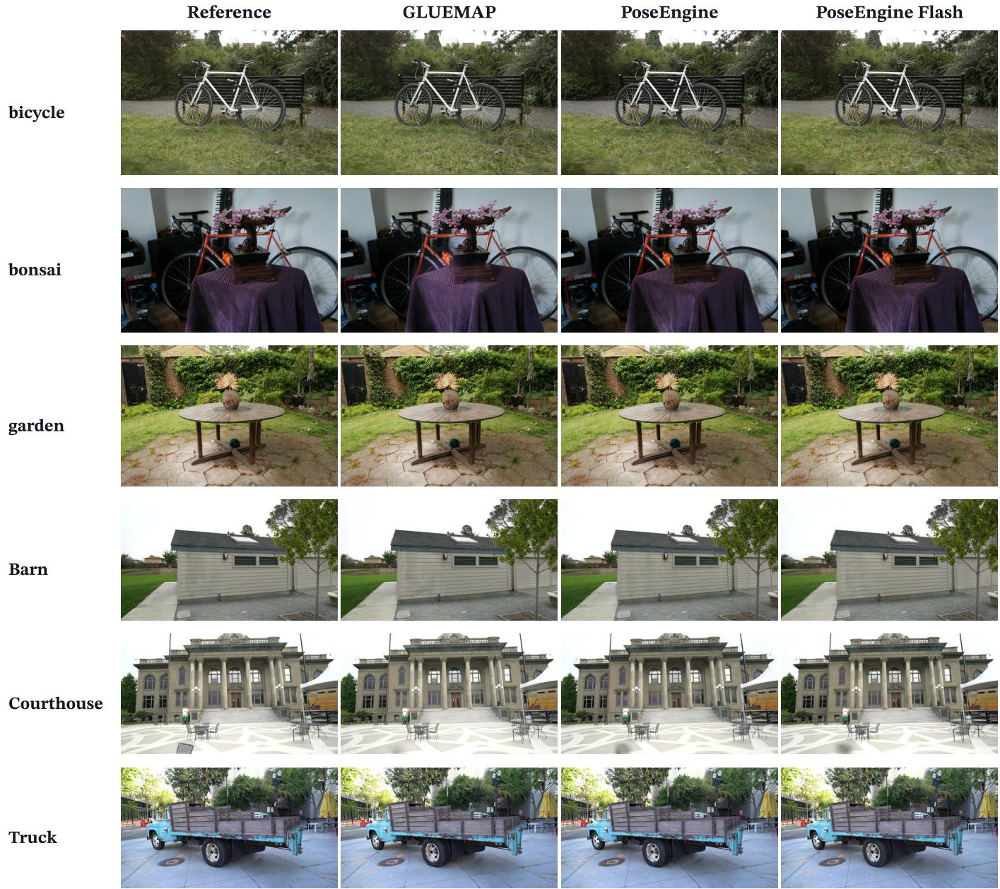  
Figure 13. 3DGS rendering on three examples each from MipNeRF360 and Tanks & Temples. Columns use reference cameras, GLUEMAP, PoseEngine, and PoseEngine Flash. Within each row, all renderings correspond to the same test image, and non-reference poses receive twenty-step image-conditioned refinement.

## 5 Scaling

Given limited open-source 3D training data and our computational resource constraints, we do not establish a quantitative scaling law for GFM. Instead, we examine whether increasing training-data quantity, model scale, and training compute continues to improve depth and camera-pose accuracy within the budgets we can evaluate. After selecting an encoder initialization, we study these three axes using experimental models that are separate from the released GFM. The results show favorable scaling trends overall, with metric-level fluctuations and diminishing gains at larger recurrent depths. These observations motivate further scaling, but do not establish a power-law scaling relationship that can be extrapolated beyond the tested range.

Scaling protocol. The three sweeps report SpatialBench Sparse depth and camera-pose accuracy in the accompanying plots and tables. Values in the training-compute plots are rounded to three decimal places.

## 5.1 Encoder Selection

GFM models rely on visual encoders initialized from pretrained models such as DINOv2 [Oquab et al., 2024]. The available pretrained checkpoints therefore constrain the model scales that can be studied directly.

We compare the Base variants of DINOv2, DINOv3 [Siméoni et al., 2026], and LingBot-Vision [Fu et al., 2026] as encoder initializations, training base-size reconstruction models for 100k iterations on Hypersim [Roberts et al., 2021] with 2–24 input views. LingBot-Vision performs best among the three general-purpose encoders across the reported depth and pose measures (Table 13). We therefore use pretrained weights from the LingBot-Vision family to initialize the encoders in the subsequent scaling experiments.

Table 13. Encoder initialization for the scaling model. Base-size reconstruction models are initialized with the Base variant of each pretrained encoder and trained for 100k iterations on Hypersim with 2–24 input views. The geometry-pretrained Depth Anything 3-Base encoder is listed as a reference. Bold marks the best value among the three general-purpose encoders.
<table><tr><td>Encoder initialization</td><td>Local AbsRel ↓</td><td>Global AbsRel ↓</td><td>AUC@30↑</td><td>AUC@5↑</td></tr><tr><td>Depth Anything 3-Base (reference)</td><td>0.0793</td><td>0.4819</td><td>0.9606</td><td>0.7742</td></tr><tr><td>DINOv2-Base</td><td>0.1333</td><td>1.0499</td><td>0.7823</td><td>0.3527</td></tr><tr><td>DINOv3-Base</td><td>0.1218</td><td>0.5506</td><td>0.8241</td><td>0.3883</td></tr><tr><td>LingBot-Vision-Base</td><td>0.1175</td><td>0.5284</td><td>0.8441</td><td>0.4064</td></tr></table>

To study intermediate scales without separately pretraining larger visual encoders, we adopt a recurrent-depth Transformer approach that reuses the 1.7B model’s weights across additional computational depth. This produces the 2.5B, 3.2B, and 4.8B variants evaluated below. For these recurrent variants, the reported scale counts parameter uses in the expanded computation graph, including repeated uses of shared weights; it is not the number of independent trainable parameters. These variants let us probe scaling through increased recurrent computation while retaining the available pretrained initialization.

## 5.2 Data Scale

We select 26 publicly available datasets and construct training sets of diferent sizes by sampling 1% to 100% of their trajectories, ranging from 1,879 to 187,880 trajectories. For a 0.2B model, more training data improves depth estimation and camera-pose accuracy at each of the three tested budgets. Figure 14 shows the 8-, 16-, and 32-GPU series at 200k training steps, and the trend holds across dataset sizes within each series.

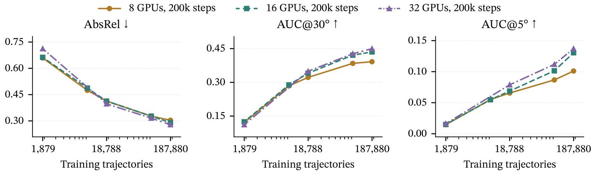  
Figure 14. Data scaling for the 0.2B model. More training trajectories reduce depth error and improve pose accuracy at each tested budget. The x-axis is logarithmic. Lines connect measured observations only.

Table 14. Data-scaling observations for the 0.2B model at 200k steps. AUC values are fractions, and dashes denote an unreported setting.
<table><tr><td rowspan="2">Trajectories</td><td colspan="3">8 GPUs</td><td colspan="3">16 GPUs</td><td colspan="3">32 GPUs</td></tr><tr><td>AbsRel ↓</td><td>AUC@30↑</td><td>AUC@5↑</td><td>AbsRel ↓</td><td>AUC@30↑</td><td>AUC@5↑</td><td>AbsRel ↓</td><td>AUC@30↑</td><td>AUC@5↑</td></tr><tr><td>1,879</td><td>0.65917</td><td>0.12169</td><td>0.01456</td><td>0.66276</td><td>0.12468</td><td>0.01498</td><td>0.71213</td><td>0.11167</td><td>0.01621</td></tr><tr><td>9,394</td><td>0.47453</td><td>0.28411</td><td>0.05513</td><td>0.48733</td><td>0.28863</td><td>0.05477</td><td></td><td></td><td></td></tr><tr><td>18,788</td><td>0.41348</td><td>0.32196</td><td>0.06557</td><td>0.41262</td><td>0.34058</td><td>0.06877</td><td>0.39743</td><td>0.34915</td><td>0.07881</td></tr><tr><td>93,940</td><td>0.32707</td><td>0.38433</td><td>0.08666</td><td>0.32710</td><td>0.42081</td><td>0.10139</td><td>0.31562</td><td>0.42707</td><td>0.11179</td></tr><tr><td>187,880</td><td>0.30391</td><td>0.39172</td><td>0.10103</td><td>0.28976</td><td>0.43517</td><td>0.13044</td><td>0.27833</td><td>0.44961</td><td>0.13702</td></tr></table>

## 5.3 Model Scale

Model-scale experiments use the full training set of 187,880 trajectories. For models trained on eight GPUs for 200,000 steps, increasing model scale from 0.6B to 3.2B consistently improves depth and camera-pose accuracy (Figure 15). The 2.5B and 3.2B variants use the recurrent-depth construction described in Section 5.1. This comparison therefore includes both changes in independent model parameters and increases in recurrent computational depth.

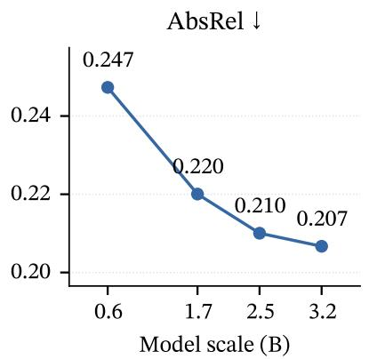

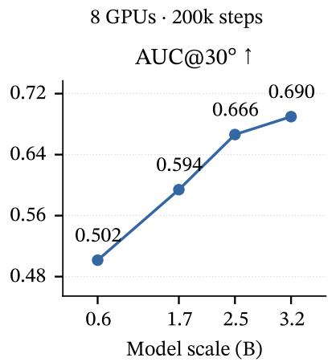

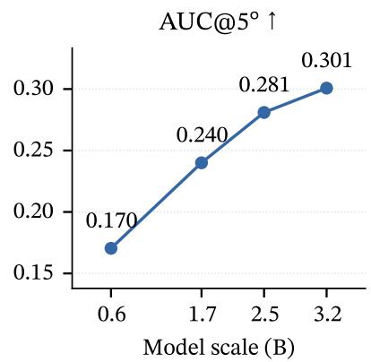  
Figure 15. Model scaling using 8 GPUs for 200k steps. Depth and pose accuracy improve as model scale increases.

## 5.4 Training Compute

We evaluate training-compute scaling for four model configurations, fixing the training length at 200,000 steps and increasing the GPU count from 8 to 16 and 32. Figure 16 uses GPU count multiplied by training steps as a budget proxy, corresponding to 1.6M, 3.2M, and 6.4M GPU-steps. We use this proxy to organize the budget sweep within each model configuration; the 3.2B configuration uses recurrent depth as described in Section 5.1.

Increasing training compute generally reduces depth error and improves camera-pose accuracy, although individual metric fluctuate. For the 3.2B variant, however, gains become smaller at higher budgets, suggesting a trend toward saturation.

Two hypotheses. We consider two possible explanations for this trend. First, the current training set of 187,880 trajectories may be insuficient in size or diversity to support further improvements at this model scale. Second, repeated applications of shared Transformer weights may yield progressively smaller representational updates as recurrent depth increases, reducing the gains from additional passes. We refer to this possible efect as recurrent “inertia.”

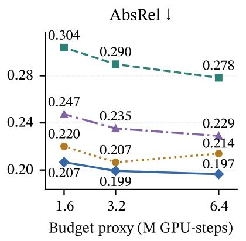

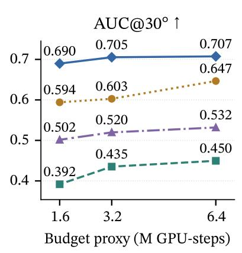

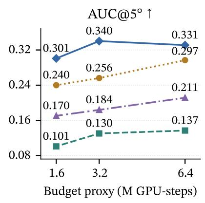  
Figure 16. Training-compute scaling across four model scales. Each series uses 200k training steps with 8, 16, or 32 GPUs; the horizontal axis reports the corresponding GPU-step budget.

Additional recurrent-depth experiments. To further examine the second hypothesis, we extend the model-scale comparison in Section 5.3 to the 4.8B recurrent variant, alongside the 2.5B and 3.2B variants (Figure 17). All variants are trained on the full set of 187,880 trajectories using 8 GPUs and 200k steps. The recurrent variants share the 1.7B model’s weights and follow the scale convention defined in Section 5.1.

The results show that increasing recurrent depth continues to improve accuracy, while the gains per increment in scale become smaller, particularly for AbsRel and AUC@30. From 3.2B to 4.8B, AbsRel decreases from 0.2067 to 0.2049, AUC@30 increases from 0.6898 to 0.7007, and AUC@5 increases from 0.3008 to 0.3216. This trend is consistent with diminishing marginal returns from recurrent depth.

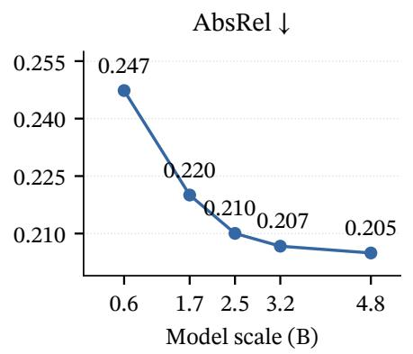

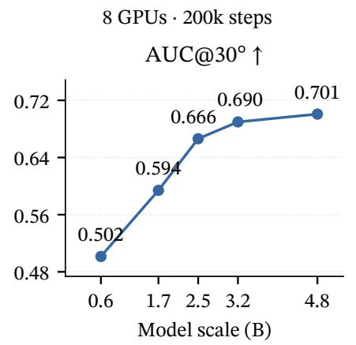

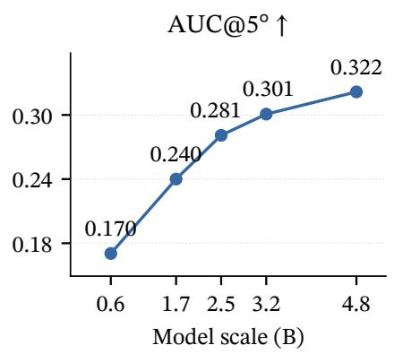  
Figure 17. Recurrent-depth scaling using 8 GPUs for 200k steps. The 2.5B, 3.2B, and 4.8B variants reuse the 1.7B model’s weights; their reported scales count parameter uses in the expanded computation graph, including weight reuse, rather than unique trainable parameters. The 0.6B and 1.7B models serve as references. Accuracy continues to improve at larger scales, with diminishing marginal gains.

Related work and outlook. Related observations have been reported in other multi-view reconstruction models. Déjà View [Burzio et al., 2026] observes decreasing relative feature updates and reports a plateau beyond the trained iteration budget under a stabilization recipe. Solv3R [Kwak et al., 2026] reports diminishing state updates and camera errors that stabilize with continued iteration. The favorable trends observed in this section support further exploration of data, model, and compute scaling. We remain optimistic about recurrent depth as a practical way to increase computation through weight reuse, and will continue investigating larger training sets and improved recurrence designs. Establishing a quantitative scaling law remains a goal for experiments spanning a wider range of data and compute budgets.

## 6 Qualitative Results

This section illustrates the range of reconstruction outputs supported by Kosmo-GFM on public datasets and captured sequences: camera trajectories, sparse and dense geometry, feed-forward 3DGS, 3DGS, dynamic points, and 4DGS. Camera-conditioned prediction incorporates recovered camera information into dense geometry and renderable scene representations, while the dynamic examples illustrate scene structure and motion over time. These qualitative results show the workflow from camera recovery to geometry reconstruction and rendering, demonstrate support for multiple reconstruction tasks and output representations, and complement the preceding quantitative evaluations.

## 6.1 Camera Pose and Sparse Geometry

Figure 18 compares Kosmo-GFM and COLMAP camera trajectories and sparse reconstructions on LingBot-Map demo sequences [Robbyant Team, 2026] and Oxford Spires data [Tao et al., 2024]. Oxford Spires trajectories are aligned to ground-truth poses.

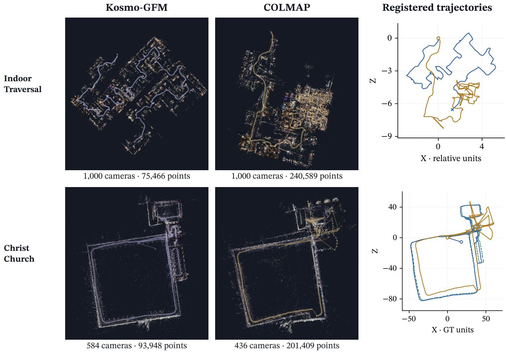

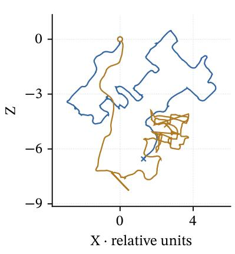

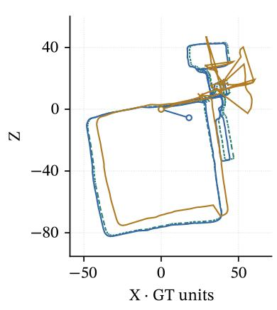  
Blue: Kosmo-GFM Ochre: COLMAP Dashed teal: GT  
Figure 18. Camera pose and sparse geometry. Left and center: sparse points of each reconstruction, framed independently to show the main structure. Right: complete registered trajectories with circles/crosses at the start/end, retaining the recorded alignment in a common coordinate system.

## 6.2 Camera-Conditioned Dense Points

Figure 19 presents dense point clouds from LingBot-Map demo sequences [Robbyant Team, 2026], Oxford Spires, SMERF, Tanks & Temples, MipNeRF360, and ETH3D. GFM predicts dense points conditioned on PoseEngine cameras and accumulates them across the input frames.

  
Indoor Traversal

  
Christ Church

  
Berlin

  
Truck

  
Garden

  
Courtyard  
Figure 19. Camera-conditioned dense points. Each scene shows a dense-point reconstruction above a small reference input image. We compute the confidence threshold separately for each chunk as the 20th percentile of its point confidence values. For each selected scene, we accumulate point predictions from all available frames.

## 6.3 Feed-Forward 3DGS

We extend camera-conditioned GFM with a query-based 3DGS decoder that directly predicts a renderable scene representation.   
Figure 20 shows results on Hypersim [Roberts et al., 2021] alongside InfiniSplat v2 [Hu et al., 2026a] with ground-truth poses.

Input views  

Kosmo-GFM  
  
688,221 Gaussians

InfiniSplat v2 (GT pose)  
  
1,260,272 Gaussians

  
430,551 Gaussians

  
936,014 Gaussians  
584,910 Gaussians

  
1,074,446 Gaussians

Figure 20. Feed-Forward 3DGS. Columns show eight input views and rendered views for Kosmo-GFM and InfiniSplat v2 with GT poses. The rendering viewpoints may difer between methods, so these are not matched-pixel quantitative comparisons. Counts describe representation size, not reconstruction accuracy.

## 6.4 3DGS

Figure 21 shows 3DGS reconstructions from Insta360 captures, rendered from multiple viewpoints.

Scene 1  
  
Figure 21. 3DGS. Four views along the recorded camera trajectory are shown for each of Scene 1 and Scene 2. All panels are rendered outputs of the reconstructed scenes.

## 6.5 Dynamic Points

Figure 22 presents dynamic-point reconstructions on DAVIS videos [Perazzi et al., 2016, Pont-Tuset et al., 2017] and studio captures, showing scene geometry and motion over time.

  
Figure 22. Dynamic-point sequences. Each row shows an input frame and reconstructions at three time points from a fixed viewpoint. Backgrounds, masks, and motion trails use consistent display settings.

## 6.6 4DGS

Figure 23 shows reconstructions from our in-house 4DGS implementation on Volumetric Video Challenge (VVC 2025) sequences [Volumetric Video Challenge Organizers, 2025].

  
Figure 23. 4DGS on VVC 2025 sequences. Top: Scene 1. Bottom: Scene 2. Columns show 1.0, 2.5, and 4.0 seconds from a fixed viewpoint for each sequence.

## 7 Discussion and Limitations

Kosmo-GFM combines learned geometric priors with scene-level optimization to support both static and dynamic reconstruction. We discuss limitations in static 3D geometry and dynamic 4D modeling separately, then consider applications and representation learning opportunities enabled by 3D point tracking.

## 7.1 Static 3D Reconstruction

Textureless scenes. Large blank surfaces ofer few distinctive features or reliable cross-view correspondences. The resulting lack of visual constraints makes camera recovery unreliable, as illustrated by the stairwell example in Figure 24(a).

Portrait-oriented inputs. Our training primarily targets landscape-oriented images and videos. Portrait-oriented inputs are less well covered during training, resulting in weaker reconstruction performance, as illustrated by the indoor video in Figure 24(b). Unstructured photo collections. Training data emphasize walkthrough trajectories, whereas independently captured Internet photos vary substantially in viewpoint, framing, appearance, and view overlap. Limited training coverage of these capture patterns reduces robustness on datasets such as MegaDepth [Li and Snavely, 2018], MegaDepth-X [Li et al., 2026c], and ArchWorld [Kriplani et al., 2026]. Figure 24(c) illustrates the resulting errors in recovered camera poses on 7 West 54th Street.

(a) Textureless walls · stairwell  

(b) Portrait-oriented video · indoor scene  

(c) Unstructured photo collections · 7 West 54th Street  
  
Figure 24. Qualitative examples. (a) Stairwell input frames and the complete camera trajectory, displayed vertically. (b) Portrait-oriented video frames and the complete camera trajectory. (c) Four input photos of 7 West 54th Street and a point cloud overlaid with GFM cameras (orange) and GT cameras (blue).

## 7.2 Dynamic 4D Reconstruction

Static–dynamic training balance. Our current GFM training emphasizes dynamic sequences, with static scenes accounting for a smaller share of the training mixture. This allocation may leave some static environments underrepresented and contribute to errors in depth estimation and cross-view scale consistency. Establishing the extent of this trade-of requires controlled ablations of the training mixture.

We are evaluating diferent mixing ratios of high-quality static data and dynamic sequences through controlled experiments. These experiments aim to improve depth accuracy and cross-view scale consistency while preserving dynamic reconstruction performance.

Decoder context and temporal conditioning. Our dynamic-point decoder adopts the source-to-target formulation of Uni-Query4R [Chen et al., 2026c]: a query sampled from the source-frame features cross-attends to the selected target-frame features. D4RT [Zhang et al., 2026a] instead lets a source-point query, augmented with local appearance, attend to a global representation of all input frames, using a learned target-time embedding to specify the requested temporal state. In our formulation, global attention in the encoder already exchanges information across all input frames. The selected source and target representations therefore provide a compact interface to this multi-frame context, reducing the information explicitly accessed by the decoder. Our design hypothesis is that this encoder-level aggregation can make additional attention to other frames unnecessary at decoding time; this remains to be established through controlled ablations. Selecting the target features also identifies the requested frame directly, removing dependence on a learned target-time embedding indexed by a predefined frame set.

Occlusion and temporal stability. We nevertheless observe temporal jitter in predicted 3D trajectories when the queried point is occluded in the target frame. Such cases lack direct target-view evidence and test whether the encoded context preserves suficient information to infer hidden motion. We will compare decoder variants under matched training conditions and vary the amount and coverage of occlusion supervision to assess the respective contributions of decoder modeling and training-data limitations.

## 7.2.1 Applications of 3D Point Tracking

3D point tracking can support downstream applications and inform representation learning.

Direct applications. We consider three uses of predicted geometry and motion in downstream systems.

4DGS initialization and motion priors. Dense dynamic point maps can initialize 4DGS geometry, while time-normalized scene flow ofers velocity priors as an alternative to FreeTimeGS’s RoMa/KNN pipeline [Wang et al., 2025d]. MoRSe [Jin et al., 2026] uses a UniQuery4R-initialized encoder to predict moving-region masks for pixel-level static–dynamic separation. These masks can guide primitive allocation, and confidence-weighted trajectories can supervise Gaussian motion.

Frame interpolation. Estimated trajectories can support frame interpolation by interpolating 3D states between observations and rendering or warping them to intermediate times, with visibility handling and image completion for newly exposed regions.

Camera reshooting. Holo4D [Lan et al., 2026a], for example, projects persistent 3D trajectories into requested camera views to condition video difusion. Following the same scene points across time supplies a geometric basis for preserving motion and identity during video reshooting, beyond the spatial information in independent point clouds.

Representation learning. Joint supervision of 3D tracks, scene flow, and visibility may also benefit the shared representation. Temporal correspondence and point identity. Tracking supervision can encourage the model to preserve point identity across appearance changes and occlusions. TrackMAE [Vandeghen et al., 2026] supports this direction through 2D track reconstruction in masked video modeling; benefits from extending such supervision to joint 3D geometry and motion learning in Kosmo-GFM remain to be evaluated.

Separating camera and scene motion. Motion expressed in a shared reference frame can help distinguish camera-induced image motion from scene dynamics, while relative motion provides cues to articulated parts and coherent motion regions.

Geometric and motion consistency. Consistency among depth, camera geometry, 2D correspondences, and 3D trajectories ofers additional constraints on the representation.

Embodiedfuture prediction. FlowDreamer [Guo et al., 2025] predicts 3D scene flow from observations and robot actions to condition future RGB-D synthesis. GFM could provide confidence-filtered trajectories or geometric features for such actionconditioned predictors, whose inputs must be restricted to observed history; full-clip reconstruction alone does not establish forecasting ability. These potential benefits require ablations under matched data and compute budgets, together with downstream reconstruction or control evaluations.

Overall, Kosmo-GFM combines multi-task geometric prediction, scene-level camera recovery, and real-world supervision to support static and dynamic reconstruction. The reported accuracy, eficiency, and scaling results motivate extending this framework to a wider range of real-world capture conditions.

## References

Dejan Azinović, Ricardo Martin-Brualla, Dan B Goldman, Matthias Nießner, and Justus Thies. Neural RGB-D surface reconstruction. In Proceedings ofthe IEEE/CVF Conference on Computer Vision and Pattern Recognition, 2022. URL https://github.com/dazinov ic/neural-rgbd-surface-reconstruction.

Abhishek Badki, Hang Su, Bowen Wen, and Orazio Gallo. L4P: Towards Unified Low-Level 4D Vision Perception. In International Conference on 3D Vision (3DV), 2026. doi: 10.1109/3dv69130.2026.00011. URL https://arxiv.org/abs/2502.13078.

Jonathan T. Barron, Ben Mildenhall, Dor Verbin, Pratul P. Srinivasan, and Peter Hedman. Mip-NeRF 360: Unbounded Anti-Aliased Neural Radiance Fields. In Proceedings ofthe IEEE/CVF Conference on Computer Vision and Pattern Recognition (CVPR), pages 5460–5469, 2022. doi: 10.1109/cvpr52688.2022.00539.

Jonathan T. Barron, Ben Mildenhall, Dor Verbin, Pratul P. Srinivasan, and Peter Hedman. Zip-NeRF: Anti-aliased grid-based neural radiance fields. In Proceedings ofthe IEEE/CVF International Conference on Computer Vision, 2023. URL https://jonbarron.info/zipnerf/.

Vukasin Bozic, Isidora Slavkovic, Dominik Narnhofer, Nando Metzger, Denis Rozumny, Konrad Schindler, and Nikolai Kalischek. Unified Panoramic Geometry Estimation via Multi-View Foundation Models. arXiv preprint arXiv:2605.26368, 2026. URL https://arxiv. org/abs/2605.26368.

Alessandro Burzio, Tobias Fischer, Sven Elflein, Qunjie Zhou, Riccardo de Lutio, Jiawei Ren, Jiahui Huang, Shengyu Huang, Marc Pollefeys, Laura Leal-Taixé, Zan Gojcic, and Haithem Turki. Déjà view: Looping transformers for multi-view 3D reconstruction. arXiv preprint arXiv:2605.30215, 2026. URL https://arxiv.org/abs/2605.30215.

Yohann Cabon, Naila Murray, and Martin Humenberger. Virtual KITTI 2. arXiv preprint arXiv:2001.10773, 2020. URL https: //arxiv.org/abs/2001.10773.

Yohann Cabon, Lucas Stofl, Leonid Antsfeld, Gabriela Csurka, Boris Chidlovskii, Jerome Revaud, and Vincent Leroy. MUSt3R: Multi-view Network for Stereo 3D Reconstruction. In Proceedings ofthe IEEE/CVF Conference on Computer Vision and Pattern Recognition (CVPR), 2025. doi: 10.1109/cvpr52734.2025.00106. URL https://arxiv.org/abs/2503.01661

Jingong Chen, Qingwen Zhang, Youming Deng, Chulwoo Pack, Olaf Wysocki, Boris Jutzi, Kwanghee Won, and Kyle Gao. Any3R: Feedforward 3D Reconstruction from Any Camera Type. arXiv preprint arXiv:2610.36150, 2026a. URL https://arxiv.org/abs/2610.36150.

Lin-Zhuo Chen, Jian Gao, Shangzhan Zhang, Yihang Chen, Ka Leong Cheng, Yipengjing Sun, Liangxiao Hu, Nan Xue, Xing Zhu, Yujun Shen, Yao Yao, and Yinghao Xu. Geometric Context Transformer for Streaming 3D Reconstruction. In European Conference on Computer Vision (ECCV), 2026b. doi: 10.1007/978-3-032-37467-7\_17. URL https://arxiv.org/abs/2604.14141.

Tiancheng Chen, Sheng Tang, Wenhua Jin, Weiqi Zhang, Juntong Fang, Junsheng Zhou, and Zesong Li. UniQuery4R: Unified 4D Scene Reconstruction from a Single Query. arXiv preprint arXiv:2608.17283, 2026c. URL https://arxiv.org/abs/2608.17283.

Tianxing Chen, Zanxin Chen, Baijun Chen, Zijian Cai, Yibin Liu, Zixuan Li, Qiwei Liang, Xianliang Lin, Yiheng Ge, Zhenyu Gu, Weiliang Deng, Yubin Guo, Tian Nian, Xuanbing Xie, Qiangyu Chen, Kailun Su, Tianling Xu, Guodong Liu, Mengkang Hu, Huan ang Gao, Kaixuan Wang, Zhixuan Liang, Yusen Qin, Xiaokang Yang, Ping Luo, and Yao Mu. RoboTwin 2.0: A scalable data generator and benchmark with strong domain randomization for robust bimanual robotic manipulation. arXiv preprint arXiv:2506.18088, 2025. URL https://arxiv.org/abs/2506.18088.

Xingyu Chen, Yue Chen, Yuliang Xiu, Andreas Geiger, and Anpei Chen. TTT3R: 3D Reconstruction as Test-Time Training. In International Conference on Learning Representations (ICLR), 2026d. URL https://arxiv.org/abs/2509.26645.

Chong Cheng, Xianda Chen, Tao Xie, Wei Yin, Weiqiang Ren, Qian Zhang, Xiaoyang Guo, and Hao Wang. LongStream: Long-Sequence Streaming Autoregressive Visual Geometry. In Proceedings of the IEEE/CVF Conference on Computer Vision and Pattern Recognition (CVPR), 2026. URL https://arxiv.org/abs/2602.13172.

Angela Dai, Angel X. Chang, Manolis Savva, Maciej Halber, Thomas Funkhouser, and Matthias Niessner. ScanNet: Richly-Annotated 3D Reconstructions of Indoor Scenes. In Proceedings ofthe IEEE Conference on Computer Vision and Pattern Recognition (CVPR), pages 2432–2443, 2017. doi: 10.1109/cvpr.2017.261.

Junyuan Deng, Heng Li, Kejie Qiu, Lingteng Qiu, Rui Peng, Weichao Shen, Weihao Yuan, Siyu Zhu, Zilong Dong, and Ping Tan. Glob3R: Global Structure-from-Motion with 3D Foundation Models. arXiv preprint arXiv:2607.09225, 2026a. URL https://arxiv.org/ab s/2607.09225.

Junyuan Deng, Heng Li, Tao Xie, Weiqiang Ren, Qian Zhang, Ping Tan, and Xiaoyang Guo. SAIL-Recon: Large SfM by Augmenting Scene Regression with Localization. In International Conference on 3D Vision (3DV), 2026b. doi: 10.1109/3dv69130.2026.00037. URL https://arxiv.org/abs/2508.17972

Kai Deng, Zexin Ti, Jiawei Xu, Jian Yang, and Jin Xie. VGGT-Long: Chunk it, Loop it, Align it – Pushing VGGT’s Limits on Kilometer-scal Long RGB Sequences. In IEEE International Conference on Robotics andAutomation (ICRA), 2026c. doi: 10.1109/icra57385.2026.11697137. URL https://arxiv.org/abs/2507.16443.

Ruxiao Duan, Erin Hong, Dongxu Zhao, Eric Turner, Alex Wong, and Yunwen Zhou. Fisheye3R: Adapting Unified 3D Feed-Forward Foundation Models to Fisheye Lenses. In European Conference on Computer Vision (ECCV), 2026. doi: 10.1007/978-3-032-37429-5\_1. URL https://arxiv.org/abs/2603.28896.

Daniel Duckworth, Peter Hedman, Christian Reiser, Peter Zhizhin, Jean-François Thibert, Mario Lučić, Richard Szeliski, and Jonathan T. Barron. SMERF: Streamable Memory Eficient Radiance Fields for Real-Time Large-Scene Exploration. ACM Transactions on Graphics, 43(4):1–13, 2024. doi: 10.1145/3658193.

Bardienus Duisterhof, Lojze Zust, Philippe Weinzaepfel, Vincent Leroy, Yohann Cabon, and Jerome Revaud. MASt3R-SfM: a Fully-Integrated Solution for Unconstrained Structure-from-Motion. In International Conference on 3D Vision (3DV), 2025. doi: 10.1109/3dv66043.2025.00 008. URL https://arxiv.org/abs/2409.19152.

Johan Edstedt, Qiyu Sun, Georg Bökman, Mårten Wadenbäck, and Michael Felsberg. RoMa: Robust Dense Feature Matching. In Proceedings ofthe IEEE/CVF Conference on Computer Vision and Pattern Recognition (CVPR), 2024. doi: 10.1109/cvpr52733.2024.01871. URL https://arxiv.org/abs/2305.15404.

Johan Edstedt, Georg Bökman, Mårten Wadenbäck, and Michael Felsberg. DaD: Distilled Reinforcement Learning for Diverse Keypoint Detection. arXiv preprint arXiv:2503.07347, 2025. URL https://arxiv.org/abs/2503.07347.

Johan Edstedt, David Nordström, Yushan Zhang, Georg Bökman, Jonathan Astermark, Viktor Larsson, Anders Heyden, Fredrik Kahl, Mårten Wadenbäck, and Michael Felsberg. RoMa v2: Harder Better Faster Denser Feature Matching. In European Conference on Computer Vision (ECCV), 2026. doi: 10.1007/978-3-032-37225-3\_36. URL https://arxiv.org/abs/2511.15706.

Sven Elflein, Ruilong Li, Sérgio Agostinho, Zan Gojcic, Laura Leal-Taixé, Qunjie Zhou, and Aljosa Osep. VGG-T3: Ofline Feed-Forward 3D Reconstruction at Scale. In Proceedings ofthe IEEE/CVF Conference on Computer Vision and Pattern Recognition (CVPR), 2026. URL https://arxiv.org/abs/2602.23361.

Haiwen Feng, Junyi Zhang, Qianqian Wang, Yufei Ye, Pengcheng Yu, Michael J. Black, Trevor Darrell, and Angjoo Kanazawa. St4RTrack: Simultaneous 4D Reconstruction and Tracking in the World. In Proceedings ofthe IEEE/CVF International Conference on Computer Vision (ICCV), 2025. doi: 10.1109/iccv51701.2025.00796. URL https://arxiv.org/abs/2504.13152.

Ilya Fradlin, Christian Schmidt, Jens Piekenbrinck, Karim Knaebel, Gonzalo Martin Garcia, and Bastian Leibe. ARROW: Arbitrar Reconstruction and Tracking of 4D Observations in the Wild. arXiv preprint arXiv:2610.01314, 2026. URL https://arxiv.org/ab s/2610.01314.

Zelin Fu, Bin Tan, Changjiang Sun, Shaohui Liu, Kecheng Zheng, Yinghao Xu, Xing Zhu, Yujun Shen, and Nan Xue. Vision Pretraining for Dense Spatial Perception. arXiv preprint arXiv:2607.05247, 2026. URL https://arxiv.org/abs/2607.05247.

Bishoy Galoaa, Xiangyu Bai, Shayda Moezzi, Utsav Nandi, Sai Siddhartha Vivek Dhir Rangoju, Somaieh Amraee, and Sarah Ostadabbas. Look Around and Pay Attention: Multi-camera Point Tracking Reimagined with Transformers. In International Conference on 3D Vision (3DV), 2026. doi: 10.1109/3dv69130.2026.00008. URL https://arxiv.org/abs/2512.04213.

Jun Guo, Xiaojian Ma, Yikai Wang, Min Yang, Huaping Liu, and Qing Li. FlowDreamer: A RGB-D world model with flow-based motion representations for robot manipulation. arXiv preprint arXiv:2505.10075, 2025. URL https://arxiv.org/abs/2505.10075.

Yijing Guo, Mengjun Chao, Luo Wang, Tianyang Zhao, Haizhao Dai, Yingliang Zhang, Jingyi Yu, and Yujiao Shi. PanoVGGT: Feed-Forward 3D Reconstruction from Panoramic Imagery. In Proceedings ofthe IEEE/CVF Conference on Computer Vision and Pattern Recognition (CVPR), 2026. URL https://arxiv.org/abs/2603.17571.

Namitha Guruprasad, Abhay Yadav, Cheng Peng, and Rama Chellappa. CAM3R: Camera-Agnostic Model for 3D Reconstruction. In European Conference on Computer Vision (ECCV), 2026. doi: 10.1007/978-3-032-37321-2\_14. URL https://arxiv.org/abs/2603.22631.

Jiarong Han, Jincheng Xiong, Yuzhou Liu, Linzhe Shi, Changjie Wu, Ning Guo, Mu Xu, Hang Zhang, and Ming Qian. Revisiting Local Context for Long-Horizon Streaming 3D Reconstruction. arXiv preprint arXiv:2608.27529, 2026. URL https://arxiv.org/abs/2608.27529.

Kaiming He, Xiangyu Zhang, Shaoqing Ren, and Jian Sun. Deep Residual Learning for Image Recognition. In Proceedings of the IEEE Conference on Computer Vision and Pattern Recognition (CVPR), pages 770–778, 2016. doi: 10.1109/cvpr.2016.90.

Yongzhen Hu, Hao Yu, Jiawei Wang, Xianming Zeng, Jianyun Xu, Xingliang Liu, Ruizhen Hu, Xiaowei Zhou, Hujun Bao, and Sida Peng. InfiniSplat v2: Analyzing and Improving Feed-Forward 3DGS from Any Views. arXiv preprint arXiv:2610.20341, 2026a. URL https://arxiv.org/abs/2610.20341.

Yu Hu, Chong Cheng, Sicheng Yu, Xiaoyang Guo, and Hao Wang. VGGT4D: Mining Motion Cues in Visual Geometry Transformers for 4D Scene Reconstruction. In Proceedings ofthe IEEE/CVF Conference on Computer Vision and Pattern Recognition, Findings Track (CVPRF), 2026b. doi: 10.1109/cvprf71909.2026.00044. URL https://arxiv.org/abs/2511.19971.

Chengjie Huang, Guile Wu, Dongfeng Bai, and Bingbing Liu. Fast Spatial Tracking with Visual Geometry Transformer. In Proceedings ofthe IEEE/CVF Conference on Computer Vision and Pattern Recognition (CVPR), pages 374–383, 2026. URL https://openaccess.the cvf.com/content/CVPR2026/html/Huang\_Fast\_Spatial\_Tracking\_with\_Visual\_Geometry\_Transformer \_CVPR\_2026\_paper.html.

Jiahui Huang, Qunjie Zhou, Hesam Rabeti, Aleksandr Korovko, Huan Ling, Xuanchi Ren, Tianchang Shen, Jun Gao, Dmitry Slepichev, Chen-Hsuan Lin, Jiawei Ren, Kevin Xie, Joydeep Biswas, Laura Leal-Taixe, and Sanja Fidler. ViPE: Video Pose Engine for 3D Geometric Perception. arXiv preprint arXiv:2508.10934, 2025. URL https://arxiv.org/abs/2508.10934.

Sergio Izquierdo and Javier Civera. Optimal Transport Aggregation for Visual Place Recognition. In Proceedings of the IEEE/CVF Conference on Computer Vision and Pattern Recognition (CVPR), 2024. doi: 10.1109/cvpr52733.2024.01672. URL https: //arxiv.org/abs/2311.15937.

Stephen James, Zicong Ma, David Rovick Arrojo, and Andrew J. Davison. RLBench: The robot learning benchmark & learning environment. IEEE Robotics and Automation Letters, 5(2):3019–3026, 2020. URL https://arxiv.org/abs/1909.12271.

Rasmus Jensen, Anders Dahl, George Vogiatzis, Engin Tola, and Henrik Aanæs. Large scale multi-view stereopsis evaluation. In Proceedings ofthe IEEE Conference on Computer Vision and Pattern Recognition, 2014. URL https://roboimagedata.compute.dtu.dk/? page\_id=39.

Minsik Jeon, Jay Karhade, Deva Ramanan, and Shubham Tulsiani. Point4D: Long-range 4D Motion Reconstruction. arXiv preprint arXiv:2609.09145, 2026. URL https://arxiv.org/abs/2609.09145.

Yuzhou Ji, Xiaotian Yang, and Zhipeng Zhang. CasaMaestro: Multi-View Panoramas for House-Scale 3D Reconstruction. In European Conference on Computer Vision (ECCV), 2026. doi: 10.1007/978-3-032-37252-9\_12. URL https://arxiv.org/abs/2606.31086.

Tinghao Jiang, Sheng Tang, Shengzhe Wei, Juntong Fang, Weiqi Zhang, Junsheng Zhou, and Zesong Li. GeoWeaver: Accurate Long-Sequence 3D Reconstruction via Hierarchical Geometric Assembly. arXiv preprint arXiv:2608.17389, 2026a. URL https://arxiv.org/abs/ 2608.17389.

Yanqin Jiang, Tengfei Wang, Zhengwei Wang, Chenjie Cao, Junta Wu, Wenhan Luo, Weiming Hu, Jin Gao, and Chunchao Guo. OmniX: Any-view and Any-time 4D Reconstruction via Feed-forward Trajectory Fields. In European Conference on Computer Vision (ECCV), 2026b. doi: 10.1007/978-3-032-37235-2\_19. URL https://arxiv.org/abs/2607.10840.

Wenhua Jin, Tiancheng Chen, Sheng Tang, Jiahao Li, Yupeng Liu, Weiqi Zhang, Juntong Fang, and Zesong Li. Moving Regions, Not Moving Objects: Segmenting What Actually Moves under Camera Motion. arXiv preprint arXiv:2610.31209, 2026. URL https: //arxiv.org/abs/2610.31209.

Hanbyul Joo, Hao Liu, Lei Tan, Lin Gui, Bart Nabbe, Iain Matthews, Takeo Kanade, Shohei Nobuhara, and Yaser Sheikh. Panoptic Studio: A Massively Multiview System for Social Motion Capture. In Proceedings ofthe IEEE International Conference on Computer Vision (ICCV), pages 3334–3342, 2015. doi: 10.1109/iccv.2015.381.

Dongki Jung, Jaehoon Choi, Adil Qureshi, Somi Jeong, Dinesh Manocha, and Suyong Yeon. Wid3R: Wide Field-of-View 3D Reconstruction via Camera Model Conditioning. In European Conference on Computer Vision (ECCV), 2026. doi: 10.1007/978-3-032-37517-9\_37. URL https://arxiv.org/abs/2602.05321.

Nikita Karaev, Ignacio Rocco, Benjamin Graham, Natalia Neverova, Andrea Vedaldi, and Christian Rupprecht. DynamicStereo: Consistent Dynamic Depth from Stereo Videos. In Proceedings ofthe IEEE/CVF Conference on Computer Vision and Pattern Recognition (CVPR), pages 13229–13239, 2023. doi: 10.1109/cvpr52729.2023.01271.

Nikita Karaev, Iurii Makarov, Jianyuan Wang, Natalia Neverova, Andrea Vedaldi, and Christian Rupprecht. CoTracker3: Simpler and Better Point Tracking by Pseudo-Labelling Real Videos. In Proceedings ofthe IEEE/CVF International Conference on Computer Vision (ICCV), pages 6013–6022, 2025. URL https://arxiv.org/abs/2410.11831.

Jay Karhade, Nikhil Keetha, Yuchen Zhang, Tanisha Gupta, Akash Sharma, Sebastian Scherer, and Deva Ramanan. Any4D: Unified Feed-Forward Metric 4D Reconstruction. In Proceedings ofthe IEEE/CVF Conference on Computer Vision and Pattern Recognition (CVPR), 2026. URL https://arxiv.org/abs/2512.10935.

Nikhil Keetha, Norman Müller, Johannes Schönberger, Lorenzo Porzi, Yuchen Zhang, Tobias Fischer, Arno Knapitsch, Duncan Zauss, Ethan Weber, Nelson Antunes, Jonathon Luiten, Manuel Lopez-Antequera, Samuel Rota Bulò, Christian Richardt, Deva Ramanan, Sebastian Scherer, and Peter Kontschieder. MapAnything: Universal Feed-Forward Metric 3D Reconstruction. In International Conference on 3D Vision (3DV), 2026. doi: 10.1109/3dv69130.2026.00054. URL https://arxiv.org/abs/2509.13414.

Bernhard Kerbl, Georgios Kopanas, Thomas Leimkühler, and George Drettakis. 3D Gaussian Splatting for Real-Time Radiance Field Rendering. ACM Transactions on Graphics, 42(4):1–14, 2023. doi: 10.1145/3592433. URL https://arxiv.org/abs/2308.04079.

Alexander Khazatsky, Karl Pertsch, Suraj Nair, et al. DROID: A large-scale in-the-wild robot manipulation dataset. arXiv preprint arXiv:2403.12945, 2024. URL https://arxiv.org/abs/2403.12945.

Arno Knapitsch, Jaesik Park, Qian-Yi Zhou, and Vladlen Koltun. Tanks and Temples: Benchmarking Large-Scale Scene Reconstruction. ACM Transactions on Graphics, 36(4):1–13, 2017. doi: 10.1145/3072959.3073599.

Jahyeok Koo, Inès Hyeonsu Kim, Mungyeom Kim, Junghyun Park, Seohyun Park, Jaeyeong Kim, Jung Yi, Seokju Cho, and Seungryong Kim. MV-TAP: Tracking Any Point in Multi-View Videos. In Proceedings ofthe IEEE/CVF Conference on Computer Vision and Pattern Recognition (CVPR), 2026. URL https://arxiv.org/abs/2512.02006.

Nicky Kriplani, Yiwen Zhang, Angelina Wang, and Hadar Averbuch-Elor. Towards Reconstructing Geographically Diverse Architecture with 3D Foundation Models. In Advances in Neural Information Processing Systems (NeurIPS), 2026. URL https://arxiv.org/abs/26 10.22514.

Jeong-gi Kwak, Andrea Tagliasacchi, Sho Kagami, Yuki Ono, and Kwang Moo Yi. Solv3R: 3D looped transformer as a multi-view solver. arXiv preprint arXiv:2611.02857, 2026. URL https://arxiv.org/abs/2611.02857.

Yushi Lan, Zeren Jiang, Koichi Namekata, Xingang Pan, Chuanxia Zheng, and Andrea Vedaldi. Holo4D: Holistic 4D reconstruction as geometric control for video difusion. arXiv preprint arXiv:2610.25276, 2026a. URL https://arxiv.org/abs/2610.25276.

Yushi Lan, Yihang Luo, Fangzhou Hong, Shangchen Zhou, Honghua Chen, Zhaoyang Lyu, Shuai Yang, Bo Dai, Chen Change Loy, and Xingang Pan. STream3R: Scalable Sequential 3D Reconstruction with Causal Transformer. In International Conference on Learning Representations (ICLR), 2026b. URL https://arxiv.org/abs/2508.10893.

Jongmin Lee, Seungyeop Kang, and Sungjoo Yoo. MV-RoMa: From Pairwise Matching into Multi-View Track Reconstruction. In Proceeding ofthe IEEE/CVF Conference on Computer Vision and Pattern Recognition (CVPR), 2026. URL https://arxiv.org/abs/2603.2 7542.

Vincent Leroy, Yohann Cabon, and Jérôme Revaud. Grounding Image Matching in 3D with MASt3R. In European Conference on Computer Vision (ECCV), 2024. doi: 10.1007/978-3-031-73220-1\_5. URL https://arxiv.org/abs/2406.09756.

Qiaoge Li, Yifan Zhan, Haijun Yang, Haiyang Liu, Yiyi Cai, and Chenchi Luo. Many Eyes, One World: Feed-Forward 3D Reconstruction from Mixed Cameras. arXiv preprint arXiv:2609.35658, 2026a. URL https://arxiv.org/abs/2609.35658.

Xi Li, Linyuan Li, Yan Wu, Tong Rao, Kai Zhang, Xinchen Hui, and Cihui Pan. Argus: Metric Panoramic 3D Reconstruction for Indoor Scenes. In European Conference on Computer Vision (ECCV), 2026b. doi: 10.1007/978-3-032-37369-4\_34. URL https: //arxiv.org/abs/2606.30047.

Yuan Li, Yuanbo Xiangli, Hadar Averbuch-Elor, Noah Snavely, and Ruojin Cai. Long-tail Internet photo reconstruction. In Proceedings ofthe IEEE/CVF Conference on Computer Vision and Pattern Recognition (CVPR), 2026c. URL https://arxiv.org/abs/2604.22714.

Zhengqi Li and Noah Snavely. MegaDepth: Learning Single-View Depth Prediction from Internet Photos. In Proceedings ofthe IEEE/CVF Conference on Computer Vision and Pattern Recognition (CVPR), 2018. doi: 10.1109/cvpr.2018.00218. URL https://arxiv.org/ abs/1804.00607.

Zhengqi Li, Richard Tucker, Forrester Cole, Qianqian Wang, Linyi Jin, Vickie Ye, Angjoo Kanazawa, Aleksander Holynski, and Noah Snavely. MegaSaM: Accurate, Fast, and Robust Structure and Motion from Casual Dynamic Videos. In Proceedings of the IEEE/CVF Conference on Computer Vision and Pattern Recognition (CVPR), 2025. doi: 10.1109/cvpr52734.2025.00981. URL https: //arxiv.org/abs/2412.04463.

Zizun Li, Jianjun Zhou, Yifan Wang, Haoyu Guo, Wenzheng Chang, Yang Zhou, Haoyi Zhu, Junyi Chen, Chunhua Shen, and Tong He. WinT3R: Window-Based Streaming Reconstruction with Camera Token Pool. In International Conference on Learning Representations (ICLR), 2026d. URL https://arxiv.org/abs/2509.05296.

Kaimin Liao, Hua Wang, Zhi Chen, Luchao Wang, and Yaohua Tang. LiteGS: A High-Performance Framework to Train 3DGS in Subminutes via System and Algorithm Codesign. In European Conference on Computer Vision (ECCV), 2026. doi: 10.1007/978-3-032-37422-6\_33. URL https://arxiv.org/abs/2503.01199.

Chenguo Lin, Yuchen Lin, Panwang Pan, Yifan Yu, Tao Hu, Honglei Yan, Katerina Fragkiadaki, and Yadong Mu. MoVieS: Motion-Aware 4D Dynamic View Synthesis in One Second. In Proceedings of the IEEE/CVF Conference on Computer Vision and Pattern Recognition (CVPR), 2026a. URL https://arxiv.org/abs/2507.10065.

Haotong Lin, Sili Chen, Junhao Liew, Donny Y. Chen, Zhenyu Li, Guang Shi, Jiashi Feng, and Bingyi Kang. Depth Anything 3: Recovering the Visual Space from Any Views. In International Conference on Learning Representations (ICLR), 2026b. URL https://arxiv.org/abs/2511.10647.

Shing Ho J. Lin, Wenzhao Zheng, Dong Zhuo, Yuqi Wu, Jie Zhou, and Jiwen Lu. SM4RT: Learning Structured Motion Geometry for 4D Reconstruction. arXiv preprint arXiv:2607.22534, 2026c. URL https://arxiv.org/abs/2607.22534.

Philipp Lindenberger, Paul-Edouard Sarlin, and Marc Pollefeys. LightGlue: Local Feature Matching at Light Speed. In Proceedings of the IEEE/CVF International Conference on Computer Vision (ICCV), 2023. doi: 10.1109/iccv51070.2023.01616. URL https: //arxiv.org/abs/2306.13643.

Xinhang Liu, Yuxi Xiao, Donny Y. Chen, Jiashi Feng, Yu-Wing Tai, Chi-Keung Tang, and Bingyi Kang. Trace Anything: Representing Any Video in 4D via Trajectory Fields. In International Conference on Learning Representations (ICLR), 2026a. URL https: //arxiv.org/abs/2510.13802.

Yifan Liu, Zhiyuan Min, Zhenwei Wang, Junta Wu, Tengfei Wang, Yixuan Yuan, Yawei Luo, and Chunchao Guo. WorldMirror: Universal 3D World Reconstruction with Any-Prior Prompting. In International Conference on Machine Learning (ICML), 2026b. URL https: //arxiv.org/abs/2510.10726.

David G. Lowe. Distinctive Image Features from Scale-Invariant Keypoints. International Journal ofComputer Vision, 60(2):91–110, 2004. doi: 10.1023/b:visi.0000029664.99615.94.

Jiahao Lu, Jiayi Xu, Wenbo Hu, Ruijie Zhu, Chengfeng Zhao, Sai-Kit Yeung, Ying Shan, and Yuan Liu. Track4World: Feedforward World-centric Dense 3D Tracking of All Pixels. In European Conference on Computer Vision (ECCV), 2026a. doi: 10.1007/978-3-032-37023-5\_11. URL https://arxiv.org/abs/2603.02573.

Xinyang Lu, Shengzhe Wei, Sheng Tang, Weiqi Zhang, Juntong Fang, and Zesong Li. MVLoMa: Multi-View Local Feature Matching with Any Geometry Foundation Model. arXiv preprint arXiv:2610.31321, 2026b. URL https://arxiv.org/abs/2610.31321.

Yihang Luo, Shangchen Zhou, Yushi Lan, Xingang Pan, and Chen Change Loy. 4RC: 4D Reconstruction via Conditional Querying Anytime and Anywhere. In International Conference on Machine Learning (ICML), 2026. URL https://arxiv.org/abs/2602.10094.

Dominic Maggio, Hyungtae Lim, and Luca Carlone. VGGT-SLAM: Dense RGB SLAM Optimized on the SL(4) Manifold. In Advances in Neural Information Processing Systems (NeurIPS), 2025. doi: 10.52202/085713-4324. URL https://arxiv.org/abs/2505.12549.

Avilasha Mandal, Rajesh Kumar, Sudarshan Sunil Harithas, and Chetan Arora. VGGT-SLAM++. In Proceedings ofthe IEEE/CVF Conference on Computer Vision and Pattern Recognition (CVPR) Workshops, 2026. URL https://arxiv.org/abs/2604.06830.

Tuan Duc Ngo, Ashkan Mirzaei, Guocheng Qian, Hanwen Liang, Chuang Gan, Evangelos Kalogerakis, Peter Wonka, and Chaoyang Wang. DELTAv2: Accelerating Dense 3D Tracking. arXivpreprint arXiv:2508.01170, 2025a. URL https://arxiv.org/abs/2508.01170.

Tuan Duc Ngo, Peiye Zhuang, Chuang Gan, Evangelos Kalogerakis, Sergey Tulyakov, Hsin-Ying Lee, and Chaoyang Wang. DELTA: Dense Eficient Long-range 3D Tracking for any video. In International Conference on Learning Representations (ICLR), 2025b. URL https://arxiv.org/abs/2410.24211.

David Nordström, Johan Edstedt, Georg Bökman, Jonathan Astermark, Anders Heyden, Viktor Larsson, Mårten Wadenbäck, Michael Felsberg, and Fredrik Kahl. LoMa: Local Feature Matching Revisited. In European Conference on Computer Vision (ECCV), 2026. doi: 10.1007/978-3-032-37026-6\_35. URL https://arxiv.org/abs/2604.04931.

OpenD4RT Contributors. OpenD4RT: Unoficial PyTorch implementation of D4RT, 2026. URL https://github.com/Lijiaxin011 1/Open-d4rt. Accessed November 7, 2026.

Maxime Oquab, Timothée Darcet, Théo Moutakanni, Huy Vo, Marc Szafraniec, Vasil Khalidov, Pierre Fernandez, Daniel Haziza, Francisco Massa, Alaaeldin El-Nouby, Mahmoud Assran, Nicolas Ballas, Wojciech Galuba, Russell Howes, Po-Yao Huang, Shang-Wen Li, Ishan Misra, Michael Rabbat, Vasu Sharma, Gabriel Synnaeve, Hu Xu, Hervé Jegou, Julien Mairal, Patrick Labatut, Armand Joulin, and Piotr Bojanowski. DINOv2: Learning Robust Visual Features without Supervision. Transactions on Machine Learning Research, 2024. URL https://arxiv.org/abs/2304.07193.

Jing Ou, Zidong Cao, Yinrui Ren, Zhuoxiao Li, Jinjing Zhu, Tongyan Hua, Shuai Zhang, Hui Xiong, and Wufan Zhao. Holo360D: A Large-Scale Real-World Dataset with Continuous Trajectories for Advancing Panoramic 3D Reconstruction. In European Conference on Computer Vision (ECCV), 2026. doi: 10.1007/978-3-032-37083-9\_38. URL https://arxiv.org/abs/2604.22482.

Linfei Pan, Dániel Baráth, Marc Pollefeys, and Johannes L. Schönberger. Global Structure-from-Motion Revisited. In European Conference on Computer Vision (ECCV), 2024. doi: 10.1007/978-3-031-73661-2\_4. URL https://arxiv.org/abs/2407.20219.

Linfei Pan, Johannes Schönberger, and Marc Pollefeys. Global Structure-from-Motion Meets Feedforward Reconstruction. In Proceedings ofthe IEEE/CVF Conference on Computer Vision and Pattern Recognition (CVPR), 2026. URL https://arxiv.org/abs/2605.26103.

Xiaqing Pan, Nicholas Charron, Yongqian Yang, Scott Peters, Thomas Whelan, Chen Kong, Omkar Parkhi, Richard Newcombe, and Yuheng Carl Ren. Aria Digital Twin: A New Benchmark Dataset for Egocentric 3D Machine Perception. In Proceedings ofthe IEEE/CVF International Conference on Computer Vision (ICCV), pages 20076–20086, 2023. doi: 10.1109/iccv51070.2023.01842.

Zador Pataki, Paul-Edouard Sarlin, Johannes L. Schönberger, and Marc Pollefeys. MP-SfM: Monocular Surface Priors for Robust Structurefrom-Motion. In Proceedings ofthe IEEE/CVF Conference on Computer Vision and Pattern Recognition (CVPR), 2025. doi: 10.1109/cvpr 52734.2025.02039. URL https://arxiv.org/abs/2504.20040.

Zador Pataki, Paul-Edouard Sarlin, and Marc Pollefeys. VidMap: Exploiting Temporal Structure for Video-Based Structure-from-Motion. In European Conference on Computer Vision (ECCV), 2026. doi: 10.1007/978-3-032-37032-7\_31. URL https://arxiv.org/abs/26 07.27194.

Haosong Peng, Hao Li, Jiaqi Chen, Yuhao Pan, Runmao Yao, Yalun Dai, Fushuo Huo, Fangzhou Hong, Zhaoxi Chen, Haozhao Wang, Dingwen Zhang, Ziwei Liu, and Wenchao Xu. SpatialBench: Is Your Spatial Foundation Model an All-Round Player? arXiv preprint arXiv:2605.27367, 2026a. URL https://arxiv.org/abs/2605.27367.

Haosong Peng, Hao Li, Yalun Dai, Yushi Lan, Yihang Luo, Tianyu Qi, Zhengshen Zhang, Yufeng Zhan, Junfei Zhang, Wenchao Xu, and Ziwei Liu. OmniVGGT: Omni-Modality Driven Visual Geometry Grounded Transformer. In Proceedings ofthe IEEE/CVF Conference on Computer Vision and Pattern Recognition (CVPR), 2026b. URL https://arxiv.org/abs/2511.10560.

F. Perazzi, J. Pont-Tuset, B. McWilliams, L. Van Gool, M. Gross, and A. Sorkine-Hornung. A Benchmark Dataset and Evaluation Methodology for Video Object Segmentation. In Proceedings of the IEEE Conference on Computer Vision and Pattern Recognition (CVPR), pages 724–732, 2016. doi: 10.1109/cvpr.2016.85.

Pi3 Contributors. Pi3X: Engineering update to Pi3, 2025. URL https://github.com/yyfz/Pi3. Oficial implementation. Accessed November 7, 2026.

Jordi Pont-Tuset, Federico Perazzi, Sergi Caelles, Pablo Arbeláez, Alexander Sorkine-Hornung, and Luc Van Gool. The 2017 DAVIS challenge on video object segmentation. arXiv preprint arXiv:1704.00675, 2017. URL https://arxiv.org/abs/1704.00675.

Wilbert Pumacay, Ishika Singh, Jiafei Duan, Ranjay Krishna, Jesse Thomason, and Dieter Fox. The Colosseum: A benchmark for evaluating generalization for robotic manipulation. In Proceedings ofRobotics: Science and Systems, 2024. URL https://arxiv.org/abs/24 02.08191.

Shenhan Qian, Ganlin Zhang, Shangzhe Wu, and Daniel Cremers. Flow4R: Unifying 4D Reconstruction and Tracking with Scene Flow. In European Conference on Computer Vision (ECCV), 2026. doi: 10.1007/978-3-032-37517-9\_4. URL https://arxiv.org/abs/26 02.14021.

Frano Rajič, Haofei Xu, Marko Mihajlovic, Siyuan Li, Irem Demir, Emircan Gündoğdu, Lei Ke, Sergey Prokudin, Marc Pollefeys, and Siyu Tang. Multi-View 3D Point Tracking. In Proceedings ofthe IEEE/CVF International Conference on Computer Vision (ICCV), 2025. URL https://arxiv.org/abs/2508.21060.

Rene Ranftl, Alexey Bochkovskiy, and Vladlen Koltun. Vision Transformers for Dense Prediction. In Proceedings ofthe IEEE/CVF International Conference on Computer Vision (ICCV), pages 12159–12168, 2021. doi: 10.1109/iccv48922.2021.01196.

Recast Navigation Contributors. Recast Navigation. Software repository, 2026. URL https://github.com/recastnavigation/ recastnavigation. Accessed November 7, 2026.

Jiahui Ren, Mochu Xiang, Jiajun Zhu, and Yuchao Dai. PanoSplatt3R: Leveraging Perspective Pretraining for Generalized Unposed Wide-Baseline Panorama Reconstruction. In Proceedings ofthe IEEE/CVF International Conference on Computer Vision (ICCV), 2025. doi: 10.1109/iccv51701.2025.02689. URL https://arxiv.org/abs/2507.21960.

Robbyant Team. LingBot-Map demo sequences, 2026. URL https://huggingface.co/datasets/robbyant/lingbot-mapdemo. Indoor traversal and driving videos. Accessed November 7, 2026.

Mike Roberts, Jason Ramapuram, Anurag Ranjan, Atulit Kumar, Miguel Angel Bautista, Nathan Paczan, Russ Webb, and Joshua M. Susskind. Hypersim: A Photorealistic Synthetic Dataset for Holistic Indoor Scene Understanding. In Proceedings ofthe IEEE/CVF International Conference on Computer Vision (ICCV), pages 10892–10902, 2021. doi: 10.1109/iccv48922.2021.01073.

Ropedia. Xperience-10M: A large-scale egocentric multimodal dataset with structured 3D/4D annotations. Hugging Face dataset, 2026. URL https://huggingface.co/datasets/ropedia-ai/xperience-10m.

Johannes L. Schönberger and Jan-Michael Frahm. Structure-from-Motion Revisited. In Proceedings ofthe IEEE Conference on Computer Vision and Pattern Recognition (CVPR), 2016. doi: 10.1109/cvpr.2016.445.

Thomas Schops, Johannes L. Schonberger, Silvano Galliani, Torsten Sattler, Konrad Schindler, Marc Pollefeys, and Andreas Geiger. A Multi-View Stereo Benchmark with High-Resolution Images and Multi-Camera Videos. In Proceedings ofthe IEEE Conference on Computer Vision and Pattern Recognition (CVPR), pages 2538–2547, 2017. doi: 10.1109/cvpr.2017.272.

You Shen, Zhipeng Zhang, Yansong Qu, Xiawu Zheng, Jiayi Ji, Shengchuan Zhang, and Liujuan Cao. FastVGGT: Fast Visual Geometry Transformer. In International Conference on Learning Representations (ICLR), pages 98040–98062, 2026. URL https://arxiv.org/ abs/2509.02560.

Jamie Shotton, Ben Glocker, Christopher Zach, Shahram Izadi, Antonio Criminisi, and Andrew Fitzgibbon. Scene coordinate regression forests for camera relocalization in RGB-D images. In Proceedings ofthe IEEE Conference on Computer Vision and Pattern Recognition, 2013. URL https://www.microsoft.com/en-us/research/project/rgb-d-dataset-7-scenes/.

Oriane Siméoni, Huy V. Vo, Maximilian Seitzer, Federico Baldassarre, Maxime Oquab, Cijo Jose, Vasil Khalidov, Marc Szafraniec, Seungeun Yi, Michaël Ramamonjisoa, Francisco Massa, Daniel Haziza, Luca Wehrstedt, Jianyuan Wang, Timothée Darcet, Théo Moutakanni, Leonel Sentana, Claire Roberts, Andrea Vedaldi, Jamie Tolan, John Brandt, Camille Couprie, Julien Mairal, Hervé Jégou, Patrick Labatut, and Piotr Bojanowski. DINOv3. Transactions on Machine Learning Research, 2026. URL https://arxiv.org/abs/2508.10104.

Daniil Sinitsyn, Nikita Araslanov, and Daniel Cremers. RayTun3R: Online Camera Adaptation in 3D Foundation Models. arXiv preprint arXiv:2607.02711, 2026. URL https://arxiv.org/abs/2607.02711.

Jürgen Sturm, Nikolas Engelhard, Felix Endres, Wolfram Burgard, and Daniel Cremers. A benchmark for the evaluation of RGB-D SLAM systems. In IEEE/RSJ International Conference on Intelligent Robots and Systems, 2012. URL https://cvg.cit.tum.de/\_medi a/spezial/bib/sturm12iros.pdf.

Edgar Sucar, Zihang Lai, Eldar Insafutdinov, and Andrea Vedaldi. Dynamic Point Maps: A Versatile Representation for Dynamic 3D Reconstruction. In Proceedings of the IEEE/CVF International Conference on Computer Vision (ICCV), 2025. doi: 10.1109/iccv51701.20 25.00685. URL https://arxiv.org/abs/2503.16318.

Edgar Sucar, Eldar Insafutdinov, Zihang Lai, and Andrea Vedaldi. V-DPM: 4D Video Reconstruction with Dynamic Point Maps. In Proceedings ofthe IEEE/CVF Conference on Computer Vision and Pattern Recognition (CVPR), 2026. URL https://arxiv.org/abs/2601.0 9499.

Pei Sun, Henrik Kretzschmar, Xerxes Dotiwalla, Aurélien Chouard, Vijaysai Patnaik, Paul Tsui, James Guo, Yin Zhou, Yuning Chai, Benjamin Caine, Vijay Vasudevan, Wei Han, Jiquan Ngiam, Hang Zhao, Aleksei Timofeev, Scott Ettinger, Maxim Krivokon, Amy Gao, Aditya Joshi, Yu Zhang, Jonathon Shlens, Zhifeng Chen, and Dragomir Anguelov. Scalability in perception for autonomous driving: Waymo Open Dataset. In Proceedings ofthe IEEE/CVF Conference on Computer Vision and Pattern Recognition, 2020. URL https://waymo.com/open/.

Yifu Tao, Miguel Ángel Muñoz-Bañón, Lintong Zhang, Jiahao Wang, Lanke Frank Tarimo Fu, and Maurice Fallon. The Oxford Spires dataset: Benchmarking large-scale LiDAR-visual localisation, reconstruction and radiance field methods. arXiv preprint arXiv:2411.10546, 2024 URL https://arxiv.org/abs/2411.10546.

Team HY-World. HY-World 2.0: A multi-modal world model for reconstructing, generating, and simulating 3D worlds. arXiv preprint arXiv:2604.14268, 2026. doi: 10.48550/arXiv.2604.14268. URL https://arxiv.org/abs/2604.14268.

Michał J. Tyszkiewicz, Pascal Fua, and Eduard Trulls. DISK: Learning local features with policy gradient. In Advances in Neural Information Processing Systems (NeurIPS), 2020. URL https://arxiv.org/abs/2006.13566.

Renaud Vandeghen, Fida Mohammad Thoker, Marc Van Droogenbroeck, and Bernard Ghanem. TrackMAE: Video representation learning via track mask and predict. arXiv preprint arXiv:2603.27268, 2026. URL https://arxiv.org/abs/2603.27268.

Volumetric Video Challenge Organizers. The 1st volumetric video challenge: SIGGRAPH Asia 2025 workshop, 2025. URL https: //www.4dv.ai/research/sig-asia2025-volumetric-video-challenges.

Hengyi Wang and Lourdes Agapito. 3D Reconstruction with Spatial Memory. In International Conference on 3D Vision (3DV), 2025. doi: 10.1109/3dv66043.2025.00013. URL https://arxiv.org/abs/2408.16061.

Hengyi Wang and Lourdes Agapito. AMB3R: Accurate Feed-forward Metric-scale 3D Reconstruction with Backend. In Proceedings of the IEEE/CVF Conference on Computer Vision and Pattern Recognition (CVPR), 2026. URL https://arxiv.org/abs/2511.20343.

Jianyuan Wang, Nikita Karaev, Christian Rupprecht, and David Novotny. VGGSfM: Visual Geometry Grounded Deep Structure from Motion. In Proceedings ofthe IEEE/CVF Conference on Computer Vision and Pattern Recognition (CVPR), 2024a. doi: 10.1109/cvpr52733.2024.02049. URL https://arxiv.org/abs/2312.04563.

Jianyuan Wang, Minghao Chen, Nikita Karaev, Andrea Vedaldi, Christian Rupprecht, and David Novotny. VGGT: Visual Geometry Grounded Transformer. In Proceedings ofthe IEEE/CVF Conference on Computer Vision and Pattern Recognition (CVPR), 2025a. doi: 10.1109/cvpr52734.2025.00499. URL https://arxiv.org/abs/2503.11651.

Jianyuan Wang, Minghao Chen, Shangzhan Zhang, Nikita Karaev, Johannes Schönberger, Patrick Labatut, Piotr Bojanowski, David Novotny, Andrea Vedaldi, and Christian Rupprecht. VGGT-Ω. In Proceedings of the IEEE/CVF Conference on Computer Vision and Pattern Recognition (CVPR), 2026a. URL https://arxiv.org/abs/2605.15195.

Qianqian Wang, Vickie Ye, Hang Gao, Weijia Zeng, Jake Austin, Zhengqi Li, and Angjoo Kanazawa. Shape of Motion: 4D Reconstruction from a Single Video. In Proceedings ofthe IEEE/CVF International Conference on Computer Vision (ICCV), 2025b. doi: 10.1109/iccv5170 1.2025.00901. URL https://arxiv.org/abs/2407.13764.

Qianqian Wang, Yifei Zhang, Aleksander Holynski, Alexei A. Efros, and Angjoo Kanazawa. Continuous 3D Perception Model with Persistent State. In Proceedings of the IEEE/CVF Conference on Computer Vision and Pattern Recognition (CVPR), 2025c. doi: 10.1109/cvpr52734.2025.00983. URL https://arxiv.org/abs/2501.12387.

Shuzhe Wang, Vincent Leroy, Yohann Cabon, Boris Chidlovskii, and Jerome Revaud. DUSt3R: Geometric 3D Vision Made Easy. In Proceedings ofthe IEEE/CVF Conference on Computer Vision and Pattern Recognition (CVPR), 2024b. doi: 10.1109/cvpr52733.2024.01956. URL https://arxiv.org/abs/2312.14132.

Yifan Wang, Peishan Yang, Zhen Xu, Jiaming Sun, Zhanhua Zhang, Yong Chen, Hujun Bao, Sida Peng, and Xiaowei Zhou. FreeTimeGS: Free gaussian primitives at anytime and anywhere for dynamic scene reconstruction. arXiv preprint arXiv:2506.05348, 2025d. URL https://arxiv.org/abs/2506.05348

Yifan Wang, Jianjun Zhou, Haoyi Zhu, Wenzheng Chang, Yang Zhou, Zizun Li, Junyi Chen, Jiangmiao Pang, Chunhua Shen, and Tong He. π3: Permutation-Equivariant Visual Geometry Learning. In International Conference on Learning Representations (ICLR), 2026b. URL https://arxiv.org/abs/2507.13347.

Zhou Wang, Alan C. Bovik, Hamid R. Sheikh, and Eero P. Simoncelli. Image quality assessment: From error visibility to structural similarity. IEEE Transactions on Image Processing, 13(4):600–612, 2004. URL https://ece.uwaterloo.ca/\~z70wang/publication s/ssim.html.

Guanjun Wu, Taoran Yi, Jiemin Fang, Lingxi Xie, Xiaopeng Zhang, Wei Wei, Wenyu Liu, Qi Tian, and Xinggang Wang. 4D Gaussian Splatting for Real-Time Dynamic Scene Rendering. In Proceedings of the IEEE/CVF Conference on Computer Vision and Pattern Recognition (CVPR), pages 20310–20320, 2024. doi: 10.1109/cvpr52733.2024.01920.

Yuqi Wu, Wenzhao Zheng, Jie Zhou, and Jiwen Lu. Point3R: Streaming 3D Reconstruction with Explicit Spatial Pointer Memory. In Advances in Neural Information Processing Systems (NeurIPS), 2025. doi: 10.52202/085713-2344. URL https://arxiv.org/abs/2507.02863.

Yuanbo Xiangli, Ruojin Cai, Hanyu Chen, Jefrey Byrne, and Noah Snavely. Doppelgangers++: Improved Visual Disambiguation with Geometric 3D Features. In Proceedings ofthe IEEE/CVF Conference on Computer Vision and Pattern Recognition (CVPR), 2025. doi: 10.1109/cvpr52734.2025.02530. URL https://arxiv.org/abs/2412.05826.

Yuxi Xiao, Qianqian Wang, Shangzhan Zhang, Nan Xue, Sida Peng, Yujun Shen, and Xiaowei Zhou. SpatialTracker: Tracking Any 2D Pixels in 3D Space. In Proceedings of the IEEE/CVF Conference on Computer Vision and Pattern Recognition (CVPR), 2024. doi: 10.1109/cvpr52733.2024.01929. URL https://arxiv.org/abs/2404.04319

Yuxi Xiao, Jianyuan Wang, Nan Xue, Nikita Karaev, Yuri Makarov, Bingyi Kang, Xing Zhu, Hujun Bao, Yujun Shen, and Xiaowei Zhou. SpatialTrackerV2: 3D Point Tracking Made Easy. In Proceedings ofthe IEEE/CVF International Conference on Computer Vision (ICCV), 2025. URL https://arxiv.org/abs/2507.12462.

Tao Xie, Peishan Yang, Yudong Jin, Yingfeng Cai, Wei Yin, Weiqiang Ren, Qian Zhang, Wei Hua, Sida Peng, Xiaoyang Guo, and Xiaowei Zhou. Scal3R: Scalable Test-Time Training for Large-Scale 3D Reconstruction. In Proceedings ofthe IEEE/CVF Conference on Computer Vision and Pattern Recognition (CVPR), 2026. URL https://arxiv.org/abs/2604.08542.

Zunnan Xu, Shangchen Zhou, Yihang Luo, and Chen Change Loy. HiP3R: Hierarchical Pose Graphs for Long-Horizon 3D Reconstruction. arXiv preprint arXiv:2610.31635, 2026. URL https://arxiv.org/abs/2610.31635.

Jenai Xuning Yang, Rishit Dagli, Alex Zook, Hugo Hadfield, Ankit Goyal, Stan Birchfield, Fabio Ramos, and Jonathan Tremblay. RoboLab: A high-fidelity simulation benchmark for analysis of task generalist policies. In Proceedings ofRobotics: Science and Systems, 2026. URL https://arxiv.org/abs/2604.09860.

Jianing Yang, Alexander Sax, Kevin J. Liang, Mikael Henaf, Hao Tang, Ang Cao, Joyce Chai, Franziska Meier, and Matt Feiszli. Fast3R: Towards 3D Reconstruction of 1000+ Images in One Forward Pass. In Proceedings ofthe IEEE/CVF Conference on Computer Vision and Pattern Recognition (CVPR), 2025. doi: 10.1109/cvpr52734.2025.02042. URL https://arxiv.org/abs/2501.13928.

Botao Ye, Marc Pollefeys, Ming-Hsuan Yang, and Abhijit Kundu. OmniPoint: Universal Monocular Metric Pointcloud from Any Camera. In European Conference on Computer Vision (ECCV), 2026. doi: 10.1007/978-3-032-37602-2\_32. URL https://arxiv.org/abs/26 09.09394.

Chandan Yeshwanth, Yueh-Cheng Liu, Matthias Nießner, and Angela Dai. ScanNet++: A high-fidelity dataset of 3D indoor scenes. In Proceedings ofthe IEEE/CVF International Conference on Computer Vision, 2023. URL https://arxiv.org/abs/2308.11417.

Shuai Yuan, Yantai Yang, Xiaotian Yang, Xupeng Zhang, Zhonghao Zhao, Lingming Zhang, and Zhipeng Zhang. InfiniteVGGT: Visual Geometry Grounded Transformer for Endless Streams. arXiv preprint arXiv:2601.02281, 2026. URL https://arxiv.org/abs/2601.02281.

Bowei Zhang, Lei Ke, Adam W. Harley, and Katerina Fragkiadaki. TAPIP3D: Tracking Any Point in Persistent 3D Geometry. In Advances in Neural Information Processing Systems (NeurIPS), 2025a. doi: 10.52202/085713-4514. URL https://arxiv.org/abs/2504.147 17.

Chuhan Zhang, Guillaume Le Moing, Skanda Koppula, Ignacio Rocco, Liliane Momeni, Junyu Xie, Shuyang Sun, Rahul Sukthankar, Joëlle K. Barral, Raia Hadsell, Zoubin Ghahramani, Andrew Zisserman, Junlin Zhang, and Mehdi S. M. Sajjadi. Eficiently Reconstructing Dynamic Scenes One D4RT at a Time. In Proceedings ofthe IEEE/CVF Conference on Computer Vision and Pattern Recognition (CVPR), 2026a. URL https://arxiv.org/abs/2512.08924.

Junyi Zhang, Charles Herrmann, Junhwa Hur, Varun Jampani, Trevor Darrell, Forrester Cole, Deqing Sun, and Ming-Hsuan Yang. MonST3R: A Simple Approach for Estimating Geometry in the Presence of Motion. In International Conference on Learning Representations (ICLR), 2025b. URL https://arxiv.org/abs/2410.03825.

Junyi Zhang, Charles Herrmann, Junhwa Hur, Chen Sun, Ming-Hsuan Yang, Forrester Cole, Trevor Darrell, and Deqing Sun. LoGeR: Long-Context Geometric Reconstruction with Hybrid Memory. In European Conference on Computer Vision (ECCV), 2026b. doi: 10.1007/978-3-032-37135-5\_15. URL https://arxiv.org/abs/2603.03269.

Richard Zhang, Phillip Isola, Alexei A. Efros, Eli Shechtman, and Oliver Wang. The Unreasonable Efectiveness of Deep Features as a Perceptual Metric. In Proceedings ofthe IEEE/CVF Conference on Computer Vision and Pattern Recognition (CVPR), pages 586–595, 2018. doi: 10.1109/cvpr.2018.00068.

Shuo Zhang, Xin Su, Wei Wang, Jun Liu, Xinrui Zeng, Yongsen Chen, Chenjie Wang, Guibo Zhu, Jinqiao Wang, Bin Luo, and Liangpei Zhang. G-ray: Ray-Level Relative Geometric Position Encoding in Multi-View Vision Transformers under Camera Heterogeneity. arXiv preprint arXiv:2609.15018, 2026c. URL https://arxiv.org/abs/2609.15018.

Yuchen Zhang, Nikhil Keetha, Chenwei Lyu, Bhuvan Jhamb, Yutian Chen, Yuheng Qiu, Jay Karhade, Shreyas Jha, Yaoyu Hu, Deva Ramanan, Sebastian Scherer, and Wenshan Wang. UFM: A Simple Path towards Unified Dense Correspondence with Flow. In Advances in Neural Information Processing Systems (NeurIPS), 2025c. doi: 10.52202/085713-3648. URL https://arxiv.org/abs/2506.09278.

Weiguang Zhao, Haoran Xu, Xingyu Miao, Qin Zhao, Rui Zhang, Kaizhu Huang, Ning Gao, Peizhou Cao, Mingze Sun, Mulin Yu, Tao Lu, Linning Xu, Junting Dong, and Jiangmiao Pang. SynthVerse: A Large-Scale Diverse Synthetic Dataset for Point Tracking. In ACM SIGGRAPH 2026 Conference Papers, pages 1–10, 2026. doi: 10.1145/3799902.3811183.

Xiaoming Zhao, Xingming Wu, Weihai Chen, Peter C. Y. Chen, Qingsong Xu, and Zhengguo Li. ALIKED: A Lighter Keypoint and Descriptor Extraction Network via Deformable Transformation. IEEE Transactions on Instrumentation and Measurement, 72:1–16, 2023. doi: 10.1109/tim.2023.3271000. URL https://arxiv.org/abs/2304.03608.

Yang Zheng, Adam W. Harley, Bokui Shen, Gordon Wetzstein, and Leonidas J. Guibas. PointOdyssey: A Large-Scale Synthetic Dataset for Long-Term Point Tracking. In Proceedings ofthe IEEE/CVF International Conference on Computer Vision (ICCV), pages 19798–19808, 2023. doi: 10.1109/iccv51070.2023.01818.

Heng Zhou, Shuhong Liu, Yonghao He, Bohao Zhang, Fa Fu, Chenhui Hou, Xianbao Hou, Lijun Han, and Wei Sui. X-Lens: Real-Time Metric Depth Estimation with Heterogeneous Cameras. arXiv preprint arXiv:2607.12993, 2026a. URL https://arxiv.org/abs/2607.1 2993.

Kaichen Zhou, Yuhan Wang, Grace Chen, Xinhai Chang, Gaspard Beaudouin, Fangneng Zhan, Paul Pu Liang, and Mengyu Wang. PAGE-4D: Disentangled Pose and Geometry Estimation for VGGT-4D Perception. In International Conference on Learning Representations (ICLR), 2026b. URL https://arxiv.org/abs/2510.17568.

Yang Zhou, Yifan Wang, Jianjun Zhou, Wenzheng Chang, Haoyu Guo, Zizun Li, Kaijing Ma, Xinyue Li, Yating Wang, Haoyi Zhu, Mingyu Liu, Dingning Liu, Jiange Yang, Zhoujie Fu, Junyi Chen, Chunhua Shen, Jiangmiao Pang, Kaipeng Zhang, and Tong He. OmniWorld: A multi-domain and multi-modal dataset for 4D world modeling. arXiv preprint arXiv:2509.12201, 2025. URL https: //arxiv.org/abs/2509.12201.

Shengjie Zhu, Ahmed Abdelkader, Mark J. Matthews, Xiaoming Liu, and Wen-Sheng Chu. Marginalized Bundle Adjustment: Multi-View Camera Pose from Monocular Depth Estimates. In International Conference on 3D Vision (3DV), 2026. doi: 10.1109/3dv69130.2026.00051. URL https://arxiv.org/abs/2602.18906.

Dong Zhuo, Wenzhao Zheng, Jiahe Guo, Yuqi Wu, Jie Zhou, and Jiwen Lu. Streaming Visual Geometry Transformer. In International Conference on Learning Representations (ICLR), 2026. URL https://arxiv.org/abs/2507.11539.

## Acknowledgments

We thank the following authors and interns for their work on this project.

Authors. Sheng Tang, Shengzhe Wei, Tiancheng Chen, Wenhua Jin, Yu Zhang, Xingshuo Chang, Jituo Tian, Hui Liang, Chaoqun Tang, Feng Tian, Xiaolin Chai, Kaojin Zhu, Wentao Ouyang, Peihuang Fu, Miao Zheng, Zesong Li, Xiao Lei and Xiang Gao (former team members). Interns. Tinghao Jiang, Xinyang Lu, Feixue Cai, Zizhen Zou, Weigang Wang, Yexuan Yang, Jiahao Li, Haoming Liu, Yupeng Liu, Shuoxuan Feng, Haoyu Feng, Keren Zhou, Yuhan Xiong, Yunbo Hu, Weiqi Zhang, Juntong Fang.