# Learning the Missing Derivative: Neural Multiple-Scattering Operators for Inverse Volume Rendering

Sipeng Chen Shibo Li∗ Department of Computer Science, Florida State University {sc25bg, sl24bp}@fsu.edu ∗Corresponding author

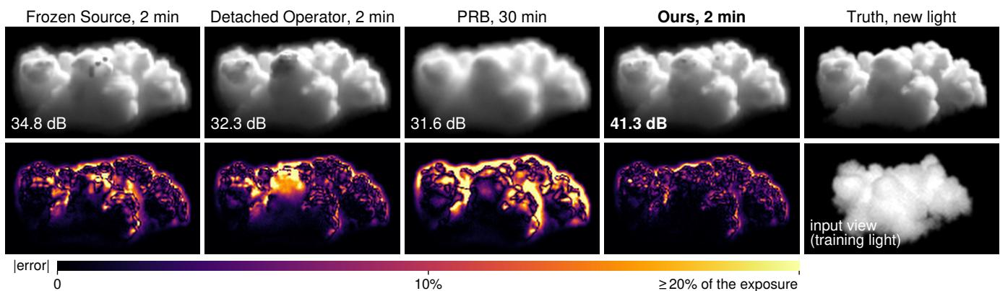  
Figure 1. Relighting a held-out cloud – A thick cloud reconstructed from 32 photographs under one light (bottom right: one of them) and relit under a new light. Differentiating through our learned multiple-scattering operator relights it most accurately after 2 min, whereas the same pipeline without the operator (Frozen Source [27]) and with the operator’s values but without its derivative (Detached Operator) misplace density in the interior, and differentiable path tracing (PRB [48]) is still blurred after 30 min. Each panel: relighting PSNR over three new lights and two new views; bottom: absolute error.

## Abstract

Reconstructing optically thick media from photographs requires modeling multiple scattering and its response to changes in extinction. Frozen-source tomography discards this derivative; differentiable path tracing estimates it through expensive, noisy sampling. We instead predict the multiple-scattering field with a neural operator and differentiate through it during inverse rendering, while computing transmittance and single scattering directly. A further challenge arises during optimization: an operator that predicts the field accurately on held-out media can still produce poor derivatives at the density states visited by the optimizer. We address this by fine-tuning on states generated during inversions driven by the operator, using Monte Carlo scattering-field supervision. On held-out optically thick clouds, our method improves relighting over frozensource tomography at equal time and outperforms differentiable path tracing given substantially more time. Training on inversion trajectories also improves derivative alignment at visited states and reduces optimization drift.

## 1. Introduction

“Light travels in a straight line.” This simple principle has shaped modern 3D reconstruction. NeRF [36] and 3D Gaussian Splatting [20] reconstruct scenes by accumulating contributions along camera rays, typically without explicitly modeling multiple scattering. But in optically thick media such as clouds and smoke, light changes direction repeatedly before reaching the camera. A pixel can therefore depend on light scattered far outside its camera ray.

A reconstruction may fit the input views yet contain errors in its interior extinction that only become visible under new lighting. To reconstruct these media from photographs and relight them under new illumination, we must account for multiple scattering. For gradient-based inverse rendering, we must also differentiate this transport with respect to the medium’s density.

Computing this derivative is a central bottleneck. In optically thick media, the multiple-scattering response to density changes can be substantially larger than the camera-side response. Differentiable path tracing estimates the full gradient through sampled light paths [38, 48], but the computation is expensive and subject to Monte Carlo noise [25,

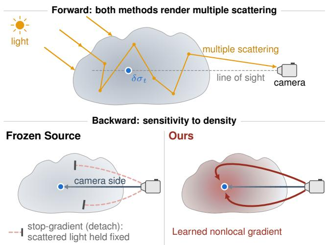  
Figure 2. Why the missing derivative matters – In the forward pass both methods render all orders of scattering. In the backward pass, Frozen Source [27] holds the scattered light fixed (stop-gradient): the gradient reaches a local density change δσ only along its line of sight (camera side). Ours also differentiates through the neural operator Gϕ, whose learned nonlocal gradient (red) captures how δσt redistributes the scattered light far beyond that line (the exact direct-beam term is not drawn).

38, 39]. Frozen-source tomography takes a cheaper approach [27]: it periodically updates the scattered-light field but treats it as constant when optimizing density (Fig. 2). This approximation omits the nonlocal multiple-scattering derivative, potentially producing incorrect interior density even when the observed images are well matched. Such errors become apparent when the reconstructed medium is rendered under new lighting (Fig. 1). Can we obtain an accurate multiple-scattering derivative without repeatedly performing expensive Monte Carlo differentiation?

Our approach predicts the multiple-scattering source with a neural operator and differentiates through that prediction during inversion. The resulting derivative captures how the scattered-light field responds to changes in density. Transmittance and single scattering remain physically computed; the neural operator supplies the expensive light-side response (Fig. 3).

Accurate field prediction does not guarantee accurate derivatives, especially inside an inversion loop. Each approximate gradient determines the next density state, which in turn becomes the next input to the operator. As optimization proceeds, these states may depart from the training distribution, allowing derivative errors to accumulate and redirect subsequent updates. The operator must therefore remain accurate along the trajectory its own gradients induce.

To address this problem, we train the operator on the states visited by inversions that use the operator itself. Starting from a pretrained operator, we collect intermediate density states generated during inversion, obtain Monte Carlo supervision for their scattering fields, and fine-tune the operator on these states. This improves derivative accuracy on visited states and reduces optimization drift.

On 12 held-out optically thick clouds, our method improves relighting over frozen-source tomography on every medium, with a median gain of 6.8 dB after two minutes. It also outperforms differentiable path tracing after thirty minutes (Sec. 4.2), while training on inversion-visited states substantially improves optimization stability (Sec. 4.4).

Our contributions are twofold:

• Learning the missing derivative. We introduce a neural multiple-scattering operator that supplies the otherwise expensive light-side derivative through automatic differentiation, enabling efficient gradient-based inverse volume rendering.

• Learning the operator for inversion. We identify the limitations of conventional operator accuracy for inverse rendering and introduce training on inversion-visited states to improve derivative reliability and optimization stability.

## 2. Related Work

Differentiable volume rendering and cloud tomography. Inverse rendering of participating media requires differentiating volumetric light transport. Monte Carlo methods, including adjoint transport and path replay backpropagation (PRB), estimate the full gradient by tracing light paths [14, 48]. Variance reduction and path reuse reduce the cost [10, 38], but reconstructing dense scattering volumes remains expensive.

Early cloud tomography methods reconstruct cloud extinction using an SHDOM forward model while holding the in-scattered source fixed during differentiation [27]. This frozen-source approximation has since been used with both deterministic and Monte Carlo transport models [15, 28]. Later methods also differentiate single scattering or full light paths [29, 33], and learned inverses map images to extinction directly [43, 44, 46]. Yet freezing the scattered source removes its nonlocal response to density changes, which dominates the camera-side response in optically thick media. We learn this missing response instead of repeatedly sampling it or discarding it.

Neural multiple scattering and neural operators. Neural networks have been used to predict in-scattered radiance for cloud rendering, including models that generalize to unseen media [16, 19]. Other approaches, such as NRPM, photon field networks, and radiance caches, fit or store light transport for individual scenes [4, 37, 50].

Neural operators [30] have been trained to predict fluence and radiance fields, including from noisy Monte Carlo labels [6, 7]. A related approach in photoacoustic tomography uses a pretrained neural operator to predict light fluence, but holds that field fixed when updating absorption [32]. Our method instead differentiates the predicted multiple-scattering field with respect to extinction and uses its Jacobian directly in inverse rendering. The learned field is not merely a faster forward model; its derivative drives the reconstruction.

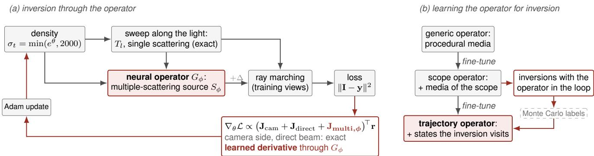  
Figure 3. Method overview – (a) The inversion renders the training views with exact transmittance and single scattering, and with the multiple-scattering source predicted by $G _ { \phi }$ . Differentiating through the operator supplies $\mathbf { J } _ { \mathrm { m u l t i } , \phi }$ for the density update; an occasiona Monte Carlo correction $\Delta$ adjusts the values only. (b) The operator is pretrained on generic media, fine-tuned for the target regime, and further trained on density states visited during inversion.

Learned surrogates for inverse optimization. A surrogate used inside an optimizer influences the states at which it will be evaluated next. Model-management methods correct surrogate values and gradients during optimization [3], while solver-in-the-loop and rollout-based training expose learned models to states produced by their own predictions [5, 47]. Adaptive and derivative-informed neural operators further improve surrogate accuracy where it matters for optimization [13, 41]. Neural operators can also be trained directly on optimization trajectories using supervision on the objective gradient [8].

We take an operator-in-the-loop approach to inverse volume rendering: the operator supplies the multiple-scattering derivative while the camera-side and direct-light terms remain physically computed. Following the idea of DAgger [45], we collect the density states visited by inversions driven by the operator and fine-tune it using Monte Carlo scattering-field labels.

## 3. Method

We reconstruct a heterogeneous participating medium from photographs taken under known directional illumination, with the goal of relighting it from novel views and light directions.

## 3.1. Image Formation and Gradient Decomposition

The unknown is the extinction field $\sigma _ { t } ( \mathbf { x } )$ in the unit cube, represented on a voxel grid. The albedo α and Henyey– Greenstein phase-function parameter g are known, and the scattering coefficient is $\sigma _ { s } ~ = ~ \alpha \sigma _ { t }$ . For light propagating along $\omega _ { l } .$ , the direct-beam transmittance at x is $T _ { l } ( \mathbf { x } ) \ =$ $e ^ { - \tau _ { l } ( \mathbf { x } ) }$ , where $\begin{array} { r } { \tau _ { l } ( \mathbf { x } ) = \int _ { 0 } ^ { \infty } \sigma _ { t } ( \mathbf { x } - s \omega _ { l } ) } \end{array}$ ds. A camera ray ${ \mathbf x } _ { t } = { \mathbf o } + t { \mathbf d }$ observes

$$
I = \int _ { 0 } ^ { \infty } T _ { \mathrm { c a m } } ( t ) \sigma _ { s } ( \mathbf { x } _ { t } ) \big [ T _ { l } ( \mathbf { x } _ { t } ) p _ { g } ( \omega _ { l } \omega _ { o } ) + S ( \mathbf { x } _ { t } , \omega _ { o } ) \big ] d t ,\tag{1}
$$

where ${ \boldsymbol { \omega } } _ { o } = - \mathbf { d } , p _ { g }$ is the phase function, and $T _ { \mathrm { { c a m } } }$ is transmittance along the camera ray. The first term in brackets accounts for light scattered once toward the camera. The source $S$ collects light that has already scattered and is scattered again toward $\omega _ { o } ;$ its dependence on extinction requires solving multiple-scattering transport. Its angular integral is given in the supplement. In contrast, transmittance and single scattering are computed by deterministic ray marching.

We optimize the log-extinction parameters θ, with $\sigma _ { t } =$ min $. ( e ^ { \theta }$ , 2000). Let $\mathbf { I } ( \bar { \boldsymbol { \theta } } ) \in \mathbb { R } ^ { P }$ contain the rendered values of $P$ rays and $\mathbf { r } = \mathbf { I } - \mathbf { y }$ their residuals. The image Jacobian splits according to the three ways in which extinction enters Eq. (1):

$$
\mathbf { J } = { \frac { \partial \mathbf { I } } { \partial \theta } } = \mathbf { J } _ { \mathrm { c a m } } + \mathbf { J } _ { \mathrm { d i r e c t } } + \mathbf { J } _ { \mathrm { m u l t i } } .\tag{2}
$$

$\mathbf { J } _ { \mathrm { c a m } }$ differentiates the local scattering coefficient and camera transmittance while holding the bracket of Eq. (1) fixed; $\mathbf { J } _ { \mathrm { d i r e c t } }$ accounts for the effect of extinction on the incoming direct beam; and $\mathbf { J _ { \mathrm { { m u l t i } } } }$ describes how a density change redistributes the multiple-scattering field. Frozen-source tomography keeps only $\mathbf { J } _ { \mathrm { c a m } }$ , whereas differentiable path tracing estimates the full gradient $\mathbf { J } ^ { \top }$ r by Monte Carlo. Our method retains $\mathbf { J } _ { \mathrm { c a m } }$ and $\mathbf { J } _ { \mathrm { d i r e c t } }$ and learns the expensive $\mathbf { J _ { \mathrm { { m u l t i } } } }$ term.

## 3.2. Neural Multiple-Scattering Operator

Operator and representation. We learn the multiplescattering source rather than the rendered image. A neural operator $G _ { \phi }$ takes the medium and illumination as input and predicts angular coefficients of the source field throughout the volume. A single predicted field is shared across all camera rays and views; only its evaluation direction changes. The input includes extinction, albedo, light transmittance, and analytic single- and forward-scattering features. The backbone is a 3D U-Net [9], conditioned on the phase-function parameter g and light direction $\omega _ { l }$ through FiLM [42].

We represent the angular dependence using a basis $\boldsymbol { B }$ containing real spherical harmonics (SH) through degree 4 (25 functions) and 12 additional light-aligned zonal harmonics of degrees 5–16. Under Henyey–Greenstein scattering, harmonics of degree ℓ have eigenvalue $g ^ { \ell }$ (Funk– Hecke, as in MRBNN [31]), so the source is reconstructed from angular moments $c _ { b }$ of the radiance that has scattered at least once:

$$
S ( \mathbf { x } , \omega ) = \sum _ { b \in B } g ^ { \ell ( b ) } c _ { b } ( \mathbf { x } ) b ( \omega ) .\tag{3}
$$

Here $\ell ( b )$ denotes the degree of basis function b. The zonal terms resolve the forward-scattering lobe without the 264 additional coefficients required by full SH through degree 16. The network predicts a light-aligned zonal component and a world-frame SH residual, which are mapped to the coefficients in Eq. (3); the exact basis and mapping are in the supplement.

Learning and differentiating the field. The generic operator is trained on $1 . 2 \times 1 0 ^ { 5 }$ procedural media, covering optical depths 1–100, albedos 0.8–0.999, $g \in [ 0 , 0 . 9 ]$ and varying light directions. Monte Carlo transport supplies noisy field labels. We write $S _ { \phi } ( \sigma _ { t } , \tau _ { l } )$ for the predicted source, with the other physical parameters understood. Since $\tau _ { l }$ itself depends on $\sigma _ { t }$ , automatic differentiation through the light sweep, operator, and camera ray marcher supplies $\mathbf { J } _ { \mathrm { m u l t i } , \phi } ^ { \top } \mathbf { r }$ without explicitly forming a Jacobian. The transmittance and single-scattering derivatives remain physically computed. Figure 4 compares the resulting directional derivative with Monte Carlo in accuracy and online cost.

## 3.3. Differentiable Inverse Rendering

We reconstruct extinction at $6 4 ^ { 3 }$ resolution, with known albedo, phase function, light, and cameras. At each iteration, we sample training-view rays R and minimize their squared image residuals, $\begin{array} { r } { \mathcal { L } = | \mathcal { R } | ^ { - 1 } \sum _ { p \in \mathcal { R } } ( I _ { p } - y _ { p } ) ^ { 2 } } \end{array}$ . The light sweep gives $\tau _ { l }$ and $T _ { l } ;$ the operator predicts $S _ { \phi } ;$ and ray marching evaluates Eq. (1). We use the corrected forward source $S = S _ { \phi } ( \sigma _ { t } , \tau _ { l } ) + \Delta$ , where $\Delta$ is held constant during differentiation. The resulting update uses

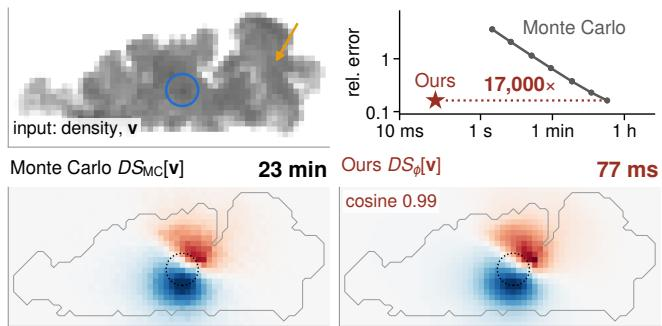  
Figure 4. Accurate multiple-scattering derivatives at low cost – Response of the multiple-scattering source (angular mean; shared color scale, red: increase, blue: decrease) to a local density increase v (circle; vertical slice of the cloud of Fig. 1; arrow: input light). One Monte Carlo central difference $( 7 . 4 \times 1 0 ^ { 9 }$ photons per evaluation) takes 23 min and reaches our error; ours takes 77 ms (each on one B200, offline training excluded): about 17,000 times faster for this directional derivative (not inversion gradients or PRB). Cosine and errors are $\sigma _ { s }$ -weighted against a reference of two independent estimates (45 min in total; the first is shown). Top right: error over time (Monte Carlo: noise; ours: bias).

$$
\nabla _ { \theta } \mathcal { L } = \frac { 2 } { \left| \mathcal { R } \right| } \big ( \mathbf { J } _ { \mathrm { c a m } } + \mathbf { J } _ { \mathrm { d i r e c t } } + \mathbf { J } _ { \mathrm { m u l t i } , \phi } \big ) ^ { \top } \mathbf { r } ,\tag{4}
$$

with r restricted here to the sampled rays. Adam updates θ using this gradient.

Monte Carlo correction. Every 30 iterations, a new Monte Carlo estimate $S _ { \mathrm { M C } }$ updates ∆ by an exponential moving average with weight $\beta = 0 . 2 5$ of the stop-gradient difference $S _ { \mathrm { M C } } - S _ { \phi }$ . This anchors the forward values without replacing the operator’s learned Jacobian. The correction is initialized from the current Monte Carlo–operator difference at the first refresh and after each coarse-to-fine resolution change; otherwise it uses the moving average. It can lag as density changes, making operator accuracy along the trajectory important.

Gradient baselines and output. Frozen Source uses periodically refreshed Monte Carlo source fields but holds the entire light-side term fixed during differentiation, retaining only $\mathbf { J } _ { \mathrm { c a m } }$ . Detached Operator uses the same anchored source values as ours but likewise retains only $\mathbf { J } _ { \mathrm { { c a m } } } ;$ our method additionally differentiates the direct beam and the operator-predicted multiple scattering. Every 25 iterations we evaluate four held-out views and retain the best checkpoint. The inversion uses a coarse-to-fine warm start and runs at approximately 17 iterations per second at $6 4 ^ { 3 }$ . The full procedure and baseline protocols are in the supplement and Sec. 4.1.

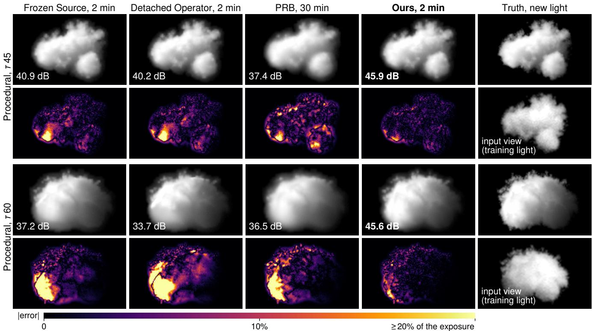  
Figure 5. Two more held-out clouds – The media of the main evaluation at the 25th and 75th percentile of our gain over Frozen Source (procedural cumulus, maximum optical depth 45 and 60), shown as in Fig. 1 under their most back-lit new light (errors saturate at 20% of the exposure); without the light-side derivative large parts of the clouds are relit wrongly.

## 3.4. Learning the Operator for Inversion

The operator must predict useful derivatives at the density states encountered during reconstruction, not just at media drawn from its training distribution. Inversion can create transient, speckled, or sharply peaked density fields; derivative errors on these states redirect subsequent updates, which in turn change the states seen by the operator. We therefore train on the distribution induced by inversion itself (Fig. 3b).

Training has three stages. Generic pretraining covers a broad range of media and illumination (Sec. 3.2). Scope fine-tuning specializes the operator to strongly scattering media using 4000 procedural and Cloudy [26] training volumes (optical depths 30–120, albedos 0.99–0.9999, and $g \in \{ 0 . 6 , 0 . 9 \}$ , mixed equally with generic data. Trajectory fine-tuning uses the scope operator to reconstruct separate training media, collects the density states visited during these inversions, labels their scattering fields with Monte Carlo, and fine-tunes on these states together with the earlier data. This follows the data-aggregation principle of $\mathrm { D A g } _ { \overline { { \mathsf { S } } } } -$ ger [45].

The new labels supervise scattering-field values, not Jacobians. Sampling states along an inversion trajectory also constrains the predicted field’s changes along the displacements that the optimizer actually makes. The resulting improvements in derivative alignment and optimization stability are measured in Sec. 4.4. Each fine-tuning stage uses $4 \times 1 0 ^ { 4 }$ training steps; equal-steps controls isolate the effect of the added data from additional training time. Implementation and data-collection details are in the supplement; the reconstruction loop is summarized in Algorithm 1.

## 4. Experiments

## 4.1. Experimental Setup

Data and task. We evaluate on held-out, optically thick clouds with maximum column optical depth 40–100, albedo 0.99–0.999, and $g \in [ 0 . 7 , 0 . 9 ]$ . Half are procedural cumulus and half come from Cloudy [26]; none are used for training or development. Our main evaluation contains 12 media rendered by Mitsuba 3 [17] at $1 2 8 ^ { 3 }$ resolution, while all methods reconstruct extinction at $6 4 ^ { 3 }$ . The observations therefore differ from every method’s reconstruction model. The protocol and success criteria were fixed before generating these test media (supplement). A separate 12-medium controlled $s e t ,$ rendered at $6 4 ^ { 3 }$ by our path tracer, supports comparisons and ablations; the supplement also reports a broader optical-depth study.

Algorithm 1: Operator training and inverse ren  
dering   
Input: Generic operator $\phi _ { g } ,$ generic/scope data $\mathcal { D } _ { g } , \mathcal { D } _ { s } ,$   
observations $\mathbf { y }$   
1 Train the operator;   
2 $\phi _ { s } \gets \mathrm { F i n e T u n e } ( \phi _ { g } , \mathcal { D } _ { g } \cup \mathcal { D } _ { s } ) ;$   
3 $\mathcal { T }  \mathrm { V i s i t e d S t a t e s } ( \operatorname { I n v e r t } ( \mathbf { y } _ { m } , \phi _ { s } ) )$ over separate   
training media m;   
4 $\mathcal { D } _ { t }  \{ ( \sigma , S _ { \mathrm { M C } } ( \sigma ) ) : \sigma \in \mathcal { T }$ accepted};   
5 $\phi _ { t } \gets \mathrm { F i n e T u n e } ( \phi _ { s } , \mathcal { D } _ { g } \cup \mathcal { D } _ { s } \cup \mathcal { D } _ { t } ) ;$   
6 Invert with $G _ { \phi } \left( \phi _ { t } \right.$ at test time);   
7 θ ← WarmStart $( \mathbf { y } ) ; \theta ^ { * } \gets \theta ; \ell ^ { * } \gets \infty ;$   
8 for step $k = 1 , 2 , \dots { }$ until the time budget do   
9 if grid resolution changes then Upsample θ; reset   
Adam state and anchor;   
10 $\sigma _ { t } \gets \operatorname* { m i n } ( e ^ { \theta } , 2 0 0 0 ) ; \tau _ { l } \gets \mathrm { S w e e p } ( \sigma _ { t } ) ;$   
11 if initial, 30-step, or grid-switch refresh then   
UpdateAnchor $( \Delta , \sigma _ { t } , \tau _ { l } , \phi ) ;$   
12 $S \gets S _ { \phi } ( \sigma _ { t } , \tau _ { l } ) + \mathrm { s g } [ \Delta ] ;$ ; sample rays $\mathcal { R } ;$   
13 $\mathbf { r }  \mathrm { R e n d e r } ( \mathcal { R } ; \sigma _ { t } , S ) - \mathbf { y } _ { \mathcal { R } } ;$   
14 $\theta \gets \mathrm { A d a m S t e p } ( \theta , \nabla _ { \theta } \mathcal { L } )$ from $\mathrm { E q . } ( 4 ) ;$   
15 if k mod $2 5 = 0$ then Keep ${ \boldsymbol { \theta } } ^ { * } \gets { \boldsymbol { \theta } }$ if held-out loss   
improves;   
16 end   
17 return $\theta ^ { * }$

Each medium is observed in 32 views of $1 2 8 ^ { 2 }$ pixels under one directional light. We evaluate reconstruction quality by rendering three novel light directions from two unseen views. Our primary metric is relighting PSNR against reference images, corrected for the Monte Carlo noise in both images (supplement). We also report voxel-wise extinction error and projected-optical-depth error.

Baselines and timing. Frozen Source [27] uses periodically refreshed Monte Carlo source fields [15] but retains only the camera-side derivative. The Detached Operator uses our corrected operator source with the same detached derivative, isolating the contribution of differentiating through the operator. PRB [48] estimates the full gradient in Mitsuba 3. All methods use the same density parameterization, optimizer, 10-s warm start, and visual hull. We select the best checkpoint using four held-out views, except that PRB returns its current iterate. Frozen Source and PRB use the best of their evaluated configurations for each medium and budget, including two smoothness priors; ours and the Detached Operator use one fixed configuration. PRB uses no Russian roulette on the main evaluation and Mitsuba’s default roulette on the controlled set; budgetspecific tuning is detailed in the supplement.

We compare equal wall-clock budgets of 30 s and 2, 8, and 16 min on one NVIDIA B200, including warm start and checkpoint selection. PRB is additionally run to 30 min. After 2 min, Frozen Source performs 1.7–1.8 times as many iterations as ours, while PRB completes 0.15–0.23 times as many. Unless stated otherwise, we report medians across media and bootstrap 95% intervals for median paired differences.

<table><tr><td>Method</td><td>Jacobian</td><td>30 s</td><td>2 min</td><td>8 min 16 min</td><td></td></tr><tr><td>Median PSNR [dB]</td><td></td><td></td><td></td><td></td><td></td></tr><tr><td>Frozen Source [27]</td><td> $\mathbf { J } _ { \mathrm { c a m } }$ </td><td>31.3</td><td>35.1</td><td>40.1</td><td>40.0</td></tr><tr><td>Detached Operator</td><td> $\mathbf { J } _ { \mathrm { c a m } }$ </td><td>32.2</td><td>32.8</td><td>38.6</td><td>39.9</td></tr><tr><td>PRB [48]</td><td>MC est. of J</td><td>24.4</td><td>28.4</td><td>31.2</td><td>32.3</td></tr><tr><td>Ours</td><td> $\mathbf { J } _ { \mathrm { c a m } } + \mathbf { J } _ { \mathrm { d i r e c t } } + \mathbf { J } _ { \mathrm { m u l t i } , \phi }$ </td><td>37.3</td><td>42.5</td><td>42.9</td><td>42.9</td></tr><tr><td colspan="6">Median paired gain of Ours [dB]</td></tr><tr><td>over Frozen Source</td><td></td><td></td><td> $+ 5 . 1 + 6 . 8 + 4 . 4 + 4 . 0$ </td><td></td><td></td></tr><tr><td>over the Detached Operator</td><td></td><td></td><td> $+ 5 . 2 ~ + 1 0 . 2 ~ + 5 . 9 ~ + 5 . 1$ </td><td></td><td></td></tr></table>

Table 1. Relighting at equal time – Median relighting PSNR [dB] over the 12 media of the main evaluation after each budget (top) and median per-medium gain of ours (bottom; positive on all 12 media in every cell). Ours after 2 min leads PRB after 30 min (33.4 dB) on all 12 media, by 9.0 dB [8.1, 9.9]. Jacobian: the terms of Eq. (2) in the gradient. Frozen Source and PRB: per medium and budget the better of two configurations.

## 4.2. Reconstruction and Relighting

Relighting under new illumination. Differentiating through the learned multiple-scattering source improves relighting on every main-evaluation medium at every tested budget (Tab. 1). After 2 min, ours reaches a median of 42.5 dB, compared with 35.1 dB for Frozen Source, 32.8 dB for the Detached Operator, and 28.4 dB for PRB. The median paired gain over Frozen Source is 6.8 dB [5.5, 10.7] (12/12 media), and remains 4.0 dB after 16 min. PRB reaches 33.4 dB after 30 min; ours after 2 min still leads on all 12 media, by a median paired 9.0 dB [8.1, 9.9]. The controlled set gives the same result with the scope-trained operator: at 2 min ours gains 6.6 dB over Frozen Source, and it exceeds PRB after 30 min by 12.0 dB with roulette (10.7 dB without roulette, post hoc), each on all 12 media.

The relighting examples in Figs. 1 and 5 expose the weakness of camera-side gradients. Camera-side gradients can fit the observed images while placing extinction incorrectly inside the cloud; the error is revealed by a new light. With the learned light-side derivative, the reconstruction retains the structure needed for relighting.

Recovered extinction. The density slices show corresponding reconstruction errors (Fig. 6). Without the multiple-scattering derivative, extinction tends toward smooth interior ramps; PRB’s noisy updates produce speckled density, whereas ours recovers more of the underlying clumps. The gap is larger in projected optical depth: after

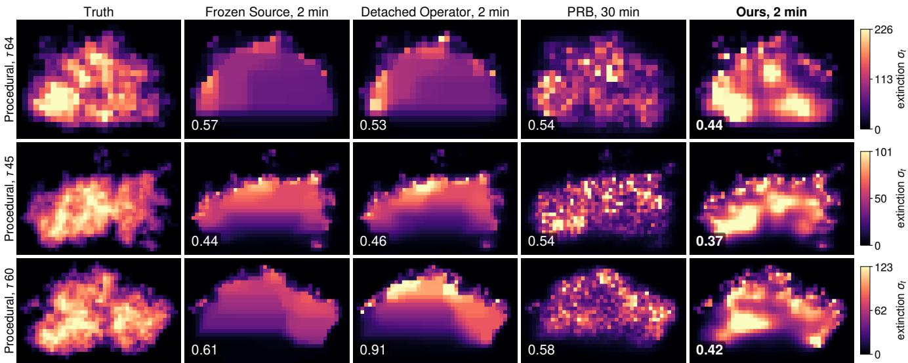  
Figure 6. What is reconstructed – Vertical density slices: a ramp without the light-side derivative, speckle for PRB, clumps for ours (number: relative density error over the grid, lowest in bold). Top: near the median margin among the 6 of 12 media where ours has the lowest density error of the methods shown (PRB after 30 min is lower on five Cloudy ones); below: the media of Fig. 5.

2 min its median relative error is 0.20 for ours, versus 0.42– 0.68 for the two Frozen Source priors, 0.53 for the Detached Operator, and 0.31–0.36 for PRB after 30 min (Fig. S4). The voxel-wise extinction errors are closer (ours 0.55; other methods 0.55–1.29). Ours has the lowest voxel-wise error on 6 of 12 main-evaluation media among the shown methods; PRB is lower on five Cloudy media and Frozen Source on one.

## 4.3. The Contribution of the Learned Derivative

An accurate nonlocal response at low cost. On the heldout cloud of Fig. 1, the predicted multiple-scattering source differs from Monte Carlo by 2.9% (σ -weighted relative field error; Tab. S3). Along a localized density increase, its directional derivative agrees with the Monte Carlo centraldifference reference (cosine 0.99, relative error 0.16); Fig. 4 shows the response extending well beyond the perturbed region. Outside two standard deviations of the perturbation, 31% of the angular-mean response’s squared norm lies, with cosine 0.99. Evaluating this directional derivative takes 77 ms for the operator versus 23 min for Monte Carlo at comparable reference-relative error. Across the 12 main-evaluation media, source-field errors are 2.2–4.9% and derivative cosines 0.95–0.99 (post hoc; supplement). In rendered-image responses, the frozen-source derivative captures only 0.1–18.1% of the true change’s norm (median 1.2%), while ours preserves its direction (cosine 0.91–0.99; Tab. S3).

The multiple-scattering term dominates. For four density perturbations on development clouds, $\left\| \mathbf { J } _ { \mathrm { { m u l t i } } } \mathbf { v } \right\|$ is 2.9–

4.8 times $\| \mathbf { J } _ { \mathrm { c a m } } \mathbf { v } \|$ , while $\| \mathbf { J } _ { \mathrm { d i r e c t } } \mathbf { v } \|$ is only 0.24–0.34 times $\| \mathbf { J } _ { \mathrm { c a m } } \mathbf { v } \|$ (the decomposition uses the generic operator; supplement). The direct-light response opposes the multiple-scattering response: upstream extinction blocks the direct beam but also redirects scattered light. As optical depth increases from 5 to 60, the frozen-source gradient’s cosine with the full gradient drops from 0.95 to 0.58.

The derivative, not just the field values. The Detached Operator shares our corrected source values but omits both $\mathbf { J } _ { \mathrm { d i r e c t } }$ and $\mathbf { J } _ { \mathrm { m u l t i } , \phi }$ . It trails ours by 10.2 dB after 2 min on the main evaluation (12/12 media; Tab. 1). On the controlled set, detached operator values perform almost identically to the Monte Carlo values used by Frozen Source (median difference −0.03 dB at 2 min, post hoc), while enabling the learned derivative improves relighting by 7.1 dB. Replacing the learned operator with a classical P1 diffusion model under the same correction yields 26–36 dB on eight development media, 13.8 dB below our operator and below Frozen Source after 2 and 8 min.

## 4.4. Learning on Inversion Trajectories

Accuracy where the optimizer goes. The operators in Tab. 2 have generic-media field errors within 7% of each other, yet their behavior inside inversion differs sharply. The trajectory operator and the equal-steps scope+ control have nearly identical generic errors (0.0216 and 0.0214), but the trajectory operator has lower error on held-back inversion states (0.0446 versus 0.0597). On drifted states, its derivative along the next optimization step aligns much better with Monte Carlo (cosine 0.51 versus 0.13–0.15 for the other measured operators; Fig. S3). The visited-state data, rather than more training steps alone, account for this improvement.

<table><tr><td rowspan="2"></td><td colspan="3">operator quality (development)</td><td colspan="6">inversion performance</td></tr><tr><td colspan="2">field error ↓</td><td>cosine ↑</td><td colspan="2">drift ↓</td><td colspan="2">final iterate, main ↑</td><td>selected, 16 min ↑</td><td></td></tr><tr><td>Operator</td><td>generic</td><td>visited</td><td>next step</td><td>controlled</td><td>main</td><td>8min</td><td>16 min</td><td>controlled</td><td>main</td></tr><tr><td>generic</td><td>0.0228</td><td>0.0725</td><td>0.15</td><td>6.42</td><td>一</td><td>一</td><td>一</td><td>42.8</td><td>一</td></tr><tr><td>generic+ (equal steps)</td><td>0.0229</td><td>0.0693</td><td>一</td><td>6.74</td><td></td><td>一</td><td>一</td><td>43.2</td><td>一</td></tr><tr><td>scope</td><td>0.0222</td><td>0.0630</td><td>0.13</td><td>4.09</td><td>7.66</td><td>40.0</td><td>30.5</td><td>43.7</td><td>42.4</td></tr><tr><td>scope+ (equal steps)</td><td>0.0214</td><td>0.0597</td><td>0.15</td><td>3.74</td><td>5.54</td><td>40.3</td><td>30.8</td><td>43.9</td><td>42.6</td></tr><tr><td>trajectory (ours)</td><td>0.0216</td><td>0.0446</td><td>0.51</td><td>1.77</td><td>1.49</td><td>43.6</td><td>43.0</td><td>44.7</td><td>42.9</td></tr></table>

Table 2. Operators for inversion – Operator quality (development): field error on generic media and on 95 held-back visited states; cosine of the derivative with Monte Carlo’s along the inversion’s next step from drifted states. Inversion performance: drift (median density error of the current iterate after 16 min, with selection) and median relighting PSNR [dB] of the final iterate (no selection) and of the selected checkpoint. +: equal-steps controls without the new data.

Scope operator  
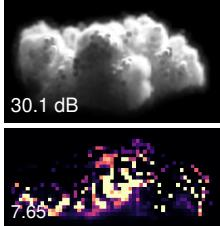

Ours (trajectory)  
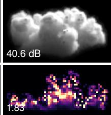

Truth  
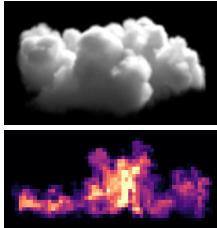  
Figure 7. Trajectory training reduces optimization drift – The medium of Fig. 1 after 16 min on all 32 views, final iterate without held-out selection: relit (top, PSNR) and density slice (bottom, density error). With the scope operator the iterate runs into density spikes; with the trajectory operator it stays far closer to the truth.

Less drift, better final iterates. Trajectory training also reduces final-iterate drift. After 16 min, its current-iterate density error on the main evaluation is lower than that of scope and scope+ on all 12 media (median per-medium error ratios 0.28 and 0.41). Without held-out checkpoint selection, the scope and scope+ operators diverge on 11 of 12 media, versus 4 of 12 for trajectory. Figure 7 shows one such case: the scope operator accumulates density spikes, while trajectory training preserves a more faithful reconstruction.

At the final iterate, without selection, the trajectory operator’s median paired gain over scope is 4.5 dB after 8 min (11/12 media) and 8.7 dB after 16 min (12/12), and over scope+ 5.0 and 8.0 dB. With held-out checkpoint selection, the improvement is smaller: 0.70 dB averaged over mainevaluation media and budgets (t-interval [0.26, 1.14]; controlled set: 0.44 dB). Trajectory training primarily stabilizes inversion, while checkpoint selection remains useful for the residual drift.

## 4.5. Ablations

The multiple-scattering derivative carries the improvement. On the controlled set, removing $\mathbf { J } _ { \mathrm { d i r e c t } }$ changes relighting by only 0.1–0.3 dB in favor of the variant without it, with every interval including zero. Dropping $\mathbf { J } _ { \mathrm { m u l t i } , \phi }$ as well, as in the Detached Operator, reduces relighting by 7.1 dB after 2 min (Tab. S15). Removing the Monte Carlo correction costs 0.8–0.9 dB from 2 min onward, though it gains 0.5 dB at 30 s because no correction refresh is needed.

Dependence on optical thickness. The benefit is strongest when multiple scattering dominates. On moderate development media $( \tau = 7 . 6 \ – 2 4 )$ , ours with the scope operator and Frozen Source are tied after 2 min (median −0.01 dB). Within the controlled set, the 2-min median gain is 7.8 dB on eight media with $\tau \geq 5 0$ , versus 1.5 dB on the other four $( \tau ~ < ~ 5 0 ;$ post hoc). This agrees with the increasingly poor frozen-source gradient alignment at larger optical depths (supplement, Sec. E.3).

Architecture and zonal-basis ablations are reported in the supplement.

## 5. Conclusion and Future Directions

A neural operator can supply the costly multiple-scattering derivative needed for inverse volume rendering. Differentiating its predicted scattering field avoids repeated Monte Carlo gradient estimation while retaining the nonlocal response omitted by frozen-source tomography. Training the operator on inversion-visited states further improves the reliability of its derivatives and substantially reduces optimization drift. On held-out thick clouds, these choices improve reconstruction and relighting within short compute budgets.

Future work includes smoke, joint recovery of illumination and material parameters, and reconstruction from captured images. Differentiating learned physical fields may also benefit inverse problems with costly gradients.

## References

[1] Marvin L. Adams and Edward W. Larsen. Fast iterative methods for discrete-ordinates particle transport calculations. Progress in Nuclear Energy, 40(1):3–159, 2002. 13

[2] R. E. Alcouffe. Diffusion synthetic acceleration methods for the diamond-differenced discrete-ordinates equations. Nuclear Science and Engineering, 64(2):344–355, 1977. 13

[3] Natalia M. Alexandrov, J. E. Dennis, Jr., Robert Michael Lewis, and Virginia Torczon. A trust-region framework for managing the use of approximation models in optimization. Structural Optimization, 15(1):16–23, 1998. 3

[4] David Bauer, Qi Wu, and Kwan-Liu Ma. Photon field networks for dynamic real-time volumetric global illumination. IEEE Transactions on Visualization and Computer Graphics, 30(1):975–985, 2024. 2

[5] Johannes Brandstetter, Daniel E. Worrall, and Max Welling. Message passing neural PDE solvers. In International Conference on Learning Representations (ICLR), 2022. 3

[6] Yubo Cao, Xi Deng, Mengqi Xia, Vignesh Gopakumar, Ander Gray, and Anima Anandkumar. PTNO: Training neural operators with noisy Monte Carlo estimates for particle transport problems. arXiv:2609.40090, 2026. 3

[7] Daniel Carne. A Fourier neural operator for accelerated discretization-invariant solutions of the radiative transfer equation. arXiv:2608.21173, 2026. 3

[8] Ze Cheng, Zhuoyu Li, Xiaoqiang Wang, Jianing Huang, Zhizhou Zhang, Zhongkai Hao, and Hang Su. Accelerating PDE-constrained optimization by the derivative of neural operators. In Proceedings ofthe 42nd International Conference on Machine Learning (ICML), pages 10090–10105, 2025. 3

[9] Ozg ¨ un C¸ ic¸ek, Ahmed Abdulkadir, Soeren S. Lienkamp,¨ Thomas Brox, and Olaf Ronneberger. 3D U-Net: Learning dense volumetric segmentation from sparse annotation. In Medical Image Computing and Computer-Assisted Intervention – MICCAI 2016, pages 424–432. Springer International Publishing, 2016. 4

[10] Ido Czerninski and Yoav Y. Schechner. PARS – path recycling and sorting for efficient cloud tomography. Intelligent Computing, 2:0007, 2023. 2

[11] Adrian Doicu, Alexandru Doicu, Dmitry Efremenko, and Thomas Trautmann. Cloud tomographic retrieval algorithms. I: Surrogate minimization method. Journal of Quantitative Spectroscopy and Radiative Transfer, 277:107954, 2022. 13

[12] Yiqiu Dong, Per Christian Hansen, Michiel E. Hochstenbach, and Nicolai Andre Brogaard Riis. Fixing noncon-´ vergence of algebraic iterative reconstruction with an unmatched backprojector. SIAM Journal on Scientific Computing, 41(3):A1822–A1839, 2019. 13

[13] Zhiwei Gao, Liang Yan, and Tao Zhou. Adaptive operator learning for infinite-dimensional Bayesian inverse problems. SIAM/ASA Journal on Uncertainty Quantification, 12 (4):1389–1423, 2024. 3

[14] Ioannis Gkioulekas, Shuang Zhao, Kavita Bala, Todd Zickler, and Anat Levin. Inverse volume rendering with material dictionaries. ACM Transactions on Graphics, 32(6):1–13, 2013. 2

[15] Vadim Holodovsky, Yoav Y. Schechner, Anat Levin, Aviad Levis, and Amit Aides. In-situ multi-view multi-scattering stochastic tomography. In IEEE International Conference on Computational Photography (ICCP), pages 1–12. IEEE, 2016. 2, 6

[16] Jinkai Hu, Chengzhong Yu, Hongli Liu, Lingqi Yan, Yiqian Wu, and Xiaogang Jin. Deep real-time volumetric rendering using multi-feature fusion. In Special Interest Group on Computer Graphics and Interactive Techniques Conference Conference Proceedings (SIGGRAPH ’23 Conference Proceedings). ACM, 2023. 2

[17] Wenzel Jakob, Sebastien Speierer, Nicolas Roussel, Merlin´ Nimier-David, Delio Vicini, Tizian Zeltner, Baptiste Nicolet, Miguel Crespo, Vincent Leroy, and Ziyi Zhang. Mitsuba 3 renderer. https://mitsuba-renderer.org, 2022. Version 3.9.1. 5

[18] Jari Kaipio and Erkki Somersalo. Statistical inverse problems: Discretization, model reduction and inverse crimes. Journal ofComputational and Applied Mathematics, 198(2): 493–504, 2007. 17

[19] Simon Kallweit, Thomas Muller, Brian McWilliams, Markus¨ Gross, and Jan Novak. Deep scattering: Rendering at-´ mospheric clouds with radiance-predicting neural networks. ACM Transactions on Graphics, 36(6), 2017. 2

[20] Bernhard Kerbl, Georgios Kopanas, Thomas Leimkuhler,¨ and George Drettakis. 3D Gaussian splatting for real-time radiance field rendering. ACM Transactions on Graphics, 42 (4), 2023. Proc. SIGGRAPH 2023. 1

[21] Diederik P. Kingma and Jimmy Ba. Adam: A method for stochastic optimization. In International Conference on Learning Representations (ICLR), 2015. 13

[22] Kiriakos N. Kutulakos and Steven M. Seitz. A theory of shape by space carving. International Journal of Computer Vision, 38(3):199–218, 2000. 13

[23] Edward W. Larsen. Unconditionally stable diffusionsynthetic acceleration methods for the slab geometry discrete ordinates equations. Part I: Theory. Nuclear Science and En gineering, 82(1):47–63, 1982. 13

[24] A. Laurentini. The visual hull concept for silhouette-based image understanding. IEEE Transactions on Pattern Analy sis and Machine Intelligence, 16(2):150–162, 1994. 13

[25] Ludwic Leonard and Rudiger Westermann. Image-based re-¨ construction of heterogeneous media in the presence of mul tiple light-scattering. Computers & Graphics, 119:103877, 2024. 1

[26] Ludwic Leonard, Nils Thurey, and R¨ udiger Westermann.¨ Light transport-aware diffusion posterior sampling for single-view reconstruction of 3D volumes. In Proceedings of the IEEE/CVF Conference on Computer Vision and Pat tern Recognition (CVPR), pages 16163–16174, 2025. 5, 16

[27] Aviad Levis, Yoav Y. Schechner, Amit Aides, and Anthony B. Davis. Airborne three-dimensional cloud tomography. In Proceedings of the IEEE International Conference on Computer Vision (ICCV), pages 3379–3387, 2015. 1, 2, 6

[28] Aviad Levis, Yoav Y. Schechner, and Anthony B. Davis. Multiple-scattering microphysics tomography. In Proceedings of the IEEE Conference on Computer Vision and Pattern Recognition (CVPR), pages 5797–5806, 2017. 2

[29] Aviad Levis, Yoav Y. Schechner, Anthony B. Davis, and Jesse Loveridge. Multi-view polarimetric scattering cloud tomography and retrieval of droplet size. Remote Sensing, 12(17):2831, 2020. 2

[30] Zongyi Li, Nikola Kovachki, Kamyar Azizzadenesheli, Burigede Liu, Kaushik Bhattacharya, Andrew Stuart, and Anima Anandkumar. Fourier neural operator for parametric partial differential equations. In International Conference on Learning Representations (ICLR), 2021. 2

[31] Jiaming Liang, Hongliang Yuan, Meng Gai, Guoping Wang, and Sheng Li. Multi-feature radiance baking neural networks for instant volumetric rendering. In Proceedings of the Special Interest Group on Computer Graphics and Interactive Techniques Conference Conference Papers (SIGGRAPH Conference Papers ’26). ACM, 2026. 4

[32] Zhaoyong Liang, Shuangyang Zhang, Zhichao Liang, Zongxin Mo, Xiaoming Zhang, Yutian Zhong, Wufan Chen, and Li Qi. Deep learning acceleration of iterative modelbased light fluence correction for photoacoustic tomography. Photoacoustics, 37:100601, 2024. 3

[33] Tamar Loeub, Aviad Levis, Vadim Holodovsky, and Yoav Y. Schechner. Monotonicity prior for cloud tomography. In Computer Vision – ECCV 2020, pages 283–299. Springer International Publishing, 2020. 2

[34] Ilya Loshchilov and Frank Hutter. Decoupled weight decay regularization. In International Conference on Learning Representations (ICLR), 2019. 12

[35] N. Max. Optical models for direct volume rendering. IEEE Transactions on Visualization and Computer Graphics, 1(2): 99–108, 1995. 13

[36] Ben Mildenhall, Pratul P. Srinivasan, Matthew Tancik, Jonathan T. Barron, Ravi Ramamoorthi, and Ren Ng. NeRF: Representing scenes as neural radiance fields for view synthesis. In Computer Vision – ECCV 2020, pages 405–421. Springer International Publishing, 2020. 1

[37] Thomas Muller, Fabrice Rousselle, Jan Nov¨ ak, and Alexan-´ der Keller. Real-time neural radiance caching for path tracing. ACM Transactions on Graphics, 40(4):1–16, 2021. 2

[38] Merlin Nimier-David, Thomas Muller, Alexander Keller,¨ and Wenzel Jakob. Unbiased inverse volume rendering with differential trackers. ACM Transactions on Graphics, 41(4), 2022. Proc. SIGGRAPH 2022. 1, 2

[39] Ntumba Elie Nsampi, Adarsh Djeacoumar, Hans-Peter Seidel, Tobias Ritschel, and Thomas Leimkuhler. Volumetric¨ inverse rendering via neural radiative transfer. Computer Graphics Forum, 45(4):e70541, 2026. Proc. Eurographics Symposium on Rendering 2026. 2

[40] Ruben Ohana, Michael McCabe, Lucas Meyer, Rudy Morel, Fruzsina J. Agocs, Miguel Beneitez, Marsha Berger, Blakesley Burkhart, Stuart B. Dalziel, Drummond B. Fielding, Daniel Fortunato, Jared A. Goldberg, Keiya Hirashima, Yan-Fei Jiang, Rich R. Kerswell, Suryanarayana Maddu, Jonah Miller, Payel Mukhopadhyay, Stefan S. Nixon, Jeff Shen, Romain Watteaux, Bruno Regaldo-Saint Blancard,´ Franc¸ois Rozet, Liam Parker, Miles Cranmer, and Shirley Ho. The Well: a large-scale collection of diverse physics simulations for machine learning. In Advances in Neural In-

formation Processing Systems, pages 44989–45037. Curran Associates, Inc., 2024. Datasets and Benchmarks Track. 12

[41] Thomas O’Leary-Roseberry, Peng Chen, Umberto Villa, and Omar Ghattas. Derivative-informed neural operator: An efficient framework for high-dimensional parametric derivative learning. Journal of Computational Physics, 496:112555, 2024. 3

[42] Ethan Perez, Florian Strub, Harm de Vries, Vincent Du moulin, and Aaron Courville. FiLM: Visual reasoning with a general conditioning layer. In Proceedings of the AAAI Conference on Artificial Intelligence, 2018. 4

[43] Roi Ronen, Vadim Holodovsky, and Yoav Y. Schechner. Variable imaging projection cloud scattering tomography. IEEE Transactions on Pattern Analysis and Machine Intelligence, 47(8):6097–6109, 2025. Early access 2022. 2

[44] Roi Ronen, Ilan Koren, Aviad Levis, Eshkol Eytan, Vadim Holodovsky, and Yoav Y. Schechner. 3D volumetric tomog raphy of clouds using machine learning for climate analysis. Scientific Reports, 15(1):8270, 2025. 2

[45] Stephane Ross, Geoffrey J. Gordon, and J. Andrew Bagnell.´ A reduction of imitation learning and structured prediction to no-regret online learning. In Proceedings of the Fourteenth International Conference on Artificial Intelligence and Statistics (AISTATS), pages 627–635, 2011. 3, 5

[46] Yael Sde-Chen, Yoav Y. Schechner, Vadim Holodovsky, and Eshkol Eytan. 3DeepCT: Learning volumetric scattering tomography of clouds. In Proceedings of the IEEE/CVF International Conference on Computer Vision (ICCV), pages 5651–5662, 2021. 2

[47] Kiwon Um, Robert Brand, Yun Raymond Fei, Philipp Holl, and Nils Thuerey. Solver-in-the-loop: Learning from differentiable physics to interact with iterative PDE-solvers. In Advances in Neural Information Processing Systems (NeurIPS), pages 6111–6122, 2020. 3

[48] Delio Vicini, Sebastien Speierer, and Wenzel Jakob. Path re-´ play backpropagation: Differentiating light paths using constant memory and linear time. ACM Transactions on Graph ics, 40(4), 2021. Proc. SIGGRAPH 2021. 1, 2, 6, 17

[49] G. L. Zeng and G. T. Gullberg. Unmatched projector/backprojector pairs in an iterative reconstruction algorithm. IEEE Transactions on Medical Imaging, 19(5):548– 555, 2000. 13

[50] Quan Zheng, Gurprit Singh, and Hans-Peter Seidel. Neural relightable participating media rendering. In Advances in Neural Information Processing Systems, pages 15203– 15215. Curran Associates, Inc., 2021. 2

# Learning the Missing Derivative: Neural Multiple-Scattering Operators for Inverse Volume Rendering

Supplementary Material

Citations, numbered sections, and figures, tables and equations without the prefix S refer to the main paper. Operators are named by their training data (generic, scope, trajectory; generic+ and scope+ are the equal-steps controls of Sec. 3.4), and methods as in the main paper.

## A. Method Details

## A.1. Renderer and Angular Representation

Ray marching. Grids hold values at the voxel centres of the unit cube and are interpolated trilinearly, constant between the outermost centres and the faces and zero outside the cube; the ray marcher, the Monte Carlo kernels and Mitsuba 3 use the same convention. A camera ray is marched from its entry into the cube with a fixed step $h = 1 / ( 2 N )$ , two samples per voxel at $N = 6 4 ; \sigma _ { t } , \tau _ { l }$ and S are read at the step midpoints and held constant over the step, so step j contributes $T _ { j } \left( 1 - e ^ { - \sigma _ { t } h } \right) \alpha Q _ { j }$ , with $T _ { j }$ the transmittance to the start of the step and $Q _ { j } = T _ { l } p _ { g } ( \pmb { \omega } _ { l } { \cdot } \pmb { \omega } _ { o } ) + S \mathrm { : }$ Eq. (1) integrated exactly for piecewise-constant coefficients. The optical depth to the light is computed at the voxel centres by marching towards the light with the same step; camera samples interpolate $\tau _ { l }$ and exponentiate, since interpolating $T _ { l }$ biases single scattering by +0.1 to +0.8%. For full multiple scattering our path tracer agrees with pbrt-v3 (mean ratio 0.9971–1.0000 at $g = 0 , 0 . 5$ and 0.85) and with Mitsuba 3.9.1 to within Mitsuba’s own seed-to-seed noise.

Angular basis. The source of Eq. $\begin{array} { r l } { ( 1 ) , ~ S ( \mathbf { x } , \omega ) } & { { } = } \end{array}$ $\begin{array} { r } { \int _ { \mathbb { S } ^ { 2 } } p _ { g } \left( \omega { \cdot } \omega ^ { \prime } \right) L ^ { ( \geq 1 ) } ( \mathbf { x } , \omega ^ { \prime } ) d \omega ^ { \prime } } \end{array}$ with $L ^ { ( \geq 1 ) }$ the radiance that has scattered at least once, is evaluated from 37 nodal coefficient grids: real SH to degree 4 (orthonormal, without the Condon–Shortley phase) and the zonal harmonics of degrees 5–16 about $\omega _ { l } .$ , with the factors $g ^ { \ell }$ applied. Multiplescattering images of a development cumulus $( \tau ~ = ~ 2 0 $ albedo 0.99, $g = 0 . 8 5 )$ rendered from tallied moments under a top, a front and a back light reach 32.7, 15.6 and 35.9 dB with SH to degree 4 alone and 36.7, 33.1 and 41.3 dB with the zonal extension, the noise floor of the 4096-spp references (34.3, 31.5 and 38.3 dB between two independent references): the forward cascade of a front light is what truncated SH miss. At $g \ = \ 0 . 9$ , front-lit, zonal degrees to 16 give 19.6–23.4 dB and to 32 give 31.2– 33.5 dB, so more strongly forward-scattering media would need a higher zonal degree. At the true density of five development media, this forward model relights under the evaluation lights at 41.9–51.1 dB (single scattering alone: 16.2–

25.9 dB).

Cell averages and nodal values. Monte Carlo tallies cell averages, whereas rendering interpolates nodal values. The operator therefore predicts nodal values cˆ and is trained through their cell averages Mcˆ, $\mathcal { M } = \mathbf { M } ^ { \otimes 3 }$ , so noisy labels are never deconvolved; per axis M has interior rows $\textstyle { \left( { \frac { 1 } { 8 } } , { \frac { 3 } { 4 } } , { \frac { 1 } { 8 } } \right) }$ and boundary rows $\bigl ( \frac { 7 } { 8 } , \frac { 1 } { 8 } \bigr )$ . Monte Carlo fields entering the inversion are converted with $\mathcal { M } ^ { - 1 }$ ; rendering tallied cell averages as nodal values instead would bias multiple scattering by $- 0 . 6 \mathrm { t o } - 1 . 1 \%$

## A.2. Operator

Inputs and network. The 14 input channels per voxel are log $( 1 + \sigma _ { t } / 1 0 ) , - \log ( 1 - \alpha ) / 5 , T _ { l }$ , the first-order forwardlobe amplitude $T _ { l } \tau _ { s }$ with $\begin{array} { r } { \tau _ { s } ( \mathbf { x } ) ~ = ~ \int _ { 0 } ^ { \infty } \sigma _ { s } ( \mathbf { x } - s \omega _ { l } ) } \end{array}$ ds, $\log ( 1 + \sigma _ { s } T _ { l } / 1 0 )$ and, for $\ell \in \{ 0 , 1 , 2 , 3 , 4 , 6 , 8 , 1 2 , 1 6 \}$ the zonal moments of the scattered radiance in the smallangle approximation,

$$
\begin{array} { r } { z _ { \ell } ^ { \mathrm { f w d } } = \sqrt { \frac { 2 \ell + 1 } { 4 \pi } } \ : T _ { l } \left( e ^ { \tau _ { s } g ^ { \ell } } - 1 \right) , } \end{array}\tag{S1}
$$

which reuse the sweep’s $\tau _ { l }$ inside the inversion $( \tau _ { s } = \alpha \tau _ { l }$ for a constant albedo). $( g , \omega _ { l } )$ passes through a twolayer MLP to a 128-dimensional embedding. The 3D U-Net has pre-activation residual blocks (GroupNorm, SiLU, $3 ^ { 3 }$ convolutions), two per level at widths 32, 64, 128 and 256 and two at the bottleneck, strided downsampling and transposed-convolution upsampling with concatenated skips; FiLM, $x \mapsto x ( 1 + \gamma ) + \beta$ with zero-initialised $( \gamma , \beta )$ follows the first convolution of every block. The head outputs 42 channels, $z _ { 0 } , \ldots , z _ { 1 6 }$ and the 25 residuals $u _ { \ell m }$ which are multiplied by $g ^ { \ell }$ and mapped to the 37 coefficients of B by

$$
\begin{array} { r } { c _ { Y _ { \ell m } } = \sqrt { \frac { 4 \pi } { 2 \ell + 1 } } Y _ { \ell m } ( \omega _ { l } ) z _ { \ell } + u _ { \ell m } , \qquad c _ { Z _ { \ell } } = z _ { \ell } ; } \end{array}\tag{S2}
$$

the network has 19.4 M parameters, and the network alone takes about 13 ms per forward pass at $6 4 ^ { 3 }$ in bfloat16.

Generic training. Procedural $6 4 ^ { 3 }$ media (cumulus 40%, fBm 25%, plume 25%, blob 10%; maximum column optical depth log-uniform in [1, 100], 1 − α log-uniform in [0.001, 0.2], spatially varying in 25% of the media, g uniform in [0, 0.9], light uniform on the sphere) are generated on line: at every step one new medium is tallied with $2 \times 1 0 ^ { 6 }$ photons and replaces the oldest of a buffer of 1024, from which batches of 4 are drawn. The loss is the relative squared error of Mcˆ against the tallied cell averages on the medium dilated by one voxel. AdamW [34] runs at learning rate $1 0 ^ { - 3 }$ after 500 warm-up steps with cosine decay over $1 . 2 \times 1 0 ^ { 5 }$ steps, weight decay $1 0 ^ { - 4 }$ , gradient clipping at 1 and bfloat16 mixed precision; the selected checkpoint, the last, has a field error of 0.0228 on 200 validation media (geometric mean of the relative $L _ { 2 }$ error). Training took 5.3 h on one NVIDIA B200. Table S1 changes one design choice at a time.

<table><tr><td>Operator (30k steps)</td><td>field rel.  $L _ { 2 }$ </td><td>image PSNR</td><td>MS PSNR</td></tr><tr><td>reference (U-Net)</td><td>0.0411</td><td>52.52</td><td>48.00</td></tr><tr><td>world-frame outputs</td><td>0.0484</td><td>50.28</td><td>45.76</td></tr><tr><td>source predicted directly (no analytic  $g ^ { \ell } )$ </td><td>0.0419</td><td>52.46</td><td>47.94</td></tr><tr><td>no forward-cascade features</td><td>0.0432</td><td>52.08</td><td>47.56</td></tr><tr><td>fixed offline set (4000 media)</td><td>0.0369</td><td>53.50</td><td>48.98</td></tr><tr><td>FNO backbone</td><td>0.0537</td><td>49.95</td><td>45.43</td></tr></table>

Table S1. Operator design – One change at a time against the reference configuration (30k training steps; 200 procedural validation media): field error and image PSNR [dB] of single plus multiple scattering and of multiple scattering alone.

Forward accuracy on held-out media. On 300 heldout procedural and Cloudy media (the forward test of the regime set), images rendered with the operator’s field are 15.9 dB more accurate in the median than with a Monte Carlo field computed in the same time $( 6 \times 1 0 ^ { 5 }$ photons; better on 100%) and 1.2 dB more accurate than with one computed in about 32 times the time $( 2 \times 1 0 ^ { 7 }$ photons; better on 66%), against a $2 \times 1 0 ^ { 8 }$ -photon reference. Outside the training distribution, on 100 media from The Well [40] (MHD and supernova), it stays ahead of the $6 \times 1 0 ^ { 5 }$ -photon field (by 9.6 and 12.2 dB; there it took 1.6–3.2 times the operator’s time) but behind the $2 \times 1 0 ^ { 7 }$ -photon one (−5.1 and −2.7 dB).

## A.3. Learning the Operator for Inversion

The training and inversion procedures are summarized in Algorithm 1 in the main paper; implementation schedules and data selection are specified below.

Scope data. 4000 training and 100 validation media in which multiple scattering dominates: maximum column optical depth log-uniform in [30, 120], albedo in [0.99, 0.9999] (1 − α log-uniform, spatially varying in 25% of the media), g uniform in [0.6, 0.9], light direction uniform; procedural cumulus 35%, fBm 15%, plume 10%, blob 5% and Cloudy training clouds 35%. Labels: $2 \times 1 0 ^ { 7 }$ photons per training medium, $2 \times 1 0 ^ { 8 }$ per validation medium.

Trajectory data. A separate set of 64 training-side media is reconstructed by inversions with the scope operator in the loop (18000 iterations, coarse to fine at 300 and 900 iterations, observations at 1024 samples per pixel, so that the trajectories also visit noise-driven states); the density is stored every 750 iterations. Every stored state with density error at most 3 is labelled by Monte Carlo $( 2 \times 1 0 ^ { 7 }$ photons): 896 states of 56 training media (448 further, fully diverged states are skipped); the remaining 8 media give 95 held-back states, labelled with $1 0 ^ { 8 }$ photons, on which the operators are compared.

<table><tr><td>Operator</td><td>starts from training data</td><td></td><td>steps</td></tr><tr><td>generic</td><td></td><td>generic (on line)</td><td> $1 . 2 \times 1 0 ^ { 5 }$ </td></tr><tr><td>generic+</td><td>generic</td><td>generic</td><td> $4 \times 1 0 ^ { 4 }$ </td></tr><tr><td>scope</td><td>generic</td><td>generic ∪ scope</td><td> $4 \times 1 0 ^ { 4 }$ </td></tr><tr><td>scope+</td><td>scope</td><td>generic ∪ scope</td><td> $4 \times 1 0 ^ { 4 }$ </td></tr><tr><td>trajectory</td><td>scope</td><td>generic ∪ scope ∪ visited</td><td> $4 \times 1 0 ^ { 4 }$ </td></tr></table>

Table S2. Training stages – The equal-steps controls of the scope and trajectory stages are generic+ and scope+. Scope: 4000 media; visited: 896 states of inversions with the scope operator.

Fine-tuning. Every fine-tuning stage starts from the previous operator and runs $4 \times 1 0 ^ { 4 }$ steps (batch 4, AdamW, learning rate $3 \times 1 0 ^ { - 4 }$ after 500 warm-up steps, weight decay $1 0 ^ { - 4 }$ , gradient clipping at 1, mixed precision), with selection on the scope validation set every 2000 steps (Tab. S2). The equal-steps controls start from the same operator and run the same schedule without the new data.

## A.4. Monte Carlo

Light-side fields. The moments $c _ { b }$ are estimated by a CUDA photon tracer: photons enter through the lit faces in proportion to their projected area and are transported by delta tracking with a global majorant, analog absorption and Henyey–Greenstein sampling; every path segment after the first real scattering is tallied with the track-length estimator into every voxel it crosses, in double precision, which estimates the cell averages of $\textstyle \int L ^ { ( \geq 1 ) } b d { \bar { \omega } }$ without bias. The uncollided tally reproduces the exact sweep and the absorbed energy balances, both to the level of the noise. On one B200 the tracer runs at $1 . 1 { - } 3 . 2 \times 1 0 ^ { 8 }$ photons per second on a $6 4 ^ { 3 }$ cumulus of maximum optical depth 10–50.

Anchor schedule. In the inversion a refresh uses $3 \times 1 0 ^ { 6 }$ photons and a new seed (about 0.11 s), every 30 iterations and right after every coarse-to-fine switch, where the average restarts with $\Delta = S _ { \mathrm { M C } } - S _ { \phi } ;$ ; Frozen Source updates its source field $S \gets ( 1 - \beta ) S + \beta S _ { \mathrm { M C } }$ on the same schedule.

Fixed point and lag. If the iterates converge to $\sigma _ { t } ^ { * } .$ the exponential average gives $\mathbb { E } [ \Delta ] \  \ \mathbb { E } [ S _ { \mathrm { M C } } ( \sigma _ { t } ^ { * } ) ] \ -$ $S _ { \phi } ( \sigma _ { t } ^ { * } )$ ), and the corrected source ${ \cal S } ~ = ~ { \cal S } _ { \phi } + \Delta$ equals the Monte Carlo one in expectation; the stationarity condition of Eq. (4) differs from the exact one by $\mathrm { ( \mathbf { J _ { m u l t i } } - }$ $\mathbf { J } _ { \mathrm { m u l t i } , \phi } ) ^ { \top } \mathbf { r }$ , while that of the frozen source differs by $( \mathbf { J } _ { \mathrm { d i r e c t } } + \mathbf { J } _ { \mathrm { m u l t i } } ) ^ { \top } \mathbf { r } .$ . Away from a fixed point the anchor lags: at $\sigma _ { t } = \sigma _ { t } ^ { a } + \delta$ near the last refresh $\sigma _ { t } ^ { a }$ the source’s error is $\left( \partial S _ { \phi } - \partial S \right) \delta$ to first order, with ∂ the Jacobians of the sources. Where the iterate leaves the operator’s training distribution, the Jacobian error on the visited states therefore drives the error of both the gradient and the values, which is what trajectory training targets.

## A.5. Inverse Renderer

Parameterisation and visual hull. The density used for rendering, the sweep, the operator, Monte Carlo and evaluation is min $( e ^ { \theta }$ , 2000) (an optical depth of 31 per voxel at $6 4 ^ { 3 } )$ , upsampled trilinearly to $6 4 ^ { 3 }$ from the current coarseto-fine grid and multiplied by a visual hull [22, 24]: a voxel is kept if it projects onto a pixel brighter than 0.5% of the image maximum in every training view that sees it, and the mask is dilated by one voxel. The hull and every other shared setting apply to every method, PRB included.

Warm start and coarse to fine. The warm start fits an emission–absorption model [35] at $1 6 ^ { 3 }$ for $1 0 \mathrm { s } ,$ charged to every method’s clock. The grid switches from $1 6 ^ { 3 }$ to $3 2 ^ { 3 }$ at 15 s and to $6 4 ^ { 3 }$ at 45 s (PRB has its own schedules); at a switch, θ is re-initialised from the upsampled density and Adam’s moments are reset.

Iteration and clock. Each iteration draws 32768 rays uniformly from the pixel-centre rays of the training views that intersect the cube and minimises their mean squared error of linear radiance with Adam [21] (learning rate 0.05, $\epsilon = 1 0 ^ { - 8 } )$ . A method’s clock starts after a one-time warmup of every model it uses, includes the warm start and the held-out losses, and pauses during checkpoint evaluation; the GPU is synchronised before the clock is read. Every run used one B200, one CPU core (four for PRB) and 6 GB of host memory.

## B. Gradient Decomposition

Descent with a partial Jacobian. A step $\begin{array} { r l } { \Delta \theta } & { { } = } \end{array}$ $- \eta \mathbf { J } _ { \mathrm { c a m } } ^ { \top } \mathbf { r }$ changes the loss by $- \eta \textstyle { \frac { 2 } { P } } \langle \mathbf { J } ^ { \top } \mathbf { r } , \mathbf { J } _ { \mathrm { c a m } } ^ { \top } \mathbf { r } \rangle + O ( \eta ^ { 2 } )$ which is $\cos ( \mathbf { J } _ { \mathrm { c a m } } ^ { \top } \mathbf { r } , \mathbf { J } ^ { \top } \mathbf { r } )$ times the change of a steepestdescent step of the same length: for a small step the frozensource iteration descends if and only if this cosine is positive. Linearised at a consistent solution, its error evolves as

$$
\delta  ( \mathbf { 1 } - \eta \mathbf { J } _ { \mathrm { c a m } } ^ { \top } \mathbf { J } ) \delta ,\tag{S3}
$$

which decays along eigenvectors of $\mathbf { J } _ { \mathrm { c a m } } ^ { \top } \mathbf { J }$ with eigenvalues of positive real part and grows along any with negative real part, as for the unmatched projector–backprojector pairs of iterative tomography [12, 49]. With consistent data every solution is a fixed point of every variant; with noise or model error the true gradient at the frozen source’s fixed point is $\begin{array} { r } { \frac { 2 } { P } ( \mathbf { J } _ { \mathrm { d i r e c t } } + \mathbf { J } _ { \mathrm { m u l t i } } ) ^ { \top } \mathbf { r } } \end{array}$

Measurements. On five development media (modelconsistent data rendered with the generic operator, 131072 rays of the 32 training views) the Jacobian is measured along four perturbations v of θ (a uniform scaling, two smooth random fields and the layer within unit optical depth of the light), and the gradients at four perturbed densities (the truth scaled by 0.8 and 1.25, and multiplied by two smooth log-normal fields); Fig. S1 reports the means. $\mathbf { J _ { \mathrm { { m u l t i } , \phi } } }$ , obtained by differentiating the operator, agrees with Monte Carlo central differences with cosine 0.94–0.99 in the 13 of 15 cases whose Monte Carlo noise is below 0.35. $\lVert \mathbf { J _ { \mathrm { { m u l t i } } } } \mathbf { v } \rVert / \lVert \mathbf { J _ { \mathrm { { c a m } } } } \mathbf { v } \rVert$ grows with optical depth (1.5 at $\tau = 5 ,$ , 3.9 at $\tau = 6 0$ with albedo 0.999), albedo and $^ { g ; }$ $\mathbf { J } _ { \mathrm { d i r e c t } }$ and $\mathbf { J _ { \mathrm { { m u l t i } } } }$ do not cancel $( \| ( \mathbf { J } _ { \mathrm { d i r e c t } } + \mathbf { J } _ { \mathrm { m u l t i } } ) \mathbf { v } \|$ is 5–21 times $\| \mathbf { J } _ { \mathrm { d i r e c t } } \mathbf { v } \|$ on the clouds). Adding $\mathbf { J } _ { \mathrm { d i r e c t } }$ without $\mathbf { J _ { \mathrm { { m u l t i } } } }$ does not help in clouds (the alignment is tied at $\tau \leq 2 0$ and lower by 0.09–0.13 at $\tau \geq 4 0 )$ , consistent with the ablation of Tab. S15; on a thin 2D cloud slice a small gain from it was reported [11], and at $\tau = 5$ our alignment does not separate the two either (0.95 and 0.94).

Source iteration and diffusion. Frozen-source differentiation lags the scattering source, just as source iteration does in transport solvers [1]. Diffusion synthetic acceleration approximates the missing response to accelerate transport [2, 23]; here $\mathbf { J } _ { \mathrm { m u l t i } , \phi }$ supplies a learned response to the inverse problem instead.

P1 diffusion derivative. The classical control replaces the operator by the P1 approximation: for the current density a cell-centred finite-volume P1 equation with Marshak boundaries and the single-scattered light as its source is solved by Jacobi-preconditioned conjugate gradients; its degree-0 and degree-1 moments enter $S$ in place of the operator’s, the derivative flows through the solve by implicit differentiation, and the same anchor corrects the values every 30 iterations. It runs 7.0–9.5 iterations per second (ours 17). On eight development media it relights at 26.2–36.2 dB after 2 and after 16 min, against 40.4–49.0 dB for ours with the scope operator and 27.3–42.3 dB for Frozen Source after 2 min; its selected iterate stops improving after 30–120 s. Diffusion is least accurate at the optically thin edges of clouds and for strongly forward-peaked scattering, which these media have.

The learned field and derivative on held-out clouds. For each medium of the main evaluation (its $6 4 ^ { 3 }$ truth,

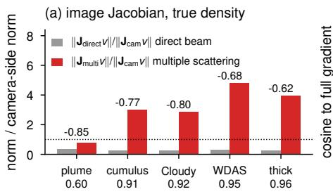

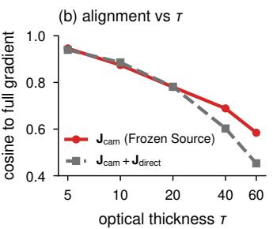

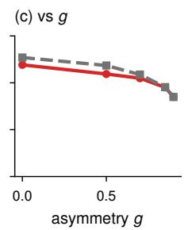

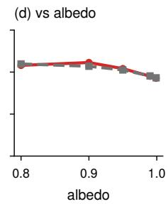  
Figure S1. The light-side derivative on development media – (a) Norms of the direct-beam and multiple-scattering parts of the image Jacobian relative to the camera-side part (above the bars: the cosine between them; below the names: the multiply scattered fraction of the image). (b–d) Cosine of the frozen-source gradient $\mathbf { J } _ { \mathrm { c a m } } ^ { \top } \mathbf { r }$ and of $\mathbf { ( J _ { \mathrm { c a m } } + \mathbf { J _ { \mathrm { d i r e c t } } } ) }$ ⊤r with the full gradient on the cumulus, against optical depth, g (albedo 0.99) and albedo $( g = 0 . 8 5 )$ . The multiple-scattering part dominates and grows with optical depth, and the frozen-source gradient loses its alignment accordingly.

budget.

albedo, $g$ and training light; post hoc), a Gaussian bump v of log $\sigma _ { t }$ with a standard deviation of 3 voxels and peak 1 is placed at the density-weighted centroid, inside the cloud (for medium 8 within two voxels of a gap, where 15% of the bump falls outside the support and is masked). The multiple-scattering source of light-side Monte Carlo at the truth (two independent halves of $1 . 0 { - } 2 . 3 \times 1 0 ^ { 9 }$ photons; their difference puts the reference’s noise below 1.0%) is compared with each operator’s prediction. Its directional derivative along v is estimated by central differences of log $\sigma _ { t }$ with $\epsilon = 0 . 5$ and common random numbers: photonindexed random streams and one majorant for both densities, so that photon paths that never meet the bump are iden tical and cancel; two independent pairs of $1 . 5 { - } 3 . 4 \times 1 0 ^ { 9 }$ photons per evaluation give the estimate’s own noise $r _ { n } .$ The operators are evaluated in fp32 (the inversion runs them in bfloat16) and differentiated by central differences with $\epsilon = 0 . 0 2$ (within cosine 0.99999 of $\epsilon = 0 . 0 5 )$ ; the trajectory operator’s own difference at $\epsilon \ : = \ : 0 . 5$ lies within cosine 0.9995 of this derivative, so its response is close to linear over this range, and compared secant with secant the cosines below change by at most 0.002. Field errors and derivative cosines are $\sigma _ { s } \mathrm { \cdot }$ -weighted over all coefficients (Tab. S3; cosines in brackets corrected for $r _ { n }$ as in Tab. S5); the far field is the $\sigma _ { s } \cdot$ -weighted angular mean of the derivative more than two bump standard deviations from its centre, with its share of the squared norm; image cosines are over pixels. The image changes of Tab. S3 are rendered by our model from a camera at $2 5 ^ { \circ }$ elevation, with the light-side bracket of the unperturbed density held fixed (the frozen source, $\mathbf { J } _ { \mathrm { c a m } } \mathbf { v } )$ , with the operator’s source and the correction $\Delta$ of the unperturbed density $( ( \mathbf { J } _ { \mathrm { c a m } } + \mathbf { J } _ { \mathrm { d i r e c t } } + \mathbf { J } _ { \mathrm { m u l t i , } \phi } ) \mathbf { v } )$ , and with the Monte Carlo sources of both densities (Jv). Figure 4 shows the medium of Fig. 1 $( 9 . 8 \times 1 0 ^ { 9 }$ reference photons in both halves, $7 . 4 \times 1 0 ^ { 9 }$ per finite-difference evaluation); the main text quotes this run for that medium, the table the uniform

<table><tr><td></td><td></td><td></td><td colspan="3">value error</td><td colspan="2">derivative (traj.)</td><td colspan="2">far field</td><td colspan="2">image change</td></tr><tr><td></td><td># family</td><td>T</td><td>traj.</td><td>scope</td><td>generic</td><td>cosine</td><td> $r _ { n }$ </td><td>share</td><td>cosine</td><td>Frozen Source</td><td>ours, cos.</td></tr><tr><td>0</td><td>procedural</td><td>89.1</td><td>0.025</td><td>0.027</td><td>0.043</td><td>0.95 (0.98)</td><td>0.25</td><td>0.49</td><td>0.97</td><td>0.1%</td><td>0.91</td></tr><tr><td>1</td><td>procedural</td><td>45.2</td><td>0.025</td><td>0.027</td><td>0.036</td><td>0.99 (1.00)</td><td>0.13</td><td>0.32</td><td>0.99</td><td>1.2%</td><td>0.99</td></tr><tr><td>2</td><td>procedural</td><td>51.1</td><td>0.031</td><td>0.033</td><td>0.042</td><td>0.98 (0.99)</td><td>0.16</td><td>0.37</td><td>0.99</td><td>1.1%</td><td>0.99</td></tr><tr><td>3</td><td>procedural</td><td>64.1</td><td>0.041</td><td>0.047</td><td>0.064</td><td>0.98 (0.99)</td><td>0.12</td><td>0.25</td><td>0.99</td><td>1.5%</td><td>0.99</td></tr><tr><td>4</td><td>procedural</td><td>50.3</td><td>0.032</td><td>0.037</td><td>0.047</td><td>0.97 (0.99)</td><td>0.21</td><td>0.58</td><td>0.99</td><td>1.2%</td><td>0.98</td></tr><tr><td>5</td><td>procedural</td><td>60.0</td><td>0.022</td><td>0.024</td><td>0.031</td><td>0.99 (1.00)</td><td>0.14</td><td>0.28</td><td>0.99</td><td>1.2%</td><td>0.95</td></tr><tr><td>6</td><td>Cloudy</td><td>49.4</td><td>0.027</td><td>0.032</td><td>0.042</td><td>0.99 (1.00)</td><td>0.14</td><td>0.49</td><td>0.99</td><td>0.7%</td><td>0.99</td></tr><tr><td>7</td><td>Cloudy</td><td>89.4</td><td>0.049</td><td>0.057</td><td>0.074</td><td>0.98 (0.99)</td><td>0.17</td><td>0.40</td><td>0.99</td><td>1.6%</td><td>0.98</td></tr><tr><td>8</td><td>Cloudy</td><td>89.7</td><td>0.039</td><td>0.043</td><td>0.057</td><td>0.99 (0.99)</td><td>0.09</td><td>0.27</td><td>0.99</td><td>18.1%</td><td>0.99</td></tr><tr><td>9</td><td>Cloudy</td><td>80.7</td><td>0.035</td><td>0.038</td><td>0.053</td><td>0.98 (1.00)</td><td>0.15</td><td>0.28</td><td>0.99</td><td>1.6%</td><td>0.94</td></tr><tr><td>10</td><td>Cloudy</td><td>43.8</td><td>0.027</td><td>0.029</td><td>0.041</td><td>0.98 (0.99)</td><td>0.15</td><td>0.36</td><td>0.99</td><td>0.9%</td><td>0.99</td></tr><tr><td>11</td><td>Cloudy</td><td>71.1</td><td>0.030</td><td>0.034</td><td>0.045</td><td>0.97 (0.99)</td><td>0.21</td><td>0.31</td><td>0.98</td><td>14.8%</td><td>0.99</td></tr><tr><td></td><td>median</td><td></td><td>0.030</td><td>0.033</td><td>0.044</td><td>0.98 (0.99)</td><td>0.15</td><td>0.34</td><td>0.99</td><td>1.2%</td><td>0.99</td></tr></table>

Table S3. The learned field and derivative on the main evaluation – Per medium (τ : maximum column optical depth): value error of each operator at the truth, the trajectory operator’s derivative along a local bump against the Monte Carlo central difference (cosine; in brackets corrected for its noise $\displaystyle r _ { n } ) _ { \ast }$ , the far field of the derivative’s angular mean (share of the squared norm, cosine), and in the image the share of the change’s norm that the frozen-source derivative keeps and the cosine of ours with the Monte Carlo change. Uniform budget; post hoc.

## C. Operator Learning Analyses

Data or training time. The scope data lower the field error on scope media by 24% (generic+ by 5%), and the trajectory states lower it on the held-back inversion states by 29% and on the most drifted ones by 44% (scope+ by 5% and 4%; Tab. S4 and Fig. S2).

Jacobian on visited states. Directional derivatives of the multiple-scattering source along a perturbation v of log $\sigma _ { t }$ are compared by central differences $( \epsilon = 0 . 2 )$ for light-side Monte Carlo $( 5 \times 1 0 ^ { 8 }$ photons, common random numbers within a pair; two independent pairs give the estimate’s own noise $r _ { n } )$ and for each operator, on held-back states of the trajectory data (per medium the stored states nearest density error 0.35, 1.0 and 2.2), along the inversion’s next step (to the next stored state), the drift (the state minus the truth in log σt) and a smooth random field. Errors and cosines are $\sigma _ { s }$ -weighted over all coefficients; errors are corrected for the Monte Carlo noise, $e ~ = ~ \sqrt { \operatorname* { m a x } ( e _ { \mathrm { r a w } } ^ { 2 } - r _ { n } ^ { 2 } , 0 ) }$ and cosines by $\sqrt { 1 + r _ { n } ^ { 2 } }$ . Along the next step and along the drift from drifted states, the derivatives of the generic, scope and scope+ operators are nearly orthogonal or opposite to Monte Carlo’s, and the trajectory operator’s are not (Tab. S5). The weighting lets the density spikes of drifted states dominate: on the two states closest to both median next-step cosines (a tie; Fig. S3; recomputed post hoc with $4 \times 1 0 ^ { 9 }$ photons per evaluation, $r _ { n }$ 0.04 and 0.06), voxels above $\sigma _ { t } = 5 0 0$ , 0.3% and 2% of the support, carry 74% and 85% of the weighted energy of the Monte Carlo derivative’s angular mean. Below $\sigma _ { t } = 5 0 0$ the trajectory operator is still closer (weighted angular-mean cosines 0.69 against 0.45 for scope, 0.62 against 0.28), though on the first state (top row) the two operators’ slices look alike.

<table><tr><td></td><td>gen.</td><td>scope</td><td>visited</td><td colspan="3">visited, by density error</td></tr><tr><td>operator</td><td>val</td><td>val</td><td>states</td><td>[0, 1)</td><td>[1,2)</td><td>[2, 3]</td></tr><tr><td>generic</td><td>0.0228</td><td>0.0441</td><td>0.0725</td><td>0.045–0.057</td><td>0.079</td><td>0.119</td></tr><tr><td>generic+</td><td>0.0229</td><td>0.0420</td><td>0.0693</td><td>0.043-0.054</td><td>0.076</td><td>0.115</td></tr><tr><td>scope</td><td>0.0222</td><td>0.0337</td><td>0.0630</td><td>0.035-0.046</td><td>0.072</td><td>0.114</td></tr><tr><td>scope+ trajectory</td><td>0.0214 0.0216</td><td>0.0313 0.0315</td><td>0.0597 0.0446</td><td>0.032-0.044 0.030–0.038</td><td>0.068 0.109 0.0480.064</td><td></td></tr></table>

Table S4. Field error by training data – Geometric mean of the relative $L _ { 2 }$ error of the multiple-scattering source on the generic and scope validation sets and on the 95 held-back inversion states, also binned by the state’s own density error ([0, 1): the bins [0, 0.5) and [0.5, 1); n = 12, 28, 36, 19). Development data.

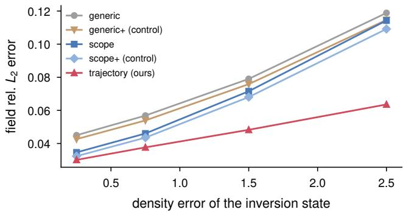  
Figure S2. Operator error on visited states – Field error of each operator on the 95 held-back inversion states against the state’s own density error. The scope data lower the error near the truth; only the trajectory states lower it where the inversion drifts.

In the loop (development). On three thick development media after 17500 iterations, the trajectory operator has current-iterate density errors 2.03 / 1.65 / 1.92, versus 8.13 / 9.51 / 3.80 with scope and 7.62 / 8.96 / 3.32 with the equalsteps scope+ control. The corresponding anchor-estimated source errors are 43 / 21 / 33% for trajectory and 208 / 219 / 83% for scope.

<table><tr><td>Direction</td><td>density error</td><td>n</td><td>generic</td><td>scope</td><td>scope+</td><td>trajectory</td></tr><tr><td>next step</td><td>[0, 0.6)</td><td>6</td><td>0.41/ 0.91</td><td>0.35 / 0.93</td><td>0.33 / 0.94</td><td>0.30 / 0.95</td></tr><tr><td></td><td>[0.6, 1.5)</td><td>10</td><td>1.01 / 0.44</td><td>1.03 / 0.42</td><td>1.03 / 0.44</td><td>0.84 /0.59</td></tr><tr><td></td><td>≥ 1.5</td><td>8</td><td>1.41 / 0.15</td><td>1.49 / 0.13</td><td>1.43 / 0.15</td><td>0.87 / 0.51</td></tr><tr><td colspan="7">trajectory below scope on 24/24 (median ratio 0.82), below scope+ on 24/24 (0.84)</td></tr><tr><td>drift</td><td>[0.6, 1.5)</td><td>5</td><td>0.90 / 0.37</td><td>0.89 / 0.38</td><td>0.89 / 0.39</td><td>0.93 / 0.37</td></tr><tr><td></td><td>≥ 1.5</td><td>7</td><td>1.17/-0.15</td><td>1.20 / -0.16</td><td>1.19 /-0.17</td><td>0.92 / 0.49</td></tr><tr><td colspan="7">trajectory below scope on 9/12 (median ratio 0.89), below scope+ on 9/12 (0.89)</td></tr><tr><td>smooth</td><td>[0, 0.6)</td><td>6</td><td>0.19 / 0.98</td><td> $0 . 1 4 / 0 . 9 9$ </td><td> $0 . 1 3 / 0 . 9 9$ </td><td> $0 . 1 2 / 0 . 9 9$ </td></tr><tr><td></td><td>[0.6, 1.5)</td><td>10</td><td>0.61 / 0.79</td><td>0.58 / 0.81</td><td>0.57 / 0.82</td><td>0.53 / 0.85</td></tr><tr><td></td><td>≥ 1.5</td><td>8</td><td>0.94 /0.48</td><td>0.91 / 0.52</td><td>0.89 / 0.54</td><td>0.70 / 0.74</td></tr><tr><td colspan="7">trajectory below scope on 22/24 (median ratio 0.87), below scope+ on 22/24 (0.91)</td></tr></table>

Table S5. Directional derivatives on visited states – Median relative error / cosine of each operator’s directional derivative against Monte Carlo on held-back inversion states, by direction and by the state’s density error (noise-corrected). Development data.

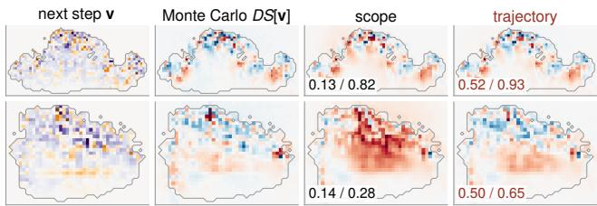  
Figure S3. Directional derivatives on two drifted states – The two held-back development states closest to both median next-step cosines of Tab. S5 (tied; density error 2.3): the inversion’s next step v and the derivative of the multiple-scattering source along it (angular mean, vertical slice through the density-weighted centroid, one scale per row) from Monte Carlo $\left( 4 \times 1 0 ^ { 9 } \right.$ photons per evaluation) and from the scope and trajectory operators; top and bottom row: the two states. Numbers: cosine with Monte Carlo over the whole field (σs-weighted, as in Tab. S5) / of the displayed slices (unweighted).

Without selection (development). On eight development media with all 32 views and no selection (Tab. S6), the trajectory operator relights 3.6 dB better than the scope operator in the mean over 2–16 min (8 of 8 media), 6.5 dB at 16 min, and diverges on two media instead of six; it stays 1.9 dB below the scope-operator pipeline with selection at 16 min, which is why selection remains part of the method.

<table><tr><td></td><td>selected</td><td colspan="2">final iterate</td><td></td><td colspan="2">traj., final –</td></tr><tr><td>Budget</td><td>scope</td><td></td><td></td><td>traj. scope Frozen Source</td><td>selected</td><td>scope</td></tr><tr><td>30s</td><td>41.04</td><td>41.32</td><td>41.29</td><td>33.10</td><td> $+ 0 . 2 8 \left( 6 \right) \ + 0 . 0 3 \left( 2 \right)$ </td><td></td></tr><tr><td>2 min</td><td>44.1244.52</td><td></td><td>44.07</td><td>34.08</td><td> $+ 0 . 4 1 \left( 5 \right) ~ + 0 . 4 5 \left( 6 \right)$ </td><td></td></tr><tr><td>8 min</td><td></td><td></td><td>44.1643.9140.08</td><td>37.93</td><td> $- 0 . 2 4 \left( 5 \right) \ + 3 . 8 3 \left( 8 \right)$ </td><td></td></tr><tr><td>16 min</td><td></td><td></td><td>44.1642.3035.79</td><td></td><td> $3 8 . 3 0 \ - 1 . 8 6 \left( 2 \right) \ + 6 . 5 0 \left( 8 \right)$ </td><td></td></tr></table>

Table S6. Trajectory training without selection – Development (eight media): mean relighting PSNR [dB] of the scope-operator pipeline with selection, of the trajectory and scope operators’ final iterates on all 32 views, and of Frozen Source (better prior); dif ferences: mean over media (clipped at ±10 dB) and media ahead (of 8). Divergences (density error above 2): selected 0, trajectory 2, scope 6.

## D. Experimental Protocol

Media. The main evaluation and the controlled set each hold six procedural cumulus clouds and six Cloudy clouds [26] that no training or development step used, each the first in a hash order of its candidates to pass an occupancy check, with maximum column optical depth loguniform in [40, 100], 1 − α log-uniform in $[ 1 0 ^ { - 3 } , 1 0 ^ { - 2 } ]$ g uniform in [0.7, 0.9] and the development lights rotated about the vertical by a random angle. The main evaluation’s drawn values span τ 43.8–89.7, α 0.9901–0.9987 and g 0.706–0.884 (controlled set: 42.8–99.8, 0.9909–0.999 and 0.703–0.888). The main evaluation’s media are $1 2 8 ^ { 3 }$ volumes (procedural clouds generated at $1 2 8 ^ { 3 }$ , Cloudy clouds averaged to 1283) whose $2 ^ { 3 }$ averages are the $6 4 ^ { \dot { 3 } }$ truths; Mitsuba 3 renders its observations and references by volumetric path tracing with Russian roulette disabled, and every inversion reads them from a cache that refuses any other source. For the main evaluation the representation ceiling, our renderer’s image of the $6 4 ^ { 3 }$ truth against Mitsuba’s references under the new lights, is 44.7 dB in the median (ours reaches 42.9 dB after 16 min), and the two renderers agree at $6 4 ^ { 3 }$ to at least 53.7 dB. The controlled set’s observations and references are rendered by our path tracer from the $6 4 ^ { 3 }$ truth, so that ours, Frozen Source and the Detached Operator share the data’s forward model up to noise (an inverse crime [18] that favours them over PRB).

Cameras, lights and metric. The 32 views are cameras on an orbit at distance 2.2 from the cube centre, evenly spaced in azimuth with elevations cycling through $5 ^ { \circ }$ $2 5 ^ { \circ }$ and $4 5 ^ { \circ }$ , field of view $4 0 ^ { \circ }$ $1 2 8 ^ { 2 }$ pixels and 4096 samples per pixel; four of them (every eighth) are held out for selection. The training light is at an elevation of $6 0 ^ { \circ }$ ; the three new lights are at 95◦, 41◦ and $5 9 ^ { \circ }$ from it (elevations $2 2 ^ { \circ }$ 22◦, 53◦), and two relighting cameras of $9 6 ^ { 2 }$ pixels lie between training views. The metric is the noise-free relighting PSNR

$$
\mathrm { P S N R } = 1 0 \log _ { 1 0 } \frac { \sum _ { l , v } \operatorname* { m a x } _ { p } \left( R ^ { ( 1 ) } \right) ^ { 2 } } { \sum _ { l , v } e _ { l v } } ,\tag{S4}
$$

with $e _ { l v } = \big \langle \big ( A ^ { ( 1 ) } - R ^ { ( 1 ) } \big ) \big ( A ^ { ( 2 ) } - R ^ { ( 2 ) } \big ) \big \rangle _ { p }$ over the new lights l and views v and the mean over pixels $\langle \cdot \rangle _ { p } ,$ where $\bar { A ^ { ( k ) } }$ and $R ^ { ( k ) }$ are path-traced images (4096 samples per pixel) of the reconstruction and of the truth with seed set $k ;$ the two seed sets are independent, so $e _ { l v }$ has the expectation of the squared error of the noise-free images. Density errors are relative $L _ { 2 }$ errors over the grid, and the projected optical depth error is that of the three axis-aligned projections.

Baselines. Frozen Source ran with two TV priors, $1 0 ^ { - 3 }$ and $3 \times 1 0 ^ { - 3 }$ , each the best of its budgets on development media; the tables report each, and the better per medium and budget (best of configuration). The Detached Operator uses its best development prior, TV $1 0 ^ { - 3 } ;$ ours uses none. PRB [48] runs in Mitsuba 3.9.1 with Dr.Jit 1.5.0 (integrator prbvolpath, unbounded paths); the density comes from the shared parameterisation through drjit.wrap, and each iteration renders one random training view with 64 samples per pixel for the primal and the adjoint pass. Its settings were chosen per budget on four thick development media among the ten configurations of Tab. S7, and the two configurations run to 30 min, with learning rates 0.01 and 0.005, form the best-of-configuration baseline; the main evaluation ran only these two. On the controlled set, the configurations tuned for 30 s and 2 min reached medians of 28.9 and 29.3 dB at these budgets, against 24.2 and 28.2 dB for the better of the two 30-min configurations. Without Russian roulette, which in media of albedo 0.99– 0.998 reweights rare long paths by factors of $1 0 ^ { 2 } – 1 0 ^ { 4 }$ , this baseline gains 1.3 dB on the controlled set (post hoc), so the main evaluation runs it without; a TV prior changes PRB by at most 0.2 dB. In PRB’s favour are its tuning on development media and the best-of-configuration selection on the test media, and in the main evaluation the observations come from its own renderer; in the controlled set they come from ours.

<table><tr><td>Config.</td><td>spp</td><td>lr</td><td>c2f</td><td>Adam €</td><td>30s</td><td>120s</td><td>480 s</td><td>960 s</td><td>1800 s</td></tr><tr><td>P16b</td><td>16</td><td>0.04</td><td>fast</td><td> $1 0 ^ { - 8 }$ </td><td>28.37</td><td>29.62</td><td>27.74</td><td></td><td></td></tr><tr><td>P16</td><td>16</td><td>0.01</td><td>slow</td><td> $1 0 ^ { - 8 }$ </td><td>26.26</td><td>29.29</td><td></td><td>30.64 30.24</td><td>29.40</td></tr><tr><td>P30d</td><td>64</td><td>0.16</td><td>fast</td><td> $1 0 ^ { - 8 }$ </td><td>29.65</td><td>26.83</td><td></td><td></td><td></td></tr><tr><td>P30c</td><td>64</td><td>0.08</td><td>fast</td><td> $1 0 ^ { - 8 }$ </td><td>29.46</td><td>29.35</td><td>25.71</td><td></td><td></td></tr><tr><td>P30b</td><td>64</td><td>0.04</td><td>fast</td><td> $1 0 ^ { - 8 }$ </td><td>28.72</td><td>30.84</td><td>29.18</td><td>27.28</td><td>25.32</td></tr><tr><td>P30</td><td>64</td><td>0.02</td><td>fast</td><td> $1 0 ^ { - 8 }$ </td><td>27.13</td><td>29.87</td><td>31.05</td><td>30.19</td><td>29.17</td></tr><tr><td>P120</td><td>64</td><td>0.01</td><td>slow</td><td> $1 0 ^ { - 8 }$ </td><td>25.60</td><td>29.83</td><td>32.22</td><td>32.92</td><td>32.70^†</td></tr><tr><td>P480</td><td>64</td><td>0.005</td><td>slow</td><td> $1 0 ^ { - 1 6 }$ </td><td>23.78</td><td>27.88</td><td>30.64</td><td>31.72</td><td>32.80†</td></tr><tr><td>Pfb</td><td>64</td><td>0.0025</td><td>fast</td><td> $1 0 ^ { - 8 }$ </td><td>21.49</td><td>23.52</td><td>26.73</td><td>28.49</td><td>29.95</td></tr><tr><td>P256</td><td>256</td><td>0.005</td><td>slow</td><td> $1 0 ^ { - 1 6 }$ </td><td>22.11</td><td>25.31</td><td>29.02</td><td>30.75</td><td>32.48</td></tr></table>

Table S7. PRB configurations – Mean relighting PSNR [dB] over the four thick development media of the choice; bold: the configuration chosen for each budget; $^ { \dagger } { \vdots }$ the two configurations run to 30 min; –: no checkpoint or a divergence. spp: samples per pixel; c2f: $3 2 ^ { 3 }$ and $6 4 ^ { 3 }$ stages from 15 and 45 s (fast) or 60 and 240 s (slow).

Statistics and failures. Comparisons are medians of permedium paired differences with bootstrap 95% intervals (the main evaluation’s estimate of trajectory against scope training: a mean with a t-interval). A run whose density error exceeds 2 in an evaluated checkpoint, or whose relighting falls 1 dB below its first evaluation, counts as diverged and enters with its last evaluation; a job that ends early without diverging is rerun once. All 132 jobs of the main evaluation ended normally on their first submission.

Pre-registration. For each held-out set the method, comparators, settings, claims, thresholds and failure rules were committed before any of its media was generated, after independent read-only audits; the media were generated once, and the report ran once on rows from the frozen code and checkpoints. The main evaluation’s thresholds are half the median effect on eight development media free of the inverse crime, rounded down to a multiple of 0.5 dB. The controlled set tested ours with the scope operator, the method at the time, and the main evaluation the complete recipe; every claim with a threshold passed in both (Tab. S8).

<table><tr><td>Claim</td><td>criterion on the 12 media of the main evaluation</td><td>development basis</td><td>main evaluation</td></tr><tr><td>P1</td><td>Ours – Frozen Source (better prior) after 2 min: median ≥4 dB and &gt; 10 ahead; after 16 min: median &gt;2.5 dB</td><td>+9.0, 8; +5.1, 8</td><td>+6.8, 12; +4.0, 12; pass</td></tr><tr><td>P2</td><td>Ours – Detached Operator after 2 min: median ≥3.5 dB</td><td>+7.7,8</td><td>+10.2, 12; pass</td></tr><tr><td>P3</td><td>Ours after 2 min ≥ PRB (better configuration) after 30 min on ≥9</td><td></td><td>12 (+9.0); pass</td></tr><tr><td>P4</td><td>Ours – Ours with the scope operator, mean over 2–16 min (estimate)</td><td>+1.3 (4 Cloudy)</td><td>+0.70 [0.26, 1.14], 11</td></tr><tr><td>P5</td><td>trajectory — scope, final iterates after 8 min: median ≥0.5 dB and ≥ 10 ahead</td><td>+1.6,8</td><td>+4.5, 11; pass</td></tr><tr><td>P5b</td><td>trajectory – scope+, the same</td><td>+1.8,8</td><td>+5.0, 11; pass</td></tr><tr><td>P6</td><td>current density error after 16 min against scope / scope+: lower on ≥ 10, median ratio ≤ 0.67</td><td>controlled set: 0.56, 11; 0.63, 12</td><td>0.28, 12; 0.41, 12; pass</td></tr></table>

Table S8. Pre-registered claims of the main evaluation – Median in dB and media ahead on the development basis (of 8) and on the main evaluation (of 12; P4: mean and 95% t-interval, media positive). The controlled set’s claims, for ours with the scope operator, all passed as well: +6.6 dB over Frozen Source (12 of 12), +7.1 dB over the Detached Operator (12), ahead of PRB after 30 min on 12 (+12.0 dB), +0.53 dB of the scope over the generic operator (9), and density-error ratios of the trajectory operator 0.56 (11) and 0.63 (12).

## E. Additional Results

## E.1. Main Evaluation

Table S10 gives the paired comparisons at every budget, Tab. S11 iterations, density errors and drift per method, Tab. S12 and Fig. S4 the projected optical depth, and Tabs. S9 and S13 the values per medium. Ours leads Frozen Source with either prior at every budget on all 12 media, and its lead over the better prior after 2 min is 2.2–13.4 dB per medium; the gain of the trajectory operator without selection is concentrated on Cloudy (7.5 dB after 8 min, against 0.6 dB on the procedural clouds, 5 of 6 positive). PRB’s better configuration reaches ours’ 2-min value on no medium within 30 min. After 16 min, ours’ density error is the highest of the methods with selection (0.70 against 0.57–0.60), and its projected optical depth error (0.24) is below that of Frozen Source and the Detached Operator (0.31–0.35) but above the scope operator’s (0.21). Among the runs with selection, Frozen Source with TV $1 0 ^ { - 3 }$ diverged on 1 of 12 media by the density criterion and on 2 counting a 1-dB fall, the Detached Operator on 2 counting a 1-dB fall, and every other method on none.

## E.2. Controlled Set

The controlled set ran ours with the scope operator and its variants (Tab. S14), and the ablations of Sec. 4.5 (Tab. S15). Ours leads each prior of Frozen Source at every budget, and PRB over every configuration that reached the budget by 10.7–14.1 dB; neither PRB configuration reaches ours 2-min value within 30 min on any medium. With selection, the trajectory operator relights 0.44 dB better than the scope operator in the mean over 2–16 min, the scope operator 0.53 dB better than the generic one, and generic+ 0.13 dB better than generic. After the report, the projected optical depth error after 2 min was 0.18 for both the trajectory and the scope operator, against 0.40–0.48 for Frozen Source, 0.43 for the Detached Operator and 0.34–0.40 for PRB after 30 min (post hoc).

<table><tr><td colspan="2"></td><td colspan="4">8 min</td><td colspan="4">16 min</td></tr><tr><td># family</td><td></td><td>τ Ours</td><td></td><td>traj. scope scope+ Ours</td><td></td><td></td><td></td><td></td><td>traj. scope scope+</td></tr><tr><td></td><td>0 procedural 89.1 41.40 41.65† 41.55† 41.03† 41.40 37.34† 30.79† 30.76†</td><td></td><td></td><td></td><td></td><td></td><td></td><td></td><td></td></tr><tr><td></td><td>1 procedural 45.2 46.77 46.93 47.22 47.33 46.77 47.03 45.13 46.82</td><td></td><td></td><td></td><td></td><td></td><td></td><td></td><td></td></tr><tr><td></td><td>2 procedural 51.1 45.07 45.10 44.32† 44.40† 45.30 45.22 29.77† 29.91†</td><td></td><td></td><td></td><td></td><td></td><td></td><td></td><td></td></tr><tr><td></td><td>3 procedural 64.1 49.14 47.95 39.62† 41.18† 49.14 47.16 33.93† 34.58†</td><td></td><td></td><td></td><td></td><td></td><td></td><td></td><td></td></tr><tr><td></td><td>4 procedural 50.3 42.55 43.22† 42.24† 42.66† 42.55 41.81† 32.50† 36.54†</td><td></td><td></td><td></td><td></td><td></td><td></td><td></td><td></td></tr><tr><td></td><td>5 procedural 60.0 46.62 47.26 46.76† 46.48† 46.62 47.28 40.23† 39.42†</td><td></td><td></td><td></td><td></td><td></td><td></td><td></td><td></td></tr><tr><td>6 Cloudy</td><td></td><td></td><td></td><td></td><td></td><td></td><td></td><td></td><td>49.4 43.26 43.97 40.33† 39.55† 43.26 43.32 35.53† 36.97†</td></tr><tr><td>7 Cloudy</td><td></td><td></td><td></td><td></td><td></td><td></td><td></td><td></td><td>89.4 41.72 41.31† 35.87† 35.64† 41.72 37.36† 29.30† 29.25†</td></tr><tr><td>8 Cloudy</td><td></td><td></td><td></td><td></td><td></td><td></td><td></td><td></td><td>89.7 41.69 42.72 35.20† 36.84† 41.69 42.67 30.09† 30.30†</td></tr><tr><td>9 Cloudy</td><td></td><td></td><td></td><td></td><td></td><td></td><td></td><td></td><td>80.7 40.17 38.03† 26.56† 28.22† 40.17 30.71† 25.01† 25.23†</td></tr><tr><td>10 Cloudy</td><td></td><td>43.843.43</td><td></td><td></td><td></td><td></td><td></td><td></td><td>3 44.24 34.78† 34.13† 43.43 43.92 27.97† 29.44†</td></tr><tr><td>11 Cloudy</td><td></td><td>71.1 41.66</td><td></td><td></td><td></td><td></td><td></td><td>41.52 34.02† 33.96† 41.66 40.57 30.12† 30.94†</td><td></td></tr><tr><td>median</td><td></td><td></td><td>42.91</td><td>43.60</td><td>39.97</td><td>40.2942.91</td><td></td><td></td><td>42.99 30.46 30.85</td></tr></table>

Table S9. Main evaluation, final iterates per medium – Relighting PSNR [dB] of ours (selected) and of the final iterates of the trajectory, scope and scope+ operators without selection. †: a run flagged as diverged.

## E.3. Where the Learned Derivative Pays

The gain over the frozen source grows with optical depth. On media of moderate optical depth, the scope-operator method and Frozen Source are level (median −0.01 dB after 2 min on five development media with τ 7.6–24, −0.17 dB after 8 min on six). Inside the thick range of the controlled set the gain is largest on the eight media with $\tau \geq 5 0$ (post hoc: median 7.8 / 6.2 dB after 2 / 16 min, against 1.5 / 1.0 dB on the four with $\tau < 5 0 )$ .

<table><tr><td>Comparison</td><td>30 s</td><td>2 min</td><td>8 min</td><td>16 min</td></tr><tr><td> $\mathrm { O u r s } - \mathrm { F r o z e n } \mathrm { S o u r c e } ( \mathrm { T V } 1 0 ^ { - 3 } )$ </td><td>+6.4 [5.0, 8.9] 12/12</td><td>+10.7 [7.2, 13.9] 12/12</td><td>+4.4 [3.0, 5.7] 12/12</td><td>+4.2 [2.9, 5.2] 12/12</td></tr><tr><td> $\mathrm { O u r s } - \mathrm { F r o z e n S o u r c e ( T V 3 \cdot 1 0 ^ { - 3 } ) }$ </td><td>+5.3 [4.9, 7.1] 12/12</td><td>+6.9 [6.1, 10.7] 12/12</td><td>+6.2 [3.6, 7.7] 12/12</td><td>+6.3 [3.6, 7.8] 12/12</td></tr><tr><td> ${ \mathrm { O u r s } } - { \mathrm { F r o z e n } } { \mathrm { S o u r c e } } { \mathrm { ( b e t t e r  p r i o r ) } }$ </td><td>+5.1 [4.7, 7.1] 12/12</td><td>+6.8 [5.5, 10.7] 12/12</td><td>+4.4 [2.4, 5.7] 12/12</td><td>+4.0 [2.3, 5.1] 12/12</td></tr><tr><td> $\mathrm { O u r s } - \mathrm { D e t a c h e d O p e r a t o r }$ </td><td>+5.2 [3.7, 7.1] 12/12</td><td>+10.2 [5.3, 12.3] 12/12</td><td>+5.9 [4.0, 8.8] 12/12</td><td>+5.1 [3.4, 6.1] 12/12</td></tr><tr><td> $\mathrm { O u r s - O u r s ~ w / s c o \ ' p e ~ o p . }$ </td><td>+0.0 [−0.1, 0.3] 7/12</td><td>+0.5 [−0.1, 0.7] 9/12</td><td>+0.9 [0.4, 1.5] 11/12</td><td>+1.0 [0.4, 1.5] 11/12</td></tr><tr><td> $\mathrm { O u r s - O u r s \ : w / s c o p e + o p . }$ </td><td>+0.1 [0.0, 0.3] 9/12</td><td>+0.3 [0.0, 0.5] 9/12</td><td>+0.7 [0.2, 1.0] 9/12</td><td>+0.7 [0.1, 1.0] 9/12</td></tr><tr><td> $\mathrm { O u r s } \left( 2 \mathrm { m i n } \right) - \mathrm { P R B } \left( \mathrm { b e t t e r } \right)$ </td><td>+17.6 [17.1, 18.3] 12/12</td><td>+13.5 [12.9, 14.1] 12/12</td><td>+10.9 [10.1, 11.9] 12/12</td><td>+9.9 [9.1, 10.8] 12/12</td></tr><tr><td>traj. — scope (final iterates)</td><td> $- 0 . 1 \left[ - 0 . 1 , 0 . 2 \right] 4 / 1 2$ </td><td> $+ 0 . 5 [ 0 . 2 , 1 . 2 ] 1 0 / 1 2$ </td><td> $+ 4 . 5 [ 0 . 6 , 7 . 9 ] 1 1 / 1 2$ </td><td> $+ 8 . 7 \ : [ 6 . 8 , 1 2 . 9 ] \ : 1 2 / 1 2$ </td></tr><tr><td>traj. — scope+ (final iterates)</td><td> $+ 0 . 0 \left[ - 0 . 3 , 0 . 1 \right] 6 / 1 2$ </td><td> $+ 0 . 3 \left[ - 0 . 2 , 1 . 0 \right] 8 / 1 2$ </td><td> $+ 5 . 0 \ [ 0 . 7 , 7 . 2 ] \ 1 1 / 1 2$ </td><td> $+ 8 . 0 \ \bar { [ 5 . 9 , 1 2 . 5 ] } \ 1 2 / 1 2$ </td></tr><tr><td>scope+ — scope (final iterates)</td><td> $+ 0 . 0 \left[ - 0 . 1 , 0 . 1 \right] 6 / 1 2$ </td><td> $+ 0 . 1 \left[ - 0 . 1 , 0 . 5 \right] 8 / 1 2$ </td><td> $+ 0 . 0 \left[ - 0 . 4 , 1 . 0 \right] 6 / 1 2$ </td><td> $+ 0 . 4 [ 0 . 1 , 1 . 5 ] 9 / 1 2$ </td></tr><tr><td>traj. (final iterate) — Ours</td><td> $+ 0 . 1 \left[ - 0 . 1 , 0 . 2 \right] 8 / 1 2$ </td><td> $+ 0 . 2 [ 0 . 0 , 0 . 4 ] 9 / 1 2$ </td><td> $+ 0 . 2 \left[ - 0 . 3 , 0 . 7 \right] 8 / 1 2$ </td><td> $- 0 . 4 \left[ - 3 . 0 , 0 . 4 \right] 5 / 1 2$ </td></tr><tr><td>scope (final iterate) – Ours w/ scope op.</td><td> $+ 0 . 2 [ 0 . 0 , 0 . 5 ] 9 / 1 2$ </td><td> $+ 0 . 0 \left[ - 0 . 2 , 0 . 3 \right] 7 / 1 2$ </td><td> $- 3 . 3 \left[ - 6 . 9 , 0 . 2 \right] 3 / 1 2$ </td><td> $- 1 0 . 6 \left[ { - 1 4 . 2 , - 7 . 7 } \right] 0 / 1 2$ </td></tr></table>

Table S10. Main evaluation, paired comparisons – Median paired difference in relighting PSNR [dB], bootstrap 95% interval and media ahead at each budget. Final iterates: all 32 views, no held-out selection. PRB: the better of its two configurations, at the column’s budget.
<table><tr><td>Arm</td><td colspan="2">iterations</td><td colspan="2">evaluated density error</td><td colspan="2">current, 16 min median (&gt;2)</td><td>div. anchor error</td></tr><tr><td></td><td>2 min</td><td>16 min</td><td>2 min</td><td>16 min</td><td></td><td></td><td></td></tr><tr><td>Ours (trajectory op.)</td><td>1960</td><td>16180</td><td>0.55</td><td>0.70</td><td>1.49 (4)</td><td>0</td><td>20%</td></tr><tr><td>Ours w/ scope op.</td><td>1992</td><td>15754</td><td>0.58</td><td>0.58</td><td>7.66 (11)</td><td>0</td><td>67%</td></tr><tr><td>Ours w/ scope+ op.</td><td>1989</td><td>16198</td><td>0.53</td><td>0.60</td><td>5.54 (10)</td><td>0</td><td>54%</td></tr><tr><td>trajectory, final iterate</td><td>2030</td><td>16897</td><td>0.56</td><td>1.32</td><td>1.32 (4)</td><td>4</td><td>21%</td></tr><tr><td>scope, final iterate</td><td>1972</td><td>15924</td><td>0.60</td><td>7.35</td><td>7.35 (11)</td><td>11</td><td>61%</td></tr><tr><td>scope+, final iterate</td><td>1952</td><td>16062</td><td>0.59</td><td>6.92</td><td>6.92 (11)</td><td>11</td><td>59%</td></tr><tr><td>Frozen Source  $( \mathrm { T V } 1 0 ^ { - 3 } )$ </td><td>3355</td><td>35590</td><td>1.29</td><td>0.57</td><td>0.58 (0)</td><td>1</td><td>一</td></tr><tr><td>Frozen Source  $( \mathbf { T V } 3 { \cdot } 1 0 ^ { - 3 } )$ </td><td>3574</td><td>38020</td><td>0.65</td><td>0.57</td><td>0.56 (0)</td><td>0</td><td>一</td></tr><tr><td>Detached Operator</td><td>2514</td><td>23283</td><td>0.98</td><td>0.58</td><td>0.59 (0)</td><td>0</td><td>17%</td></tr><tr><td>PRB, lr 0.005</td><td>460</td><td>2246</td><td>0.66</td><td>0.56</td><td>0.56 (0)</td><td>0</td><td>一</td></tr><tr><td>PRB, lr 0.01</td><td>296</td><td>1562</td><td>0.59</td><td>0.56</td><td>0.56 (0)</td><td>0</td><td>一</td></tr></table>

Table S11. Main evaluation, per method – Medians over the 12 media: iterations reached, density error of the evaluated iterate, density error of the current iterate after 16 min (in brackets: media above 2), divergences (density criterion) and the operator’s error on the current density along the run (mean of the anchor error).

<table><tr><td>Arm</td><td>2 min</td><td>8 min</td><td>16 min</td><td>30 min</td></tr><tr><td>Ours (trajectory op.)</td><td>0.55 / 0.20</td><td></td><td>0.70 / 0.24</td><td></td></tr><tr><td>Ours w/ scope op.</td><td>0.58 / 0.21</td><td></td><td>0.58 / 0.21</td><td></td></tr><tr><td>trajectory, final iterate</td><td></td><td>0.81 / 0.31</td><td>1.32 / 0.49</td><td></td></tr><tr><td>scope, final iterate</td><td></td><td>2.05 / 0.65</td><td>7.35 / 3.61</td><td></td></tr><tr><td>scope+, final iterate</td><td></td><td>1.80 / 0.56</td><td>6.92 / 3.37</td><td></td></tr><tr><td>Frozen Source  $( \mathrm { T V } 1 0 ^ { - 3 } )$ </td><td>1.29 / 0.68</td><td></td><td>0.57 / 0.31</td><td></td></tr><tr><td>Frozen Source  $( \mathrm { T V } 3 { \cdot } 1 0 ^ { - 3 } )$ </td><td>0.65 / 0.42</td><td></td><td>0.57 / 0.33</td><td></td></tr><tr><td>Detached Operator</td><td>0.98 / 0.53</td><td></td><td>0.58 / 0.35</td><td></td></tr><tr><td>PRB, lr 0.005</td><td></td><td></td><td></td><td>0.55 / 0.36</td></tr><tr><td>PRB, lr 0.01</td><td></td><td></td><td></td><td>0.58 / 0.31</td></tr></table>

Table S12. Main evaluation, what is reconstructed – Median relative $L _ { 2 }$ error of the density / of the projected optical depth of the evaluated iterate (PRB after 30 min). Per medium, against Frozen Source and the Detached Operator after 2 min and PRB after 30 min (its configuration of better PSNR, lr 0.01 on all 12), ours after 2 min has the lowest density error on 6 of 12 (5 if lr 0.005 also counts) and the lowest projected-optical-depth error on 11 of 12.

## E.4. Limitations

The gains are limited to media in which multiple scattering dominates (in our tests maximum optical depth 40–100 and albedo of at least 0.99); at moderate optical depth the frozen source is as accurate and cheaper (Sec. E.3). Training on the inversion’s states slows the drift of the iterate but does not stop it, so the method selects its output on held-out views (Tab. S6). We assume known albedo, phase function, cameras and a directional light, reconstruct at $6 4 ^ { 3 }$ and test on synthetic data.

## E.5. Compute

Development (operator training, development inversions and analyses, baseline tuning) used about 881 B200 GPUhours and the regime, controlled and main held-out sets 283, 150 and 220 (1,534 in total).

Online cost of the derivative. Table S16 times the derivative of Fig. 4 (post hoc) with a synchronized wall clock on two B200s of one node, each call on one GPU, from the density and v in GPU memory to the derivative field (all coefficients); loading the operator, warm-up calls and its offline training (once for all media: 8.5 h of network training for the three stages on one B200, besides generating the training data) are excluded. Ours is the central difference above, two fp32 forward passes with the optical depths and features (median of 180 calls, 75–79 ms); one forward pass takes 38 ms in fp32 and 18 ms in the inversion’s bfloat16 (in a separate run, the inputs alone 7 ms and the network alone 33 ms and 13 ms). Monte Carlo is the central difference with common random numbers at $1 0 ^ { 7 }$ to $7 . 4 \times 1 0 ^ { 9 }$ photons per evaluation, with seeds independent of the reference’s; the reference averages two central differences at $7 . 4 \times 1 0 ^ { 9 }$ (45 min in all), and Fig. 4 shows the first of them. Errors and cosines are taken against that reference and include its own noise (0.09); the comparison is between derivatives of the multiple-scattering field, not with PRB’s gradient estimator. Monte Carlo reaches our error (0.163) at $7 . 4 \times 1 0 ^ { 9 }$ photons per evaluation (0.162–0.163 for its two seeds), after 23 min, 17,600 times our time (Fig. 4 rounds down), and is still less accurate at $3 \times 1 0 ^ { 9 }$ (9.1 min, 7,100 times). Its error is noise that falls with the photon count, ours a bias of the operator (it overshoots the lobe of the response towards the light). On this cloud the tracer is among the slowest $( 1 . 1 \times 1 0 ^ { 7 }$ photons per second; $1 . 1 { - } 2 . 6 \times 1 0 ^ { 7 }$ over the clouds of the main evaluation), so the ratio is likely smaller on most others; the cloud was chosen for Fig. 1, not for its cost.

<table><tr><td colspan="3"></td><td colspan="3">Ours, 2 min</td><td colspan="3">Frozen Source, 2 min</td><td>Detached Operator</td><td colspan="3">PRB, 2 min</td><td>PRB</td></tr><tr><td></td><td># family</td><td>T</td><td>traj.</td><td>scope</td><td>scope+</td><td> $1 0 ^ { - 3 }$ </td><td> $3 { \cdot } 1 0 ^ { - 3 }$ </td><td>better</td><td>2 min</td><td>lr .005</td><td>lr .01</td><td>better</td><td>30min</td></tr><tr><td>0</td><td>procedural</td><td>89.1</td><td>40.42</td><td>39.56</td><td>40.22</td><td>27.22</td><td>27.40</td><td>27.40</td><td>27.14</td><td>24.40</td><td>25.98</td><td>25.98</td><td>28.41</td></tr><tr><td>1</td><td>procedural</td><td>45.2</td><td>45.94</td><td>45.84</td><td>45.99</td><td>40.87</td><td>39.26</td><td>40.87</td><td>40.20</td><td>29.94</td><td>32.33</td><td>32.33</td><td>37.40</td></tr><tr><td>2</td><td>procedural</td><td>51.1</td><td>43.53</td><td>43.41</td><td>43.51</td><td>41.34</td><td>38.72</td><td>41.34</td><td>40.85</td><td>29.47</td><td>31.24</td><td>31.24</td><td>36.73</td></tr><tr><td>3</td><td>procedural</td><td>64.1</td><td>47.44</td><td>47.81</td><td>48.13</td><td>38.13</td><td>41.19</td><td>41.19</td><td>43.16</td><td>33.52</td><td>35.23</td><td>35.23</td><td>39.82</td></tr><tr><td>4</td><td>procedural</td><td>50.3</td><td>43.38</td><td>43.71</td><td>43.18</td><td>39.03</td><td>39.40</td><td>39.40</td><td>38.61</td><td>25.69</td><td>27.74</td><td>27.74</td><td>32.93</td></tr><tr><td>5</td><td>procedural</td><td>60.0</td><td>45.61</td><td>44.97</td><td>45.14</td><td> $3 1 . 2 1 ^ { \dagger }$ </td><td>37.22</td><td>37.22</td><td>33.69†</td><td>30.99</td><td>32.20</td><td>32.20</td><td>36.46</td></tr><tr><td>6</td><td>Cloudy</td><td>49.4</td><td>42.59</td><td>42.09</td><td>42.24</td><td>27.65</td><td>29.20</td><td>29.20</td><td>29.52</td><td>27.23</td><td>28.78</td><td>28.78</td><td>33.82</td></tr><tr><td>7</td><td>Cloudy</td><td>89.4</td><td>41.30</td><td>40.69</td><td>40.72</td><td>31.74</td><td>35.31</td><td>35.31</td><td>33.27</td><td>26.13</td><td>27.94</td><td>27.94</td><td>31.27</td></tr><tr><td>8</td><td>Cloudy</td><td>89.7</td><td>41.05</td><td>40.04</td><td>40.30</td><td>30.60</td><td>33.95</td><td>33.95</td><td>29.57†</td><td>26.38</td><td>27.37</td><td>27.37</td><td>31.37</td></tr><tr><td>9</td><td>Cloudy</td><td>80.7</td><td>40.17</td><td>39.60</td><td>39.77</td><td>25.82†</td><td>32.12</td><td>32.12</td><td>27.54</td><td>25.62</td><td>26.84</td><td>26.84</td><td>31.41</td></tr><tr><td>10</td><td>Cloudy</td><td>43.8</td><td>42.47</td><td>42.74</td><td>42.84</td><td>29.10</td><td>29.41</td><td>29.41</td><td>30.77</td><td>28.86</td><td>29.96</td><td>29.96</td><td>35.04</td></tr><tr><td>11</td><td>Cloudy</td><td>71.1</td><td>41.33</td><td>39.78</td><td>40.08</td><td>30.39</td><td>34.79</td><td>34.79</td><td>32.31</td><td>24.78</td><td>26.27</td><td>26.27</td><td>31.55</td></tr><tr><td colspan="2">median</td><td></td><td>42.53</td><td>42.41</td><td>42.54</td><td>30.91</td><td>35.05</td><td>35.05</td><td>32.79</td><td>26.80</td><td>28.36</td><td>28.36</td><td>33.38</td></tr></table>

Table S13. Main evaluation, per medium – Relighting PSNR [dB] after 2 min of ours with each operator, Frozen Source with each prior and the better one, the Detached Operator and PRB with each configuration and the better one, and of PRB’s better configuration after 30 min. †: a diverged run.

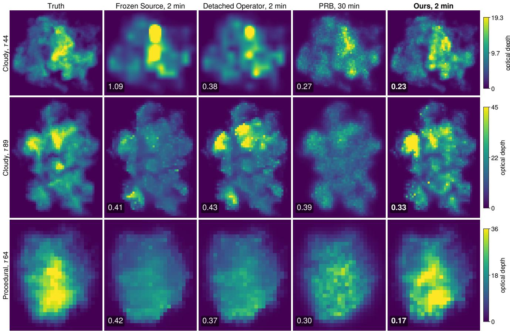  
Figure S4. Projected optical depth – Optical depth along the vertical (seen from above) of the truth and of the reconstructions for three media of the main evaluation, those at the 25th, 50th and 75th percentile of ours’ advantage over the best baseline in projected optica depth (relative error over the three axis-aligned projections; ours lowest on 11 of 12). Colour bar per medium; number: relative error of the displayed projection, lowest in bold. The images constrain this quantity, and ours matches it best.

<table><tr><td>Comparison</td><td>30 s</td><td>2 min</td><td>8min</td><td>16 min</td></tr><tr><td> $\mathrm { O u r s } - \mathrm { F r o z e n } \mathrm { S o u r c e } ( \mathrm { T V } 1 0 ^ { - 3 } )$ </td><td>+6.5 [2.3, 10.7] 11/12</td><td>+8.4 [4.1, 15.2] 12/12</td><td>+5.8 [1.8, 8.3] 12/12</td><td>+5.7 [1.7, 7.0] 12/12</td></tr><tr><td> $\mathrm { O u r s - F r o z e n S o u r c e ( T V 3 \cdot 1 0 ^ { - 3 } ) }$ </td><td>+6.1 [3.5, 7.5] 12/12</td><td>+7.6 [4.0, 9.2] 12/12</td><td>+7.0 [3.3, 8.4] 12/12</td><td>+6.8 [3.3, 8.3] 12/12</td></tr><tr><td> $\mathrm { O u r s - F r o z e n ~ S o u r c e ~ ( b e t t e r ~ p r i o r ) }$ </td><td>+5.2 [2.3, 7.5] 11/12</td><td>+6.6 [3.1, 9.2] 12/12</td><td>+5.8 [1.5, 7.8] 12/12</td><td>+5.7 [1.6, 7.0] 12/12</td></tr><tr><td>Ours — Detached Operator</td><td> $+ 5 . 5 \left[ 1 . 4 , 9 . 7 \right] 1 2 / 1 2$ </td><td>+7.1 [2.3, 14.3] 12/12</td><td>+6.1 [1.7, 8.4] 12/12</td><td>+6.1 [1.5, 7.6] 12/12</td></tr><tr><td>Ours — Ours without Jdirect</td><td> $- 0 . 1 \left[ - 0 . 3 , 0 . 1 \right] 4 / 1 2$ </td><td>-0.1 [-0.2, 0.1] 5/12</td><td>-0.3 [−0.4, 0.1] 5/12</td><td>-0.3 [-0.4, 0.1] 5/12</td></tr><tr><td>Ours — Ours without anchor</td><td>-0.5[-0.6, -0.3] 2/12</td><td>+0.8 [0.4, 1.2] 10/12</td><td>+0.9 [0.5, 1.3] 11/12</td><td>+0.9 [0.5, 1.3] 11/12</td></tr><tr><td>Ours — PRB (best configuration)</td><td>+10.7 [10.4, 11.6] 12/12</td><td></td><td>+14.1 [12.9, 15.0] 12/12 +13.0 [12.3, 13.6] 12/12</td><td>+12.3 [11.6, 13.0] 12/12</td></tr></table>

Table S14. Controlled set, paired comparisons – Median paired difference in relighting PSNR [dB], bootstrap 95% interval and media ahead. Ours: the scope operator. PRB: per medium the best configuration that reached the budget.

<table><tr><td>Controlled set</td><td>30s</td><td>2 min</td><td>8 min</td><td>16 min</td></tr><tr><td>Ours (scope operator)</td><td>39.3</td><td>43.5</td><td>43.7</td><td>43.7</td></tr><tr><td>without  $\mathbf { J } _ { \mathrm { d i r e c t } }$ </td><td>39.4</td><td>43.5</td><td>44.1</td><td>44.1</td></tr><tr><td>without anchor  $( \Delta = 0 )$ </td><td>39.7</td><td>43.3</td><td>42.9</td><td>42.9</td></tr><tr><td>Detached Operator (no  $\mathbf { J } _ { \mathrm { d i r e c t } } + \mathbf { J } _ { \mathrm { m u l t i } , \phi } )$ </td><td>34.1</td><td>35.5</td><td>38.4</td><td>38.9</td></tr><tr><td>Frozen Source (no operator)</td><td>34.7</td><td>36.9</td><td>38.0</td><td>39.1</td></tr></table>

Table S15. Ablations on the controlled set – Median relighting PSNR [dB] of our pipeline with the scope operator (the controlled set’s method) when one component is removed (top), and of the baselines, which also differ in their prior (bottom; Frozen Source: the better of two priors per medium). Median paired differences: Tab. S14.

<table><tr><td>Monte Carlo, photons / evaluation</td><td>time</td><td>error</td><td>cosine</td></tr><tr><td>107 (3 seeds)</td><td>1.9s</td><td>3.60–3.61</td><td>0.264–0.271</td></tr><tr><td> $3 \times 1 0 ^ { 7 } \ : ( 3 \ : \mathrm { s e e d s } )$ </td><td>5.6s</td><td>2.08–2.10</td><td>0.421-0.423</td></tr><tr><td> $1 0 ^ { 8 } ~ ( 3$  seeds)</td><td>18s</td><td>1.15</td><td>0.650–0.659</td></tr><tr><td> $3 \times 1 0 ^ { 8 } ( 3 \mathrm { s e e d s } )$ </td><td>55s</td><td>0.662–0.667</td><td>0.828–0.832</td></tr><tr><td> $1 0 ^ { 9 } \ ( 3 \ \mathrm { s e e d s } )$ </td><td>3.0 min</td><td>0.371-0.381</td><td>0.934–0.937</td></tr><tr><td> $3 \times 1 0 ^ { 9 } \left( 2 \mathrm { s e e d s } \right)$ </td><td>9.1 min</td><td>0.228–0.230</td><td>0.974–0.975</td></tr><tr><td> $7 . 4 \times 1 0 ^ { 9 } ( 2 \mathrm { s e e d s } )$ </td><td>23 min</td><td>0.162–0.163</td><td>0.987</td></tr><tr><td>reference: two at  $7 . 4 \times 1 0 ^ { 9 }$ </td><td>45 min</td><td></td><td>一</td></tr><tr><td>Ours, two fp32 forward passes one pass, fp32 / bfloat16</td><td>77 ms 38 ms / 18 ms</td><td>0.163</td><td>0.987</td></tr></table>

Table S16. Cost of the derivative of Fig. 4 – Synchronized wallclock time on one B200 and the error (relative, σs-weighted, all coefficients) and cosine against the reference (two central differences with $7 . 4 \times 1 0 ^ { 9 }$ photons per evaluation; its own noise 0.09). Monte Carlo: median time over seeds, range of the seeds’ errors and cosines.