# Model Distribution-Aware Multimodal Dataset Distillation

Jiajun Shen<sup>∗</sup> Yonglin Wu<sup>∗</sup> Ruonan Yu Xinchao Wang<sup>†</sup> National University of Singapore {jiajun.shen,yonglin.wu,ruonan}@u.nus.edu xinchao@nus.edu.sg

## Abstract

Multimodal dataset distillation (MDD) aims to reduce the cost of vision-language pre-training by synthesizing compact image-text datasets. Although recent featurematching methods have improved distillation efficiency, synthetic data may become specialized to the model representations encountered during optimization, limiting generalization to unseen model states. We propose Model Distribution-Aware Multimodal Dataset Distillation (MDA-DD), which leverages supervision from a dynamic staggered queue of models at different training stages. We further introduce asymmetric dual projection for complementary alignment in visual and linguistic spaces and an uncentered second-order moment objective that retains mean-related cross-modal information. Experiments on Flickr30K and MS-COCO demonstrate consistent retrieval improvements over existing methods across synthetic-data budgets. With only 100 synthetic pairs, MDA-DD improves IR@1 and TR@1 on Flickr30K by 12.9 and 18.2 percentage points, respectively, over the strongest baseline at the same budget, outperforming all compared methods using 500 pairs on both datasets across all six retrieval metrics. Our code is available at https://github.com/Jun-Shen04-Jia/MDA-DD.

## 1 Introduction

Dataset distillation (DD) [40, 2, 44, 1, 51, 61] aims to compress large datasets into compact synthetic training sets. Contrastive vision-language models such as CLIP [31] and SigLIP [53, 37] rely heavily on web-scale image-text corpora, incurring substantial storage and computational costs. Although DD has proven effective across unimodal domains, extending it to image-text data requires preserving finegrained semantic alignment between modalities.

Trajectory-based methods such as MTT-VL [43] and LoRS [46] address this issue by matching expert training trajectories to guide cross-modal alignment. RepBlend [54] further improves efficiency by freezing both encoders and matching projection-layer trajectories. However, generating expert trajectories still requires training on the full dataset and storing intermediate checkpoints, incurring substantial computational and storage costs. CovMatch [22] avoids expert trajectory generation by updating both encoders online and matching feature distributions between real and synthetic data, substantially reducing the cost of distillation.

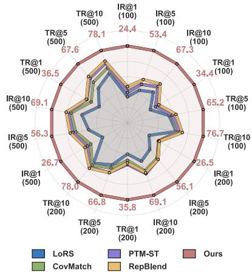  
Figure 1: Radar charts comparing MDA-DD against all baselines on Flickr30K across retrieval metrics.

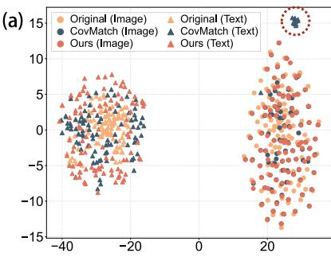

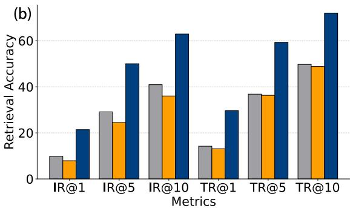  
Figure 2: (a) Joint t-SNE visualization of multimodal embeddings under a different model initialization. Circles denote image embeddings and triangles denote text embeddings; colors indicate the source (yellow:real data, cyan:CovMatch, orange:MDA-DD). The red dashed circle highlights a subset of CovMatch text embeddings that collapses to an isolated region. (b) Retrieval performance of CovMatch variants on Flickr30K with 100 pairs. Removing the image projection (yellow) has minimal impact relative to the baseline (grey), while random model initialization (blue) yields consistent gains across all metrics.

Despite this progress, feature matching remains dependent on the model representations used during distillation. CovMatch periodically resets its encoders to the same pretrained weights before updating them online, which may cause synthetic data to specialize to the encountered model states and degrade downstream retrieval performance under different initializations. Figure 2(a) shows a subset of its text embeddings separated from the main clusters under a different model initialization, while Figure 2(b) shows that changing the initialization strategy improves retrieval performance.

Beyond model-state dependence, aligning both modalities in the visual feature space leaves complementary alignment in the linguistic space unexplored, while centered cross-covariance removes mean-related cross-modal information from the matched second-order statistic, potentially overlooking useful global cross-modal information.

We propose Model Distribution-Aware Multimodal Dataset Distillation (MDA-DD), which uses a dynamic staggered model queue to provide supervision from models at different training stages. We further introduce asymmetric dual projection (ADP) for complementary alignment in visual and linguistic spaces and a Second-Order Cross-Modal Moment (SOCM) objective that retains mean-related cross-modal information without explicit centering.

Experiments on Flickr30K [30] and MS-COCO [24] show consistent improvements across syntheticdata budgets. With only 100 pairs, MDA-DD achieves 24.4 IR@1 and 34.4 TR@1 on Flickr30K, and 7.3 IR@1 and 10.5 TR@1 on MS-COCO. On both datasets, this 100-pair configuration outperforms all compared methods using 500 pairs across all six retrieval metrics.

Our main contributions are summarized as follows:

(1) We introduce a model-distribution-aware distillation framework with a dynamic staggered model queue that provides supervision from models at different training stages.

(2) We develop complementary cross-modal matching through asymmetric dual projection and an uncentered second-order moment objective that retains mean-related cross-modal information.

(3) We demonstrate substantial improvements in retrieval performance and data efficiency, as well as generalization to unseen visual encoder architectures.

## 2 Preliminaries and Related Work

We formalize multimodal dataset distillation for image-text contrastive learning and review existing distribution-based approaches (see Appendix A.3 for a discussion on trajectory-based methods).

Multimodal Dataset Distillation. Vision-language models embed image-text pairs into a joint representation space. Given a dataset $\mathcal { T } = \{ ( \mathbf { x } _ { v } ^ { i } , \mathbf { x } _ { l } ^ { i } ) \} _ { i = 1 } ^ { M }$ , an image encoder $f _ { v }$ and a text encoder $f _ { l } .$ each followed by a linear projection head, produce multimodal embeddings $\mathbf { z } _ { v } , \mathbf { z } _ { l } \in \mathbb { R } ^ { z }$ . The model is trained with the symmetric InfoNCE [29] loss:

$$
\mathcal { L } _ { \mathrm { N C E } } ( S ) = - \frac { 1 } { 2 B } \sum _ { i = 1 } ^ { B } \left[ \log \frac { \exp ( S _ { i i } / \tau ) } { \sum _ { j = 1 } ^ { B } \exp ( S _ { i j } / \tau ) } + \log \frac { \exp ( S _ { i i } / \tau ) } { \sum _ { j = 1 } ^ { B } \exp ( S _ { j i } / \tau ) } \right] .\tag{1}
$$

where $s _ { i j } = \cos ( \mathbf { z } _ { v } ^ { i } , \mathbf { z } _ { l } ^ { j } )$ and $\tau > 0$ is a learnable temperature.

The goal of cross-modal dataset distillation is to compress $\tau$ into a compact synthetic set ${ \boldsymbol { s } } =$ $\{ ( \tilde { \mathbf { x } } _ { v } ^ { i } , \tilde { \mathbf { x } } _ { l } ^ { i } ) \} _ { i = 1 } ^ { N }$ with $N \ll M$ . Let $P _ { D }$ denote the distribution of the real data. We seek the synthetic set such that a model trained on $s$ attains cross-modal alignment comparable to training on the full corpus $\tau$ , by minimizing the expected alignment gap under $P _ { \mathcal { D } } \mathrm { : }$

$$
\begin{array} { r } { S ^ { * } \ = \ \underset { S } { \arg \operatorname* { m i n } } \ \mathbb { E } _ { ( \mathbf { x } _ { v } , \mathbf { x } _ { l } ) \sim P _ { \mathcal { D } } } \big \| \mathcal { L } ( \theta _ { \mathcal { T } } ) \ - \ \mathcal { L } ( \theta _ { S } ) \big \| , } \end{array}\tag{2}
$$

where $\theta _ { T }$ and $\theta _ { S }$ denote model parameters obtained by training on $\tau$ and $s$ respectively, and $\mathcal { L }$ is the cross-modal retrieval loss.

Distribution-Based Paradigms. CovMatch replaces costly trajectory unrolling with single-step distribution matching. By interleaving model training with data distillation, CovMatch uses the updated model directly as a feature extractor for both real and synthetic sets. Its distillation objective combines a shared projection design with cross-covariance matching.

Projection Design. The image encoder extracts embeddings $\mathbf { e } _ { v } \in \mathbb { R } ^ { d _ { v } }$ , which are mapped to $\mathbf { z } _ { v } = \mathbf { W } _ { v } ^ { \updownarrow } \mathbf { e } _ { v } \in \mathbb { R } ^ { d _ { v } }$ through a projection matrix $\mathbf { W } _ { v } ^ { \updownarrow } \in \mathbb { R } ^ { d _ { v } \times d _ { \imath } }$ . Similarly, the text encoder produces embeddings $\mathbf { e } _ { l } \in \mathbb { R } ^ { d _ { l } }$ and maps them to $\mathbf { z } _ { l } = \mathbf { W } _ { l } ^ { \uparrow } \mathbf { e } _ { l } \in \mathbb { R } ^ { d _ { v } }$ through a projection matrix $\mathbf { W } _ { l } ^ { \uparrow } \in \mathbb { R } ^ { d _ { v } \times d _ { l } }$ This projection scheme aligns text representations with the visual feature space.

Cross-Covariance Matching. Given a batch of B paired embeddings $\{ \mathbf { e } _ { v } ^ { i } , \mathbf { e } _ { l } ^ { i } \} _ { i = 1 } ^ { B }$ , the batch means $\pmb { \mu } _ { v }$ and $\pmb { \mu } _ { l }$ are first computed to obtain centered embeddings $\bar { \mathbf e } _ { v } ^ { i } = \mathbf e _ { v } ^ { i } - \mu _ { v }$ and $\bar { \mathbf { e } } _ { l } ^ { i } = \mathbf { e } _ { l } ^ { i } - \mu _ { l }$ . The cross-modal covariance matrix is then defined as:

$$
\mathbf { C } = \frac { 1 } { B } \sum _ { i = 1 } ^ { B } \bar { \mathbf { e } } _ { v } ^ { i } ( \bar { \mathbf { e } } _ { l } ^ { i } ) ^ { \top } = \frac { 1 } { B } \bar { \mathbf { E } } _ { v } ^ { \top } \bar { \mathbf { E } } _ { l } \in \mathbb { R } ^ { d _ { v } \times d _ { l } } ,\tag{3}
$$

where $\bar { \mathbf { E } } _ { v } \in \mathbb { R } ^ { B \times d _ { v } }$ and $\bar { \mathbf { E } } _ { l } \in \mathbb { R } ^ { B \times d _ { l } }$ stack the centered embeddings row-wise.

The distillation loss aligns the cross-covariance matrices and the projected means of each modality:

$$
\mathcal { L } _ { \mathrm { t o t a l } } = \left. \mathbf { C } _ { S } - \rho \mathbf { C } _ { \mathcal { T } } \right. _ { F } ^ { 2 } + \lambda \big ( \lVert \bar { \mathbf { z } } _ { v } ^ { S } - \bar { \mathbf { z } } _ { v } ^ { \mathcal { T } } \rVert _ { 2 } ^ { 2 } + \lVert \bar { \mathbf { z } } _ { l } ^ { S } - \bar { \mathbf { z } } _ { l } ^ { \mathcal { T } } \rVert _ { 2 } ^ { 2 } \big ) ,\tag{4}
$$

where $\rho$ is a scaling factor, z¯ denotes the projected batch mean, and λ is a balancing weight. This scheme avoids generating and storing expert trajectories.

## 3 Method

## 3.1 Model-Distribution-Aware Distillation

Motivation. Feature-distribution matching depends on model representations that evolve during training, so synthetic data optimized along one trajectory may match real-data statistics less well under other model states. CovMatch [22] introduces model-state variation through online training and periodic reinitialization, but its encoders repeatedly return to the same pretrained weights. Syntheticdata updates are also guided by one active model at a time, rather than by models at different training stages. This may cause synthetic data to specialize to the states encountered during distillation and generalize poorly to others.

To characterize this limitation, let $\tau$ and S denote the real and synthetic datasets, respectively, and let $\mathcal { L } _ { \mathrm { m a t c h } } ( \theta ; S , \mathcal { T } )$ ) denote their feature-matching discrepancy under model state $\theta ,$ , as defined in Eq. (13). Let $P _ { \mathrm { s e q } } ( \Theta \mid \dot { \phi _ { 0 } } )$ represent the model-state distribution covered by sequential online training cycles starting from a common pretrained encoder initialization $\phi _ { 0 }$ , including their subsequent parameter updates. Let $P ( \Theta )$ denote a broader target distribution of model states. We characterize potential model-state overfitting through the generalization gap

Model Distribution-Aware Multimodal Dataset Distillation  
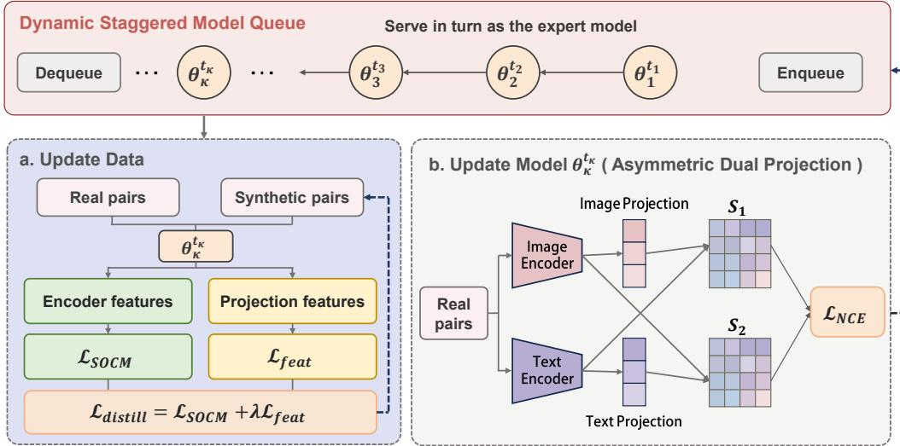  
Figure 3: Overview of MDA-DD. A dynamic staggered model queue maintains expert models at different training stages. (a) Update Data: Synthetic pairs are optimized by matching encoder-level second-order cross-modal moments (SOCM) and projection-level feature means with real pairs. (b) Update Model: Each expert is trained on real pairs using asymmetric dual projections for bidirectional contrastive learning.

$$
\Delta _ { \mathrm { s t a t e } } ( S ) = \mathbb { E } _ { \theta \sim P ( \Theta ) } \left[ \mathcal { L } _ { \mathrm { m a t c h } } ( \theta ; S , \mathcal { T } ) \right] - \mathbb { E } _ { \theta \sim P _ { \mathrm { s e q } } ( \Theta | \phi _ { 0 } ) } \left[ \mathcal { L } _ { \mathrm { m a t c h } } ( \theta ; S , \mathcal { T } ) \right] .\tag{5}
$$

A positive $\Delta _ { \mathrm { s t a t e } }$ indicates that synthetic data matches real-data statistics more closely on the states covered during distillation than on the broader target distribution. This motivates expanding modelstate coverage beyond the repeatedly encountered training trajectories.

Distributional Objective. To reduce this sensitivity, we formulate multimodal dataset distillation as feature matching over a distribution of model states:

$$
\mathcal { S } ^ { * } = \arg \operatorname* { m i n } _ { S } \mathbb { E } _ { \theta \sim P ( \Theta ) } \left[ \left| \left| M _ { \theta } ( S ) - \rho M _ { \theta } ( T ) \right| \right| _ { F } ^ { 2 } + \lambda \big ( \| \bar { z } _ { v , \theta } ^ { S } - \bar { z } _ { v , \theta } ^ { T } \| _ { 2 } ^ { 2 } + \| \bar { z } _ { l , \theta } ^ { S } - \bar { z } _ { l , \theta } ^ { T } \| _ { 2 } ^ { 2 } \big ) \right] .\tag{6}
$$

Here, $M _ { \theta } ( \cdot )$ denotes the second-order cross-modal moment defined in Eq. (11), while $\bar { z } _ { v , \theta } ^ { D }$ and $\bar { z } _ { l , \theta } ^ { \mathcal { D } }$ are the mean projected features of the visual and linguistic modalities for dataset D. The coefficient ρ scales the real-data moment, and λ balances moment matching and feature-mean regularization.

Since the target model-state distribution is generally inaccessible, we approximate its supervision using K concurrently maintained online models at different training stages. At iteration t, the active queue $\mathcal { Q } _ { t } = \{ \theta _ { k } \} _ { k = } ^ { K _ { t } }$ induces the empirical matching objective

$$
\widehat { \mathcal { L } } _ { \mathrm { d i s t i l l } } ( S ; \mathcal { Q } _ { t } ) = \frac { 1 } { K _ { t } } \sum _ { k = 1 } ^ { K _ { t } } \left[ \left\| M _ { \theta _ { k } } ( S ) - \rho M _ { \theta _ { k } } ( \mathcal { T } ) \right\| _ { F } ^ { 2 } + \lambda \big ( \| \boldsymbol { \bar { z } } _ { v , k } ^ { S } - \boldsymbol { \bar { z } } _ { v , k } ^ { T } \| _ { 2 } ^ { 2 } + \| \boldsymbol { \bar { z } } _ { l , k } ^ { S } - \boldsymbol { \bar { z } } _ { l , k } ^ { T } \| _ { 2 } ^ { 2 } \big ) \right] ,\tag{7}
$$

where $K _ { t } = | Q _ { t } | \leq K$ denotes the number of active models. The queue provides a stage-stratified approximation that covers different training states without treating its models as independent samples from the target distribution.

Dynamic Staggered Model Queue. As illustrated in Figure 3, we maintain a queue of at most K online models, each with a maximum lifetime of $T _ { \mathrm { m a x } }$ training steps on real data. New models share the pretrained encoder initialization but use independently initialized projection heads and separate training randomness. Each model evolves through online contrastive training, with its age defined by the number of real-data updates since initialization.

To maintain coverage across training stages, we introduce new models at intervals of $\Delta t = T _ { \operatorname* { m a x } } / K$ and retire the oldest model when it reaches its maximum lifetime. During the initial warm-up period, the queue is gradually populated. Once the queue reaches its steady state, the active models span different training ages. Let $a _ { ( k ) } ( t )$ denote the age of the k-th model ordered from youngest to oldest. The steady-state ages satisfy

$$
\begin{array} { r } { \boldsymbol { \mathcal { Q } } _ { t } = \{ \boldsymbol { \theta } _ { k } ^ { ( t ) } \} _ { k = 1 } ^ { K } , \qquad \boldsymbol { a } _ { ( k ) } ( t ) = ( k - 1 ) \Delta t + t ^ { \prime } , \qquad t ^ { \prime } = t \bmod \Delta t , } \end{array}\tag{8}
$$

where the iteration index is aligned with the model replacement cycle. Consecutive models are therefore separated by $\Delta t$ training steps, providing simultaneous supervision from early, intermediate, and later stages of model optimization.

At each distillation iteration, the active models take turns updating the synthetic dataset. For each model $\theta _ { k } ,$ we first extract encoder-level cross-modal moments and projection-level feature means from real and synthetic image-text batches. Keeping $\theta _ { k }$ fixed, we treat the real-data statistics as targets and backpropagate the matching loss in Eq. (13) only through the synthetic branch to update ${ \mathcal { S } } .$ The model is then advanced by one contrastive-learning step on real data using the asymmetric dual projection objective (§3.2). After all active models have been processed, the queue is updated by retiring expired models and introducing new ones according to the staggered schedule.

Following Algorithm 1, synthetic-data updates are performed sequentially across the active models, providing an incremental optimization of the multi-state objective in Eq. (7). By exposing synthetic pairs to multiple evolving feature geometries within each distillation iteration, the dynamic queue broadens model-state supervision without requiring stored expert trajectories.

## 3.2 Asymmetric Dual Projection

Limitations of Existing Projection Design. CovMatch aligns both modalities in the visual feature space $\mathbb { R } ^ { d _ { v } }$ by projecting image embeddings with $W _ { v } \in \mathbb { R } ^ { \breve { d } _ { v } \times d _ { v } }$ and text embeddings with $W _ { l } \in$ $\mathbb { R } ^ { d _ { v } \times d _ { l } }$ . These projections produce a single similarity matrix S for contrastive learning. This design has two limitations: the same-dimensional image projection $W _ { v }$ may be absorbed into the trainable image encoder’s final layer, while text embeddings are projected into the visual space without a corresponding projection in the reverse direction. Consequently, cross-modal alignment is restricted to the visual space, leaving complementary alignment in the linguistic space unexplored.

Dual Projection. We replace the redundant same-dimension image projection with two asymmetric cross-dimensional matrices, $\mathbf { W } v ^ { \downarrow } \in \mathbb { R } ^ { d _ { l } \times d _ { v } }$ and $\mathbf { W } l ^ { \uparrow } \in \mathbb { R } ^ { d _ { v } \times \breve { d } _ { l } }$ <sup>l</sup>, which project image and text embeddings into the feature space of the other modality:

$$
\begin{array} { r } { \mathbf { z } _ { v } = \mathbf { W } _ { v } ^ { \downarrow } \mathbf { e } _ { v } \in \mathbb { R } ^ { d _ { l } } , \qquad \mathbf { z } _ { l } = \mathbf { W } _ { l } ^ { \uparrow } \mathbf { e } _ { l } \in \mathbb { R } ^ { d _ { v } } . } \end{array}\tag{9}
$$

Neither projection is redundant: $\mathbf { W } _ { v } ^ { \downarrow }$ genuinely reduces dimensionality and cannot be absorbed by the image encoder, while $\mathbf { W } _ { l } ^ { \uparrow }$ performs the complementary expansion.

Dual-Space Similarity. The two projected representations produce two cross-modal similarity matrices in different feature spaces. Within the text space $\mathbb { R } ^ { \dot { d } _ { l } }$ , projected image embeddings are compared with original text embeddings, whereas within the visual space $\mathbb { R } ^ { \breve { d } _ { \iota } }$ , original image embeddings are compared with projected text embeddings:

$$
{ \bf S } _ { 1 } ^ { ( i j ) } = \cos ( { \bf z } _ { v } ^ { i } , ~ { \bf e } _ { l } ^ { j } ) , \qquad { \bf S } _ { 2 } ^ { ( i j ) } = \cos ( { \bf e } _ { v } ^ { i } , ~ { \bf z } _ { l } ^ { j } ) .\tag{10}
$$

$\mathbf { S } _ { 1 }$ quantifies how effectively visual content is represented in the linguistic space, whereas $\mathbf { S } _ { 2 }$ quantifies how reliably textual content is grounded in the visual space. Together, they provide complementary alignment signals through the two projection directions, rather than relying on a single feature space. We then apply the symmetric InfoNCE loss in Eq. 1 to each similarity matrix and average the resulting losses.

## 3.3 Second-Order Cross-Modal Moment

From Covariance to Raw Moment. The cross-modal covariance in CovMatch $( \mathrm { E q } . 3 )$ requires explicit mean centering before computing the outer product. We instead match the raw second-order cross-modal moment, avoiding explicit centering.

Algorithm 1 MDA-DD: Model-Distribution-Aware Multimodal Dataset Distillation   
Require: Real dataset T, synthetic size N, iterations $T _ { \mathrm { i t e r } } .$ , queue size K, max lifetime $T _ { \mathrm { m a x } } .$   
learning rates $\eta _ { S } , \eta _ { \theta }$   
Ensure: Synthetic dataset ${ \cal S } = \{ ( \tilde { \mathbf { x } } _ { v } ^ { i } , \tilde { \mathbf { x } } _ { l } ^ { i } ) \} _ { \underline { { i = 1 } } } ^ { N }$   
1: Initialize S by sampling N pairs from T   
2: Initialize queue $\mathcal { Q } \overset { \vartriangle } { = } \{ \bar { \theta } _ { 1 } \}$ with $t _ { 1 } = 0 \ \{ t _ { k } \}$ training steps of $\theta _ { k } \}$   
3: for $t = 1$ to $T _ { \mathrm { i t e r } }$ do   
4: for each $\theta _ { k } \in \mathcal { Q }$ do   
5: // Compute real-data statistics (frozen)   
6: Sample $\begin{array} { r } { B \sim \mathcal { T } ; } \end{array}$ compute $\mathbf { M } _ { \theta _ { k } } ( \dot { B } )$ via Eq. 11 and $\bar { \mathbf { z } } _ { v } ^ { \mathcal { T } } , \bar { \mathbf { z } } _ { l } ^ { \mathcal { T } }$   
7: // Compute synthetic-data statistics (with gradients)   
8: Sample $\tilde { B } \sim { \mathcal { S } } ;$ compute $\mathbf { M } _ { \theta _ { k } } ( \tilde { B } )$ and $\bar { \mathbf { z } } _ { v } ^ { S } , \bar { \mathbf { z } } _ { l } ^ { S }$   
9: // Update synthetic data   
10: Compute $\dot { \mathcal { L } } _ { \mathrm { t o t a l } }$ via Eq. 13; $\mathcal { S }  \mathcal { S } - \eta _ { S } \nabla _ { S } \mathcal { L } _ { \mathrm { t o t a l } }$   
11: // Advance model on real data   
12: Sample $\smash { B ^ { \prime } \sim \mathcal { T } }$ $\theta _ { k } \gets \theta _ { k } - \eta _ { \theta } \nabla _ { \theta _ { k } } \mathcal { L } _ { \mathrm { N C E } } ( \theta _ { k } , \mathcal { B ^ { \prime } } ) ; t _ { k } \gets t _ { k } + 1$   
13: end for   
14: // Queue maintenance   
15: if max<sub>k</sub> $t _ { k } \ge T _ { \operatorname* { m a x } }$ then   
16: Remove oldest $\theta _ { k }$ from Q   
17: end if   
18: if $| \mathcal { Q } | < K$ and t mod $\lfloor T _ { \mathrm { m a x } } / K \rfloor = 0$ then   
19: Enqueue freshly initialized $\bar { \theta } _ { \mathrm { n e w } }$ with $t _ { \mathrm { n e w } } = 0$   
20: end if   
21: end for

Given a dataset $\mathcal { D } = \{ ( \mathbf { x } _ { v } ^ { i } , \mathbf { x } _ { l } ^ { i } ) \} _ { i = 1 } ^ { n }$ and model parameters θ, let $\mathbf { e } _ { v } ^ { i } \mid \mathbf { \sigma } = f _ { v } ( \mathbf { x } _ { v } ^ { i } ; \boldsymbol { \theta } _ { v } ) \in \mathbb { R } ^ { d _ { v } }$ and $\mathbf { e } _ { l } ^ { i } = f _ { l } ( \mathbf { x } _ { l } ^ { i } ; \boldsymbol { \theta } _ { l } ) \in \mathbb { R } ^ { d _ { l } }$ denote the encoder outputs. The Second-Order Cross-Modal Moment (SOCM) is defined as:

$$
\mathbf { M } _ { \theta } ( \mathcal { D } ) \triangleq \frac { 1 } { n } \sum _ { i = 1 } ^ { n } \mathbf { e } _ { v } ^ { i } \mathbf { e } _ { l } ^ { i ^ { \intercal } } = \frac { 1 } { n } \mathbf { E } _ { v } ^ { \intercal } \mathbf { E } _ { l } \in \mathbb { R } ^ { d _ { v } \times d _ { l } } ,\tag{11}
$$

where $\mathbf { E } _ { v } \in \mathbb { R } ^ { n \times d _ { v } }$ and $\mathbf { E } _ { l } \in \mathbb { R } ^ { n \times d _ { l } }$ stack the encoder outputs row-wise. Its relationship to the cross-modal covariance C (Eq. 3) is:

$$
\mathbf { M } _ { \theta } ( \mathcal { D } ) \ = \ \underbrace { \mathbf { C } } _ { \mathrm { c o v a r i a n c e } } + \underbrace { \mu _ { v } \mu _ { l } ^ { \top } } _ { \mathrm { m e a n o u t e r p r o d u c t } } ,\tag{12}
$$

where $\pmb { \mu } _ { v }$ and $\pmb { \mu } _ { l }$ denote the batch means. SOCM therefore captures both the centered cross-modal covariance and the outer product of the modality means within a single matrix. Computing the raw moment directly avoids the mean-centering and element-wise subtraction required by covariance matching, reducing the computational cost of the second-order matching term.

Complete Distillation Loss. We pair SOCM matching with a per-modality mean constraint at the projection level. The full objective is:

$$
\mathcal { L } _ { \mathrm { t o t a l } } = \underbrace { { \left\| { \bf { M } } _ { \theta } ( S ) - \rho { \bf { M } } _ { \theta } ( T ) \right\| _ { F } ^ { 2 } } } _ { \mathcal { L } _ { \mathrm { s o c x u } } } + \lambda \underbrace { { \left( { \left\| { { { \bar { \bf { z } } } _ { v } ^ { S } } - { { \bar { \bf { z } } } _ { v } ^ { T } } } \right\| _ { 2 } ^ { 2 } } + { \left\| { { { \bar { \bf { z } } } _ { l } ^ { S } } - { { \bar { \bf { z } } } _ { l } ^ { T } } } \right\| _ { 2 } ^ { 2 } } \right) } } _ { \mathcal { L } _ { \mathrm { f e a t } } } ,\tag{13}
$$

where $\bar { \mathbf { z } } _ { v } ^ { \mathcal { D } }$ and $\bar { \mathbf { z } } _ { l } ^ { \mathcal { D } }$ are the batch-wise mean projected features, $\rho$ is a scaling coefficient, and λ balances the two terms. $\mathcal { L } _ { \mathrm { S O C M } }$ captures second-order cross-modal statistics at the encoder level, while $\mathcal { L } _ { \mathrm { f e a t } }$ matches the mean features of each modality at the projection level.

Table 1: Cross-modal retrieval on Flickr30K (NFNet+BERT). The model trained on full dataset achieves: IR@1 = 47.8, IR@5 = 79.0, IR@10 = 87.4, TR@1 = 61.5, TR@5 = 85.1, TR@10 = 92.1.
<table><tr><td rowspan="2">Pairs Ratio Metric</td><td rowspan="2"></td><td rowspan="2"></td><td colspan="4">Coreset selection</td><td colspan="5">Dataset distillation</td></tr><tr><td>Rand</td><td>Herd</td><td>K-Cent</td><td>Forget</td><td>LoRS</td><td>CovMatch</td><td>RepBlend</td><td>PTM-ST</td><td>Ours</td></tr><tr><td rowspan="6">100</td><td rowspan="6">0.3%</td><td>IR@1</td><td>1.0</td><td>0.7</td><td>0.7</td><td>0.7</td><td>8.3±0.2</td><td>10.1±0.2</td><td>11.5±0.4</td><td>9.6±0.3</td><td>24.4±0.6</td></tr><tr><td>IR@5</td><td>4.0</td><td>2.8</td><td>3.1</td><td>2.4</td><td>24.1±0.2</td><td>28.6±0.4</td><td>32.0±0.7</td><td>28.4±0.5</td><td>53.4±0.7</td></tr><tr><td>IR@10</td><td>6.5</td><td>5.3</td><td>6.1</td><td>5.6</td><td>35.1±0.3</td><td>40.9±0.6</td><td>44.5±0.6</td><td>41.5±0.5</td><td>67.3±0.7</td></tr><tr><td>TR@1</td><td>1.3</td><td>1.1</td><td>0.6</td><td>1.2</td><td>11.8±0.2</td><td>14.8±0.9</td><td>16.2±0.8</td><td>14.4±0.4</td><td>34.4±0.7</td></tr><tr><td>TR@5</td><td>5.9</td><td>4.7</td><td>5.0</td><td>4.2</td><td>35.8±0.6</td><td>38.0±0.4</td><td>41.7±0.9</td><td>38.6±0.8</td><td>65.2±0.9</td></tr><tr><td>TR@10</td><td>10.1</td><td>7.9</td><td>7.6</td><td>9.7</td><td>49.2±0.5</td><td>50.6±0.6</td><td>55.5±0.4</td><td>52.7±0.7</td><td>76.7±0.7</td></tr><tr><td rowspan="6">200</td><td rowspan="6">0.7%</td><td>IR@1</td><td>1.1</td><td>1.5</td><td>1.5</td><td>1.2</td><td>8.6±0.3</td><td>12.3±0.4</td><td>12.7±0.8</td><td>12.5±0.1</td><td>26.5±0.5</td></tr><tr><td>IR@5</td><td>4.8</td><td>5.5</td><td>5.4</td><td>3.1</td><td>25.3±0.2</td><td>33.6±0.3</td><td>34.7±0.6</td><td>34.7±0.2</td><td>56.1±0.6</td></tr><tr><td>IR@10</td><td>9.2</td><td>9.3</td><td>9.9</td><td>8.4</td><td>36.6±0.3</td><td>45.8±0.2</td><td>47.6±0.5</td><td>48.5±0.2</td><td>69.1±0.7</td></tr><tr><td>TR@1</td><td>2.1</td><td>2.3</td><td>2.2</td><td>1.5</td><td>14.5±0.5</td><td>17.4±0.5</td><td>18.6±0.7</td><td>19.3±0.2</td><td>35.8±0.8</td></tr><tr><td>TR@5</td><td>8.7</td><td>8.4</td><td>8.2</td><td>8.4</td><td>38.7±0.5</td><td>41.7±0.5</td><td>46.0±0.8</td><td>45.9±0.4</td><td>66.8±0.6</td></tr><tr><td>TR@10</td><td>13.2</td><td>14.4</td><td>13.5</td><td>10.2</td><td>53.4±0.5</td><td>55.8±0.5</td><td>60.0±0.6</td><td>58.9±0.5</td><td>78.0±0.8</td></tr><tr><td rowspan="6">500</td><td rowspan="6">1.7%</td><td>IR@1</td><td>2.4</td><td>3.0</td><td>3.5</td><td>1.8</td><td>10.0±0.2</td><td>14.7±0.3</td><td>17.0±0.6</td><td>16.0±0.2</td><td>26.7±1.2</td></tr><tr><td>IR@5</td><td>10.5</td><td>10.0</td><td>10.4</td><td>9.0</td><td>28.9±0.7</td><td>38.4±0.4</td><td>42.5±0.5</td><td>40.5±0.3</td><td>56.3±1.5</td></tr><tr><td>IR@10</td><td>17.4</td><td>17.0</td><td>17.3</td><td>15.9</td><td>41.6±0.6</td><td>51.4±0.3</td><td>55.9±0.6</td><td>54.0±0.3</td><td>69.1±1.2</td></tr><tr><td>TR@1</td><td>5.2</td><td>5.1</td><td>4.9</td><td>3.6</td><td>15.5±0.7</td><td>19.9±0.6</td><td>22.5±0.4</td><td>22.2±0.6</td><td>36.5±1.1</td></tr><tr><td>TR@5</td><td>18.3</td><td>16.4</td><td>16.4</td><td>12.3</td><td>39.8±0.4</td><td>46.7±0.9</td><td>53.2±0.3</td><td>51.1±0.3</td><td>67.6±1.3</td></tr><tr><td>TR@10</td><td>25.7</td><td>24.3</td><td>23.3</td><td>19.3</td><td>53.7±0.3</td><td>59.5±0.7</td><td>66.7±0.3</td><td>64.6±0.3</td><td>78.1±1.0</td></tr></table>

## 4 Experiments

## 4.1 Experimental Setup

We evaluate on two standard vision-language benchmarks: Flickr30K [30] (∼31K images) and MS-COCO [24] (∼123K images), each with five human-annotated captions per image. Using the Karpathy split [19], Flickr30K follows a 29K/1K/1K train/val/test partition, while MS-COCO follows 113K/5K/5K, with results reported on the full 5K test set. Cross-modal candidates are ranked by cosine similarity within the shared embedding space. We report Recall@K (K =1, 5, 10) for both image-to-text retrieval (TR@K) and text-to-image retrieval (IR@K). Following prior work [43, 46], we use an ImageNet-pretrained NFNet [5] as the image encoder and a pretrained BERT-base [10] as the text encoder. Each encoder is equipped with the asymmetric dual projection layer (§3.2) to map features into two complementary shared spaces for bidirectional alignment.

Baselines. We compare with two families of methods. (i) Coreset selection: Random Sampling, Herding [42], K-Center [15], and Forgetting [36], all adapted to the vision-language setting following prior work. (ii) Dataset distillation: LoRS [46], RepBlend [54], CovMatch [22], and PTM-ST [16].

Implementation Details. We report the mean and standard deviation across 5 independent runs. All experiments are conducted on a single NVIDIA RTX 5090 (32 GB). Detailed hyperparameters and optimization settings are provided in the appendix.

## 4.2 Main Results

Tables 1 and 2 report cross-modal retrieval results on Flickr30K and MS-COCO under synthetic budgets of 100, 200, and 500 pairs. MDA-DD ranks first on every budget–metric combination on both benchmarks. At 100 pairs, MDA-DD reaches 24.4 IR@1 and 34.4 TR@1 on Flickr30K (0.3% of training data) and 7.3 IR@1 and 10.5 TR@1 on MS-COCO (0.8‰), more than doubling the strongest baseline on Flickr30K and outperforming it by +3.2 IR@1 and +5.3 TR@1 on MS-COCO. On both datasets, this 100-pair configuration already surpasses all baselines operating at 500 pairs, yielding an effective 5× reduction in synthetic data requirement.

Table 2: Cross-modal retrieval on MS-COCO (NFNet+BERT). The model trained on full dataset achieves: IR@1 = 24.9, IR@5 = 53.7, IR@10 = 67.5, TR@1 = 32.5, TR@5 = 61.9, TR@10 = 74.0.
<table><tr><td rowspan="2">Pairs Ratio Metric</td><td rowspan="2"></td><td rowspan="2"></td><td colspan="4">Coreset selection</td><td colspan="5">Dataset distillation</td></tr><tr><td>Rand</td><td>Herd</td><td>K-Cent</td><td>Forget</td><td>LoRS</td><td></td><td>CovMatch RepBlend</td><td>PTM-ST</td><td>Ours</td></tr><tr><td rowspan="6">100 0.8%</td><td rowspan="6"></td><td>IR@1</td><td>0.3</td><td>0.5</td><td>0.4</td><td>0.3</td><td> $1 . 8 { \pm } 0 . 1$ </td><td> $2 . 8 { \pm } 0 . 1$ </td><td> $4 . 1 { \pm } 0 . 3$ </td><td> $2 . 3 { \pm } 0 . 1$ </td><td> ${ \bf 7 . 3 \pm 0 . 2 }$ </td></tr><tr><td>IR@5</td><td>1.3</td><td>1.4</td><td>1.4</td><td>1.5</td><td> $7 . 1 \pm 0 . 2$ </td><td> $1 0 . 5 { \pm } 0 . 2 $ </td><td> $1 3 . 9 2 0 . 8$ </td><td> $9 . 0 { \pm } 0 . 1$ </td><td> $2 2 . 6 { \pm } 0 . 4$ </td></tr><tr><td>IR@10</td><td>2.7</td><td>3.5</td><td>2.5</td><td>2.5</td><td> $1 2 . 2 { \pm } 0 . 2 $ </td><td> $1 7 . 7 { \pm } 0 . 3 $ </td><td> $2 2 . 3 { \pm } 0 . 5$ </td><td> $1 5 . 6 { \pm } 0 . 3$ </td><td> ${ \bf 3 4 . 4 \pm 0 . 6 }$ </td></tr><tr><td>TR@1</td><td>0.8</td><td>0.8</td><td>1.4</td><td>0.7</td><td> $3 . 3 { \pm } 0 . 2$ </td><td> $3 . 8 { \pm } 0 . 1$ </td><td> $5 . 2 { \pm } 0 . 5$ </td><td> $4 . 1 \pm 0 . 2$ </td><td> ${ \bf 1 0 . 5 \pm 0 . 2 }$ </td></tr><tr><td>TR@5</td><td>3.0</td><td>2.1</td><td>3.7</td><td>2.6</td><td> $1 2 . 2 { \pm } 0 . 3 $ </td><td> $1 3 . 1 { \pm } 0 . 3 $ </td><td> $1 7 . 9 { \pm } 0 . 9$ </td><td> $1 3 . 4 { \pm } 0 . 2$ </td><td> $2 { \bf 8 . 6 } \pm { \bf 0 . 6 }$ </td></tr><tr><td>TR@10</td><td>5.0</td><td>4.9</td><td>5.5</td><td>4.8</td><td> $1 9 . 6 { \pm } 0 . 3$ </td><td> $2 1 . 1 { \pm } 0 . 2 $ </td><td> $2 8 . 0 { \pm } 0 . 3 $ </td><td> $2 2 . 0 { \pm } 0 . 2$ </td><td> ${ \bf 4 1 . 8 \pm 0 . 7 }$ </td></tr><tr><td rowspan="6">200</td><td rowspan="6">1.7%o</td><td>IR@1</td><td>0.6</td><td>0.9</td><td>0.7</td><td>0.6</td><td> $2 . 4 \pm 0 . 1$ </td><td> $3 . 8 { \pm } 0 . 1$ </td><td> $6 . 1 { \pm } 0 . 8$ </td><td> $3 . 9 { \pm } 0 . 1$ </td><td> ${ \bf 8 . 3 \pm 0 . 2 }$ </td></tr><tr><td>IR@5</td><td>2.3</td><td>2.4</td><td>2.1</td><td>2.8</td><td> $9 . 3 { \pm } 0 . 2$ </td><td> $1 3 . 4 \pm 0 . 1$ </td><td> $1 9 . 3 { \pm } 0 . 7 $ </td><td> $1 3 . 7 \pm 0 . 2$ </td><td>25.6±0.4</td></tr><tr><td>IR@10</td><td>4.4</td><td>4.1</td><td>5.8</td><td>4.9</td><td> $1 5 . 5 { \pm } 0 . 2 $ </td><td>21.8±0.2</td><td> $2 9 . 8 { \pm } 0 . 5$ </td><td> $2 2 . 2 { \pm } 0 . 2$ </td><td> $3 8 . 4 \pm 0 . 5$ </td></tr><tr><td>TR@1</td><td>1.0</td><td>1.0</td><td>1.2</td><td>1.1</td><td> $4 . 3 { \pm } 0 . 1$ </td><td> $5 . 3 { \pm } 0 . 2$ </td><td> $6 . 9 { \pm } 0 . 6 $ </td><td> $5 . 7 \pm 0 . 2$ </td><td> ${ \bf 1 2 . 1 { \pm } 0 . 3 }$ </td></tr><tr><td>TR@5</td><td>4.0</td><td>3.6</td><td>3.8</td><td>3.5</td><td> $1 4 . 2 { \pm } 0 . 3 $ </td><td> $1 7 . 3 { \pm } 0 . 2 $ </td><td> $2 1 . 8 { \pm } 0 . 9$ </td><td> $1 8 . 2 { \pm } 0 . 3 $ </td><td> $3 2 . 6 { \pm } 0 . 5$ </td></tr><tr><td>TR@10</td><td>7.2</td><td>7.7</td><td>7.5</td><td>7.0</td><td> $2 2 . 6 { \pm } 0 . 2$ </td><td> $2 7 . 0 { \pm } 0 . 2 $ </td><td> $3 2 . 3 { \pm } 0 . 7 $ </td><td> $2 7 . 8 { \pm } 0 . 3 $ </td><td> ${ \bf 4 5 . 6 { \pm 0 . 8 } }$ </td></tr><tr><td rowspan="6">4.4% 500</td><td rowspan="6"></td><td>IR@1</td><td>1.1</td><td>1.7</td><td>1.1</td><td>0.8</td><td> $2 . 8 { \pm } 0 . 2$ </td><td> $5 . 4 { \pm } 0 . 1$ </td><td> $6 . 2 { \pm } 0 . 1$ </td><td> $6 . 6 { \pm } 0 . 1$ </td><td> ${ \bf 9 . 5 \pm 0 . 4 }$ </td></tr><tr><td>IR@5</td><td>5.0</td><td>5.3</td><td>6.3</td><td>5.8</td><td> $9 . 9 { \pm } 0 . 5$ </td><td> $1 8 . 0 { \pm } 0 . 1 $ </td><td> $1 9 . 9 2 0 . 3$ </td><td> $2 0 . 5 { \pm } 0 . 2$ </td><td> $2 7 . 5 { \scriptstyle \pm 0 . 7 }$ </td></tr><tr><td>IR@10</td><td>8.7</td><td>9.9</td><td>10.5</td><td>8.2</td><td> $1 6 . 5 { \scriptstyle \pm 0 . 7 }$ </td><td> $2 8 . 2 { \pm } 0 . 1 $ </td><td> $3 0 . 6 { \pm } 0 . 1$ </td><td> $3 0 . 7 \pm 0 . 2 $ </td><td> ${ \bf 4 0 . 3 \pm 0 . 8 }$ </td></tr><tr><td>TR@1</td><td>1.9</td><td>1.9</td><td>2.5</td><td>2.1</td><td> $5 . 3 { \pm } 0 . 5$ </td><td> $8 . 1 \pm 0 . 3$ </td><td> $7 . 0 { \pm } 0 . 2$ </td><td> $6 . 9 { \pm } 0 . 3$ </td><td> ${ \bf 1 3 . 0 { \pm 0 . 6 } }$ </td></tr><tr><td>TR@5</td><td>7.5</td><td>7.8</td><td>8.7</td><td>8.2</td><td> $1 8 . 3 { \pm } 1 . 5$ </td><td> $2 3 . 5 { \pm } 0 . 3 $ </td><td> $2 2 . 0 { \pm } 0 . 3$ </td><td> $2 0 . 1 \pm 0 . 2$ </td><td> $3 4 . 7 { \pm } 1 . 1 $ </td></tr><tr><td>TR@10</td><td>12.5</td><td>13.7</td><td>14.3</td><td>13.0</td><td> $2 7 . 9 2 1 . 4$ </td><td> $3 4 . 6 { \pm } 0 . 6$ </td><td> $3 2 . 9 2 0 . 6$ </td><td> $3 0 . 0 { \scriptstyle \pm 0 . 3 }$ </td><td> ${ \bf 4 8 . 1 \pm 1 . 1 }$ </td></tr></table>

Table 3: Scaling performance on Flickr30K and MS-COCO with larger synthetic-data budgets (NFNet+BERT). The real-data baseline uses equally sized subsets sampled from the original training data. mR is the mean of six retrieval metrics (%).
<table><tr><td>Dataset</td><td>Pairs</td><td>Method</td><td>IR@1</td><td>IR@5</td><td>IR@10</td><td>TR@1</td><td>TR@5</td><td>TR@10</td><td>mR</td></tr><tr><td rowspan="3">Flickr30K</td><td rowspan="3">5K</td><td>Real Data</td><td>26.6</td><td>57.4</td><td>69.6</td><td>34.3</td><td>64.3</td><td>76.5</td><td>54.8</td></tr><tr><td>CovMatch</td><td>24.0</td><td>53.9</td><td>64.9</td><td>32.1</td><td>61.7</td><td>73.3</td><td>51.7</td></tr><tr><td>MDA-DD</td><td>31.7</td><td>61.7</td><td>73.0</td><td>43.2</td><td>73.5</td><td>82.1</td><td>60.9</td></tr><tr><td rowspan="3">MS-COCO</td><td rowspan="3">5K</td><td>Real Data</td><td>11.9</td><td>32.2</td><td>45.4</td><td>15.3</td><td>38.3</td><td>51.0</td><td>32.4</td></tr><tr><td>CovMatch</td><td>10.8</td><td>29.7</td><td>42.8</td><td>15.1</td><td>36.8</td><td>50.4</td><td>30.9</td></tr><tr><td>MDA-DD</td><td>12.9</td><td>34.6</td><td>47.6</td><td>19.3</td><td>44.7</td><td>58.5</td><td>36.3</td></tr></table>

## 4.3 Scaling with Synthetic Data Budget

We evaluate MDA-DD with 5,000 synthetic pairs on Flickr30K and MS-COCO to examine its effectiveness at larger data budgets. As shown in Table 3, increasing the budget from 500 to 5,000 pairs improves mR by 5.2 and 7.4 points, respectively. However, CovMatch remains below equally sized real-data subsets across all six retrieval metrics on both datasets. This suggests that increasing the synthetic budget alone may not overcome the limitations of feature matching along repeatedly sampled model trajectories. In contrast, MDA-DD incorporates supervision from models at different training stages through the dynamic staggered queue, while ADP and SOCM provide complementary cross-modal matching constraints. At 5,000 pairs, MDA-DD surpasses the real-data baselines across all six metrics, achieving 6.1 and 3.9 higher mR points on Flickr30K and MS-COCO, respectively.

## 4.4 Ablation Study

Component-Wise Contribution. Figure 4 evaluates ADP, DQ, and SOCM on Flickr30K across three synthetic-data budgets. DQ provides the largest retrieval gains, with ADP yielding further improvements. With DQ enabled and ADP disabled, replacing centered covariance (COV) with SOCM changes mean Recall (mR) by +0.10, −0.23, and −0.13 points at 100, 200, and 500 pairs, respectively. In a separate timing comparison with DQ and ADP fixed, SOCM reduces momentmatching computation by 1.8% and full iteration time by 0.3% at 500 pairs, while maintaining comparable retrieval performance.

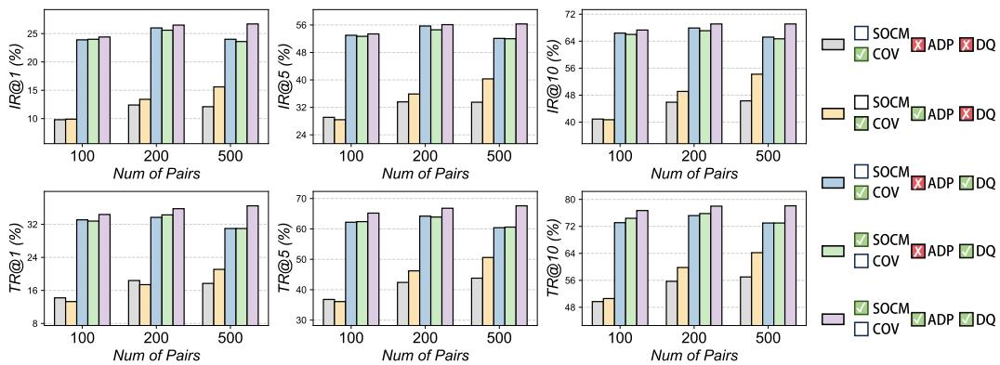  
Figure 4: Component-wise ablation on Flickr30K with NFNet+BERT. We compare centered covariance (COV) and SOCM under different configurations of asymmetric dual projection (ADP) and dynamic model queue (DQ).

Table 4: Effects of asymmetric dual projection (ADP) during distillation and downstream training on Flickr30K with 500 synthetic pairs. Original denotes the CovMatch projection design. Results use the controlled ablation setting, and mR averages the six retrieval metrics.
<table><tr><td>Distillation</td><td>Downstream</td><td>IR@1</td><td>IR@5</td><td>IR@10</td><td>TR@1</td><td>TR@5</td><td>TR@10</td><td>mR</td></tr><tr><td>Original</td><td>Original</td><td>12.1</td><td>33.5</td><td>46.3</td><td>17.7</td><td>43.8</td><td>57.0</td><td>35.1</td></tr><tr><td>Original</td><td>ADP</td><td>15.3</td><td>39.1</td><td>52.1</td><td>18.3</td><td>49.3</td><td>62.5</td><td>39.4</td></tr><tr><td>ADP</td><td>Original</td><td>15.4</td><td>37.7</td><td>49.8</td><td>20.8</td><td>45.9</td><td>58.2</td><td>38.0</td></tr><tr><td>ADP</td><td>ADP</td><td>15.6</td><td>40.3</td><td>54.2</td><td>21.1</td><td>50.6</td><td>64.2</td><td>41.0</td></tr></table>

Distillation-Stage Effect of ADP. To distinguish improvements in synthetic-data quality from downstream architectural gains, we independently vary the projection designs during distillation and downstream training. As shown in Table 4, introducing ADP during distillation improves mR from 35.1 to 38.0 and from 39.4 to 41.0 under the two fixed downstream architectures, respectively. These gains across all six retrieval metrics indicate that ADP benefits the distillation process itself, rather than merely providing a stronger downstream model. By introducing alignment in both visual and linguistic spaces, ADP changes the online model training and projected feature-mean constraints that guide synthetic-data optimization. Moreover, under the same ADP architecture, MDA-DD achieves 55.7 mR compared with 41.0 for CovMatch, showing that its performance advantage extends beyond the projection design.

## 4.5 Cross-Architecture Generalization.

Distribution-matching methods align feature-level statistics rather than architecture-specific parameter trajectories, making distilled data less tied to the encoder architecture. Following prior work, we distill with NFNet+BERT and evaluate on alternative image encoders, including ResNet-50 [4] and RegNet [45], with the text encoder held fixed. As detailed in Table 6, MDA-DD consistently outperforms the compared baselines across both architectures.

## 4.6 Computational Efficiency

Table 5 compares the computational costs of trajectory-based and distribution-matching methods. RepBlend incurs substantial overhead from generating and storing expert trajectories, whereas CovMatch and MDA-DD avoid this checkpoint storage. Notably, despite maintaining multiple online models at different training stages, MDA-DD achieves shorter distillation time than CovMatch. Thus, broader model-state supervision need not increase distillation cost.

Table 5: Computational cost on MS-COCO with 100 synthetic pairs (NVIDIA RTX 5090, 32 GB).
<table><tr><td rowspan="2">Method</td><td colspan="2">Expert</td><td>Distill</td></tr><tr><td>storage</td><td>time</td><td>time</td></tr><tr><td>RepBlend</td><td>16.6 GB</td><td>78.6 h</td><td>1.5 h</td></tr><tr><td>CovMatch</td><td>0</td><td>2.0h</td><td>2.8 h</td></tr><tr><td>MDA-DD</td><td>0</td><td>2.0h</td><td>1.3 h</td></tr></table>

Table 6: Cross-modal retrieval performance under alternative image encoder architectures on Flickr30K with 500 synthetic pairs. Results are reported as the mean and standard deviation over 5 independent runs.
<table><tr><td>Backbone</td><td>Method</td><td>IR@1</td><td>IR@5</td><td>IR@10</td><td>TR@1</td><td>TR@5</td><td>TR@10</td></tr><tr><td rowspan="4">ResNet+BERT</td><td>LoRS</td><td> $3 . 3 { \pm } 0 . 2$ </td><td>12.7±0.3</td><td>20.4±0.2</td><td> $6 . 8 { \pm } 0 . 2$ </td><td>19.6±1.3</td><td>31.1±0.3</td></tr><tr><td>RepBlend</td><td> $4 . 2 { \pm } 0 . 2$ </td><td>14.1±0.2</td><td> $2 3 . 6 { \pm } 0 . 6 $ </td><td> $8 . 4 { \pm } 0 . 2$ </td><td> $2 3 . 1 \pm 0 . 8$ </td><td>35.0±1.3</td></tr><tr><td>CovMatch</td><td>10.6±0.8</td><td> $2 9 . 0 { \pm } 1 . 3$ </td><td>41.0±1.2</td><td> $1 3 . 4 \pm 1 . 3$ </td><td> $3 4 . 2 { \pm } 0 . 9$ </td><td> $4 6 . 2 \pm 1 . 4$ </td></tr><tr><td>Ours</td><td> $1 4 . 5 { \pm } 2 . 2$ </td><td> $3 6 . 4 \pm 4 . 6$ </td><td> ${ \bf 4 9 . 1 } \pm 5 . 2$ </td><td> $1 7 . 8 { \pm 2 . 2 }$ </td><td> $4 2 . 2 { \pm } 4 . 5$ </td><td> ${ \pm 4 . 1 \pm 5 . 3 }$ </td></tr><tr><td rowspan="4">RegNet+BERT</td><td>LoRS</td><td>3.5±0.1</td><td>12.6±0.3</td><td>21.1±0.4</td><td>6.8±0.3</td><td> $2 0 . 8 { \pm } 0 . 3$ </td><td> $3 0 . 2 { \pm } 0 . 3 $ </td></tr><tr><td>RepBlend</td><td>3.9±0.2</td><td>13.9±0.3</td><td>24.0±0.6</td><td>7.9±0.3</td><td>24.2±0.3</td><td> $3 6 . 2 \pm 1 . 1$ </td></tr><tr><td>CovMatch</td><td>10.6±0.3</td><td>29.5±0.7</td><td>41.0±0.8</td><td>13.9±0.7</td><td>33.5±1.0 44.8±0.5</td><td></td></tr><tr><td>Ours</td><td>16.1±2.1</td><td>40.6±3.2</td><td>53.8±3.4</td><td> $2 1 . 3 { \pm } 2 . 6$ </td><td>46.5±2.8 59.6±2.9</td><td></td></tr></table>

Table 7: Cross-modal retrieval on LLaVA-CC3M with NFNet+BERT (%). The full-data reference achieves IR@1/5/10 = 23.77/50.95/62.84 and TR@1/5/10 = 24.66/50.82/63.58.
<table><tr><td>Pairs</td><td>Method</td><td>IR@1</td><td>IR@5</td><td>IR@10</td><td>TR@1</td><td>TR@5</td><td>TR@10</td></tr><tr><td></td><td>LoRS</td><td>1.56</td><td>5.33</td><td>8.77</td><td>1.01</td><td>4.04</td><td>6.81</td></tr><tr><td>200</td><td>RepBlend</td><td>3.53</td><td>12.38</td><td>19.33</td><td>4.39</td><td>13.45</td><td>20.18</td></tr><tr><td></td><td>CovMatch</td><td>2.04</td><td>6.95</td><td>12.31</td><td>2.67</td><td>9.46</td><td>14.93</td></tr><tr><td></td><td>MDA-DD</td><td>7.92</td><td>22.29</td><td>32.13</td><td>10.21</td><td>28.54</td><td>39.62</td></tr><tr><td></td><td>LoRS</td><td>1.96</td><td>6.72</td><td>10.55</td><td>1.41</td><td>5.11</td><td>8.51</td></tr><tr><td>500</td><td>RepBlend</td><td>4.45</td><td>15.09</td><td>22.31</td><td>5.14</td><td>14.89</td><td>22.97</td></tr><tr><td></td><td>CovMatch</td><td>3.00</td><td>10.06</td><td>16.07</td><td>3.83</td><td>13.04</td><td>20.14</td></tr><tr><td></td><td>MDA-DD</td><td>8.88</td><td>24.76</td><td>35.09</td><td>10.23</td><td>28.99</td><td>40.06</td></tr></table>

## 4.7 Beyond Curated Benchmarks

We further evaluate MDA-DD on LLaVA-CC3M, using 334K image-text pairs for distillation and a disjoint 10K-pair evaluation set, with identical backbones and optimization settings across methods. As shown in Table 7, MDA-DD outperforms all baselines across six retrieval metrics at both 200 and 500 pairs. Notably, with only 200 pairs, MDA-DD surpasses all 500-pair baselines, suggesting that its multi-state supervision and cross-modal matching design can better utilize limited synthetic data capacity on larger web-sourced corpora.

## 5 Conclusion

We propose MDA-DD, which extends feature matching across models at different training stages through a dynamic staggered queue. Combined with asymmetric dual projection and uncentered second-order cross-modal moment matching, MDA-DD outperforms existing methods on Flickr30K and MS-COCO across synthetic-data budgets. The distilled datasets also achieve improved retrieval performance under alternative visual encoder architectures.

Limitations and Future Work. Despite the strong performance of MDA-DD, current MDD frameworks, including our framework, rely heavily on CLIP-style dual-encoder architectures, which limits their direct applicability to emerging native MLLMs. The dependence on explicit visual encoders also hinders the transferability of distilled datasets to unified autoregressive generation paradigms. In future work, we plan to explore architecture-agnostic distillation strategies for native MLLMs.

## Acknowledgement

This project is supported by the Ministry of Education, Singapore, under the Academic Research Fund Tier 1 (FY2026, WBS: A-8004345-00-00), the National Research Foundation, Singapore, and Cyber Security Agency of Singapore under its National Cybersecurity R&D Programme and CyberSG R&D Cyber Research Programme Office (Award: CRPO-GC1-NTU-002).

## References

[1] Deyu Bo, Songhua Liu, and Xinchao Wang. Understanding Dataset Distillation via Spectral Filtering. In International Conference on Learning Representations, 2026.

[2] Deyu Bo and Xinchao Wang. Beyond soft label: Dataset distillation via orthogonal gradient matching. In IEEE/CVF Conference on Computer Vision and Pattern Recognition, 2026.

[3] Deyu Bo and Xinchao Wang. Efficient multi-modal dataset distillation via analytic parameter matching. In International Conference on Machine Learning, 2026.

[4] Andrew Brock, Soham De, and Samuel L Smith. Characterizing signal propagation to close the performance gap in unnormalized resnets. In International Conference on Learning Representa tions.

[5] Andy Brock, Soham De, Samuel L Smith, and Karen Simonyan. High-performance large-scale image recognition without normalization. In International conference on machine learning, pages 1059–1071. PMLR, 2021.

[6] George Cazenavette, Tongzhou Wang, Antonio Torralba, Alexei A Efros, and Jun-Yan Zhu. Dataset distillation by matching training trajectories. In Proceedings ofthe IEEE/CVF conference on computer vision and pattern recognition, pages 4750–4759, 2022.

[7] Zigeng Chen, Gongfan Fang, Xinyin Ma, Ruonan Yu, and Xinchao Wang. DMax: Aggressive Parallel Decoding for dLLMs. In Neural Information Processing Systems, 2026.

[8] Zigeng Chen, Gongfan Fang, Xinyin Ma, Ruonan Yu, and Xinchao Wang. dParallel: Learnable Parallel Decoding for dLLMs. In International Conference on Learning Representations, 2026.

[9] Justin Cui, Ruochen Wang, Si Si, and Cho-Jui Hsieh. Scaling up dataset distillation to imagenet-1k with constant memory. In International Conference on Machine Learning, pages 6565–6590. PMLR, 2023.

[10] Jacob Devlin, Ming-Wei Chang, Kenton Lee, and Kristina Toutanova. Bert: Pre-training of deep bidirectional transformers for language understanding. In Proceedings of the 2019 conference of the North American chapter of the association for computational linguistics: human language technologies, volume 1 (long and short papers), pages 4171–4186, 2019.

[11] Guodong Ding, Rongyu Chen, and Angela Yao. Condensing action segmentation datasets via generative network inversion. In Proceedings of the Computer Vision and Pattern Recognition Conference, pages 17733–17742, 2025.

[12] Alexey Dosovitskiy, Lucas Beyer, Alexander Kolesnikov, Dirk Weissenborn, Xiaohua Zhai, Thomas Unterthiner, Mostafa Dehghani, Matthias Minderer, Georg Heigold, Sylvain Gelly, et al. An image is worth 16x16 words: Transformers for image recognition at scale. In International Conference on Learning Representations.

[13] Jiawei Du, Yidi Jiang, Vincent YF Tan, Joey Tianyi Zhou, and Haizhou Li. Minimizing the accumulated trajectory error to improve dataset distillation. In Proceedings ofthe IEEE/CVF conference on computer vision and pattern recognition, pages 3749–3758, 2023.

[14] Jiawei Du, Qin Shi, and Joey Tianyi Zhou. Sequential subset matching for dataset distillation. In Thirty-seventh Conference on Neural Information Processing Systems.

[15] Reza Zanjirani Farahani and Masoud Hekmatfar. Facility location: concepts, models, algorithms and case studies. Springer Science & Business Media, 2009.

[16] Shengbin Guo, Hang Zhao, Senqiao Yang, Chenyang Jiang, Yuhang Cheng, Xiangru Peng, Rui Shao, and Zhuotao Tian. Multimodal dataset distillation via phased teacher models. In The Fourteenth International Conference on Learning Representations.

[17] Chao Jia, Yinfei Yang, Ye Xia, Yi-Ting Chen, Zarana Parekh, Hieu Pham, Quoc Le, Yun-Hsuan Sung, Zhen Li, and Tom Duerig. Scaling up visual and vision-language representation learning with noisy text supervision. In International conference on machine learning, pages 4904–4916. PMLR, 2021.

[18] Wei Jin, Lingxiao Zhao, Shichang Zhang, Yozen Liu, Jiliang Tang, and Neil Shah. Graph condensation for graph neural networks. In International Conference on Learning Representations.

[19] Andrej Karpathy and Li Fei-Fei. Deep visual-semantic alignments for generating image descriptions. In Proceedings of the IEEE conference on computer vision and pattern recognition, pages 3128–3137, 2015.

[20] Dmitry Kobak and Philipp Berens. The art of using t-sne for single-cell transcriptomics. Nature communications, 10(1):5416, 2019.

[21] Saehyung Lee, Sanghyuk Chun, Sangwon Jung, Sangdoo Yun, and Sungroh Yoon. Dataset condensation with contrastive signals. In International Conference on Machine Learning, pages 12352–12364. PMLR, 2022.

[22] Yongmin Lee and Hye Won Chung. Covmatch: Cross-covariance guided multimodal dataset distillation with trainable text encoder. In The Thirty-ninth Annual Conference on Neural Information Processing Systems.

[23] Zhe Li, Hadrien Reynaud, Mischa Dombrowski, Sarah Cechnicka, Franciskus Xaverius Erick, and Bernhard Kainz. Video dataset condensation with diffusion models. 2025.

[24] Tsung-Yi Lin, Michael Maire, Serge Belongie, James Hays, Pietro Perona, Deva Ramanan, Piotr Dollár, and C Lawrence Zitnick. Microsoft coco: Common objects in context. In European conference on computer vision, pages 740–755. Springer, 2014.

[25] Yang Liu, Deyu Bo, and Chuan Shi. Graph distillation with eigenbasis matching. In Forty-first International Conference on Machine Learning.

[26] Huimin Lu, Masaru Isonuma, Junichiro Mori, and Ichiro Sakata. Unidetox: Universal detoxification of large language models via dataset distillation. arXiv preprint arXiv:2504.20500, 2025.

[27] Aru Maekawa, Naoki Kobayashi, Kotaro Funakoshi, and Manabu Okumura. Dataset distillation with attention labels for fine-tuning bert. Journal of Natural Language Processing, 32(1):283– 299, 2025.

[28] Aru Maekawa, Satoshi Kosugi, Kotaro Funakoshi, and Manabu Okumura. Dilm: Distilling dataset into language model for text-level dataset distillation. Journal of Natural Language Processing, 32(1):252–282, 2025.

[29] Aaron van den Oord, Yazhe Li, and Oriol Vinyals. Representation learning with contrastive predictive coding. arXiv preprint arXiv:1807.03748, 2018.

[30] Bryan A Plummer, Liwei Wang, Chris M Cervantes, Juan C Caicedo, Julia Hockenmaier, and Svetlana Lazebnik. Flickr30k entities: Collecting region-to-phrase correspondences for richer image-to-sentence models. In Proceedings of the IEEE international conference on computer vision, pages 2641–2649, 2015.

[31] Alec Radford, Jong Wook Kim, Chris Hallacy, Aditya Ramesh, Gabriel Goh, Sandhini Agarwal, Girish Sastry, Amanda Askell, Pamela Mishkin, Jack Clark, et al. Learning transferable visual models from natural language supervision. In International conference on machine learning, pages 8748–8763. PmLR, 2021.

[32] Ahmad Sajedi, Samir Khaki, Ehsan Amjadian, Lucy Z Liu, Yuri A Lawryshyn, and Konstantinos N Plataniotis. Datadam: Efficient dataset distillation with attention matching. In Proceedings of the IEEE/CVF International Conference on Computer Vision, pages 17097–17107, 2023.

[33] Seungjae Shin, Heesun Bae, Donghyeok Shin, Weonyoung Joo, and Il-Chul Moon. Losscurvature matching for dataset selection and condensation. In International Conference on Artificial Intelligence and Statistics, pages 8606–8628. PMLR, 2023.

[34] Peng Sun, Bei Shi, Daiwei Yu, and Tao Lin. On the diversity and realism of distilled dataset: An efficient dataset distillation paradigm. In Proceedings of the IEEE/CVF conference on computer vision and pattern recognition, pages 9390–9399, 2024.

[35] Yefan Tao, Luyang Kong, Andrey Kan, and Laurent Callot. Textual dataset distillation via language model embedding. In Findings of the Association for Computational Linguistics: EMNLP 2024, pages 12557–12569, 2024.

[36] Mariya Toneva, Alessandro Sordoni, Remi Tachet des Combes, Adam Trischler, Yoshua Bengio, and Geoffrey J Gordon. An empirical study of example forgetting during deep neural network learning. In International Conference on Learning Representations.

[37] Michael Tschannen, Alexey Gritsenko, Xiao Wang, Muhammad Ferjad Naeem, Ibrahim Alabdulmohsin, Nikhil Parthasarathy, Talfan Evans, Lucas Beyer, Ye Xia, Basil Mustafa, et al. Siglip 2: Multilingual vision-language encoders with improved semantic understanding, localization, and dense features. arXiv preprint arXiv:2502.14786, 2025.

[38] Laurens Van der Maaten and Geoffrey Hinton. Visualizing data using t-sne. Journal ofmachine learning research, 9(11), 2008.

[39] Kai Wang, Bo Zhao, Xiangyu Peng, Zheng Zhu, Shuo Yang, Shuo Wang, Guan Huang, Hakan Bilen, Xinchao Wang, and Yang You. Cafe: Learning to condense dataset by aligning features. In Proceedings of the IEEE/CVF Conference on Computer Vision and Pattern Recognition, pages 12196–12205, 2022.

[40] Tongzhou Wang, Jun-Yan Zhu, Antonio Torralba, and Alexei A Efros. Dataset distillation.

[41] Ziyu Wang, Yue Xu, Cewu Lu, and Yong-Lu Li. Dancing with still images: Video distillation via static-dynamic disentanglement. In Proceedings ofthe IEEE/CVF Conference on Computer Vision and Pattern Recognition, pages 6296–6304, 2024.

[42] Max Welling. Herding dynamical weights to learn. In Proceedings of the 26th annual international conference on machine learning, pages 1121–1128, 2009.

[43] Xindi Wu, Byron Zhang, Zhiwei Deng, and Olga Russakovsky. Vision-language dataset distillation. Transactions on Machine Learning Research.

[44] Lingao Xiao, Songhua Liu, Yang He, and Xinchao Wang. Unifying dataset pruning and distillation for efficient large-scale compression. In International Conference on Machine Learning, 2026.

[45] Jing Xu, Yu Pan, Xinglin Pan, Steven Hoi, Zhang Yi, and Zenglin Xu. Regnet: Self-regulated network for image classification. IEEE transactions on neural networks and learning systems, 34(11):9562–9567, 2022.

[46] Yue Xu, Zhilin Lin, Yusong Qiu, Cewu Lu, and Yong-Lu Li. Low-rank similarity mining for multimodal dataset distillation. In Forty-first International Conference on Machine Learning.

[47] Beining Yang, Kai Wang, Qingyun Sun, Cheng Ji, Xingcheng Fu, Hao Tang, Yang You, and Jianxin Li. Does graph distillation see like vision dataset counterpart? Advances in Neural Information Processing Systems, 36:53201–53226, 2023.

[48] Zeyuan Yin and Zhiqiang Shen. Dataset distillation via curriculum data synthesis in large data era. Transactions on Machine Learning Research.

[49] Zeyuan Yin, Eric Xing, and Zhiqiang Shen. Squeeze, recover and relabel: Dataset condensation at imagenet scale from a new perspective. Advances in Neural Information Processing Systems, 36:73582–73603, 2023.

[50] Ruonan Yu, Songhua Liu, and Xinchao Wang. Dataset distillation: A comprehensive review. IEEE transactions on pattern analysis and machine intelligence, 46(1):150–170, 2023.

[51] Ruonan Yu, Songhua Liu, and Xinchao Wang. Flash-dd: An ultra parameter-efficient approach to dataset distillation. In European Conference on Computer Vision, 2026.

[52] Ruonan Yu, Songhua Liu, Jingwen Ye, and Xinchao Wang. Teddy: Efficient large-scale dataset distillation via taylor-approximated matching. In European Conference on Computer Vision, pages 1–17. Springer, 2024.

[53] Xiaohua Zhai, Basil Mustafa, Alexander Kolesnikov, and Lucas Beyer. Sigmoid loss for language image pre-training. In Proceedings of the IEEE/CVF international conference on computer vision, pages 11975–11986, 2023.

[54] Xin Zhang, Ziruo Zhang, Jiawei Du, Zuozhu Liu, and Joey Tianyi Zhou. Beyond modality collapse: Representation blending for multimodal dataset distillation. In The Thirty-ninth Annual Conference on Neural Information Processing Systems.

[55] Yuchen Zhang, Tianle Zhang, Kai Wang, Ziyao Guo, Yuxuan Liang, Xavier Bresson, Wei Jin, and Yang You. Navigating complexity: Toward lossless graph condensation via expanding window matching. In Forty-first International Conference on Machine Learning.

[56] Bo Zhao and Hakan Bilen. Dataset condensation with differentiable siamese augmentation. In International Conference on Machine Learning, pages 12674–12685. PMLR, 2021.

[57] Bo Zhao and Hakan Bilen. Dataset condensation with distribution matching. In Proceedings of the IEEE/CVF winter conference on applications of computer vision, pages 6514–6523, 2023.

[58] Bo Zhao, Konda Reddy Mopuri, and Hakan Bilen. Dataset condensation with gradient matching. In International Conference on Learning Representations.

[59] Ganlong Zhao, Guanbin Li, Yipeng Qin, and Yizhou Yu. Improved distribution matching for dataset condensation. In 2023 IEEE/CVF Conference on Computer Vision and Pattern Recognition (CVPR), pages 7856–7865. IEEE Computer Society, 2023.

[60] Yinjie Zhao, Heng Zhao, Bihan Wen, Yew-Soon Ong, and Joey Tianyi Zhou. Video set distillation: Information diversification and temporal densification. arXiv preprint arXiv:2412.00111, 2024.

[61] Letian Zhou, Songhua Liu, and Xinchao Wang. CoDA: From Text-to-Image Diffusion Models to Training-Free Dataset Distillation. In International Conference on Learning Representations, 2026.

## A More Related Work

## A.1 Vision-Language Pre-Training

Our work distills the training data of dual-encoder vision-language models, a paradigm popularized by CLIP [31] and ALIGN [17]. In this architecture, an image encoder and a text encoder independently produce embeddings that are aligned via the InfoNCE objective [29] in a shared space. SigLIP [53] replaces the softmax-based contrastive loss with a per-pair sigmoid loss, improving batch efficiency. All existing multimodal dataset distillation methods [43, 46, 54, 22, 16] operate under this dualencoder setting.

## A.2 Dataset Distillation

Dataset distillation synthesizes a compact training set whose learning signal approximates that of the full dataset [50]. Early meta-learning formulations [40] optimize synthetic pixels through bi-level optimization but are computationally prohibitive.

Gradient matching (DC [58], DCC [21], DSA [56], LCMat [33]) sidesteps the inner loop by aligning single-step gradients, while trajectory matching (MTT [6], TESLA [9], FTD [13], SeqMatch [14]) extends this to multi-step parameter trajectories at the cost of storing dense expert checkpoints. Teddy [52] further improves distillation efficiency through Taylor-approximated matching and a precached pool of weak models. Distribution matching (DM [57], DataDAM [32], CAFE [39], IDM [59], RDED [34], $\mathrm { S R e ^ { 2 } L }$ [49], CDA [48]) takes a different route, directly minimizing the discrepancy between real and synthetic feature distributions. Beyond image-centric settings, dataset distillation has also been studied for text [26, 28], video [41, 11], and graph data [25, 55], where recent studies synthesize compact data by exploiting domain-specific structures, including linguistic generation [35, 27, 8, 7], temporal dynamics [60, 23], and graph spectra [47, 18]. These advances indicate that dataset distillation is evolving from a vision-oriented technique into a general data compression framework, further motivating its extension to multimodal learning. Among existing multimodal efforts, MTT-VL [43] adapts trajectory matching to vision-language data; by contrast, distribution matching provides a more favorable efficiency–quality trade-off and serves as the methodological basis of CovMatch [22] and our method. We follow this paradigm but address challenges specific to multimodal settings: cross-modal alignment between heterogeneous feature spaces, dimensional asymmetry between encoders, and the lack of discrete class labels that can serve as alignment anchors.

## A.3 Trajectory-Based Multimodal Distillation

Trajectory-based methods extend MTT to vision-language models by matching expert parameter trajectories across both encoder branches. Given a real dataset $\tau ,$ an expert trajectory $\bar { \tau } ^ { * } \stackrel { \textstyle \cdot } { = } \{ \Theta _ { t } ^ { * } \} _ { t = 0 } ^ { T }$ is pre-computed by training a vision-language model with the symmetric InfoNCE loss (Eq. 1), where $\Theta _ { t } ^ { \ast } = ( \Theta _ { \mathrm { i m g } , t } ^ { \ast } , \Theta _ { \mathrm { t x t } , t } ^ { \ast } )$ . A student model initialized from an expert checkpoint $\hat { \Theta } _ { s } = \Theta _ { s } ^ { * }$ is then trained on the synthetic data $s$ for $R ^ { \prime }$ inner steps, and the synthetic data is updated by minimizing the bi-modal trajectory discrepancy:

$$
{ \mathcal { L } } _ { \mathrm { b i \cdot t r a j } } = { \frac { \| \hat { \Theta } _ { \mathrm { i m g } , s + R ^ { \prime } } - \Theta _ { \mathrm { i m g } , s + R } ^ { * } \| ^ { 2 } } { \| \Theta _ { \mathrm { i m g } , s } ^ { * } - \Theta _ { \mathrm { i m g } , s + R } ^ { * } \| ^ { 2 } } } + { \frac { \| \hat { \Theta } _ { \mathrm { t x t } , s + R ^ { \prime } } - \Theta _ { \mathrm { t x t } , s + R } ^ { * } \| ^ { 2 } } { \| \Theta _ { \mathrm { t x t } , s } ^ { * } - \Theta _ { \mathrm { t x t } , s + R } ^ { * } \| ^ { 2 } } } ,\tag{14}
$$

where R is the expert matching horizon and $R ^ { \prime }$ is the student unrolling horizon. Representative methods include MTT-VL, which provides the first baseline; LoRS [46], which jointly optimizes a soft label similarity matrix alongside the synthetic image-text pairs and applies low-rank decomposition to this matrix to reduce computational cost; and RepBlend [54], which freezes both encoders and blends real and synthetic representations. Despite these refinements, all trajectory-based methods require a full pre-training run to produce the expert trajectory, which is precisely the cost that distillation aims to avoid. As shown in Table 5, RepBlend incurs 16.6 GB of expert storage and 78.6 hours of expert training, compared with zero additional storage and 2.0 hours for distribution-based methods including ours. More recently, APM [3] proposed an efficient multimodal dataset distillation framework that matches analytically estimated projection parameters, reducing the computational and storage overhead associated with conventional trajectory-based methods.

## B t-SNE Visualization

This section describes the procedure used to generate the t-SNE visualization in Figure 2 [38].

Feature Extraction. We instantiate a CLIPModel (NFNet image encoder + BERT text encoder) with pre-trained weights under a random seed distinct from those used during distillation; all parameters are frozen. For each method (Real Data, CovMatch, MDA-DD), we extract image embeddings $\mathbf { e } _ { v } ^ { i } = f _ { v } ( \tilde { \mathbf { x } } _ { v } ^ { i } ; \boldsymbol { \theta } _ { v } ) \in \mathbb { R } ^ { d _ { v } }$ without projection or normalization, and text embeddings $\mathbf { z } _ { l } ^ { i } = \mathbf { W } _ { l } ^ { \uparrow } \cdot f _ { l } ( \tilde { \mathbf { x } } _ { l } ^ { i } ; \boldsymbol { \theta } _ { l } ) \in \mathbb { R } ^ { d _ { v } }$ , projected into the visual space for direct comparison.

Joint t-SNE Reduction. All image and text embeddings from the three configurations are concatenated into a single matrix $\mathbf { X } \in \mathbb { R } ^ { 6 N \times d _ { v } } ( 2$ modalities $\times \ 3$ methods $\times \textit { N }$ pairs) and jointly reduced by a single t-SNE instance to $\mathbf { X } _ { \mathrm { 2 D } } ~ \in ~ \mathbb { R } ^ { 6 N \times 2 }$ . Joint reduction is essential because all embeddings are extracted by the same model and reside in the same high-dimensional space; reducing them simultaneously preserves their relative proximity. We set the perplexity to 50 and use PCA initialization [20].

Observations. As shown in Figure 2(a), real-data embeddings form two well-spread, spatially interleaved clusters with strong cross-modal alignment. CovMatch exhibits two pathologies: a subset of text embeddings collapses into an isolated region far from both main clusters, consistent with the initialization overfitting analyzed in Section 3.1. The embeddings produced by MDA-DD distribute similarly to real data, with both modalities well-spread and interleaved, confirming that initialization overfitting is effectively alleviated.

## C Proofs and Derivations

## C.1 Matrix Form Equivalence of SOCM (Eq. 11)

Let $\mathbf { E } _ { v } ~ \in ~ \mathbb { R } ^ { n \times d _ { \tau } }$ and $\mathbf { E } _ { l } ~ \in ~ \mathbb { R } ^ { n \times d _ { l } }$ be obtained by stacking $\mathbf { e } _ { v } ^ { i }$ and $\mathbf { e } _ { l } ^ { i }$ row-wise. Then $\begin{array} { r } { \frac { 1 } { n } \sum _ { i = 1 } ^ { n } \mathbf { e } _ { v } ^ { i } ( \mathbf { e } _ { l } ^ { i } ) ^ { \top } = \frac { 1 } { n } \mathbf { E } _ { v } ^ { \top } \mathbf { E } _ { l } } \end{array}$

The $( p , q )$ -th entry of $\begin{array} { r } { \mathbf { E } _ { v } ^ { \top } \mathbf { E } _ { l } \mathrm { \ i s \ } \sum _ { i = 1 } ^ { n } [ \mathbf { e } _ { v } ^ { i } ] _ { p } [ \mathbf { e } _ { l } ^ { i } ] _ { q } . } \end{array}$ , which equals the $( p , q )$ -th entry of $\Sigma _ { i = 1 } ^ { n } { \bf e } _ { v } ^ { i } ( { \bf e } _ { l } ^ { i } ) ^ { \top }$ Since this holds for all $( p , q )$ , dividing by n yields the result.

## C.2 SOCM Decomposition (Eq. 12)

Let $\begin{array} { r } { \pmb { \mu _ { v } } = \frac { 1 } { n } \sum _ { i } \mathbf { e } _ { v } ^ { i } , \pmb { \mu _ { l } } = \frac { 1 } { n } \sum _ { i } \mathbf { e } _ { l } ^ { i } } \end{array}$ , and $\begin{array} { r } { { \bf C } = \frac { 1 } { n } \sum _ { i } ( { \bf e } _ { v } ^ { i } - { \pmb \mu } _ { v } ) ( { \bf e } _ { l } ^ { i } - { \pmb \mu } _ { l } ) ^ { \top } } \end{array}$ . Then $\mathbf { M } _ { \theta } ( \mathcal { D } ) = \mathbf { C } + \mu _ { v } \pmb { \mu } _ { l } ^ { \top }$ Substituting $\mathbf e _ { v } ^ { i } = \bar { \mathbf e } _ { v } ^ { i } + \boldsymbol { \mu } _ { v }$ and $\mathbf { e } _ { l } ^ { i } = \bar { \mathbf { e } } _ { l } ^ { i } + \mu _ { l }$ into the SOCM definition and expanding:

$$
\begin{array} { l } { { \displaystyle { \bf M } _ { \theta } ( { \mathcal D } ) = \frac { 1 } { n } \sum _ { i = 1 } ^ { n } ( \bar { \bf e } _ { v } ^ { i } + { \boldsymbol \mu } _ { v } ) ( \bar { \bf e } _ { l } ^ { i } + { \boldsymbol \mu } _ { l } ) ^ { \top } } \ ~ } \\ { { \displaystyle = \underbrace { \frac { 1 } { n } \sum _ { i } \bar { \bf e } _ { v } ^ { i } ( \bar { \bf e } _ { l } ^ { i } ) ^ { \top } } _ { \mathrm { c } } + \underbrace { \frac { 1 } { n } \Big ( \sum _ { i } \bar { \bf e } _ { v } ^ { i } \Big ) { \boldsymbol \mu } _ { l } ^ { \top } } _ { = { \bf 0 } } + \underbrace { { \boldsymbol \mu } _ { v } \frac { 1 } { n } \Big ( \sum _ { i } \bar { \bf e } _ { l } ^ { i } \Big ) ^ { \top } } _ { = { \bf 0 } } + { \boldsymbol \mu } _ { v } { \boldsymbol \mu } _ { l } ^ { \top } } . } \end{array}\tag{15}
$$

The cross terms vanish because $\begin{array} { r } { \sum _ { i } \bar { \mathbf e } _ { v } ^ { i } = \sum _ { i } \bar { \mathbf e } _ { l } ^ { i } = \mathbf { 0 } } \end{array}$ by definition of centering.

This decomposition shows that SOCM incorporates both the centered cross-modal covariance and the mean outer product within a single matrix. Matching the raw moment therefore preserves their combined contribution without requiring explicit mean-centering.

## C.3 Approximation Analysis of the Staggered Model Queue (Eq. 6→Eq. 7)

We analyze how the staggered queue approximates a model-state matching objective. The analysis first considers a fixed synthetic dataset and then distinguishes ideal stratified sampling from the deterministic training ages used by the actual queue.

Loss and boundedness. For a fixed synthetic dataset S, define the matching loss under model state θ as

$$
\begin{array} { r l } & { g _ { \mathcal { S } } ( \boldsymbol { \theta } ) = \left\| \mathbf { M } _ { \boldsymbol { \theta } } ( \mathcal { S } ) - \rho \mathbf { M } _ { \boldsymbol { \theta } } ( \mathcal { T } ) \right\| _ { F } ^ { 2 } } \\ & { \qquad + \lambda \bigg ( \left\| \bar { \mathbf { z } } _ { v , \boldsymbol { \theta } } ^ { \mathcal { S } } - \bar { \mathbf { z } } _ { v , \boldsymbol { \theta } } ^ { \mathcal { T } } \right\| _ { 2 } ^ { 2 } + \left\| \bar { \mathbf { z } } _ { l , \boldsymbol { \theta } } ^ { \mathcal { S } } - \bar { \mathbf { z } } _ { l , \boldsymbol { \theta } } ^ { \mathcal { T } } \right\| _ { 2 } ^ { 2 } \bigg ) . } \end{array}\tag{16}
$$

Assume that, over the model states under consideration, encoder features satisfy $\| \mathbf { e } _ { v } \| _ { 2 } \leq R _ { v }$ and $\| \mathbf { e } _ { l } \| _ { 2 } \leq R _ { l }$ , while projected features satisfy $\| \mathbf { z } _ { v } \| _ { 2 } \leq Z _ { \tau }$ and $\| \mathbf { z } _ { l } \| _ { 2 } \leq Z _ { l }$ . For $\lambda \geq 0$ , these bounds imply

$$
0 \leq g _ { S } ( \theta ) \leq B ,\tag{17}
$$

where one valid upper bound is

$$
B = ( 1 + | \rho | ) ^ { 2 } R _ { v } ^ { 2 } R _ { l } ^ { 2 } + 4 \lambda ( Z _ { v } ^ { 2 } + Z _ { l } ^ { 2 } ) .\tag{18}
$$

This boundedness condition is an explicit assumption of the analysis, rather than a consequence of network architecture alone.

Training-stage distribution. Let $\Theta _ { a }$ denote the random model state after a real-data training updates, starting from the prescribed pretrained encoder weights. The randomness includes indepen dently initialized projection heads and stochastic training updates. Write $P _ { a }$ for the distribution of $\Theta _ { a }$ and

$$
m ( a ) = \mathbb { E } _ { \theta \sim P _ { a } } [ g _ { S } ( \theta ) ] .\tag{19}
$$

For integer training ages $a \in \{ 0 , \ldots , T _ { \operatorname* { m a x } } - 1 \}$ , consider the stage-averaged objective

$$
\mu _ { \mathrm { s t a g e } } = \frac { 1 } { T _ { \mathrm { m a x } } } \sum _ { a = 0 } ^ { T _ { \mathrm { m a x } } - 1 } m ( a ) .\tag{20}
$$

This corresponds to a model-state distribution obtained by sampling the training age uniformly and then drawing a model state from $P _ { a }$ . It is a specific stage-based distribution and need not coincide with the general target distribution $P ( \Theta )$ in Eq. 6.

## C.3.1 I.i.d. baseline

Suppose $\theta _ { 1 } , \ldots , \theta _ { K }$ are drawn independently from the stage-based distribution. Define

$$
\bar { g } _ { K } ^ { \mathrm { M C } } = \frac { 1 } { K } \sum _ { k = 1 } ^ { K } g _ { S } ( \theta _ { k } ) .\tag{21}
$$

Then $\mathbb { E } [ \bar { g } _ { K } ^ { \mathrm { M C } } ] = \mu _ { \mathrm { s t a g e } }$ . Since $g _ { S } ( \theta _ { k } ) \in [ 0 , B ]$ , Popoviciu’s inequality gives

$$
\mathrm { V a r } [ { \bar { g } } _ { K } ^ { \mathrm { M C } } ] \leq \frac { B ^ { 2 } } { 4 K } .\tag{22}
$$

Consequently, by Cauchy–Schwarz,

$$
\mathbb { E } \big [ | \bar { g } _ { K } ^ { \mathrm { M C } } - \mu _ { \mathrm { s t a g e } } | \big ] \leq \frac { B } { 2 \sqrt { K } } .\tag{23}
$$

Hoeffding’s inequality further yields

$$
\operatorname* { P r } \left( | \bar { g } _ { K } ^ { \mathrm { M C } } - \mu _ { \mathrm { s t a g e } } | \geq \epsilon \right) \leq 2 \exp \left( - \frac { 2 K \epsilon ^ { 2 } } { B ^ { 2 } } \right) .\tag{24}
$$

## C.3.2 Ideal stratified sampling

Assume that K divides $T _ { \mathrm { m a x } }$ and let $\Delta t = T _ { \operatorname* { m a x } } / K$ . Partition the training ages into strata

$$
I _ { k } = \{ ( k - 1 ) \Delta t , \ldots , k \Delta t - 1 \} .\tag{25}
$$

Let H denote the stratum index of a uniformly sampled training age. Each stratum has probability $\operatorname* { P r } ( H = k ) = 1 / K$

Consider an ideal stratified estimator that independently draws one model state from the conditional distribution associated with each stratum. Let

$$
\mu _ { k } = \mathbb { E } [ g _ { S } ( \theta ) \mid H = k ] , \qquad \sigma _ { k } ^ { 2 } = \mathrm { V a r } [ g _ { S } ( \theta ) \mid H = k ] .\tag{26}
$$

The estimator

$$
\bar { g } _ { K } ^ { \mathrm { s t r a t } } = \frac { 1 } { K } \sum _ { k = 1 } ^ { K } g _ { S } ( \theta _ { k } )\tag{27}
$$

is unbiased for $\mu _ { \mathrm { s t a g e } }$ . Because the draws are independent across strata,

$$
\mathrm { V a r } [ \bar { g } _ { K } ^ { \mathrm { s t r a t } } ] = \frac { 1 } { K ^ { 2 } } \sum _ { k = 1 } ^ { K } \sigma _ { k } ^ { 2 } .\tag{28}
$$

By the law of total variance,

$$
\begin{array} { l } { { \displaystyle \mathrm { V a r } [ g _ { \cal S } ( \theta ) ] = \frac { 1 } { K } \sum _ { k = 1 } ^ { K } \sigma _ { k } ^ { 2 } } \ ~ } \\ { { \displaystyle ~ + \frac { 1 } { K } \sum _ { k = 1 } ^ { K } ( \mu _ { k } - \mu _ { \mathrm { s t a g e } } ) ^ { 2 } } . } \end{array}\tag{29}
$$

The between-stratum term is non-negative. Therefore,

$$
\mathrm { V a r } [ \bar { g } _ { K } ^ { \mathrm { s t r a t } } ] \leq \frac { \mathrm { V a r } [ g _ { S } ( \theta ) ] } { K } = \mathrm { V a r } [ \bar { g } _ { K } ^ { \mathrm { M C } } ] .\tag{30}
$$

The inequality is strict when the stratum means differ. Thus, ideal stratification reduces sampling variance by accounting for variation across training stages.

## C.3.3 Approximation by staggered ages

The actual queue differs from ideal stratified sampling because its model ages are determined by the replacement schedule. At steady state, Eq. 7 uses one model from each training-age stratum. For a fixed replacement-cycle offset $r \in \{ 0 , \ldots , \Delta t - 1 \}$ , the ages are

$$
a _ { k } ( r ) = ( k - 1 ) \Delta t + r , \qquad k = 1 , \dots , K .\tag{31}
$$

Let $\theta _ { k } ( r )$ denote the model state at age $a _ { k } ( r )$ , and define

$$
\widehat { \mu } _ { K } ( r ) = \frac { 1 } { K } \sum _ { k = 1 } ^ { K } g _ { S } ( \theta _ { k } ( r ) ) .\tag{32}
$$

For a fixed $s ,$ suppose the model trajectories use independent training randomness, so that the states $\theta _ { k } ( r )$ are independent across models. They need not be identically distributed because their ages differ. The estimator has expectation

$$
\mu _ { r } = \mathbb { E } [ \widehat { \mu } _ { K } ( r ) ] = \frac { 1 } { K } \sum _ { k = 1 } ^ { K } m ( a _ { k } ( r ) ) .\tag{33}
$$

Assume that the expected matching loss varies smoothly across training ages:

$$
| m ( a ) - m ( b ) | \leq L _ { a } | a - b |\tag{34}
$$

for some constant $L _ { a } \ge 0$ . The difference between the staggered-age expectation and the stageaveraged objective satisfies

$$
\begin{array} { c l l } { | \mu _ { r } - \mu _ { \mathrm { s t a g e } } | \leq \displaystyle \frac { L _ { a } } { K \Delta t } \sum _ { k = 1 } ^ { K } \sum _ { a \in I _ { k } } | a _ { k } ( r ) - a | } \\ { \leq \displaystyle \frac { L _ { a } ( \Delta t - 1 ) } { 2 } . } \end{array}\tag{35}
$$

Since the model states are independent under the stated assumption and their losses lie in $[ 0 , B ]$ Hoeffding’s inequality for independent, not necessarily identically distributed, random variables gives

$$
\mathrm { P r } \left( \lvert \widehat { \mu } _ { K } ( r ) - \mu _ { r } \rvert \geq \epsilon \right) \leq 2 \exp \left( - \frac { 2 K \epsilon ^ { 2 } } { B ^ { 2 } } \right) .\tag{36}
$$

Combining this concentration bound with the stage-discretization error yields

$$
\mathbb { E } \big [ | \widehat { \mu } _ { K } ( r ) - \mu _ { \mathrm { s t a g e } } | \big ] \leq \frac { B } { 2 \sqrt { K } } + \frac { L _ { a } ( \Delta t - 1 ) } { 2 } .\tag{37}
$$

The first term represents stochastic variation across independently evolving models, while the second captures the difference between the staggered ages and the stage-averaged objective. Moreover, averaging the expected staggered estimator over a complete replacement cycle gives

$$
{ \frac { 1 } { \Delta t } } \sum _ { r = 0 } ^ { \Delta t - 1 } \mu _ { r } = \mu _ { \mathrm { s t a g e } } .\tag{38}
$$

Thus, the staggered schedule covers all training ages across a complete cycle, although its expectation at any single offset need not equal the stage average.

For the more general target distribution $P ( \Theta )$ in $\mathrm { E q . } 6 ,$ , define the distributional mismatch

$$
\delta _ { P } ( S ) = \left| \mu _ { \mathrm { s t a g e } } - \mathbb { E } _ { \theta \sim P ( \Theta ) } [ g _ { S } ( \theta ) ] \right| .\tag{39}
$$

The corresponding expected approximation error is bounded by

$$
\begin{array} { r l } & { \mathbb { E } \left[ \left| \widehat { \mu } _ { K } ( r ) - \mathbb { E } _ { \theta \sim P ( \Theta ) } [ g _ { S } ( \theta ) ] \right| \right] } \\ & { \qquad \leq \displaystyle \frac { B } { 2 \sqrt { K } } + \frac { L _ { a } ( \Delta t - 1 ) } { 2 } + \delta _ { P } ( S ) . } \end{array}\tag{40}
$$

The mismatch term vanishes when the target distribution is the stage-based distribution defined above.

Dependence and scope. The preceding concentration bounds hold for a fixed synthetic dataset and independently evolving model trajectories. They characterize model-state objective approximation, not convergence of the joint optimization algorithm.

During actual distillation, the synthetic dataset is updated using the active queue. Consequently, the losses evaluated at the adaptively optimized synthetic dataset may be statistically dependent, even when the underlying model trajectories use independent randomness.

More generally, for dependent losses $Y _ { k } = g _ { S } ( \theta _ { k } )$ , the estimator variance satisfies

$$
\begin{array} { l } { { \displaystyle \operatorname { V a r } \left[ \frac { 1 } { K } \sum _ { k = 1 } ^ { K } Y _ { k } \right] = \frac { 1 } { K ^ { 2 } } \sum _ { k = 1 } ^ { K } \operatorname { V a r } [ Y _ { k } ] } } \\ { { \displaystyle ~ + \frac { 2 } { K ^ { 2 } } \sum _ { i < j } \operatorname { C o v } ( Y _ { i } , Y _ { j } ) } . } \end{array}\tag{41}
$$

Thus, a comparable variance rate under dependence requires additional control of the cross-model covariance terms. Such control is not implied solely by staggered replacement or weight decay.

The analysis isolates the benefit of training-stage coverage under explicit sampling and regularity assumptions. The empirical ablations in Section 4.4 and Appendix F further evaluate the effectiveness of the staggered queue in the actual distillation procedure.

## D Implementation of Asymmetric Dual Projection

## D.1 Training and Evaluation Procedures

Algorithm 2 and Algorithm 3 describe the training and evaluation procedures, respectively. During training, the forward pass computes contrastive losses in two complementary subspaces: one pairs raw image features with projected text representations in $\mathbb { R } ^ { d _ { v } }$ , while the other pairs projected image features with raw text representations in $\mathring { \mathbb { R } } ^ { d _ { l } }$ . At evaluation time, the model trained on synthetic data constructs a fused similarity matrix by averaging scores from both projection directions, and retrieval metrics are computed from this fused matrix through top-k selection.

Algorithm 2 Forward Pass with Asymmetric Dual Projection   
Require: Image batch $\{ \mathbf { x } _ { v } ^ { i } \} _ { i = 1 } ^ { B }$ , text batch $\{ ( \mathbf { x } _ { l } ^ { i } , \mathbf { m } ^ { i } ) \} _ { i = 1 } ^ { B }$ , learnable logit-scale parameter ℓ   
Ensure: Contrastive loss $\dot { \mathcal { L } }$   
1: $\mathbf { e } _ { v } ^ { i }  f _ { v } ( \mathbf { x } _ { v } ^ { i } ; \boldsymbol { \theta } _ { v } ) \in \mathbb { R } ^ { d _ { v } } , \quad \forall i$   
2: $\mathbf { e } _ { l } ^ { \bar { i } } \gets f _ { l } ( \mathbf { x } _ { l } ^ { i } , \mathbf { m } ^ { i } ; \theta _ { l } ) \in \mathbb { R } ^ { d _ { l } } , \quad \forall i$   
3: $\mathbf { z } _ { l } ^ { i }  \mathbf { W } _ { l } ^ { \uparrow } \mathbf { e } _ { l } ^ { i } \in \mathbb { R } ^ { d _ { v } }$ {text → visual space}   
4: $\mathbf { z } _ { v } ^ { i }  \mathbf { W } _ { v } ^ { \downarrow } \mathbf { e } _ { v _ { \perp } } ^ { i } \in \mathbb { R } ^ { d _ { l } }$ {image → linguistic space}   
5: $\hat { \mathbf { e } } _ { v } ^ { i }  \mathbf { e } _ { v } ^ { i } / \| \mathbf { e } _ { v } ^ { i } \| _ { 2 } , \quad \hat { \mathbf { z } } _ { l } ^ { i }  \mathbf { \bar { z } } _ { l } ^ { i } / \| \mathbf { z } _ { l } ^ { i } \| _ { 2 } ^ { - }$   
6: $\hat { \mathbf { z } } _ { v } ^ { i }  \mathbf { z } _ { v } ^ { i } / \| \mathbf { z } _ { v } ^ { i } \| _ { 2 } , \quad \hat { \mathbf { e } } _ { l } ^ { i }  \mathbf { e } _ { l } ^ { i } / \| \mathbf { e } _ { l } ^ { i } \| _ { 2 }$   
7: $\mathbf { S } _ { 1 , i j }  \hat { \mathbf { z } } _ { v } ^ { i \top } \hat { \mathbf { e } } _ { l } ^ { j }$ {linguistic space}   
8: $\mathbf { S } _ { 2 , i j }  \hat { \mathbf { e } } _ { v } ^ { i \top } \hat { \mathbf { z } } _ { l } ^ { j }$ {visual space}   
9: $\tau  \exp ( - \ell ) \dot { }$   
10: $\mathcal { L } _ { 1 }  \dot { \mathcal { L } } _ { \mathrm { N C E } } ( \mathbf { S } _ { 1 } ; \tau )$   
11: $\mathcal { L } _ { 2 }  \mathcal { L } _ { \mathrm { N C E } } ( \mathbf { S } _ { 2 } ; \tau )$   
12: $\mathscr { L }  \frac { 1 } { 2 } ( \mathscr { L } _ { 1 } + \mathscr { L } _ { 2 } )$   
13: return $\mathcal { L }$

```latex
Algorithm 3 Similarity Matrix Construction with Asymmetric Dual Projection at Evaluation
Require: Test images $\{ \mathbf { x } _ { v } ^ { i } \} _ { i = 1 } ^ { N _ { I } }$ , test texts $\{ \mathbf { x } _ { l } ^ { j } \} _ { j = 1 } ^ { N _ { T } }$ , trained model $( f _ { v } , f _ { l } , \mathbf { W } _ { l } ^ { \uparrow } , \mathbf { W } _ { v } ^ { \downarrow } , \tau )$
Ensure: Score matrices $\mathbf { S } ^ { i 2 t } \in \mathbb { R } ^ { N _ { I } \times N _ { T } } , \mathbf { S } ^ { t { \dot { 2 } } i } \in \mathbb { R } ^ { N _ { T } \times N _ { I } }$
1: $\hat { \mathbf { e } } _ { v } ^ { i } , \hat { \mathbf { z } } _ { v } ^ { i } \gets \mathrm { N o r m } ( f _ { v } ( \mathbf { x } _ { v } ^ { i } ) )$ , Norm $( \mathbf { W } _ { v } ^ { \downarrow } f _ { v } ( \mathbf { x } _ { v } ^ { i } ) )$ , ∀ i
2: $\hat { \mathbf { e } } _ { l } ^ { j } , \hat { \mathbf { z } } _ { l } ^ { j } \gets \mathrm { N o r m } ( f _ { l } ( \mathbf { x } _ { l } ^ { j } ) )$ , Norm $( \mathbf { W } _ { l } ^ { \uparrow } f _ { l } ( \mathbf { x } _ { l } ^ { j } ) )$ , ∀ j
3: $\begin{array} { r } { \mathbf { R } _ { i j }  \frac { 1 } { 2 \tau } ( \hat { \mathbf { e } } _ { v } ^ { i \top } \hat { \mathbf { z } } _ { l } ^ { j } + \hat { \mathbf { z } } _ { v } ^ { i \top } \hat { \mathbf { e } } _ { l } ^ { j } ) } \end{array}$
4: $\mathbf { S } ^ { i 2 t } \gets \mathrm { \ " { T o p K M a s k } } ( \mathbf { R } , k )$
5: $\mathbf { S } ^ { t 2 i } \gets \mathrm { T o p K M a s k } ( \mathbf { R } ^ { \top } , k )$
6: return $\mathbf { S } ^ { i \widehat { 2 t } } , \mathbf { S } ^ { t 2 i }$
```

## E Comparison Methods

Coreset Selection. Random (Rand) uniformly samples image-text pairs i.i.d. from the full dataset. This unbiased baseline is computationally cheap but ignores sample informativeness, which limits performance at low compression ratios. Herding (Herd) [42] is a greedy algorithm that iteratively selects the sample whose inclusion best approximates the full dataset’s feature mean, minimizing first-order distributional discrepancy. K-Center (K-Cent) [15] is a coverage-based strategy that iteratively picks the point farthest from the current subset, solving an approximate k-center problem to maximize geometric coverage in the feature space. Forgetting (Forget) [36] counts how often each sample transitions from correctly to incorrectly matched during training; low-forgetting (easy) samples are discarded first, retaining the most informative hard examples.

Dataset Distillation. LoRS [46] is a trajectory-matching multimodal distillation method that applies low-rank factorization to the cross-modal similarity matrix, reducing memory and computation while preserving key alignment information. CovMatch [22] is a distribution-matching method that projects both modalities into a shared space and aligns the cross-modal covariance between real and synthetic data, relying on a fixed model initialization for optimization stability. RepBlend [54] is a trajectorymatching method that freezes pretrained encoders and symmetrically matches the trajectories of image and text projection heads, while blending synthetic representations to mitigate modality collapse and enhance intra-modal diversity. PTM-ST [16] is a staged distillation framework with two components. PTM partitions the distillation process into multiple phases with dynamically shifted trajectory-matching intervals, enabling progressive cross-modal knowledge absorption. ST replaces the original high-variance expert trajectory with a smoothed linear interpolation between endpoints, weighted by cumulative distance. Combined with EMA updates, this suppresses gradient oscillation and bridges inter-stage knowledge gaps, improving both distillation stability and retrieval performance.

Table 8: Hyperparameter configurations of MDA-DD on Flickr30K and MS-COCO under varying synthetic budget sizes.
<table><tr><td rowspan="2">Hyperparameter</td><td colspan="3">Flickr30K</td><td colspan="3">MS-COCO</td></tr><tr><td>100</td><td>200</td><td>500</td><td>100</td><td>200</td><td>500</td></tr><tr><td>Scaling factor ρ</td><td>2</td><td>2</td><td>1</td><td>2</td><td>2</td><td>1</td></tr><tr><td>Feature matching weight λ</td><td>0.1</td><td>0.1</td><td>0.5</td><td>0.1</td><td>0.1</td><td>0.5</td></tr><tr><td>Batch size (real)</td><td>128</td><td>128</td><td>128</td><td>128</td><td>128</td><td>128</td></tr><tr><td>Batch size (synthetic)</td><td>一</td><td>一</td><td>200</td><td>一</td><td>一</td><td>200</td></tr><tr><td>Learning rate (image)</td><td>1</td><td>1</td><td>1</td><td>1</td><td>1</td><td>1</td></tr><tr><td>Learning rate (text)</td><td>1</td><td>1</td><td>1</td><td>1</td><td>1</td><td>1</td></tr><tr><td>Iterations</td><td>1000</td><td>1000</td><td>1000</td><td>1000</td><td>1000</td><td>1000</td></tr><tr><td>Number of models in queue K</td><td>8</td><td>8</td><td>8</td><td>8</td><td>8</td><td>8</td></tr><tr><td>Maximum model lifetime  $T _ { \mathrm { m a x } }$ </td><td>200</td><td>200</td><td>200</td><td>200</td><td>200</td><td>200</td></tr></table>

Table 9: Network architectures and parameter counts.
<table><tr><td>Architecture</td><td>Model Variant</td><td>Parameter Count</td></tr><tr><td>NFNet [5]</td><td>nfnet_10</td><td>26.4M</td></tr><tr><td>NF-ResNet [4]</td><td>nf_resnet50</td><td>25.6M</td></tr><tr><td>NF-RegNet [45]</td><td>nf_regnet_b1</td><td>21.0M</td></tr><tr><td>ViT [12]</td><td>vit_base_patch16_224</td><td>85.8M</td></tr><tr><td>BERT [10]</td><td>bert-base-uncased</td><td>110.0M</td></tr></table>

## F Additional Ablation Studies

## F.1 Component-Wise Contribution

Baseline reproduction. To ensure a fair comparison, we re-run CovMatch under identical hardware and optimization settings as MDA-DD. All experiments in this ablation use a single NVIDIA RTX 5090 (32 GB). We set the following CovMatch hyperparameters to match those of our method and its ablated variants: inner-loop iterations (50), outer-loop iterations (200), synthetic batch size, feature-matching weight λ, and scaling factor $\rho .$ The remaining architecture-level settings (image encoder, text encoder, image resolution, and synthetic budget N) are also kept consistent with the main experiments (Table 8). This controlled setup isolates the effect of each proposed component, namely the model-distribution-aware objective (§3.1), asymmetric dual projection (§3.2), and the SOCM statistic (§3.3), from confounding factors such as hardware differences or hyperparameter tuning.

## F.2 Cross-Architecture Generalization

Network architectures. Table 9 lists all models used in our experiments. The image encoders are NFNet, NF-ResNet, NF-RegNet, and ViT; the text encoder is BERT throughout.

Cross-architecture evaluation. Table 10 reports the full cross-architecture results on Flickr30K with 100 synthetic pairs. All methods perform distillation using NFNet+BERT and are evaluated on unseen image encoders (NF-ResNet50, NF-RegNet-B1, ViT-B/16) while keeping the text encoder fixed. Trajectory-based methods (MTT-VL, LoRS, RepBlend) generally perform below random selection on image-retrieval metrics, indicating limited transferability across visual encoders. In contrast, MDA-DD consistently outperforms the compared methods across all six retrieval metrics, achieving approximately 2.7–2.8× the IR@1 of CovMatch across the three unseen architectures. These results demonstrate improved cross-architecture retrieval performance with synthetic data distilled using MDA-DD.

Table 10: Cross-architecture evaluation on Flickr30K with $N = 1 0 0$ synthetic pairs. All methods are distilled with NFNet+BERT and evaluated on unseen image encoders.
<table><tr><td>Backbone</td><td>Method</td><td>IR@1</td><td>IR@5</td><td>IR@10</td><td>TR@1</td><td>TR@5</td><td>TR@10</td></tr><tr><td rowspan="5">ResNet+BERT</td><td>Random</td><td>2.2</td><td>8.0</td><td>13.4</td><td>3.0</td><td>10.1</td><td>16.4</td></tr><tr><td>MTT-VL</td><td>1.8</td><td>7.0</td><td>11.9</td><td>2.9</td><td>10.5</td><td>16.4</td></tr><tr><td>LoRS</td><td>1.6</td><td>7.0</td><td>12.1</td><td>2.9</td><td>11.1</td><td>18.0</td></tr><tr><td>RepBlend</td><td>1.2</td><td>5.3</td><td>9.7</td><td>4.1</td><td>11.2</td><td>18.9</td></tr><tr><td>CovMatch Ours</td><td>4.7 13.3</td><td>15.4</td><td>23.4</td><td>5.5</td><td>17.3</td><td>26.6</td></tr><tr><td rowspan="6">RegNet+BERT</td><td></td><td></td><td>35.4</td><td>47.3</td><td>13.6</td><td>33.8</td><td>47.0</td></tr><tr><td>Random</td><td>2.2</td><td>7.6</td><td>12.4</td><td>2.6</td><td>9.7</td><td>15.3</td></tr><tr><td>MTT-VL</td><td>1.5</td><td>6.0</td><td>10.6</td><td>2.9</td><td>9.2</td><td>15.0</td></tr><tr><td>LoRS</td><td>1.6 1.8</td><td>6.4 6.8</td><td>11.2 11.1</td><td>2.5</td><td>11.0</td><td>17.7</td></tr><tr><td>RepBlend CovMatch</td><td>3.9</td><td>13.8</td><td>21.7</td><td>3.2 5.6</td><td>14.0 16.8</td><td>21.0</td></tr><tr><td>Ours</td><td>10.8</td><td>29.6</td><td>42.7</td><td>12.2</td><td>29.9</td><td>26.0 43.1</td></tr><tr><td rowspan="6">ViT+BERT</td><td>Random</td><td>2.8</td><td>9.3</td><td></td><td></td><td></td><td></td></tr><tr><td>MTT-VL</td><td>2.1</td><td></td><td>15.1</td><td>4.2</td><td>13.3</td><td>19.8</td></tr><tr><td>LoRS</td><td>2.0</td><td>7.8 7.3</td><td>13.1</td><td>3.9</td><td>12.2</td><td>18.6</td></tr><tr><td>RepBlend</td><td>2.4</td><td>9.5</td><td>12.7 15.3</td><td>3.2 4.8</td><td>11.7 16.6</td><td>19.0</td></tr><tr><td>CovMatch</td><td>3.7</td><td>13.5</td><td>21.7</td><td>5.2</td><td>18.6</td><td>23.9</td></tr><tr><td>Ours</td><td>9.9</td><td>30.6</td><td>43.8</td><td>13.0</td><td>33.7</td><td>28.0 45.9</td></tr></table>

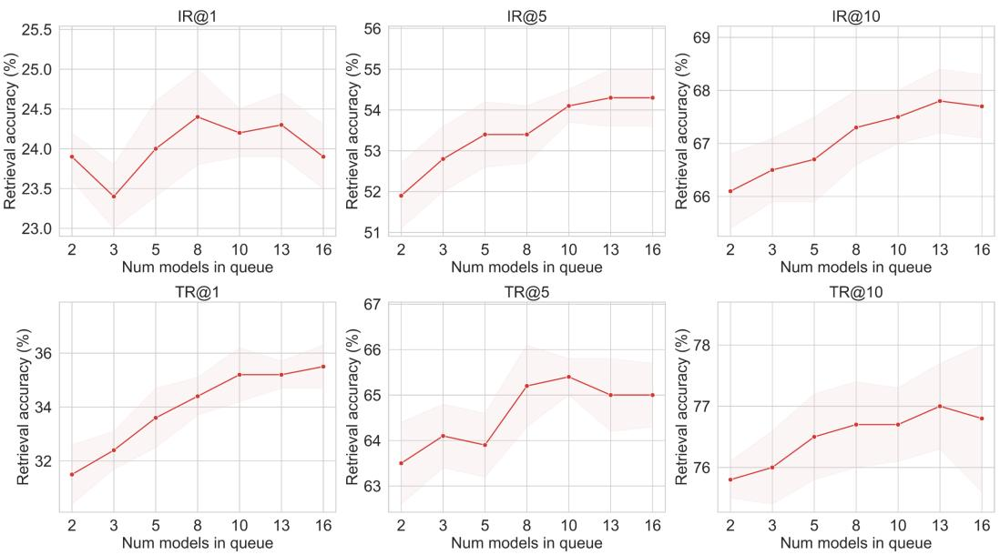  
Figure 5: Effect of queue size K on cross-modal retrieval performance $( { \mathrm { F l i c k r } } 3 0 \mathrm { K }$ , 100 synthetic pairs). Performance improves steadily up to $K = 8$ and saturates beyond $K = 1 0$

## F.3 Sensitivity Analysis

Effect of queue size K. Figure 5 reports retrieval performance on Flickr30K with 100 synthetic pairs as a function of the queue size $( K \in \{ 2 , 3 , 5 , 8 , 1 0 , 1 3 , 1 6 \} )$ , with all other hyperparameters held fixed. All six metrics improve consistently as K increases from 2 to 8, with further marginal gains at $K = 1 0$ on certain metrics such as IR@5 and TR@1. This trend agrees with the theoretical expectation from Appendix C.3: a larger queue improves coverage of the model-state distribution $P ( \Theta )$ , thereby narrowing the approximation gap between the particle objective (Eq. 7) and the distributional objective (Eq. 6). Beyond $K = 1 0$ , performance saturates or slightly decreases on several metrics, indicating diminishing returns from additional particles. Since $\bar { K } { = } 8$ and $K = 1 0$ yield comparable accuracy while larger queues incur proportionally higher GPU memory and per-iteration cost, we adopt $K = 8$ as the default to balance performance and efficiency.

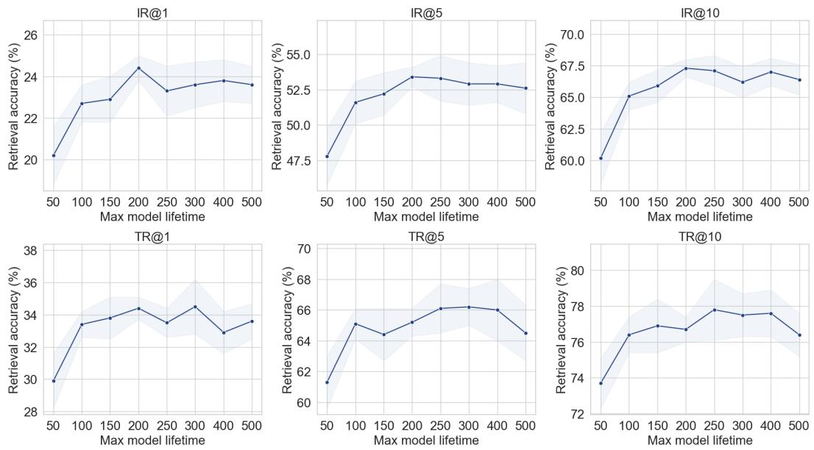  
Figure 6: Effect of model lifetime $T _ { \mathrm { m a x } }$ on cross-modal retrieval performance (Flickr30K, 100 synthetic pairs). The optimum lies around $T _ { \mathrm { m a x } } { = } 2 0 0 { - } 2 5 0$

Table 11: Cross-modal retrieval performance with 50 synthetic pairs (0.2% of Flickr30K, 0.4‰ of MS-COCO). Results are reported as mean ± standard deviation over 5 independent runs.
<table><tr><td>Dataset</td><td>Pairs</td><td>Ratio</td><td>Method</td><td>IR@1</td><td>IR@5</td><td>IR@10</td><td>TR@1</td><td>TR@5</td><td>TR@10</td></tr><tr><td rowspan="3">Flickr30K</td><td rowspan="3">50</td><td rowspan="3">0.2%</td><td>RepBlend</td><td> $7 . 5 { \pm } 0 . 5$ </td><td> $2 4 . 8 { \pm } 1 . 1$ </td><td> $3 6 . 0 { \scriptstyle \pm 1 . 7 }$ </td><td> $1 2 . 5 { \pm } 0 . 5 $ </td><td> $3 4 . 7 { \scriptstyle \pm 0 . 7 }$ </td><td> $4 8 . 4 \pm 0 . 8$ </td></tr><tr><td>CovMatch</td><td> $7 . 8 { \pm } 0 . 2$ </td><td> $2 3 . 8 { \pm } 0 . 5$ </td><td> $3 5 . 0 { \pm } 0 . 3 $ </td><td> $1 1 . 5 { \pm } 0 . 3 $ </td><td> $3 1 . 8 { \pm } 1 . 3$ </td><td> $4 4 . 2 \pm 1 . 1$ </td></tr><tr><td>Ours</td><td> $2 { \bf 0 . 5 } \pm 1 . 0$ </td><td>49.4±0.8</td><td> ${ \bf 6 3 . 8 \pm 0 . 6 }$ </td><td> ${ \bf 3 0 . 6 { \pm } } 0 . 5$ </td><td> ${ \bf 6 0 . 0 \mathrm { _ { \pm 0 . 7 } } }$ </td><td> $7 1 . 8 { \pm } 1 . 0$ </td></tr><tr><td rowspan="3">MS-COCO 50</td><td rowspan="3"></td><td rowspan="3"> $0 . 4 \text{‰}$ </td><td>RepBlend</td><td>3.0±0.2</td><td>10.9±0.4</td><td> $1 8 . 6 { \pm } 0 . 6 $ </td><td> $4 . 4 { \pm } 0 . 2$ </td><td> $1 5 . 6 { \pm } 0 . 3 $ </td><td> $2 4 . 7 { \pm } 0 . 4$ </td></tr><tr><td>CovMatch</td><td> $2 . 3 { \pm } 0 . 1$ </td><td>8.6±0.2</td><td> $1 4 . 8 { \pm } 0 . 4$ </td><td> $2 . 8 { \pm } 0 . 2$ </td><td> $1 0 . 3 { \pm } 0 . 4 $ </td><td> $1 6 . 8 { \pm } 0 . 6 $ </td></tr><tr><td>Ours</td><td> ${ \bf 5 . 0 \pm 0 . 4 }$ </td><td>16.5±0.8</td><td> ${ 2 6 . 0 \pm 1 . 1 }$ </td><td> $7 . 7 { \pm } 0 . 3$ </td><td> $2 2 . 7 \pm 0 . 9$ </td><td> $3 3 . 8 { \pm } 1 . 0$ </td></tr></table>

Effect of model lifetime $T _ { \mathrm { m a x } } .$ Figure 6 shows retrieval performance on Flickr30K with 100 synthetic pairs as $T _ { \mathrm { m a x } }$ varies from 50 to 500. Performance rises sharply from 50 to 200, peaks around $T _ { \mathrm { m a x } } = 2 0 0 { - } 2 5 0$ across most metrics (e.g., IR@1 reaches 24.5% at 200), and plateaus or slightly declines beyond 300. Too short a lifetime limits the training-stage coverage of each particle, reducing the diversity of model states in the queue. Too long a lifetime causes particles to drift into late-training regimes where the feature geometry changes slowly, diminishing the informational gain from queue refreshes. We set $T _ { \mathrm { m a x } } { = } 2 0 0$ as the default, as it provides sufficient training-stage diversity while maintaining frequent queue renewal.

## G Distillation under Alternative Budget Settings

Extreme compression with 50 synthetic pairs. Table 11 evaluates performance under an extreme compression setting using only 50 synthetic image-text pairs (0.2% of Flickr30K, 0.4‰ of MS-COCO). At this budget, both RepBlend and CovMatch produce comparable yet modest results on Flickr30K (7–8 IR@1). MDA-DD, by contrast, reaches 20.5 IR@1 and 30.6 TR@1, outperforming the strongest baseline by roughly 2.6× and 2.4×, respectively. On MS-COCO, where the compression ratio is even more extreme, MDA-DD achieves 1.67× and 2.17× the IR@1 of RepBlend and CovMatch, respectively. The widening gap at lower budgets suggests that the model-distributionaware objective is particularly effective when each synthetic sample must carry a larger share of the overall training signal.

## H Visualization of Distilled Data

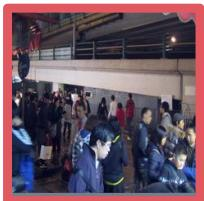  
A busy crowd in a Asian metropolis

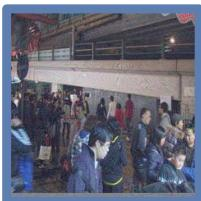  
A busy street in an Asian neighborhood

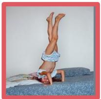  
A small chil doing a handstand on a bed

  
A small boy does handstand on one hand

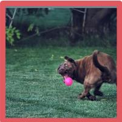  
Brown dog catches a pink ball in park

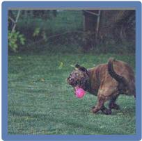  
Brown dog chasing a pink ba

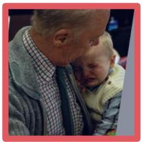  
A child crying in elderly man's arm

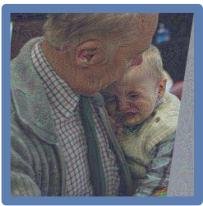  
A baby crying in older man's hand

  
Man looking at computer screen in a lab coa

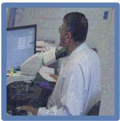  
Man sitting at computer

  
Two old men sit o a park bench

  
Two old men sitting dow

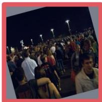  
Many people walk around at nigh

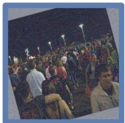  
Several peopl standing outside a dusk

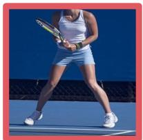  
Woman in a whit shirt and blu shorts playin tennis

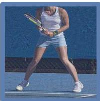  
Woman in a white shirt and bla skirt playing ten

Figure 7: Synthetic image-text pairs on Flickr30K before and after distillation. Red (left): original initialized pairs. Blue (right): distilled pairs produced by MDA-DD.

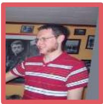  
A man in glasse holding a remote playing vide games

  
A man in glasse with a remote playing video game

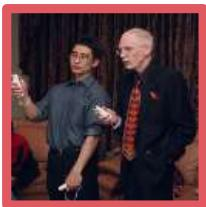  
An image of two men playing video games

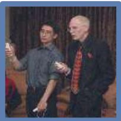  
An image of two people playing video games

  
A baseball playe gets ready to h the bal

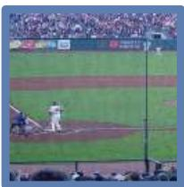  
A baseball play gets ready to hi ball

  
A parked motorcycle towing a four -wheeled cart in front shopping area

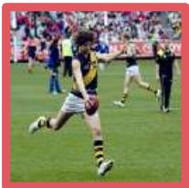

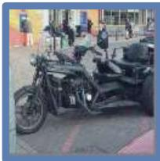  
A group of people playing football a fiel

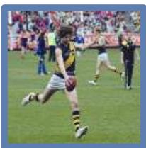  
A group of peopl playing soccer on fiel

  
A group of peopl walking across beach flying kit near the ocean  
A parked motorcycle towing a four-wheeled cart in front shopping area  
A number of people walking on a beach with kit


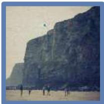  
A pitcher throwin a baseball toward batter  
A pitcher throwin a baseball toward a hitte

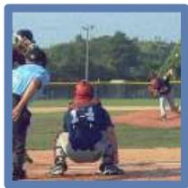

  
A train station w a large clo mounting to it roof

  
A train platfor with a large clo hanging above i  
Figure 8: Synthetic image-text pairs on MS-COCO before and after distillation. Red (left): original initialized pairs. Blue (right): distilled pairs produced by MDA-DD.